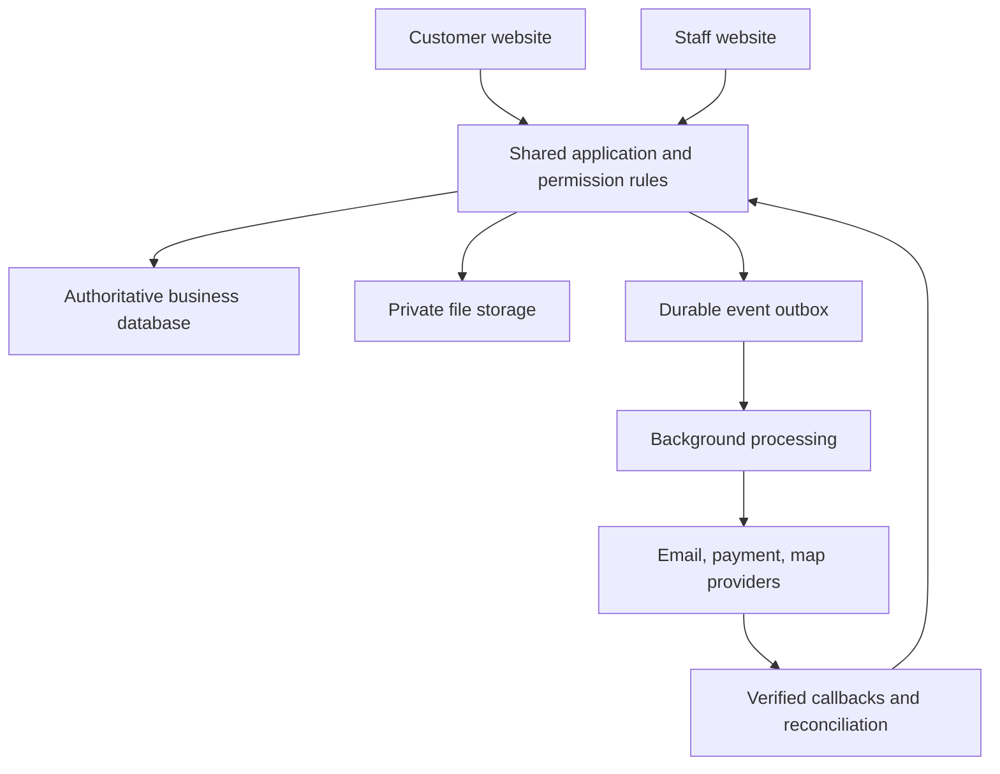

# HandyHub: Customer Website, Staff Website, and Shared Business System

**Detailed functionality requirements and AI implementation guide**  
Version 1.0 · October 11, 2026 · America/New_York  
Status: implementation specification; actual repository and provider configuration require verification

## Read this first

This is a functionality guide for the two HandyHub websites and the system connecting them. Keep the premium design already applied to the website. Extend its existing components to support the workflows in this document; a visual redesign is not part of this task.

The customer's latest instructions supersede conflicting older planning documents:

- **No minimum job charge or automatic minimum-price adjustment.** Price comes from the reviewed project estimate and approved pricing rules.
- **Customer website: English.** Customer notifications, estimates, invoices, and project documents are English at launch.
- **Staff website: English and Spanish.** Staff interface, operational templates, SOPs, and safety guidance support both languages. Safety-critical translations require competent review before operational use.
- **Customers can request an estimate as guests.** Permanent customer accounts are optional. Staff accounts are required and individually assigned.
- **Two websites, one authoritative business system.** Customer and staff views share records, IDs, permissions, transitions, and financial rules.

The plan defines intended behavior. It does not claim that the staging website already implements these features, that any integration is active, or that the business has verified credentials for every catalog service.

### Document map

1. Business scope and priorities
2. AI agent audit and implementation rules
3. Connection architecture and domain responsibilities
4. End-to-end journeys and cross-website updates
5. Customer website functionality
6. Service catalog and service-specific requests
7. Guest request, uploads, confirmation, and recovery
8. Customer identity, optional accounts, and secure access
9. Customer project workspace
10. Staff accounts, roles, and permissions
11. Staff navigation and operational queues
12. Customer, property, and lead management
13. Estimating and approvals
14. Site visits, scheduling, capacity, and assignment
15. Worker job packet and preparation
16. Start-work gates and job execution
17. Offline operation and synchronization
18. Change orders, incidents, and stop-work resolution
19. Quality, closeout, complaints, and return visits
20. Invoices, deposits, payments, and reconciliation
21. Messaging, notifications, and automations
22. Data model and invariants
23. State machines and transitions
24. API contracts, authorization, and concurrency
25. Security, privacy, and lifecycle controls
26. Staff languages, accessibility, and quality targets
27. Testing and requirement traceability
28. Implementation sequence and acceptance gates
29. Migration, release, recovery, and operating procedures
30. Documentation, configuration decisions, and definition of done
31. Technical references and evidence limits
32. Ready-to-use AI coding-agent prompt

## 1. Business scope and priorities

### 1.1 Operating context

HandyHub provides Home Improvement, Drywall, Painting, and Cleaning services in its approved Kentuckiana coverage area across Kentucky and Indiana. The intended business domain is handyhub247.com. The initial field team is two employees; do not assume the owner is a third worker or that two employees form two independent crews for every job.

Pricing is service-specific. Some requests can be estimated remotely; others need a site visit. Deposits apply to larger jobs under an owner-approved policy, with thresholds, amounts, payment timing, and cancellation/refund terms still to configure. Electronic invoices are required; cash and checks must also be recorded and reconciled. A received check is not automatically cleared money.

Keep the existing 26-service catalog as planning scope, but verify which services are actually ready to publish, estimate, schedule, and perform. The catalog does not establish licenses, insurance, worker qualifications, equipment, or applicable local permission.

### 1.2 Product objective

Allow a customer to request help, review an estimate, confirm approved work, see the appointment, communicate, and handle invoices. Allow staff to qualify the request, price it, prepare and assign work, execute with complete instructions, document quality, and reconcile payment. Connect every stage through the same project history.

### 1.3 Requirement conventions

Each requirement uses an `HH-` ID to avoid collisions with earlier documents. **MUST** is required for the described feature to be complete. **SHOULD** is expected unless a documented reason supports deferral. **MAY** is optional.

| Priority | Meaning                                                         | Delivery treatment                                        |
| -------- | --------------------------------------------------------------- | --------------------------------------------------------- |
| P0       | Complete initial operational journey and its essential controls | Required before releasing that journey                    |
| P1       | Repeat-customer convenience and productivity enhancements       | Subsequent slice; never imply it exists before completion |
| P2       | Growth features with higher complexity                          | Design extension points; implement when justified         |

Launch P0 covers request → staff review → estimate → customer approval → scheduling → worker preparation/start/execution → QA → invoice/payment record → closeout, including failure and unauthorized-access cases. A limited public-request release may precede full operations if later customer controls are hidden and a documented staff process handles the requests.

### 1.4 Fixed behavior rules

- **HH-BASE-01 · P0:** Preserve the applied premium design. Add functional states and accessible interactions without an unrelated theme rewrite.
- **HH-BASE-02 · P0:** Remove any minimum-charge logic, minimum-disclosure text, minimum validation, and automatic top-up from new quotes. Do not recalculate or rewrite historical accepted estimates or invoices during this change.
- **HH-BASE-03 · P0:** Provide English customer journeys and EN/ES staff journeys. A staff language change must never change a record's service ID, price, status, quantity, or customer language.
- **HH-BASE-04 · P0:** Do not invent availability, response times, staff biographies, reviews, service credentials, prices, trade eligibility, branches, or 24/7 staffing.
- **HH-BASE-05 · P0:** An inquiry is not a booking; estimate acceptance is not a confirmed appointment; a payment redirect is not proof of paid status; a checked safety box is not proof a site is safe.
- **HH-BASE-06 · P0:** Store approved versions and evidence. Never silently rewrite acceptance, scope, financial records, safety acknowledgments, or incident history.

## 2. AI agent audit and implementation rules

### 2.1 Inspect before editing

The staging URL is `https://handyhub-staging.onrender.com/`. The web reader could not retrieve it during plan preparation. The current stack, functionality, database, and deployed controls are unverified here.

**HH-AUD-01 · P0:** Inspect applicable `AGENTS.md`, README, manifests, lockfiles, routes, schemas/migrations, identity/session code, server permissions, pricing logic, tests, deployment configuration, approved content, and existing design components. Keep secret values out of outputs.

**HH-AUD-02 · P0:** Read available operational documents: requirements, service registry, main plans, pricing, reviewed SOPs, inventories, quality checklists, and service agreements. Apply the latest instructions in this document to the superseded minimum-charge and customer-language rules. Record material conflicts instead of quietly choosing incompatible policies.

**HH-AUD-03 · P0:** Produce a concise gap matrix: requirement ID, current evidence, missing behavior, affected modules/files, data impact, and planned test. Record pre-existing test failures separately. Keep useful working features; extend the current supported stack unless a concrete incompatibility justifies migration.

**HH-AUD-04 · P0:** Implement vertical slices across interface, server rules, persistence, notifications, and verification. Do not finish all screens using fake data and call the platform complete. Test money, authorization, identity linking, versioned approvals, and scheduling concurrency with meaningful behavior tests.

**HH-AUD-05 · P0:** Use synthetic customers and sandbox providers in development. Do not send real customer messages, perform real charges/refunds, publish new content, or migrate production simply because a test requires it. Prepare release-ready changes and follow the user's actual authorization for external actions.

### 2.2 Evidence and decisions

Separate observed implementation, approved business fact, proposed default, assumption, unresolved configuration, and test result. Exact framework versions and provider APIs must be checked against the repository and current official documentation. Existing master requirements inform the platform, but this document is not an exhaustive audit of the full repository.

## 3. Connection architecture and domain responsibilities

### 3.1 The two websites

| Website          | Audience                                                          | Responsibilities                                                                                                       | Data authority                                                 |
| ---------------- | ----------------------------------------------------------------- | ---------------------------------------------------------------------------------------------------------------------- | -------------------------------------------------------------- |
| Customer website | Visitors, guests, registered customers                            | Service discovery, coverage, requests, verified project access, estimates, appointments, messages, documents, invoices | Server is authoritative; browser is a presentation/input layer |
| Staff website    | Owner, office staff, estimators, dispatchers, workers, bookkeeper | Intake/CRM, pricing, scheduling, work preparation/execution, QA, finance, configuration, reporting                     | Uses the same server business records and rules                |

**HH-ARC-01 · P0:** Maintain one authoritative relational business datastore. The two websites must not maintain separate customer/job histories or copy records manually between them. Provider transaction state may have an external authority, but linked business records remain centrally reconciled.

**HH-ARC-02 · P0:** Use a shared application/domain layer with modules for identity, catalog/content, requests/CRM, estimates, appointments, jobs, quality, finance, communication, media, and reporting. Start with a modular application rather than premature microservices.

**HH-ARC-03 · P0:** Server code owns authorization, totals, eligibility, acceptance, capacity, job-start gates, visibility, and transitions. Hiding a button is not permission enforcement.

**HH-ARC-04 · P0:** Return separate customer and staff projections of the same records. Internal notes, access secrets, margin, employee records, incident details, and unrelated attachments must never be sent to a customer browser and merely hidden with CSS.



### 3.2 Domains and sessions

Proposed customer origin: `handyhub247.com`. Proposed staff origin: `staff.handyhub247.com`. These are deployment options; verify ownership, DNS, certificates, and existing routing before using them. They may initially be `/customer` and `/staff` surfaces in the current application.

**HH-ARC-05 · P0:** Distinct websites may be separate frontends/deployments while sharing backend modules and data. They do not require separate databases. Keep business policy in one place; frontend duplication must not create competing calculations.

**HH-ARC-06 · P0:** If using separate origins, prefer same-origin backend gateways for each frontend, communicating with shared backend services. Use host-only cookies and separate customer/staff session contexts. Do not create a broadly scoped shared domain cookie just to make both sites “connected.” Staff authentication is never inherited from customer registration.

**HH-ARC-07 · P0:** For a dedicated cross-origin API, use the selected maintained authentication protocol and exact allowlisted origins/credential rules. Document issuer/audience validation and CSRF/session behavior for that architecture. CORS is not authorization; browsers and integrations still need per-object permission checks. Do not mix session patterns without an architectural decision.

Proposed routes, adjusted to preserve working routes:

| Surface                  | Route                                           | Access                                             |
| ------------------------ | ----------------------------------------------- | -------------------------------------------------- |
| Public services/coverage | `/services/...`, `/service-areas`               | Public, English                                    |
| Request wizard           | `/request-estimate`                             | Guest or customer                                  |
| Verification landing     | `/access/...`                                   | Minimal page; private data only after verification |
| Guest project            | `/project/{reference}`                          | Verified, project-scoped session                   |
| Customer account         | `/account`, `/account/projects`                 | Verified customer account                          |
| Staff sign-in            | `/sign-in` on staff origin, or `/staff/sign-in` | Invite-only staff identity                         |
| Staff operations         | Staff origin modules, or `/staff/...`           | Active role/record-scoped staff session            |
| Shared operations API    | `/api/v1/...` via applicable gateway            | Endpoint-specific permission                       |

References in URLs are identifiers, not access grants. Never include addresses, access codes, customer names, or ordinary long-lived bearer credentials in readable URLs.

### 3.3 Event delivery and update visibility

**HH-ARC-08 · P0:** Record important business mutations and a durable outbox event in the same database transaction. External email/provider failure must not erase a valid request, acceptance, or assignment.

**HH-ARC-09 · P0:** Background consumers deduplicate events, retry safe operations with bounded backoff, expose permanent failures, and reconcile uncertain provider outcomes. Promise at-least-once processing with idempotent effects, not universal “exactly once” delivery.

**HH-ARC-10 · P0:** For launch, refresh affected screens after writes and poll visible status/queues at a modest interval, for example 30–60 seconds, pausing when hidden. Show last refreshed time and stale/error state. Financial/safety actions always fetch authoritative current state before committing. Realtime subscriptions are P1 if justified.

### 3.4 Sources of truth

| Concern                         | Authority                                                          | Consuming screens                               |
| ------------------------------- | ------------------------------------------------------------------ | ----------------------------------------------- |
| Service and availability policy | Approved service registry                                          | Both websites; request router and dispatch      |
| Coverage                        | Approved coverage configuration                                    | Public checker, staff qualification, booking    |
| Customer/contact                | Customer/contact records plus verified identity links              | Request, account, CRM                           |
| Property                        | Property/site record with job-specific snapshot                    | Customer project, staff briefing                |
| Approved scope/price            | Accepted estimate revision and approved change orders              | Customer project, worker packet, invoice        |
| Appointment                     | Committed visit/assignment records                                 | Customer visit screen, dispatch, worker Today   |
| Work progress                   | Valid job/task/hold events                                         | Staff operations and filtered customer timeline |
| Payment                         | Verified transaction/tender evidence and allocation/reconciliation | Invoice and staff finance views                 |
| SOP/hazard controls             | Approved versioned operational content                             | Staff preparation/execution only                |

## 4. End-to-end journeys and cross-website updates

### 4.1 First-time guest

1. Guest selects a service, describes work, supplies general location/photos if useful, selects visit preferences, and submits contact information.
2. Server stores the request and new project/reference. Staff intake immediately sees the same request with contact-verification status.
3. Guest receives a confirmation of receipt and an operational verification/access route. No permanent account is required.
4. Staff qualify coverage/scope. They request missing information or arrange a site visit when needed.
5. Estimator publishes a specific reviewed estimate revision. Guest verifies access and reviews scope, price, exclusions, options, and applicable deposit policy.
6. Guest approves the exact revision. Server creates the unique job/scheduling task or advances the existing one. It does not create a confirmed appointment automatically.
7. Dispatcher commits a date/window and eligible assignments. Guest sees the confirmed visit and preparation instructions.
8. Workers use the shared job packet, readiness checks, SOPs, and execution records. Guest sees a simpler, approved status timeline.
9. Staff complete QA and issue an invoice. Guest pays through configured provider controls or receives recorded cash/check receipts.
10. Guest receives closeout/care information and may optionally create an account to reuse verified projects/properties.

### 4.2 Returning account customer

Sign in → select authorized saved property → request new service → confirm current site/access details → review estimate → schedule → work → invoice. Reusing a property never silently copies expired access codes, outdated occupants/pets, or old hazards as verified current facts.

### 4.3 Staff daily operations

Office staff review new requests and exceptions; estimators review pending information and proposals; dispatcher checks visits, staffing, travel, tools, and readiness; workers prepare assigned jobs and execute approved scope; owner resolves blockers/QA/financial exceptions; bookkeeper reconciles payments and exports financial records.

### 4.4 Cross-website update contract

| Event                 | Staff website effect                                | Customer website effect                    | Failure handling                                        |
| --------------------- | --------------------------------------------------- | ------------------------------------------ | ------------------------------------------------------- |
| Request submitted     | New intake item and project                         | Receipt reference and next steps           | Stored request remains even if confirmation email fails |
| Information requested | Follow-up task linked to project                    | Clear questions and upload/reply action    | Delivery failure becomes staff exception                |
| Estimate published    | Sent/current revision locked against silent changes | Reviewable exact revision                  | Access may be reissued without republishing price       |
| Estimate approved     | Acceptance evidence, job and scheduling task        | Approved scope and “Scheduling next”       | Retry returns same acceptance/job                       |
| Visit confirmed       | Committed capacity and assignment                   | Date/window/preparation                    | Notification failure does not duplicate booking         |
| Visit rescheduled     | Prior/new schedule history                          | Current committed visit and changed notice | Stale requests conflict rather than overwrite           |
| Worker en route       | Travel status and approved arrival update           | En-route text/window if supported          | No fabricated GPS/ETA                                   |
| Work stopped          | Hold, owner alert, timer/task handling              | Appropriate delay/next-step summary        | Internal hazard details stay restricted                 |
| Change order issued   | Current proposed revision and approval state        | Scope/price/time delta with review action  | Old/stale proposal cannot be accepted                   |
| QA completed          | Quality evidence and invoice readiness              | Completion/shared photos/care notes        | Punch items remain visible to appropriate parties       |
| Invoice issued        | Receivable and delivery status                      | Invoice, deposits/payments, balance        | Provider outage gives pending/retry state               |
| Payment verified      | Allocation and reconciliation record                | Accurate receipt/payment state             | Duplicates/reordering cannot double-credit              |
| Complaint opened      | Linked case/action owner                            | Acknowledgment and relevant case updates   | No automatic resolution or lost punch items             |

## 5. Customer website functionality

### 5.1 Discovery and coverage

**HH-CUS-01 · P0:** Present active services in the four established categories. Service CTA preselects the service in the request wizard. “Not sure” lets customers describe the need without selecting an inaccurate service.

**HH-CUS-02 · P0:** Service detail pages explain approved scope, exclusions, estimating inputs, remote/site-review approach, customer preparation, and any relevant limitations. Do not display unconfigured rates or guaranteed duration.

**HH-CUS-03 · P0:** Coverage checker uses the same rules as staff qualification. Return `served`, `needs_review`, or `not_served`. Distinguish area eligibility from date availability. A ZIP spanning boundaries may require exact-address review before appointment confirmation.

**HH-CUS-04 · P0:** County pages exist only for approved coverage and have 2–3 real useful local lines. Leave unverified/thin county pages unpublished. Publishing a page must not automatically expand operational coverage.

**HH-CUS-05 · P0:** Retain functional request/contact controls, verified business contact details, FAQ, genuine portfolio/reviews if available, reviewed privacy/terms, help, and useful not-found/error pages. Customer private routes are excluded from public search/sitemaps and require authorization regardless of indexing settings.

### 5.2 Customer capability matrix

| Capability                     | Unverified visitor                   | Verified guest project session                    | Registered customer account                       |
| ------------------------------ | ------------------------------------ | ------------------------------------------------- | ------------------------------------------------- |
| Browse public services         | Yes                                  | Yes                                               | Yes                                               |
| Submit request                 | Yes                                  | Yes                                               | Yes, with authorized saved details                |
| View existing private project  | No                                   | Granted project only                              | Authorized projects only                          |
| Review/approve estimate        | No                                   | Exact authorized project; sensitive-action checks | Exact authorized project; sensitive-action checks |
| Upload additional photos       | Current request draft only           | Authorized project                                | Authorized project                                |
| Appointment/messages/invoice   | No                                   | Authorized project                                | Authorized project                                |
| Pay invoice                    | No private access by reference alone | Authorized invoice/provider flow                  | Authorized invoice/provider flow                  |
| View history across projects   | No                                   | No automatic cross-project access                 | Verified linked records                           |
| Save/reuse multiple properties | No                                   | No permanent account convenience                  | P1                                                |
| Manage recurring cleaning      | New request only                     | Project-specific communication                    | P1 under configured recurrence policy             |
| Organization collaborators     | No                                   | No                                                | P2 with explicit membership/role grants           |

## 6. Service catalog and service-specific requests

### 6.1 Registry requirements

**HH-SVC-01 · P0:** Each service has stable ID/code, category, slug/aliases, English public description, bilingual staff label, public status, operational eligibility, input schema, estimating method, pricing policy reference, approved SOP/hazard/quality versions, qualification flags, tools/materials, preparation, agreement, and completion evidence.

**HH-SVC-02 · P0:** Separate publication from dispatch readiness. Imported service definitions start in review unless existing evidence proves readiness. Inquiry-only services may be presented accurately if owner-approved; they must not auto-schedule as fully qualified work.

### 6.2 The existing 26 service cards

These names/codes are from the current reconstructed requirements, not newly authorized capabilities. Keep existing production identities and reconcile naming aliases.

| Code  | Category         | Catalog service                         | Extra inputs / review needs                                                              |
| ----- | ---------------- | --------------------------------------- | ---------------------------------------------------------------------------------------- |
| HI-01 | Home Improvement | Picture Hanging & Art Installation      | Count, size/weight, wall type, height, hardware/photos                                   |
| HI-02 | Home Improvement | Barbecue & Grill Cleaning/Maintenance   | Type/model, condition, fuel/power, access, scope                                         |
| HI-03 | Home Improvement | Driveway Pressure Washing               | Surface/area, stains, drainage/water, sensitive surroundings                             |
| HI-04 | Home Improvement | TV Mounting & Wire Hiding               | TV/mount models and weight, substrate, height, cable plan; trade-scope review            |
| HI-05 | Home Improvement | Door Hardware & Smart Locks             | Door/lock model, dimensions, alignment, setup; no credentials in form                    |
| HI-06 | Home Improvement | Gutter Maintenance & Leaf Protection    | Height/length, access, condition, protection request                                     |
| HI-07 | Home Improvement | Attic Insulation                        | Area/access, condition, moisture reports, ventilation/material review                    |
| HI-08 | Home Improvement | Closet & Shelving Installation          | Dimensions, model, substrate, loading, customer items                                    |
| HI-09 | Home Improvement | Trim & Architectural Molding            | Rooms/lengths, profile/material, finish/substrate                                        |
| HI-10 | Home Improvement | Fence Maintenance & Structural Repairs  | Material, dimensions, damaged posts/areas, utility/property questions; structural review |
| HI-11 | Home Improvement | Deck Maintenance & Board Repairs        | Size/height, damaged boards/support reports, access; structural review                   |
| DW-01 | Drywall          | Patching & Repair                       | Damage size/count/cause, moisture, texture, painting inclusion                           |
| DW-02 | Drywall          | Texture Matching & Popcorn Removal      | Area/age if known, prior testing/coatings, occupancy/height; material review             |
| DW-03 | Drywall          | Remodeling & Home Additions             | Plans/areas, demolition and trade dependencies, scope/permit review                      |
| DW-04 | Drywall          | Residential New Construction            | Drawings/quantities, phase, access, contractor/inspection coordination                   |
| PT-01 | Painting         | Residential Interior Painting           | Rooms/surfaces, dimensions/condition, colors, occupancy, trim/ceilings                   |
| PT-02 | Painting         | Deck & Fence Staining/Sealing           | Area/material, previous finish, condition, weather/product                               |
| PT-03 | Painting         | Brick Limewashing & Masonry Coatings    | Masonry/area, condition/moisture, prior coating, product/access                          |
| PT-04 | Painting         | Wallpaper Removal & Surface Restoration | Area/layers/type, substrate, desired finish, concealed damage                            |
| CL-01 | Cleaning         | Routine House Cleaning                  | Size/rooms, frequency, priorities, pets, condition                                       |
| CL-02 | Cleaning         | Deep Cleaning                           | Size/condition, priorities, appliances/add-ons, excluded areas                           |
| CL-03 | Cleaning         | Move-In/Move-Out Cleaning               | Vacancy, utilities, move date, cabinets/appliances, access                               |
| CL-04 | Cleaning         | Post-Construction Cleaning              | Dust/debris, area, trade completion, surfaces, phases                                    |
| CL-05 | Cleaning         | Airbnb Turnover                         | Turnover windows, unit size, linens/supplies, checklist, authorized host                 |
| CL-06 | Cleaning         | Hotel-Style Housekeeping                | Rooms/property, standards/frequency, laundry/supplies/access                             |
| CL-07 | Cleaning         | Air Duct & Ventilation Cleaning         | System/vents, access, contamination reports, specialist equipment/capability             |

PT-04 appears in the current master although absent from the earlier pricing filename list. Verify its pricing, inventory, SOP, agreement, and public/operational status rather than silently dropping it or assuming readiness.

**HH-SVC-03 · P0:** Render relevant questions dynamically. Customer measurements are explicitly reported/unverified, with units. “Unknown” remains unknown; it does not become zero, safe, or approved.

**HH-SVC-04 · P0:** Route remote versus site estimates using reviewed policy and uncertainty. A customer preference for a remote estimate cannot override required site/qualification review. Multiple services become distinct work packages with their own readiness, dependencies, and checklists.

## 7. Guest request, uploads, confirmation, and recovery

### 7.1 Required wizard

**HH-INT-01 · P0:** Guest-first submission requires no permanent registration. Returning customers can sign in without losing current inputs.

| Step            | Fields                                                                             | Validation / behavior                                                      |
| --------------- | ---------------------------------------------------------------------------------- | -------------------------------------------------------------------------- |
| Service         | Category, service, “Not sure,” optional additional services                        | Existing IDs; prefill from service page; group the catalog                 |
| Work details    | Description, service-specific questions, approximate measurements, optional photos | Required core description; units; unknown options; relevant questions only |
| Location/timing | ZIP, city/state if needed; optional address if needed now; visit preferences       | Coverage outcomes; exact address required before confirmed dispatch        |
| Contact         | Name, email, optional phone, channel preference                                    | Normalize/validate; explain operational use; no account enumeration        |
| Review/submit   | Summary, editable answers, terms/privacy notice versions, next-step explanation    | No invented price or confirmed time; explicit submission                   |

Proposed access default: email for secure project verification. Provide a staff-assisted process for customers who cannot use email; a verified phone-access implementation may also be retained or added. Do not fabricate addresses or let unverified phone/email claims access historical records.

**HH-INT-02 · P0:** Preferred visits: **Mornings, Afternoons, Evenings, Weekends, Any time.** These are preferences, not booking slots or promised operating hours. “Any time” excludes other choices. Weekend plus morning/afternoon preferences may coexist if the interface explains the combination. Persist canonical enums.

**HH-INT-03 · P0:** Remote estimate preference, onsite preference, or “Let HandyHub decide” may be offered under policy. Site visits are separate appointment records, with purpose and approved fee rules if applicable. Do not invent a visit fee.

### 7.2 Uploads and drafts

**HH-INT-04 · P0:** Photos are optional unless a particular estimation route needs them. Allow a request followed by a staff request for missing evidence. Warn customers against uploading payment cards, credentials, identification documents, or unrelated private items.

**HH-INT-05 · P0:** Anonymous draft uploads use an expiring capability scoped to that draft. It cannot read old customer records or other drafts. Submitted attachment ownership is bound server-side; consume/rotate draft privileges when finalized.

**HH-INT-06 · P0:** Proposed limits: 10 intake photos, 15 MiB per photo, 20 MiB per permitted PDF; validate real phone-camera use and adjust explicitly. Validate content signatures/type, size, and file count server-side. Quarantine pending scan/conversion. Strip unnecessary location metadata from shared derivatives while retaining evidence only under approved policy.

**HH-INT-07 · P0:** Show per-file progress, processing, ready, failed, retry, and remove states. Failed attachments do not erase the description or completed files. Confirmation accurately shows attachments still pending and how to recover them.

**HH-INT-08 · P0:** Preserve minimal draft fields through normal navigation. Explain saving/expiry/clear behavior. Do not store access secrets or complete sensitive project data in ordinary browser storage. Switching identities must not expose the previous user's draft/cache.

### 7.3 Submission and receipt

**HH-INT-09 · P0:** Validate on client and server. Show inline errors and an accessible error summary; retain fields; focus the error summary. Normalize contact data conservatively, validate units/IDs/enums, and bound free-text length. Do not rewrite customer text to fit a service without retaining the original.

**HH-INT-10 · P0:** Submission uses a scoped idempotency key and durable database transaction. Double taps and timeout retries yield one request. Reusing a key with different content is an explicit conflict. Success appears only after a committed receipt; uncertain outcomes provide a retry/status-recovery route.

**HH-INT-11 · P0:** Rate-limit submissions, verification, upload issuance, and repeated abuse. Use quiet spam controls and an accessible challenge only when needed. Do not block all legitimate guests by requiring permanent accounts.

**HH-INT-12 · P0:** Receipt says the request was received, supplies a non-secret reference, explains review, and distinguishes timing preferences from confirmed appointments. Staff see the new request even if email delivery fails.

**HH-INT-13 · P0:** Contact verification may follow submission. Requests are visibly `contact_unverified` until verified. Staff can review a new request; private customer access and consequential approval require verified ownership. The receipt must not disclose existing-account status or previous projects.

**HH-INT-14 · P0:** After receipt/verification, offer optional account creation to save project history. Declining it does not prevent authorized estimate approval, appointment viewing, messaging, or invoice access for that project.

## 8. Customer identity, optional accounts, and secure access

### 8.1 Customer record is not a login account

**HH-ID-01 · P0:** Create/associate Customer and Contact records for every genuine request. Authentication identities and access grants are separate entities. An account can be linked later without duplicating requests, properties, estimates, invoices, or jobs.

**HH-ID-02 · P0:** Matching email/phone is a candidate match, not unrestricted proof of ownership. Use conservative normalization and explicit verification. Ambiguous/shared contacts enter a staff review queue; never merge customers by name/address alone. Shared household or organization addresses require explicit authority.

**HH-ID-03 · P0:** Do not reveal previous records after a new guest submits an existing email. Attach account access only after verifying the exact contact/grant and legitimate record relationship. Staff-assisted linking captures evidence/reason/actor and cannot rely solely on knowledge of an address or invoice number.

### 8.2 Guest project access

**HH-ID-04 · P0:** Issue high-entropy, hashed-at-rest, expiring, revocable project-access credentials. Each grant identifies project, intended verified contact, permitted actions, creation, expiry, and revocation. A public reference or database ID grants nothing.

**HH-ID-05 · P0:** A link landing displays no private scope, address, financial details, or photos before the verification/exchange is complete. Link-preview crawlers must not consume a credential or approve anything through GET. Completion uses an explicit verified exchange and server-side session.

**HH-ID-06 · P0:** Proposed launch defaults: access invitation expires after 24 hours; verification code lasts 10 minutes with bounded attempts; a single-use session-establishment credential is exchanged for a project-scoped session with 30-minute inactivity and 8-hour absolute expiry. These are configurable engineering defaults, subject to the selected identity solution. Expiry offers safe reissue without losing project state.

**HH-ID-07 · P0:** Use fresh contact verification for approving financial/scope commitments or changing access contacts if the session assurance is stale; proposed freshness limit 15 minutes. Bind approval to verified actor, grant, exact revision, selected options, and displayed total. The server checks expiry/revocation again on the sensitive write.

**HH-ID-08 · P0:** Clean exchanged secrets from the address bar/history where feasible; exclude access pages from analytics, referrer leakage, third-party embeds, and caches. Never log raw tokens/codes. Use maintained identity primitives; do not invent cryptography.

**HH-ID-09 · P0:** Revoked/expired access shows a neutral recovery page, not project information. Reissue uses anti-enumeration wording and rate limits. Project access is limited to that grant even when other projects have the same customer/email.

### 8.3 Optional account registration and recovery

**HH-ID-10 · P0:** Account enrollment verifies the chosen identity, obtains the customer's intent to create an account, and attaches only authorized existing grants/records. Provide a passwordless email sign-in if suitable for the actual stack. Passkeys are P1 if supported; do not build a custom authentication system.

**HH-ID-11 · P0:** Account sessions have logout/revocation, inactivity/absolute expiry, recovery, notification of sensitive contact changes, and safe account linking. Email changes verify both the new contact and authority over the old account, or use a documented recovery process.

**HH-ID-12 · P1:** Customers can name/save properties, set communication preferences, reuse request inputs, and view authorized history. Confirm mutable site/access details per new job. Account closure does not silently delete financial/approval evidence that approved retention policy requires.

**HH-ID-13 · P2:** Organization accounts support explicit membership, property scopes, approval/payment privileges, invites, revocation, and history. Do not grant all employees access merely because they share an email domain.

## 9. Customer project workspace

### 9.1 Required screens

| Screen                 | Information order                                                                               | Actions and conditions                                                            |
| ---------------------- | ----------------------------------------------------------------------------------------------- | --------------------------------------------------------------------------------- |
| Account home           | Projects needing action, confirmed visits, open invoices, recent updates                        | Open authorized project, request another service, manage preferences              |
| Guest project overview | Project reference, service/property label, public status, next step, confirmed visit if any     | Contextual next action; no cross-project history                                  |
| Project details        | Approved scope, relevant exclusions, site/preparation information, shared files                 | Request correction; sensitive contact/property changes reviewed when needed       |
| Estimate               | Revision, work packages, options, exclusions, total, validity, deposit terms                    | Approve exact revision, ask question/request change, decline with optional reason |
| Appointment            | Confirmed purpose/date/window, time zone, preparation, approved team identity if policy permits | Request reschedule/cancel; existing booking remains until changed                 |
| Messages               | Project-scoped thread, send state, permitted attachments                                        | Ask/respond; errors preserve draft; no private staff thread                       |
| Photos/documents       | Explicitly shared assets, meaningful labels, valid access                                       | View/download authorized asset, upload requested evidence                         |
| Invoice/receipt        | Issued invoice, approved line items, payments/credits, due balance, payment state               | Pay via configured provider, download receipt, raise billing question             |
| Completion/help        | Shared after evidence, care notes, punch/return status, support contact                         | Report issue; feedback invitation per policy                                      |

### 9.2 Behavior requirements

**HH-PORT-01 · P0:** All project screens enforce record and field permissions. Guests see only their granted project. Account customers see only explicitly authorized history and properties.

**HH-PORT-02 · P0:** Show one clear next action: provide information, review estimate, await scheduling, review visit, review change, pay invoice, or contact support. Distinguish waiting on customer from waiting on HandyHub.

**HH-PORT-03 · P0:** Show a filtered timeline: received, under review, estimate ready, approved/scheduling, scheduled, underway, paused/update pending, completion review, complete, invoice/payment. Include meaningful timestamps and next steps. Do not expose risk scores, employee notes, or confidential incident descriptions.

**HH-PORT-04 · P0:** Reschedule/cancellation requests record intent and notify staff. They do not silently erase an existing appointment. If self-service confirmed changes are later implemented, they must use the same authoritative capacity/policy checks as dispatch.

**HH-PORT-05 · P0:** A customer cannot change accepted scope through a generic “edit project” form. Changes create a reviewed change request/order. Address changes affecting coverage/travel/readiness require review before dispatch.

**HH-PORT-06 · P0:** Provide explicit empty, loading, expired-session, permission-denied, partial-upload, stale-document, and network-failure states. A failed payment or message is never shown as complete. Polling failure cannot erase the last confirmed appointment.

**HH-PORT-07 · P0:** Show en-route or arrival-window updates only when recorded. Launch does not require live GPS tracking. If GPS is introduced later, specify consent, purpose, work-hour limits, audience, retention, and worker controls before implementing it.

**HH-PORT-08 · P0:** Customer content and notifications remain English regardless of a staff member's language setting. Preserve customer-provided free text in its original language; any translation used internally is labeled and reviewed according to purpose.

## 10. Staff accounts, roles, and permissions

### 10.1 Staff identity

**HH-STAFF-01 · P0:** Require individual, invite-only staff accounts. No shared worker/owner password. Active staff membership is distinct from a customer account. Use MFA for all staff where supported, with enforced strong MFA for privileged roles and a documented recovery path before enforcement.

**HH-STAFF-02 · P0:** Role assignment, role change, recovery, and offboarding are audited. Deactivation immediately blocks new server operations, revokes active sessions/tokens, removes assignments from future capacity where appropriate, and preserves existing work evidence. A stale browser session cannot continue writing after offboarding.

**HH-STAFF-03 · P0:** One person may hold multiple role grants at launch, but capabilities remain explicit. Do not implement “any logged-in staff can do everything.” Require fresh authentication for privilege changes, refunds, bulk exports, and high-consequence configuration changes.

### 10.2 Access matrix

`Assigned` means active assignment or explicitly approved job sharing. `Scoped` means only records/fields needed for that role. These are server rules, not menu rules.

| Capability                      | Worker                           | Supervisor                     | Dispatcher                     | Estimator                    | Customer service             | Bookkeeper                  | Owner/admin                             |
| ------------------------------- | -------------------------------- | ------------------------------ | ------------------------------ | ---------------------------- | ---------------------------- | --------------------------- | --------------------------------------- |
| View job/site briefing          | Assigned                         | Assigned or supervision scope  | Scheduling scope               | Estimation scope             | Support scope                | Financial context only      | Authorized business scope               |
| View sensitive access code      | Assigned and need-to-know window | Scope and need                 | Only when operationally needed | Normally no                  | Normally no                  | No                          | Need-to-know, audited                   |
| View customer thread            | Assigned operational thread      | Supervision scope              | Scheduling scope               | Estimate scope               | Support scope                | Billing scope               | Yes                                     |
| View unrelated customer history | No                               | Limited approved scope         | Required scope                 | Required scope               | Required support scope       | Financial scope             | Yes, audited where sensitive            |
| Create field notes/photos/time  | Assigned                         | Authorized jobs                | Coordination notes             | Survey notes                 | Support notes                | No field edits              | Yes where appropriate                   |
| Set price/send estimate         | No                               | Draft proposal only if granted | No                             | Granted limits/review policy | No unless separately granted | No                          | Yes                                     |
| Confirm visit/assign team       | No                               | Request/limited grant          | Yes                            | Site-visit request           | Request                      | No                          | Yes                                     |
| Start/pause/stop work           | Assigned with gates              | Assigned/supervised with gates | Coordinate only                | No                           | No                           | No                          | No bypass of gates                      |
| Propose change order            | Assigned proposal                | Proposal/review grant          | No price authority             | Price/revise under grant     | Record customer request      | No                          | Yes                                     |
| QA release                      | Submit checklist                 | Approved review scope          | No                             | No                           | No                           | No                          | Yes after evidence                      |
| Record cash/check collection    | Explicit collection grant        | Explicit collection grant      | No                             | No                           | No                           | Record/reconcile            | Yes                                     |
| Refund/credit/write-off         | No                               | No                             | No                             | No                           | Request only                 | Explicit financial grant    | Yes, audited                            |
| View cost/margins               | No                               | Limited if granted             | Normally no                    | Needed estimating cost       | No                           | Financial scope             | Yes                                     |
| Manage SOP/coverage/policy      | No                               | Draft/review as granted        | Scheduling settings only       | Price draft if granted       | No                           | Finance settings if granted | Publish approved policy                 |
| Manage roles/bulk export        | No                               | No                             | No                             | No                           | No                           | Scoped approved export      | Privileged grant + fresh authentication |

**HH-STAFF-04 · P0:** Every API read/write, search, download, export, background task, and field projection enforces permissions. Future subcontractors receive only assigned work packages and necessary site information, not general CRM or finance access.

**HH-STAFF-05 · P0:** Split notes/attachments into explicit visibility classes: `internal_operational`, `restricted_incident`, `restricted_financial`, and `customer_shared`. Public marketing use is a separate publication approval, never a synonym for customer sharing.

## 11. Staff navigation and operational queues

### 11.1 Role-adapted modules

Use the existing design system, with functional density appropriate for staff. Navigation can include Today, Requests, Customers/Properties, Estimates, Schedule, Jobs, QA/Issues, Invoices/Payments, Messages, Reports, and Settings. Each role sees the appropriate modules; the server remains authoritative even if a hidden route is requested directly.

| Module    | Required screens and operations                                                                             |
| --------- | ----------------------------------------------------------------------------------------------------------- |
| Today     | Assigned visits/jobs, preparation, readiness, blockers, next action, travel/contact, pending sync           |
| Requests  | New/unverified/review/awaiting-info queues, source, service, coverage, urgency, duplicates, owner           |
| CRM       | Customer/contact record, authorized properties, projects, verification, consent, record-link review         |
| Estimates | Draft/review/sent/expired/accepted, work packages, quantities, pricing, exclusions, version history         |
| Schedule  | Day/week/list, visits, capacity, assignments, absence, buffers, required skills/equipment, conflicts        |
| Jobs      | Scope/version, briefing, tasks, hazards, tools/materials, time, media, changes, events                      |
| QA/Issues | Pending reviews, punch items, incidents, complaints, return work, release decisions                         |
| Finance   | Deposits, invoices, payment receipts, check clearance, provider exceptions, reconciliation, A/R             |
| Messages  | Project threads, customer-visible/internal separation, delivery failures, assignment                        |
| Reports   | Funnel, response time, capacity, job cost inputs, rework, receivables, exception trends                     |
| Settings  | Approved service/SOP/content versions, coverage, staff roles, business/calendar/finance policies, templates |

**HH-OPS-01 · P0:** Owner/office homepage is an action queue, not only charts. Show new requests, overdue follow-ups, pending estimates, unscheduled accepted work, tomorrow's readiness, blocked jobs, QA/punch cases, unpaid invoices, and failed messages/integrations.

**HH-OPS-02 · P0:** Each queue item has record reference, current status, assigned owner, age/due date, reason/action, and deep link. Search/filter/pagination obey role scope. Hide or mask restricted fields in list results as well as detail screens.

**HH-OPS-03 · P0:** Concurrent edits show conflicts and current values. Stale notes may append safely where appropriate, but stale schedule, scope, financial, or safety writes must not overwrite newer state.

**HH-OPS-04 · P0:** Staff can switch English/Spanish without losing form drafts, location in a job packet, or unsynced field notes. Persist locale per staff identity. Browser locale does not change customer messages or document language.

## 12. Customer, property, and lead management

### 12.1 Customer/contact/property

**HH-CRM-01 · P0:** Customer profile includes stable ID, display name, contacts and verification, authorized properties, project/request history, communication preferences, consent history, and role-relevant notes. Do not place passwords or payment card data in notes.

**HH-CRM-02 · P0:** Property profile contains service address/unit, separately scoped billing address if needed, site contact and authority, access windows, parking/loading, occupants/pets, restricted areas, relevant power/water access, customer preparation, photos, and known site flags. Mark source and last confirmed date for changeable information.

**HH-CRM-03 · P0:** Store access secrets in a dedicated protected field/entity with narrow access, short retention, masking, and audited reveal. Do not copy them into ordinary notes, emails, public work orders, analytics, or broad exports.

**HH-CRM-04 · P0:** Deduplication offers candidate matches and human-reviewed merge/link actions. A merge preserves original IDs/aliases, relationships, provenance, financial history, and audit trail; it must not silently grant one customer another customer's portal access. Provide a correction procedure for erroneous links.

### 12.2 Intake qualification

**HH-LEAD-01 · P0:** New leads record original submission, source, services, property/general location, contact verification, attachments, preferred timing, intake owner, and follow-up due state. Calls/manual leads use the same schema with their source identified.

**HH-LEAD-02 · P0:** Staff qualification checks coverage, service fit, essential missing facts, urgency, need for site visit, staff/equipment eligibility, and relevant risk flags. Record `needs_information`, `needs_site_visit`, `ready_for_estimate`, `outside_scope`, or `not_served` with reason.

**HH-LEAD-03 · P0:** Staff questions become structured project follow-up items. Customers see only intended questions and can answer/upload evidence in their authorized workspace. Complete answers update the request but do not silently erase original inputs or staff decisions.

**HH-LEAD-04 · P0:** Potential hazards/restricted scope become review holds, not an AI declaration of safety. Uncertainty must remain visible. Closing a lost/out-of-scope request retains source/reason/history and applies approved retention.

## 13. Estimating and approvals

### 13.1 Estimate workspace

**HH-EST-01 · P0:** Each estimate revision contains project/customer/property, number, preparer, revision, creation/validity, service/work packages, measured/reported quantities and units, approved rate references, labor/material assumptions, options, exclusions, customer responsibilities, dependencies, schedule assumptions, price lines, discounts/fees/taxes when configured, total/currency, and applicable deposit terms.

**HH-EST-02 · P0:** No minimum-job floor or automatic top-up applies. Do not use a hidden default setting that restores an old minimum. Validate each line and final total under approved pricing policy. Unexpected zero/negative pricing requires explicit owner-approved handling rather than accidental free service.

**HH-EST-03 · P0:** Use deterministic exact money arithmetic, explicit rounding, and versioned pricing rules. Internal cost, wages, markup assumptions, margin, and confidential estimator notes stay out of customer projections.

**HH-EST-04 · P0:** Estimator can save draft, request review, publish, revise, expire, withdraw, or record decline under permissions. Publishing locks that sent revision's customer terms; edits create a new revision. Old links show superseded/expired state and the current available review route.

**HH-EST-05 · P0:** Unknown rates, tax treatment, deposit terms, qualifications, or required agreements must not be invented. Draft work can proceed, but affected publishing/booking/payment actions remain unavailable until necessary configuration is approved.

### 13.2 Customer approval

**HH-EST-06 · P0:** Customer approves the exact published estimate revision, selected options, displayed total, scope/exclusions, and presented agreement version. Record verified actor/contact/access grant, time, revision/document hash or immutable reference, and acceptance mechanism. Capture additional evidence only when purpose/policy justifies it.

**HH-EST-07 · P0:** Validate revision availability, validity, permission, fresh identity assurance, total/options, and acceptance state in one authoritative transaction. Two tabs/retries cannot create duplicate acceptance or jobs.

**HH-EST-08 · P0:** Acceptance creates at most one active job for the accepted work package and one scheduling task. Link the immutable accepted snapshot. Do not claim that acceptance reserves crew capacity or completes a deposit payment.

**HH-EST-09 · P0:** Customer questions or requested changes create a follow-up/revision request. Declining preserves evidence and any applicable staff follow-up. Unanswered questions do not automatically accept terms.

**HH-EST-10 · P0:** Later catalog/rate changes do not recalculate accepted work. Material changes require a new approval/change order. Controlled corrections preserve the original and record reason/actor.

## 14. Site visits, scheduling, capacity, and assignment

### 14.1 Visit model

**HH-SCH-01 · P0:** Separate customer timing preference, staff scheduling task, tentative hold, and confirmed appointment. Visits have purpose (`site_estimate`, `service`, `follow_up`, `return_work`), project/job link, start/end/window, time zone, expected work duration, buffers/travel, staffing, equipment, state, and history.

**HH-SCH-02 · P0:** Store actual instants in UTC and use an explicit IANA zone for local scheduling. Default service-zone proposal is America/New_York for the current operating context; verify actual service locations rather than assuming every KY/IN address is in the same zone. Test daylight-saving gaps/repeats. Show customer appointment zone clearly.

### 14.2 Capacity and conflicts

**HH-SCH-03 · P0:** Model individual worker availability, shifts, leave, qualifications, task staffing requirements, travel, preparation/cleanup, drying/multi-visit dependencies, and equipment reservations. A two-person task occupies both workers; do not present two simultaneous crew slots for it.

**HH-SCH-04 · P0:** Prevent double-booking at the database/transaction boundary, not only in a calendar widget. Check overlapping reservations for every required worker/equipment item and current eligibility. Concurrent confirmations for the same last capacity must produce one success and one conflict.

**HH-SCH-05 · P0:** Pending estimate acceptance/deposit/site readiness can create a scheduling task or tentative hold but cannot create a false confirmed customer booking. Holds have explicit expiry and release rules. Do not implement tentative holds unless their capacity effect is defined.

**HH-SCH-06 · P0:** Confirmation requires verified property/site contact, coverage, accepted scope as appropriate, qualified staff, required permit/approval state, approved deposit readiness where policy applies, estimated duration, and feasible resources. Missing job-start materials may still allow a planning appointment, but must remain visible as readiness blockers and have an assigned resolution owner.

**HH-SCH-07 · P0:** Reschedule/reassign/cancel operations use current version checks, preserve previous commitments, validate new capacity, and record actor/reason. Notifications reference the committed current appointment only. Failed message delivery creates an exception; it does not roll back a valid schedule silently.

### 14.3 Arrival updates

**HH-SCH-08 · P0:** Workers can mark preparation/departure/en-route/arrived under policy. Travel and labor timers are separate. Customer messages use actual recorded window/approved update, not invented GPS-derived promises.

**HH-SCH-09 · P0:** Delays, no access, customer absence, weather, missing resources, and readiness issues create explicit outcomes and owner actions. Do not mark work complete because the worker could not enter the property.

**HH-SCH-10 · P1:** Recurring cleaning generates dated visits/jobs with per-visit scope and exceptions. Define frequency, time zone/DST, pauses, skipped visits, changes, billing, and duplicate prevention before automation. A recurrence series is not one endlessly edited job record.

## 15. Worker job packet and preparation

### 15.1 The single briefing

**HH-PKT-01 · P0:** Before departure and before Start Work, an assigned worker receives one complete versioned job packet. Critical information must not require searching disconnected screens or external chat messages.

| Packet section          | Required information                                                                                                    | Visibility / freshness                                          |
| ----------------------- | ----------------------------------------------------------------------------------------------------------------------- | --------------------------------------------------------------- |
| Identity and visit      | Job/project reference, services, date/window, purpose, assigned workers, lead, current state                            | Current server state and last synced time                       |
| Property/site           | Verified address/unit, route/map link, parking/loading, access window, authorized contact                               | Assigned staff; protected access code separate                  |
| Occupants/environment   | Pets, children/occupancy concerns, restricted spaces, sensitive surfaces, relevant utility availability                 | Necessary operational facts; source/confirmation date           |
| Approved scope          | Accepted estimate revision, work areas, quantities/specifications, selected options, exclusions, approved changes       | Immutable accepted snapshots plus current approved deltas       |
| Prior evidence          | Customer photos, staff survey, existing condition, relevant previous-job information                                    | Only relevant authorized items                                  |
| SOP                     | Approved service-specific bilingual version, prerequisites, ordered steps, hold points, quality results                 | Exact version pinned; untranslated critical content flagged     |
| Hazards and controls    | Service/site flags, required PPE/controls, stop conditions, reviewed manufacturer/SDS references where relevant         | Unknown is unresolved; review and qualification states explicit |
| Tools/equipment         | Critical/optional items, sizes/models, quantities, condition/charge/calibration checks if needed, reserved/rental items | Availability and loaded/verified state                          |
| Materials               | Approved items/specifications/color/model, quantities, supplier, customer items, substitute restrictions                | On-hand/reserved/loaded status; no invented quantity            |
| Dependencies            | Qualifications, permits/inspections when configured, approval/deposit state, access, multi-visit/cure dependencies      | Blocking status, owner, resolution evidence                     |
| Pre-work evidence       | Required arrival/condition/setup photos, measurements, product/model checks                                             | Capture checklist and missing items                             |
| Communication/emergency | Owner/dispatcher escalation, site contact, emergency process, Report Hazard/Stop Work                                   | Easy access; no suggestion to wait for app during an emergency  |
| Completion preview      | Required after evidence, QA, cleanup, handoff, punch/care instructions                                                  | Known before starting                                           |

**HH-PKT-02 · P0:** Every packet shows version, generated/updated time, source of uncertain facts, and “What changed since you reviewed this?” Critical scope/hazard/SOP changes invalidate relevant acknowledgment/readiness until reviewed again.

**HH-PKT-03 · P0:** Select approved SOP, hazard, and quality versions per work package. Each task defines prerequisites, required competence, tools/materials/PPE, instructions/reference, expected result, evidence, and hold point. This plan specifies the app structure; it does not author technical field procedures or structural/chemical specifications.

**HH-PKT-04 · P0:** English and Spanish operational versions share canonical IDs and reviewed version mapping. Never replace a safety instruction with unreviewed live machine translation. If a worker cannot understand the approved available content, readiness remains blocked pending an appropriate reviewed briefing.

### 15.2 Loadout and readiness

**HH-PKT-05 · P0:** Loadout groups shop/vehicle tools, consumable materials, PPE, rental equipment, and customer-supplied products. Workers confirm what is loaded/available, report missing/damaged items, and attach needed evidence. “Required” and “nice to have” are distinct.

**HH-PKT-06 · P0:** Critical resource shortages create task-specific blocks with owner/action. Proposed substitutes affecting safety, appearance, specification, price, or warranty need the applicable reviewed approval. Workers cannot quietly swap a critical item.

**HH-PKT-07 · P0:** Briefing download/export excludes secret access credentials by default and stays private. Any offline packet cache follows the controls in Section 17; printable packets have a version/freshness warning and controlled distribution.

## 16. Start-work gates and job execution

### 16.1 Gate model

**HH-WORK-01 · P0:** The server evaluates `ready`, `needs_attention`, `blocked`, or `requires_review`, with exact missing items, policy/version, and resolution owner. Opening Today or tapping a notification must not bypass the briefing.

Start Work prerequisites:

1. Active authenticated worker and current assignment.
2. Correct property/site identity and access.
3. Current approved scope/change version reviewed.
4. Approved SOP and comprehensible reviewed safety guidance available.
5. Required qualifications/permits/competent reviews satisfied where applicable.
6. Hazards and controls reviewed; unresolved critical safety hold absent.
7. Critical PPE, tools, equipment, and materials confirmed available.
8. Actual site condition reviewed; differences assessed.
9. Required existing-condition/setup evidence completed or permissible documented evidence exception resolved.
10. Dependencies and policy-defined financial readiness satisfied.

**HH-WORK-02 · P0:** A checkbox cannot clear an unverified qualification, permit, hazardous condition, or unavailable critical control. Hard safety/legal/competence holds are not bypassable through a generic owner override. Resolving them requires the appropriate evidence/qualified review.

**HH-WORK-03 · P0:** Lower-risk administrative exceptions may be explicitly permitted by policy. Capture actor, reason, current evidence, affected requirement, duration, and review. Distinguish an evidence exception from approving unsafe work.

**HH-WORK-04 · P0:** Start commits job/task state, worker/team, server timestamp, briefing/scope/SOP versions, acknowledgments, and allowed exceptions. Recheck all gates and version in the transaction. A preflight green screen cannot authorize a later stale start.

### 16.2 Active execution

**HH-WORK-05 · P0:** Support ordered/parallel tasks, progress notes, measurements, before/during/after photos, tool/material usage, preparation/protection/cleanup steps, time events, pause/resume, handoff, and completion submission. Preserve history when a task is reopened.

**HH-WORK-06 · P0:** Work timers, travel, breaks, waiting, and preparation are classified under owner timekeeping policy. Multiple workers have separate time entries even on one crew job. Prevent overlapping active work timers for a person where policy disallows them; corrections retain original evidence and reviewer.

**HH-WORK-07 · P0:** Keep approved scope, proposed extra work, and prohibited/unapproved tasks visibly distinct. Workers can propose a change but cannot bind a price or perform additional unapproved work through a field note.

**HH-WORK-08 · P0:** Report issue categories: unsafe/unexpected condition, scope mismatch, hidden damage, missing/wrong material, missing equipment, access problem, customer change, weather, product defect, and incident. Capture affected task, severity, description, safe photos if possible, time, and next owner.

**HH-WORK-09 · P0:** Stop Work/Report Hazard is available throughout the active job. Stop does not require permission to prevent unsafe continuation. Customer-facing updates describe delay/next steps in suitable terms; restricted incident details remain internal.

**HH-WORK-10 · P0:** A reassigned worker must review unresolved tasks, current hazards/holds, changes, resources, prior evidence, and packet version before resuming. Do not inherit another worker's personal acknowledgment as the new worker's own.

## 17. Offline operation and synchronization

### 17.1 Launch behavior

**HH-OFF-01 · P0:** Authorized workers may retain a minimal recent packet/SOP/checklist for assigned work on an approved device, with visible version/last-sync time. Cached sensitive records require a deliberate protected-storage design. Never promise that browser storage is secure merely because data is encoded or encryption keys sit beside the data.

**HH-OFF-02 · P0:** Exclude access secrets, finance exports, unneeded customer history, and restricted incidents from ordinary offline caches. Cache only authorized current assignment data and expire/purge under policy. Do not cache sensitive offline data until device/session controls are implemented.

**HH-OFF-03 · P0:** Offline workers can draft notes/photos/task observations and record local pause/stop/issue events. A stop remains prominent immediately even without a network. The UI must state “Not yet synchronized” and explain that automatic office notification has not occurred; workers use the independent escalation/emergency contact when needed.

**HH-OFF-04 · P0:** New Start Work, resume after critical hold, estimate/change acceptance, confirmed reschedule, financial mutation, role changes, and final operational closeout require authoritative online validation at launch. Draft observations are not server-confirmed completion. This avoids accepting stale scope/assignment/safety state while disconnected.

### 17.2 Sync queue

**HH-OFF-05 · P0:** Queue allowed events with client UUID, actor, job/task, base version, event type, local recorded time, server received time, payload, attachment references, retry count, and state. Idempotent server consumption prevents duplicate photos/time/notes.

**HH-OFF-06 · P0:** On reconnect, revalidate identity and assignment. Append safe observations; reject or route conflicting state edits for review. Financial, scope, scheduling, and critical safety data never use blind last-write-wins. A revoked user cannot sync new writes as though still authorized; preserve necessary evidence through a controlled recovery path.

**HH-OFF-07 · P0:** Show pending, syncing, synchronized, failed, and needs-review items. Do not silently erase unsynced work on logout/update; warn and offer permitted upload/recovery before clearing device data. Lost-device controls revoke server access; acknowledge that an already-offline local copy cannot always be remotely erased immediately.

**HH-OFF-08 · P1:** Consider fuller offline workflows only after threat, conflict, freshness, and device controls are proven. Do not bypass server start/safety gates to make an offline demo appear complete.

## 18. Change orders, incidents, and stop-work resolution

### 18.1 Change orders

**HH-CHG-01 · P0:** Link each change to job, reason, requested/proposed scope, added/removed quantities, price delta, revised total, schedule impact, affected hazards/resources, estimator/reviewer, and version.

**HH-CHG-02 · P0:** Workers submit proposed changes with photos/measurements. Authorized estimator/admin reviews pricing/eligibility and issues a customer-facing proposal. Only the exact current revision can be approved through verified customer access.

**HH-CHG-03 · P0:** Approved changes update the current approved work package and invalidate affected preparation/readiness acknowledgments. Existing original acceptance remains immutable. Rejecting a change does not authorize the extra work.

**HH-CHG-04 · P0:** Stop only affected tasks where safe separation is possible; unrelated safe approved work may continue under competent judgment/policy. The app must not recommend continuation through a hazard to preserve the schedule. Emergency stabilization, if permitted by reviewed policy, is separately documented and escalated.

### 18.2 Incident workflow

**HH-INC-01 · P0:** Incident types include injury, near miss, property damage, exposure concern, customer conflict, equipment failure, and other. Record factual report, affected people/work areas, timestamps, evidence, immediate actions, current hold, responsible reviewer, and follow-up tasks. Minimize unnecessary medical/personal detail.

**HH-INC-02 · P0:** Restrict detailed incident access to authorized personnel. Customer communication is separately reviewed. An incident attachment is not automatically part of the shared project gallery or worker-wide feed.

**HH-INC-03 · P0:** Resuming affected work requires documented hold resolution, appropriate reviewer authority/evidence, refreshed scope/SOP if needed, and new worker review. Resolution of an administrative app flag is not certification of site safety or a legal conclusion.

## 19. Quality, closeout, complaints, and return visits

### 19.1 Completion submission and QA

**HH-QA-01 · P0:** Each service/work package has observable quality checks, after-photo requirements, cleanup/waste handling, protection removal, functional checks where appropriate, care instructions, and handoff requirements. Required answers/evidence cannot silently be skipped.

**HH-QA-02 · P0:** Worker submits `ready_for_qa`; supervisor/owner reviews under configured risk/role policy. Missing/failed checks create punch items or return to active work. Worker submission is not automatic final customer acceptance or closed finance.

**HH-QA-03 · P0:** Record customer walkthrough outcome: accepted, accepted with punch items, customer unavailable, or disputed. “Unavailable” is not a signature or acceptance. Where acknowledgment is needed, verify the authorized representative and exact reviewed record.

**HH-QA-04 · P0:** Punch items have task description, severity, owner, due date, current state, evidence, and completion review. They remain linked and visible as appropriate even if an invoice is issued. Invoice issuance does not erase unfinished work or imply a resolved complaint.

**HH-QA-05 · P0:** Share only approved photos/care instructions with the customer. Marketing permission is separate. No warranty duration or guarantee is invented by the platform.

### 19.2 Complaints and return work

**HH-QA-06 · P0:** Customer issue intake links to original project/job, description/photos, category, owner, acknowledgment state, due follow-up, actions, and outcome. The customer receives a truthful case status, not an automatic denial/resolution.

**HH-QA-07 · P0:** Classify return work as open punch, workmanship callback, approved warranty, new scope, customer change/damage, product/manufacturer issue, or unresolved classification. Authorized staff decide coverage/pricing under actual reviewed policy.

**HH-QA-08 · P0:** Create linked return visit/job with current scope/readiness, not a hidden reopening that overwrites original evidence. Capture labor/material costs separately to track rework. Suppress automated review requests while an active complaint/return issue is unresolved.

**HH-QA-09 · P0:** Operational completion and financial closeout are separate flags/states. Closing a job requires appropriate task/QA disposition, approved financial records, resolved or explicitly tracked remaining obligations, and audited correction procedures.

## 20. Invoices, deposits, payments, and reconciliation

### 20.1 Financial policies

**HH-FIN-01 · P0:** Store exact amounts in minor units or a suitable exact decimal with USD currency, explicit quantity/rounding policy, and authorized discount/fee/tax handling. No floating-point money calculations. No minimum floor. Tax rates/treatment and deposit/cancellation terms are configured after review; unknown does not mean legally tax-exempt or free.

**HH-FIN-02 · P0:** Larger-job deposit policy includes applicable threshold/rule, fixed/percentage amount, when due, which stage it blocks, exceptions, refund/cancellation terms, and reviewer. Do not assume every job needs a deposit or hard-code an unapproved threshold.

**HH-FIN-03 · P0:** Financial permissions separate proposing price, publishing estimates, issuing invoices, recording collection, reconciling settlement, approving credits/refunds, and write-offs. Workers have only explicitly granted collection capability.

### 20.2 Invoice and allocation

**HH-FIN-04 · P0:** Invoice includes unique number, issuer/customer, billing/service addresses as needed, job/approved scope linkage, issue/due policy, lines, taxes/approved fees, credits, allocated deposits/payments, outstanding amount, status, delivery state, and payment instructions. Customer version is English.

**HH-FIN-05 · P0:** Derive draft invoice from approved scope/change orders. Show unapproved financial exceptions before issue. Progress/deposit invoices and final invoices have separate purposes; reconcile allocation so deposits are not charged or credited twice.

**HH-FIN-06 · P0:** Separate invoice, payment transaction/tender, payment allocation, refund/credit, provider fee, and payout/reconciliation records. Customer payment success is not the same event as provider payout to the business bank.

**HH-FIN-07 · P0:** Prevent over-allocation and double-credit in transactions. Show amount invoiced, credits, confirmed allocated payment, pending tender/payment, and remaining due distinctly. Overpayments route to a documented credit/refund decision rather than silently becoming negative invoice balances.

### 20.3 Electronic payment

**HH-FIN-08 · P0 when offered:** Use a supported hosted payment page or provider component, never store raw card data in HandyHub. Verify invoice authorization and current balance before creating a payment session. Failed/pending flows preserve the invoice and offer safe recovery.

**HH-FIN-09 · P0 when offered:** A success-page redirect does not mark an invoice paid. Verify signed provider callbacks per official SDK requirements, persist event receipts, deduplicate, tolerate reordering, validate invoice/customer/amount/currency, and reconcile authoritative provider state. Unknown provider outcome remains pending/needs review.

**HH-FIN-10 · P0:** If electronic payment is not configured, present accurate supported payment instructions and staff records; never show a nonfunctional Pay button or pretend a processor is active. Sandbox credentials and live credentials are separate.

### 20.4 Cash and check

**HH-FIN-11 · P0:** Cash collection records amount/currency, collector, received time, job/invoice, receipt number, optional memo, and reconciliation state. Produce a receipt through the authorized workflow. Recording receipt is distinct from later bank deposit/reconciliation.

**HH-FIN-12 · P0:** Check collection records minimal required reference/payer details, collector, amount, received date, invoice, and states `received`, `deposited`, `cleared`, `returned`, or `voided` as policy defines. Do not mark cleared on physical receipt. Avoid storing full bank account details or check images without a justified restricted process.

**HH-FIN-13 · P0:** Returned checks and failed/disputed payments preserve original evidence and update the financial exception/balance according to reviewed policy. Staff and customer see accurate current payment/balance state.

### 20.5 Corrections, reporting, and accounting handoff

**HH-FIN-14 · P0:** Refund, credit, void, write-off, or payment correction requires authorized role, reason, original linkage, current-state check, and audit. Provider refund is not complete until authoritative confirmation. Never correct finance by deleting transactions or rewriting accepted scope.

**HH-FIN-15 · P0:** Provide reconciliation queue for unmatched transactions, amount/currency mismatch, pending/returned checks, disputes, duplicated events, failed callbacks, and uncertain charge/refund outcomes. Owner/bookkeeper resolves with evidence.

**HH-FIN-16 · P0:** Export accountant-ready invoices, payment allocations, tenders/refunds, deposits, provider fees/payout IDs, and relevant job-cost inputs under permissions. Do not claim this replaces a complete accounting system or final accounting/tax review.

**HH-FIN-17 · P0:** Capture estimated versus actual labor, materials, approved purchases/rentals, travel/wait categories, and return-work costs. Report missing cost data as incomplete, not zero or a misleading final margin. Dashboard definitions must explain whether they show revenue, cash received, settlement, or estimated profit.

## 21. Messaging, notifications, and automations

### 21.1 Project communication

**HH-COM-01 · P0:** All meaningful customer conversations link to the project and actor. Internal operational conversations are separate. Free-text notes do not become binding scope/price changes. Calls can be summarized with source/author/time.

**HH-COM-02 · P0:** Messages show draft, queued, sent, delivered where supported, failed, and read only if actually measured. Retry failures without duplicate dispatch. Provider acceptance is not proof the customer read a message.

**HH-COM-03 · P0:** Customer templates are English. Staff notifications/interface can use the recipient staff locale; critical operational content must use reviewed EN/ES versions. The message destination and content language are chosen from audience policy, never blindly from the sender's interface locale.

### 21.2 Event and notification rules

| Trigger              | Recipient and result                                       | Preconditions / suppression                                                |
| -------------------- | ---------------------------------------------------------- | -------------------------------------------------------------------------- |
| Request received     | Customer receipt/verification; staff intake queue          | Durable request; no booking wording                                        |
| Missing information  | Customer questions; staff follow-up task                   | Correct project grant; no internal note leakage                            |
| Estimate published   | Customer secure review link; estimator delivery state      | Current reviewed revision; no credentials/address secrets in message       |
| Estimate reminder    | Customer reminder under approved cadence                   | Suppress accepted/declined/expired/superseded estimate                     |
| Estimate accepted    | Staff scheduling task; customer approved/next-step message | Idempotent acceptance; not automatic appointment                           |
| Deposit due/verified | Customer instruction/receipt; staff financial readiness    | Actual policy and verified payment evidence                                |
| Visit confirmed      | Customer date/window/preparation; assigned staff           | Current committed visit/capacity                                           |
| Visit reminder       | Customer preparation reminder                              | Active visit; recheck cancellation/reschedule before send                  |
| Assignment changed   | Old/new worker access/capacity and packet update           | Approved change; revoke old access as appropriate                          |
| Delay/en route       | Customer approved status/window; office coordination       | Recorded event; no invented ETA/GPS                                        |
| Work stopped         | Staff escalation; appropriate customer update              | Restricted incident details excluded; offline notification status explicit |
| Change proposal      | Customer revision review; estimator queue                  | Current reviewed proposal only                                             |
| QA/punch             | Supervisor action; customer appropriate completion state   | Do not call unresolved work fully accepted                                 |
| Invoice/payment      | Customer invoice/receipt; finance status                   | Authorized issued document/verified financial evidence                     |
| Follow-up/review     | Customer request under approved rules                      | Suppress active unresolved complaint; separate marketing permission        |
| Delivery failure     | Staff exception owner and retry action                     | Keep original business event intact                                        |

**HH-COM-04 · P0:** Notifications use templates with version/audience, event ID, record reference, destination, channel permission, queued time, send attempts, provider message ID, delivery state, and error summary. Never include access codes, raw payment data, detailed incidents, or unnecessary interior photos in ordinary email/SMS.

**HH-COM-05 · P0:** Recheck current state and suppression/permission at send time, not only when queued. An old reminder must not go out after approval, cancellation, or opt-out. Transactional communication preferences and marketing choices are separate; having a phone number is not universal texting/marketing consent.

### 21.3 Automation boundaries

**HH-AUTO-01 · P0:** Use deterministic rules for acceptance → scheduling task, confirmed visit → reminder task, readiness block → owner queue, completion submission → QA queue, and verified payment → allocation/reconciliation. Each automation has trigger, authorized identity, inputs/version, idempotency key, allowed effect, retry/timeout, exception owner, and audit.

**HH-AUTO-02 · P0:** Automations do not independently approve unsafe work, waive qualifications, change accepted price, confirm unvalidated capacity, decide warranty coverage, authorize refunds, or publish legal/tax conclusions. Configure external message sending under actual owner authorization and channel permissions; the plan itself activates nothing.

**HH-AUTO-03 · P1:** AI may classify requests, draft responses/estimates/job packets, suggest scheduling, identify missing evidence, or summarize performance. It must use authorized scoped inputs, label assumptions, and submit consequential outputs for review. AI cannot gain permissions because it generated text. Existing skills are instructions, not live integrations or background workers.

**HH-AUTO-04 · P1:** Treat customer text/photos/documents as untrusted data, not operational instructions to the model. Authorization and validated tool arguments live outside the model. Bound model/tool steps, cost, retries, privacy destinations, and output actions; provide deterministic/manual fallback.

## 22. Data model and invariants

### 22.1 Core entity specification

Use the existing schema when it can express these responsibilities. Add fields/tables through controlled migrations rather than building a second database. The names below describe domain entities; they do not require identical SQL names.

| Entity                   | Core data                                                                        | Relationships / constraints                                                   |
| ------------------------ | -------------------------------------------------------------------------------- | ----------------------------------------------------------------------------- |
| AuthIdentity             | Provider subject, verified contact references, identity state                    | Stable unique provider subject; separate staff/customer grants                |
| Customer                 | ID, display name, lifecycle, provenance                                          | One customer may have many contacts/properties/projects                       |
| Contact                  | Name, email/phone, verification/channel status                                   | Verification belongs to exact contact value; shared-contact ambiguity handled |
| CustomerIdentityLink     | Identity, customer/contact, authority/evidence, grant state                      | No automatic name/email-only historical ownership                             |
| ProjectAccessGrant       | Project, intended contact, scope, hashed secret, expiry/revocation               | Project-specific; no implicit customer-wide grant                             |
| StaffMembership          | Identity, active state, locale, onboarding/offboarding                           | Role grants separate; active status checked server-side                       |
| RoleGrant                | Subject, capability, record scope, effective/expiry, issuer                      | Audited least privilege; future scoped exceptions supported                   |
| Property                 | Address/unit, zone, site attributes, verification/source date                    | Customer/authorized organization relationship; billing address distinct       |
| AccessInstructionSecret  | Property/visit, protected value, authorized audience, expiry                     | Masked/reveal audited; no ordinary exports/caches                             |
| ConsentPreference        | Subject, purpose/channel, notice/version, evidence/time, withdrawal              | Service communication, marketing, photo publication separated                 |
| ServiceDefinition        | ID/code/category, aliases, input schema, eligibility                             | Versioned policies; public state separate from dispatch readiness             |
| CoverageRule             | Geography/type, disposition, reviewed state/effective date                       | Same rules used by both sites and scheduling                                  |
| Project                  | Customer/property, reference, services, owner, public progress                   | Container for requests, estimates, jobs, messages, invoices                   |
| Request/Lead             | Original inputs, source, verification/qualification, follow-up                   | Project and contact link; submission idempotency                              |
| Estimate                 | Number/project, overall lifecycle, current revision                              | Multiple immutable/published revisions                                        |
| EstimateRevision         | Scope/lines/options/exclusions, pricing version, total, validity                 | Accepted/published snapshot not silently rewritten                            |
| Acceptance               | Revision, options, amount, agreement, verified actor/evidence/time               | Unique authoritative acceptance per applicable revision/work package          |
| Job                      | Project, accepted work linkage, operational state, version                       | Distinct from appointment and finance state                                   |
| JobWorkPackage/Task      | Service, approved quantity/spec, dependencies, progress                          | Per-task SOP, hazard, tool/material, evidence, and QA mapping                 |
| Visit                    | Purpose, job/project, instants/zone, duration/window/state/version               | Schedule history and current state; multiple visits per job                   |
| Assignment/Reservation   | Worker/equipment, visit/time range, qualification state                          | Transactional overlap prevention; no conflicting active capacity              |
| SOPVersion               | Service/tasks, EN/ES content, review status/evidence, revision                   | Approved version mapping; job packets pin exact versions                      |
| JobPacketSnapshot        | Scope/SOP/hazards/resources/visit references, version/time                       | Start and acknowledgments bind to snapshot/current checks                     |
| Hazard/Hold              | Job/task, type/severity, unknowns, review, resolution evidence                   | Hard versus administrative hold; never checkbox-only clearance                |
| Acknowledgment           | Worker, packet/SOP/scope version, type/time                                      | Personal evidence; critical changes invalidate applicable readiness           |
| Tool/MaterialRequirement | Item/spec, quantity/unit, criticality, supply/reservation/load state             | Consumption separate from reusable equipment                                  |
| TimeEvent/Entry          | Actor/job/task, category, start/end, source/review                               | Corrections preserve original; local/server times distinguished               |
| FieldEvent               | Actor, job/task, event UUID/type, base version, payload, times                   | Idempotent offline/online ingestion                                           |
| Attachment               | Object key, owner/project/task, uploader, type/size/hash, processing, visibility | Private by default; authorization before signed access                        |
| ChangeOrderRevision      | Job, delta scope/price/time, proposer/reviewer, state                            | Approval binds exact revision and refreshes affected packet                   |
| Incident                 | Restricted report/evidence, hold, owner, follow-up                               | Visibility separate from shared messages/photos                               |
| QAInspection/PunchItem   | Checklist version/results, reviewer, task/evidence, owner/due/state              | Unresolved punch retained after invoice/closeout decisions                    |
| Complaint/ReturnWork     | Original job/project, report, classification, owner/outcome                      | Linked visit/job with separate cost/evidence                                  |
| Invoice/InvoiceLine      | Number, customer/job, issue/due, approved scope linkage, exact totals            | Issued correction through controlled credit/void/reissue                      |
| Payment/Tender           | Method/provider/ref, exact amount/currency, lifecycle, collector                 | External event ID or collection reference deduplication                       |
| PaymentAllocation        | Payment, invoice, allocated amount, correction history                           | Prevent double/over-allocation transactionally                                |
| Credit/Refund            | Original finance links, reason, authority, amount, state                         | Provider confirmation separate from requested refund                          |
| Reconciliation           | Payment/payout/fee/bank reference, result, exception/reviewer                    | Customer payment distinct from business payout                                |
| Message/Delivery         | Thread/audience, actor/template, send state/provider ID                          | Customer/internal threads separate; audience locale explicit                  |
| OutboxEvent              | Type, aggregate ID/version, minimal payload, processing state                    | Created with mutation; idempotent consumers                                   |
| WebhookReceipt           | Provider/event ID, authenticated receipt, processing state                       | Unique provider event ID; no arbitrary state overwrite                        |
| AuditEvent               | Actor/action/object/time/version/change/reason, request ID                       | Append-only controls; sensitive values redacted/protected                     |

All relevant tables need stable IDs, explicit nullability, foreign keys, timestamps, created/updated actor or provenance where useful, version fields for concurrent records, retention classification, and purposeful indexes. Keep human-friendly reference numbers separate from IDs and authorization secrets.

### 22.2 Required invariants

**HH-DATA-01 · P0:** Enforce record relationships and access grants, not just application naming. A child attachment/invoice/task cannot be fetched through a project belonging to someone else. Validate object linkage for reads and writes.

**HH-DATA-02 · P0:** Exact monetary totals and approved quantity/rounding rules are computed on the server. Store currency. Invalid negative line/quantity/discount combinations fail according to documented policy. No minimum-price rule is introduced through migrations, seeds, defaults, or inherited calculators.

**HH-DATA-03 · P0:** Accepted estimate/change versions and issued financial evidence are immutable or corrected by an auditable superseding record. Pricing updates do not rewrite history.

**HH-DATA-04 · P0:** Job creation/acceptance, visit confirmation/resource reservations, payment allocation, and gate-checked start require transaction boundaries preventing partial/duplicate outcomes.

**HH-DATA-05 · P0:** A job's operational state, visit state, hold state, quality state, and financial state are separate. “Paid” does not mean complete; “Complete” does not mean paid; “Paused” does not delete confirmed scheduling history.

**HH-DATA-06 · P0:** Use UTC for instants plus explicit IANA zone for intended local schedules/recurrence. Store local date/window as applicable; test conversions rather than relying on server timezone.

**HH-DATA-07 · P0:** Customer-facing fields/media are explicitly shared. Internal/restricted defaults apply to staff uploads/notes unless the operator intentionally chooses an approved share action. Marketing approval is independent.

**HH-DATA-08 · P0:** Critical packet changes invalidate readiness/acknowledgments for affected staff/tasks. New workers need their own review. Removed assignments revoke server access to the old job under the approved handoff policy.

**HH-DATA-09 · P0:** Archived/closed records remain governed by retention/permission policy. Use void/supersede/archive where evidence is needed; do not indiscriminately soft-delete every table or preserve all data forever.

**HH-DATA-10 · P0:** Reports and exports define which source states they include. Pending checks, failed charges, estimates, invoices, fees, and payouts cannot all be added together as “cash.” Unknown cost data is marked incomplete.

### 22.3 Index and query plan

Index project/customer/property relationship lookups, role-scoped assignments, visit resource/time conflicts, current estimate revisions, unpaid invoices, queue owner/status/due date, messages by project/time, outbox/webhook receipt uniqueness, and attachment ownership. Paginate broad lists and media. Profile query plans with realistic data before adding caches or search services. Every cache must document key scope, invalidation, expiry, and no cross-customer leakage.

## 23. State machines and transitions

These states are proposed canonical values. Map existing production values through a migration table; do not silently change their meaning. Staff translations are labels on canonical enums, not separate workflows.

| Entity               | Valid main transitions                                                                                                                                       | Actor / gate / side effect                                                                  |
| -------------------- | ------------------------------------------------------------------------------------------------------------------------------------------------------------ | ------------------------------------------------------------------------------------------- |
| Request              | `received → reviewing → needs_information / needs_site_visit / ready_for_estimate → estimated`; terminal `declined / outside_scope / not_served / withdrawn` | Office/estimator; evidence and reason; preserves original request                           |
| Contact verification | `unverified → pending → verified`; `pending → expired / failed`; sensitive contact change creates new verification                                           | Verified exchange or authorized recovery; no previous-project disclosure                    |
| Estimate revision    | `draft → in_review → published → accepted / declined / expired / withdrawn / superseded`                                                                     | Estimator publishes under grant; verified customer accepts current revision                 |
| Scheduling task      | `open → planning → fulfilled / canceled`                                                                                                                     | Dispatcher; fulfilled only after committed visit                                            |
| Visit                | `tentative → confirmed → en_route → arrived → completed`; `tentative → expired`; confirmed may become `canceled / no_access`                                 | Capacity/eligibility; reschedule adds history/new committed version rather than erasing old |
| Job                  | `pending_preparation → ready → in_progress → ready_for_qa → operationally_complete → closed`; `in_progress ↔ paused`; permitted cancellation path            | Preparation/readiness; start/resume/QA/close gates; finance status separate                 |
| Hold                 | `open → under_review → resolved / canceled_as_error`                                                                                                         | Appropriate authority/evidence; hard hold cannot be generic overridden                      |
| Task                 | `not_started → ready → in_progress → completed`; `in_progress ↔ paused`; `completed → reopened`                                                              | Task prerequisites/evidence; reopening reason/audit                                         |
| Change revision      | `draft → reviewed → issued → approved / rejected / expired / superseded / withdrawn`                                                                         | Pricing review; exact customer approval; refresh affected packet                            |
| Incident             | `reported → triaged → action_pending → resolution_review → closed`                                                                                           | Restricted appropriate reviewer; work hold resolution separately evaluated                  |
| QA                   | `pending → in_review → passed / punch_required`; `punch_required → pending_recheck → passed`                                                                 | Service evidence, reviewer authority; customer acknowledgment tracked separately            |
| Complaint            | `open → acknowledged → investigating → action_pending → resolved → closed`; permitted reopening                                                              | Owner/reviewer; linked return work and communication                                        |
| Invoice              | `draft → issued → partially_paid / paid`; controlled `voided` and credit/correction flow                                                                     | Authorized issue; derived allocation state; overdue is due-date/balance condition           |
| Electronic payment   | `created → pending → succeeded / failed / canceled`; dispute/refund state linked separately                                                                  | Verified provider evidence; no redirect-only success                                        |
| Check tender         | `received → deposited → cleared`; `received/deposited → returned / voided` under policy                                                                      | Collection versus confirmed clearing; allocation policy explicit                            |
| Refund               | `requested → approved → processing → succeeded / failed / needs_review`                                                                                      | Privilege/reason/current balance; provider evidence                                         |
| Notification         | `queued → sending → sent → delivered` where observable; failures → retry or `permanent_failure`                                                              | State/permission recheck; deduplication and owner exception                                 |

**HH-STATE-01 · P0:** Implement transition policies on the server with allowed actor, prerequisite, version, side effect, public projection, and audit. No generic unrestricted “update status to anything” endpoint.

**HH-STATE-02 · P0:** Reject invalid transitions with a useful reason; retain drafts where safe. Closeout/cancellation cannot bypass unresolved approval, payment, quality, or safety record obligations.

### 23.1 Customer-visible mapping

| Operational situation        | English customer label / next step                                          |
| ---------------------------- | --------------------------------------------------------------------------- |
| Received, not yet qualified  | Request received · HandyHub will review the details                         |
| Awaiting customer facts      | More information needed · Answer the listed questions                       |
| Site review required         | Site visit needed · Confirm details with HandyHub                           |
| Published current estimate   | Estimate ready · Review this estimate                                       |
| Accepted, no confirmed visit | Approved · Scheduling is next                                               |
| Confirmed appointment        | Scheduled · View date/window and preparation                                |
| En route                     | On the way · Show recorded arrival update if available                      |
| Active work                  | Work in progress · View shared updates                                      |
| Internal hold/incident       | Work paused / Update pending · Customer-appropriate explanation and contact |
| QA/punch                     | Completion review / Follow-up work · Show relevant next step                |
| Operational complete         | Work complete · Review care notes and invoice                               |
| Canceled/not served          | Canceled / Outside service area · Reason and contact route as appropriate   |

The customer sees a separate payment summary alongside operational progress. Avoid a single combined status that obscures unpaid balances or unfinished work.

## 24. API contracts, authorization, and concurrency

### 24.1 Contract requirements

**HH-API-01 · P0:** Publish a machine-readable OpenAPI contract or equivalent for the actual stack. For each operation specify actor, permission, record scope, request/response schemas, validation, side effects, state/version checks, idempotency, rate limits, timeout, pagination, cache behavior, safe errors, audit, and test.

**HH-API-02 · P0:** Proposed REST operations below are semantic contracts, not a mandate to replace existing safe RPC/REST routes. Preserve compatible clients/routes and centralize domain handlers.

| Operation             | Proposed endpoint                                     | Critical rules / returned data                                                    |
| --------------------- | ----------------------------------------------------- | --------------------------------------------------------------------------------- |
| Active services       | `GET /api/v1/services`                                | Public English fields only; no internal rates/eligibility detail                  |
| Coverage check        | `POST /api/v1/coverage/check`                         | General location; outcome/reason; no capacity claim                               |
| Create draft          | `POST /api/v1/request-drafts`                         | Expiring draft capability; quotas; no old-record access                           |
| Issue upload          | `POST /api/v1/uploads`                                | Authorized draft/project owner, MIME/size/visibility; private object key          |
| Finalize upload       | `POST /api/v1/uploads/{id}/complete`                  | Validate object/hash/state; scanning/processing result                            |
| Submit request        | `POST /api/v1/requests`                               | Idempotency; canonical IDs; durable receipt; generic contact response             |
| Send verification     | `POST /api/v1/access/challenges`                      | Rate limits; no enumeration; intended contact/grant                               |
| Verify/exchange       | `POST /api/v1/access/exchange`                        | Single use, expiry/attempt bound, project session; no GET side effects            |
| Account enrollment    | `POST /api/v1/customer/accounts`                      | Verified identity and explicit consent; safe record links                         |
| Account project list  | `GET /api/v1/customer/projects`                       | Account-owned scoped results only                                                 |
| Project view          | `GET /api/v1/projects/{id}`                           | Account/project-grant authorization; customer field projection                    |
| Project messages      | `GET/POST /api/v1/projects/{id}/messages`             | Audience/attachment validation; idempotent send                                   |
| Estimate review       | `GET /api/v1/estimates/{id}/revisions/{revision}`     | Authorized project; current/superseded/expired info                               |
| Approve estimate      | `POST /api/v1/estimates/{id}/acceptances`             | Exact revision/options/total; fresh verification; transaction/job dedupe          |
| Ask estimate change   | `POST /api/v1/estimates/{id}/change-requests`         | No direct editing of accepted revision                                            |
| Request reschedule    | `POST /api/v1/visits/{id}/reschedule-requests`        | Current authorized visit; request only unless confirmed-change policy implemented |
| Invoice view          | `GET /api/v1/invoices/{id}`                           | Customer/finance scope; correct allocation/pending state                          |
| Payment session       | `POST /api/v1/invoices/{id}/payment-sessions`         | Current due and currency; provider idempotency; no raw cards                      |
| Staff intake          | `GET /api/v1/staff/requests`                          | Role-scoped filtering/pagination; masked restricted fields                        |
| Qualify request       | `POST /api/v1/staff/requests/{id}/qualification`      | Policy/evidence/reason/version                                                    |
| Draft/revise estimate | `POST /api/v1/staff/estimates/{id}/revisions`         | Authorized price rules and exact totals; immutable prior history                  |
| Publish estimate      | `POST /api/v1/staff/estimates/{id}/publish`           | Reviewed revision, business readiness, notification outbox                        |
| Confirm visit         | `POST /api/v1/staff/visits/{id}/confirm`              | Capacity/eligibility lock, version, unique assignments                            |
| Reassign/reschedule   | `POST /api/v1/staff/visits/{id}/changes`              | Current version, reason, reservations and access update                           |
| Job packet            | `GET /api/v1/staff/jobs/{id}/packet`                  | Assigned role projection; protected secret separate                               |
| Reveal access secret  | `POST /api/v1/staff/visits/{id}/access/reveal`        | Need-to-know scope/time; audit; not cacheable                                     |
| Readiness             | `GET /api/v1/staff/jobs/{id}/readiness`               | Current gates/version and missing items                                           |
| Start/pause/resume    | `POST /api/v1/staff/jobs/{id}/actions`                | Explicit allowed action; assignment/version/gates; no arbitrary status            |
| Stop/report issue     | `POST /api/v1/staff/jobs/{id}/issues`                 | Task/hold semantics, restricted evidence, outbox escalation                       |
| Sync field events     | `POST /api/v1/staff/jobs/{id}/field-events`           | UUID dedupe, identity/assignment recheck, safe conflict handling                  |
| Propose change        | `POST /api/v1/staff/jobs/{id}/change-orders`          | Proposal only unless authorized review/issue operation                            |
| Accept change         | `POST /api/v1/change-orders/{id}/acceptances`         | Verified customer, exact issued revision; refresh packet                          |
| Submit completion     | `POST /api/v1/staff/jobs/{id}/completion-submissions` | Required evidence, QA state; not automatic final close                            |
| Review QA             | `POST /api/v1/staff/jobs/{id}/qa-reviews`             | Reviewer permission, results/punch, no deleted failures                           |
| Issue invoice         | `POST /api/v1/staff/invoices/{id}/issue`              | Approved scope/deltas, balances, required financial readiness                     |
| Record cash/check     | `POST /api/v1/staff/payments`                         | Collection permission, exact amount/ref, receipt/reconciliation                   |
| Reconcile/correct     | `POST /api/v1/staff/payments/{id}/actions`            | Specific privilege/action/reason; immutable source evidence                       |
| Provider callbacks    | `POST /api/v1/webhooks/{provider}`                    | Raw-body authenticity as required, unique event receipt, bounded handling         |
| Reports/export        | `GET/POST /api/v1/staff/reports/...`                  | Role/field scope, fresh auth for sensitive bulk export, audit                     |

### 24.2 Sample request contract

Illustrative values below are synthetic. Actual service IDs and schemas come from the registry.

```json
{
  "serviceIds": ["existing-service-id"],
  "description": "Patch the damaged wall in the hallway.",
  "serviceAnswers": {
    "damageCount": 1,
    "approximateWidth": { "value": 12, "unit": "inch", "source": "customer_report" },
    "moistureCauseKnown": "unknown"
  },
  "location": { "postalCode": "40208", "state": "KY" },
  "visitPreferences": ["mornings", "weekends"],
  "estimatePreference": "let_handyhub_decide",
  "contact": { "name": "Example Customer", "email": "customer@example.invalid" },
  "attachmentIds": [],
  "privacyNoticeVersion": "configured-current-version"
}
```

An accepted request response contains committed request/project reference, `received` status, verification-required state, attachment processing summary, and English next-step text. It contains no previous projects, private historical customer data, computed final price, or confirmed appointment.

### 24.3 Sample approval contract

```json
{
  "estimateRevisionId": "authorized-published-revision-id",
  "expectedVersion": 3,
  "selectedOptionIds": [],
  "expectedTotalMinor": 42500,
  "currency": "USD",
  "agreementVersionId": "reviewed-agreement-version-id"
}
```

The amount is an illustrative expected total, not an authorized input price. The server independently recalculates/checks the published options and compares it, verifies access and freshness, and commits acceptance/job/outbox. It must reject altered totals, expired or superseded versions, and cross-project IDs. A retry returns the same logical acceptance and job reference.

### 24.4 Errors, versions, and idempotency

**HH-API-03 · P0:** Use stable safe error shape, for example:

```json
{
  "error": {
    "code": "REVISION_SUPERSEDED",
    "message": "This estimate has been updated. Review the current version before approving.",
    "fieldErrors": [],
    "requestId": "safe-correlation-reference",
    "retryable": false
  }
}
```

Choose consistent status codes: validation failure, unauthenticated, unauthorized/neutral not-found as appropriate, stale version/conflict, rate limit, and transient server failure. Do not leak stack traces, database queries, secrets, or record existence to unauthorized users.

**HH-API-04 · P0:** Critical writes carry `expectedVersion`/ETag equivalent and a scoped idempotency key. Persist key, actor/context, operation, payload hash, response reference, lifecycle, and retention. Matching retries return the original effect; different payloads conflict. A crash after commit must be recoverable. External charge/refund uncertainty must be reconciled, not blindly retried under a new key.

**HH-API-05 · P0:** Pagination has bounded page size, stable sort/cursor, role filters, and no unrestricted dump endpoint. API caches include identity/scope where relevant; private endpoints default to private/no-store behavior suitable for the selected architecture.

### 24.5 Transaction boundaries

| Operation           | Atomic work                                                             | Concurrency failure behavior                                          |
| ------------------- | ----------------------------------------------------------------------- | --------------------------------------------------------------------- |
| Request submission  | Request/project/contact association, attachment binding, receipt/outbox | Duplicate key returns existing receipt; content mismatch conflicts    |
| Estimate acceptance | Verify revision/actor, acceptance, unique job/scheduling task, outbox   | Stale/duplicate/changed total rejected or returned idempotently       |
| Visit confirmation  | Check and reserve all staff/equipment, commit visit/version, outbox     | Overlap/eligibility conflict; no partial team reservation             |
| Start work          | Validate assignment/packet/gates, state/time evidence, audit            | Changed hazard/scope/assignment produces block or stale-version error |
| Change approval     | Exact revision acceptance, approved delta, packet invalidation/outbox   | Old proposals rejected; no duplicate scope or price delta             |
| Payment allocation  | Verified payment/tender state, allocation constraints, balance/outbox   | Duplicate/over-allocation rejected; original event preserved          |
| Provider receipt    | Authenticated receipt unique key and durable processing job             | Duplicate acknowledged safely; ordering not assumed                   |

## 25. Security, privacy, and lifecycle controls

### 25.1 Threat and session controls

**HH-SEC-01 · P0:** Threat-model guest access, customer linking, cross-customer record access, worker assignment, privileged finance/configuration, private media, uploads, webhooks, offline devices, and exports. Map each material threat to a server control, negative test, monitoring, and residual risk.

**HH-SEC-02 · P0:** Use TLS, maintained authentication/cryptography, appropriately scoped Secure/HttpOnly cookies when sessions use cookies, suitable SameSite policy, CSRF protection for the selected credential architecture, expiry/rotation/revocation, and safe recovery. Enforce privileged MFA and least privilege. Pin applicable OWASP ASVS requirements by version; this plan proposes the verified 5.0.0 reference, not a claim of completed certification.

**HH-SEC-03 · P0:** Use parameterized data access, contextual output encoding, safe handling of rich content, validated identifiers, controlled upload processing, rate limits, and narrowly scoped service identities. No arbitrary URL fetching without SSRF controls. Never execute customer attachments/instructions as code or AI commands.

**HH-SEC-04 · P0:** Keep secrets out of frontend bundles, source control, URLs after exchange, logs, analytics, exports, and error reports. Separate environments and rotate compromised credentials through actual provider controls. No publicly shared database or object-storage admin key.

**HH-SEC-05 · P0:** Store customer media privately. Generate short-lived authorized file access only after record/visibility checks. Public marketing derivatives are separately approved. Storage keys and attachment IDs are not authorization. Prevent object listing and orphan-file leakage.

### 25.2 Purpose/access inventory

| Data class                | Purpose                                  | Allowed audience                                             | Retention/control requirement                                                     |
| ------------------------- | ---------------------------------------- | ------------------------------------------------------------ | --------------------------------------------------------------------------------- |
| Contact                   | Verification and service communication   | Customer owner, relevant office roles                        | Verified values; channel/purpose preferences; protected exports                   |
| Service address           | Qualification and work delivery          | Authorized customer and operational staff                    | Defer collection until needed; confirm per job                                    |
| Interior/work photos      | Estimation, evidence, QA                 | Role/project scope; customer-shared items only               | Minimize faces/valuables/docs; metadata policy; separate marketing consent        |
| Access secret             | Site entry                               | Assigned staff with need during applicable visit             | Protected field; expiry; no messages/broad export/cache                           |
| Estimate/approval         | Scope and commercial commitment evidence | Authorized customer, estimation/operations/finance as needed | Exact version and retention/hold policy                                           |
| Payment reference         | Receipt/reconciliation                   | Authorized customer/finance, limited collection role         | Minimal references; no raw card data                                              |
| Incident                  | Response, follow-up, evidence            | Restricted authorized roles                                  | Minimize sensitive personal details; legal/incident holds where applicable        |
| Worker qualification/time | Eligibility and operations               | Necessary supervisors/admin/bookkeeper                       | Employment/privacy policy; no customer-wide visibility                            |
| Analytics                 | Product reliability/task success         | Authorized aggregate reporting                               | No free-form inputs, access secrets, photos, or private IDs in ordinary analytics |
| Logs/audit                | Reliability, integrity, accountability   | Authorized technical/administrative scope                    | Redaction, controlled access, retention, tamper protection                        |

**HH-PRIV-01 · P0:** Implement a data inventory and category-specific retention plan with purpose, owner, trigger, duration/rationale, holds, deletion/anonymization method, backup behavior, and vendor destinations. Unresolved legal/accounting durations require review; do not invent one universal retention period.

**HH-PRIV-02 · P0:** Job documentation permission, customer asset sharing, and marketing publication permission are different. Record publication permission by asset/purpose/channel/version. Withdrawal stops new use and triggers a controlled-copy review; do not promise deletion from all third-party copies.

**HH-PRIV-03 · P0:** Access/correction/deletion requests use proportionate identity verification, scoped search, third-party privacy review, holds/retention assessment, and recorded execution. Account deletion must not automatically destroy required invoices, acceptance, or incident evidence. Reapply deletions/suppressions when restoring backups.

**HH-PRIV-04 · P0:** Customer privacy/terms must describe actual practices and vendors. Do not certify KY/IN legal compliance from this specification. The implementing team must verify applicable local requirements and review agreements, tax treatment, safety content, employment/time policies, and publicity/communication permissions before activating affected behavior.

### 25.3 Audit coverage

**HH-SEC-06 · P0:** Audit identity linking/merges, permissions/offboarding, contact/access changes, protected secret reveal, estimate publishing/acceptance/revision, appointment changes, gate exceptions, work start/stop/hold resolution, critical SOP publication, customer sharing, QA release, invoice issue, payment/refund/credit corrections, reconciliation, exports, and policy changes. Include actor, object, time, versions, reason, request correlation, and safe change summary. Do not store raw secrets in the audit diff.

**HH-SEC-07 · P0:** Access denial, unusual verification attempts, repeated object-ID probing, privileged changes, suspicious uploads, and callback validation failures produce appropriate monitoring. Alert volume must be manageable for the small team; do not promise continuous staffed monitoring without configuration.

## 26. Staff languages, accessibility, and quality targets

### 26.1 English customer, bilingual staff

**HH-LANG-01 · P0:** Customer routes, forms/errors, portal, estimates, invoices, receipts, appointment and transactional templates are English. Do not add Spanish customer routes or a customer language switcher as part of this plan. Existing Spanish public content can be retired through reviewed redirects/content decisions without deleting historical records.

**HH-LANG-02 · P0:** Staff EN/ES coverage includes menus, forms, field validation, state labels, queues, briefing, hazards/PPE, tools/materials, SOP steps, hold reasons, incident/QA forms, timer/actions, sync/error feedback, help, and staff alerts. Use translation keys and interpolation/pluralization; do not scatter duplicated localized strings across code.

**HH-LANG-03 · P0:** Service IDs, quantities, currency, option IDs, scope revisions, and legal/financial evidence are canonical regardless of staff locale. Customer document generation explicitly selects English. Staff preview shows what the customer will receive.

**HH-LANG-04 · P0:** Critical EN/ES operational translations have reviewer, date, version mapping, and approval state. Unreviewed translated content stays draft. Preserve original free text; identify translated summaries and their source rather than silently replacing evidence.

### 26.2 Accessibility and responsive functionality

**HH-A11Y-01 · P0:** Target WCAG 2.2 AA for the implemented journeys, with manual keyboard/screen-reader/mobile checks in addition to automation. Accessible labels, errors, focus management, status announcements, contrast, text zoom/reflow, reduced motion, and meaningful semantics apply to both websites.

**HH-A11Y-02 · P0:** Core journeys work at 320 px width and with 200% text zoom; relevant reflow checks include larger zoom. No hidden actions dependent only on hover, color, or drag. Scheduling and uploads have accessible alternatives; dialogs return focus appropriately.

**HH-A11Y-03 · P0:** Project touch-target goal is at least 44 px for main controls and 48 px for primary worker actions where practical. Do not treat this target as a substitute for the complete WCAG criteria. Sticky action bars cannot cover field errors/focus or required content.

### 26.3 Proposed performance/reliability budgets

These are engineering targets to validate, not measured results or customer guarantees.

| Area                        | Proposed target / context                                                                       | Verification                                                                                             |
| --------------------------- | ----------------------------------------------------------------------------------------------- | -------------------------------------------------------------------------------------------------------- |
| Public/customer interaction | LCP ≤2.5 s, INP ≤200 ms, CLS ≤0.1 at field p75 by mobile/desktop when enough real samples exist | Initial lab proxy and later consent/privacy-appropriate field measurement; do not confuse lab with field |
| Staff key reads             | p95 ≤800 ms excluding third-party calls on representative staging                               | Dataset proposal: 10,000 jobs, 20 concurrent active users, paginated queries                             |
| Core writes                 | p95 ≤1.5 s excluding provider waiting on same representative setup                              | Submission/acceptance/schedule/start test; external work queued                                          |
| Uploads                     | Bounded file/memory usage; retry preserves request and completed assets                         | Real phone images, slow/interrupted network, safe processing                                             |
| Update visibility           | Refresh-after-write; visible queues/status poll 30–60 s at launch                               | Last-sync/stale indicators and authoritative action checks                                               |
| Recovery                    | Proposed RPO ≤15 min and RTO ≤4 h for core records if infrastructure supports it                | Restore drill verifies database/media/identity references and reconciliation                             |
| Availability                | Internal target proposal 99.5% monthly for core service; establish measurement/exclusions       | Monitoring and recovery evidence, not a marketed SLA                                                     |

**HH-NFR-01 · P0:** If infrastructure cannot meet recovery/latency targets, record actual capability and explicit tradeoff before launch. Do not advertise unsupported guarantees. Avoid large hero assets, unbounded galleries, unnecessary map loads, and heavy third-party scripts while preserving existing premium design.

**HH-NFR-02 · P0:** Health checks, structured redacted logs, request IDs, error tracking, queue age/retry/failure, request-to-inbox integrity, scheduling conflicts, callback failures, upload errors, and backup status must be observable. Owner dashboard includes important operational exceptions without exposing secrets.

**HH-NFR-03 · P0:** Provider outages have defined fallback: store request and queue message; show pending payment rather than paid; show address without map; retain upload draft and retry; display stale packet warning; stop unsafe progression when current authorization/gates cannot be checked.

## 27. Testing and requirement traceability

### 27.1 Verification principles

Use behavioral unit tests for deterministic pricing/transitions/gates, integration tests for permissions/transactions/providers, and end-to-end tests for cross-website journeys. Do not build hundreds of tests that merely mirror component markup. Test the high-consequence boundary and observable outcome. Use sandbox providers and synthetic records. No real charges, refunds, customer emails, or production destructive tests.

**HH-TEST-01 · P0:** The implementation repository must map each P0 requirement to its code/module, API/UI/data responsibility, test evidence, owner/reviewer, and any active limitation. A deferred item is explicit and cannot be called complete.

**HH-TEST-02 · P0:** Test unauthorized access via direct API calls and altered IDs, not only through the UI. Include customer A/customer B, guest A/guest B, assigned/unassigned worker, deactivated worker, limited finance role, and automation identity.

**HH-TEST-03 · P0:** Test races, stale versions, double submits, provider reordering/duplicates, network interruption, partial success, clock/zone boundaries, critical packet changes, and language changes. Evidence includes actual commands/environment/results, not invented passing statements.

### 27.2 Required acceptance scenarios

The tests below are specifications for the implementing agent; they have not been executed against the staging application in preparing this document.

| Test | Scenario and required result                                                                                                                            |
| ---- | ------------------------------------------------------------------------------------------------------------------------------------------------------- |
| T01  | Guest submits a valid request without registration; one durable request appears in staff intake and an English receipt appears on the customer website. |
| T02  | A low-value estimate remains at its approved calculated price; no minimum floor or automatic top-up is added anywhere.                                  |
| T03  | Removing an old minimum policy does not alter historical accepted estimate/invoice totals.                                                              |
| T04  | Customer website/notifications/documents stay English; staff locale can switch EN/ES without affecting customer output.                                 |
| T05  | Existing service CTA preselects the correct immutable service identity; “Not sure” works without forcing a false service.                               |
| T06  | Service-specific questions retain reported measurement units/source and unknown answers; unknown does not become zero.                                  |
| T07  | Covered, review-required, and out-of-area cases match staff rules; coverage never claims a booking slot.                                                |
| T08  | Unverified county pages remain unpublished and absent from navigation/sitemap; published page has factual useful detail.                                |
| T09  | Timing preferences support the five specified choices; Any time excludes other choices; no false confirmation.                                          |
| T10  | Invalid fields show accessible errors and retain inputs; client manipulation is independently rejected server-side.                                     |
| T11  | Double submit and timeout retry return one request/reference; changed body under the same idempotency key conflicts.                                    |
| T12  | Confirmation email failure retains request in staff queue with failed-delivery owner/retry action.                                                      |
| T13  | Successful and failed photo uploads coexist; text and completed assets survive retry; receipt reports pending photos accurately.                        |
| T14  | Oversized/disallowed/mismatched or unsafe uploads are rejected/quarantined and cannot be fetched as approved evidence.                                  |
| T15  | Draft upload capability cannot access another draft, existing customer project, or private object list.                                                 |
| T16  | New request with an existing email reveals no old projects/account status before verified linking.                                                      |
| T17  | Link-preview GET does not consume access, expose private data, or execute acceptance.                                                                   |
| T18  | Expired/revoked grant and exhausted verification attempts fail with safe recovery; no project data leaks.                                               |
| T19  | Guest access for project A cannot read/modify project B, its invoice, messages, attachments, or acceptance by altered IDs.                              |
| T20  | Account enrollment links only verified authorized records; existing guest job/estimate/invoice remains the same entity.                                 |
| T21  | Shared-email/contact ambiguity goes to review rather than automatic cross-customer merge/access.                                                        |
| T22  | Customer account logout/recovery/contact change revokes or renews sessions as designed; old contact cannot retain unintended access.                    |
| T23  | Customer project shows correct English next action, public timeline, current appointment, and financial summary from shared records.                    |
| T24  | Direct customer/API access cannot retrieve internal costs, restricted incidents, access secrets, employee notes, or internal messages.                  |
| T25  | Customer reschedule request leaves the confirmed visit intact until authorized committed change; history preserved.                                     |
| T26  | Staff role/assignment API tests deny unrelated job access, unauthorized pricing/refunds, and bulk export.                                               |
| T27  | Worker offboarding revokes server operations from a previously active browser/session and future assignments/capacity are handled.                      |
| T28  | Access secret reveal requires assigned need-to-know permission and is audited; no secret in email/export/log/cache.                                     |
| T29  | CRM merge/correction retains financial relationships/provenance and never silently widens customer access.                                              |
| T30  | Intake questions and customer replies update the same project while preserving original submission and review history.                                  |
| T31  | Estimator creates reviewed scope/price/options with deterministic totals and no invented rates/tax/deposit defaults.                                    |
| T32  | Publishing/revising preserves old revisions; old superseded/expired version cannot be accepted.                                                         |
| T33  | Customer approval binds exact current revision/options/agreement/total and fails altered total or stale verification.                                   |
| T34  | Concurrent approvals/retries create one acceptance, one active job/work package, and one scheduling task.                                               |
| T35  | Accepted estimate remains unchanged after rate/catalog updates; a material scope change needs new approval.                                             |
| T36  | Larger-job deposit gates apply only under approved rule/per-estimate decision; no deposit is assumed for every job.                                     |
| T37  | Site-estimate visit and service visit retain different purposes/scope; neither is confused with customer's preference.                                  |
| T38  | Two concurrent appointments needing the same worker/equipment cannot both confirm overlapping capacity.                                                 |
| T39  | A two-person task reserves both initial workers; it cannot create a second overlapping two-person crew slot.                                            |
| T40  | Ineligible/missing qualification, permit review, or unapproved restricted scope blocks applicable scheduling/start.                                     |
| T41  | DST gap/repeated-hour and applicable local zone handling produce unambiguous stored/customer visit times.                                               |
| T42  | Reschedule/reassignment updates shared customer/worker screens, capacity, history, and appropriate access; stale write conflicts.                       |
| T43  | Worker packet contains required property/scope/SOP/hazards/PPE/tools/materials/evidence/escalation and shows freshness.                                 |
| T44  | Critical packet/scope/hazard change invalidates affected acknowledgment; reassigned worker must review personally.                                      |
| T45  | Missing critical equipment/material/PPE or unreviewed critical translation prevents start; checkbox/generic override cannot clear it.                   |
| T46  | Start rechecks server assignment/gates/version and records packet version, actor, acknowledgments, and time; list shortcut cannot bypass briefing.      |
| T47  | Tasks/time/notes/material usage remain associated with correct workers/work packages; corrections preserve prior evidence.                              |
| T48  | Stop Work is immediately available; a hold, owner action, and appropriate customer status are created without revealing restricted detail.              |
| T49  | Offline packet is minimized and stale-labeled; access secrets/unneeded sensitive records are absent.                                                    |
| T50  | Offline note/photo/stop drafts remain pending; Start/resume-critical/financial/final-close actions require online authority at launch.                  |
| T51  | Reconnect deduplicates field UUIDs and rejects or reviews conflicts; revoked worker cannot continue unauthorized writes.                                |
| T52  | Logout/app update warns about pending drafts and offers permitted recovery; does not silently discard field evidence.                                   |
| T53  | Worker change proposal cannot alter accepted scope/price; exact customer-approved revision updates packet/gates once.                                   |
| T54  | Incident evidence is role-restricted; resumption requires appropriate documented hold resolution and current worker review.                             |
| T55  | Missing QA/evidence yields punch/return status; customer absence is not fabricated acceptance.                                                          |
| T56  | Invoice issuance does not hide punch/complaint; return job is linked without overwriting original completion/cost evidence.                             |
| T57  | Customer-shared photo is private to the authorized audience; marketing use still requires separate recorded permission.                                 |
| T58  | Issued invoice matches approved estimate/change scope with correct deposit/payment/credit allocation and English output.                                |
| T59  | Partial payment/deposit/overpayment cases cannot double-credit or over-allocate; pending payment is separate from confirmed paid amount.                |
| T60  | Electronic success redirect alone does not mark paid; invalid signed callback fails and duplicates/reordering do not double-credit.                     |
| T61  | Provider outage/uncertain charge remains pending/needs review; safe retry/reconciliation does not create a duplicate charge.                            |
| T62  | Cash receipt identifies collector/time/amount/invoice and retains reconciliation; check received is not automatically cleared.                          |
| T63  | Returned check, failed/disputed payment, refund, credit, and correction preserve evidence and correct current balance under policy.                     |
| T64  | Unauthorized worker cannot refund/write off/export; privileged financial correction requires reason/fresh permission/audit.                             |
| T65  | Outbox commit survives notification failure; reminder worker rechecks current cancellation/approval/suppression state.                                  |
| T66  | Message retry preserves customer draft and avoids duplicate sends; staff locale does not switch customer template language.                             |
| T67  | Active complaint suppresses automated review request; marketing opt-out/channel restrictions apply at execution time.                                   |
| T68  | Direct objects, search, download, export, and cache tests prevent cross-customer/role leakage.                                                          |
| T69  | Full customer and staff task flows pass keyboard/screen-reader/error/focus checks and small-screen/large-text review.                                   |
| T70  | Staff EN/ES forms, alerts, packet, SOP mapping, dates/units, and offline messages preserve canonical data and drafts.                                   |
| T71  | Request/provider/upload/database outages expose truthful states and recovery; no false success or safe-ready state.                                     |
| T72  | Restore rehearsal preserves customers/projects/versions/media/payment relationships and reapplies deletion/suppression before controlled resume.        |
| T73  | Operational/reporting totals distinguish estimates, invoices, pending checks, received payment, payout, fees, and incomplete cost data.                 |
| T74  | Audit/log/analytics review finds no raw credentials/access codes/cards/unnecessary private values; material events remain traceable.                    |
| T75  | Existing premium pages/components and working routes retain behavior through regression checks; no unrelated visual redesign.                           |

### 27.3 Requirement-family coverage

This is the starting traceability map. The implementation must expand it to individual requirements, exact tests, and code paths as features are delivered.

| Requirement family | Main implementation owners                                    | Acceptance evidence                                         |
| ------------------ | ------------------------------------------------------------- | ----------------------------------------------------------- |
| BASE, AUD          | Existing-app audit, pricing/language configuration, delivery  | T02–T04, T31, T75; audit matrix                             |
| ARC                | Shared server/data, gateways, projections, outbox             | T01, T12, T23–T24, T34, T42, T65, T68                       |
| CUS, SVC           | Public functions, registry, coverage                          | T05–T09, T30–T31, T40                                       |
| INT                | Guest intake, media, validation, receipt                      | T01, T09–T16                                                |
| ID                 | Identity, verification, grant/account linking                 | T16–T22, T33, T68                                           |
| PORT               | Project screens, customer actions/projections                 | T19, T23–T25, T33, T42, T58                                 |
| STAFF, OPS         | Roles, queues, offboarding, locale                            | T26–T28, T42, T70, T74                                      |
| CRM, LEAD          | Contact/property/request management                           | T16, T21, T28–T30                                           |
| EST                | Pricing/revisions/acceptance                                  | T02–T03, T31–T36                                            |
| SCH                | Capacity, visits, resources, zones                            | T25, T37–T42                                                |
| PKT, WORK          | Packet, gates, execution/time                                 | T40, T43–T48                                                |
| OFF                | Protected cache, draft queue, sync                            | T49–T52, T70–T71                                            |
| CHG, INC           | Change versions, holds/incidents                              | T44, T48, T53–T54                                           |
| QA                 | Evidence, punch, complaints/return work                       | T55–T57, T67                                                |
| FIN                | Exact invoices/payment/reconciliation/reporting               | T02–T03, T36, T58–T64, T73                                  |
| COM, AUTO          | Threads, events, notifications, review boundaries             | T12, T48, T65–T67; approved AI evaluation when implemented  |
| DATA, STATE, API   | Transactions/invariants/authorization contracts               | T11, T19, T32–T46, T51, T58–T64, T68                        |
| SEC, PRIV          | Access/media/audit/retention                                  | T18–T29, T49, T57, T64, T68, T72, T74                       |
| LANG, A11Y, NFR    | Staff localization, customer language, usability, reliability | T04, T41, T45, T69–T72; measured budgets                    |
| TEST               | Repository verification and evidence                          | Complete mapped suite, baseline distinction, release report |

## 28. Implementation sequence and acceptance gates

Do not impose an arbitrary deadline on authentication, money, or safety correctness. Implement in small reviewable slices, using the current stack, feature flags where needed, and the phase gate before exposing each customer/staff action.

### Slice 0 — Audit and decision alignment

**Outcome:** The agent knows what exists and what the latest instructions change.

- Read actual repository and authoritative docs; record working functions and baseline checks.
- Locate all minimum-price logic/content/config and customer-language routes/templates; plan removal/migration without historical financial recalculation.
- Map customer/staff routes, data, sessions, APIs, providers, design primitives, and deployment.
- Deliver gap matrix, architecture decision, config checklist, and requirement/test map.
- **Gate:** No invented baseline; preserved premium design plan; latest instructions applied. Evidence T02–T04/T75 where current behavior can be checked.

### Slice 1 — Shared foundation and staff access

**Outcome:** Both surfaces use one real domain/data foundation with verified roles.

- Add necessary relational constraints/version fields and migrations.
- Implement staff identity/MFA/recovery/offboarding and customer/staff projection separation.
- Add service/coverage/settings registry, minimal audit, private media ownership, outbox, and error contracts.
- Seed synthetic data only: two field employees plus actual office-role configuration, not invented extra field capacity.
- **Dependencies:** Slice 0; selected maintained identity/storage setup.
- **Gate:** T26–T28/T68/T74; no shared database copies or frontend-only authorization.

### Slice 2 — Customer request to staff intake

**Outcome:** A guest submits real data, receives a truthful receipt, and staff act on it.

- Wire existing service CTAs and dynamic intake questions.
- Implement coverage, preferred timing, draft/upload controls, validation, idempotent submission, and contact-verification state.
- Implement staff intake/qualification/follow-up, email queue/delivery failure, and matching review.
- Keep unavailable services/config safely in review; allow useful intake without false booking.
- **Dependencies:** Foundation; verified service/contact/coverage policy or manual-review defaults.
- **Gate:** T01/T05–T16/T30; one durable project visible across both websites.

### Slice 3 — Secure project access and optional account

**Outcome:** Guests and registered customers see only authorized projects.

- Implement expiring/revocable access grants, verification exchange, neutral recovery, and project-scoped sessions.
- Add project overview/details, messages/shared media, account enrollment/history linkage, and safe contact changes.
- Implement English customer templates explicitly; staff localization cannot influence them.
- **Dependencies:** Request records and maintained identity provider.
- **Gate:** T16–T24/T66/T68; later account creation preserves original record IDs/history.

### Slice 4 — Reviewed estimates and exact-version acceptance

**Outcome:** Staff price real work and customers approve unambiguous terms.

- Implement estimate inputs/rate references, work packages, exclusions/options, deterministic total, no minimum top-up.
- Add review/publish/revision/expiry lifecycle and English customer preview/document.
- Implement verified current revision acceptance, agreement evidence, unique job/scheduling task, outbox.
- Allow owner-reviewed per-estimate deposit decision until an approved automated large-job rule exists; never invent the rule.
- **Dependencies:** Pricing/agreement/tax/deposit review where applicable; secure project access.
- **Gate:** T02–T03/T31–T36; concurrent/stale acceptance safe.

### Slice 5 — Site visits and real capacity scheduling

**Outcome:** Confirmed visits reflect actual workers/resources and appear on both sites.

- Create visit purposes, resource reservations, shifts/absence, required team/qualifications, time zones/buffers.
- Implement scheduling task → confirmation, conflict prevention, reschedule/reassign/cancel history, notifications.
- Add customer visit/preparation screen and worker Today.
- **Dependencies:** Accepted scope, coverage/property readiness, actual two-person capability and policies.
- **Gate:** T25/T37–T42; no double booking, false slot, or invented second crew.

### Slice 6 — Worker packet and execution

**Outcome:** Staff have current operational information and cannot blindly start work.

- Assemble packet with site/scope/approved bilingual SOP/hazards/PPE/resources/quality/escalation.
- Implement loadout, version freshness, hard/administrative gates, authoritative start, task/time/evidence, pause/stop/handoff.
- Add protected offline read/drafts/sync where device controls permit; keep critical authority online at launch.
- **Dependencies:** Reviewed SOPs/Spanish safety mapping, qualifications, relevant resource/permit policies.
- **Gate:** T40/T43–T52/T70; missing critical conditions block safely and explain next action.

### Slice 7 — Changes, incidents, quality, and return work

**Outcome:** Unplanned work and completion have accountable review.

- Implement proposed/reviewed/issued/approved changes and packet invalidation.
- Add restricted incident/hold workflow, appropriate resumption, QA submission/review, punch list, shared closeout, complaint/linked return work.
- **Dependencies:** Worker execution, estimator/supervisor permission, reviewed policies.
- **Gate:** T53–T57/T67; no scope creep, fabricated customer acceptance, or erased unresolved work.

### Slice 8 — Invoices and payment integrity

**Outcome:** Customers receive accurate invoices/receipts and staff can reconcile all methods.

- Build invoice lines from approved scope/change orders, deposits/allocation/balance, receipt delivery.
- Record cash/check lifecycle and collection permissions; add reconciliation/correction/credit/refund controls.
- Integrate electronic payment only when actual provider is selected/configured; use sandbox signature/retry/ordering tests before exposure.
- Add finance queues and accountant-ready exports/cost inputs.
- **Dependencies:** Approved invoice/payment policies, exact finance model, configured provider when offered.
- **Gate:** T58–T64/T73; no redirect-only paid status, double deposit credit, or received-check-as-cleared error.

### Slice 9 — Hardening, training, and pilot

**Outcome:** The complete two-website journey is verified and operable.

- Complete individual requirement traceability and critical end-to-end tests.
- Run staff EN/ES, English customer, accessibility/mobile, privacy, negative permission, outage, restore, and performance checks.
- Train owner/worker on daily queues, packet/readiness, stop/escalate, QA, cash/check, delivery failures, and recovery.
- Pilot with synthetic data, then a small controlled real workflow under actual authorization and rollback plan.
- **Gate:** T01–T75 as applicable; known limitations recorded; no placeholder exposed as a live feature.

### Later slices — P1/P2

Prioritize saved-property/repeat requests, recurrence, better inventory reservations/procurement, reporting improvements, staff realtime subscriptions, passkeys if appropriate, AI drafting, and organization memberships based on actual use. Live customer GPS, advanced route optimization, full offline consequential writes, multiple branches, and microservices require separate justification rather than automatic inclusion.

## 29. Migration, release, recovery, and operating procedures

### 29.1 Safe migration

- Back up/export and inspect current schema/data before migration; rehearse restore with protected synthetic/restored data as authorized.
- Map old service/status/locale/price-policy fields to new semantics. Preserve stable IDs, accepted snapshots, invoice/payment totals, and media links.
- Remove minimum calculations for new estimates and hide/retire obsolete minimum configuration; retain historical evidence. Verify templates, APIs, client/server calculators, seeds, fixtures, reports, and validation all agree.
- Scope localization to staff. Review existing Spanish customer routes/content and redirect/remove them without corrupting historical documents or staff safety translations.
- Backfill links/grants cautiously. Existing matching contact values do not automatically justify account-wide access; unresolved ownership stays pending review.
- Use expand/backfill/validate/contract when rolling compatibility needs it. Backfills are restartable and report counts/errors.
- Compare before/after customer/project/job/invoice/payment counts, relationship integrity, totals, accepted hashes/versions, and attachment availability.

### 29.2 Release gates

Before exposing a feature, require implementation evidence, relevant test results, business policy readiness, proper provider/environment configuration, accessible failure states, and a recovery owner. Disable incomplete consequential actions with a clear reason or keep them out of customer navigation.

Staging uses synthetic data and sandbox messaging/payments. Staff/client sessions cannot cross environments. Production does not expose debug tools, sample credentials, fake reviews, test staff, or private seed records. Domain/certificate/cookie configuration is verified for the actual origins.

### 29.3 Rollback

Record deployed commit/version, schema version, feature flags, migration/backfill progress, affected providers/templates, smoke checks, and rollback constraints. A rollback must preserve newly accepted/paid records; do not drop new finance tables or restore an older backup over live transactions as a routine UI rollback.

Prefer disabling a newly broken action and retaining read access/records while resolving issues. Pause dangerous automation and reconcile external transactions before retries. Document where schema rollback is unsafe and use forward correction instead.

### 29.4 Recovery and runbooks

| Failure                            | Required operating response                                                                                                 |
| ---------------------------------- | --------------------------------------------------------------------------------------------------------------------------- |
| Request stored, confirmation fails | Staff queue shows record and delivery issue; retry/alternate verified contact under policy                                  |
| Verification delivery unavailable  | Safe reissue/staff-assisted verified recovery; no temporary public access                                                   |
| Database unavailable               | Show failed/uncertain outcome, preserve draft, retry with same key; no false receipt/start/payment                          |
| Storage/upload unavailable         | Preserve text/completed file references, display failures, safe retry; no file marked ready before processing               |
| Payment callback failure           | Keep payment pending/exception; verify provider state and dedupe before allocation                                          |
| Unknown charge/refund              | Pause blind retry, reconcile provider evidence, record resolution                                                           |
| Scheduling conflict                | Existing commitment remains; dispatcher reviews alternatives; no silent last-write-wins                                     |
| Lost/offline worker device         | Revoke server sessions, follow authorized device controls, preserve evidence appropriately; acknowledge offline-copy limits |
| Critical hazard/scope change       | Refresh packet, invalidate applicable readiness, communicate/escalate; no blind resume                                      |
| Compromised privileged identity    | Preserve evidence, revoke affected access, secure recovery, review changes/exports, coordinate privacy response             |
| Restore needed                     | Isolated restore, integrity checks, deletion/suppression replay, provider reconciliation, controlled resume                 |

Backups must include relational records and private-media references/bytes through documented supported mechanisms. A successful backup notification is not proof of restore. Recovery evidence records restored version/time, integrity results, elapsed time, missing data, and external transactions requiring reconciliation.

## 30. Documentation, configuration decisions, and definition of done

### 30.1 Required repository documentation

Reuse existing equivalents rather than multiplying conflicting documents. Required handoff content:

| Artifact                     | Required contents                                                                                 |
| ---------------------------- | ------------------------------------------------------------------------------------------------- |
| Current-state/gap matrix     | Evidence, missing requirements, baseline failures, impacted modules/migrations                    |
| Architecture decision        | Origins/gateways/session model, shared modules/data, providers, choices/tradeoffs                 |
| Service/coverage registry    | Active/review states, aliases, questions, scope, eligibility, operational references              |
| Data dictionary/migration    | Fields/types/relationships/constraints, money/time, versioning/retention, backfill/reconciliation |
| API contract                 | Schemas, audience/permission, errors, state/version/idempotency, pagination and integrations      |
| State/permission matrix      | Allowed transitions, actor/gate/evidence, customer projection, assignment/offboarding             |
| Staff packet policy          | Versioning, bilingual approval, readiness, hard holds, tools/materials, offline and handoff       |
| Finance/communication policy | Pricing without minimum, deposits, invoice/payment/refund, templates/audiences/suppression        |
| Test/traceability report     | Individual requirements → implementation → tests/results → limitations                            |
| Security/privacy map         | Threats/control/tests, data purposes/access, media/consent/retention/vendors, recovery            |
| Admin/worker runbooks        | Daily queues, scheduling, packet/start/stop, QA, finance exceptions, incident escalation          |
| Release/changelog            | Commit/schema/config, migrations/smoke checks, feature flags, rollback, changed behavior          |

### 30.2 Configuration decision register

These unknowns do not block writing code or testing with labeled synthetic configuration. They do block affected real-world publication, commitments, or transactions if required evidence is missing.

| Decision                              | Safe implementation treatment now                                                | Needed before affected live use                                    |
| ------------------------------------- | -------------------------------------------------------------------------------- | ------------------------------------------------------------------ |
| Current stack/providers               | Audit and reuse working supported solutions                                      | Versions, architecture, maintenance/compatibility confirmed        |
| Domains/origins                       | Build route/gateway abstraction using current hosting                            | Ownership, DNS/TLS, actual session/CORS configuration              |
| Public services                       | Import catalog in review; retain verified active services                        | Approved scope, eligibility, SOP/equipment readiness per service   |
| Coverage counties/ZIPs                | `needs_review` where unknown; no invented county pages                           | Owner-approved rules and actual local limitations                  |
| Estimate rates/production assumptions | Draft estimation structure with synthetic test rates                             | Owner-reviewed rate cards and estimator authority                  |
| Minimum pricing                       | Implement no floor/top-up for new quotes                                         | No new decision required; latest user instruction governs          |
| Deposits                              | Manual owner-reviewed per-estimate policy before automation                      | Large-job rule, amount/timing, terms and exceptions                |
| Taxes/agreements                      | Versioned configuration/document hooks; no invented conclusions                  | Applicable treatment and reviewed documents                        |
| Electronic payment                    | Preserve working provider; otherwise disabled feature with accurate alternatives | Provider onboarding/configuration and sandbox-to-live verification |
| Contact/hours/response                | Use verified existing values; no guaranteed response/24-hour claim               | Actual channels/capacity and message-send authorization            |
| Timing preferences                    | Store Mornings/Afternoons/Evenings/Weekends/Any time                             | Actual operating shifts; preferences never promise availability    |
| Staff qualifications/SOPs             | Explicit unknown/review/blocked state                                            | Competent operational review and applicable qualifications         |
| Staff Spanish guidance                | Translation keys/draft content; preserve reviewed existing translations          | Reviewer/version mapping for critical SOP/safety content           |
| Offline storage                       | Minimal non-sensitive draft support; sensitive caching gated                     | Protected-device/storage design, purge/conflict/recovery controls  |
| Customer accounts                     | Guest-first; maintained verified optional enrollment                             | Identity solution/recovery and ownership tests                     |
| Customer language                     | English explicit in routes/documents/templates                                   | No new decision required; staff locale isolated                    |
| Retention/consent                     | Purpose/access inventory and configurable jobs/holds                             | Reviewed category policy and vendor implementation                 |
| Guarantees/cancellation/returns       | No invented promise; reviewed-policy hooks                                       | Owner/professional-reviewed policy where appropriate               |
| Notification channels                 | Sandbox and disabled sending defaults unless already authorized/configured       | Owner authorization, channel permissions, approved templates       |
| Recovery targets                      | Measure infrastructure and document gap                                          | Backup/restore evidence and accepted capability/tradeoff           |

### 30.3 Specialist responsibility during implementation

Use available specialist instructions where relevant without assuming they automatically provide integrations or account access. Architecture owns contracts; implementation owns working code; quality/delivery owns evidence and release; systems administration owns record/source-of-truth configuration; automation owns trigger/retry/recovery; security/privacy own identity/data controls; estimating/job-costing own price/cost rules; job planning/risk/quality own reviewed operational packet and readiness; scheduling owns actual capacity. Legal, tax, qualification, and competent field reviews remain with appropriate human reviewers where necessary.

No requirement here authorizes a model to approve a restricted task, publish legal terms, send customer messages, or execute money movements outside the user's actual authorization. Prepare concrete reviewable configuration and continue unaffected implementation; ask only for missing facts that truly change a consequential decision.

### 30.4 Definition of done

A feature is done only when:

1. Its customer/staff outcome works against real persistent shared records, not mock state alone.
2. Server authorization, visibility, transitions, version/concurrency rules, and relevant invariants are implemented.
3. Empty/loading/error/stale/duplicate/recovery states are truthful and usable.
4. Customer English and staff EN/ES rules are met for that feature; critical translations are reviewed before activation.
5. No minimum-charge adjustment returns through hidden defaults, templates, calculators, or seed data.
6. Relevant tests have actual recorded passing evidence, with existing failures and unresolved limitations distinguished.
7. Sensitive data/media/secrets do not leak through UI/API/search/cache/export/notifications/logs.
8. Migrations are validated, history preserved, operational exceptions visible, and recovery/rollback documented.
9. Existing premium design and unrelated working features retain their behavior.
10. Documentation/traceability/configuration status reflect what is actually implemented, configured, verified, and active.

The complete initial platform is ready for a controlled operational release only after a synthetic customer completes the entire request-to-closeout journey and representative staff/customer roles pass negative permission, finance, schedule, packet, language, and recovery tests. Record the remaining limitations; do not promise zero defects or absolute security.

## 31. Technical references and evidence limits

Primary references checked while preparing this plan, October 11–12, 2026 UTC:

- [W3C WCAG 2.2](https://www.w3.org/TR/WCAG22/): source for the accessibility target. This document sets a project target; it does not claim tested conformance.
- [OWASP ASVS](https://owasp.org/projects/asvs): official project identifies 5.0.0 in stable download guidance. The implementing agent should pin exact applicable controls and verify current release/documentation when implementation starts.
- [Google Web Vitals](https://web.dev/articles/vitals): source for LCP/INP/CLS thresholds and field p75 interpretation. No site metrics were measured here.
- [Stripe webhook documentation](https://docs.stripe.com/webhooks): an example primary reference for signed raw-payload verification, duplicate-event handling, and unordered delivery. Stripe is not selected or configured by this plan; apply the chosen provider's own current documentation.

Existing planning evidence consulted: `HandyHub_Master_AI_Development_Guide_Prompt.md` and relevant portions of `HandyHub_Requirements_Specification_Reconstructed.md`, including its current 26-service catalog. The latest user direction overrides their older minimum and customer-language assumptions. Available software architecture, website strategy, systems administration, worker job planning, security, and privacy instructions informed the specification.

The plan is not a live-site audit, completed integration, implemented repository change, legal determination, safety certification, or provider selection. Defaults for sessions, file limits, polling, testing scale, and recovery are explicit project proposals to verify against the actual system and business needs.

## 32. Ready-to-use AI coding-agent prompt

Copy this instruction and attach this whole document, the actual repository, and available approved operational files:

> Implement the functionality in `HandyHub_Two_Websites_Functionality_Guide.md` in the existing HandyHub project. The premium design is already applied; preserve it and use its components. My request is the connected functionality of the customer website and the staff website.
>
> My latest rules are: no minimum job charge or automatic minimum-price adjustment for new quotes; customer website and customer communications/documents are English; only the staff website is bilingual English/Spanish. Preserve historical accepted estimates and invoices. Customers request estimates as guests with optional accounts; staff use individual required accounts. Keep two websites connected to one authoritative business data/model/API layer.
>
> First audit repository instructions, routes, current stack/versions, data/schema/migrations, identity, permissions, pricing/templates/locales, providers, design components, and tests. Produce the current-state/gap matrix and resolve the latest instruction conflicts. Reuse functioning code and supported dependencies. Do not start a wholesale rewrite or create a second database.
>
> Implement the vertical slices in Section 28. Wire every feature across persistent records, server rules, audience-specific projections, permissions, notifications, and realistic failure states. Apply the data invariants, state machines, API/idempotency/transaction contracts, and acceptance scenarios. Prevent cross-customer access, worker overreach, stale revision approval, duplicate requests/jobs/payment effects, conflicting crew assignments, and blind start of work.
>
> The customer journey must cover service request, verification, optional registration with safe history linking, exact estimate approval, confirmed visit, project messages/shared files, reviewed changes, invoice/payment/receipt, and issue reporting. The staff journey must cover intake/CRM, reviewed estimation, two-person capacity scheduling, complete current job packets, reviewed bilingual SOP/safety instructions, tools/materials, authoritative start/stop gates, execution/time/evidence, offline drafts and safe sync, incidents, QA/punch/return work, finance/reconciliation, and exception queues.
>
> Keep customer language independent of the staff member's chosen language. Never invent rates, tax treatment, deposit thresholds, qualifications, service coverage, safety instructions, guarantees, reviews, extra workers, live GPS, or an active provider. Use synthetic/sandbox values for tests and keep incomplete live actions unavailable with a truthful reason. Prepare owner-reviewable policy configuration while continuing work that does not depend on it.
>
> Run meaningful tests for the changed behavior and required cross-website journeys. Record real commands/results, baseline failures, migration reconciliation, privacy/security checks, accessibility/mobile and staff-language evidence, and recovery limitations. Update the requirement traceability and operational docs as each slice is completed. Do not claim mock UI, generated code, a payment redirect, or a provider send acknowledgment proves a completed operational outcome.
>
> Deliver reviewable working increments and a clear implementation/release report: what changed, requirement IDs covered, how it was tested, remaining configuration/dependencies, known limitations, and the next executable slice. Continue through the authorized work. Do not deploy production, send real customer communications, or perform real financial actions beyond the authorization available in the session.
