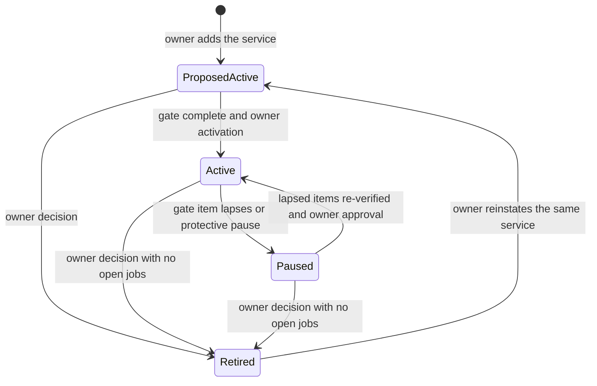
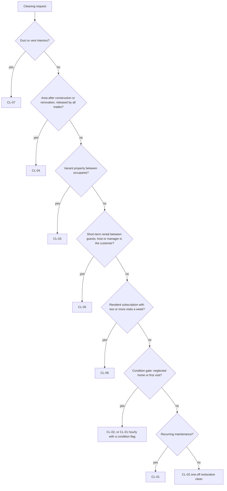

# 04 - Service Registry

> **Status:** Draft - AI-generated planning document, not approved · **Owner/domain:** Service catalog / business systems (orchestrator, applying business-systems-administrator; field column owners per [35 section 5.3](35-skills-coverage-matrix.md)) · **Last updated:** 2026-10-04
> **Human review required:** Owner (canonical identity, statuses and the launch set, slug and alias decisions, boundary rules, every PROPOSED value in the cards); qualified safety professional (draft risk classes, hazard, PPE and stop-work fields, the activation gate); attorney licensed in KY and/or IN (agreement references and terms quoted in cards, names that carry claims or third-party marks, permit and license questions); local licensing and permit authorities in each Kentucky and Indiana jurisdiction served (permit and license flags); EPA RRP-certified renovator and accredited asbestos inspector (old-property screening); qualified mold assessor or industrial hygienist (the mold rule, sections 5.1 and 6.2); structural engineer and building official (structural, framing, inspection-before-concealment and fire-rated assembly questions for HI-10, HI-11, DW-03 and DW-04); licensed electrician, plumber, gas professional and HVAC contractor (licensed boundaries, section 6.3); qualified bilingual reviewer (Spanish safety text, gate item 3); CPA (tax questions noted in cards and gate item 6); licensed insurance broker (coverage questions).
> **Related:** [Requirements spec](../Requierments/HandyHub_Requirements_Specification_Reconstructed.md) (Appendix B, section 17, Appendix C) · [Master prompt](../HandyHub%20Master.md) (section 3) · [00 Project charter](00-project-charter.md) · [02 Gap analysis](02-gap-analysis.md) · [28 Pricing](28-pricing-estimating-and-job-costing.md) · [29 Inventory](29-inventory-and-procurement.md) · [30 Service agreements](30-service-agreement-standards.md) · [31 SOP standard](31-sop-standard.md) · [32 Website](32-website-and-customer-experience.md) · [34 Naming and migration](34-naming-and-migration-plan.md) · [35 Skills coverage](35-skills-coverage-matrix.md)

## 1. Purpose and how to use

This registry is the canonical source of service identity for HandyHub. For each of the 26 services in spec Appendix B it records the `service_id`, canonical name, slug, category, aliases, lifecycle status, web and booking flags, and the current pricing, inventory, agreement and SOP files, and it summarizes the 29 fields that master section 3 requires in one card per service (section 7).

Master section 3 sets two rules this document exists to enforce: "Every service-specific file must reference the same canonical service identity", and naming drift such as `move-in-out` / `move-in-move-out` is not allowed "unless an explicit alias map exists". Section 4 is that alias map. At the audit (original snapshot of 2026-10-03) no service file carried a service code, titles drifted in 25 of 26 services and 8 agreement references pointed to files that do not exist (**FACT**, [02](02-gap-analysis.md) G-011). Since the edit phase of 2026-10-03, all 104 service files (26 per document type, including the new CL-07 agreement skeleton) carry frontmatter with `service_id`, `service_slug`, `canonical_name` and `doc_type` that matches this registry (**FACT**, checked by script 2026-10-04). The edits were additive, so the drifting H1 titles, the original body text with its 8 references to missing files and the 13 alias paths of section 4.1 remain until [34](34-naming-and-migration-plan.md) and [30](30-service-agreement-standards.md) resolve them.

**Where the registry sits (charter PROPOSED DECISION D-00-10, [00 section 10.3](00-project-charter.md)).** Rank 4 of 7: below owner decisions in [20](20-decision-log.md), the owner facts and the requirement text of the spec; above approved operational documents, planning drafts and the brainstorm files. In practice:

- Identity (code, name, category) comes from spec Appendix B. The registry mirrors it character for character and adds what the spec does not define: slugs, aliases, status, web and booking flags, and file references.
- Service-card requirements (intake, tools, materials, hazards, stop-work, quality) come from the spec section 17 cards, keyed `<CODE>.INT`, `.TLS`, `.MAT`, `.HAZ`, `.SAF` and `.QAC`. The registry cards cite them and show where the draft service files diverge.
- A card summarizes and cites; it approves nothing. A value is approved only when its owning standard approves it (prices in [28](28-pricing-estimating-and-job-costing.md), kits in [29](29-inventory-and-procurement.md), agreements in [30](30-service-agreement-standards.md), SOPs in [31](31-sop-standard.md), public text in [32](32-website-and-customer-experience.md)) and the owner records the decision in [20](20-decision-log.md). Every dollar figure in a card comes from an unapproved draft file: a pricing "benchmark in file (unapproved)" or a fee in a draft agreement awaiting attorney review.

**Owned elsewhere and linked, not repeated:** price-book design and the minimum rule ([28](28-pricing-estimating-and-job-costing.md)); kits, stock and procurement ([29](29-inventory-and-procurement.md)); agreement terms ([30](30-service-agreement-standards.md)); SOP template, versions, approval and shared safety modules ([31](31-sop-standard.md)); pages, URLs, claims and translations ([32](32-website-and-customer-experience.md)); renames and migration waves ([34](34-naming-and-migration-plan.md)); the contradiction register and gap status ([02](02-gap-analysis.md)); entities, state tables and schema ([05](05-domain-model.md), [06](06-state-machines.md), [08](08-data-model-and-database.md)).

| Reader | Start with | Rule |
|---|---|---|
| Developer or AI coding agent | Section 2 (identity rules, statuses, booking gate, SVC requirements) and section 8 (YAML seed) | Resolve services by `service_id`, never by name similarity or hard-coded path; `booking_enabled` is computed and never seeded `true` |
| AI agent editing a vault file | The service's card (section 7) and the alias map (section 4) | Cite the `service_id`; keep the canonical name; never change a price, legal term or safety control (master section 29); route renames through [34](34-naming-and-migration-plan.md) |
| Estimator | Card rows "pricing model" to "material assumptions"; section 5 boundaries | Card figures are unapproved benchmarks; customer quotes use the approved price book only ([28](28-pricing-estimating-and-job-costing.md)) |
| Job planner or safety reviewer | Card rows "PPE" to "customer preparation requirements"; section 6 | Card content is draft; only approved, effective SOP versions reach worker briefings ([31](31-sop-standard.md) SOP-004) |
| Owner or professional reviewer | Sections 3, 5 and 6, then the end sections | Decide the PROPOSED DECISIONS and OPEN QUESTIONS; record outcomes in [20](20-decision-log.md) |

**Card format.** Each card in section 7 starts with a heading that is exactly the service code (`### HI-04`), so links such as `04-service-registry.md#HI-04` from spec Appendix C and the other plan documents resolve. A one-line identity summary follows, then a 32-row table: the 29 master section 3 fields in master order, with an aliases row after the slug, then a Files row and an Open issues row. Every row carries its value, its source and an evidence label (master section 1.4).

**Specialist expertise applied.**

| Skill | Rule applied (quoted) | Where applied |
|---|---|---|
| [business-systems-administrator](../Skills/Website%2C%20software%2C%20and%20cybersecurity/business-systems-administrator/SKILL.md) (primary) | "Use stable identifiers, required fields only where justified, controlled statuses" and "Avoid competing masters." ([playbook](../Skills/Website%2C%20software%2C%20and%20cybersecurity/business-systems-administrator/references/playbook.md)); "Mark work as proposed, configured, tested, active, blocked, or not applicable based on evidence." | Sections 2, 8, 9 |
| [handyhub-job-planner](../Skills/Business%20direction/handyhub-job-planner/SKILL.md) | "Stop planning a ready-to-start packet if required scope or hazard decisions are missing."; "Never invent structural specifications or chemical mixtures."; "A missing ladder or unverified permit keeps affected tasks blocked." ([playbook](../Skills/Business%20direction/handyhub-job-planner/references/playbook.md)) | Section 2 gate; card rows for tools, prerequisites and SOP |
| [handyhub-estimate-assistant](../Skills/Branding%2C%20marketing%2C%20social%20media%2C%20and%20sales/handyhub-estimate-assistant/SKILL.md) | "Use each service's approved estimating basis"; "Avoid counting bundled preparation twice."; "never invent an industry-standard price"; "A multi-service visit must not accidentally receive several minimum charges." ([playbook](../Skills/Branding%2C%20marketing%2C%20social%20media%2C%20and%20sales/handyhub-estimate-assistant/references/playbook.md)) | Sections 3 and 5; card rows from pricing model to material assumptions |
| [safety-liability-manager](../Skills/LLC%2C%20legal%20administration%2C%20and%20risk/safety-liability-manager/SKILL.md) | "Classify work as routine, elevated, high-risk / specialist review, or stop-work / emergency. Explain the concrete hazard causing the classification."; "Prefer the hierarchy of controls"; "Define when work must stop until a licensed trade professional ... is involved." | Section 6; card rows for PPE, hazards and stop-work |
| [handyhub-risk-triage](../Skills/LLC%2C%20legal%20administration%2C%20and%20risk/handyhub-risk-triage/SKILL.md) | "unknown applicability must not default to no permit"; "Route potential lead/asbestos, unresolved leaks/rot, unsafe deck structure, attic wiring/heat, elevated gutter work or unknown systems to competent assessment"; do not invent "anchor load ratings, ladder setup tolerances or chemical mixing ratios" ([playbook](../Skills/LLC%2C%20legal%20administration%2C%20and%20risk/handyhub-risk-triage/references/playbook.md)) | Section 6; SVC-009; card permit and license rows |
| [handyhub-quality-assistant](../Skills/LLC%2C%20legal%20administration%2C%20and%20risk/handyhub-quality-assistant/SKILL.md) | "Mark each requirement verified, failed, not inspected or not applicable with evidence"; "Missing photos are unknown evidence, not proof of defective work." ([playbook](../Skills/LLC%2C%20legal%20administration%2C%20and%20risk/handyhub-quality-assistant/references/playbook.md)) | Card rows for quality checklist, completion evidence, warranty or callback |
| [legal-compliance-administrator](../Skills/LLC%2C%20legal%20administration%2C%20and%20risk/legal-compliance-administrator/SKILL.md) | Separate "confirmed requirement, likely requirement needing verification, business policy choice, and professional-review item"; "Do not invent licenses, permit rules, filing fees, deadlines, or tax registrations."; "When multiple jurisdictions apply, treat each separately." | Sections 4 (agreement references) and 6; card rows for agreement, exclusions, permit and license |

No skill was used to reach a legal, tax, licensing, insurance, OSHA, EPA or structural conclusion. Each such item names the human reviewer who decides (master section 1.3).

**Skills are design-time guidance; AI features are a second wave.** **FACT** (owner direction 2026-10-04, [HANDOFF](../HANDOFF.md) section 2): AI functionality is built after launch readiness. People and coding agents apply the skills while planning and building ([33](33-ai-and-automation-governance.md) D-33-19). No AI workspace, AIR role or AI provider integration is built in Wave 1, and the AI module stays in its tested disabled state (AIG-002, ARC-030); the AI role workspaces (NEAR-002) come after launch readiness ([19](19-product-roadmap.md) Phase 6). Where a card's "responsible skill / business role" row cites AIR IDs, the named human roles (ROLE-004, ROLE-006, ROLE-009 and the others listed) do that work until the owner approves [33](33-ai-and-automation-governance.md).

## 2. Canonical identity rules

**2.1 Identity fields (PROPOSED DECISION D-04-02).**

| Field | Rule | Basis | Example (HI-04) |
|---|---|---|---|
| `service_id` | Two-letter category code (HI, DW, PT, CL), a hyphen and a two-digit sequence within the category. Assigned once through registry change control (section 9); never renamed, renumbered or reused, including after retirement. A new service takes the next unused number in its category | Spec Appendix B (26 codes, **FACT**); [34](34-naming-and-migration-plan.md) D-34-01 "Identifiers are stable; paths are mutable" | `HI-04` |
| `canonical_name` | Appendix B text, character for character, including "&" and the comma in DW-01. Changed only by owner decision after attorney review of claim words and third-party marks (Q-04-02); the old name becomes an alias | **FACT:** all 26 main-plan headings and all 26 spec section 17 headings match Appendix B ([01](01-repository-inventory.md)) | "Professional TV Wall Mounting & Wire Hiding" |
| `display_name` (per language) | Separate from `canonical_name`; approved through [32](32-website-and-customer-experience.md) (claims register, Spanish review); never used as a key. Until Q-32-09 is answered the canonical name is displayed | [32](32-website-and-customer-experience.md) section 3.2, Q-32-09 | canonical name |
| `slug` | Lower-case ASCII words joined by single hyphens; at most 48 characters, so every derived file name stays within the 64-character limit of [34](34-naming-and-migration-plan.md) section 3.2; unique across all records including retired ones. A key, not a title: it may drop words. New slugs carry no brand or third-party mark, no claim word ("elite", "luxury", "premium", "structural") and no category prefix. Stable once published | [34](34-naming-and-migration-plan.md) D-34-02 (file names); [32](32-website-and-customer-experience.md) D-32-03 (URLs); writing conventions slug list | `tv-mounting` |
| `category`, `category_slug` | One of the four Appendix B categories: Home Improvement `home-improvement`, Drywall `drywall`, Painting `painting`, Cleaning `cleaning`. A catalog and reporting grouping only: it grants no crew eligibility and selects no safety module (D-04-07) | Appendix B; [32](32-website-and-customer-experience.md) section 3.2; owner action 2026-10-03: Carpentry is not a category | Home Improvement, `home-improvement` |
| `aliases` | Name and path variants that resolve to this record (section 4) | Master section 3; [34](34-naming-and-migration-plan.md) section 3.6 | "Professional TV Wall Mounting" |
| `status` | `proposed-active`, `active`, `paused` or `retired` (2.3) | D-04-04 | `proposed-active` |
| `web_status` | `hidden` or `estimate-requests`; default `hidden` until the owner opens a service (Q-04-01) | [32](32-website-and-customer-experience.md) WEB-006, Q-32-07 | `hidden` |
| `booking_enabled` | Computed from `status` and the gate evidence (2.4); there is no field to set it | HND-004; [00](00-project-charter.md) D-00-05 | `false` |
| `line_types` | Optional controlled list of scoped or priced variants inside one service, for example the PT-03 coating options (alternates under EST-005) or the proposed HI-06 split (section 5). A line type never receives its own `service_id`; gates and permit flags may differ per line type | EST-005; section 5 | `wire-hiding` (PROPOSED) |
| `risk_class`, `hazard_classes`, `licensed_boundaries` | Service defaults using the [31 section 3.2](31-sop-standard.md) vocabularies (section 6); the job-level classification stays with risk triage | [31](31-sop-standard.md) section 3.2; safety-liability-manager | `elevated`; height, electrical; electrical |
| Document references | Current vault path per document type (`pricing`, `inventory`, `agreement`, `sop`) and, once approved, the approved version ([31](31-sop-standard.md) `sop_version`, the [28](28-pricing-estimating-and-job-costing.md) price-book version, the [30](30-service-agreement-standards.md) agreement version) | SVC-013; [34](34-naming-and-migration-plan.md) D-34-01 | `Standard Of Operations/sop-tv-mounting.md` |
| Spec card keys | `<CODE>.INT`, `.TLS`, `.MAT`, `.HAZ`, `.SAF`, `.QAC` (spec section 17) | Spec Appendix D | `HI-04.HAZ` |

Patterns for validators (outside the table because they contain pipe characters):

```text
service_id   ^(HI|DW|PT|CL)-[0-9]{2}$
slug         ^[a-z0-9]+(-[a-z0-9]+)*$        maximum 48 characters
status       proposed-active | active | paused | retired
web_status   hidden | estimate-requests
```

**2.2 Alias handling (PROPOSED DECISION D-04-03; details and the map in section 4).**

1. An alias resolves to exactly one `service_id`. A string may not be an alias of two services. Words shared by several services ("turnover", "deck", "structural", "texture", "construction") are never aliases on their own.
2. Aliases are added when a variant is found (audit, import, intake, a new file) and are never deleted. A former canonical name, slug or file path becomes an alias at the moment it changes.
3. Frontmatter `aliases` in a vault file list only that file's former file names ([34](34-naming-and-migration-plan.md) D-34-04, section 3.6). Name variants live only in section 4 of this registry.
4. Matching is exact after the normalization in section 4.4. No similarity or fuzzy matching: master section 1.1 rule 5 says "Never assume two similarly named services are identical."
5. Free-text customer descriptions are not aliases. Intake classifies them through the service picker or a person ([32](32-website-and-customer-experience.md) section 6).
6. An alias does not make drift acceptable. Every file-name or title alias in section 4 names its planned fix (a [34](34-naming-and-migration-plan.md) wave, a [30](30-service-agreement-standards.md) agreement change or a [36](36-file-modification-plan.md) edit).

**2.3 Status vocabulary (PROPOSED DECISION D-04-04).**

| Status | Meaning | `booking_enabled` | `web_status` allowed | Estimates and jobs |
|---|---|---|---|---|
| `proposed-active` | In the owner's scope (**FACT**, owner facts: "All 26 categories in cleaning, drywall, painting and home improvement are in scope") but the activation gate (2.4) is incomplete | `false` | `hidden`; `estimate-requests` only by owner decision (Q-04-01) | Requests may be received and assessed when visible. No binding estimate is sent (approved price-book entries are gate item 6) and no job is scheduled |
| `active` | Every gate item recorded with current evidence and owner activation recorded in [20](20-decision-log.md) | `true` (computed) | `estimate-requests`, or `hidden` by owner choice | Estimates use approved price-book lines; jobs may be scheduled and started subject to the job-level gates START-001 to START-015 |
| `paused` | Temporarily not taking new work: a gate item lapsed (automatic, SVC-008) or the owner or ADM paused it (safety, insurance, capacity, season) | `false` | `hidden`, or `estimate-requests` with an approved notice that scheduling is closed | No new binding estimate or scheduling; scheduled jobs flagged for ADM review; started jobs follow [31](31-sop-standard.md) section 5.6 |
| `retired` | Withdrawn by owner decision | `false` | `hidden`; public URLs 301-redirect ([32](32-website-and-customer-experience.md) WEB-005) | No new work; open jobs completed or cancelled first (CX-006 history); record, ID, slug and aliases kept |



| From | To | Who and step-up ([27](27-roles-and-permissions.md) section 6.2) | Condition | Effects |
|---|---|---|---|---|
| none | `proposed-active` | Owner decides; ADM records (L2) | Service added through section 9; new `service_id`; card created with all 29 master fields, unknown values marked GAP | Record exists, `hidden`, not bookable |
| `proposed-active` | `active` | ADM (L2) after owner approval | Every item in 2.4 has current evidence | `booking_enabled` becomes `true`; [32](32-website-and-customer-experience.md) may publish if `web_status` allows |
| `active` | `paused` | System (automatic) | A gate item lapses (SVC-008) | `booking_enabled` becomes `false`; scheduled jobs flagged; review item opened |
| `active` | `paused` | ADM or owner (L1: protective actions are never delayed) | Reason recorded | As above |
| `paused` | `active` | ADM (L2) after owner approval | Lapsed or flagged items re-verified; all other items still current | `booking_enabled` becomes `true` |
| `proposed-active`, `active` or `paused` | `retired` | Owner decides; ADM records (L2) | No open job for the service; affected customers handled under CX-006 | URLs redirected; record kept |
| `retired` | `proposed-active` | Owner decides; ADM records (L2) | The same service definition returns (a materially different service gets a new `service_id`) | Full gate again |

Not allowed: `proposed-active` to `paused` (it is already not bookable), `retired` to `active` or `paused`, and any direct edit of `booking_enabled`. Every transition is an audited event with actor, step-up level, reason, evidence references and effective time (NFR-008, NFR-013, NFR-019).

**2.4 Booking-enabled gate tied to HND-004 (PROPOSED DECISION D-04-05).** HND-004 requires approval of "initial SOPs, hazards, tools, materials, stop-work conditions and QA checklists for every active service before enabling booking". The charter turns this into a ten-item activation rule (D-00-05, [00 section 4.4](00-project-charter.md)). The registry stores the evidence for each item:

| # | Gate item (charter section 4.4) | Evidence stored with the service record | Requirement | Who decides or reviews |
|---|---|---|---|---|
| 1 | Owner places the service in the launch set | Decision ID in [20](20-decision-log.md) | Q-00-02 | Owner |
| 2 | Approved SOP version, hazards, tools, materials, stop-work conditions and QA checklist after competent review | Effective SOP version ([31](31-sop-standard.md) `version_status: effective`), hazard-template version, approval references | HND-004; owner facts L20; [31](31-sop-standard.md) SOP-004 | Qualified safety professional; trade specialists for each listed licensed boundary |
| 3 | Spanish critical safety text approved | [31](31-sop-standard.md) `translation_es` approved for the effective version | HND-006; COM-006 | Qualified bilingual reviewer |
| 4 | Permit, license and qualification flags determined per Kentucky and Indiana jurisdiction and encoded as start gates | Flag table per line type and jurisdiction with source, date and reviewer; no `unknown` left on a line that will be offered | HND-005; START-010; SVC-009 | Licensing authority or attorney determines; legal-compliance-administrator researches |
| 5 | Customer terms reviewed by an attorney licensed in the state(s) served | Approved agreement version ([30](30-service-agreement-standards.md)) | CX-004 | Attorney licensed in KY and/or IN |
| 6 | Approved price-book entries; minimum and deposit configuration; the CPA's tax-treatment determination for the service in each state served | Price-book version ID ([28](28-pricing-estimating-and-job-costing.md)); tax-treatment determination per state with source, date and reviewer, configured on the estimate and invoice. No taxability is assumed in either direction | FIN-001; FIN-002; EST-004; D-28-04 | Owner; CPA for tax |
| 7 | Insurance coverage confirmed from policy documents | Document reference and expiry date | Owner facts L5 ("Reported capability is not documentary proof of insurance") | Licensed insurance broker |
| 8 | Every critical contradiction for the service RESOLVED or BLOCKED with an owner and a trigger | Register status in [02](02-gap-analysis.md) for the service's critical IDs (section 3) | [02](02-gap-analysis.md) | Owner |
| 9 | Required tools, equipment and PPE verified as available | Kit version and check record ([29](29-inventory-and-procurement.md)) | HND-004 | Job planner; qualified safety professional for PPE |
| 10 | Worker qualification tags assigned | Tags for each hazard class and licensed boundary held by enough workers for the crew size | SCH-003 | Owner; qualified safety professional |

- `booking_enabled` is `true` only when `status` is `active` and every item has current, unexpired evidence. The system computes it.
- No item can be satisfied by an acknowledgment, checkbox or override. Owner facts L20: "Unknown is not safe; acknowledgment cannot bypass critical holds"; [31](31-sop-standard.md) SOP-004: "this gate cannot be overridden".
- **PROPOSED:** where gate evidence differs by line type (for example HI-04 wire hiding or HI-06 guards), the gate is evaluated per line type, so a line whose own items are incomplete stays disabled while the rest of the service is active. Owner approval required (part of D-04-05; Q-04-16). Until it is given, the gate is evaluated per service: an incomplete item on any offered line keeps the whole service unbookable, and a lapse or an `unknown` flag on any line pauses the whole service (SVC-008).
- **Deposit part of item 6 (PROPOSED).** The deposit policy is OFF by default ([28](28-pricing-estimating-and-job-costing.md) D-28-12), and its threshold, amount, timing and terms are undecided (owner facts L9: "Deposits for large jobs; threshold, amount, timing and terms remain owner decisions."; BIZ-006; FIN-002 "The system must not assume every job requires a deposit."). The default alone does not satisfy item 6 for a service whose jobs can reach a deposit threshold: item 6 then needs the owner's recorded deposit decision for that service (an approved DepositPolicy version, or a recorded decision that no deposit applies), because [26](26-business-process-map.md) BPM-030 refuses activation while a needed policy is missing. Deposit and draw clauses in the draft agreements are never configuration (X-04).
- **Process readiness and staging rehearsal (OPEN QUESTION, Q-18-13).** [26](26-business-process-map.md) BPM-030 refuses activation while a launch-critical lifecycle step or a needed policy is missing, and [18](18-release-and-launch-plan.md) section 9.3 adds a process-readiness check and a staging rehearsal record to the activation packet (its items 11 and 12). Whether they become an eleventh gate item here and in `catalog.service_gate_evidence` ([08](08-data-model-and-database.md)) or stay in the activation decision record is for the owner (Q-18-13). Until then they are cited in the activation decision, and the ten items above remain the minimum.
- **FACT (2026-10-03, re-checked 2026-10-04):** no SOP is approved, so item 2 is missing for all 26 services. No agreement is attorney-reviewed (item 5); CL-07 has only the structure-only skeleton created in the edit phase, which contains no agreement wording (approved version: none - not bookable, [30](30-service-agreement-standards.md) AGR-031; [02](02-gap-analysis.md) G-001). No price-book entry is approved (item 6). All 26 services are `proposed-active`, `booking_enabled` is `false` and, pending Q-04-01, `web_status` is `hidden`.

**2.5 Field authority (PROPOSED DECISION D-04-06; resolves the "two unlinked sources" gap G-025).** The spec cards and the four service files per service define overlapping fields and disagree. Until a field is approved, the card shows both and labels the conflict; the authority below decides which source software and briefings use.

| Field group (master section 3) | Authoritative now | Authoritative after approval | Column owner ([35](35-skills-coverage-matrix.md) section 5.3) |
|---|---|---|---|
| `service_id`, canonical name, category | Spec Appendix B (registry mirrors it) | Same | Orchestrator |
| Slug, aliases, file references | This registry | This registry | Orchestrator with business-systems-administrator |
| Status, `web_status`, booking | Owner decisions recorded here and in [20](20-decision-log.md) | Same | Owner |
| Customer-facing description | None approved; plan copy is draft with unverified claims | [32](32-website-and-customer-experience.md) claims register and approved page copy | handyhub-marketing |
| Pricing model, minimum, estimating method, labor and material assumptions | Spec BIZ-003, BIZ-004, FIN-001, EST-001 to EST-007; pricing files are unapproved benchmarks | Approved price book ([28](28-pricing-estimating-and-job-costing.md)) | handyhub-estimate-assistant |
| Inventory and tools | Spec `<CODE>.TLS` and `.MAT`; inventory files are draft checklists | Approved kit ([29](29-inventory-and-procurement.md)) | handyhub-job-planner |
| PPE, hazards, stop-work, prerequisites | Spec `<CODE>.HAZ` and `.SAF`, START-011; SOP drafts are not active | Effective SOP version and hazard templates ([31](31-sop-standard.md)) | safety-liability-manager; handyhub-risk-triage |
| Permit and license flags | `unknown` everywhere | Recorded determinations per jurisdiction (SVC-009) | handyhub-risk-triage with legal-compliance-administrator |
| Exclusions, customer preparation | Spec CX-004, CX-005, `<CODE>.INT`; agreement drafts need attorney review | Approved agreement ([30](30-service-agreement-standards.md)) and SOP section 5 ([31](31-sop-standard.md)) | legal-compliance-administrator; handyhub-job-planner |
| Quality checklist, completion evidence | Spec `<CODE>.QAC`, QA-001 to QA-004, START-008 | Effective SOP sections 13, 16 and 18 ([31](31-sop-standard.md)) | handyhub-quality-assistant |
| Warranty or callback policy | None exists | Owner decision with attorney review (CX-007, QA-010) | Owner |
| Responsible skill or role; software workflow | This registry from [35](35-skills-coverage-matrix.md); spec sections 4, 14 and 19 | [05](05-domain-model.md), [06](06-state-machines.md), [08](08-data-model-and-database.md) | Orchestrator; business-systems-administrator |

Conflict rule: where a draft service file contradicts the spec card, the spec card governs software defaults and briefings, and the contradiction stays in the [02](02-gap-analysis.md) register until resolved; it is never silently fixed. For safety fields, the more protective statement applies until a qualified safety professional decides (owner facts L20: "Unknown is not safe").

**2.6 SVC requirements (PROPOSED).** Priority follows spec section 19 (P0 launch-critical, P1 near-term).

| ID | Requirement | Priority | Basis | Verification |
|---|---|---|---|---|
| SVC-001 | The registry holds exactly one record per canonical service, keyed by a `service_id` matching the 2.1 pattern. The baseline set equals spec Appendix B: 26 codes, names and categories. | P0 | Master section 3; Appendix B | Script compares the section 8 index with Appendix B: 26 of 26 exact |
| SVC-002 | Every service-specific vault file (pricing, inventory, agreement, SOP) carries YAML frontmatter with `service_id` and `doc_type`. The `service_id` exists in the registry, and the slug in the file name equals the registry slug (before the [34](34-naming-and-migration-plan.md) renames: the path is a registered alias in section 4.1). SOP files also carry the [31](31-sop-standard.md) Tier A identity fields. Baseline at the audit: 0 of 103 files complied (**FACT**, checked 2026-10-03). After the edit phase, 104 of 104 files carry `service_id`, `service_slug` and `doc_type` matching the registry, and the file name differs from the registry slug only on the 13 alias paths of section 4.1 (**FACT**, checked 2026-10-04). | P0 | Master section 3; [34](34-naming-and-migration-plan.md) D-34-04; [31](31-sop-standard.md) SOP-002 | Lint over the four folders: zero missing or mismatched keys |
| SVC-003 | A `service_id` is never renamed or reused. A slug changes only through section 9, with an alias entry and, after launch, a 301 redirect ([32](32-website-and-customer-experience.md) WEB-005). Retired IDs and slugs stay reserved. | P0 | [34](34-naming-and-migration-plan.md) D-34-01; [32](32-website-and-customer-experience.md) D-32-03 | Uniqueness check including retired records; change log sample |
| SVC-004 | Software, imports and AI agents resolve any service name or file name through the alias map (exact match after section 4.4 normalization) to exactly one `service_id`. Unmatched or ambiguous input goes to a human mapping queue and is never guessed. | P0 | Master section 1.1 rule 5 | Fixture with every alias in section 4 resolves to its code; "deck", "turnover" and "structural repairs" are rejected |
| SVC-005 | `canonical_name` is never edited for marketing. Display names per language are separate fields approved through [32](32-website-and-customer-experience.md) and change neither `service_id`, slug nor `canonical_name`. | P0 | [32](32-website-and-customer-experience.md) Q-32-09; COM-006 | Schema review; attempt to edit the canonical name through the display-name path fails |
| SVC-006 | `status` takes only the four 2.3 values. Transitions follow the 2.3 table; forbidden transitions are rejected; each transition is an audited event with actor, step-up level, reason, evidence and effective time. | P0 | NFR-008; NFR-013; NFR-019; [27](27-roles-and-permissions.md) section 6.2 | Transition tests including every forbidden pair |
| SVC-007 | `booking_enabled` is computed: `true` only when `status` is `active` and every 2.4 item has current evidence. While it is `false`, no job containing the service can be scheduled, no binding estimate containing it can be sent, and no booking control appears ([32](32-website-and-customer-experience.md) WEB-006). | P0 | HND-004; HND-005; HND-006; [00](00-project-charter.md) D-00-05; [31](31-sop-standard.md) SOP-004 | One negative test per gate item; AT-014 and AT-017 |
| SVC-008 | When a gate item lapses (SOP version suspended or retired under [31](31-sop-standard.md), approval withdrawn, insurance evidence expired, a permit flag returns to `unknown` or becomes required-but-missing, a critical register item reopened), the service moves to `paused` automatically, its scheduled jobs are flagged for ADM review and Start Job is blocked (START-010; [31](31-sop-standard.md) section 5.6). | P0 | NFR-013; START-010 | Suspend an SOP in staging: service paused, jobs flagged, start blocked |
| SVC-009 | Permit, license and qualification flags are recorded per line type and per jurisdiction (Kentucky and Indiana separately, and each municipality served) with the value `required`, `not-required` or `unknown`, plus source, date and reviewer. `unknown` blocks Start for the affected line and never defaults to `not-required`. | P0 | HND-005; START-010; risk-triage playbook; legal-compliance-administrator "treat each separately" | Flag table complete for every offered line; start-gate test with an `unknown` flag |
| SVC-010 | Each service record carries default `risk_class`, `hazard_classes` and `licensed_boundaries` from the [31](31-sop-standard.md) section 3.2 vocabularies. These, not the category, select shared safety modules ([31](31-sop-standard.md) section 5.8) and the qualification tags that scheduling checks. | P0 | SCH-003; [31](31-sop-standard.md) section 3.2 | A worker without the required tag cannot be assigned (scheduling test) |
| SVC-011 | Each service has an approved task-inclusion matrix (included, add-on, excluded, refer-out) that is the single source for SOP scope, price-book lines, agreement inclusions and exclusions and website copy. Every price-book line maps to one `service_id` and one task. Required before activation of the service. | P0 | [02](02-gap-analysis.md) G-028; estimate playbook "Avoid counting bundled preparation twice." | Every price-book item maps to one task; cross-file consistency report shows zero included-versus-add-on conflicts |
| SVC-012 | Out-of-catalog work reached through change orders or discovered conditions (the section 5.9 list) is recorded as refer-out. Estimates and change orders cannot price it as a HandyHub line. | P0 | X-05; [02](02-gap-analysis.md) G-091; [00](00-project-charter.md) section 6.1 | Adding a refer-out task as a line is blocked |
| SVC-013 | The registry stores the current vault path per service and document type and, once approved, the approved version. Scripts, imports and the application resolve documents through `service_id` plus `doc_type`, never through hard-coded paths. | P0 | [34](34-naming-and-migration-plan.md) D-34-01 | All non-null paths in section 8 resolve; no hard-coded service path in code review |
| SVC-014 | The section 8 index and spec Appendix C are regenerated from the registry records after every registry change; a documentation check fails when they disagree. | P1 | business-systems-administrator "Avoid competing masters." | Diff check in the documentation lint ([16](16-testing-quality-strategy.md)) |
| SVC-015 | Identity, status, alias and reference changes follow section 9: proposal, impact check, approval by the named role, versioned record with an effective date, preview and validation, and entries in [20](20-decision-log.md) and [25](25-change-log.md). | P0 | NFR-013; NFR-019 | Audit sample of changes |
| SVC-016 | The estimate workspace warns, and blocks where the rule is a hard boundary, when lines on one estimate overlap under a recorded boundary rule (section 5), for example a CL-04 phase line for an area whose drywall or painting line already includes trade cleanup, or a second minimum-type charge on one bundle. | P1 | Estimate playbook; [28](28-pricing-estimating-and-job-costing.md) D-28-05 | One test per boundary in section 5 |

## 3. Summary of all 26 services

- **Status.** All 26 services are `proposed-active` and not bookable (**FACT**: no SOP is approved; owner facts L20 "No active field SOP until competent review"; HND-004). `web_status` is `hidden` for all 26 until Q-04-01 is answered.
- **Pricing model.** The model types found in each draft pricing file, without figures. Every figure in those files is a benchmark in file (unapproved); none is a HandyHub price (owner facts L8: "numeric rates, wages, production factors, tax rates and profit targets are not supplied"). Full analysis: [28 section 7](28-pricing-estimating-and-job-costing.md).
- **Minimum behavior.** How each draft file relates to the \$150 rule (BIZ-003, CX-001, FIN-001). The proposed application (once per separately quoted job or visit bundle before tax, never stacked) is [28](28-pricing-estimating-and-job-costing.md) D-28-04 and D-28-05; the owner must still confirm recurrence, callbacks and estimate-visit exceptions (owner facts L7).
- **Recurring plans.** Whether the minimum is evaluated per visit, per billing period or per plan for CL-01, CL-05 and CL-06 is owner question Q-28-04. Until the owner decides, [28 section 4.5](28-pricing-estimating-and-job-costing.md) proposes per visit for CL-01 and CL-05 (D-28-07) and per plan period for CL-06 if prepaid tiers are kept; the recurrence OPEN QUESTIONS in those cards defer to it.
- **Deposits.** Owner facts L9: "Deposits for large jobs; threshold, amount, timing and terms remain owner decisions." The deposit policy is OFF until the owner approves one ([28](28-pricing-estimating-and-job-costing.md) D-28-12; FIN-002). The non-refundable deposits, retainers and draw schedules in the CL-02, DW-02, DW-03, PT-01 and PT-03 draft agreements and the CL-06 monthly prepayment are unapproved conflicts (X-04 and the card IDs), never configuration.
- **Payment methods.** Owner facts L10: "Electronic invoices with cash/check acceptance. Payment provider not selected. Received checks are not cleared money." Electronic payment (card, online payment, card on file, automatic charging) is `NOT CONFIGURED`, so the card-on-file and automatic-billing terms in the CL-01, CL-05 and CL-06 drafts are unsupported (C-CL01-03, C-CL05-06, C-CL06-06). A received check does not satisfy a cleared-funds condition until it clears ([28](28-pricing-estimating-and-job-costing.md) D-28-12 `cleared_funds_required`, D-28-26).
- **Pricing approval.** No HandyHub price exists. No price-book entry is approved; every figure in a card is a benchmark in file (unapproved) or a draft-agreement fee awaiting attorney review; prices become usable only through the approval workflow of [28 section 10](28-pricing-estimating-and-job-costing.md) (gate item 6).
- **Critical and high issues.** Live entries of the contradiction register in [02](02-gap-analysis.md); REFUTED items are excluded. Medium and low items are listed in each card's Open issues row.

| ID | Name | Slug | Category | Status | Pricing model in draft file (unapproved) | Minimum behavior against the \$150 rule | Files | Critical / high open issues |
|---|---|---|---|---|---|---|---|---|
| [HI-01](04-service-registry.md#HI-01) | Precision Picture Hanging & Art Installation | `picture-hanging` | Home Improvement | proposed-active; not bookable | Hybrid with no precedence rule: hourly fallback, visit charge covering the first items, per frame, 5-frame bundle, per heavy item, masonry surcharge per item | Own visit charge whose range starts below \$150 (C-HI01-03); stacks on multi-service visits (X-18) | [SOP](../Standard%20Of%20Operations/sop-picture-hanging.md) · [Agreement](../Service%20Agreements/contract-picture-hanging.md) · [Pricing](../Pricing/pricing-picture-hanging.md) · [Inventory](../Required%20inventory/inventory-picture-hanging.md) | Critical: C-HI01-01, C-HI01-02 · High: C-HI01-03, C-HI01-04, C-HI01-05, C-HI01-06, C-HI01-07, X-01, X-03, X-10, X-11, X-12, X-13 |
| [HI-02](04-service-registry.md#HI-02) | Deep-Clean Barbecue & Grill Maintenance | `grill-cleaning` | Home Improvement | proposed-active; not bookable | Flat by grill size (burner count); hourly mode with minimum hours for neglected units; per-job chemical surcharge | Hourly mode carries its own minimum-hours floor (X-18); flat tiers exceed \$150 | [SOP](../Standard%20Of%20Operations/sop-grill-cleaning.md) · [Agreement](../Service%20Agreements/contract-grill-cleaning.md) · [Pricing](../Pricing/pricing-grill-cleaning.md) · [Inventory](../Required%20inventory/inventory-grill-cleaning.md) | Critical: C-HI02-01, C-HI02-02, C-HI02-03 · High: C-HI02-04, X-01, X-02, X-03, X-07, X-09, X-10, X-11 |
| [HI-03](04-service-registry.md#HI-03) | Driveway Pressure Washing & Surface Restoration | `driveway-cleaning` | Home Improvement | proposed-active; not bookable | Flat area tiers (overlapping bounds) beside a per-sq-ft benchmark; stain-treatment add-ons; equipment trip charge | Trip charge equal to \$150, worded as a separate charge (C-HI03-06, X-18) | [SOP](../Standard%20Of%20Operations/sop-driveway-cleaning.md) · [Agreement](../Service%20Agreements/contract-driveway-cleaning.md) · [Pricing](../Pricing/pricing-driveway-cleaning.md) · [Inventory](../Required%20inventory/inventory-driveway-cleaning.md) | Critical: C-HI03-01, C-HI03-02 · High: C-HI03-03, C-HI03-04, C-HI03-05, X-01, X-02, X-03, X-06, X-08, X-09, X-10, X-11, X-27 |
| [HI-04](04-service-registry.md#HI-04) | Professional TV Wall Mounting & Wire Hiding | `tv-mounting` | Home Improvement | proposed-active; not bookable | Flat base by screen-size band (labor only) plus flat add-ons: wire hiding, soundbar, substrate surcharges | Smallest base price below \$150 (C-HI04-03); no minimum statement | [SOP](../Standard%20Of%20Operations/sop-tv-mounting.md) · [Agreement](../Service%20Agreements/contract-tv-mounting.md) · [Pricing](../Pricing/pricing-tv-mounting.md) · [Inventory](../Required%20inventory/inventory-tv-mounting.md) | Critical: C-HI04-01, C-HI04-02 · High: C-HI04-03, C-HI04-04, C-HI04-05, C-HI04-06, C-HI04-07, C-HI04-08, C-HI04-09, C-HI04-10, X-01, X-10, X-11, X-12 |
| [HI-05](04-service-registry.md#HI-05) | Door Hardware & Smart Lock Installation | `smart-locks` | Home Improvement | proposed-active; not bookable | Flat per lock unit (standard or smart); per-strike realignment add-on | Every single-unit job below \$150 (C-HI05-03); no minimum statement | [SOP](../Standard%20Of%20Operations/sop-smart-locks.md) · [Agreement](../Service%20Agreements/contract-smart-locks.md) · [Pricing](../Pricing/pricing-smart-locks.md) · [Inventory](../Required%20inventory/inventory-smart-locks.md) | Critical: C-HI05-01, C-HI05-02 · High: C-HI05-03, C-HI05-04, C-HI05-05, C-HI05-06, X-01, X-02, X-03, X-10, X-11 |
| [HI-06](04-service-registry.md#HI-06) | Gutter Maintenance & Leaf Protection | `gutter-maintenance` | Home Improvement | proposed-active; not bookable | Cleaning packages by stories and run length; guards per linear foot; per-seam reseal surcharge | No minimum statement; single-story package floor equals \$150; seam-only or short runs below (OPEN QUESTION) | [SOP](../Standard%20Of%20Operations/sop-gutter-maintenance.md) · [Agreement](../Service%20Agreements/contract-gutter-maintenance.md) · [Pricing](../Pricing/pricing-gutter-maintenance.md) · [Inventory](../Required%20inventory/inventory-gutter-guards.md) | Critical: C-HI06-01 · High: C-HI06-02, X-01, X-02, X-03, X-05, X-09, X-10, X-11, X-12, X-27 |
| [HI-07](04-service-registry.md#HI-07) | Attic Insulation Upgrades | `attic-insulation` | Home Improvement | proposed-active; not bookable | Per sq ft tiered by attic footprint; per-bay baffle and per-fixture shield add-ons | No minimum statement; add-on-only work would fall below (OPEN QUESTION) | [SOP](../Standard%20Of%20Operations/sop-attic-insulation.md) · [Agreement](../Service%20Agreements/contract-attic-insulation.md) · [Pricing](../Pricing/pricing-attic-insulation.md) · [Inventory](../Required%20inventory/inventory-attic-insulation.md) | Critical: C-HI07-01, C-HI07-02, C-HI07-03, C-HI07-04, C-HI07-05 · High: C-HI07-06, C-HI07-07, X-01, X-02, X-05, X-06, X-10, X-11, X-12, X-13, X-27 |
| [HI-08](04-service-registry.md#HI-08) | Closet & Shelving System Installation | `closet-shelving` | Home Improvement | proposed-active; not bookable | Hourly with minimum hours, flat per closet or per-foot surcharge for client kits (no selection rule); per tier face for supplied shelving | Hourly mode carries its own minimum-hours floor (X-18); small shelving jobs below \$150 | [SOP](../Standard%20Of%20Operations/sop-closet-shelving.md) · [Agreement](../Service%20Agreements/contract-closet-shelving.md) · [Pricing](../Pricing/pricing-closet-shelving.md) · [Inventory](../Required%20inventory/inventory-closet-shelving.md) | Critical: C-HI08-01, C-HI08-02 · High: C-HI08-03, C-HI08-04, C-HI08-05, C-HI08-06, X-01, X-03, X-10, X-11, X-12 |
| [HI-09](04-service-registry.md#HI-09) | Custom Trim & Architectural Molding Installation | `trim-molding` | Home Improvement | proposed-active; not bookable | Labor-only per linear foot by profile; flat per wainscot wall face | No minimum statement; short runs below \$150 (FIN-001 applies) | [SOP](../Standard%20Of%20Operations/sop-trim-molding.md) · [Agreement](../Service%20Agreements/contract-trim-molding.md) · [Pricing](../Pricing/pricing-trim-molding.md) · [Inventory](../Required%20inventory/inventory-trim-molding.md) | Critical: C-HI09-01 · High: C-HI09-02, C-HI09-03, C-HI09-04, X-01, X-03, X-10, X-11, X-12 |
| [HI-10](04-service-registry.md#HI-10) | Structural Fence Maintenance & Structural Repairs | `fence-repair` | Home Improvement | proposed-active; not bookable | Flat per component (post, rail section, picket, gate); call-out minimum balance | Call-out minimum above \$150 competes with the rule (C-HI10-03, X-18) | [SOP](../Standard%20Of%20Operations/sop-fence-repair.md) · [Agreement](../Service%20Agreements/contract-fence-repair.md) · [Pricing](../Pricing/pricing-fence-repair.md) · [Inventory](../Required%20inventory/inventory-fence-repair.md) | Critical: C-HI10-01, C-HI10-02 · High: C-HI10-03, C-HI10-05, C-HI10-06, X-01, X-03, X-10, X-11, X-27 |
| [HI-11](04-service-registry.md#HI-11) | Structural Deck Maintenance & Deck Board Repairs | `deck-repair` | Home Improvement | proposed-active; not bookable | Per linear foot of boards; per post connection; per stair tread; hourly diagnostic fallback | No minimum statement; one board, post, tread or diagnostic hour below \$150 | [SOP](../Standard%20Of%20Operations/sop-deck-repair.md) · [Agreement](../Service%20Agreements/contract-deck-repair.md) · [Pricing](../Pricing/pricing-deck-repair.md) · [Inventory](../Required%20inventory/inventory-deck-repair.md) | Critical: C-HI11-01, C-HI11-02 · High: C-HI11-03, C-HI11-04, C-HI11-05, X-01, X-02, X-03, X-05, X-10, X-11, X-12, X-27 |
| [DW-01](04-service-registry.md#DW-01) | Professional Patching, Repair & Handyman Services | `drywall-patching` | Drywall | proposed-active; not bookable | Flat by patch-size bracket; percentage ceiling surcharge; paint and primer add-on; trip fee | Ranged trip-fee minimum from \$150 that also covers the first hour (C-DW01-03, X-18) | [SOP](../Standard%20Of%20Operations/sop%20drywall-patching.md) · [Agreement](../Service%20Agreements/contract-drywall-patching.md) · [Pricing](../Pricing/pricing-drywall-patching.md) · [Inventory](../Required%20inventory/inventory-drywall-patching.md) | Critical: C-DW01-01, C-DW01-02 · High: C-DW01-03, C-DW01-04, C-DW01-05, C-DW01-11, X-01, X-03, X-05, X-06, X-09, X-10, X-11, X-12, X-13 |
| [DW-02](04-service-registry.md#DW-02) | Texture Matching & Popcorn Ceiling Removal | `popcorn-removal` | Drywall | proposed-active; not bookable | Per sq ft by finish tier; testing and high-ceiling add-ons; marketing room floors; agreement retainer | Small-room trip-fee floor acts as an unapproved service minimum (X-18) | [SOP](../Standard%20Of%20Operations/sop%20popcorn-removal.md) · [Agreement](../Service%20Agreements/contract-popcorn-removal.md) · [Pricing](../Pricing/pricing-popcorn-removal.md) · [Inventory](../Required%20inventory/inventory-popcorn-removal.md) | Critical: C-DW02-01, C-DW02-02, C-DW02-03, C-DW02-04, C-DW02-05, C-DW02-06 · High: C-DW02-07, C-DW02-08, C-DW02-09, C-DW02-10, C-DW02-12, X-01, X-02, X-05, X-07, X-09, X-10, X-11, X-12, X-13 |
| [DW-03](04-service-registry.md#DW-03) | Residential Remodeling & Home Additions | `drywall-remodeling` | Drywall | proposed-active; not bookable | Per sq ft (A) or per sheet (B) with no selection rule; hourly tie-ins; add-ons; agreement draws | No minimum statement; one sheet, hour or small area below \$150 (FIN-001 applies) | [SOP](../Standard%20Of%20Operations/sop%20drywall-remodeling.md) · [Agreement](../Service%20Agreements/contract-drywall-remodeling.md) · [Pricing](../Pricing/pricing-drywall-remodeling.md) · [Inventory](../Required%20inventory/inventory-drywall-remodeling.md) | Critical: C-DW03-01, C-DW03-02 · High: C-DW03-03, C-DW03-04, C-DW03-05, C-DW03-06, C-DW03-07, C-DW03-08, C-DW03-09, C-DW03-10, X-01, X-03, X-06, X-07, X-10, X-11, X-12, X-13 |
| [DW-04](04-service-registry.md#DW-04) | High-Volume Residential New Construction | `new-construction` | Drywall | proposed-active; not bookable | B2B per sq ft (hang, tape, turnkey volume tiers); crew standby hourly; winter surcharge | No minimum statement; whether the \$150 rule applies to builder work is open | [SOP](../Standard%20Of%20Operations/sop%20new-construction.md) · [Agreement](../Service%20Agreements/contract-new-construction.md) · [Pricing](../Pricing/pricing-new-construction.md) · [Inventory](../Required%20inventory/inventory-new-construction.md) | Critical: C-DW04-01, C-DW04-02 · High: C-DW04-03, C-DW04-04, C-DW04-05, C-DW04-07, C-DW04-08, X-01, X-02, X-10, X-11, X-12 |
| [PT-01](04-service-registry.md#PT-01) | Professional Residential Interior Painting | `interior-painting` | Painting | proposed-active; not bookable | Flat by room type and scope; flat add-ons; ceiling-height percentage; materials markup; agreement deposit and draws | No minimum statement; no listed job total below \$150; single-wall or closet-only work unpriced | [SOP](../Standard%20Of%20Operations/sop-interior-painting.md) · [Agreement](../Service%20Agreements/contract-interior-painting.md) · [Pricing](../Pricing/pricing-interior-painting.md) · [Inventory](../Required%20inventory/inventory-interior-painting.md) | Critical: C-PT01-01, C-PT01-02, C-PT01-03 · High: C-PT01-04, C-PT01-05, C-PT01-06, C-PT01-07, C-PT01-08, C-PT01-09, X-01, X-03, X-09, X-10, X-11, X-12, X-13 |
| [PT-02](04-service-registry.md#PT-02) | Outdoor Deck & Fence Staining and Sealing | `deck-staining` | Painting | proposed-active; not bookable | Per sq ft package; railing, step and joist add-ons; solid-stain percentage; per-cycle minimum | Per-cycle absolute minimum above \$150 competes with the rule (C-PT02-03, X-18) | [SOP](../Standard%20Of%20Operations/sop-deck-staining.md) · [Agreement](../Service%20Agreements/contract-deck-staining.md) · [Pricing](../Pricing/pricing-deck-staining.md) · [Inventory](../Required%20inventory/inventory-deck-staining.md) | Critical: C-PT02-01, C-PT02-02 · High: C-PT02-03, C-PT02-04, C-PT02-05, C-PT02-06, X-01, X-02, X-05, X-06, X-08, X-09, X-10, X-11, X-27 |
| [PT-03](04-service-registry.md#PT-03) | Brick Limewashing & Elastomeric Masonry Coatings | `brick-limewashing` | Painting | proposed-active; not bookable | Per sq ft by coating option; house-type minimums and flat rates; lift rental flat or pass-through | House-type minimums act as project floors (X-18) | [SOP](../Standard%20Of%20Operations/sop-brick-limewashing.md) · [Agreement](../Service%20Agreements/contract-brick-limewashing.md) · [Pricing](../Pricing/pricing-brick-limewashing.md) · [Inventory](../Required%20inventory/inventory-brick-limewashing.md) | Critical: C-PT03-01, C-PT03-02, C-PT03-03, C-PT03-04 · High: C-PT03-05, C-PT03-07, C-PT03-08, C-PT03-09, C-PT03-10, X-01, X-02, X-03, X-05, X-06, X-08, X-09, X-10, X-11, X-12, X-27 |
| [PT-04](04-service-registry.md#PT-04) | Wallpaper Removal & Surface Restoration | `wallpaper-removal` | Painting | proposed-active; not bookable | Per sq ft, flat per room or hourly fallback; per-room surcharges; border-only fee | No minimum statement; border-only fee starts at \$150; small accent walls below | [SOP](../Standard%20Of%20Operations/sop-wallpaper-removal.md) · [Agreement](../Service%20Agreements/contract-wallpaper-removal.md) · [Pricing](../Pricing/pricing-wallpaper-removal.md) · [Inventory](../Required%20inventory/inventory-wallpaper-removal.md) | Critical: C-PT04-01, C-PT04-02, C-PT04-03, C-PT04-04 · High: C-PT04-05, C-PT04-06, C-PT04-09, X-01, X-02, X-03, X-05, X-06, X-07, X-09, X-10, X-11, X-12, X-13 |
| [CL-01](04-service-registry.md#CL-01) | Routine House Cleaning | `routine-cleaning` | Cleaning | proposed-active; not bookable | Three methods (flat by layout, hourly per cleaner, per sq ft); frequency discounts; per-visit surcharges | Smallest layouts below \$150; frequency discounts push more visits below (C-CL01-01); recurrence open | [SOP](../Standard%20Of%20Operations/sop%20Routine%20Cleaning%20Checklist.md) · [Agreement](../Service%20Agreements/contract-routine-cleaning.md) · [Pricing](../Pricing/pricing-routine-cleaning.md) · [Inventory](../Required%20inventory/inventory-routine-cleaning.md) | Critical: C-CL01-02 · High: C-CL01-01, C-CL01-03, C-CL01-04, C-CL01-06, X-01, X-03, X-06, X-09, X-10, X-11 |
| [CL-02](04-service-registry.md#CL-02) | Elite Deep Cleaning Service | `deep-cleaning` | Cleaning | proposed-active; not bookable | Three methods (per sq ft, hourly per cleaner, flat by size) with no selection rule; add-on menu | Small units by area and short hourly jobs below \$150 (C-CL02-13) | [SOP](../Standard%20Of%20Operations/sop%20Deep%20Cleaning%20CheckList.md) · [Agreement](../Service%20Agreements/contract-deep-cleaning.md) · [Pricing](../Pricing/pricing-deep-cleaning.md) · [Inventory](../Required%20inventory/inventory-deep-cleaning.md) | Critical: C-CL02-02, C-CL02-03, C-CL02-04 · High: C-CL02-01, C-CL02-05, C-CL02-06, C-CL02-07, C-CL02-08, X-01, X-02, X-03, X-06, X-07, X-09, X-10, X-11, X-12 |
| [CL-03](04-service-registry.md#CL-03) | Move-In & Move-Out Cleaning | `move-in-out` | Cleaning | proposed-active; not bookable | Per sq ft or flat vacant packages; percentage leftover-items surcharge; utilities and exterior-window add-ons | Small units by area below \$150 and below the package floor (C-CL03-13) | [SOP](../Standard%20Of%20Operations/sop%20Move-In%20and%20Move-Out%20Cleaning%20Checklist.md) · [Agreement](../Service%20Agreements/contract-move-in-out.md) · [Pricing](../Pricing/pricing-move-in-out.md) · [Inventory](../Required%20inventory/inventory-move-in-move-out.md) | Critical: C-CL03-01, C-CL03-02 · High: C-CL03-04, C-CL03-05, C-CL03-07, C-CL03-08, X-01, X-03, X-07, X-09, X-10, X-11, X-12 |
| [CL-04](04-service-registry.md#CL-04) | Post-Construction & Post-Renovation Cleaning | `post-construction` | Cleaning | proposed-active; not bookable | Per sq ft for three phases or an all-in bundle; high-ceiling rental or hazard fee | A single phase on a small area falls below; per-phase invoicing leaves the evaluation unit unclear | [SOP](../Standard%20Of%20Operations/sop%20Post-Construction%20Cleaning%20Checklist.md) · [Agreement](../Service%20Agreements/contract-post-construction.md) · [Pricing](../Pricing/pricing-post-construction.md) · [Inventory](../Required%20inventory/inventory-post-construction.md) | Critical: C-CL04-01, C-CL04-02, C-CL04-03, C-CL04-04, C-CL04-05 · High: C-CL04-06, C-CL04-09, C-CL04-10, C-CL04-11, X-01, X-02, X-03, X-09, X-10, X-11, X-12, X-13 |
| [CL-05](04-service-registry.md#CL-05) | Airbnb Turnover & Vacation Rental Management | `airbnb-turnover` | Cleaning | proposed-active; not bookable | Flat per turnover by property type with a time cap; co-hosting revenue share or retainer; late-checkout and rush surcharges | Smallest property types below \$150 per turnover (C-CL05-03) | [SOP](../Standard%20Of%20Operations/sop%20Airbnb%20Cleaning%20and%20Turnover%20Checklist.md) · [Agreement](../Service%20Agreements/contract-airbnb-turnover.md) · [Pricing](../Pricing/pricing-airbnb-turnover.md) · [Inventory](../Required%20inventory/inventory-airbnb-turnover.md) | Critical: C-CL05-01, C-CL05-02 · High: C-CL05-03, C-CL05-06, C-CL05-07, C-CL05-08, C-CL05-09, C-CL05-V01, X-01, X-03, X-09, X-10, X-11 |
| [CL-06](04-service-registry.md#CL-06) | Hotel-Style Luxury Housekeeping | `hotel-housekeeping` | Cleaning | proposed-active; not bookable | Monthly prepaid subscription tiers by visits per week; fine-garments surcharge | Plan totals exceed \$150; per-visit equivalents fall below (ESTIMATE); per visit or per plan undecided | [SOP](../Standard%20Of%20Operations/sop%20Hotel-Style%20Housekeeping%20Checklist.md) · [Agreement](../Service%20Agreements/contract-hotel-housekeeping.md) · [Pricing](../Pricing/pricing-hotel-housekeeping.md) · [Inventory](../Required%20inventory/inventory-hotel-housekeeping.md) | Critical: none · High: C-CL06-01, C-CL06-02, C-CL06-03, C-CL06-04, C-CL06-05, C-CL06-06, C-CL06-07, C-CL06-08, C-CL06-09, X-01, X-03, X-09, X-10, X-11 |
| [CL-07](04-service-registry.md#CL-07) | Air Duct & Ventilation Cleaning | `air-duct-cleaning` | Cleaning | proposed-active; not bookable | Two unreconciled models: base fee plus per register, or flat per system; ancillary add-ons | Base fee equal to \$150 in one model; add-on-only and inspection-only visits undefined (C-CL07-V03) | [SOP](../Standard%20Of%20Operations/sop%20Air%20Duct%20and%20Vent%20Cleaning%20Checklist.md) · [Agreement skeleton](../Service%20Agreements/contract-air-duct-cleaning.md) (structure only, no wording; approved version: none) · [Pricing](../Pricing/pricing-air-duct-cleaning.md) · [Inventory](../Required%20inventory/inventory-air-duct-cleaning.md) | Critical: C-CL07-01, C-CL07-03 · High: C-CL07-02, C-CL07-04, C-CL07-05, C-CL07-07, X-06, X-07, X-09, X-10, X-11, X-12 |

**Counts (FACT, register of 2026-10-03):** 64 critical findings across 25 services (CL-06 has none); 24 services carry a critical safety finding (all except CL-01 and CL-06); 113 service-level high findings plus 13 cross-service high findings (X-01, X-02, X-03, X-05 to X-13, X-27). Activation gate item 8 requires every critical finding of a service to be RESOLVED or BLOCKED before that service can become `active`.

## 4. Alias map

This map lists every naming variant found in vault file names, H1 titles, main-plan headings and bodies, agreement file references, tags, the spec and the master prompt, and resolves each to one canonical code and slug (PROPOSED DECISION D-04-03). Titles were extracted by script from all 103 service files on 2026-10-03 (**FACT**).

- Main-plan headings (after removing the list number and emoji) and spec section 17 headings equal the canonical names for all 26 services. The drift is in the operational files: only HI-07 keeps the canonical name in all four service-file titles (**FACT**).
- Website headlines in the main plans are marketing taglines, not names. They are tracked in the [32](32-website-and-customer-experience.md) claims register and are never used for matching.
- Descriptive phrases from agreement preambles are listed in full in each card's aliases row; the name-like ones are repeated below.

**4.1 Path and file-name aliases.**

| Variant (as found) | Where | Resolves to | Planned fix |
|---|---|---|---|
| `inventory-gutter-guards.md` | `Required inventory/` (current file name) | HI-06 `gutter-maintenance` | The file covers cleaning, sealing and guard hardware, not guards only. Rename to `inventory-gutter-maintenance.md` ([34](34-naming-and-migration-plan.md) step 2.12) |
| `inventory-move-in-move-out.md` | `Required inventory/` (current file name) | CL-03 `move-in-out` | Rename to `inventory-move-in-out.md` (34 step 2.13) |
| `sop drywall-patching.md` | `Standard Of Operations/` (space instead of hyphen) | DW-01 `drywall-patching` | `sop-drywall-patching.md` (34 step 2.1) |
| `sop popcorn-removal.md` | same | DW-02 `popcorn-removal` | `sop-popcorn-removal.md` (34 step 2.2) |
| `sop drywall-remodeling.md` | same | DW-03 `drywall-remodeling` | `sop-drywall-remodeling.md` (34 step 2.3) |
| `sop new-construction.md` | same | DW-04 `new-construction` | `sop-new-construction.md` (34 step 2.4) |
| `sop Routine Cleaning Checklist.md` | `Standard Of Operations/` (title-style name) | CL-01 `routine-cleaning` | `sop-routine-cleaning.md` (34 step 2.5) |
| `sop Deep Cleaning CheckList.md` | same; "CheckList" casing differs from the other six | CL-02 `deep-cleaning` | `sop-deep-cleaning.md` (34 step 2.6) |
| `sop Move-In and Move-Out Cleaning Checklist.md` | same | CL-03 `move-in-out` | `sop-move-in-out.md` (34 step 2.7) |
| `sop Post-Construction Cleaning Checklist.md` | same | CL-04 `post-construction` | `sop-post-construction.md` (34 step 2.8) |
| `sop Airbnb Cleaning and Turnover Checklist.md` | same | CL-05 `airbnb-turnover` | `sop-airbnb-turnover.md`, or the slug chosen under Q-32-09 (34 step 2.9) |
| `sop Hotel-Style Housekeeping Checklist.md` | same | CL-06 `hotel-housekeeping` | `sop-hotel-housekeeping.md` (34 step 2.10) |
| `sop Air Duct and Vent Cleaning Checklist.md` | same | CL-07 `air-duct-cleaning` | `sop-air-duct-cleaning.md` (34 step 2.11) |
| `sop-drywall-patching.md` (file does not exist) | [contract-drywall-patching](../Service%20Agreements/contract-drywall-patching.md), "Inclusions" clause | DW-01 SOP | Becomes correct after 34 step 2.1; no agreement edit needed |
| `routine-cleaning.md` "micro-checklist" (does not exist) | [contract-routine-cleaning](../Service%20Agreements/contract-routine-cleaning.md), "Inclusions" clause | CL-01 SOP | Agreement text change through [30](30-service-agreement-standards.md); **HUMAN REVIEW: attorney licensed in KY and/or IN** |
| `deep-cleaning.md` "micro-checklist" (does not exist) | [contract-deep-cleaning](../Service%20Agreements/contract-deep-cleaning.md), "Inclusions" clause | CL-02 SOP | As above |
| `move-in-move-out.md` (does not exist) | [contract-move-in-out](../Service%20Agreements/contract-move-in-out.md), "Turnover Standard" clause | CL-03 SOP | As above |
| `post-construction.md` "micro-checklist" (does not exist) | [contract-post-construction](../Service%20Agreements/contract-post-construction.md), milestone scope statement | CL-04 SOP | As above |
| `airbnb-turnover.md` (does not exist) | [contract-airbnb-turnover](../Service%20Agreements/contract-airbnb-turnover.md), "Standard Turnover" clause | CL-05 SOP | As above |
| `hotel-housekeeping.md` "micro-checklist" (does not exist) | [contract-hotel-housekeeping](../Service%20Agreements/contract-hotel-housekeeping.md), "Premium Care" clause | CL-06 SOP | As above |
| `pricing-brick-coatings.md` (does not exist) | [contract-brick-limewashing](../Service%20Agreements/contract-brick-limewashing.md), "Project Specifications" clause | PT-03 pricing file `pricing-brick-limewashing.md` | As above; incorporating an internal pricing file into an agreement is itself an open issue (C-PT03-06, X-03) |
| [`contract-air-duct-cleaning.md`](../Service%20Agreements/contract-air-duct-cleaning.md) (created 2026-10-03 in the edit phase as a structure-only skeleton) | Spec CL-07 card and Appendix C link this path | CL-07 agreement | No rename needed. The skeleton holds no agreement wording; an attorney licensed in KY and/or IN drafts and approves the text ([02](02-gap-analysis.md) G-001; [30](30-service-agreement-standards.md) section 10.2, AGR-031; [36](36-file-modification-plan.md)) |
| `Dry Wall Business.md` | `Main Plans/`; MOC link text | Category Drywall (`drywall`) | Rename to `Drywall Business.md` (34 step 3.1, Q-34-03) |

**4.2 Name variants by service.** Titles are the file H1s without emoji and without the document-type prefix ("Regional Pricing:", "SOP:", "Master Service Agreement:" and so on, section 4.3). P = pricing, I = inventory, A = agreement, S = SOP.

| Code and slug | Canonical name (Appendix B) | Service-file titles that differ | Other name forms (plan body, agreement wording, tags, file references) | Related but never an alias of |
|---|---|---|---|---|
| HI-01 `picture-hanging` | Precision Picture Hanging & Art Installation | P, I, A, S: "Picture Hanging & Art Installation" | Plan: "professional art installation service"; agreement: "localized artwork and mirror mounting services" | HI-04, HI-08 (they share a wall-anchoring module only) |
| HI-02 `grill-cleaning` | Deep-Clean Barbecue & Grill Maintenance | P, I, A, S: "Barbecue & Grill Deep-Cleaning" | Plan: "premium barbecue detailing service"; agreement: "professional barbecue detailing and carbon-stripping services" | CL-02 kitchen appliance cleaning |
| HI-03 `driveway-cleaning` | Driveway Pressure Washing & Surface Restoration | P, I, A, S: "Driveway Pressure Washing" | Plan: "industrial pressure washing service"; agreement: "high-pressure concrete cleaning and surface restoration services" | PT-02 wood washing before staining; PT-03 masonry cleaning before coating |
| HI-04 `tv-mounting` | Professional TV Wall Mounting & Wire Hiding | P, I, A, S: "Professional TV Wall Mounting" (drop "& Wire Hiding") | Plan: "TV wall mounting service"; line-type labels "In-Wall Low-Voltage Wire Hiding" (plan, pricing) and "In-Wall Low-Voltage Cable Hiding" (SOP) | HI-01 |
| HI-05 `smart-locks` | Door Hardware & Smart Lock Installation | P: "Door Hardware & Smart Locks" | Plan: "door hardware installation team"; agreement: "structural door hardware upgrades and smart security integrations" | None found |
| HI-06 `gutter-maintenance` | Gutter Maintenance & Leaf Protection | P, A: "Gutter Maintenance & Leaf Guards"; inventory file stem `gutter-guards` | Plan: "complete gutter maintenance service"; pricing packages "Multi-Tier Gutter Cleaning & Flush Packages" and "Premium Micro-Mesh Gutter Guards (All-In Supply & Install)" (proposed line types, section 5.7) | Fascia and soffit carpentry, roofing (outside the catalog, section 5.9) |
| HI-07 `attic-insulation` | Attic Insulation Upgrades | None: all four titles are canonical | Agreement: "blown-in thermal attic insulation upgrades" | DW-03 wall-cavity batt insulation add-on |
| HI-08 `closet-shelving` | Closet & Shelving System Installation | P: "Closet & Shelving Installations" | Plan: "custom shelving installation"; pricing variants "Client-Supplied Modular Kits" and "Custom Heavy-Duty Garage/Pantry Slats"; agreement: "commercial or residential shelving installations" | CL-06 closet organization; PT-01 closet-interior painting |
| HI-09 `trim-molding` | Custom Trim & Architectural Molding Installation | P, I, A, S: "Custom Trim & Architectural Molding" (drop "Installation") | Plan: "finish carpentry team"; pricing: "Finish Carpentry Baseline"; agreement: "Finish Carpentry Agreement", "decorative wood trim installations". "Finish carpentry" is a label inside HI-09, not a category | PT-01 trim painting |
| HI-10 `fence-repair` | Structural Fence Maintenance & Structural Repairs | P: "Structural Fence Repairs"; I, A, S: "Structural Fence Maintenance & Repairs" | Plan: "targeted fence repair service"; agreement: "localized structural post stabilization, rail re-ties, and picket repair services" | PT-02 fence staining |
| HI-11 `deck-repair` | Structural Deck Maintenance & Deck Board Repairs | P: "Structural Deck Repairs"; I, A, S: "Structural Deck Maintenance & Repairs" | Plan: "specialized deck repair division"; agreement: "safety-focused residential deck repairs" | PT-02 deck staining |
| DW-01 `drywall-patching` | Professional Patching, Repair & Handyman Services | P: "Patching & Handyman Repairs (Kentuckiana)"; I: "Patching & Handyman Repairs"; A: "Drywall Patching & Repairs (Kentuckiana)"; S: "Meticulous Drywall Patching & Repairs" | Plan: "rapid-response patching and repair service"; agreement: "localized drywall repair and patching services"; tag `#service/patching` | General handyman tasks of HI-01 to HI-11 (scope question Q-00-12); PT-01 patching inside painting |
| DW-02 `popcorn-removal` | Texture Matching & Popcorn Ceiling Removal | P: "Popcorn Ceiling & Texture Modernization"; I: "Popcorn Ceiling Removal & Texturing"; A: "Popcorn Ceiling Removal & Modernization"; S: "Popcorn Ceiling Removal & Texture Matching" | Plan: "texture removal and remodeling service"; agreement: "heavy containment scraping and ceiling updating services"; tag `#service/popcorn-removal` | DW-03 (the word "remodeling"); DW-01 wall texture (section 5.3) |
| DW-03 `drywall-remodeling` | Residential Remodeling & Home Additions | P, I, A: "Residential Remodeling & Additions"; S: "Residential Remodeling & Structural Additions" | Plan: "residential remodeling service"; agreement: "custom residential renovations, basement build-outs, or room additions" | DW-04; general-contractor scope beyond drywall (out of scope, [00](00-project-charter.md) section 6.1) |
| DW-04 `new-construction` | High-Volume Residential New Construction | P, I: "High-Volume New Construction"; A: "New Construction Drywall" (H1 prefix "Master Subcontract Agreement:"); S: "High-Volume New Construction Drywall" | Plan: "new construction drywall division"; tags `#drywall/production`, `#sop/production`, `#high-volume`, `#service/new-construction` | DW-03; CL-04 |
| PT-01 `interior-painting` | Professional Residential Interior Painting | P, A: "Residential Interior Painting (Kentuckiana)"; I: "Residential Interior Painting"; S: "Premium Residential Interior Painting" | Tags `#painting/interior`, `#service/interior` | DW-01 patching; HI-09 trim installation |
| PT-02 `deck-staining` | Outdoor Deck & Fence Staining and Sealing | P, I, A, S: "Outdoor Deck & Fence Staining" (drop "and Sealing") | Plan: "specialized staining and sealing service"; agreement: "exterior wood restoration, brightening, and staining services"; tags `#service/staining`, `#painting/staining` | HI-10 and HI-11 repairs; HI-03 hardscape washing |
| PT-03 `brick-limewashing` | Brick Limewashing & Elastomeric Masonry Coatings | P, I, A: "Brick Limewashing & Masonry Coatings"; S: "Brick Limewashing & Elastomeric Coatings" | Plan: "specialized brick coatings division"; agreement reference `pricing-brick-coatings.md`; tags `#painting/brick-coatings`, `#service/brick-coatings`, `#sop/brick-coatings`. The limewash and elastomeric options are alternates of one service (EST-005) | HI-03; PT-02; masonry repair (outside the catalog) |
| PT-04 `wallpaper-removal` | Wallpaper Removal & Surface Restoration | P: "Wallpaper Removal & Surface Prep"; I: "Wallpaper Removal & Wall Restoration" | Plan: "professional wallpaper removal service"; agreement: "wallpaper stripping and drywall restoration"; tag `#sop/wallpaper-removal` | DW-01; DW-02; PT-01 |
| CL-01 `routine-cleaning` | Routine House Cleaning | P, I, A: "Routine Cleaning"; S: "Routine Cleaning Micro-Checklist" | Plan: "Routine House Cleaning service"; agreement: "regular, recurring residential cleaning services"; agreement reference `routine-cleaning.md` | CL-02; CL-06 |
| CL-02 `deep-cleaning` | Elite Deep Cleaning Service | P, I, A: "Deep Cleaning"; S: "Deep Cleaning Micro-Checklist" | Plan: "Elite Deep Cleaning service"; agreement: "a specialized, rigorous deep cleaning session"; agreement reference `deep-cleaning.md` | CL-01; CL-03; CL-07 for hoods and vents (section 5.8) |
| CL-03 `move-in-out` | Move-In & Move-Out Cleaning | P, A: "Move-In / Move-Out Cleaning"; I: "Move-In / Move-Out"; S: "Move-In / Move-Out Micro-Checklist" | Plan: "Move-In/Move-Out service"; agreement: "vacant property turnover cleaning"; agreement reference `move-in-move-out.md`; SOP file wording "Move-In and Move-Out"; master section 3 drift examples `move-in-out` (the canonical slug), `move-in-move-out`, `move in/out`, `move-in and move-out` | CL-05 (guest "turnover"); CL-02 |
| CL-04 `post-construction` | Post-Construction & Post-Renovation Cleaning | P, A: "Post-Construction Cleaning" (agreement H1 prefix "Master Service Agreement:", agreement body "Commercial Service Agreement"); I: "Post-Construction"; S: "Post-Construction Micro-Checklist" | Plan: "Post-Construction division"; agreement reference `post-construction.md`; the rough, detail and final phases are line types | Drywall and painting trade cleanup (section 5.2); DW-04 |
| CL-05 `airbnb-turnover` | Airbnb Turnover & Vacation Rental Management | P: "Airbnb & Short-Term Rental Turnover"; I: "Airbnb Turnover"; A: "Airbnb & Vacation Rental Turnover" (H1 prefix "Operational Agreement:"); S: "Airbnb Cleaning & Turnover Micro-Checklist" | Plan: "on-the-ground operational partner"; pricing sub-offer "Co-Hosting & Operational Management Add-ons"; agreement reference `airbnb-turnover.md`. Name and slug contain a third-party mark (Q-32-09) | CL-03 (vacant "turnover"); CL-06 |
| CL-06 `hotel-housekeeping` | Hotel-Style Luxury Housekeeping | I, A: "Hotel-Style Housekeeping" (agreement H1 prefix "Subscription Agreement:"); S: "Hotel-Style Housekeeping Micro-Checklist" | Plan: "subscription-based Hotel-Style Housekeeping"; agreement: "luxury housekeeping package"; agreement reference `hotel-housekeeping.md`; tiers "Silver Tier", "Gold Tier", "Elite Presidential Tier" are line types | CL-01; CL-05 |
| CL-07 `air-duct-cleaning` | Air Duct & Ventilation Cleaning | P, I: "Air Duct & Vent Cleaning"; S: "Air Duct & Vent Cleaning Micro-Checklist"; A (skeleton, 2026-10-03): the canonical name with the suffix "(CL-07)" (H1 prefix "Service Agreement Skeleton:") | Plan: "ventilation cleaning service"; agreement skeleton `contract-air-duct-cleaning.md` | HVAC repair or service (licensed trade, refer out); CL-02 hood filters and grille wiping |

**4.3 Category, plan-file and document-type variants.**

| Variant | Where | Canonical meaning |
|---|---|---|
| "Dry Wall" | Main plan file name and MOC link text | Category Drywall, slug `drywall` |
| "Drywall Services Explanation", "House Cleaning Services Explanation", "Home Improvement Services Explanation", "Painting Services Explanations" | Main plan H1s | Categories Drywall, Cleaning, Home Improvement, Painting |
| "Carpentry", "Carpentry Business" | Former empty main plan | Not a category. **DECISION (owner action, observed 2026-10-03; confirm Q-00-11):** the file was deleted and its MOC line removed; do not recreate it. Carpentry-type tasks stay inside HI-08 to HI-11 |
| "Micro-Checklist", "micro-checklist" | 7 cleaning SOP titles; 7 agreements | Document type SOP (`doc_type: sop`); not a separate document class |
| "Regional Pricing", "Pricing Guide" | 19 and 7 pricing titles | Document type `pricing` |
| "Inventory & Tools", "Inventory Checklist" | 19 and 7 inventory titles | Document type `inventory` |
| "Service Agreement", "Master Service Agreement", "Master Subcontract Agreement", "Operational Agreement", "Subscription Agreement", "Service Agreement Skeleton" | Agreement titles (the last one only in the CL-07 skeleton) | Document type `contract`; the agreement class (consumer, subcontract, subscription) is decided in [30](30-service-agreement-standards.md), not by the title word |
| `[Your Company Name]`, `[Your Drywall Company Name]`, `[Your Painting Company Name]`, `[Your Cleaning Company Name]` | Agreement placeholders | The single HandyHub legal entity, whose name is not yet supplied ([30](30-service-agreement-standards.md)); not a service or division name |
| "division", "team" | Plan bodies (for example DW-04, PT-03, HI-11, CL-04; HI-05, HI-09) | Copy wording, not organizational units: the initial team is two employees (owner facts L6); claims are handled in [32](32-website-and-customer-experience.md) |

**4.4 Normalization and matching rules (for SVC-004).**

1. Remove leading emoji, Markdown heading marks and list numbering ("6. ").
2. Remove a document-type prefix from 4.3 and the suffixes "Micro-Checklist" and "(Kentuckiana)".
3. Case-fold; treat "&" and "and" as equal; collapse spaces, hyphens and slashes; read "CheckList" as "Checklist".
4. Look the result up among canonical names, slugs and every variant in 4.1 to 4.3. Exactly one hit resolves; zero or several hits go to the human mapping queue.
5. Never resolve on a partial word. "Deck", "Turnover", "Structural", "Texture", "Construction" and "Cleaning" alone are ambiguous.

Example: "Inventory Checklist: Move-In / Move-Out" becomes "move in move out" and resolves to CL-03; "Structural Repairs" matches nothing exactly and is rejected rather than guessed between HI-10 and HI-11.

## 5. Service boundary rules

Where services meet, the files do not say which service owns a task, so the same work can be charged twice, priced three ways or done without the safety module it needs ([02](02-gap-analysis.md) G-028; estimate playbook: "Avoid counting bundled preparation twice."). The rules below decide only which service owns which task. They change no price, legal term or safety control. Each group is a **PROPOSED DECISION** that becomes binding only when the owner records it in [20](20-decision-log.md) ([02](02-gap-analysis.md) section 5.2). Two cross-service findings were refuted as contradictions: X-24 (cleaning tier differences are tier design) and X-25 (primer is a per-job option). The routing need they point to remains part of G-028.

**5.1 Cleaning tiers: CL-01, CL-02, CL-03, CL-05, CL-06, with CL-04 and CL-07 (PROPOSED DECISION D-04-08).**

- **FACT:** every CL-03 file assumes a vacant home ([contract-move-in-out](../Service%20Agreements/contract-move-in-out.md): "100% vacant of furniture, personal items, and heavy trash bags"), while the spec intake asks for "vacant/occupied status" (CL-03.INT). CL-01 offers hourly billing "Best for Custom or Unkempt Homes" ([pricing-routine-cleaning](../Pricing/pricing-routine-cleaning.md)), while CL-02 warns "Never give a flat price over the phone for a deep clean if the house hasn't been cleaned in months" ([pricing-deep-cleaning](../Pricing/pricing-deep-cleaning.md)). CL-05 contracts with a "[Host / Property Manager Name]" per turnover; CL-06 with a "[Resident Name]" on a weekly-visit subscription. The CL-02 plan recommends a deep clean "as a baseline first-time visit" ([Cleaning Business](../Main%20Plans/Cleaning%20Business.md)); the CL-01 agreement has no such prerequisite.
- **Rule (a), routing:** classify by work area, occupancy, customer and recurrence, in the order of the chart below.
- **Rule (b), condition gate:** a home not cleaned for an owner-set period (`<owner decision: neglect threshold>`) or with heavy buildup goes to CL-02 first, or to CL-01 hourly with a condition flag. The owner chooses one path (Q-04-06).
- **Rule (c):** one task-inclusion matrix per service (SVC-011) is the single source for SOP, pricing, agreement and plan wording. It settles the in-service conflicts, for example CL-02 oven and refrigerator interiors that the SOP and plan include and the pricing sells as add-ons (C-CL02-01).
- **Rule (d):** one mold and biohazard rule for all cleaning services (X-06; mold module in [31](31-sop-standard.md) section 5.8). **HUMAN REVIEW:** qualified mold assessor or industrial hygienist.
- **Rule (e):** occupied move-outs are either refused or routed to a named code (Q-04-05).
- **Rule (f):** a host's long-stay guest is CL-05 when the host or manager is the customer, and CL-06 only when the resident contracts directly.
- **Decides:** owner, with handyhub-estimate-assistant, handyhub-job-planner and handyhub-customer-service. **Linked:** C-CL02-01, C-CL03-04, C-CL06-07, C-CL01-V01, C-CL02-V01, C-CL05-V01, X-06.



**5.2 Post-construction cleaning against drywall and painting trade cleanup; construction glass (PROPOSED DECISION D-04-09).**

- **FACT:** CL-04 phase 1 sells "Bulk vacuuming fine drywall powder, pulling construction trash" ([pricing-post-construction](../Pricing/pricing-post-construction.md)). The DW-03 SOP ends with "Vacuum up all fine sanding debris, damp-wipe window frames, and sweep clean before painter turnover" ([sop drywall-remodeling](../Standard%20Of%20Operations/sop%20drywall-remodeling.md)); QA-002 makes cleanup part of completion; DW-04.QAC requires a clean handoff. CL-04 starts only when "All primary trades (painters, floor installers, plumbers) must be completely finished" ([contract-post-construction](../Service%20Agreements/contract-post-construction.md)). Glass scraping carries opposite waiver logic in the DW-04 and CL-04 agreements and no clause in PT-03 (X-17).
- **Rule (a):** trade cleanup is inside every DW and PT job (QA-002): its own debris, containment removal and the dust that job created. CL-04 sells only detail and final cleaning of areas released by all trades, including HandyHub's own crews.
- **Rule (b):** one service owns construction-glass scraping, recommended CL-04, under one attorney-reviewed clause; DW-04 hands over with a note that the glass was not cleaned (Q-04-07).
- **Rule (c):** one dust and respiratory module for DW-01 to DW-04, CL-04 and the sanding steps of PT-01 and PT-04. **HUMAN REVIEW:** qualified safety professional.
- **Rule (d):** an estimate may not carry a CL-04 phase line for an area whose drywall or painting line already includes its cleanup (SVC-016).
- **Decides:** owner, qualified safety professional, attorney licensed in KY and/or IN. **Linked:** C-DW02-09, C-DW03-08, C-DW04-07, C-CL04-03, C-CL04-05, X-17.

**5.3 Finishing work: DW-01, DW-02, PT-04 and PT-01 (PROPOSED DECISION D-04-10).**

- **FACT:** the DW-01 agreement promises it "will execute expert texture matching (e.g., Orange Peel, Knockdown)" on patches up to 4 ft by 4 ft, while its SOP covers "minor to medium" damage. DW-02 is canonically "Texture Matching & Popcorn Ceiling Removal" and its plan sells "Orange Peel, Knockdown, or Skip-Trowel" wall textures, but its SOP textures ceilings only. PT-04 includes "a Level 4 skim coat mud repair" and prices torn drywall as a per-room reconstruction surcharge after a stop (C-PT04-01). PT-01 patches inside painting ("Fill nail holes, dents, and cracks"). No file defines Level 4, Level 5 or "paint-ready" (X-26).
- **Rule (a):** one wall-surface repair schedule (patch-size band by finish level) shared by DW-01, PT-01 and PT-04. PT-01 and PT-04 include repairs up to an owner-set threshold (`<owner decision: patch-size threshold>`); larger repairs become DW-01 lines on the same estimate, with one minimum per bundle ([28](28-pricing-estimating-and-job-costing.md) D-28-05).
- **Rule (b):** DW-02 owns ceilings (popcorn removal and ceiling texture); wall texture matching is a DW-01 line item.
- **Rule (c):** Level 4, Level 5 and "paint-ready" acceptance are defined once, in the quality checklist, from a cited source. No values are set here.
- **Rule (d):** primer is a per-service, per-job option in the task-inclusion matrix; the spec cards treat primer as included only where the estimate includes it.
- **Decides:** owner with handyhub-quality-assistant (Q-04-08). **Linked:** C-DW01-04, C-DW01-07, C-DW01-08, C-DW02-15, C-PT01-04, C-PT04-06, X-26.

**5.4 Exterior wood: HI-10 and HI-11 against PT-02, with HI-03 (PROPOSED DECISION D-04-11).**

- **FACT:** PT-02 lists "Under-Deck Support Joists" and a fence benchmark but has no fence pricing method (C-PT02-07). Its agreement says staining "cannot fix pre-existing wood rot", yet its SOP has no rot or soundness check. HI-11's agreement cross-sells "a full cleaning and oil staining cycle (minimum 60 days post-cure)"; this and PT-02's moisture rule are cumulative, not contradictory (C-HI11-09, refuted). HI-03's plan covers "concrete driveways, sidewalks, and entry brick steps" and its SOP is a concrete procedure.
- **Rule (a):** repair (HI-10, HI-11) comes before coating (PT-02). PT-02 gets a soundness hold that routes rot or loose structure to HI-10 or HI-11; PT-02 does no structural work.
- **Rule (b):** washing wood is a PT-02 preparation line, or a separate wash line if the owner decides to offer one (Q-04-09). HI-03 is limited to hardscape, with methods approved per surface.
- **Rule (c):** repair plus stain goes on one estimate with one minimum; staining waits as the product instructions require. No cure period is set here.
- **Rule (d):** one exterior-wood soundness checklist shared by HI-10, HI-11 and PT-02.
- **Decides:** owner, qualified safety professional. **Linked:** C-PT02-06, C-PT02-07, C-HI03-08, C-HI11-09 (refuted), X-08.

**5.5 DW-03 against DW-04 (PROPOSED DECISION D-04-12).**

- **FACT:** DW-03 contracts with the property owner "for custom residential renovations, basement build-outs, or room additions" and includes framing. DW-04 contracts with a "[General Contractor / Developer Name]", with HandyHub as "Subcontractor", on net terms. DW-04 prices "Custom Builds" per sq ft in a range that overlaps DW-03's Level 4 range, and its plan targets "custom luxury single-family builds". DW-04 relies on the contractor's warranty that MEP rough-in inspections passed "before the Subcontractor hangs a single sheet"; DW-03 has no inspection hold (C-DW03-01, critical).
- **Rule (a):** decide by contracting party, not by size. DW-04 applies only under an attorney-reviewed subcontract with a general contractor or developer; DW-03 applies when HandyHub contracts directly with the property owner.
- **Rule (b):** framing is DW-03 only and sits behind the START-010 permit and inspection gate. **HUMAN REVIEW:** building official. General-contractor scope beyond drywall stays out ([00](00-project-charter.md) section 6.1).
- **Rule (c):** one inspection-before-concealment hold shared by DW-03 and DW-04.
- **Rule (d):** whether DW-04 is offered at launch follows the customer-segment decision (Q-00-07, Q-04-10).
- **Decides:** owner, attorney licensed in KY and/or IN, building official. **Linked:** C-DW03-01, C-DW04-06, C-DW04-09, X-23.

**5.6 Category is not work type: HI-02, HI-03 and safety modules (PROPOSED DECISION D-04-07).**

- **FACT:** Appendix B files HI-02 and HI-03 under Home Improvement although both are cleaning work. Their inventories stock degreasers and "Sodium Hypochlorite (Soft-Wash Mix 12.5%)" with no PPE, while CL-02 stocks "Thick Industrial Rubber Gloves" and "Safety Splash Goggles" for comparable chemistry. Pressure washing appears in HI-03, PT-02 and PT-03 (X-08); chemicals appear in at least 16 services with no SDS rule (X-09); HI-02 involves gas connections (HI-02.HAZ).
- **Rule (a):** keep the Appendix B category for navigation, reports and marketing.
- **Rule (b):** each service record carries `hazard_classes` and `licensed_boundaries` (section 6). These, not the category, select the shared safety modules ([31](31-sop-standard.md) section 5.8) and the qualification tags that scheduling checks (SCH-003; SVC-010).
- **Rule (c):** category grants no crew eligibility; qualification tags do (Q-04-13).
- **Rule (d):** the estimating basis is recorded per service in the card: area and condition for HI-03, per unit for HI-02 (estimate playbook).
- **Decides:** owner, qualified safety professional; CPA for any tax effect (no conclusion drawn). **Linked:** C-HI02-03, C-HI02-04, C-HI03-01, C-HI03-02, X-08, X-09.

**5.7 HI-06: cleaning, minor repair and guards (PROPOSED DECISION D-04-13).**

- **FACT:** one code covers flat cleaning packages, re-pitch and reseal repairs, and per-linear-foot guard installation that includes a "full complimentary deep flush clean" ([pricing-gutter-maintenance](../Pricing/pricing-gutter-maintenance.md)). The inventory file is named for guards; the agreement preamble covers "drainage clearance, pitch adjustment, and guard mounting" but its inclusions list only cleaning and sealing (C-HI06-05), and a "Guard Warranty" has no terms. Seam resealing is included in the agreement but a per-seam surcharge in pricing (C-HI06-03). Rotted fascia leads to a change order for work no service performs (X-05).
- **Rule (a):** HI-06 stays one service with three line types: `cleaning` (cleaning and flush), `minor-repair` (an approved add-on) and `guards` (a project; warranty terms only after attorney review).
- **Rule (b):** fascia and soffit carpentry is outside the catalog: refer out, or the owner adds a service (5.9).
- **Rule (c):** all three line types fall under one height and access policy (X-12; [31](31-sop-standard.md) section 5.8), which activation requires.
- **Rule (d):** the inventory file is renamed through [34](34-naming-and-migration-plan.md) step 2.12; the alias stays in 4.1.
- **Decides:** owner, attorney licensed in KY and/or IN for warranty wording (Q-04-03). **Linked:** C-HI06-01 to C-HI06-05, C-HI06-09, X-05, X-12.

**5.8 Other overlaps (PROPOSED DECISION D-04-14).**

| Overlap | Evidence (FACT) | Rule (PROPOSED) | Decides |
|---|---|---|---|
| Wall anchoring: HI-01, HI-04, HI-08 | Three anchoring methods; the masonry surcharges of HI-01 and HI-04 differ; masonry bits are stocked only for HI-01 | One wall-anchoring and hidden-utility scan module using manufacturer-rated hardware data; no ratings are invented. **HUMAN REVIEW:** qualified safety professional | Owner |
| Insulation: HI-07 and DW-03 | DW-03 sells an "R-13/R-15 Fiberglass Batt" add-on with no SOP or PPE (C-DW03-04); HI-07 stocks respirators | One insulation handling and PPE module; HI-07 owns attics, DW-03 only the wall cavities it closes | Owner, qualified safety professional |
| Trim: HI-09 and PT-01 | PT-01 prices "Walls + Trim & Baseboards"; HI-09 excludes paint unless "wrapped into a separate painting division contract" | Trim painting is a PT-01 line on the same estimate, with one minimum | Owner |
| Range hoods and vent grilles: CL-02 and CL-07 | CL-02 degreases "range hood filters"; CL-07 scrapes "kitchen range hood exhaust fan blades" and sells a "Commercial Range Exhaust Hood" add-on; CL-02 vent-grille handling overlaps CL-07 ([31](31-sop-standard.md)) | Residential hood filters and grille surfaces belong to CL-02; hood fans, ducts and duct interiors to CL-07; commercial hoods are excluded unless the owner decides (X-23; Q-04-15) | Owner; licensed HVAC contractor for the scope line |
| Colour-match paint after patching: DW-01 and PT-01 | DW-01 sells a "Paint & Primer Match Add-on"; its agreement excludes "final aesthetic color-matching paint coats" unless itemized | Colour-match painting is priced under PT-01 rules | Owner |
| "Handyman Services": DW-01 and the HI services | The DW-01 canonical name reads broader than its drywall-only card intake (C-DW01-14) | DW-01 is drywall-only until the owner answers Q-00-12 (registry mapping: Q-04-04); other handyman tasks go to the HI service that owns them or are declined | Owner, qualified safety professional |

**5.9 Out-of-catalog work: refer-out list (PROPOSED DECISION D-04-15).** Change orders and hidden-condition clauses lead into work that no catalog service owns (X-05; [02](02-gap-analysis.md) G-091). Under SVC-012 these tasks are refer-out entries and cannot be priced as HandyHub lines.

| Work | Reached from (FACT) | Registry treatment | Who decides or performs |
|---|---|---|---|
| Fascia and soffit carpentry | HI-06 change order for rotted fascia | Refer out | Owner (referral partner, Q-04-12) |
| Roof and rafter repair; roofing | HI-07 hidden-condition clause; HI-06 guard flanges under shingles | Refer out | Roofing professional |
| Masonry repair | PT-03 "Pre-existing Masonry Defects" clause | Refer out | Masonry contractor |
| Structural framing outside DW-03; joist, ledger, footing and foundation repair | DW-01 agreement add-on path (C-DW01-02, critical); DW-02 ceiling-joist conditions; HI-11.SAF "major structural/ledger/foundation issues" | Refer out; the DW-01 add-on path is blocked ([00](00-project-charter.md) section 6.1 item 2) | Structural engineer; building official |
| Mold remediation; asbestos and lead abatement; hazardous-material testing as tester of record | CL-07, PT-04 and DW-02 clauses; X-06; [00](00-project-charter.md) section 6.1 item 3 | Stop and refer out | Mold assessor; accredited asbestos inspector; EPA RRP-certified renovator |
| Licensed electrical, plumbing, gas and HVAC work | HI-04 line voltage; HI-02 gas; CL-07 furnace and plenum; PT-04 junction boxes; START-011 | Stop and refer out; no HandyHub line | Licensed trade professional; licensing authority |
| Property management on a share of reservation revenue | CL-05 co-hosting sub-offer | Outside MVP scope (PROPOSED, [00](00-project-charter.md) section 6.1 item 5; Q-00-08) | Owner, attorney licensed in KY and/or IN |

## 6. High-risk and permit/license flag summary

**6.1 Rules.**

- These are service defaults for planning and activation. The job-level hazard assessment by risk triage governs each job ([31](31-sop-standard.md) section 3.2: "Job-level classification stays with Risk Triage").
- Draft risk classes use the safety-liability-manager scale (routine, elevated, high-risk / specialist review, stop-work / emergency) and name the concrete hazard. All are **PROPOSED**. **HUMAN REVIEW: qualified safety professional.**
- The fourth class, stop-work / emergency, is never a service default ([31](31-sop-standard.md) `risk_class` holds only the first three). It is a job-level state raised by the card's stop-work guidance, the START-011 triggers or a JOB-006 make-safe condition. In an active emergency, immediate safety and emergency response come before paperwork (safety-liability-manager: "For an active emergency, prioritize immediate safety and emergency response over paperwork"); the incident is then recorded under JOB-008. "Routine" is always "routine with approved controls" (risk-triage disposition vocabulary): while the controls named in a row are not approved, the work is not routine.
- Permit, license and qualification flags take `required`, `not-required` or `unknown` per line type and per jurisdiction: Kentucky and Indiana separately, and each municipality served (SVC-009). `unknown` blocks Start for the affected line (START-010) and never defaults to `not-required` (risk-triage playbook).
- No legal, licensing, OSHA, EPA or structural conclusion is drawn here; each question names the reviewer who decides (master section 1.3).
- **FACT (2026-10-03):** no service has a recorded permit, license or qualification determination, so every flag is `unknown`. No SOP lists PPE or a hazards section, and none has an incident step ([02](02-gap-analysis.md)).
- Hazard classes and licensed boundaries use the [31 section 3.2](31-sop-standard.md) vocabularies; "(c)" marks a class that applies only under a condition such as property age, a found condition or a specific line type. Shared modules are those of [31 section 5.8](31-sop-standard.md), plus four marked "(04)" that section 5 of this document proposes; the occupants, emergency-kit and incident, make-safe, photo and waste modules apply to all 26 services and are not repeated per row.
- A conditional lead or asbestos class always selects the old-property screening module or its screening questions, and a mold-biological class selects the mold module (D-04-07). Applying that rule here adds three services that the [31 section 5.8](31-sop-standard.md) screening list omits (HI-08 and HI-11, whose hazard rows already call for lead and asbestos screening, and CL-03, whose hazard row names painted surfaces of unknown composition in older homes). The table also follows 31 in giving CL-07 full screening and DW-03 the mold module. The 31 list is to be aligned (Q-04-18; re-checked 2026-10-04: [31 section 5.8](31-sop-standard.md) still omits the three, and every other module selection in 6.2 equals the 31 lists). Until then, the more protective selection applies (2.5).

**6.2 Risk and hazard matrix.**

| Code | Draft service risk class and concrete driver (PROPOSED) | Hazard classes | Shared modules required | Critical safety findings |
|---|---|---|---|---|
| [HI-01](04-service-registry.md#HI-01) | Elevated: drilling into walls with possible hidden services, heavy-item lifts, ladder work. High-risk / specialist review for hammer-drilling masonry and for older painted or plaster surfaces until screened | height, electrical, silica-dust (c), lead (c), asbestos (c) | height and access, old-property screening, wall anchoring (04) | C-HI01-01, C-HI01-02 |
| [HI-02](04-service-registry.md#HI-02) | Elevated: hot surfaces, sharp metal, grease, degreasers without SDS. High-risk / specialist review for any fuel isolation, reconnection or leak check | gas, chemical | isolate-verify-restore, chemicals and SDS | C-HI02-02, C-HI02-03 |
| [HI-03](04-service-registry.md#HI-03) | High-risk / specialist review: high-pressure injection, 12.5% hypochlorite soft-wash mix, electrical proximity and runoff, until the pressure-washing and chemical modules are approved | pressure, chemical, electrical, heat-weather | chemicals and SDS, pressure washing, exterior mildew distinction, weather and heat | C-HI03-01, C-HI03-02 |
| [HI-04](04-service-registry.md#HI-04) | Elevated: heavy lifts, drilling, ladder. High-risk / specialist review for in-wall routing through framing or fire blocking, masonry or fireplace mounts and older plaster | height, electrical, gas (c), silica-dust (c), lead (c), asbestos (c) | height and access, old-property screening questions, wall anchoring (04) | C-HI04-02 |
| [HI-05](04-service-registry.md#HI-05) | Elevated: property security and customer credentials; drilling. High-risk / specialist review for fire-rated or egress doors | security-privacy, lead (c) | old-property screening questions, guest property and lock-up, credentials and access codes | C-HI05-01, C-HI05-02 |
| [HI-06](04-service-registry.md#HI-06) | High-risk / specialist review: elevated gutter work at the roof edge, near overhead power lines (the risk-triage playbook routes elevated gutter work to competent assessment) | height, electrical, heat-weather, lead (c) | height and access, chemicals and SDS, old-property screening questions, weather and heat | C-HI06-01 |
| [HI-07](04-service-registry.md#HI-07) | High-risk / specialist review: attic wiring and heat, fall-through, suspect existing material (card) | heat-weather, height, electrical, mold-biological, asbestos (c) | height and access, old-property screening, mold and biological, weather and heat, insulation handling (04) | C-HI07-01, C-HI07-02, C-HI07-03 |
| [HI-08](04-service-registry.md#HI-08) | Elevated: drilling into concealed cavities, falling loads, ladder (card) | height, electrical, lead (c) | height and access, old-property screening questions, wall anchoring (04) | C-HI08-02 |
| [HI-09](04-service-registry.md#HI-09) | Elevated, raised to high-risk / specialist review when painted surfaces in pre-1978 housing are disturbed or electrical boxes must be extended (card) | height, electrical, lead (c) | height and access, old-property screening questions | C-HI09-01 |
| [HI-10](04-service-registry.md#HI-10) | Elevated, raised to high-risk / specialist review for digging, augering or driving anchors where utilities are unconfirmed (card) | electrical, gas, heat-weather, structural (c) | weather and heat, underground utilities, exterior-wood soundness (04) | C-HI10-01 |
| [HI-11](04-service-registry.md#HI-11) | High-risk / specialist review: unsafe deck structure routes to competent assessment (card) | height, structural, heat-weather, lead (c) | height and access, old-property screening questions, weather and heat, exterior-wood soundness (04) | C-HI11-01 |
| [DW-01](04-service-registry.md#DW-01) | Elevated: hidden services, dust, ceiling work from a ladder. High-risk / specialist review for water damage or suspected mold, pre-1978 painted surfaces and anything structural | height, electrical, silica-dust, mold-biological (c), lead (c), structural (c) | height and access, chemicals and SDS, old-property screening, mold and biological, dust and respiratory (04) | C-DW01-01 |
| [DW-02](04-service-registry.md#DW-02) | High-risk / specialist review: suspect asbestos texture, lead paint, overhead work near light fixtures. "Unknown popcorn-ceiling material is not cleared by wet scraping" (risk-triage playbook); work stops until a qualified person clears the material | asbestos, lead, height, silica-dust, electrical | height and access, isolate-verify-restore, chemicals and SDS, old-property screening, dust and respiratory (04) | C-DW02-01, C-DW02-03, C-DW02-04, C-DW02-05 |
| [DW-03](04-service-registry.md#DW-03) | High-risk / specialist review: structural interfaces, permits and inspections before concealment, demolition of older plaster, lifts and stilts | structural, electrical, height, silica-dust, mold-biological (c), asbestos (c), lead (c) | height and access, old-property screening, mold and biological (X-06; concealed mold in kitchen and bathroom gut renovations), dust and respiratory (04), insulation handling (04) | C-DW03-01, C-DW03-02 |
| [DW-04](04-service-registry.md#DW-04) | High-risk / specialist review: scaffolds and stilts, multi-employer construction sites, fire and sound-rated assemblies | height, silica-dust, electrical (c) | height and access, temperature precondition, dust and respiratory (04) | C-DW04-01, C-DW04-02 |
| [PT-01](04-service-registry.md#PT-01) | Elevated: ladders, coatings, sanding dust. High-risk / specialist review for sanding or scraping coatings in pre-1978 housing and for work above the approved height limit (X-12) | height, chemical, silica-dust, lead (c) | height and access, isolate-verify-restore, chemicals and SDS, old-property screening, dust and respiratory (04) | C-PT01-01, C-PT01-02 |
| [PT-02](04-service-registry.md#PT-02) | Elevated: slips, chemicals, oily rags, weather. High-risk / specialist review for caustic stripping with acid brightening and for pressure washing | chemical, pressure, heat-weather, lead (c) | chemicals and SDS, pressure washing, old-property screening questions, exterior mildew distinction, weather and heat, exterior-wood soundness (04) | C-PT02-02 |
| [PT-03](04-service-registry.md#PT-03) | High-risk / specialist review: work at height on ladders or lifts, pressure washing, bleach and alkaline products | height, pressure, chemical, heat-weather, lead (c) | height and access, chemicals and SDS, pressure washing, old-property screening questions, exterior mildew distinction, weather and heat | C-PT03-01, C-PT03-03, C-PT03-04 |
| [PT-04](04-service-registry.md#PT-04) | Elevated: steam, ladders, wet work. High-risk / specialist review for electrical isolation at outlets, suspected mold behind the paper, and older coatings or joint compound | electrical, chemical, height, mold-biological (c), lead (c), asbestos (c) | height and access, isolate-verify-restore, chemicals and SDS, old-property screening, mold and biological, dust and respiratory (04) | C-PT04-02, C-PT04-03, C-PT04-04 |
| [CL-01](04-service-registry.md#CL-01) | Routine only with approved controls (chemical compatibility and SDS, wet-floor control: CL-01.SAF "never mix incompatible chemicals"); elevated with pets, occupants, biohazard or sharps (card) | chemical, sharps-biohazard, security-privacy | chemicals and SDS, mold and biological, credentials and access codes | none |
| [CL-02](04-service-registry.md#CL-02) | Elevated; high-risk / specialist review for gas- or water-connected appliance moves and mold beyond surface staining; stop-work on chemical incompatibility or exposure symptoms (card) | chemical, height, electrical, mold-biological, gas (c), lead (c) | height and access, isolate-verify-restore, chemicals and SDS, old-property screening questions, mold and biological | C-CL02-03, C-CL02-04 |
| [CL-03](04-service-registry.md#CL-03) | Elevated; high-risk / specialist review for exterior windows at height, disposal of left-behind property and drain-opening chemicals; stop-work on biohazard, pests or unsafe utilities (card) | chemical, sharps-biohazard, height, electrical, security-privacy, lead (c) | height and access, isolate-verify-restore, chemicals and SDS, old-property screening questions, mold and biological, guest property and lock-up, credentials and access codes | C-CL03-02 |
| [CL-04](04-service-registry.md#CL-04) | Elevated; high-risk / specialist review for silica-generating dust, work above 12 ft, acid treatment and suspect lead or asbestos debris (card) | silica-dust, height, chemical, electrical, sharps-biohazard, asbestos (c), lead (c) | height and access, chemicals and SDS, old-property screening, dust and respiratory (04) | C-CL04-01, C-CL04-02, C-CL04-03, C-CL04-04 |
| [CL-05](04-service-registry.md#CL-05) | Routine with approved controls; elevated for sharps or biohazard, overstaying guests and same-day time pressure (card) | sharps-biohazard, security-privacy, chemical | chemicals and SDS, mold and biological, guest property and lock-up, credentials and access codes | C-CL05-01 |
| [CL-06](04-service-registry.md#CL-06) | Routine with approved controls; elevated for steam and iron work, lone work and high-value property (card) | security-privacy, chemical | chemicals and SDS, guest property and lock-up, credentials and access codes | none |
| [CL-07](04-service-registry.md#CL-07) | High-risk / specialist review: site assessment, plus a specialist or permit hold for plenum access, biocide use, suspected mold or suspected asbestos (card) | electrical, chemical, mold-biological, height, heat-weather (c), gas (c), asbestos (c) | height and access, isolate-verify-restore, chemicals and SDS, mold and biological, old-property screening (CL-07.SAF "asbestos-containing material") | C-CL07-01, C-CL07-03 |

**6.3 Permit, license and licensed-trade questions.** Every entry is an **OPEN QUESTION** for the named reviewers, per Kentucky and Indiana jurisdiction; nothing here states that a permit or license is or is not required. Card rows "permit/license flags" hold the full text. Each service's licensed boundaries below and the refer-out list in 5.9 are inputs to the service-specific entries of its SOP "Do not perform" list ([31](31-sop-standard.md) section 3.3; UXE-010), so the worker packet names what not to touch even before any determination is recorded.

| Code | Licensed boundaries ([31](31-sop-standard.md) vocabulary) | Other permit, registration or regulatory questions | Who determines (HUMAN REVIEW) |
|---|---|---|---|
| HI-01 | electrical (picture lights stay out); lead (c) | Handyman or home-improvement registration per municipality; EPA RRP applicability on pre-1978 painted surfaces; respirable silica when hammer-drilling masonry; coverage for customer property in HandyHub's care | Municipal licensing office with legal-compliance-administrator; EPA RRP-certified renovator; qualified safety professional; insurance broker |
| HI-02 | gas | Whether closing or disconnecting a fixed gas supply is licensed gas work (interim PROPOSED rule in the card: no disconnection of fixed gas piping); degreaser wastewater and grease disposal; duties for commercial units | Municipal authority and licensed gas fitter or plumber; sewer and stormwater utility; health department or fire official |
| HI-03 | none of the eight | Discharge of wash water with hypochlorite and degreaser; label use and applicator credentials for biocide claims; backflow protection at the customer spigot; operating hours | Stormwater or sewer authority with attorney; state pesticide regulator; water utility or plumbing inspector |
| HI-04 | electrical (low-voltage work only "if permitted"; line voltage refer-out); gas (c) for fireplace appliances | Licence, registration or permit for in-wall low-voltage routing per municipality; fire-blocking penetrations | Electrical inspector or licensing office with legal-compliance-administrator; building official; licensed gas professional |
| HI-05 | lead (c) | Locksmith or security-hardware licensing per municipality; verifying the requester's authority to change locks; egress and fire-rated doors; credential and access-code handling | Licensing office and attorney; building official or fire marshal; business-privacy-data-owner |
| HI-06 | electrical (overhead service drops); lead (c) | Fall-protection and ladder obligations; contractor registration for guard, pitch and fascia work; effect of guard flanges on roof warranties | Qualified safety professional and insurance broker; licensing office and attorney; electric utility; roofing professional |
| HI-07 | electrical; gas and HVAC (combustion venting); asbestos (c) for existing loose fill | Permit or inspection for retrofit insulation; any R-value, depth-marker or certificate rule; rules for energy-savings claims | Building department; attorney; licensed electrician; HVAC or gas professional |
| HI-08 | electrical (closet lighting or outlets); lead (c) | Registration, insurance and building rules for commercial installations | Legal-compliance-administrator and attorney; insurance broker; licensed electrician |
| HI-09 | electrical (box extensions); lead (c) | EPA RRP when painted trim is removed, cut or sanded in pre-1978 housing; contractor registration | EPA RRP-certified renovator or attorney; licensed electrician; legal-compliance-administrator |
| HI-10 | structural (c) for leaning or failed sections | Utility-locate obligations and lead time before digging; fence permits, zoning and HOA rules; gate latches on pool-barrier fences; property-line disputes | Local permit office; legal-compliance-administrator; attorney |
| HI-11 | structural; lead (c) | Permit or inspection for joist, ledger, guard, stair or framing repairs; basis of the "code compliance" wording; fall protection on elevated decks | Building official; structural engineer; attorney; qualified safety professional |
| DW-01 | electrical, plumbing, gas (c) behind a patch; structural (add-on path blocked); lead (c) | EPA RRP on painted surfaces in pre-1978 homes; contractor or handyman registration per municipality | EPA RRP-certified renovator and attorney; legal-compliance-administrator; licensed trades; structural engineer and building department |
| DW-02 | asbestos; lead; electrical (fixtures) | Who may sample suspect texture, which laboratory, what chain of custody; abatement, notification and disposal after a positive result; debris and containment disposal | Accredited asbestos inspector; attorney; Kentucky and Indiana environmental agencies; EPA RRP-certified renovator; licensed electrician |
| DW-03 | structural; electrical, plumbing, HVAC (utility relocation); asbestos (c); lead (c) | Building permits for framing, basements, additions and headers, and who obtains them; inspections before concealment; energy-code fit of insulation; fire separation; contractor registration | Building department and building official; attorney; legal-compliance-administrator |
| DW-04 | structural (fire and sound-rated assemblies) | Pre-cover inspections; contractor licensing for new-construction, multi-family or commercial drywall; certificates of insurance; multi-employer site duties; late interest, retainage and lien notices | Building official; legal-compliance-administrator and attorney; insurance broker; qualified safety professional |
| PT-01 | lead; electrical (thermostat and HVAC controls) | EPA RRP firm and renovator certification for pre-1978 work; painting-contractor registration | EPA RRP-certified renovator and attorney; legal-compliance-administrator; licensed electrician or HVAC technician |
| PT-02 | lead (c) | Runoff, rinse water, stripped residue and container disposal; "eco-safe" and mold claims; neighbour-side access for fences; HOA colour approval; contractor registration | Local authority with legal-compliance-administrator; attorney; owner |
| PT-03 | lead (c) for painted brick | Historic-district or HOA approval; wash-water and bleach runoff; aerial-lift operator qualification and rental terms; commercial scope | Local authority; legal-compliance-administrator; qualified safety professional and insurance broker |
| PT-04 | electrical; lead; asbestos (c); mold | EPA RRP; testing of older joint compound before sanding; mold-remediation credentials by jurisdiction and size; commercial corridors and registration | EPA RRP-certified renovator and attorney; accredited asbestos inspector; remediation professional; licensed electrician |
| CL-01 | none of the eight | Municipal business licensing; general liability before any "fully insured" wording; workers' compensation; sales and use tax; enforceability of fees and the liability cap; card-on-file storage | Legal-compliance-administrator; attorney; insurance broker; CPA; payment provider |
| CL-02 | gas, plumbing, electrical (appliance moves); mold; lead (c) | Licensed-trade boundary for appliance relocation; mold referral; chemical hazard communication for employees; deposit and forfeiture clauses | Licensed trades; EPA RRP-qualified reviewer; qualified safety professional; attorney; CPA |
| CL-03 | plumbing (drain-opening chemicals); lead (c) | Hauling and disposal of left-behind items; authority to discard tenant property; deposit-return and "sterilization" claims; vacancy warranty, surcharge and fee enforceability | Legal-compliance-administrator; attorney; licensed plumber; CPA |
| CL-04 | asbestos (c); lead (c) | EPA RRP for renovation dust; suspect asbestos debris; respiratory, silica-housekeeping and ladder or scaffold training duties; debris disposal; certificate-of-insurance requests; late-interest term | EPA RRP-certified renovator; licensed asbestos inspector; qualified safety professional; solid-waste authority; insurance broker; attorney |
| CL-05 | none of the eight | Whether co-hosting on a revenue share is regulated property management; owner funds for supplies; tax on resold amenities; use of the "Airbnb" mark; automatic card billing; key and code custody | Attorney; real-estate licensing authority; CPA; payment provider; insurance broker |
| CL-06 | none of the eight | Consumer subscription terms (prepayment, renewal, refunds, termination); insurance for property in HandyHub's care and for garment errands; background checks; mail and package handling; taxability | Attorney; insurance broker; business-privacy-data-owner; CPA |
| CL-07 | HVAC; electrical; gas (c) at the furnace; mold; asbestos (c) for duct wrap, tape or mastic | Plenum access and furnace connection as licensed HVAC or permit work; sanitizer label use in ducts and applicator credentials; commercial kitchen exhaust duties | Licensing authority; licensed HVAC contractor; state pesticide regulator; fire code official; mold assessor; accredited asbestos inspector; insurance broker; attorney |

**6.4 Licensed boundaries with no skill.** No HandyHub skill covers electrical, gas, HVAC, locksmith, structural, fire-rated assembly or roofing boundaries ([02](02-gap-analysis.md) G-075). Until qualified professionals are engaged, risk triage screens, stops and routes, and every line that touches one of these boundaries stays `unknown` and blocked.

## 7. Service cards

Each card below was drafted from the 2026-10-03 repository audit and inserted unchanged except for formatting and the independent-review corrections listed in the revision history. Read the cards with these conventions:

- "L" numbers in the Source column (for example "pricing L4-22") are line numbers in the named service file as audited on 2026-10-03. Edit-phase changes ([36](36-file-modification-plan.md)) keep the original lines but can shift their numbers, so later citations should use section headings or quoted text.
- "Owner facts" means the [operating context](../Skills/Business%20direction/handyhub-job-planner/references/operating-context.md) recorded on 2026-10-02. Register IDs (C-, X-) resolve in [02](02-gap-analysis.md).
- Every dollar figure comes from an unapproved draft file: either a pricing benchmark ("benchmark in file (unapproved)") or a fee written into a draft agreement (attorney review pending). None is a HandyHub price or an approved fee. Every PROPOSED value waits for the owner and the named reviewer.
- Status rows say "in scope": the owner put all 26 services in scope, but the launch set is not decided (Q-00-02, Q-04-01). The HI-07 to HI-11 cards originally said "in launch scope" and were corrected in the independent review.
- Universal prerequisites are not repeated in every card's prerequisites row. They are:
  - an effective approved SOP version with its hazard set and approved Spanish safety text (2.4 items 2 and 3);
  - permit, license and qualification flags with no `unknown` on the line being worked (item 4; START-010);
  - kit and PPE availability (item 9; START-005, START-006);
  - qualification tags (item 10; SCH-003);
  - the Start Job gates START-001 to START-015 and the Appendix A checklist.

  A card row lists only what the service adds. A missing universal prerequisite blocks the affected tasks, and an acknowledgment never clears it (job-planner playbook: "A missing ladder or unverified permit keeps affected tasks blocked").
- Formatting normalized during assembly: dollar signs escaped outside code spans, evidence labels in the Label column set in bold and joined with "+", two code spans restored to the placeholder as it renders in the agreements, and the CL-07 link to the not-yet-created agreement shown as a path.

## Home Improvement (HI)

### HI-01
**Precision Picture Hanging & Art Installation** · Category: Home Improvement · Slug: `picture-hanging` · Status: proposed-active (not bookable until HND-004 approvals)

| Field | Value | Source | Label |
|---|---|---|---|
| service_id | HI-01 | spec App. B; spec §17 card HI-01 | **FACT** |
| canonical service name | Precision Picture Hanging & Art Installation | spec App. B | **FACT** |
| service slug | `picture-hanging`: shared stem of all four service file names; no file declares a slug or service_id (no frontmatter) | file names; C-HI01-13 | **FACT** + **GAP** |
| aliases | "1. Precision Picture Hanging & Art Installation" (plan heading); "Picture Hanging & Art Installation" (pricing, inventory, agreement and SOP titles, which drop "Precision"); "localized artwork and mirror mounting services" (agreement preamble); "professional art installation service" (plan overview); "`sop-picture-hanging.md` micro-checklist" (agreement); website headline "Secure, Laser-Level Placement for Fine Art, Heavy Mirrors, and Gallery Walls" (tagline, not a name); file stems pricing-/inventory-/contract-/sop-picture-hanging | plan §1 L7-11; pricing L1; inventory L1; agreement L1, L4, L7; SOP L1 | **FACT** |
| category | Home Improvement | spec App. B; spec §17 "Home Improvement"; main plan file | **FACT** |
| active/inactive status | proposed-active: in scope (all 26 services) but not bookable until the SOP, hazards, tools, materials, stop-work conditions and QA checklist are approved (HND-004) and Spanish safety text is human-reviewed; no status is recorded in any HI-01 file | owner facts L5, L11, L20; spec HND-004 | **PROPOSED** + **GAP** |
| customer-facing description | Draft website copy only (headline, overview, 4 process bullets), not approved. Unreviewed claims: "guarantee perfect symmetry and spacing"; anchors "rated to hold up to 100+ lbs safely without sagging"; mirror "mounted safely above a mantel". PROPOSED neutral summary (owner + handyhub-marketing review): hanging framed art, canvases and mirrors on approved wall types, with placement approved by the customer before any drilling | plan §1 L8-17; C-HI01-02; C-HI01-V01 | **FACT** + **PROPOSED** |
| pricing model | Hybrid with overlapping methods and no precedence rule: hourly fallback; visit charge covering the first items; per-frame rate and 5-frame bundle; per-item rate for heavy items; masonry surcharge. Benchmark in file (unapproved): hourly fallback \$65 - \$85; "Trip Fee / Minimum Visit Charge" \$125 - \$175 (covers first 3 small pictures or 1 large mirror); standard frame (up to 16x20 in, under 10 lb, drywall) \$35 - \$50 each; 5-frame gallery grid \$180 - \$250; 20-50 lb item \$110 - \$160 (includes zinc toggles); masonry surcharge \$50 per item; "Target Margin: 80%" (margin vs markup undefined). No tier for 10-20 lb or over 50 lb; no tax, travel or change-order rate | pricing L4-22; owner facts L8; C-HI01-07 | **FACT** + **ASSUMPTION** |
| minimum charge behavior | Rule: \$150 minimum per job, shown before the customer commits (BIZ-003, CX-001); if calculated work is below \$150 the estimate applies the minimum or records an authorized exception, and the approved total never changes silently (FIN-001). Owner proposal: once per separately quoted job/visit bundle before tax, never per line; recurrence, callbacks and estimate-visit exceptions unconfirmed. Conflict: pricing defines its own "Minimum Visit Charge" whose low end is below \$150 (C-HI01-03) and would stack with other services' trip fees (X-18); agreement has no minimum disclosure. OPEN QUESTION, standalone jobs below \$150 at the benchmark in file (unapproved): 1-2 standard frames (each \$35 - \$50); a 1-hour job at the hourly fallback; whether the visit charge is retired, renamed or kept as a separate trip fee | spec BIZ-003, CX-001, FIN-001; owner facts L7; pricing L5-6, L14; agreement §2 | **FACT** + **OPEN QUESTION** |
| estimating method | Installation basis (units, time, materials, access): item count x weight class x substrate x height/access x customer-supplied hardware, plus layout time for gallery walls. Firm quote blocked until item weight, substrate, exact placement and access are known; property age captured where older finishes will be drilled | spec HI-01.INT, BRF-003; estimate playbook L7, L9 | **FACT** + **PROPOSED** |
| labor assumptions | Only the hourly fallback (benchmark in file, unapproved). Missing: time per item or tier, crew size for two-person lifts, travel, setup, layout and cleanup time; owner has not supplied production factors | pricing L5; spec HI-01.SAF; owner facts L8 | **GAP** |
| material assumptions | Pricing embeds hardware in two lines: heavy-item rate "Includes heavy-duty zinc toggle bolts"; masonry surcharge covers "hammer-drill bit wear and specialized sleeve anchors". Spec materials: rated anchors/fasteners, bumpers, patching touch-up materials if included; intake asks for customer-supplied hardware. Undefined: who supplies hangers, wire and anchors; markup; whether patching is included | pricing L19, L22; spec HI-01.MAT, HI-01.INT | **FACT** + **GAP** |
| required inventory | Inventory file (checklist only): zinc self-drilling toggle anchors (file states "Rated for 50–100 lbs", unsourced); plastic expansion sleeves; monkey/gorilla hooks (under 10 lb); galvanized Tapcon-style masonry screws; rubber bumper pads; green cross-line laser with tripod/pole; 20V hammer drill/impact driver combo; carbide masonry bits (3/16 and 1/4 in); deep-sensing stud finder; pocket and 24-in box levels. Used by SOP/spec but not stocked: masonry anchor sleeves (SOP names plastic or lead), hangers/D-rings/wire, patch materials if included. No quantities, minimum stock, reorder point, vendor or hazmat fields (master §14) | inventory L4-16; SOP L12-13; spec HI-01.MAT | **FACT** + **GAP** |
| required tools | Spec: stud finder/scanner, laser level, tape, drill/driver, bits, anchors/fasteners, ladder as needed, hand tools, dust protection. SOP also needs a scale ("Weigh the artwork") and a rubber mallet. Not stocked: tape measure, scale, non-masonry pilot bits, driver bits/hand tools, rubber mallet, ladder, dust control/vacuum, floor/wall protection (C-HI01-11). Stocked but unused by SOP: stud finder, levels, Tapcon-style screws | spec HI-01.TLS; SOP L5-13; inventory L5-16 | **FACT** + **GAP** |
| PPE | None in SOP or inventory; spec names only "dust protection". GAP - requires safety review: PPE selected by a qualified safety professional after higher-order controls, for the actual tasks (hammer-drilling masonry, drilling dust, ladder work, fragile items) | SOP L1-13; inventory L1-16; spec HI-01.TLS, HI-01.HAZ | **GAP** |
| hazards | Spec: hidden electrical/plumbing; heavy-object handling; ladder work; fragile/high-value items; drilling dust. File-evidenced conditions not on the card (unassessed; requires safety review): hammer-drilling brick/concrete; "plastic or lead expansion masonry anchor sleeve"; "historic plaster" and older finishes with no property-age or lead/asbestos screen (X-13); fireplace mantels with possible heat or gas-appliance proximity | spec HI-01.HAZ; SOP L10-12; agreement §1 L8; pricing L21; plan L11 | **FACT** + **GAP** |
| stop-work conditions | Spec: verify substrate; confirm fastener capacity; two-person lift when required; protect floor/wall; stop if hidden-service risk or wall condition is uncertain. START-011 triggers apply (unsafe conditions, concealed damage, suspect hazardous materials, unapproved electrical/plumbing/gas/structural scope, aggressive occupants/animals, severe weather, material mismatch). SOP has none, only a mortar-joint durability note (C-HI01-06). PROPOSED (requires safety review): stop when item weight exceeds the manufacturer rating of the hardware and substrate, or the substrate is not one the SOP covers | spec HI-01.SAF, START-011; SOP L11; C-HI01-02 | **FACT** + **GAP** + **PROPOSED** |
| prerequisites | Intake complete (wall type/thickness, item dimensions/weight, exact placement, stud/anchor availability, item count, height/access, customer-supplied hardware); approved estimate version (CX-003); customer sign-off on the laser layout before anchors, which the agreement uses as the change-order trigger (C-HI01-04); START-009 condition record for customer artwork and hardware; approved SOP version (HND-004) | spec HI-01.INT, CX-003, START-009; agreement §1 L9 | **FACT** + **PROPOSED** |
| exclusions | None explicit; scope only implied ("leveling, anchoring, and secure mounting of designated frames, canvases, or mirrors"). OPEN QUESTION for owner: items above an approved weight limit; ceiling-hung items; picture lights or any electrical work; unsupported substrates; wall repair/painting; frame repair; removal/patching of old holes | agreement §1 L7; spec EST-003, CX-004 | **GAP** + **OPEN QUESTION** |
| permit/license flags | None set in any HI-01 file; unknown applicability must not default to "no permit". OPEN QUESTIONS (no conclusion drawn): handyman/home-improvement registration in each KY/IN municipality served (HUMAN REVIEW: legal-compliance-administrator + municipal licensing office); EPA RRP applicability when drilling or patching painted surfaces in pre-1978 homes (EPA RRP certified renovator); respirable-silica requirements for hammer-drilling masonry (qualified safety professional); coverage for customer property in HandyHub's care (insurance broker) | owner facts L4, L21; risk-triage playbook L13; spec START-010, HND-005 | **GAP** + **OPEN QUESTION** |
| customer preparation requirements | Agreement: client must disclose hidden wall utilities and specialized substrates such as historic plaster or soft brick (a disclosure duty; attorney review). Missing: items and customer hardware on site; placement decided and customer present for layout sign-off; wall area cleared; pets/occupants managed (X-11); valuables noted before work | agreement §1 L8-9; spec CX-005, START-009 | **FACT** + **GAP** |
| SOP reference | `Standard Of Operations/sop-picture-hanging.md`: draft, unversioned, not field-approved; two procedures (drywall hollow wall; brick/concrete mantel); no master §16 section fully present ([31](31-sop-standard.md) section 6.2: 0 present, 4 partial, 18 missing of 22); English only. Agreement cites it as plain text ("micro-checklist"). PROPOSED: shared wall-anchoring and hidden-utility-scan module with HI-04 and HI-08, using manufacturer-rated hardware data (no invented ratings) | SOP L4-13; agreement §1 L7; owner facts L20 | **FACT** + **PROPOSED** |
| service agreement reference | `Service Agreements/contract-picture-hanging.md`: template draft; placeholders `[Your Company Name]`, `[Client Full Name]`, `$[Amount]`; utility-liability limitation; paid change order for moves after anchor setting; payment "captured in full immediately upon final work walkthrough"; no minimum disclosure, exclusions, cancellation, warranty, valuables or jurisdiction terms. HUMAN REVIEW: attorney licensed in KY/IN | agreement L4-13 | **FACT** |
| pricing reference | `Pricing/pricing-picture-hanging.md`: unapproved "Kentuckiana Local Market Benchmarks" (no source, date or approver); no Arabic or SAR | pricing L4; owner facts L8 | **FACT** |
| inventory reference | `Required inventory/inventory-picture-hanging.md`: checklist only; Arabic section headings (C-HI01-12) | inventory L4, L11 | **FACT** |
| quality checklist | Spec: secure mounting; level/alignment; no wall/item damage; customer-approved placement; cleanup. SOP has no QA step (laser setup and bumper pads only) | spec HI-01.QAC, QA-001; SOP L6, L8 | **FACT** + **GAP** |
| completion evidence | None defined in any file. PROPOSED: arrival/existing-condition photos of wall and items (START-008); recorded layout approval before the first hole; after photo per item or wall (QA-003); cleanup (QA-002); walkthrough outcome (QA-004) | spec START-008, QA-002, QA-003, QA-004; agreement §1 L9 | **GAP** + **PROPOSED** |
| warranty or callback policy | None in any HI-01 file. Plan copy makes outcome promises ("guarantee perfect symmetry and spacing"; "without sagging") with no warranty basis (C-HI01-V01, C-HI01-02). OPEN QUESTION: owner + KY/IN attorney decide; return visits classified per CX-007/QA-010; nothing invented | plan L14, L16; spec CX-007, QA-010 | **GAP** + **OPEN QUESTION** |
| responsible skill / business role | Estimator (ROLE-006) with handyhub-estimate-assistant; Lead Worker (ROLE-004) with handyhub-job-planner (packet, loadout); handyhub-risk-triage + safety-liability-manager (hazard holds, stop-work); handyhub-quality-assistant (QA, callbacks); legal-compliance-administrator (agreement, licence/permit research); handyhub-job-costing (cost basis); business-systems-administrator (registry record); approvals by Administrator/Owner (ROLE-009). No file assigns an owner today | spec ROLE-004, ROLE-006, ROLE-009; AIR-001..004, AIR-007, AIR-011, AIR-014; OWN-004 | **PROPOSED** |
| applicable software workflow | Journey STG-001..009 (request, estimate, approve, prepare, execute, QA/close, follow-up); service card ENT-007 with versioned SOP ENT-008 and hazard templates ENT-009, admin-managed (LAUNCH-009); CX-001, EST-002..005, FIN-001 (AT-006); FIN-008/JOB-005 for post-anchor moves; START-003..011 (START-008 photos, START-009 customer artwork/hardware); JOB-004, JOB-008; QA-001..004, QA-010; booking enabled only after HND-004 | spec §4, §14, §19; spec IDs as listed | **FACT** + **PROPOSED** |
| Files | [Pricing](../Pricing/pricing-picture-hanging.md) · [Inventory](../Required%20inventory/inventory-picture-hanging.md) · [Agreement](../Service%20Agreements/contract-picture-hanging.md) · [SOP](../Standard%20Of%20Operations/sop-picture-hanging.md) · [Spec card HI-01](../Requierments/HandyHub_Requirements_Specification_Reconstructed.md) · [Main plan §1](../Main%20Plans/Home%20Improvement%20Business.md) | vault folders (checked 2026-10-03) | **FACT** |
| Open issues | Critical: C-HI01-01 agreement relies on unperformed wall scan; C-HI01-02 load claims exceed SOP coverage. High: C-HI01-03 visit charge conflicts with minimum; C-HI01-04 change order lacks layout sign-off; C-HI01-05 plaster promised without procedure; C-HI01-06 SOP omits card safety/QA; C-HI01-07 unapproved benchmarks and margin; X-01 agreement lacks property/estimate reference; X-03 scope references unapproved files; X-10 no emergency kit or incident step; X-11 occupants/pets not a control; X-12 no shared height/access standard; X-13 no old-property hazard trigger. Medium: C-HI01-11 SOP hardware/tools not stocked; C-HI01-V01 symmetry guarantee vs paid change; X-18 service minimums stack per visit; X-19 unsourced benchmarks and margins; X-22 no customer-supplied product rule. Low: C-HI01-12 Arabic inventory headings; C-HI01-13 name drift, no alias map. Refuted (not open): C-HI01-08, C-HI01-09, C-HI01-10 | contradiction register (02 gap analysis) | **FACT** |

### HI-02
**Deep-Clean Barbecue & Grill Maintenance** · Category: Home Improvement · Slug: `grill-cleaning` · Status: proposed-active (not bookable until HND-004 approvals)

| Field | Value | Source | Label |
|---|---|---|---|
| service_id | HI-02 | spec App. B; spec §17 card HI-02 | **FACT** |
| canonical service name | Deep-Clean Barbecue & Grill Maintenance | spec App. B | **FACT** |
| service slug | `grill-cleaning`: shared stem of all four service file names; narrower than the canonical "Maintenance" wording (C-HI02-10); no file declares it | file names | **FACT** + **GAP** |
| aliases | "2. Deep-Clean Barbecue & Grill Maintenance" (plan heading); "Barbecue & Grill Deep-Cleaning" (pricing, inventory, agreement and SOP titles); "premium barbecue detailing service" (plan overview); "professional barbecue detailing and carbon-stripping services" and "detailing event" (agreement); website headline "Restore Your Outdoor Grill to Factory Shine—Eco-Safe, Carbon-Stripping Service" (tagline); file stems pricing-/inventory-/contract-/sop-grill-cleaning | plan §2 L21-25; pricing L1; inventory L1; agreement L1, L4, L12; SOP L1 | **FACT** |
| category | Home Improvement (catalog category), although the work is chemical cleaning around a gas appliance. PROPOSED work-type tags "chemical cleaning" and "gas-appliance isolation" to drive safety modules and worker qualification tags; the category itself grants no crew eligibility | spec App. B; spec HI-02.HAZ, SCH-003; X-09 | **FACT** + **PROPOSED** |
| active/inactive status | proposed-active: in scope but not bookable until HND-004 approvals and human-reviewed Spanish safety text. Additional holds: cleaning products approved with SDS; fuel-restoration and leak-check control added to the SOP (C-HI02-03); attorney review of the chemical warranty clause (C-HI02-01). No status recorded in any HI-02 file | owner facts L5, L11, L20; spec HND-004 | **PROPOSED** + **GAP** |
| customer-facing description | Draft website copy only, not approved. Unreviewed claims: "Eco-Safe"; "non-toxic, eco-safe methods"; "sanitizes your grill" (C-HI02-V02); buildup "cuts your expensive grill’s lifespan in half"; "ensuring a safe, consistent gas flow"; insect-nest clearing (C-HI02-V03); steam brushes (C-HI02-09). PROPOSED neutral summary (owner + handyhub-marketing review): cleaning of a customer's grill (removable components, cookbox, burner ports where in scope, exterior polish) within the manufacturer's limits, with no gas-component repair | plan §2 L22-31 | **FACT** + **PROPOSED** |
| pricing model | Flat by grill layout (burner count) plus an hourly mode for heavily neglected units; all unapproved. Benchmark in file (unapproved): 2-3 burner \$175 - \$225; 4-6 burner, built-in island or large smoker \$250 - \$350 (both include soak, cookbox scrape, burner purge, exterior polish); "Extremely Neglected Commercial Restorations" at \$75 per hour with a 3-hour minimum; average time 1.5 - 3 hours; chemical surcharge about \$20 per job; "Target Margin: 70%". No tier for 1-burner, portable, charcoal, pellet, electric or kamado units; the hourly trigger is subjective and has no approval step (C-HI02-06) | pricing L4-22 | **FACT** + **ASSUMPTION** |
| minimum charge behavior | Rule: \$150 minimum per job, shown before the customer commits (BIZ-003, CX-001); below \$150 the estimate applies the minimum or records an authorized exception (FIN-001). Owner proposal: once per separately quoted job/visit bundle before tax, never per line; recurrence, callbacks and estimate-visit exceptions unconfirmed. File: the lowest flat tier and the hourly floor (3 x \$75 = \$225, ESTIMATE) are above \$150 (benchmark in file, unapproved); the chemical line is a component, not a job total. Agreement has no minimum disclosure. OPEN QUESTION: price and minimum for units with no tier; whether the 3-hour hourly minimum stacks with another service's minimum on one visit (X-18) | spec BIZ-003, CX-001, FIN-001; owner facts L7; pricing L6, L14, L22 | **FACT** + **OPEN QUESTION** |
| estimating method | Per-unit basis: grill type, fuel and size (burner count) x condition x location and water/power access; the hourly mode only through an approved change order with a recorded trigger. Firm quote needs fuel type, make/model and condition | spec HI-02.INT; estimate playbook L9, L19; C-HI02-06 | **FACT** + **PROPOSED** |
| labor assumptions | Average 1.5 - 3 hours per grill by size (benchmark in file, unapproved). Missing: crew size and person-hours; labor cost basis (the hourly figure is a customer billing rate, not a wage); travel, setup, cleanup and wastewater handling time | pricing L5, L22; owner facts L8 | **ASSUMPTION** + **GAP** |
| material assumptions | Only the chemical line (about \$20 per job, benchmark in file, unapproved); unclear whether it is an internal cost or a customer surcharge on top of the agreement's fixed fee (OPEN QUESTION). Spec materials: approved degreaser/cleaner, cloths, bags, absorbents, protective coverings; no product is approved. Polish, leak-detector solution and towels not costed | pricing L6; agreement §2 L12; spec HI-02.MAT | **FACT** + **GAP** + **OPEN QUESTION** |
| required inventory | Inventory file (checklist only): eco-safe degreaser concentrate (file calls it "Non-toxic, food-surface safe", unverified); industrial carbon-liquefying oven and grill spray; stainless protective oil; propane leak-detector spray; 27-gallon plastic soak bins; stainless and brass wire brushes; carbon-steel putty scrapers (2 and 4 in); handheld steam cleaning brush; microfiber towels and coarse scratch pads. Not stocked: bags, absorbents, protective coverings, wastewater/grease container. No SDS, quantities or master §14 fields | inventory L4-15; spec HI-02.MAT | **FACT** + **GAP** |
| required tools | Spec: scrapers, brushes, non-damaging detailing tools, wet/dry or HEPA vacuum as appropriate, steam/cleaning equipment, PPE. SOP uses a heavy-duty plastic putty scraper, wire block brush, soak bin, boiling water and a small drill bit or paperclip for ports. Not stocked: plastic scraper (inventory has carbon-steel, C-HI02-07), hand tools for disassembly, heat source, port-clearing tool, vacuum, hose/rinse water. Stocked but unused by SOP: industrial spray, leak detector, steam brush | spec HI-02.TLS; SOP L5-9; inventory L5-15 | **FACT** + **GAP** |
| PPE | None in SOP or inventory; spec lists "PPE" without detail. GAP - requires safety review: selection by a qualified safety professional from product SDS and the card hazards (hot surfaces, sharp metal, chemical exposure) | spec HI-02.TLS, HI-02.HAZ; SOP L1-9; inventory L1-15 | **GAP** |
| hazards | Spec: hot surfaces; sharp metal; grease/fire risk; gas connections; chemical exposure; slips. File-evidenced conditions not on the card (unassessed; requires safety review): boiling-water soak; steam brush "high-temperature water vapor"; industrial carbon-stripping chemicals with no SDS; full 27-gallon soak bins; insect nests in burner tubes; "heavy grease fire risk crust layers" | spec HI-02.HAZ; SOP L6; inventory L6, L11, L14; agreement §1 L8; plan L30; pricing L22 | **FACT** + **GAP** |
| stop-work conditions | Spec: confirm unit is cool/off; isolate fuel/power per manufacturer; avoid modifying gas components beyond scope; ventilate; control chemicals/waste. START-011 triggers apply. SOP only closes the propane/gas valves: no cool-down, power isolation, ventilation, waste or fuel-restoration step (C-HI02-03, X-07); port clearing with "a small drill bit or paperclip" conflicts with the gas-component limit (C-HI02-04). PROPOSED (requires safety review): stop and refer on gas odor or leak, a damaged burner, valve, hose or regulator, or any request for gas-component repair | spec HI-02.SAF, START-011; SOP L5, L8 | **FACT** + **GAP** + **PROPOSED** |
| prerequisites | Intake complete (fuel type, make/model, condition, location, water/power access, expectations, corrosion/damage); approved estimate version (CX-003); customer grants access to the gas shut-off valve or propane regulator before work; manufacturer instructions for the unit available; cleaning products approved with SDS (PROPOSED) | spec HI-02.INT, CX-003, §17 card note; agreement §2 L13; X-09 | **FACT** + **PROPOSED** |
| exclusions | None listed. Agreement disclaims liability for pre-existing structural component failures found during cleaning (attorney review; X-02). OPEN QUESTION for owner: parts replacement; gas valve/regulator/hose/manifold repair; igniter or electrical repair; rust/paint repair; fuel types out of scope; commercial food-service units (X-23) | agreement §1 L9; pricing L21 | **GAP** + **OPEN QUESTION** |
| permit/license flags | None set; unknown applicability must not default to "no permit". OPEN QUESTIONS (no conclusion drawn): whether closing or disconnecting a fixed natural-gas supply is licensed gas/plumbing work in the municipality (HUMAN REVIEW: municipal authority + licensed gas fitter/plumber; PROPOSED interim rule: no disconnection of fixed gas piping); disposal of degreaser wastewater and grease (local sewer/stormwater utility); health or fire-code duties for commercial units (health department, fire official); the express chemical warranty (KY/IN attorney); insurance for gas-appliance work (insurance broker) | owner facts L4, L21; risk-triage playbook L13; agreement §1 L8, §2 L13; pricing L21 | **GAP** + **OPEN QUESTION** |
| customer preparation requirements | Agreement: client grants access to the main gas shut-off valve or propane tank regulator before work begins. Missing: grill off and cool (cool-down period set by safety review, not invented); work area clear; water/power access; pets secured (X-11); make/model information | agreement §2 L13; spec HI-02.INT, CX-005 | **FACT** + **GAP** |
| SOP reference | `Standard Of Operations/sop-grill-cleaning.md`: draft, unversioned, not field-approved; one 5-step procedure written for gas grills; no cool-down, PPE, rinse/dry, leak check, cleanup, waste or photo steps; no master §16 section fully present ([31](31-sop-standard.md) section 6.2: 0 present, 5 partial, 17 missing of 22); English only. Agreement incorporates it by file name (X-03). PROPOSED: shared chemical-cleaning safety module with CL-02, CL-04 and CL-07 | SOP L4-9; agreement §1 L7; owner facts L20 | **FACT** + **PROPOSED** |
| service agreement reference | `Service Agreements/contract-grill-cleaning.md`: template draft; placeholders `[Your Company Name]`, `[Client Full Name]`, `$[Amount]`; promises "Full system tear-down" (C-HI02-05); warrants chemicals "completely non-toxic and food-surface safe post-rinsing"; pre-existing-defect disclaimer; flat fee only; no payment timing, cancellation, change-order or minimum terms; omits burner purging (C-HI02-V01). HUMAN REVIEW: attorney licensed in KY/IN | agreement L4-13 | **FACT** |
| pricing reference | `Pricing/pricing-grill-cleaning.md`: unapproved "Kentuckiana Local Market Benchmarks" (no source, date or approver); no Arabic or SAR | pricing L4; owner facts L8 | **FACT** |
| inventory reference | `Required inventory/inventory-grill-cleaning.md`: checklist only; Arabic section headings (legacy, kept pending owner decision) | inventory L4, L10 | **FACT** |
| quality checklist | Spec: components reassembled correctly; burner ports unobstructed where in scope; no leaks/loose parts introduced; surfaces clean/dry; area restored. SOP reassembles with no check and has no rinse/dry, leak check or cleanup (C-HI02-02, C-HI02-03) | spec HI-02.QAC; SOP L9 | **FACT** + **GAP** |
| completion evidence | None defined. PROPOSED: arrival/existing-condition photos of cookbox, burners and heat shields (START-008; backs the defect disclaimer, X-02); after photos mapped to components (QA-003); recorded result of the fuel/leak verification that safety review approves; waste handling note (QA-002); walkthrough outcome (QA-004) | spec START-008, QA-002, QA-003, QA-004, HI-02.QAC | **GAP** + **PROPOSED** |
| warranty or callback policy | No workmanship warranty or callback policy. The agreement contains an express chemical warranty ("completely non-toxic and food-surface safe post-rinsing") with no product list or SDS (C-HI02-01). OPEN QUESTION: owner + KY/IN attorney decide the warranty position; care notes (QA-008) only from manufacturer data; return visits classified per CX-007/QA-010; nothing invented | agreement §1 L8; spec QA-008, QA-010, CX-007 | **FACT** + **OPEN QUESTION** |
| responsible skill / business role | Estimator (ROLE-006) with handyhub-estimate-assistant; Lead Worker (ROLE-004) with handyhub-job-planner; handyhub-risk-triage + safety-liability-manager (gas and chemical holds); handyhub-quality-assistant; legal-compliance-administrator (agreement, chemical claims); handyhub-job-costing; business-systems-administrator (registry record); approvals by Administrator/Owner (ROLE-009). Expertise gap: no gas-appliance skill, so manufacturer instructions + a qualified gas-appliance technician (HUMAN REVIEW) | spec ROLE-004, ROLE-006, ROLE-009; AIR-001..004, AIR-007, AIR-011, AIR-014; OWN-004 | **PROPOSED** |
| applicable software workflow | Journey STG-001..009; service card ENT-007 with versioned SOP ENT-008 and hazard templates ENT-009 (LAUNCH-009); CX-001, EST-001..007, FIN-001 (AT-006); FIN-008/JOB-005 when the hourly mode or hidden defects arise; START-008 photos and START-011; "Do not perform" list (UXE-010) for gas-component repair; qualification tag for gas isolation (SCH-003, PROPOSED); APXA-005 restore components altered within scope; JOB-004, JOB-007, JOB-008; QA-001..004, QA-008, QA-010; booking only after HND-004 | spec §4, §7, §8, §9, §14; spec IDs as listed | **FACT** + **PROPOSED** |
| Files | [Pricing](../Pricing/pricing-grill-cleaning.md) · [Inventory](../Required%20inventory/inventory-grill-cleaning.md) · [Agreement](../Service%20Agreements/contract-grill-cleaning.md) · [SOP](../Standard%20Of%20Operations/sop-grill-cleaning.md) · [Spec card HI-02](../Requierments/HandyHub_Requirements_Specification_Reconstructed.md) · [Main plan §2](../Main%20Plans/Home%20Improvement%20Business.md) | vault folders (checked 2026-10-03) | **FACT** |
| Open issues | Critical: C-HI02-01 "non-toxic" warranty vs industrial strippers; C-HI02-02 food safety relies on missing rinse; C-HI02-03 no fuel restore or leak check. High: C-HI02-04 drill-bit port clearing vs gas limit; X-01 agreement lacks property/estimate reference; X-02 disclaimer lacks prior-condition evidence; X-03 scope references unapproved files; X-07 no isolate-verify-restore rule; X-09 no chemical SDS/storage/disposal rules; X-10 no emergency kit or incident step; X-11 occupants/pets not a control. Medium: C-HI02-05 "Full system tear-down" exceeds limits; C-HI02-06 hourly mode vs flat-fee agreement; C-HI02-07 steel scrapers vs non-damaging tools; C-HI02-08 defect disclaimer without arrival photos; C-HI02-09 steam cleaning promised, never used; C-HI02-V01 agreement omits burner purging; C-HI02-V02 "sanitizes" claim unsupported; C-HI02-V03 venturi/nest clearing not proceduralized; X-15 concealed-condition handling inconsistent; X-18 service minimums stack per visit; X-19 unsourced benchmarks and margins; X-23 commercial scope without policy. Low: C-HI02-10 "Maintenance" vs "Deep-Cleaning" naming | contradiction register (02 gap analysis) | **FACT** |

### HI-03
**Driveway Pressure Washing & Surface Restoration** · Category: Home Improvement · Slug: `driveway-cleaning` · Status: proposed-active (not bookable until HND-004 approvals)

| Field | Value | Source | Label |
|---|---|---|---|
| service_id | HI-03 | spec App. B; spec §17 card HI-03 | **FACT** |
| canonical service name | Driveway Pressure Washing & Surface Restoration | spec App. B | **FACT** |
| service slug | `driveway-cleaning`: shared stem of all four service file names; the titles say "Pressure Washing" (C-HI03-10); no file declares it | file names | **FACT** + **GAP** |
| aliases | "3. Driveway Pressure Washing & Surface Restoration" (plan heading); "Driveway Pressure Washing" (pricing, inventory, agreement and SOP titles); "industrial pressure washing service" (plan overview); "high-pressure concrete cleaning and surface restoration services" and "Hydraulic Cleansing" (agreement); website headline "Eradicate Oil Stains, Mildew, and Black Mold—Instant Curb Appeal Restored" (tagline); file stems pricing-/inventory-/contract-/sop-driveway-cleaning | plan §3 L35-39; pricing L1; inventory L1; agreement L1, L4, L6; SOP L1 | **FACT** |
| category | Home Improvement (catalog category), although the work is exterior pressure washing. PROPOSED work-type tag "pressure washing" (shared module with PT-02 and PT-03) to drive safety controls and worker qualification tags; HI-03 limited to hardscape, with wood washing handled as PT-02 preparation or an owner-decided line | spec App. B; spec HI-03.HAZ, SCH-003; X-08 | **FACT** + **PROPOSED** |
| active/inactive status | proposed-active: in scope but not bookable until HND-004 approvals and human-reviewed Spanish safety text. Additional holds: chemicals (including 12.5% hypochlorite) approved with SDS; wash-water runoff/discharge question answered; SOP adds test-area, PPE, exclusion-zone and runoff controls (C-HI03-01, C-HI03-02). No status recorded in any HI-03 file | owner facts L5, L11, L20; spec HND-004 | **PROPOSED** + **GAP** |
| customer-facing description | Draft website copy only, not approved. Unreviewed claims: "Eradicate Oil Stains, Mildew, and Black Mold" (the agreement says some stains may be permanent, C-HI03-04); "rendering slippery walkways completely safe again"; "eco-safe surfactants" (C-HI03-V02); bio-shield "keeping your driveway cleaner for three times longer" (C-HI03-05). PROPOSED neutral summary (owner + handyhub-marketing review): pressure washing of concrete driveways and walkways, with stain pre-treatment where approved; some stains may not lift fully | plan §3 L36-45; agreement §1 L8 | **FACT** + **PROPOSED** |
| pricing model | Area tiers plus stain add-ons; all unapproved. Benchmark in file (unapproved): regional average \$0.20 - \$0.35 per sq ft; "Minimum Equipment Trip Charge: \$150 minimum billable allocation"; up to 1,000 sq ft \$180 - \$250; 1,000 - 2,500 sq ft \$300 - \$550 ("Calculated at roughly \$0.22/sq. ft."); 2,500+ sq ft \$600 - \$900+; heavy motor-oil extraction add-on \$75; bio-shield spray option \$45; "Target Margin: 75%". Tier boundaries overlap at 1,000 and 2,500 sq ft, and 1,000 sq ft x \$0.22 = \$220, not \$300 (ESTIMATE; C-HI03-07); tiers name no surface material | pricing L4-26 | **FACT** + **ASSUMPTION** |
| minimum charge behavior | Rule: \$150 minimum per job, shown before the customer commits (BIZ-003, CX-001); below \$150 the estimate applies the minimum or records an authorized exception (FIN-001). Owner proposal: once per separately quoted job/visit bundle before tax, never per line; recurrence, callbacks and estimate-visit exceptions unconfirmed. File: pricing labels its \$150 figure a trip charge, so it can read as an extra fee rather than the job minimum (C-HI03-06); the agreement adds a \$50 dry-run cancellation fee (template term, unapproved; a no-work charge, not a minimum). Agreement has no minimum disclosure. OPEN QUESTION, standalone jobs below \$150 at the benchmark in file (unapproved): oil-stain-only (at \$75) or bio-shield-only (at \$45) visits; small areas at the per-sq-ft average (500 sq ft = \$100 - \$175, ESTIMATE); trip-charge stacking on multi-service visits (X-18) | spec BIZ-003, CX-001, FIN-001; owner facts L7; pricing L5-6, L25-26; agreement §2 L12 | **FACT** + **OPEN QUESTION** |
| estimating method | Area and condition basis: measured area per surface type x condition x stain treatments x drainage, water source and access; add-ons separately identifiable (EST-005). Photos are screening only; damaged substrate, coatings or non-concrete surfaces route to on-site assessment | spec HI-03.INT, EST-005; estimate playbook L7, L9 | **FACT** + **PROPOSED** |
| labor assumptions | None: no hours, crew size, labor cost, setup, travel or cleanup time; equipment ownership vs rental unknown (reported capability is not proof) | pricing L4-7; owner facts L5, L8 | **GAP** |
| material assumptions | Only the oil add-on description ("chemical poultice lift compounds and extended scrub hours"); chemicals, fuel and water not costed. Spec: surface-compatible cleaners/pre-treatments, absorbents, rinse-water controls as needed. Bio-shield product unidentified (C-HI03-05) | pricing L25-26; spec HI-03.MAT | **FACT** + **GAP** |
| required inventory | Inventory file (checklist only): sodium hypochlorite 12.5% soft-wash mix; concrete degreaser and poultice clay; foaming surfactants; gas-powered pressure washer (file: minimum 3,000 PSI at 3.0 GPM, thermal relief valve); 20-in stainless surface cleaner; 0-degree oscillating turbo nozzle; 2-gallon pump sprayer with Viton seals; 50-ft 3/8-in high-pressure hoses. Not stocked: bio-shield and rust products, absorbents beyond poultice, rinse-water/runoff controls, fuel container. No SDS/hazmat flags or master §14 fields; Arabic headings and citation residue (C-HI03-09) | inventory L4-14; spec HI-03.MAT; plan L42 | **FACT** + **GAP** |
| required tools | Spec: pressure washer, rotary surface cleaner, appropriate nozzles, hoses, barriers, PPE. SOP adds a stiff-bristled wire deck brush and warm water. Not stocked: deck brush, warm-water source, a non-0-degree nozzle for the perimeter detailing the agreement promises (C-HI03-03), supply hose to the customer spigot, barriers, landscape/electrical/opening protection | spec HI-03.TLS; SOP L5-12; agreement §1 L7 | **FACT** + **GAP** |
| PPE | None in SOP or inventory; spec lists "PPE" without detail. GAP - requires safety review: selection by a qualified safety professional from product SDS (12.5% hypochlorite) and the card hazards (injection injury, flying debris, chemicals), plus gas-engine noise | spec HI-03.TLS, HI-03.HAZ; inventory L5, L10 | **GAP** |
| hazards | Spec: high-pressure injection injury; slips; flying debris; chemicals; electrical proximity; property damage; runoff. File-evidenced conditions not on the card (unassessed; requires safety review): 12.5% sodium hypochlorite mixed with surfactant, which the inventory itself calls corrosive; 0-degree turbo nozzle held 6 in from the surface; gas-engine 3,000 PSI washer (fuel, exhaust near openings, noise); mold/mildew wording with no shared definition (X-06) | spec HI-03.HAZ; SOP L5, L7, L12; inventory L5, L10, L13 | **FACT** + **GAP** |
| stop-work conditions | Spec: exclude people/pets; test inconspicuous area; use surface-appropriate pressure; protect electrical/openings/landscape; manage runoff; stop for damaged substrate. START-011 triggers and SCH-008 No Start (water frozen or unavailable, severe weather). SOP has none (C-HI03-01, C-HI03-02); no weather or temperature rule exists (X-27) | spec HI-03.SAF, START-011, SCH-008; agreement §2 L12 | **FACT** + **GAP** |
| prerequisites | Intake complete (surface type/condition, area, drainage, nearby doors/windows/landscaping, stain types, water source, weather); approved estimate version (CX-003); vehicles moved at least 50 ft and an unrestricted spigot available; chemicals approved with SDS and a runoff/discharge decision recorded (PROPOSED) | spec HI-03.INT, CX-003; agreement §2 L11-12; C-HI03-02 | **FACT** + **PROPOSED** |
| exclusions | Agreement stain limitation: decades-old oil saturation, heavy rust and battery-acid burns may leave permanent shading. GAP: sealing; crack repair; painted/coated surfaces; pavers/brick unless assessed (C-HI03-08); wood decks/fences (PT-02 preparation or an owner-decided line); siding/roofs; rust removal although the plan promises it. OPEN QUESTION for owner | agreement §1 L8; plan L42; C-HI03-08 | **FACT** + **GAP** + **OPEN QUESTION** |
| permit/license flags | None set; unknown applicability must not default to "no permit". OPEN QUESTIONS (no conclusion drawn): discharge of wash water containing hypochlorite, degreaser and oil to storm drains or soil (HUMAN REVIEW: municipal stormwater/sewer authority + attorney); label use and any applicator credential for biocide/algaecide claims (state pesticide regulator); backflow protection at the customer spigot (water utility or plumbing inspector); local noise/operating hours; insurance for etching, overspray and plant damage (insurance broker) | owner facts L4, L21; risk-triage playbook L13; plan L45; inventory L5; agreement §2 L12 | **GAP** + **OPEN QUESTION** |
| customer preparation requirements | Agreement: all vehicles removed and parked at least 50 ft from the wash zones; access to an unrestricted external spigot (frozen or unavailable water triggers the dry-run fee). Missing: windows/doors closed; pets/children indoors (X-11); outdoor items moved; sprinkler heads and landscape lights marked; drainage issues and HOA rules disclosed | agreement §2 L11-12; spec BRF-002, CX-005 | **FACT** + **GAP** |
| SOP reference | `Standard Of Operations/sop-driveway-cleaning.md`: draft, unversioned, not field-approved; two problem options (moss/mold; motor oil) with no general wash path, perimeter step, final site rinse, test area, PPE, exclusion zone or runoff control; oil procedure written for a "fresh oil spot" (C-HI03-V01); no master §16 section fully present ([31](31-sop-standard.md) section 6.2: 0 present, 3 partial, 19 missing of 22); English only. Agreement incorporates it ("as outlined in"). PROPOSED: shared pressure-washing module with PT-02 and PT-03 (X-08) | SOP L4-12; agreement §1 L7; owner facts L20 | **FACT** + **PROPOSED** |
| service agreement reference | `Service Agreements/contract-driveway-cleaning.md`: template draft; placeholders `[Your Company Name]`, `[Client Full Name]`; no price or fee line for the work; promises perimeter wand detailing the SOP lacks; \$50 dry-run cancellation fee absent from pricing; no payment, change-order, property-damage or weather terms. HUMAN REVIEW: attorney licensed in KY/IN | agreement L4-12 | **FACT** |
| pricing reference | `Pricing/pricing-driveway-cleaning.md`: unapproved "Kentuckiana Local Market Benchmarks"; Arabic heading on the surcharge section | pricing L4, L24; owner facts L8 | **FACT** |
| inventory reference | `Required inventory/inventory-driveway-cleaning.md`: checklist only; Arabic section headings and a citation residue in one line (C-HI03-09) | inventory L4, L9, L11 | **FACT** |
| quality checklist | Spec: uniform cleaning without etching/striping; stain treatment documented; runoff controlled; adjacent property protected; site safe and rinsed. SOP covers only overlapping rotary passes "to prevent streak lines" | spec HI-03.QAC; SOP L7 | **FACT** + **GAP** |
| completion evidence | None defined. PROPOSED: arrival photos of existing cracks, etching and stains (START-008; backs the stain limitation, X-02); test-area result; stain-treatment record (HI-03.QAC); after photos per area (QA-003); runoff-control and cleanup note (QA-002); walkthrough outcome (QA-004) | spec START-008, QA-002, QA-003, QA-004, HI-03.QAC | **GAP** + **PROPOSED** |
| warranty or callback policy | None in any file. The plan implies durability ("keeping your driveway cleaner for three times longer") with no basis, while the agreement limits stain outcomes. OPEN QUESTION: owner + KY/IN attorney; return visits classified per CX-007/QA-010; nothing invented | plan L45; agreement §1 L8; spec CX-007, QA-010 | **GAP** + **OPEN QUESTION** |
| responsible skill / business role | Estimator (ROLE-006) with handyhub-estimate-assistant; Lead Worker (ROLE-004) with handyhub-job-planner; handyhub-risk-triage + safety-liability-manager (chemical, pressure and runoff holds); handyhub-quality-assistant; legal-compliance-administrator (agreement, discharge and biocide questions); handyhub-job-costing; business-systems-administrator (registry record); approvals by Administrator/Owner (ROLE-009). Expertise gap: no stormwater/environmental skill, so municipal authority review (HUMAN REVIEW) | spec ROLE-004, ROLE-006, ROLE-009; AIR-001..004, AIR-007, AIR-011, AIR-014; OWN-004 | **PROPOSED** |
| applicable software workflow | Journey STG-001..009; service card ENT-007 with versioned SOP ENT-008 and hazard templates ENT-009 (LAUNCH-009); CX-001, EST-001..007 (EST-005 separately identifiable add-ons), FIN-001 (AT-006), FIN-008; SCH-008 No Start for water or weather; START-008 existing-condition photos, START-011; qualification tag for pressure-washer use (SCH-003, PROPOSED); JOB-004 damaged substrate, JOB-008; QA-001..004, QA-010; booking only after HND-004 | spec §4, §5, §6, §7, §8, §9; spec IDs as listed | **FACT** + **PROPOSED** |
| Files | [Pricing](../Pricing/pricing-driveway-cleaning.md) · [Inventory](../Required%20inventory/inventory-driveway-cleaning.md) · [Agreement](../Service%20Agreements/contract-driveway-cleaning.md) · [SOP](../Standard%20Of%20Operations/sop-driveway-cleaning.md) · [Spec card HI-03](../Requierments/HandyHub_Requirements_Specification_Reconstructed.md) · [Main plan §3](../Main%20Plans/Home%20Improvement%20Business.md) | vault folders (checked 2026-10-03) | **FACT** |
| Open issues | Critical: C-HI03-01 0-degree nozzle, no test area; C-HI03-02 hypochlorite without PPE/SDS/runoff controls. High: C-HI03-03 perimeter detailing absent from SOP; C-HI03-04 "Eradicate" stains vs agreement limits; C-HI03-05 bio-shield included, priced, absent; X-01 agreement lacks property/estimate reference; X-02 disclaimer lacks prior-condition evidence; X-03 scope references unapproved files; X-06 mold vs mildew undefined; X-08 no shared pressure-washing module; X-09 no chemical SDS/storage/disposal rules; X-10 no emergency kit or incident step; X-11 occupants/pets not a control; X-27 no weather/heat work rule. Medium: C-HI03-06 trip charge vs dry-run fee; C-HI03-07 per-sq-ft basis vs tiers; C-HI03-08 other surfaces sold, concrete-only SOP; C-HI03-V02 "eco-safe" vs corrosive hypochlorite; X-18 service minimums stack per visit; X-19 unsourced benchmarks and margins. Low: C-HI03-09 Arabic text, citation residue; C-HI03-10 name vs slug drift; C-HI03-V01 oil procedure for fresh spots | contradiction register (02 gap analysis) | **FACT** |

### HI-04
**Professional TV Wall Mounting & Wire Hiding** · Category: Home Improvement · Slug: `tv-mounting` · Status: proposed-active (not bookable until HND-004 approvals)

| Field | Value | Source | Label |
|---|---|---|---|
| service_id | HI-04 | spec App. B; spec §17 card HI-04 | **FACT** |
| canonical service name | Professional TV Wall Mounting & Wire Hiding | spec App. B | **FACT** |
| service slug | `tv-mounting`: shared stem of all four service file names; omits the wire-hiding half of the name (C-HI04-16); no file declares it | file names | **FACT** + **GAP** |
| aliases | "4. Professional TV Wall Mounting & Wire Hiding" (plan heading); "Professional TV Wall Mounting" (pricing, inventory, agreement and SOP titles, which drop "& Wire Hiding"); "TV wall mounting service" (plan overview); "secure flat-screen TV wall mounting and optional wire hiding" (agreement preamble); sub-scope labels "In-Wall Low-Voltage Wire Hiding" (plan, pricing), "In-Wall Low-Voltage Cable Hiding" (SOP) and "in-wall low-voltage cable fish lines" (agreement); website headline "Sleek, Ultra-Secure TV Mounting with Seamless Hidden Cable Routing" (tagline); file stems pricing-/inventory-/contract-/sop-tv-mounting | plan §4 L49-58; pricing L1, L22; inventory L1; agreement L1, L4, L11; SOP L1, L9 | **FACT** |
| category | Home Improvement | spec App. B; spec §17 "Home Improvement"; main plan file | **FACT** |
| active/inactive status | proposed-active: in scope but not bookable until HND-004 approvals and human-reviewed Spanish safety text. The in-wall wire-hiding line is additionally held until low-voltage permission is verified for each municipality (card: components "if permitted"); line-voltage work stays excluded. No status recorded in any HI-04 file | owner facts L5, L11, L20; spec HND-004, HI-04.MAT, HI-04.SAF | **PROPOSED** + **GAP** |
| customer-facing description | Draft website copy only, not approved. Unreviewed claims: "Ultra-Secure"; "anchored with absolute structural safety"; bracket "anchored directly into a load-bearing column"; "completely wireless appearance" (C-HI04-06); "conduits" (C-HI04-14); height tuning (C-HI04-V01); consolidation of soundbars, streaming boxes and consoles (C-HI04-11). PROPOSED neutral summary (owner + handyhub-marketing review): mounting a customer's TV on a wall bracket fastened into verified framing, with optional low-voltage cable concealment where permitted; no electrical (line-voltage) work | plan §4 L50-59 | **FACT** + **PROPOSED** |
| pricing model | Flat base by screen size (labor only, wood-stud drywall) plus flat add-ons; all unapproved. Benchmark in file (unapproved): under 55 in \$125; 55 - 85 in \$165; in-wall low-voltage wire hiding add-on \$85 (includes 2 brush faceplates); soundbar add-on \$45; plaster/wire-lath/metal-stud add-on \$40; brick/concrete (fireplace) add-on \$60; market references: client-supplied mount \$125 - \$185, turnkey with a HandyHub bracket \$190 - \$275; "Target Margin: 70%". No tier above 85 in; no bracket supply price or markup; no price for streaming boxes/consoles, old-mount removal or patching | pricing L4-25; C-HI04-10 | **FACT** + **ASSUMPTION** |
| minimum charge behavior | Rule: \$150 minimum per job, shown before the customer commits (BIZ-003, CX-001); below \$150 the estimate applies the minimum or records an authorized exception (FIN-001). Owner proposal: once per separately quoted job/visit bundle before tax, never per line; recurrence, callbacks and estimate-visit exceptions unconfirmed. File: the bare under-55-in mount (at \$125, benchmark in file, unapproved) is below \$150 when sold alone (C-HI04-03); the 55-85 in base clears it, and any add-on lifts the under-55 job to \$165 - \$210 (ESTIMATE). The agreement has no financial section, so no disclosure. OPEN QUESTION: the bare under-55-in mount; add-ons sold alone (wire hiding or soundbar on an already-mounted TV); one minimum when combined with HI-01 or other services | spec BIZ-003, CX-001, FIN-001; owner facts L7; pricing L14, L17, L22-25 | **FACT** + **OPEN QUESTION** |
| estimating method | Installation basis: TV count x size/weight/model x mount type (fixed, tilt, full-motion) x substrate x height/access x add-ons; a second person in the labor basis when the lift needs it. Firm quote blocked until TV and mount ratings, substrate and cable plan are known; in-wall routing quoted only where permitted | spec HI-04.INT, HI-04.SAF; estimate playbook L7, L9 | **FACT** + **PROPOSED** |
| labor assumptions | "Labor only" flat rates with no hours, crew size, travel or setup; the card requires "lift help" and a "two-person lift when needed", which the price does not reflect (two workers double person-hours) | pricing L14, L17; spec HI-04.TLS, HI-04.SAF; owner facts L8 | **GAP** |
| material assumptions | Benchmarks assume the client supplies TV and bracket, or HandyHub supplies a "premium tilt/fixed bracket" (turnkey) with no matrix price or markup; wire-hiding add-on includes 2 double-brush faceplates; HDMI cables customer-supplied. Spec: rated fasteners, customer/HandyHub mount, low-voltage pass-through components if permitted, cable management. No acceptance rule for customer-supplied products (X-22) | pricing L5-6, L22; agreement §2 L12; spec HI-04.MAT | **FACT** + **GAP** |
| required inventory | Inventory file (checklist only): 5/16 x 3 in hex lag bolts; high-tensile hollow-wall toggle anchors (steel-stud fallback); flat, tilting and full-motion bracket assortment ("Stocked inside the van"); low-voltage boxes and brush faceplates; zip ties and hook-and-loop wraps; cordless impact driver with hex sockets; paddle bits and hole saws (1 and 2 in); 15-ft fiberglass fish tape; drywall jab saw; multi-mode stud scanner. Missing: bracket rating documentation, masonry anchors, soundbar hardware; no master §14 fields; Arabic headings (C-HI04-15) | inventory L4-16; pricing L23, L25 | **FACT** + **GAP** |
| required tools | Spec: stud scanner, level, drill/driver, torque/hand tools, socket set, fish tools for approved low-voltage path, ladder, lift help. Not stocked: level (SOP uses a bubble level), drill and wood pilot bit (SOP bores 2.5-in pilot holes), torque/hand tools, tape measure, pencil, ladder, masonry tooling for the priced brick add-on (C-HI04-13, C-HI04-07); lift help is a second worker, not inventory. Stocked but unused by SOP: toggles, cable wraps, paddle bits and hole saws | spec HI-04.TLS; SOP L5-12; inventory L5-16 | **FACT** + **GAP** |
| PPE | None in SOP, inventory or spec card. GAP - requires safety review: selection by a qualified safety professional for drilling, drywall cutting (dust, jab-saw cuts), heavy lift and ladder work | SOP L1-13; inventory L1-16; spec HI-04.TLS, HI-04.HAZ | **GAP** |
| hazards | Spec: heavy lift; drilling into hidden utilities; ladder; electrical exposure; wall damage. File-evidenced conditions not on the card (unassessed; requires safety review): drywall cutouts and boring through framing, fire blocking, insulation or plumbing vents (C-HI04-08); fireplace/masonry mounting (C-HI04-07); cutting older plaster/wire-lath with no property-age screen; jab-saw cuts; TV fall risk, since the SOP has no rating check and no TV-hang step (C-HI04-01) | spec HI-04.HAZ; SOP L10-11; agreement §2 L11; inventory L13, L15; pricing L24-25 | **FACT** + **GAP** |
| stop-work conditions | Spec: verify mount/TV ratings; use structural attachment per instructions; do not perform unlicensed line-voltage work; two-person lift when needed; stop on uncertain substrate/utilities. START-011 triggers apply. SOP has none, fixes its own pilot depth instead of following the mount manufacturer, and cuts drywall without a hidden-utility scan (C-HI04-09, C-HI04-02) | spec HI-04.SAF, START-011, §17 note; SOP L6, L10-11 | **FACT** + **GAP** |
| prerequisites | Intake complete (TV size/weight/model, mount model, wall/substrate, stud layout, desired height, cable plan, outlet/low-voltage situation); approved estimate version (CX-003); TV and mount ratings verified; START-009 record of customer TV/mount model and condition; customer approval of height and placement before fastening (C-HI04-V01); second person scheduled when needed; low-voltage permission status recorded before in-wall work (START-010) | spec HI-04.INT, HI-04.SAF, CX-003, START-009, START-010 | **FACT** + **PROPOSED** |
| exclusions | Agreement: running low-voltage wire behind drywall is excluded unless itemized as a paid add-on, but nothing is itemized (C-HI04-05); spec: no unlicensed line-voltage work. GAP: outlet/power relocation or in-wall power kits; old-mount removal; patching/painting; TV setup; ceiling or outdoor mounts; masonry/fireplace mounts until a procedure exists. OPEN QUESTION for owner | agreement §1 L8; spec HI-04.SAF | **FACT** + **GAP** + **OPEN QUESTION** |
| permit/license flags | None set in any file. The card makes low-voltage components conditional ("if permitted") and bars unlicensed line-voltage work. OPEN QUESTIONS (no conclusion drawn): whether in-wall low-voltage routing or pass-through boxes need a licence, registration or permit in each KY/IN municipality (HUMAN REVIEW: legal-compliance-administrator + municipal electrical inspector/licensing office); line-voltage requests referred to a licensed electrician; fire-blocking penetrations (local building official); fireplace with a gas appliance (licensed gas professional). PROPOSED: START-010 flag on the wire-hiding line until verified | spec HI-04.MAT, HI-04.SAF, START-010; owner facts L21; risk-triage playbook L13 | **GAP** + **OPEN QUESTION** |
| customer preparation requirements | Agreement: client supplies functional HDMI cables of sufficient length (10-15 ft recommended for wire hiding); the benchmark assumes the client supplies TV and bracket. Missing: TV, mount and model/weight documents on site; height and location decided; outlet location known; furniture cleared; children/pets kept away during the lift (X-11) | agreement §2 L12; pricing L5; spec CX-005 | **FACT** + **GAP** |
| SOP reference | `Standard Of Operations/sop-tv-mounting.md`: draft, unversioned, not field-approved; two options (wood-stud bracket; low-voltage cable hiding); ends after lag-bolting the bracket (no TV hang, rating check, articulation or cable check); no master §16 section fully present ([31](31-sop-standard.md) section 6.2: 0 present, 4 partial, 18 missing of 22); English only. The agreement does not reference it. PROPOSED: shared wall-anchoring and hidden-utility-scan module with HI-01 and HI-08 (manufacturer-rated hardware, no invented ratings) | SOP L4-13; owner facts L20 | **FACT** + **PROPOSED** |
| service agreement reference | `Service Agreements/contract-tv-mounting.md`: template draft; placeholders `[Your Company Name]`, `[Client Full Name]`; "Structural Guarantee" warranty; wire-hiding liability release for cutting fire blocks, insulation or plumbing vents; no financial section (price, payment, minimum, cancellation, change orders). HUMAN REVIEW: attorney licensed in KY/IN | agreement L4-12 | **FACT** |
| pricing reference | `Pricing/pricing-tv-mounting.md`: unapproved "Kentuckiana Local Market Benchmarks"; Arabic heading on the add-on menu (C-HI04-15) | pricing L4, L21; owner facts L8 | **FACT** |
| inventory reference | `Required inventory/inventory-tv-mounting.md`: checklist only; Arabic section headings (C-HI04-15) | inventory L4, L11 | **FACT** |
| quality checklist | Spec: secure mount; correct hardware; level; articulation clearance; cables managed within approved scope; TV powers/functions if the customer authorizes a test. SOP: bubble-level template alignment before drilling and "Verify absolute plumbness" after the lag bolts only | spec HI-04.QAC; SOP L6-7 | **FACT** + **GAP** |
| completion evidence | None defined. PROPOSED: pre-hang photo of bracket fasteners (hidden once the TV hangs) plus the TV/mount model and rating record; existing-condition photos of wall and customer TV (START-008, START-009); after photos (QA-003); function-test result only if the customer authorizes; walkthrough outcome (QA-004) | spec START-008, START-009, QA-003, QA-004, HI-04.QAC; quality playbook L9 | **GAP** + **PROPOSED** |
| warranty or callback policy | The agreement's "Structural Guarantee" warrants fastening "completely meeting safety weight parameters" with no duration, remedy, exclusions or conditions, while the SOP never checks ratings or hangs the TV (C-HI04-01) and the warranted methods do not cover priced masonry mounts (C-HI04-04). OPEN QUESTION: owner + KY/IN attorney define or withdraw it; return visits classified per CX-007/QA-010; nothing invented | agreement §1 L7; spec CX-007, QA-010 | **FACT** + **OPEN QUESTION** |
| responsible skill / business role | Estimator (ROLE-006) with handyhub-estimate-assistant; Lead Worker (ROLE-004) with handyhub-job-planner (packet, loadout, second person); handyhub-risk-triage + safety-liability-manager; handyhub-quality-assistant; legal-compliance-administrator (agreement, low-voltage permission research); handyhub-job-costing; business-systems-administrator (registry record); approvals by Administrator/Owner (ROLE-009). Line-voltage boundary: licensed electrician (no skill covers it) | spec ROLE-004, ROLE-006, ROLE-009; AIR-001..004, AIR-007, AIR-011, AIR-014; OWN-004 | **PROPOSED** |
| applicable software workflow | Journey STG-001..009; service card ENT-007 with versioned SOP ENT-008 and hazard templates ENT-009 (LAUNCH-009); CX-001, EST-002..005 (add-ons separately identifiable), FIN-001 (AT-006), FIN-008; START-004..011 (START-009 TV/mount record; START-010 flag on the in-wall line, AT-024); "Do not perform" list (UXE-010) for line-voltage work; JOB-004 cavity obstruction, JOB-005, JOB-010; QA-001 (function test only if authorized), QA-003, QA-004, QA-008, QA-010; booking only after HND-004 | spec §4, §5, §7, §8, §9; spec IDs as listed | **FACT** + **PROPOSED** |
| Files | [Pricing](../Pricing/pricing-tv-mounting.md) · [Inventory](../Required%20inventory/inventory-tv-mounting.md) · [Agreement](../Service%20Agreements/contract-tv-mounting.md) · [SOP](../Standard%20Of%20Operations/sop-tv-mounting.md) · [Spec card HI-04](../Requierments/HandyHub_Requirements_Specification_Reconstructed.md) · [Main plan §4](../Main%20Plans/Home%20Improvement%20Business.md) | vault folders (checked 2026-10-03) | **FACT** |
| Open issues | Critical: C-HI04-01 structural guarantee unsupported by SOP; C-HI04-02 cutouts without hidden-utility scan. High: C-HI04-03 under-55-in base below minimum; C-HI04-04 guarantee excludes priced masonry mounts; C-HI04-05 "itemized below" lists nothing; C-HI04-06 "completely wireless" vs line-voltage rule; C-HI04-07 masonry/plaster add-ons lack procedure; C-HI04-08 boring through framing and fire blocking; C-HI04-09 SOP omits card safety/QA; C-HI04-10 unapproved benchmarks and margin; X-01 agreement lacks property/estimate reference; X-10 no emergency kit or incident step; X-11 occupants/pets not a control; X-12 no shared height/access standard. Medium: C-HI04-11 peripheral consolidation unpriced, no procedure; C-HI04-13 SOP tools not stocked; C-HI04-V01 height tuning not in SOP; X-19 unsourced benchmarks and margins; X-22 no customer-supplied product rule; X-23 commercial scope without policy. Low: C-HI04-14 "conduits" vs conduit-free method; C-HI04-15 Arabic headings; C-HI04-16 "& Wire Hiding" dropped from titles. Refuted (not open): C-HI04-12 | contradiction register (02 gap analysis) | **FACT** |

### HI-05
**Door Hardware & Smart Lock Installation** · Category: Home Improvement · Slug: `smart-locks` · Status: proposed-active (not bookable until HND-004 approvals)

| Field | Value | Source | Label |
|---|---|---|---|
| service_id | HI-05 | spec App. B; spec §17 card HI-05 | **FACT** |
| canonical service name | Door Hardware & Smart Lock Installation | spec App. B | **FACT** |
| service slug | `smart-locks`: shared stem of all four service file names; narrower than the canonical name because it omits door hardware (C-HI05-12); no file declares it | file names | **FACT** + **GAP** |
| aliases | "5. Door Hardware & Smart Lock Installation" (plan heading; also the inventory, agreement and SOP titles); "Door Hardware & Smart Locks" (pricing title); "door hardware installation" (plan overview, "Our door hardware installation team"); "structural door hardware upgrades and smart security integrations" (agreement preamble); website headline "Upgrade Your Home Security with Premium Smart Locks & Modern Door Hardware" (tagline); file stems pricing-/inventory-/contract-/sop-smart-locks | plan §5 L63-67; pricing L1; inventory L1; agreement L1, L4; SOP L1 | **FACT** |
| category | Home Improvement | spec App. B; spec §17 "Home Improvement"; main plan file | **FACT** |
| active/inactive status | proposed-active: in scope but not bookable until HND-004 approvals and human-reviewed Spanish safety text. The credential and access-code procedure additionally needs privacy and attorney review before activation (C-HI05-01). No status recorded in any HI-05 file | owner facts L5, L11, L17, L20; spec HND-004, HI-05.SAF | **PROPOSED** + **GAP** |
| customer-facing description | Draft website copy only, not approved. Unreviewed claims: "outdated locks compromise your home security"; removal "without damaging the structural wood or fiberglass door veneer"; "ensuring zero mechanical drag"; third-party brand names (Nest, August, Schlage); "program emergency master codes", contrary to the card's customer-control rule. PROPOSED neutral summary (owner + handyhub-marketing review): replacing door locks and handles and installing smart locks, with the customer creating and keeping control of all codes and app accounts | plan §5 L64-73; spec HI-05.SAF | **FACT** + **PROPOSED** |
| pricing model | Per-unit flat rates plus a per-strike add-on; all unapproved. Benchmark in file (unapproved): \$60 - \$95 per handle or cylinder (market reference); standard lockset/deadbolt swap \$65 per lock ("zero mortise boring"); smart lock \$95 - \$135 per unit (includes unboxing, spindle alignment, motor calibration, Wi-Fi pairing tests); strike-plate realignment add-on \$45 each; "Target Margin: 75%". No price for new bores or re-bores, mortise locks, handlesets, re-keying or multi-door jobs | pricing L4-22; C-HI05-06 | **FACT** + **ASSUMPTION** |
| minimum charge behavior | Rule: \$150 minimum per job, shown before the customer commits (BIZ-003, CX-001); below \$150 the estimate applies the minimum or records an authorized exception (FIN-001). Owner proposal: once per separately quoted job/visit bundle before tax, never per line; recurrence, callbacks and estimate-visit exceptions unconfirmed. File: every single-unit price is below \$150 (benchmark in file, unapproved: \$65 swap; \$95 - \$135 smart lock; \$60 - \$95 per-unit reference), and so are 2 swaps (total \$130) or 1 swap plus 1 strike (total \$110) (ESTIMATE; C-HI05-03). The agreement has no financial section, so no disclosure. OPEN QUESTION: how single-lock and small multi-lock jobs apply the minimum or an authorized exception; one minimum per visit bundle when combined with other services | spec BIZ-003, CX-001, FIN-001; owner facts L7; pricing L5, L13, L16, L22 | **FACT** + **OPEN QUESTION** |
| estimating method | Installation basis per door: hardware type (standard, smart, handleset) x door condition (alignment, existing bore/backset, thickness, handing, strike alignment) x Wi-Fi/app needs. Firm quote blocked until door and lock compatibility is confirmed | spec HI-05.INT; estimate playbook L7, L9 | **FACT** + **PROPOSED** |
| labor assumptions | None: flat per unit with no time basis, multi-door efficiency, travel or setup | pricing L10-17; owner facts L8 | **GAP** |
| material assumptions | Lock supply (customer or HandyHub) and markup undefined ("Unboxing" implies a boxed lock on site); the strike add-on includes 3-in reinforcement screws; stocked consumables: 3-in screws, drive-in latches/faceplates, lubricant, lithium AA/AAA batteries. Spec: lock/hardware, screws, strike plate, batteries, approved shims/wood filler if included. Strike plates and shims/filler not stocked; no customer-supplied product rule (X-22) | pricing L17, L22; inventory L10-13; spec HI-05.MAT | **FACT** + **GAP** |
| required inventory | Inventory file (checklist only): wood chisels (1/2, 3/4 and 1 in); boring jig template kit; bi-metal hole saws (2-1/8 and 1 in); wood rasp and files; 3-in exterior framing screws; drive-in latches and faceplates; graphite/dry-silicone lubricant; lithium AA/AAA batteries. No smart-lock, strike-plate or shim stock; no hazmat/SDS flags for batteries or aerosol; no master §14 fields; Arabic headings (C-HI05-11) | inventory L3-13 | **FACT** + **GAP** |
| required tools | Spec: screwdrivers, drill/driver, bits, chisels, measuring tools, templates, file, vacuum. Not stocked: screwdrivers/driver bits (SOP unscrews strike plates), drill/driver (SOP drives 3-in screws), measuring tools, vacuum, a mallet for chiseling (to confirm) (C-HI05-10). Stocked but unused by SOP: boring jig, hole saws, rasp/files (no boring procedure, C-HI05-09) | spec HI-05.TLS; SOP L4-11; inventory L4-7 | **FACT** + **GAP** |
| PPE | None in SOP, inventory or spec card, although the card lists pinch/cut and drilling hazards. GAP - requires safety review | spec HI-05.TLS, HI-05.HAZ; SOP L1-11; inventory L1-13 | **GAP** |
| hazards | Spec: pinch/cut; drilling; door damage; security/privacy; account credentials. File-evidenced conditions not on the card (unassessed; requires safety review): property left unsecured or customer locked out (card requires "do not leave property unsecured"; SOP has no hold, C-HI05-02); older painted doors and frames in "older homes" with no property-age/lead screen; lithium batteries and aerosol lubricant with no SDS; hole-saw boring. Fire-rated or egress doors: GAP, no file addresses them | spec HI-05.HAZ, HI-05.SAF; agreement §1 L8; inventory L5-6, L12-13 | **FACT** + **GAP** |
| stop-work conditions | Spec: protect customer credentials; have customer control personal account/password; verify emergency/manual operation; do not leave property unsecured. START-011 triggers apply. SOP has none; its pairing step has the worker configure guest codes (C-HI05-01) and it has no manual-operation check (C-HI05-02). PROPOSED (requires safety and privacy review): hard hold until the door closes, locks and operates manually; stop on compatibility failure after the old lock is removed, on a suspected fire-rated door, or on visible frame movement (record under JOB-004; do not diagnose) | spec HI-05.SAF, START-011, JOB-004; SOP L6, L11 | **FACT** + **GAP** + **PROPOSED** |
| prerequisites | Intake complete (door material/thickness, existing bore/backset, lock model, handing, strike alignment, Wi-Fi/app needs, customer account/privacy); approved estimate version (CX-003); START-009 record of a customer-supplied lock; customer or authorized representative present to create and own the account and codes; requester's authority to change locks confirmed (OPEN QUESTION) | spec HI-05.INT, CX-003, START-009 | **FACT** + **PROPOSED** + **OPEN QUESTION** |
| exclusions | Agreement disclaims only ongoing structural settling and network dropouts/router issues. GAP: mortise locks; re-keying or key cutting; door planing or rehanging; frame/structural repair; hardwired access control; fire-rated/egress door hardware; new bores until priced and proceduralized (C-HI05-09). OPEN QUESTION for owner | agreement §1 L8, §2 L11 | **FACT** + **GAP** + **OPEN QUESTION** |
| permit/license flags | None set; unknown applicability must not default to "no permit". OPEN QUESTIONS (no conclusion drawn): locksmith or security-hardware licensing/registration in each KY/IN municipality (HUMAN REVIEW: legal-compliance-administrator + attorney + municipal licensing office); how the requester's authority to change locks is verified (owner, tenant, landlord, rental host) (attorney); egress or fire-rated door rules (building official, fire marshal); handling and retention of Wi-Fi/app credentials and access codes (business-privacy-data-owner + attorney); EPA RRP applicability to paint disturbance on pre-1978 doors and frames (EPA RRP certified renovator) | owner facts L4, L17, L21; risk-triage playbook L13 | **GAP** + **OPEN QUESTION** |
| customer preparation requirements | None stated in any file. PROPOSED from the intake fields: compatible lock on site; customer or authorized representative present with their own phone and account; Wi-Fi bridge if the model needs one; all existing keys available; decision on the old hardware | spec HI-05.INT, CX-005 | **GAP** + **PROPOSED** |
| SOP reference | `Standard Of Operations/sop-smart-locks.md`: draft, unversioned, not field-approved; two options (strike adjustment; smart-lock setup); no old-lock extraction (C-HI05-07), compatibility check, manual/emergency check, credential handover or procedure for standard hardware (C-HI05-V01); claims the screws prevent "future settling misalignment" (C-HI05-05); no master §16 section fully present ([31](31-sop-standard.md) section 6.2: 0 present, 5 partial, 17 missing of 22); English only. Agreement incorporates it ("as defined in") | SOP L3-11; agreement §1 L7; owner facts L20 | **FACT** |
| service agreement reference | `Service Agreements/contract-smart-locks.md`: template draft; placeholders `[Your Company Name]`, `[Client Full Name]`; inclusions name only "premium digital deadbolts" (C-HI05-08) and strike re-alignment, which pricing charges as an add-on (C-HI05-04); "Structural Frame Waiver" (typo "wrap"); network disclaimer with Company-side Wi-Fi pairing; no financial, minimum, cancellation, change-order or warranty terms. HUMAN REVIEW: attorney licensed in KY/IN | agreement L4-11 | **FACT** |
| pricing reference | `Pricing/pricing-smart-locks.md`: unapproved "Kentuckiana Local Market Benchmarks"; brand examples (Schlage Encode, Nest Yale); Arabic heading (C-HI05-11) | pricing L4, L15, L21; owner facts L8 | **FACT** |
| inventory reference | `Required inventory/inventory-smart-locks.md`: checklist only; Arabic section headings (C-HI05-11) | inventory L3, L9 | **FACT** |
| quality checklist | Spec: smooth latch/deadbolt; secure attachment; door closes/locks; customer controls codes/accounts; old keys/hardware disposition confirmed. SOP: drag inspection before work and motor calibration only | spec HI-05.QAC; SOP L4, L10 | **FACT** + **GAP** |
| completion evidence | None defined. PROPOSED: interior/exterior hardware photos that never show codes or account screens (REC-002, COM-002); function-test record (key, thumb-turn, keypad, app where in scope); customer confirmation that they own the codes and account; old keys/hardware disposition; existing-condition photos of door and frame (START-008); walkthrough outcome (QA-004) | spec HI-05.QAC, REC-002, COM-002, START-008, QA-003, QA-004 | **GAP** + **PROPOSED** |
| warranty or callback policy | None; only disclaimers for settling and network issues. Manufacturer vs workmanship warranty handling undefined (QA-008, QA-010). OPEN QUESTION: owner + KY/IN attorney; return visits classified per CX-007/QA-010; nothing invented | agreement §1 L8, §2 L11; spec QA-008, QA-010, CX-007 | **GAP** + **OPEN QUESTION** |
| responsible skill / business role | Estimator (ROLE-006) with handyhub-estimate-assistant; Lead Worker (ROLE-004) with handyhub-job-planner; handyhub-risk-triage + safety-liability-manager (security and lockout holds); handyhub-quality-assistant; legal-compliance-administrator (agreement, licensing and authority questions); business-privacy-data-owner (credential and access-code handling); handyhub-job-costing; business-systems-administrator (registry record); approvals by Administrator/Owner (ROLE-009) | spec ROLE-004, ROLE-006, ROLE-009; AIR-001..004, AIR-007, AIR-011, AIR-014; OWN-004, OWN-007 | **PROPOSED** |
| applicable software workflow | Journey STG-001..009; service card ENT-007 with versioned SOP ENT-008 and hazard templates ENT-009 (LAUNCH-009); CX-001, EST-002..004, FIN-001 (AT-006); START-004..011 (START-009 lock record); PERM-003 sensitive-note separation; COM-002 no codes in SMS/email; REC-002 photo classification; JOB-004, JOB-006, JOB-008; QA-001 check "customer controls codes/accounts", QA-003, QA-004, QA-008, QA-010; secured-property hold (PROPOSED; any override audited per PERM-006); booking only after HND-004 | spec §2, §4, §7, §8, §9, §10, §11; spec IDs as listed | **FACT** + **PROPOSED** |
| Files | [Pricing](../Pricing/pricing-smart-locks.md) · [Inventory](../Required%20inventory/inventory-smart-locks.md) · [Agreement](../Service%20Agreements/contract-smart-locks.md) · [SOP](../Standard%20Of%20Operations/sop-smart-locks.md) · [Spec card HI-05](../Requierments/HandyHub_Requirements_Specification_Reconstructed.md) · [Main plan §5](../Main%20Plans/Home%20Improvement%20Business.md) | vault folders (checked 2026-10-03) | **FACT** |
| Open issues | Critical: C-HI05-01 workers configure customer credentials; C-HI05-02 no manual-operation or secured-property hold. High: C-HI05-03 single-unit prices below minimum; C-HI05-04 strike realignment included vs add-on; C-HI05-05 settling-prevention claim vs waiver; C-HI05-06 unapproved benchmarks and margin; X-01 agreement lacks property/estimate reference; X-02 disclaimer lacks prior-condition evidence; X-03 scope references unapproved files; X-10 no emergency kit or incident step; X-11 occupants/pets not a control. Medium: C-HI05-07 old-lock extraction and keys unproceduralized; C-HI05-08 inclusions name digital deadbolts only; C-HI05-09 re-bore promised, no procedure; C-HI05-10 SOP/card tools not stocked; C-HI05-V01 no standard-hardware procedure; X-15 concealed-condition handling inconsistent; X-19 unsourced benchmarks and margins; X-22 no customer-supplied product rule. Low: C-HI05-11 Arabic headings; C-HI05-12 name and slug drift | contradiction register (02 gap analysis) | **FACT** |

### HI-06
**Gutter Maintenance & Leaf Protection** · Category: Home Improvement · Slug: `gutter-maintenance` · Status: proposed-active (not bookable until HND-004 approvals)

| Field | Value | Source | Label |
|---|---|---|---|
| service_id | HI-06 | spec App. B; spec §17 card HI-06 | **FACT** |
| canonical service name | Gutter Maintenance & Leaf Protection | spec App. B | **FACT** |
| service slug | `gutter-maintenance`: stem of the pricing, agreement and SOP file names; the inventory file uses `gutter-guards` (alias, C-HI06-09); no file declares a slug. Any rename only through the naming and migration plan (34) | file names | **FACT** + **PROPOSED** |
| aliases | "6. Gutter Maintenance & Leaf Protection" (plan heading; also the inventory and SOP titles); "Gutter Maintenance & Leaf Guards" (pricing and agreement titles); "complete gutter maintenance service" (plan overview); "drainage clearance, pitch adjustment, and guard mounting services" (agreement preamble); package names "Multi-Tier Gutter Cleaning & Flush Packages" and "Premium Micro-Mesh Gutter Guards (All-In Supply & Install)" (pricing); website headline "Structural Water Diversion—Premium Seamless Gutter Guards and Cleaning" (tagline); file stems pricing-/contract-/sop-gutter-maintenance and inventory-gutter-guards | plan §6 L77-81; pricing L1, L13, L17; inventory L1; agreement L1, L4; SOP L1 | **FACT** |
| category | Home Improvement | spec App. B; spec §17 "Home Improvement"; main plan file | **FACT** |
| active/inactive status | proposed-active: in scope but not bookable until HND-004 approvals and human-reviewed Spanish safety text. Elevated work is additionally blocked until an approved height/access and fall-protection policy exists (the card relies on an "approved height/access policy" that does not exist, X-12); guard warranty wording needs attorney review. No status recorded in any HI-06 file | owner facts L5, L11, L20; spec HND-004, HI-06.SAF; X-12 | **PROPOSED** + **GAP** |
| customer-facing description | Draft website copy only, not approved. Unreviewed claims: "Structural Water Diversion"; "Premium Seamless Gutter Guards" although the product is 4-ft sectional screens (C-HI06-07); shields the home "permanently" (C-HI06-02); "stainless steel micro-mesh" that is not stocked (C-HI06-08); "We measure gutter slopes" with no measurement step (C-HI06-V01). PROPOSED neutral summary (owner + handyhub-marketing review): gutter and downspout cleaning, minor re-pitching and seam sealing, and aluminum mesh guard installation, within the approved height and access policy | plan §6 L78-87 | **FACT** + **PROPOSED** |
| pricing model | Cleaning by story and length, guards per linear foot, per-seam surcharge; all unapproved. Benchmark in file (unapproved): regional averages \$1.25 - \$2.25 per lf (cleaning) and \$4.00 - \$8.00 per lf (guards, labor and materials); single-story up to 150 lf \$150 - \$225; two-story up to 250 lf \$275 - \$400; micro-mesh guards all-in \$5.50 - \$7.50 per lf (example 150 lf x \$6.50 = \$975, includes a complimentary flush); leaking miter seam add-on \$30 each; "Target Margin: 65%". Pitch realignment, underground-drain clearing and fascia change orders unpriced; no tier above 250 lf, for three stories or complex rooflines | pricing L4-24 | **FACT** + **ASSUMPTION** |
| minimum charge behavior | Rule: \$150 minimum per job, shown before the customer commits (BIZ-003, CX-001); below \$150 the estimate applies the minimum or records an authorized exception (FIN-001). Owner proposal: once per separately quoted job/visit bundle before tax, never per line; recurrence, callbacks and estimate-visit exceptions unconfirmed. File: the single-story tier floor equals \$150 (benchmark in file, unapproved); per-lf and per-seam amounts are unit rates and add-ons. Agreement has no minimum disclosure. OPEN QUESTION: short runs priced per lf (60 lf at the \$1.25 - \$2.25 average = \$75 - \$135, ESTIMATE) and seam-only visits (at \$30 per seam) below \$150; whether guard projects (example \$975) are larger jobs that take a deposit (threshold undecided, X-04); one minimum when bundled with HI-03 or other services | spec BIZ-003, CX-001, FIN-001, FIN-002; owner facts L7, L9; pricing L5, L14, L19, L24 | **FACT** + **OPEN QUESTION** |
| estimating method | Linear feet x stories/roofline x access and ground x condition (sags, leaks, downspouts); guards per linear foot. PROPOSED line types under HI-06: cleaning/flush; minor repair add-on (re-pitch, reseal); guard installation project, each with its own minimum, deposit and warranty treatment (owner + attorney decide). Elevated work routes to on-site assessment | spec HI-06.INT; pricing L13-24; risk-triage playbook L11 | **FACT** + **PROPOSED** |
| labor assumptions | None: no crew size, hours or labor cost; the guard benchmark bundles labor and materials without a split; ladder work may need both employees on one job (two employees are not two crews) | pricing L6; job-planner playbook L15; owner facts L6, L8 | **GAP** |
| material assumptions | Guard material embedded in the per-lf all-in rate; the seam add-on includes caulk removal, drying and copolymer seal injection; spikes/screws for pitch work, debris bags and minor hardware not costed. Spec: fasteners, sealant, guard system, bags, replacement minor hardware if included | pricing L17-19, L24; spec HI-06.MAT | **FACT** + **GAP** |
| required inventory | Inventory file `inventory-gutter-guards.md` (checklist only): copolymer gutter sealant; wire-brush grinder wheel (drill mandrel); downspout flushing nozzle; aluminum micro-mesh guard screens in 4-ft sections; offset aviation tin snips; self-tapping hex zip screws; 16-24 ft telescoping ladder with stabilizer bars (file states ANSI Type IA); gutter scoops. Not stocked: 7-in gutter spikes or structural timber screws the SOP drives, debris bags, minor hardware, stainless mesh (C-HI06-08). No master §14 fields; Arabic headings (C-HI06-10) | inventory L4-14; SOP L6; spec HI-06.MAT | **FACT** + **GAP** |
| required tools | Spec: ladders/access equipment, stabilizer, hand scoop/tools, hose, drill/driver, fall-protection equipment where policy requires, PPE. Stocked: ladder with stabilizer, scoops, tin snips, wire wheel. Not stocked: drill/driver, hose (nozzle only), tape measure, caulk gun, slope/level tool, fall-protection equipment (no policy). Ladder adequacy for two-story eaves unverified, and the SOP never references the ladder | spec HI-06.TLS; inventory L6-14; SOP L5-12; pricing L15 | **FACT** + **GAP** |
| PPE | None in SOP or inventory; the card lists "fall-protection equipment where policy requires, PPE", but no height/access or fall-protection policy exists. GAP - requires safety review (falls, sharp metal, wire-wheel use, insects, wet surfaces) | spec HI-06.TLS, HI-06.HAZ; SOP L7; X-12 | **GAP** |
| hazards | Spec: falls; overhead power; unstable ladders; sharp metal; insects; roof edge; wet/slippery surfaces. File-evidenced conditions not on the card (unassessed; requires safety review): two-story work; power wire wheel used at the gutter line; guard flange slid under the first course of shingles; high-volume flushing of underground drains; rotted fascia; falling debris or tools onto people below (card exclusion zone) | spec HI-06.HAZ, HI-06.SAF; pricing L15; SOP L5, L7, L11; inventory L6-7; agreement §2 L11 | **FACT** + **GAP** |
| stop-work conditions | Spec: weather/ground check; ladder setup; maintain exclusion zone; stop near unsafe power lines/roof conditions or beyond approved height/access policy. Agreement: work pauses when the fascia is rotted, with a change order before gutters are secured. START-011 triggers apply. SOP has none (C-HI06-01), has no fascia inspection or hold (C-HI06-04) and no weather rule (X-27); the height/access policy it depends on does not exist (X-12) | spec HI-06.SAF, START-011; agreement §2 L11 | **FACT** + **GAP** |
| prerequisites | Intake complete (building height/roofline, gutter type/length, downspouts, access, ground conditions, known leaks/sagging, guard product); approved estimate version (CX-003); approved height/access and fall-protection policy (missing; blocks elevated work); qualification tag for ladder work (SCH-003); suitable weather and ground; fascia sound or change order approved (FIN-008) | spec HI-06.INT, HI-06.SAF, CX-003, SCH-003, FIN-008; agreement §2 L11 | **FACT** + **PROPOSED** + **GAP** |
| exclusions | Agreement: ultra-fine shingle grit and pine needles may need seasonal blowing and are "not covered under clog failure warranties"; fascia replacement only by a separate paid change order. GAP: roof/soffit repair; gutter replacement or seamless fabrication; underground drain excavation; work beyond the approved height/access policy; fascia carpentry has no owning catalog service (X-05: refer out or the owner adds a service). OPEN QUESTION for owner | agreement §1 L8, §2 L11; X-05 | **FACT** + **GAP** + **OPEN QUESTION** |
| permit/license flags | None set; unknown applicability must not default to "no permit". OPEN QUESTIONS (no conclusion drawn): fall-protection and ladder obligations for employees at height (HUMAN REVIEW: qualified safety professional + insurance broker); contractor/home-improvement registration for guard installation, pitch work and fascia in each KY/IN municipality (municipal licensing office + attorney); work near overhead service drops (electric utility + safety professional); EPA RRP applicability if painted gutters or fascia on pre-1978 homes are disturbed (EPA RRP certified renovator); roof warranty impact of sliding guard flanges under shingles (roofing professional; guard manufacturer instructions) | owner facts L4, L21; risk-triage playbook L11, L13; SOP L11 | **GAP** + **OPEN QUESTION** |
| customer preparation requirements | None stated in any file. PROPOSED: access to all sides of the house; vehicles and items moved from beneath the eaves; pets indoors (X-11); spigot access; known leaks, sags and underground drains disclosed; roof warranty information before guard installs | spec HI-06.INT, CX-005 | **GAP** + **PROPOSED** |
| SOP reference | `Standard Of Operations/sop-gutter-maintenance.md`: draft, unversioned, not field-approved; two options (pitch and seam repair; guard mounting); never mentions the ladder; no fall-protection, power-line, weather, exclusion-zone, fascia-hold, flow-test, cleanup or photo steps; the guard option has no pre-clean although pricing promises one; no master §16 section fully present ([31](31-sop-standard.md) section 6.2: 0 present, 3 partial, 19 missing of 22); English only. Agreement incorporates it ("as outlined in") | SOP L4-12; agreement §1 L7; pricing L19; owner facts L20 | **FACT** |
| service agreement reference | `Service Agreements/contract-gutter-maintenance.md`: template draft; placeholders `[Your Company Name]`, `[Client Full Name]`; no price line; inclusions omit the pitch adjustment and guard mounting named in its preamble (C-HI06-05) and include seam resealing that pricing charges per seam (C-HI06-03); "Guard Warranty" without terms; fascia-rot pause with change order. HUMAN REVIEW: attorney licensed in KY/IN | agreement L4-11 | **FACT** |
| pricing reference | `Pricing/pricing-gutter-maintenance.md`: unapproved "Kentuckiana Local Market Benchmarks"; no Arabic or SAR | pricing L4; owner facts L8 | **FACT** |
| inventory reference | `Required inventory/inventory-gutter-guards.md` (alias file name): checklist only; Arabic section headings (C-HI06-10) | inventory L4, L9 | **FACT** |
| quality checklist | Spec: debris removed; flow verified; leaks/sags addressed only in approved scope; guards secure/aligned; site cleaned. SOP has no QA step, flow test or cleanup, and fastens guards without an alignment check | spec HI-06.QAC; SOP L5-12 | **FACT** + **GAP** |
| completion evidence | None defined. PROPOSED: arrival photos of sags, leaks, fascia and roof edge (START-008; backs the fascia clause and any guard terms, X-02); recorded flow test (card "flow verified"); guard fastening/alignment photos; after photos per run (QA-003); cleanup (QA-002); walkthrough outcome (QA-004) | spec START-008, QA-002, QA-003, QA-004, HI-06.QAC | **GAP** + **PROPOSED** |
| warranty or callback policy | The agreement uses a "Guard Warranty" heading and "clog failure warranties" with no terms, duration, remedy or warrantor (HandyHub or manufacturer); the plan says "permanently" (C-HI06-02). OPEN QUESTION: owner + KY/IN attorney; seasonal-maintenance wording belongs in QA-008 care notes; return visits classified per CX-007/QA-010; nothing invented | agreement §1 L8; plan L81; spec QA-008, QA-010, CX-007 | **FACT** + **OPEN QUESTION** |
| responsible skill / business role | Estimator (ROLE-006) with handyhub-estimate-assistant; Dispatcher/Scheduler (ROLE-005) with handyhub-scheduling for two-person ladder jobs; Lead Worker (ROLE-004) with handyhub-job-planner; handyhub-risk-triage + safety-liability-manager (height and power-line holds); handyhub-quality-assistant; legal-compliance-administrator (agreement, registration questions); handyhub-job-costing; business-systems-administrator (registry record); approvals by Administrator/Owner (ROLE-009). Expertise gap: no fall-protection or roofing skill, so a qualified safety professional + roofing professional (HUMAN REVIEW) | spec ROLE-004, ROLE-005, ROLE-006, ROLE-009; AIR-001..004, AIR-007, AIR-008, AIR-011, AIR-014; OWN-004 | **PROPOSED** |
| applicable software workflow | Journey STG-001..009; service card ENT-007 with versioned SOP ENT-008 and hazard templates ENT-009 (LAUNCH-009); CX-001, EST-001..007, FIN-001 (AT-006); FIN-002/BIZ-006 deposit for guard projects (threshold undecided, HND-003); FIN-008/JOB-005 fascia change order; SCH-003 qualification tags for ladder work; SCH-008 weather No Start; START-010 gate for the height/access policy, START-011; JOB-004, JOB-008; QA-001 flow test, QA-002..004, QA-008, QA-010; booking only after HND-004 | spec §1.1, §4, §5, §6, §7, §8, §9; spec IDs as listed | **FACT** + **PROPOSED** |
| Files | [Pricing](../Pricing/pricing-gutter-maintenance.md) · [Inventory](../Required%20inventory/inventory-gutter-guards.md) · [Agreement](../Service%20Agreements/contract-gutter-maintenance.md) · [SOP](../Standard%20Of%20Operations/sop-gutter-maintenance.md) · [Spec card HI-06](../Requierments/HandyHub_Requirements_Specification_Reconstructed.md) · [Main plan §6](../Main%20Plans/Home%20Improvement%20Business.md) | vault folders (checked 2026-10-03) | **FACT** |
| Open issues | Critical: C-HI06-01 no ladder/fall/power-line/weather controls. High: C-HI06-02 "permanently" vs seasonal-maintenance clause; X-01 agreement lacks property/estimate reference; X-02 disclaimer lacks prior-condition evidence; X-03 scope references unapproved files; X-05 fascia work has no owning service; X-09 no SDS or chemical-safety program (copolymer gutter sealant); X-10 no emergency kit or incident step; X-11 occupants/pets not a control; X-12 no shared height/access standard; X-27 no weather/heat work rule. Medium: C-HI06-03 seam reseal included vs surcharge; C-HI06-04 no fascia inspection or hold; C-HI06-05 inclusions omit pitch/guard work; C-HI06-07 "Seamless" vs sectional screens; C-HI06-08 stainless mesh offered, not stocked; X-04 deposits keyed to service, not size; X-15 concealed-condition handling inconsistent; X-19 unsourced benchmarks and margins. Low: C-HI06-09 "gutter-guards" inventory slug; C-HI06-10 Arabic headings; C-HI06-V01 slope measurement promised, not performed. Refuted (not open): C-HI06-06 | contradiction register (02 gap analysis) | **FACT** |

### HI-07
**Attic Insulation Upgrades** · Category: Home Improvement · Slug: `attic-insulation` · Status: proposed-active (not bookable until HND-004 approvals)

| Field | Value | Source | Label |
|---|---|---|---|
| service_id | HI-07 | spec Appendix B; spec §17 HI-07 card | **FACT** |
| canonical service name | Attic Insulation Upgrades | spec Appendix B | **FACT** |
| service slug | `attic-insulation` (identical in the pricing, inventory, agreement and SOP file names) | file names; spec Appendix C | **FACT** |
| aliases | Plan heading "7. Attic Insulation Upgrades"; website headline "Slash Energy Bills and Keep Your Home Comfortable—Premium Blow-In Attic Insulation"; pricing title "Regional Pricing: Attic Insulation Upgrades"; inventory title "Inventory & Tools: Attic Insulation Upgrades"; agreement title "Service Agreement: Attic Insulation Upgrades" and scope phrase "blown-in thermal attic insulation upgrades"; SOP title "SOP: Attic Insulation Upgrades"; spec card "HI-07 — Attic Insulation Upgrades"; unit-name drift "joist bay" (agreement, SOP) vs "rafter vent channel bay" (pricing). Not an alias: the DW-03 wall-cavity batt insulation add-on is a separate scope | plan L92-93; pricing L1, L22; inventory L1; agreement L1, L4, L8; SOP L1, L6; DW-03 pricing L25 | **FACT** |
| category | Home Improvement | spec Appendix B | **FACT** |
| active/inactive status | proposed-active: in scope (owner: all 26 services; launch set undecided, Q-00-02), not bookable until HND-004 approvals (SOP, hazards, tools, materials, stop-work, QA) and owner approval of prices; no field SOP is active until competent review; proposed risk class "high-risk / specialist review" (attic wiring/heat, fall-through, suspect existing material) | owner facts; spec HND-004; safety-liability-manager SKILL L21; risk-triage playbook L11 | **PROPOSED** |
| customer-facing description | Current: draft website copy only - "Existing Insulation Audit"; styrofoam soffit baffles "to guarantee" open ventilation; fire-rated boxing of recessed lights; blow-in fiberglass or cellulose to "(R-49 to R-60 standard)". Savings, "guarantee" and code-type claims are unsubstantiated (C-HI07-07, C-HI07-05). PROPOSED neutral summary for owner/legal approval: on-site attic assessment first, then blown-in insulation to the coverage and depth in the approved estimate, with ventilation baffles and approved fixture protection | plan L93-102 | **FACT** + **PROPOSED** |
| pricing model | Area-based: per-sq-ft rate tiered by attic footprint plus per-unit prep add-ons. Benchmark in file (unapproved): "Regional Standard" \$1.50 - \$2.50/sq ft with an R-49/R-60 claim; under 1,000 sq ft \$2.00 - \$2.50/sq ft; 1,000-2,500 sq ft \$1.50 - \$1.90/sq ft; +\$12 per rafter vent channel bay (baffles); +\$25 flat per hot can-light enclosure; target margin 50% - 60%. Gaps: no rate above 2,500 sq ft; add-ons labelled "Included or Itemized" (C-HI07-10); all-units tiers let a just-under-1,000 sq ft attic price above a 1,000 sq ft one (owner tier rule needed); no labor/material split, equipment rental, disposal, travel, tax or deposit line | pricing L4-7, L10-23 | **FACT** + **ASSUMPTION** |
| minimum charge behavior | File states no minimum. Rule: BIZ-003 \$150 job minimum unless an authorized administrator changes it, shown before booking (CX-001); FIN-001: calculated work below \$150 gets the minimum or a recorded authorized exception. Owner-fact proposal: once per separately quoted job/visit bundle before tax, never per line (owner to confirm recurrence, callbacks, estimate-visit exceptions). No standalone price below \$150 in the file: add-ons attach to an insulation job, and area totals fall below \$150 only under roughly 60-75 sq ft (ESTIMATE). OPEN QUESTION: baffle-only or light-protection-only work sold standalone would compute below \$150 | spec BIZ-003, CX-001, FIN-001; owner facts; pricing L12-23 | **FACT** + **PROPOSED** + **OPEN QUESTION** |
| estimating method | Mandatory on-site assessment before a firm quote (hazardous-condition decisions block a firm quote; photos cannot show hidden conditions). Area takeoff of the attic footprint plus counts of eave bays and recessed lights. Capture spec intake: attic access, area, existing insulation, moisture/pest history, ventilation, recessed lights, wiring, target insulation plan, material type; record the target coverage/depth in the approved estimate | spec HI-07.INT, HI-07.QAC; estimate-assistant playbook L7, L9; pricing L10-23 | **PROPOSED** |
| labor assumptions | None in pricing (no crew size, hours or production rate). SOP implies two concurrent roles - one person feeding the blowing-machine hopper outside and an attic technician directing the hose - so both initial employees on one job | SOP L8; owner facts; job-planner playbook L15 | **GAP** + **ASSUMPTION** |
| material assumptions | Loose-fill fiberglass or cellulose "Sourced in bulk pallets" - no product, coverage chart, bag count, supplier or markup; baffle material differs: agreement "foam", SOP "plastic or styrofoam", inventory styrofoam only (C-HI07-12); drywall for recessed-light boxes is not stocked; fire-rated caulk/foam is stocked for top-plate wire-hole sealing that no SOP, price or agreement covers (C-HI07-V01) | inventory L5-7; agreement §1 L8; SOP L6-7 | **GAP** |
| required inventory | Listed (8): blowing cellulose/fiberglass bags; styrofoam soffit baffles; fire-rated caulk and foam spray; 4-mil poly masking; pneumatic blowing machine (rig-mounted or rented); 100-ft delivery hose; NIOSH-approved N95/P100 disposable respirators; cordless LED work lights/headlamps. Missing vs spec/SOP: depth markers; coveralls; hand tools; vacuum; approved light-protection material; ladder/hatch access equipment. No quantity, reorder, vendor or SDS fields; Arabic text in heading L10 (C-HI07-13) | inventory L4-14; spec HI-07.TLS, HI-07.MAT | **FACT** + **GAP** |
| required tools | Spec: respiratory PPE, coveralls, lighting, insulation blower where used, measuring/depth markers, hand tools, vacuum. Files: blower, hose and lights only; no access equipment for the hatch, although briefings must list ladder/access equipment (BRF-009) | spec HI-07.TLS, BRF-009; inventory L11-14; SOP L5, L8 | **FACT** + **GAP** |
| PPE | Spec: respiratory PPE and coveralls; "use respiratory/skin protection". Inventory: N95/P100 respirators "Mandatory". SOP: no PPE step. Respirator selection, fit testing and any other PPE: GAP - requires safety review | spec HI-07.TLS, HI-07.SAF; inventory L13; SOP L4-8 | **FACT** + **GAP** |
| hazards | Spec: heat stress; low clearance; dust/fibers; electrical; falls through ceiling; pests/mold; combustion/ventilation issues. Risk-triage routing: attic wiring/heat and potential asbestos in existing insulation (an intake item) go to competent assessment. Items in files with no hazard controls: blowing machine; fire-rated foam/caulk (no SDS); hatch access. SOP names no hazard; anything further requires safety review | spec HI-07.HAZ, HI-07.INT; risk-triage playbook L9, L11; inventory L7, L11; SOP L4-8 | **FACT** + **GAP** |
| stop-work conditions | Spec: pre-inspect moisture/electrical/combustion concerns; do not cover unsafe fixtures/vents; maintain soffit ventilation; stop on mold, active leak or unsafe wiring; START-011 triggers (unsafe conditions, concealed damage, suspect hazardous materials, unapproved electrical/plumbing/gas/structural scope, severe weather, material mismatch). SOP has no inspection or stop step (C-HI07-01) and boxes every recessed light unconditionally (C-HI07-03); the agreement only notifies the client of rot or stains. PROPOSED (requires safety review): unknown or suspect existing insulation = do not disturb, stop, escalate | spec HI-07.SAF, START-011; SOP L4-8; agreement §2 L12; operating-context L20-21 | **FACT** + **GAP** + **PROPOSED** |
| prerequisites | Pre-work inspection of moisture, electrical and combustion concerns; on-site assessment before a firm quote; approved product and target depth in the estimate; permit/qualification status where admin flags it (START-010); competent SOP review before activation. None appear in the SOP | spec HI-07.SAF, START-010; estimate-assistant playbook L7; owner facts | **FACT** + **PROPOSED** |
| exclusions | Only implied: blown insulation "cannot fix active roof leaks". Not stated: removal of existing insulation; air sealing/fire-stopping of penetrations; electrical or fixture work; ventilation/roof changes; roof/rafter repair (no catalog service or referral path, X-05); mold/pest remediation; suspect hazardous material; hatch replacement. Boundary (PROPOSED): wall-cavity batt insulation stays in DW-03; one shared insulation handling/PPE module for HI-07 and DW-03 | agreement §2 L12; inventory L7; DW-03 pricing L25 | **FACT** + **GAP** + **PROPOSED** |
| permit/license flags | None recorded; unknown applicability must not default to "no permit". OPEN QUESTIONS per KY/IN municipality: permit/inspection for retrofit insulation; whether any R-value target, depth-marker or certificate rule applies (agreement and SOP claim "code" targets without a source); possible insulation-advertising rules for savings claims (unverified); fixture protection and combustion venting stay licensed-trade scope on the "Do not perform" list; insurance coverage for attic work unconfirmed. HUMAN REVIEW: KY/IN attorney, local building department, licensed electrician, HVAC/gas professional, insurance broker | agreement §1 L6-7; SOP L8; spec HND-005, START-010, UXE-010; operating-context L4-5, L21; risk-triage playbook L13 | **OPEN QUESTION** |
| customer preparation requirements | None placed on the customer; the company masks the hallway floor under the hatch. PROPOSED checklist for review, sent with the appointment reminder: clear path and space under the hatch; pets/occupants plan; disclose known leaks, pests, wiring and existing insulation | SOP L5; spec HI-07.INT, BRF-005, CX-005, NTF-005 | **GAP** + **PROPOSED** |
| SOP reference | `Standard Of Operations/sop-attic-insulation.md` - one flow of 4 steps (masking, baffles, fixture boxing, blow-in); no PPE, hazards, stop-work, QA, cleanup, waste or photo sections; draft, not active until competent review | SOP L4-8; owner facts | **FACT** |
| service agreement reference | `Service Agreements/contract-attic-insulation.md` - draft template with `[Your Company Name]`, `[Client Full Name]`, `[Insert Inches]`, `$[Amount]`; "Code Compliance" representation (§1) and dust-migration liability release (§2) need attorney review; no payment, deposit, cancellation, change-order, minimum, exclusion, warranty or Spanish terms | agreement L4-12 | **FACT** |
| pricing reference | `Pricing/pricing-attic-insulation.md` - unapproved benchmark rates and margin; no minimum, tax, deposit or labor/material lines | pricing L1-23; owner facts | **FACT** |
| inventory reference | `Required inventory/inventory-attic-insulation.md` - 8 items in two groups (insulation media/containment; machinery/protective gear) | inventory L1-14 | **FACT** |
| quality checklist | Spec: target coverage/depth per approved plan; vents clear; fixtures protected as required; access/weatherstripping restored; no insulation contamination in living space. SOP has no QA step and fixes a "16–20 inches" depth against the per-job depth in the agreement (C-HI07-06); hatch weatherstripping restoration appears in no service file | spec HI-07.QAC, QA-001; SOP L8; agreement §1 L7 | **FACT** + **GAP** |
| completion evidence | None defined for HI-07. Platform rules: arrival/existing-condition photos (START-008), after photos mapped to areas (QA-003), walkthrough outcome (QA-004). PROPOSED: depth-marker photos per area; baffle photos per eave run; fixture-protection photos; hatch and weatherstripping restored; living-space clean photos; product and bag-count record | spec START-008, QA-003, QA-004, HI-07.QAC | **GAP** + **PROPOSED** |
| warranty or callback policy | None in any HI-07 file; no warranty may be added without an owner-approved policy. Return visits (e.g., settling or coverage disputes) are classified under QA-010 and linked to the original job per CX-007 | spec QA-010, CX-007; pricing, inventory, agreement and SOP silent | **GAP** + **OPEN QUESTION** |
| responsible skill / business role | Estimator (ROLE-006) with handyhub-estimate-assistant (route, takeoff, minimum) and handyhub-job-costing (cost, margin); handyhub-job-planner (packet, loadout, two-person sequence); handyhub-risk-triage + safety-liability-manager (hazards, stop-work, risk class); legal-compliance-administrator (agreement, code and advertising claims, permits); handyhub-quality-assistant (QA, evidence, callbacks); business-systems-administrator (service record, status, gate configuration); Lead Worker (ROLE-004) validates the field plan; Owner (ROLE-009) approves prices and activation. HUMAN REVIEW: qualified safety professional, licensed electrician, HVAC/gas professional, KY/IN attorney | spec ROLE-004, ROLE-006, ROLE-009, AIR-001..AIR-004, AIR-007, AIR-011, AIR-014, OWN-004 | **PROPOSED** |
| applicable software workflow | Request with photos -> Qualify: high-risk flag and site assessment (STG-003) -> Estimate EST-001..EST-007 with FIN-001 and CX-001 -> Approve (CX-003) -> Prepare: SCH-001 readiness (SOP, materials, permit/qualification) -> Start Job: START-004 supervisor confirmation for high-risk flags, START-005/006 loadout, START-007 site check, START-008 photos, START-010 gate, START-011 stop-work -> JOB-004 unexpected condition, JOB-005 and FIN-008 change order, JOB-008 incident -> QA-001..QA-005, QA-008 care note -> FIN-003..FIN-005 invoice and payment | spec §4-§9 requirement IDs | **PROPOSED** |
| Files | [Pricing](../Pricing/pricing-attic-insulation.md); [Inventory](../Required%20inventory/inventory-attic-insulation.md); [Agreement](../Service%20Agreements/contract-attic-insulation.md); [SOP](../Standard%20Of%20Operations/sop-attic-insulation.md); [Spec (§17 HI-07 card)](../Requierments/HandyHub_Requirements_Specification_Reconstructed.md); [Main plan (§7)](../Main%20Plans/Home%20Improvement%20Business.md) | spec Appendix C; MOC Dashboard | **FACT** |
| Open issues | critical: C-HI07-01 no pre-work inspection or stop gate; C-HI07-02 attic PPE, fall, heat controls missing; C-HI07-03 unconditional recessed-light boxing; C-HI07-04 dust-migration liability release; C-HI07-05 unverified code-compliance claim; high: C-HI07-06 fixed depth vs approved plan; C-HI07-07 unsubstantiated savings and "guarantee" claims; X-01 agreement lacks property/estimate reference; X-02 pre-existing condition never documented; X-05 roof/rafter repair unowned; X-06 mold handling inconsistent; X-10 no emergency kit or incident step; X-11 occupants and pets uncontrolled; X-12 no shared height/access standard; X-13 no old-property hazard trigger; X-27 no heat-stress rule; medium: C-HI07-08 containment promise exceeds SOP; C-HI07-10 add-ons included or itemized unclear; C-HI07-V01 fire-protection materials mismatch; X-04 deposits keyed to service, not size; X-15 concealed-condition handling inconsistent; X-19 unsourced benchmarks and margins; low: C-HI07-12 baffle material differs across files; C-HI07-13 Arabic inventory heading | [02 Gap analysis](02-gap-analysis.md) register | **FACT** |

### HI-08
**Closet & Shelving System Installation** · Category: Home Improvement · Slug: `closet-shelving` · Status: proposed-active (not bookable until HND-004 approvals)

| Field | Value | Source | Label |
|---|---|---|---|
| service_id | HI-08 | spec Appendix B; spec §17 HI-08 card | **FACT** |
| canonical service name | Closet & Shelving System Installation | spec Appendix B | **FACT** |
| service slug | `closet-shelving` (identical in the pricing, inventory, agreement and SOP file names) | file names; spec Appendix C | **FACT** |
| aliases | Plan heading "8. Closet & Shelving System Installation"; website headline "Reclaim Your Spaces—Custom-Fit Closet Systems & Heavy-Duty Shelving"; pricing title "Regional Pricing: Closet & Shelving Installations" (drift, C-HI08-12); pricing variants "Client-Supplied Modular Kits (e.g., ClosetMaid, IKEA, Elfa tracks)" and "Custom Heavy-Duty Garage/Pantry Slats"; inventory, agreement and SOP titles use the canonical name; agreement scope phrase "commercial or residential shelving installations"; spec card "HI-08 — Closet & Shelving System Installation". Not aliases: CL-06 closet color-coding organization; Cleaning plan wardrobe organization; PT-01 "Closet Interiors" painting add-on | plan L106-107; pricing L1, L12, L16; inventory L1; agreement L1, L4; SOP L1; CL-06 pricing L21; Cleaning plan L92; PT-01 pricing L31 | **FACT** |
| category | Home Improvement | spec Appendix B | **FACT** |
| active/inactive status | proposed-active: in scope (owner: all 26 services; launch set undecided, Q-00-02), not bookable until HND-004 approvals, one approved pricing basis and owner approval of prices; no field SOP is active until competent review; proposed risk class "elevated" (drilling into concealed cavities, falling loads, ladder) | owner facts; spec HND-004, HI-08.HAZ; safety-liability-manager SKILL L21 | **PROPOSED** |
| customer-facing description | Current: draft website copy - wire shelving arrays or "modern wooden modular closet systems"; a measured storage "blueprint"; laser-levelled steel top tracks; "toggle bolts or structural screws directly into wood studs to guarantee" heavy loads; weight-tolerance testing. The load "guarantee" (C-HI08-01), the design blueprint (C-HI08-V01) and the toggle-into-stud method (C-HI08-11) are not supported by the agreement, pricing or SOP. PROPOSED neutral summary for owner/legal approval: installation of customer-supplied or HandyHub-supplied closet and shelving systems per the approved estimate, fastened per the manufacturer's instructions to verified framing or rated anchors | plan L107-116 | **FACT** + **PROPOSED** |
| pricing model | Client-supplied kits: hourly base rate or flat price per closet, plus a per-linear-foot "install surcharge" with no rule for which basis applies (C-HI08-04); HandyHub-supplied garage/pantry shelving priced per linear shelf tier face. Benchmark in file (unapproved): \$75 - \$125 per linear foot of layout; \$85/hour with a 2-hour billable minimum; flat \$150 per standard reach-in and \$350 - \$550 per large walk-in; \$25 - \$45 per linear shelf tier face; target margin 65%. Units ("linear foot of shelving layout", "tier face", "standard reach-in", "large walk-in") undefined; "weight load capacity certification" listed as an inclusion (C-HI08-01); no material, markup, tax or deposit line | pricing L4-18 | **FACT** + **ASSUMPTION** |
| minimum charge behavior | File: only a service-level "Minimum 2 hours billable baseline" on the hourly basis; no \$150 statement. Rule: BIZ-003 \$150 job minimum, shown before booking (CX-001); FIN-001: calculated work below \$150 gets the minimum or a recorded authorized exception. Owner-fact proposal: once per separately quoted job/visit bundle before tax, never per line (owner to confirm recurrence, callbacks, estimate-visit exceptions). The flat reach-in rate equals \$150 (not below). OPEN QUESTION: small standalone tier-face or per-foot jobs compute below \$150; which minimum governs a multi-service visit (2-hour vs bundle minimum; X-18 stacking) | pricing L5, L13-14, L17; spec BIZ-003, CX-001, FIN-001; owner facts | **FACT** + **PROPOSED** + **OPEN QUESTION** |
| estimating method | Installation basis: units, time, materials, access. Capture spec intake: wall/substrate, dimensions/layout, load expectation, system model, obstructions, desired heights; record the customer-supplied kit's model, completeness and condition (START-009). Remote proposal only where substrate and load are verified; otherwise a site visit (photos cannot establish hidden condition or load-bearing adequacy) | spec HI-08.INT, START-009; estimate-assistant playbook L7, L9 | **PROPOSED** |
| labor assumptions | Only the \$85/hour basis implies labor-hour billing; flat and per-unit rates carry no time basis; no crew size or productivity | pricing L13-17 | **GAP** |
| material assumptions | Client buys the kit (hourly, flat and per-foot lines) vs HandyHub supplies lumber/shelves (tier-face line) vs van-stocked "standard sizes" of wire tracks and rod end-caps; who supplies which hardware on a job is undefined; no material cost, markup or substitution rule; no acceptance/defect rule for customer-supplied kits (X-22) | pricing L5, L12, L16; inventory L8 | **GAP** |
| required inventory | Listed (8): steel toggle bolts 3/16 x 3 in; self-drilling zinc drywall anchors; 2.5-in T25 structural wood screws; pre-cut wire shelving tracks and rod end-caps; 360-degree green laser level; cordless hacksaw/portaband saw; rubber mallet; magnetic stud finder with laser. Missing vs SOP/spec: drill and 1/2-in bit; impact driver and bits; measuring tools; vertical standards and brackets; ladder/step stool; cleanup supplies. Arabic text in headings L4, L10 (C-HI08-13) | inventory L4-14; SOP L6-8; spec HI-08.TLS, HI-08.MAT | **FACT** + **GAP** |
| required tools | Spec: laser/level, stud finder, drill/driver, bits, saw if authorized, measuring tools, hand tools. SOP also needs a 1/2-in drill bit, an impact driver and a "deep-scanning sensor" (inventory has a magnetic stud finder, C-HI08-10); no utility-detection capability is listed | spec HI-08.TLS; SOP L6-7, L11; inventory L14 | **FACT** + **GAP** |
| PPE | None in any HI-08 file and none named on the spec card; the briefing must list required PPE (BRF-008). Selection for drilling, cutting wire shelving and ladder work: GAP - requires safety review | spec BRF-008, HI-08 card; pricing, inventory, agreement and SOP silent | **GAP** |
| hazards | Spec: drilling hidden utilities; sharp edges; lifting; ladder; falling loads. SOP names none. Lead/asbestos screening when drilling older painted or textured walls follows the risk-triage exposure checklist; further hazards require safety review | spec HI-08.HAZ; SOP L4-12; risk-triage playbook L9 | **FACT** + **GAP** |
| stop-work conditions | Spec guidance: confirm load path/fastener rating; locate studs/utilities; follow manufacturer spacing; do not overload wall/substrate; START-011 triggers. SOP drills before any utility scan (C-HI08-02) and has no stop step. PROPOSED triggers (require safety review): utility detected or unknown in the drilling path; substrate does not match the method (e.g., metal stud, plaster, masonry, tile); fastener or kit load rating unknown | spec HI-08.SAF, START-011; SOP L5-7, L11-12; inventory L14 | **FACT** + **GAP** + **PROPOSED** |
| prerequisites | Customer clears the closet before arrival; customer-supplied kit recorded (START-009); substrate, expected load and manufacturer rating/spacing known before fastening; utility scan before drilling; competent SOP review before activation | agreement §2 L11; spec START-009, HI-08.SAF; owner facts | **FACT** + **PROPOSED** |
| exclusions | None stated. Not addressed: removal/disposal of existing shelving; patching/painting old holes (spec: "trim/patch materials if included"); electrical changes (licensed scope, "Do not perform" list); assembly of free-standing units; missing or defective customer parts; commercial installations pending owner decision (X-23). Boundary (PROPOSED): one shared wall-anchoring and hidden-utility-scan module with HI-01 and HI-04; closet organization stays in CL-06; closet painting stays in PT-01 | spec HI-08.MAT, UXE-010, START-011; agreement L4 | **GAP** + **PROPOSED** |
| permit/license flags | None recorded; unknown applicability must not default to "no permit". OPEN QUESTIONS per KY/IN municipality: commercial installations (agreement scope "commercial or residential") - registration, insurance and building rules; closet lighting/outlet changes are licensed electrical work; EPA RRP applicability when drilling painted surfaces in pre-1978 housing. HUMAN REVIEW: legal-compliance-administrator, KY/IN attorney, insurance broker, licensed electrician | agreement L4; risk-triage playbook L13, L27; operating-context L21; spec HND-005 | **OPEN QUESTION** |
| customer preparation requirements | Agreement: client must completely clear clothes, boxes and personal items from the closet before the technician arrives; a "\$30 delayed access fee" applies if the technician waits (in no price list, unapproved: C-HI08-07). Not reflected in an SOP arrival check or the appointment reminder (NTF-005) | agreement §2 L11; spec NTF-005 | **FACT** + **OPEN QUESTION** |
| SOP reference | `Standard Of Operations/sop-closet-shelving.md` - two "Problem Options" (wire track into drywall hollows with toggles; screws into wood studs), 6 steps; no utility scan, PPE, hazards, stop-work, load/rating check, cleanup or photos; no layout/design, wooden-system or garage/pantry procedure (C-HI08-05); draft, not active | SOP L4-12; owner facts | **FACT** |
| service agreement reference | `Service Agreements/contract-closet-shelving.md` - template with `[Your Company Name]`, `[Client Full Name]`; no price or amount field; inclusions "as outlined in `sop-closet-shelving.md`" (C-HI08-06, X-03); load-rating disclaimer; \$30 delayed-access fee; no payment, deposit, cancellation, change-order, minimum, warranty or Spanish terms | agreement L4-11 | **FACT** |
| pricing reference | `Pricing/pricing-closet-shelving.md` - unapproved benchmarks; title drift; no \$150 minimum, tax, deposit or material lines | pricing L1-18; owner facts | **FACT** |
| inventory reference | `Required inventory/inventory-closet-shelving.md` - 8 items in two groups (track systems/anchors; levelling/fastening hardware) | inventory L1-14 | **FACT** |
| quality checklist | Spec: level/plumb; secure fasteners; intended components installed; basic load/fit check; no sharp projections; area clean. SOP: alignment only ("verify perfect square alignment") | spec HI-08.QAC, QA-001; SOP L8 | **FACT** + **GAP** |
| completion evidence | None defined. Platform rules: START-008, QA-003, QA-004. PROPOSED: fastener-location photos before shelves cover them; level-check photo; installed-components photo; kit model and manufacturer load limits recorded and handed to the customer (QA-008); walkthrough outcome. Photos cannot prove hidden fastener or load adequacy | spec START-008, QA-003, QA-004, QA-008; quality-assistant playbook L9 | **GAP** + **PROPOSED** |
| warranty or callback policy | None. The agreement only disclaims drywall fracture when the client "grossly exceeds the manufactured load rating", while SOP and plan copy "guarantee" load (C-HI08-01). No warranty may be added without an owner-approved policy; returns classified under QA-010/CX-007 | agreement §1 L8; SOP L12; plan L115; spec QA-010, CX-007 | **GAP** + **OPEN QUESTION** |
| responsible skill / business role | Estimator (ROLE-006) with handyhub-estimate-assistant (pricing basis, takeoff, minimum) and handyhub-job-costing (cost, margin); handyhub-job-planner (packet, loadout, customer-kit check); handyhub-risk-triage + safety-liability-manager (drilling, anchors, falling loads); legal-compliance-administrator (agreement, load claims, commercial scope); handyhub-quality-assistant (QA, evidence, callbacks); business-systems-administrator (service record, status, gate configuration); Lead Worker (ROLE-004) validates the field plan; Owner (ROLE-009) approves prices and activation. HUMAN REVIEW: qualified safety professional, KY/IN attorney, licensed electrician | spec ROLE-004, ROLE-006, ROLE-009, AIR-001..AIR-004, AIR-007, AIR-011, AIR-014, OWN-004 | **PROPOSED** |
| applicable software workflow | Request with photos and dimensions -> Qualify: remote proposal vs site visit (STG-003) -> Estimate EST-001..EST-007 on one pricing basis with FIN-001 and CX-001 -> Approve (CX-003) -> Prepare: SCH-001 (kit on site, tools) -> Start Job: START-005/006, START-007, START-008, START-009 customer-kit check, START-011 -> JOB-004, JOB-005 and FIN-008, JOB-007 substitution -> QA-001..QA-004, QA-008 load-limit note -> FIN-003..FIN-005 | spec §4-§9 requirement IDs | **PROPOSED** |
| Files | [Pricing](../Pricing/pricing-closet-shelving.md); [Inventory](../Required%20inventory/inventory-closet-shelving.md); [Agreement](../Service%20Agreements/contract-closet-shelving.md); [SOP](../Standard%20Of%20Operations/sop-closet-shelving.md); [Spec (§17 HI-08 card)](../Requierments/HandyHub_Requirements_Specification_Reconstructed.md); [Main plan (§8)](../Main%20Plans/Home%20Improvement%20Business.md) | spec Appendix C; MOC Dashboard | **FACT** |
| Open issues | critical: C-HI08-01 load "guarantee" vs disclaimer; C-HI08-02 drilling without utility location; high: C-HI08-03 no fastener rating or spacing check; C-HI08-04 conflicting kit pricing bases; C-HI08-05 marketed scope lacks SOP; C-HI08-06 agreement incorporates unapproved SOP; X-01 agreement lacks property/estimate reference; X-03 scope defined by internal files; X-10 no emergency kit or incident step; X-11 occupants and pets uncontrolled; X-12 no shared height/access standard; medium: C-HI08-07 unapproved \$30 delayed-access fee; C-HI08-V01 design blueprint not delivered or priced; X-18 service minimums stack per visit; X-19 unsourced benchmarks and margins; X-22 no customer-supplied product rule; X-23 commercial scope without policy; low: C-HI08-10 stud finder type mismatch; C-HI08-11 toggle-into-stud copy inaccurate; C-HI08-12 pricing title drift; C-HI08-13 Arabic inventory headings | [02 Gap analysis](02-gap-analysis.md) register | **FACT** |

### HI-09
**Custom Trim & Architectural Molding Installation** · Category: Home Improvement · Slug: `trim-molding` · Status: proposed-active (not bookable until HND-004 approvals)

| Field | Value | Source | Label |
|---|---|---|---|
| service_id | HI-09 | spec Appendix B; spec §17 HI-09 card | **FACT** |
| canonical service name | Custom Trim & Architectural Molding Installation | spec Appendix B | **FACT** |
| service slug | `trim-molding` (identical in the pricing, inventory, agreement and SOP file names) | file names; spec Appendix C | **FACT** |
| aliases | Plan heading "9. Custom Trim & Architectural Molding Installation"; website headline "Elegant Visual Detailing—Custom Crown Molding, Baseboards, and Wainscoting"; pricing, inventory, agreement and SOP titles "Custom Trim & Architectural Molding" (drop "Installation", C-HI09-10); pricing "Finish Carpentry Baseline"; agreement "Finish Carpentry Agreement" and "decorative wood trim installations"; plan "finish carpentry team"; spec card "HI-09 — Custom Trim & Architectural Molding Installation". "Finish carpentry" is a label inside HI-09, not a category (the owner removed the empty Carpentry plan on 2026-10-03). Not an alias: PT-01 "Walls + Trim & Baseboards" painting | plan L120-124; pricing L1, L5; inventory L1; agreement L1, L4; SOP L1; PT-01 pricing L15; Main Plans folder (owner action) | **FACT** |
| category | Home Improvement | spec Appendix B | **FACT** |
| active/inactive status | proposed-active: in scope (owner: all 26 services; launch set undecided, Q-00-02), not bookable until HND-004 approvals and owner approval of prices; no field SOP is active until competent review; proposed risk class "elevated", raised to "high-risk / specialist review" when painted surfaces in pre-1978 housing are disturbed or electrical boxes must be extended | owner facts; spec HND-004; safety-liability-manager SKILL L21; risk-triage playbook L27 | **PROPOSED** |
| customer-facing description | Current: draft website copy - crown molding, deep baseboards, window casings and wainscoting; "flawless, micro-tight wood joints"; corners that "lock tight without gaps"; pneumatic brad nailing "onto framing lines"; nail-hole filling, caulking and sanding "for flawless paint prep". The "flawless" joints (C-HI09-04) and sanding (C-HI09-06) are not supported by the agreement or SOP. PROPOSED neutral summary for owner/legal approval: installation of baseboards, casings, crown and wainscot panels per the approved estimate, with nail holes filled and seams caulked ready for painting; painting is a separate PT-01 line | plan L121-130; agreement §2 L11 | **FACT** + **PROPOSED** |
| pricing model | Labor-only rate per linear foot by profile type plus a flat price per wainscot wall face. Benchmark in file (unapproved): headline "Finish Carpentry Baseline" \$4.50 - \$9.00/LF (does not contain the crown range, C-HI09-09); baseboards and door/window casings up to 4-in profiles \$4.50 - \$6.00/LF labor only; single-piece crown \$7.00 - \$10.50/LF labor only; wainscoting/box panels \$350 - \$600 per standard wall face including design grid, adhesive and pin nails; target margin 60%. Unpriced: profiles over 4 in; multi-piece crown; removal/disposal; trim stock and waste allowance; tax; deposit | pricing L4-20 | **FACT** + **ASSUMPTION** |
| minimum charge behavior | File states no minimum. Rule: BIZ-003 \$150 job minimum, shown before booking (CX-001); FIN-001: calculated work below \$150 gets the minimum or a recorded authorized exception. Owner-fact proposal: once per separately quoted job/visit bundle before tax, never per line (owner to confirm recurrence, callbacks, estimate-visit exceptions); trim bundled with PT-01 painting takes one minimum. OPEN QUESTION: short standalone runs at the per-foot rates compute below \$150 (ESTIMATE: under about 25-33 LF of baseboard/casing or 14-21 LF of crown); the wainscot rate is above \$150 | pricing L13, L16, L20; spec BIZ-003, CX-001, FIN-001; owner facts | **FACT** + **PROPOSED** + **OPEN QUESTION** |
| estimating method | Linear-foot takeoff by profile type plus a count of wainscot wall faces; alternates separately identifiable (EST-005). Capture spec intake: room dimensions, profile/material, finish state, wall/ceiling condition, corner geometry, paint/stain responsibility; property age when existing painted trim will be disturbed | spec HI-09.INT, EST-005, BRF-003; pricing L10-20; estimate-assistant playbook L9 | **PROPOSED** |
| labor assumptions | Rates are "Labor only" with no hours, crew size or productivity; the crown premium is attributed to "High ceiling ladder adjustment logistics and complex upside-down compound angle cuts" | pricing L13, L16-17 | **FACT** + **GAP** |
| material assumptions | Trim stock supplier, species/MDF/PVC, finish state (primed, stain-grade) and miter-waste allowance undefined; the wainscot price includes adhesive and pin nails; consumables (caulk, construction adhesive, putty/filler, wood glue) are stocked; no markup | pricing L13, L16, L20; inventory L11-14; spec HI-09.MAT | **GAP** |
| required inventory | Listed (8): 12-in dual-bevel sliding compound miter saw on rolling stand; 20V cordless 18-ga brad and 23-ga pin nailers; caulking spatulas/putty knives; coping saw; paintable latex caulk; construction adhesive; wood putty/vinyl filler; wood glues. Missing vs SOP/spec: brad nails and pins; shims; utility knife; chalk line; caulk gun; measuring/angle tools; level; fastening-path scanner; ladder; compressor if pneumatic; dust control; surface protection. Arabic text in headings L4, L10 (C-HI09-11) | inventory L4-14; SOP L5-13; spec HI-09.TLS, HI-09.MAT | **FACT** + **GAP** |
| required tools | Spec: miter saw, nailer/compressor or approved fastening system, measuring/angle tools, level, caulk tools, PPE/dust control. SOP and plan specify pneumatic nailers; inventory stocks cordless nailers with no compressor or fasteners (C-HI09-05); the coping saw is stocked but unused by the SOP | spec HI-09.TLS; SOP L7, L13; plan L129; inventory L6, L8 | **FACT** + **GAP** |
| PPE | Spec: eye/hearing protection; dust collection; PPE/dust control; guarded tool use. No HI-09 file lists PPE. Specific selection, including any SDS-based needs for adhesive and glue: GAP - requires safety review | spec HI-09.TLS, HI-09.SAF; inventory L12, L14 | **FACT** + **GAP** |
| hazards | Spec: saw/nailer injury; dust; hidden wiring/pipes; ladder; finish damage. Conditional: disturbing existing painted trim in pre-1978 housing (lead screen; a customer statement does not clear it). SOP names none; further hazards require safety review | spec HI-09.HAZ; risk-triage playbook L9, L27; operating-context L21 | **FACT** + **GAP** |
| stop-work conditions | Spec safety guidance: guarded tool use; eye/hearing protection; dust collection; scan fastening paths; ladder controls; START-011 triggers. SOP fires 2-in brads into plates and studs with no scan and has no stop step (C-HI09-01). PROPOSED triggers (require safety review): wiring or pipes detected or unknown in a fastening path; suspect lead or asbestos on surfaces to be disturbed; an outlet or switch box would need extension | spec HI-09.SAF, START-011; SOP L5-13 | **FACT** + **GAP** + **PROPOSED** |
| prerequisites | Finish state and paint/stain responsibility agreed; wall/ceiling condition and corner geometry recorded; property age captured where existing trim is disturbed; trim stock on site (START-006); competent SOP review before activation | spec HI-09.INT, BRF-003, START-006; owner facts | **PROPOSED** |
| exclusions | Final paint coats excluded unless in a separate painting contract. Not addressed: removal/disposal of existing trim; wall repair beyond caulking; outlet/switch box extensions (licensed scope, "Do not perform" list); stain or clear finishing; material supply. Boundary (PROPOSED): trim painting is a PT-01 line on the same estimate with one minimum | agreement §2 L11; PT-01 pricing L15; spec UXE-010 | **FACT** + **GAP** + **PROPOSED** |
| permit/license flags | None recorded; unknown applicability must not default to "no permit". OPEN QUESTIONS: EPA RRP applicability when existing painted trim is removed, cut or sanded in pre-1978 housing (START-010 gate if required); electrical box extensions for wainscot or deep baseboards; local contractor registration per KY/IN municipality. HUMAN REVIEW: EPA RRP-certified renovator or attorney; licensed electrician; legal-compliance-administrator | operating-context L21; risk-triage playbook L13, L27; spec START-010, HND-005 | **OPEN QUESTION** |
| customer preparation requirements | None in any file. PROPOSED checklist for review, sent with the appointment reminder: move furniture and wall decor away from work walls; access and pets plan; items to protect; noise/dust sensitivity | spec BRF-005, CX-005, NTF-005 | **GAP** + **PROPOSED** |
| SOP reference | `Standard Of Operations/sop-trim-molding.md` - crown on wavy ceilings (4 steps) and wainscot box panels (3 steps) only; no baseboard or door/window casing procedure (C-HI09-02); stated crown saw angles need finish-carpentry review; no PPE, scanning, stop-work, QA, cleanup or photos; draft, not active | SOP L4-13; owner facts | **FACT** |
| service agreement reference | `Service Agreements/contract-trim-molding.md` - template with `[Your Company Name]`, `[Client Full Name]`, `$[Amount]`; scope "as outlined in `sop-trim-molding.md`" (C-HI09-03, X-03) and omits casings; "The Contour Waiver" acknowledges uneven walls (label for attorney review); painting exclusion; no payment, deposit, cancellation, change-order, minimum, preparation, warranty or Spanish terms | agreement L4-11 | **FACT** |
| pricing reference | `Pricing/pricing-trim-molding.md` - unapproved benchmarks; title drift; no minimum, materials, removal, tax or deposit lines | pricing L1-20; owner facts | **FACT** |
| inventory reference | `Required inventory/inventory-trim-molding.md` - 8 items in two groups (saws/nailers/joining hardware; adhesives/finish fillers) | inventory L1-14 | **FACT** |
| quality checklist | Spec: tight joints appropriate to finish level; secure attachment; consistent reveals/alignment; filled/caulked per scope; surface ready for agreed finish. SOP: filling and caulking steps only, no checks | spec HI-09.QAC, QA-001; SOP L8, L13 | **FACT** + **GAP** |
| completion evidence | None defined. Platform rules: START-008, QA-003, QA-004. PROPOSED: existing-condition photos; joint and corner close-ups; caulk/fill completion per room; finish-readiness photo for the PT-01 hand-off; walkthrough outcome | spec START-008, QA-003, QA-004, HI-09.QAC | **GAP** + **PROPOSED** |
| warranty or callback policy | None in any file; callbacks for seasonal joint or caulk movement have no policy. No warranty may be added without an owner-approved policy; returns classified under QA-010/CX-007 | spec QA-010, CX-007; service files silent | **GAP** + **OPEN QUESTION** |
| responsible skill / business role | Estimator (ROLE-006) with handyhub-estimate-assistant (takeoff, alternates, minimum) and handyhub-job-costing (cost, margin); handyhub-job-planner (packet, loadout, PT-01 hand-off); handyhub-risk-triage + safety-liability-manager (tools, dust, pre-1978 screen); legal-compliance-administrator (agreement, claims, RRP and permit questions); handyhub-quality-assistant (QA, evidence, callbacks); business-systems-administrator (service record, status, gate configuration); PT-01 estimator for bundled painting; Lead Worker (ROLE-004) validates the field plan; Owner (ROLE-009) approves prices and activation. HUMAN REVIEW: qualified safety professional, EPA RRP-certified renovator or attorney, licensed electrician, experienced finish carpenter (cutting method) | spec ROLE-004, ROLE-006, ROLE-009, AIR-001..AIR-004, AIR-007, AIR-011, AIR-014, OWN-004 | **PROPOSED** |
| applicable software workflow | Request with photos -> Qualify: property age, existing-trim removal (STG-003) -> Estimate with alternates (EST-005), FIN-001 and CX-001 -> Approve (CX-003) -> Prepare: SCH-001 (trim stock, nailers) -> Start Job: START-005/006, START-008 existing-condition photos, START-010 if RRP or electrical flagged, START-011 -> JOB-004, JOB-005 and FIN-008, JOB-007 substitution -> QA-001..QA-004 -> PT-01 hand-off when painting is bundled -> FIN-003..FIN-005 | spec §4-§9 requirement IDs | **PROPOSED** |
| Files | [Pricing](../Pricing/pricing-trim-molding.md); [Inventory](../Required%20inventory/inventory-trim-molding.md); [Agreement](../Service%20Agreements/contract-trim-molding.md); [SOP](../Standard%20Of%20Operations/sop-trim-molding.md); [Spec (§17 HI-09 card)](../Requierments/HandyHub_Requirements_Specification_Reconstructed.md); [Main plan (§9)](../Main%20Plans/Home%20Improvement%20Business.md) | spec Appendix C; MOC Dashboard | **FACT** |
| Open issues | critical: C-HI09-01 no scanning or tool-safety controls; high: C-HI09-02 baseboards and casings lack SOP; C-HI09-03 agreement incorporates unapproved SOP; C-HI09-04 "flawless" joint promise unsupported; X-01 agreement lacks property/estimate reference; X-03 scope defined by internal files; X-10 no emergency kit or incident step; X-11 occupants and pets uncontrolled; X-12 no shared height/access standard; medium: C-HI09-05 pneumatic vs cordless nailers; C-HI09-06 promised sanding not covered; X-19 unsourced benchmarks and margins; low: C-HI09-09 baseline excludes crown range; C-HI09-10 service name drift; C-HI09-11 Arabic inventory headings; C-HI09-V01 nailing method copy differs | [02 Gap analysis](02-gap-analysis.md) register | **FACT** |

### HI-10
**Structural Fence Maintenance & Structural Repairs** · Category: Home Improvement · Slug: `fence-repair` · Status: proposed-active (not bookable until HND-004 approvals)

| Field | Value | Source | Label |
|---|---|---|---|
| service_id | HI-10 | spec Appendix B; spec §17 HI-10 card | **FACT** |
| canonical service name | Structural Fence Maintenance & Structural Repairs | spec Appendix B | **FACT** |
| service slug | `fence-repair` (identical in the pricing, inventory, agreement and SOP file names) | file names; spec Appendix C | **FACT** |
| aliases | Plan heading "10. Structural Fence Maintenance & Structural Repairs"; website headline "Secure Your Property Bounds—Expert Fence Post Stabilization and Panel Repairs"; pricing title "Regional Pricing: Structural Fence Repairs"; inventory, agreement and SOP titles "Structural Fence Maintenance & Repairs" (drift, C-HI10-10); agreement scope phrase "localized structural post stabilization, rail re-ties, and picket repair services"; spec card "HI-10 — Structural Fence Maintenance & Structural Repairs". Not an alias: PT-02 fence staining ("Linear Foot Baseline (Fences)") | plan L134-135; pricing L1; inventory L1; agreement L1, L4; SOP L1; PT-02 pricing L6 | **FACT** |
| category | Home Improvement | spec Appendix B | **FACT** |
| active/inactive status | proposed-active: in scope (owner: all 26 services; launch set undecided, Q-00-02), not bookable until HND-004 approvals (including a utility-locate and property-authorization gate), owner approval of prices and of the minimum rule, and attorney review of the agreement; no field SOP is active until competent review; proposed risk class "elevated", raised to "high-risk / specialist review" for digging, augering or driving anchors where utilities are unconfirmed | owner facts; spec HND-004, HI-10.SAF; safety-liability-manager SKILL L21 | **PROPOSED** |
| customer-facing description | Current: draft website copy - stabilize leaning posts by digging and installing "heavy-gauge steel reinforcement brackets" or concrete collars "below the frost line"; replace rails with pressure-treated lumber; swap pickets with matching species (cedar or pressure-treated); re-square gates with anti-sag hinges and self-latching drop rods; reinforce to "like-new strength". Frost-line and strength claims are unverified (C-HI10-02); bracket, picket and hinge work has no SOP (C-HI10-06, C-HI10-07). PROPOSED neutral summary for owner/legal approval: repair of existing wood fences on the current footprint - post stabilization, rail and picket replacement, gate re-alignment - after property authorization and utility locate | plan L135-144 | **FACT** + **PROPOSED** |
| pricing model | Flat per-component rates plus a call-out minimum. Benchmark in file (unapproved): post stabilization \$185 - \$250 per 4x4 post hole (excavation, temporary braces, 2 bags concrete); rail replacement \$45 - \$65 per 8-10 ft section with PT lumber and clips; pickets \$15 each ("Minimum order of 5 pickets or combined with post/rail jobs"); gate re-alignment \$125 - \$185 flat per opening; under a market-benchmark heading: "Post Replacement Average" \$175 - \$275 per post hole (no HandyHub rate or SOP) and a "\$200 minimum balance" call-out fee; target margin 60%. No labor basis, cure-wait/return-trip, disposal, tax or deposit line | pricing L4-24 | **FACT** + **ASSUMPTION** |
| minimum charge behavior | File: "Minimum Structural Repair Call-Out Fee: \$200 minimum balance" under the market-benchmark heading; it conflicts with BIZ-003 if applied as a HandyHub rule without administrator authorization (C-HI10-03); floor vs additive fee unclear. Rule: BIZ-003 \$150 job minimum, shown before booking (CX-001); FIN-001: calculated work below \$150 gets the minimum or a recorded authorized exception. Owner-fact proposal: once per separately quoted job/visit bundle before tax, never per line (owner to confirm recurrence, callbacks, estimate-visit exceptions); fence repair plus PT-02 staining must not stack minimums. OPEN QUESTION: a standalone 5-picket order at \$15 each and a single gate at the \$125 low end compute below \$150 - lift to the minimum, sell only with other work, or record an exception? | pricing L4, L6, L21, L24; spec BIZ-003, CX-001, FIN-001; owner facts | **FACT** + **PROPOSED** + **OPEN QUESTION** |
| estimating method | Site visit before a firm quote for digging or structural work. Component takeoff: counts of posts, rail sections, pickets and gates. Capture spec intake: fence type/material, damaged posts/rails/pickets/gate, property-line assumptions, underground utility concerns, soil/access; post condition (leaning but sound vs rotted at or below grade) decides stabilization vs replacement (OPEN QUESTION) | spec HI-10.INT; pricing L11-24; estimate-assistant playbook L7 | **PROPOSED** |
| labor assumptions | None: no crew size, person-hours or production rate. Plumbing a leaning section while bracing it implies both employees; "Let cure for 4 hours before removing temporary braces" implies a wait or a return trip that is not priced | SOP L5-6; pricing L11-24; owner facts; job-planner playbook L15 | **GAP** + **ASSUMPTION** |
| material assumptions | "2 bags red-bag concrete" per post with no basis against the SOP's 24-inch trench; PT lumber and galvanized clips inside the rail rate; picket species/profile and gate hardware unquantified; water for the concrete pour has no stated source | pricing L15, L18, L21, L23; SOP L4, L6 | **FACT** + **GAP** |
| required inventory | Listed (9): galvanized post splints/EZ-Post anchors driven into the ground; fast-setting concrete mix; 3-in polymer-coated framing screws; galvanized 2x4 bracket hangers; anti-sag gate cable kits; manual post-hole digger and digging bar; gas-powered handheld post-hole auger; crowbar/pry bar; cordless reciprocating saw. Missing vs SOP/spec: trenching spade; post level; bracing lumber; drill/driver; tape measure; crosscut saw; clamps; rail stock; pickets; gate hinges/latches; PPE (C-HI10-V01). Splints and auger have no SOP step; Arabic headings L4, L11 (C-HI10-11) | inventory L4-15; SOP L4-11; spec HI-10.TLS, HI-10.MAT | **FACT** + **GAP** |
| required tools | Spec: post/rail tools, saw, drill/driver, digging tools, level, clamps, PPE, concrete tools if approved. SOP: trenching spade, post level, digging bar, fastener removal, saw, measuring | spec HI-10.TLS; SOP L4-11 | **FACT** |
| PPE | Spec lists "PPE" without specifics; no PPE in the SOP or inventory. Selection for digging, the powered auger, cutting and dry concrete mix (per product SDS): GAP - requires safety review | spec HI-10.TLS; SOP L4-11; inventory L4-15 | **FACT** + **GAP** |
| hazards | Spec: underground utilities; collapse/unstable sections; saw/drill; heavy materials; property boundary dispute. Items in files with no hazard controls: gas-powered auger and ground-driven splints (ground penetration); dry concrete mix wetted in place (no SDS); open trenches and braces left in the yard during the 4-hour cure. SOP names none; further hazards require safety review | spec HI-10.HAZ; inventory L5-6, L13; SOP L4-6 | **FACT** + **GAP** |
| stop-work conditions | Spec: verify scope/property authorization; utility-location/permit policy before digging; brace unstable sections; stop for major structural/boundary uncertainty; START-011 triggers. SOP digs with no locate or authorization gate (C-HI10-01) and pushes sections to plumb before bracing (C-HI10-05); the utility-location policy the spec refers to does not exist yet | spec HI-10.SAF, START-011; SOP L4-5 | **FACT** + **GAP** |
| prerequisites | Property authorization recorded (agreement: client warrants ownership or neighbor approval); utility-locate status before any digging, augering or anchor driving; permit, zoning or HOA determination where required (START-010); customer disclosure of private buried lines (PROPOSED); competent SOP review before activation | spec HI-10.SAF, HI-10.INT, START-010; agreement §2 L11; owner facts | **FACT** + **PROPOSED** |
| exclusions | Agreement: no property-line surveys or neighbor disputes; repairs only "on the existing fence footprint"; no wind-load warranty "for the entire fence perimeter line". Not stated: non-wood fences; full replacement or new lines; post replacement; rot below grade (concealed condition, change order); staining or painting. Boundary (PROPOSED): repair precedes coating; staining is a PT-02 line on the same estimate with one minimum; one exterior-wood soundness checklist shared with HI-11 and PT-02 | agreement §1 L8, §2 L11; PT-02 agreement L12 | **FACT** + **GAP** + **PROPOSED** |
| permit/license flags | None recorded; unknown applicability must not default to "no permit". OPEN QUESTIONS per KY/IN municipality: utility-locate (one-call) obligations and lead time; fence permit, zoning and HOA rules for repairs; gate-latch requirements on any pool-barrier fence; contractor registration; property-line disputes. HUMAN REVIEW: legal-compliance-administrator, local permit office, KY/IN attorney | spec HI-10.SAF, HND-005, START-010; operating-context L4, L21; risk-triage playbook L13 | **OPEN QUESTION** |
| customer preparation requirements | None in any file. PROPOSED checklist for review, sent with the appointment reminder: pets secured; yard and gate access; fence line cleared; disclose private buried lines; neighbor notice on shared lines; keep people and pets clear of braces and wet concrete during the cure | spec HI-10.INT, CX-005, NTF-005; SOP L6 | **GAP** + **PROPOSED** |
| SOP reference | `Standard Of Operations/sop-fence-repair.md` - Option A post concrete collar (3 steps) and Option B rails and gate cable kit (3 steps); unsourced parameters (24-inch trench, 1–2 gallons of water, 4-hour cure); no picket, post-replacement or steel-splint procedure (C-HI10-06); no locate, authorization, PPE, hazards, stop-work, QA, photos or cleanup; draft, not active | SOP L3-11; owner facts | **FACT** |
| service agreement reference | `Service Agreements/contract-fence-repair.md` - template with `[Your Company Name]`, `[Client Full Name]`; scope = "items checked inside `pricing-fence-repair.md`" (an internal file with no checkboxes that carries the margin: C-HI10-08, X-03); "excellent trade standards" and "below regional frost lines" representation (C-HI10-02); boundary disclaimer with a client warranty of ownership or neighbor approval; no price, payment, deposit, cancellation, change-order or warranty terms | agreement L4-11 | **FACT** |
| pricing reference | `Pricing/pricing-fence-repair.md` - unapproved benchmarks; title drift; \$200 call-out vs \$150 rule (C-HI10-03); named in the agreement although it holds the internal margin | pricing L1-24; agreement §1 L7; owner facts | **FACT** |
| inventory reference | `Required inventory/inventory-fence-repair.md` - 9 items in two groups (stabilization steel/concrete; digging/demolition hardware) | inventory L1-15 | **FACT** |
| quality checklist | Spec: stable posts/rails; aligned replacement pieces; gate functions; fasteners appropriate; site/backfill clean and safe. SOP: only the gate "lifts and closes smoothly" check and a 4-hour cure | spec HI-10.QAC, QA-001; SOP L6, L11 | **FACT** + **GAP** |
| completion evidence | None defined. Platform rules: START-008, QA-003, QA-004. PROPOSED: authorization and locate-mark record; existing-condition photos; post plumb and collar photos; rail, picket and gate after photos; backfill and site-clean photo; walkthrough outcome; QA-008 cure/no-load note taken from product instructions | spec START-008, QA-003, QA-004, QA-008 | **GAP** + **PROPOSED** |
| warranty or callback policy | None defined. The agreement's "Wind/Storm Warranty Disclaimer" implies but never defines coverage of repaired sections. No warranty may be added without an owner-approved policy; returns classified under QA-010/CX-007 | agreement §1 L8; spec QA-010, CX-007 | **GAP** + **OPEN QUESTION** |
| responsible skill / business role | Estimator (ROLE-006) with handyhub-estimate-assistant (takeoff, minimum, site-visit route) and handyhub-job-costing (cost, margin); handyhub-job-planner (packet, loadout, cure-wait sequencing); handyhub-risk-triage + safety-liability-manager (utilities, unstable sections, auger, concrete); legal-compliance-administrator (agreement, boundary, structural claim, permits); handyhub-quality-assistant (QA, evidence, callbacks); business-systems-administrator (service record, status, locate gate configuration); Lead Worker (ROLE-004) validates the field plan; Owner (ROLE-009) approves prices, the minimum rule and activation. HUMAN REVIEW: qualified safety professional, local permit office or one-call center, KY/IN attorney | spec ROLE-004, ROLE-006, ROLE-009, AIR-001..AIR-004, AIR-007, AIR-011, AIR-014, OWN-004 | **PROPOSED** |
| applicable software workflow | Request with photos -> Qualify: utility and boundary concerns, site visit (STG-003) -> Estimate EST-001..EST-007 with FIN-001 and CX-001 -> Approve (CX-003) -> Prepare: SCH-001 (locate status, authorization, materials) -> Start Job: START-007 site check, START-008 photos, START-010 locate/permit gate, START-011 -> JOB-004 rot below grade, JOB-005 and FIN-008 change order, JOB-006 stabilization, JOB-008 incident -> QA-001..QA-004, QA-008 cure note -> PT-02 hand-off when staining is bundled -> FIN-003..FIN-005 | spec §4-§9 requirement IDs | **PROPOSED** |
| Files | [Pricing](../Pricing/pricing-fence-repair.md); [Inventory](../Required%20inventory/inventory-fence-repair.md); [Agreement](../Service%20Agreements/contract-fence-repair.md); [SOP](../Standard%20Of%20Operations/sop-fence-repair.md); [Spec (§17 HI-10 card)](../Requierments/HandyHub_Requirements_Specification_Reconstructed.md); [Main plan (§10)](../Main%20Plans/Home%20Improvement%20Business.md) | spec Appendix C; MOC Dashboard | **FACT** |
| Open issues | critical: C-HI10-01 digging without utility-locate gate; C-HI10-02 unverified frost-line structural claim; high: C-HI10-03 \$200 minimum vs \$150 rule; C-HI10-05 sections disturbed before bracing; C-HI10-06 pickets and splints lack SOP; X-01 agreement lacks property/estimate reference; X-03 scope defined by internal files; X-10 no emergency kit or incident step; X-11 occupants and pets uncontrolled; X-27 no weather or heat rule; medium: C-HI10-07 gate method differs across files; C-HI10-08 scope by internal pricing file; C-HI10-V01 SOP tools missing from inventory; X-18 service minimums stack per visit; X-19 unsourced benchmarks and margins; low: C-HI10-10 service title drift; C-HI10-11 Arabic inventory headings | [02 Gap analysis](02-gap-analysis.md) register | **FACT** |

### HI-11
**Structural Deck Maintenance & Deck Board Repairs** · Category: Home Improvement · Slug: `deck-repair` · Status: proposed-active (not bookable until HND-004 approvals)

| Field | Value | Source | Label |
|---|---|---|---|
| service_id | HI-11 | spec Appendix B; spec §17 HI-11 card | **FACT** |
| canonical service name | Structural Deck Maintenance & Deck Board Repairs | spec Appendix B | **FACT** |
| service slug | `deck-repair` (identical in the pricing, inventory, agreement and SOP file names) | file names; spec Appendix C | **FACT** |
| aliases | Plan heading "11. Structural Deck Maintenance & Deck Board Repairs"; website headline "Ensure Backyard Safety—Professional Deck Structural Repairs and Board Replacements"; plan "specialized deck repair division"; pricing title "Regional Pricing: Structural Deck Repairs"; inventory, agreement and SOP titles "Structural Deck Maintenance & Repairs" (drift, C-HI11-10); agreement scope phrase "safety-focused residential deck repairs"; spec card "HI-11 — Structural Deck Maintenance & Deck Board Repairs"; inventory item misnamed "Drywall Lift Board Board Straightener" (a deck-board straightener). Not an alias: PT-02 deck staining | plan L148-152; pricing L1; inventory L1, L11; agreement L1, L4; SOP L1; spec Appendix B | **FACT** |
| category | Home Improvement | spec Appendix B | **FACT** |
| active/inactive status | proposed-active: in scope (owner: all 26 services; launch set undecided, Q-00-02), not bookable until HND-004 approvals, a structural-scope decision (in-field joist sistering suspended or approved by a qualified reviewer), owner approval of prices, attorney review of the agreement and a permit determination per municipality (HND-005); no field SOP is active until competent review; proposed risk class "high-risk / specialist review" (unsafe deck structure routes to competent assessment) | owner facts; spec HND-004, HND-005; risk-triage playbook L11; safety-liability-manager SKILL L21 | **PROPOSED** |
| customer-facing description | Current: draft website copy - crawl under the deck to inspect ledger boards, joist hangers and post connections; remove split, rotting or cupped boards; lay pressure-treated replacements with polymer-coated screws; replace weak stair steps and through-bolt loose handrails "into primary support posts"; claims the division "structurally reinforces existing sub-structures" and "restores the safety and lifespan" of the deck. Under-deck evaluation and reinforcement are not in the SOP (C-HI11-05). PROPOSED neutral summary for owner/legal approval: replacement of damaged deck boards and stair treads and tightening of loose handrail posts within the approved scope; framing, ledger or foundation problems found during work stop the job for a change order or referral | plan L149-158; spec HI-11.SAF | **FACT** + **PROPOSED** |
| pricing model | Per-unit components plus an hourly fallback. Benchmark in file (unapproved): board swap-out \$8.50 - \$13.00 per LF including PT lumber (worked example 36 LF x \$11 = \$396); handrail-post through-bolt \$45 - \$65 per post connection including bolts, washers and nuts; stair tread \$60 - \$85 flat per step; under a market-benchmark heading: "Deck Board Replacement Average" \$6 - \$12 per LF and "Hourly Repair Diagnostic Fallback" \$75 - \$95 per hour "per structural carpenter"; target margin 55% - 65%. No structural-remediation, railing/stringer, disposal, height/access, tax or deposit line | pricing L4-22 | **FACT** + **ASSUMPTION** |
| minimum charge behavior | File states no minimum. Rule: BIZ-003 \$150 job minimum, shown before booking (CX-001); FIN-001: calculated work below \$150 gets the minimum or a recorded authorized exception. Owner-fact proposal: once per separately quoted job/visit bundle before tax, never per line (owner to confirm recurrence, callbacks, estimate-visit exceptions); deck repair plus PT-02 staining must not stack minimums. OPEN QUESTION: a standalone single tread (\$60 - \$85), single post (\$45 - \$65), one short board at the per-LF rate or a one-hour diagnostic (\$75 - \$95) computes below \$150; is a diagnostic visit an estimate-visit exception, and is the fallback a HandyHub rate at all? | pricing L4-6, L14, L18, L22; spec BIZ-003, CX-001, FIN-001; owner facts | **FACT** + **PROPOSED** + **OPEN QUESTION** |
| estimating method | Site assessment of framing condition before a firm quote (photos cannot establish hidden condition or load-bearing adequacy). LF takeoff for boards; counts of posts and treads. Capture spec intake: deck size/height, damaged boards/rails/stairs, framing condition, ledger/joist observations, material match, access | spec HI-11.INT; pricing L11-22; estimate-assistant playbook L7 | **PROPOSED** |
| labor assumptions | Only the hourly fallback; no production rates or crew size; the "structural carpenter" role and qualification are undefined (reported capability is not proof of qualification) | pricing L6; owner facts | **GAP** |
| material assumptions | PT lumber included in the board rate; 5-in carriage bolts, washers and nuts in the post rate; no joist, ledger, hanger or stair-stringer materials priced; material match (PT vs cedar vs composite; board profile) undefined; van stock of 2x4, 2x6 and 4x4 PT lumber | pricing L13, L19; inventory L8; spec HI-11.INT, HI-11.MAT | **FACT** + **GAP** |
| required inventory | Listed (8): polymer-coated deck screws 2-1/2 and 3 in; galvanized carriage bolts 1/2 x 5 and 1/2 x 7 in with washers and nuts; joist hangers and structural ledger screws ("For framing code compliance"); PT lumber stock in the van; board straightener (misnamed "Drywall Lift Board"); cordless 1/2-in impact wrench set; crowbars and cat's paw; 7-1/4 in circular saw. Missing vs SOP/spec: impact driver and bits; reciprocating saw with metal blade; drill with long 1/2-in bit; hammer; socket wrench; tape and square; clamps; ladder/access; access barriers; PPE (C-HI11-08). Ledger/hanger stock has no SOP procedure (C-HI11-06); Arabic headings L4, L10 (C-HI11-11) | inventory L4-14; SOP L5-12; spec HI-11.TLS | **FACT** + **GAP** |
| required tools | Spec: saws, drill/driver, pry tools, clamps, socket/bolt tools, ladder/access, PPE. SOP: impact driver, reciprocating saw with metal blade, pry bar, saw, drill with 1/2-in bit, hammer, socket wrench | spec HI-11.TLS; SOP L5-12 | **FACT** |
| PPE | Spec lists "PPE" and "use fall controls as applicable" without specifics; no PPE in the SOP or inventory. Selection, fall controls and access restriction for elevated decks: GAP - requires safety review | spec HI-11.TLS, HI-11.SAF; SOP L4-12; inventory L4-14 | **FACT** + **GAP** |
| hazards | Spec: falls; unstable framing; nails/splinters; saws; heavy materials; concealed structural decay. Activities in files with no controls: crawling under the deck; open gaps after boards are removed; working at a loose guard; drilling through the band joist; cutting fastener shafts with a reciprocating saw under a board. Lead/asbestos and dust screening per the risk-triage exposure checklist; further hazards require safety review | spec HI-11.HAZ; plan L155; SOP L5-12; risk-triage playbook L9 | **FACT** + **GAP** |
| stop-work conditions | Spec: restrict access; inspect support before loading/removing boards; stop for major structural/ledger/foundation issues outside approved repair; use fall controls as applicable; START-011 triggers. SOP removes boards before inspecting support (C-HI11-03) and sisters spongy joists in the field instead of stopping (C-HI11-01); the agreement pauses only when rot makes "screw fastening impossible". Make-safe protocol for a paused job (JOB-006) undefined | spec HI-11.SAF, START-011, JOB-006; SOP L6; agreement §1 L8 | **FACT** + **GAP** |
| prerequisites | Support and framing inspected before boards are loaded or removed; structural-scope authority and referral path decided (OPEN QUESTION); permit determination where required (START-010); access restriction in place; competent SOP review before activation | spec HI-11.SAF, START-010, HND-005; owner facts | **FACT** + **PROPOSED** + **OPEN QUESTION** |
| exclusions | None explicit; the agreement routes structural frame remediation to a change order and discloses new-lumber color variance. Not stated: footings; ledger re-attachment; stair stringers; full railing systems; new decks; composite or cedar boards; permits; staining (PT-02). Boundary (PROPOSED): repair precedes PT-02 coating on one estimate with one minimum; staining timed by product instructions, not an invented cure period; one exterior-wood soundness checklist shared with HI-10 and PT-02 | agreement §1 L8, §2 L11; PT-02 agreement L12 | **FACT** + **GAP** + **PROPOSED** |
| permit/license flags | None recorded; unknown applicability must not default to "no permit". OPEN QUESTIONS per KY/IN municipality: permit or inspection for joist, ledger, guard, stair or framing repairs; basis for the agreement's "Structural Code Compliance" and "regional safety codes" wording and the inventory's "framing code compliance"; qualification behind "structural carpenter"; fall-protection obligations on elevated decks; EPA RRP for painted decks or railings in pre-1978 housing. HUMAN REVIEW: building official, structural engineer, KY/IN attorney, qualified safety professional | agreement §1 L6, L8; inventory L7; pricing L6; spec HND-005, START-010; operating-context L21; risk-triage playbook L13 | **OPEN QUESTION** |
| customer preparation requirements | None in any file. PROPOSED checklist for review, sent with the appointment reminder: clear furniture, grills and planters from the work area; keep occupants and pets off the deck; access under the deck; disclose deck-lighting wiring | spec HI-11.INT, CX-005, NTF-005 | **GAP** + **PROPOSED** |
| SOP reference | `Standard Of Operations/sop-deck-repair.md` - Option A floorboards (3 steps, including an in-field joist "sister" block) and Option B handrail posts (3 steps; "Steps" in the title but no stair procedure, C-HI11-04); unsourced parameters (1/8-inch gap, 5-inch bolt, 3-inch screws); no hazards, PPE, fall controls, stop-work, QA, photos or escalation; draft, not active | SOP L4-12; owner facts | **FACT** |
| service agreement reference | `Service Agreements/contract-deck-repair.md` - template with `[Your Company Name]`, `[Client Full Name]`; scope "as defined in `sop-deck-repair.md`" (X-03); "Structural Code Compliance" wording (C-HI11-02); hidden-frame-rot clause (pause plus structural remediation change order); "Material Discoloration Waiver" heading on a color-variance disclosure with an unsourced "minimum 60 days post-cure" staining recommendation; no price, payment, deposit, cancellation, warranty or Spanish terms | agreement L4-11 | **FACT** |
| pricing reference | `Pricing/pricing-deck-repair.md` - unapproved benchmarks; title drift; no minimum statement; not linked from any HI-11 file | pricing L1-22; owner facts | **FACT** |
| inventory reference | `Required inventory/inventory-deck-repair.md` - 8 items in two groups (structural fasteners/hardware; extraction/compression tooling) | inventory L1-14 | **FACT** |
| quality checklist | Spec: replaced elements secure/flush; stairs/rails stable; trip hazards removed; fasteners correct; unresolved structural concerns documented. SOP: screws "driven flush"; handrail sway judged by feel ("completely eliminating any sway or play"), so guard adequacy needs competent review | spec HI-11.QAC, QA-001; SOP L7, L12 | **FACT** + **GAP** |
| completion evidence | None defined. Platform rules: START-008, QA-003, QA-004, QA-005 punch items. PROPOSED: before photos; concealed-condition photos of exposed joists; after photos per replaced element; record of unresolved structural concerns; walkthrough outcome | spec START-008, QA-003, QA-004, QA-005, HI-11.QAC | **GAP** + **PROPOSED** |
| warranty or callback policy | None defined; no warranty may be added without an owner-approved policy; returns classified under QA-010/CX-007. QA-008 care note: the 60-day staining wait has no product source | agreement §2 L11; spec QA-008, QA-010, CX-007 | **GAP** + **OPEN QUESTION** |
| responsible skill / business role | Estimator (ROLE-006) with handyhub-estimate-assistant (site-assessment route, takeoff, minimum) and handyhub-job-costing (cost, margin); handyhub-job-planner (packet, loadout, make-safe sequence); handyhub-risk-triage + safety-liability-manager (structural stop, falls, guards); legal-compliance-administrator (agreement, code claims, permits); handyhub-quality-assistant (QA, evidence, callbacks); business-systems-administrator (service record, status, gate configuration); Lead Worker (ROLE-004) validates the field plan; Owner (ROLE-009) approves prices, structural scope and activation. HUMAN REVIEW: structural engineer or building official for structural decisions, qualified safety professional, KY/IN attorney | spec ROLE-004, ROLE-006, ROLE-009, AIR-001..AIR-004, AIR-007, AIR-011, AIR-014, OWN-004 | **PROPOSED** |
| applicable software workflow | Request with photos -> Qualify: deck height, structural flag, site assessment (STG-003) -> Estimate EST-001..EST-007 including EST-003 concealed-condition assumptions, FIN-001 and CX-001 -> Approve (CX-003) -> Prepare: SCH-001 -> Start Job: START-004 supervisor confirmation for high-risk flags, START-007, START-008, START-010, START-011 -> JOB-004 concealed decay, JOB-005 and FIN-008 change order, JOB-006 make-safe, JOB-008 incident, JOB-012 supervisor queue -> QA-001..QA-005, QA-008 -> PT-02 hand-off when staining is bundled -> FIN-003..FIN-005 | spec §4-§9 requirement IDs | **PROPOSED** |
| Files | [Pricing](../Pricing/pricing-deck-repair.md); [Inventory](../Required%20inventory/inventory-deck-repair.md); [Agreement](../Service%20Agreements/contract-deck-repair.md); [SOP](../Standard%20Of%20Operations/sop-deck-repair.md); [Spec (§17 HI-11 card)](../Requierments/HandyHub_Requirements_Specification_Reconstructed.md); [Main plan (§11)](../Main%20Plans/Home%20Improvement%20Business.md) | spec Appendix C; MOC Dashboard | **FACT** |
| Open issues | critical: C-HI11-01 field sistering instead of stopping; C-HI11-02 unsupported building-code compliance claims; high: C-HI11-03 boards removed before support inspection; C-HI11-04 stair work lacks procedure; C-HI11-05 under-deck evaluation not in SOP; X-01 agreement lacks property/estimate reference; X-02 pre-existing condition never documented; X-03 scope defined by internal files; X-05 structural referral path undefined; X-10 no emergency kit or incident step; X-11 occupants and pets uncontrolled; X-12 no shared height/access standard; X-27 no weather or heat rule; medium: C-HI11-06 ledger/hanger stock without procedure; C-HI11-08 SOP tools missing from inventory; X-15 concealed-condition handling inconsistent; X-19 unsourced benchmarks and margins; low: C-HI11-10 title drift, drywall-named item; C-HI11-11 Arabic inventory headings | [02 Gap analysis](02-gap-analysis.md) register | **FACT** |

## Drywall (DW)

### DW-01
**Professional Patching, Repair & Handyman Services** · Category: Drywall · Slug: `drywall-patching` · Status: proposed-active (not bookable until HND-004 approvals)

| Field | Value | Source | Label |
|---|---|---|---|
| service_id | DW-01 | spec App. B; spec §17 DW-01 | **FACT** |
| canonical service name | Professional Patching, Repair & Handyman Services | spec App. B; plan L8 | **FACT** |
| service slug | `drywall-patching` - used by all four service files; declared in no file metadata | file names; MOC Dashboard | **FACT** |
| aliases | plan heading "1. Professional Patching, Repair & Handyman Services"; website headline "Flawless Wall & Ceiling Repairs in a Single Day"; pricing title "Regional Pricing: Patching & Handyman Repairs (Kentuckiana)"; inventory title "Inventory & Tools: Patching & Handyman Repairs", tag `#service/patching`; agreement title "Service Agreement: Drywall Patching & Repairs (Kentuckiana)", scope phrase "localized drywall repair and patching services"; agreement SOP reference `sop-drywall-patching.md` (no such file); SOP title "SOP: Meticulous Drywall Patching & Repairs"; SOP file `sop drywall-patching.md` (space, not hyphen); party placeholder `[Your Drywall Company Name]`. Whether "Handyman Services" reaches beyond drywall (overlap with HI-01..HI-11) is an owner question (C-DW01-14) | plan L8-9; pricing L1; inventory L1-2; agreement L1, L4, L7; SOP L1; MOC Dashboard | **FACT** + **OPEN QUESTION** |
| category | Drywall | spec App. B | **FACT** |
| active/inactive status | proposed-active (not bookable until HND-004 approvals): in scope per owner; booking stays disabled until competent review approves the SOP, hazards, tools, materials, stop-work conditions and QA checklist (HND-004), the owner approves rates, and a KY/IN attorney reviews the agreement; no field SOP is active before competent review incl. Spanish | owner facts; spec HND-004 | **PROPOSED** |
| customer-facing description | Draft plan copy (unapproved): headline above plus "rapid-response", "cleanly, quickly, and invisibly", "completely undetectable", "prevent future sagging or cracking" - time and outcome claims with no approved basis (C-DW01-05). PROPOSED neutral text: repair of localized wall and ceiling drywall damage (holes, cracks, utility cut-outs): cut out, back, patch, tape, feather and sand; primer, texture match and paint only when included in the approved estimate | plan L9-18 | **FACT** + **PROPOSED** |
| pricing model | Flat rate by damage-size bracket (small up to 4 x 4 in; medium up to 12 x 12 in; large panel up to 4'x4') + 25% surcharge on overhead (ceiling) patches + paint-and-primer add-on per patch area. Benchmark in file (unapproved): small \$150 - \$225; medium \$250 - \$370; large \$400 - \$550; add-on +\$75 (client paint) or +\$125 (crew color match); labor "\$60 - \$90 / hour"; "Target Margin: 75%". Agreement price is a placeholder (`$[Amount]`); no tax line; heading "Mandatory Surcharges" holds an optional add-on | pricing L4-7, L11-29; agreement §2 L12; owner facts | **FACT** + **OPEN QUESTION** |
| minimum charge behavior | Rule: \$150 minimum applies to jobs unless an authorized administrator changes it, and is shown before booking (BIZ-003, CX-001); calculated work below \$150 must apply the minimum or record an authorized exception (FIN-001). PROPOSED (owner facts): once per separately quoted job/visit bundle before applicable tax, never per line; owner to confirm recurrence, callbacks and estimate-visit exceptions. Conflict: "Trip Fee Minimum: \$150 - \$250" (incl. "first hour") is a second, ranged minimum, repeated in agreement §2 (C-DW01-03), and would stack with other services' trip charges on one visit (X-18). OPEN QUESTION: the \$50 Lockout/Dry-Run Fee (agreement §3) is a standalone sub-\$150 charge that exists only in the agreement (C-DW01-09). Small-patch floor equals \$150 | spec BIZ-003, CX-001, FIN-001; owner facts; pricing L6, L14; agreement L13, L18 | **FACT** + **PROPOSED** + **OPEN QUESTION** |
| estimating method | File: bracket by damage size + wall/ceiling + paint/primer option. Spec intake DW-01.INT: hole/damage size/location, cause of damage, active leak status, wall/ceiling type, texture/finish, paint responsibility. Estimate playbook basis for drywall: repaired size, finish, visits. PROPOSED route: preliminary range from photos only for small dry patches; site assessment for water damage, ceilings, unknown cause or texture match; a missing leak, mold or hazardous-material decision blocks a firm quote. GAP: pricing captures neither cause nor leak status | pricing L11-29; spec DW-01.INT; estimate playbook | **FACT** + **PROPOSED** + **GAP** |
| labor assumptions | GAP: no person-hours per bracket, crew size, set/dry/recoat times or revisit allowance; only a market labor figure and "first hour" folded into the trip minimum. Single-technician rig assumed (inventory L4). SOP claims a single visit and gives "approx. 30 mins" set time for two different compounds - verify against manufacturer data. Owner has not supplied wages or production factors | pricing L5-6; inventory L4; SOP L4, L23-24; owner facts | **GAP** |
| material assumptions | GAP: only "Low material cost"; no material cost, quantity or waste allowance per bracket. Paint inclusion contradictory: excluded unless client supplies paint (pricing L15) vs +\$75 / +\$125 add-on (L29) (C-DW01-06). SOP primes every patch (L30) while pricing treats primer as an add-on (C-DW01-07) | pricing L7, L15, L29; SOP L30 | **GAP** + **OPEN QUESTION** |
| required inventory | Spec DW-01.MAT: drywall, backing, screws, tape/mesh, joint compound, primer if included. Inventory file (unapproved single-technician kit): 4/6/10-in taping knives; utility knife + blades; jab saw; mud pan; 25-ft tape; 20V screw gun with dimpler bits; Easy Sand 20 and 45 setting compound; 2-in mesh tape; 1-1/4 in coarse- and fine-thread screws; precut 2'x2' and 4'x4' squares of 1/2 in UltraLight and 5/8 in Type X; primer-sealer; canvas drop cloths; pre-taped masking film; sanding sponges; cordless HEPA vacuum. GAP vs SOP/spec: backing lumber, lightweight ready-mix mud, microfiber cloth, primer applicator, ladder, PPE; no quantity logic, reorder point, vendor or SDS flag (C-DW01-11) | spec DW-01.MAT; inventory L4-25; SOP L14, L24, L29-30 | **FACT** + **GAP** |
| required tools | Spec DW-01.TLS: utility knife/saw, drill/driver, taping knives, sanding/vacuum, light, measuring tools, PPE. SOP also needs stud finder/scanner (L8), framing square + pencil (L9), 10- or 12-in knife (L24), high-powered LED light (L28). GAP: stud finder, framing square, LED light and any ladder/step platform for ceiling patches (spec "ladder for ceilings") are not in the inventory | spec DW-01.TLS, DW-01.HAZ; SOP L8-9, L24, L28; inventory file | **FACT** + **GAP** |
| PPE | Spec lists "PPE" without specifics; SOP and inventory list none. GAP - requires safety review: PPE for sanding dust ("silica/dust"), cutting ("sharp tools") and overhead work must come from a task hazard assessment and product SDS (BRF-008); no respirator or other PPE is selected here | spec DW-01.TLS, DW-01.HAZ, BRF-008; risk-triage playbook | **GAP** |
| hazards | Spec DW-01.HAZ: hidden utilities; silica/dust; ladder for ceilings; possible mold/moisture; sharp tools. File-evidenced conditions (requires safety review): water-damage and ceiling-leak repairs (pricing L21; plan L15); overhead panels up to 4'x4' (pricing L21-23); cutting painted drywall/plaster with no build-year capture (SOP L12; inventory L9); setting compound and primer with no SDS reference (inventory L15, L19). SOP has no hazard section; only hidden utilities are addressed, by the pre-cut scan (SOP L8) | spec DW-01.HAZ; pricing L21-23; plan L15; SOP L8, L12; inventory L9, L15, L19 | **FACT** + **GAP** |
| stop-work conditions | Spec DW-01.SAF: confirm leak/source resolved; scan before cutting; isolate dust; stop on mold/suspect hazardous material or extensive concealed damage; plus START-011 triggers (unsafe conditions, concealed damage, suspect hazardous materials, unapproved electrical/plumbing/gas/structural scope, aggressive occupants/animals, severe weather, material mismatch). SOP implements only the scan before cutting (L8 before L12) and partial dust isolation (L7); no leak, mold, hazardous-material or concealed-damage stop and no escalation path (C-DW01-01). GAP - requires safety review | spec DW-01.SAF, START-011; SOP L7-8, L12 | **FACT** + **GAP** |
| prerequisites | Leak/source resolved before patching (DW-01.SAF); work zone cleared 5 ft by the client (agreement §3); approved estimate version stating paint, primer and texture responsibility (DW-01.INT, CX-003). PROPOSED: build year and older-coating disposition recorded before cutting or sanding painted surfaces (risk-triage playbook; X-13) | spec DW-01.SAF, DW-01.INT, CX-003; agreement L17; risk-triage playbook | **FACT** + **PROPOSED** |
| exclusions | Agreement §1 excludes "Structural load-bearing stud replacement, framing remediation for foundational shifting, and final aesthetic color-matching paint coats" but adds "unless explicitly itemized as a paid add-on", which makes structural work purchasable (C-DW01-02; HUMAN REVIEW: structural engineer, building department, attorney). Pricing: paint excluded unless the client supplies it. GAP: no exclusion for mold remediation, hazardous-material work, leak/plumbing/electrical repair or texture beyond agreed tolerance (EST-003). PROPOSED boundary (owner decides): wall texture matching beyond the patch is a DW-01 line item and DW-02 covers ceilings; color-match painting follows PT-01 rules | agreement L8; pricing L15, L29; spec EST-003; registry boundary rules | **FACT** + **GAP** + **PROPOSED** |
| permit/license flags | None recorded in any DW-01 file. OPEN QUESTION (HUMAN REVIEW): whether EPA RRP applies when cutting or sanding painted surfaces in pre-1978 homes (EPA RRP-certified renovator + attorney); local contractor/handyman registration in each KY/IN municipality served (legal-compliance-administrator + attorney; unknown must not default to "no permit"); wiring, plumbing or gas found behind a patch = licensed trade and a START-010 hold (licensed electrician/plumber); the structural add-on in agreement §1 needs structural-engineer and building-department review before any sale | owner facts; risk-triage playbook; spec START-010, HND-005; agreement L8 | **OPEN QUESTION** + **GAP** |
| customer preparation requirements | Agreement §3: clear furniture, fragile decorations and hanging art at least 5 ft from the target wall/ceiling before arrival; spec intake: state paint responsibility. GAP: not echoed in the SOP or the appointment confirmation (NTF-004 must carry preparation instructions); nothing on pets/occupants, access or utilities | agreement L17; spec DW-01.INT, NTF-004 | **FACT** + **GAP** |
| SOP reference | `Standard Of Operations/sop drywall-patching.md` - "SOP: Meticulous Drywall Patching & Repairs", 5 procedural phases; draft, not an active field SOP until competent review incl. Spanish; Arabic word in step L28 (C-DW01-13); agreement §1 cites nonexistent `sop-drywall-patching.md` (C-DW01-12) | MOC Dashboard; SOP L1-30; agreement L7; owner facts | **FACT** |
| service agreement reference | `Service Agreements/contract-drywall-patching.md` - unsigned template with placeholders (`[Your Drywall Company Name]`, `[Client Full Name]`, `$[Amount]`); payment "captured in full" at walkthrough although no payment provider is selected; no change-order, cancellation, warranty, hazardous-material, payment-method or governing-law terms. HUMAN REVIEW: KY/IN attorney | MOC Dashboard; agreement L1-21; owner facts | **FACT** + **GAP** |
| pricing reference | `Pricing/pricing-drywall-patching.md` - unsourced, undated "Kentuckiana Local Market Benchmarks"; not owner-approved; not referenced by the agreement | MOC Dashboard; pricing L4 | **FACT** |
| inventory reference | `Required inventory/inventory-drywall-patching.md` - single-technician kit; Arabic headings L6, L14, L21; no master §14 fields (min stock, reorder point, vendor, substitution, SDS/hazard flag) | MOC Dashboard; inventory L1-25 | **FACT** + **GAP** |
| quality checklist | Spec DW-01.QAC: stable patch; flat/feathered finish appropriate to scope; texture match within agreed tolerance; primed if included; dust cleaned. SOP: LED flashlight inspection (L28) and dry wipe (L29) only; HEPA vacuum stocked but unused. GAP: stability check, tolerance and finish-level definition (X-26), supervisor sign-off | spec DW-01.QAC, QA-001; SOP L28-29; inventory L25 | **FACT** + **GAP** |
| completion evidence | GAP: no photo, walkthrough or sign-off requirement in any DW-01 file. PROPOSED minimum from spec: arrival/existing-condition photos incl. damage and protection setup (BRF-012, START-008); after photos mapped to each patch (QA-003); cleanup confirmed (QA-002); walkthrough outcome accepted / punch / unavailable / disputed (QA-004) | spec BRF-012, START-008, QA-002, QA-003, QA-004 | **GAP** + **PROPOSED** |
| warranty or callback policy | No warranty or callback policy exists and none is proposed here. Agreement §1 disclaims a "100% molecular texture blend" yet states "seamless flat feathering will be achieved"; plan claims "prevent future sagging or cracking" (C-DW01-05; HUMAN REVIEW: attorney). Return visits must be linked and classified (CX-007, QA-010); care notes via QA-008 | agreement L9; plan L16-17; spec CX-007, QA-008, QA-010 | **GAP** + **OPEN QUESTION** |
| responsible skill / business role | Estimator (ROLE-006) with handyhub-estimate-assistant (brackets, minimum, route) and handyhub-job-costing (variance); handyhub-job-planner (packet, loadout, drying waits); handyhub-risk-triage + safety-liability-manager (leak, mold, older-coating and ladder holds); legal-compliance-administrator (agreement, RRP and registration questions); handyhub-quality-assistant (QA evidence, callbacks); business-systems-administrator (service card, SOP version, registry record); Lead Worker (ROLE-004) field sign-off; Owner/Administrator (ROLE-009) approves rates, SOP and booking | spec §12 AIR-001, AIR-002, AIR-003, AIR-004, AIR-007, AIR-011, AIR-014; ROLE-004, ROLE-006, ROLE-009; OWN-004 | **PROPOSED** |
| applicable software workflow | Journey STG-001..009; admin-managed service card, SOP version and hazard template (ENT-007..009, LAUNCH-009); estimate EST-001..007 with FIN-001 minimum and CX-001 disclosure (AT-006); SCH-001 readiness; Start Job briefing BRF-001..014 with START-001..015 (START-008 photos, START-010/011 holds) and Appendix A APXA-001..007; JOB-004 concealed damage/moisture; JOB-005 + FIN-008 change order (AT-032); JOB-008 incident; QA-001..012 (AT-039, AT-042); FIN-003 invoice | spec §4-9, §14, §19, App. A | **FACT** + **PROPOSED** |
| Files | [Pricing](../Pricing/pricing-drywall-patching.md); [Inventory](../Required%20inventory/inventory-drywall-patching.md); [Agreement](../Service%20Agreements/contract-drywall-patching.md); [SOP](../Standard%20Of%20Operations/sop%20drywall-patching.md); [Spec §17 DW-01](../Requierments/HandyHub_Requirements_Specification_Reconstructed.md); [Main plan §1](../Main%20Plans/Dry%20Wall%20Business.md) | vault paths checked 2026-10-03 | **FACT** |
| Open issues | critical: C-DW01-01 SOP omits card stop-work triggers; C-DW01-02 structural work purchasable as add-on. high: C-DW01-03 ranged trip minimum vs \$150; C-DW01-04 texture matching unsupported by SOP; C-DW01-05 outcome guarantees vs agreed tolerance; C-DW01-11 SOP tools missing from inventory; X-01 agreement lacks property/estimate reference; X-03 agreement incorporates unapproved SOP; X-05 change orders into unowned scope; X-06 mold handling inconsistent across services; X-09 no SDS or chemical-safety program (primer spray, compound); X-10 no emergency kit or incident step; X-11 occupants and pets not controlled; X-12 no shared height/access standard; X-13 no old-property screening trigger. medium: C-DW01-06 paint inclusion contradictory; C-DW01-07 primer always vs add-on; C-DW01-08 SOP scope vs 4'x4' patches; C-DW01-09 contract-only \$50 lockout fee; C-DW01-12 agreement cites wrong SOP file; C-DW01-13 Arabic in SOP and inventory; X-15 concealed-condition handling inconsistent; X-18 trip charges stack across services; X-19 unsourced benchmarks and margins; X-22 customer-supplied products lack rules; X-26 finish-level terms undefined. low: C-DW01-14 "Handyman" name broader than scope | contradiction register (02 gap analysis) | **FACT** |

### DW-02
**Texture Matching & Popcorn Ceiling Removal** · Category: Drywall · Slug: `popcorn-removal` · Status: proposed-active (not bookable until HND-004 approvals)

| Field | Value | Source | Label |
|---|---|---|---|
| service_id | DW-02 | spec App. B; spec §17 DW-02 | **FACT** |
| canonical service name | Texture Matching & Popcorn Ceiling Removal | spec App. B; plan L22 | **FACT** |
| service slug | `popcorn-removal` - used by all four service files and tag `#service/popcorn-removal`; omits the "texture matching" half of the name | file names; inventory L2 | **FACT** |
| aliases | plan heading "2. Texture Matching & Popcorn Ceiling Removal"; website headline "Modernize Your Home—Ditch the Outdated Popcorn Ceilings"; plan body "texture removal and remodeling service" ("remodeling" overlaps DW-03); pricing title "Regional Pricing: Popcorn Ceiling & Texture Modernization"; inventory title "Inventory & Tools: Popcorn Ceiling Removal & Texturing", tag `#service/popcorn-removal`; agreement title "Service Agreement: Popcorn Ceiling Removal & Modernization", scope phrase "heavy containment scraping and ceiling updating services"; SOP title "SOP: Popcorn Ceiling Removal & Texture Matching"; SOP file `sop popcorn-removal.md` (space); party placeholder `[Your Drywall Company Name]`. Cleaning-template residue, not aliases: "2-cleaner" crew label (inventory L4) and "Total Cleanable Area" (agreement L16) (C-DW02-16) | plan L22-23, L26; pricing L1; inventory L1-4; agreement L1, L4, L16; SOP L1; MOC Dashboard | **FACT** |
| category | Drywall | spec App. B | **FACT** |
| active/inactive status | proposed-active (not bookable until HND-004 approvals); booking also stays disabled until a written hazardous-material policy for suspect asbestos and lead exists (who samples, which lab, what record releases work - HUMAN REVIEW: accredited asbestos professional, EPA RRP-certified renovator, attorney), the owner approves rates and an attorney reviews the agreement | owner facts; spec HND-004, HND-005, DW-02.SAF | **PROPOSED** |
| customer-facing description | Draft plan copy (unapproved): the service "safely strips away these old finishes ... while improving interior air quality", "completely sealing floors, walls, and light fixtures to trap all scraping dust", "Level 5 mirror finish", matching "perfectly"; asbestos, lead and testing are never mentioned (C-DW02-10, C-DW02-15). PROPOSED neutral text: removal of acoustic ("popcorn") ceiling texture after the required hazardous-material evaluation, then a smooth skim finish or spray texture as selected in the approved estimate; wall texture matching only if the owner keeps it in DW-02 scope | plan L23-32 | **FACT** + **PROPOSED** |
| pricing model | Per sq ft of ceiling by tier: Tier 1 scrape + texture spray (Orange Peel or Knockdown) incl. "single coat skim"; Tier 2 scrape + Level 5 smooth incl. two to three skim passes, HEPA sanding and "paint-ready white prime"; add-ons for pre-1980 asbestos testing and ceilings over 10 ft. Benchmark in file (unapproved): Tier 1 \$2.50 - \$3.25/sq ft; Tier 2 \$3.50 - \$4.75/sq ft (above the file's own "\$2.50 - \$4.50" benchmark); testing +\$150; over 10 ft +\$0.50/sq ft; marketing examples \$500 - \$650 (under 150 sq ft), \$630 - \$800 (180 sq ft), \$1,800 - \$2,400 (600 sq ft) (C-DW02-11); containment overhead ~\$120 per room (internal cost, not a customer price); "Target Margin: 60%". Agreement: `[Insert Sq. Ft.]` and `$[Amount]` placeholders; non-refundable 25% retainer on every job (C-DW02-06) | pricing L5-7, L13-33; agreement §3 L16-17 | **FACT** + **OPEN QUESTION** |
| minimum charge behavior | Rule: \$150 minimum applies to jobs unless an authorized administrator changes it, shown before booking (BIZ-003, CX-001); calculated work below \$150 applies the minimum or records an authorized exception (FIN-001). PROPOSED (owner facts): once per separately quoted job/visit bundle before applicable tax; owner to confirm recurrence, callbacks and estimate-visit exceptions. File sets a service floor "\$500 - \$650 minimum trip fee" for rooms under 150 sq ft: above \$150 but labelled a trip fee, not owner-approved and stackable with other trip charges (OPEN QUESTION; X-18). OPEN QUESTION: the +\$150 testing fee can be the only completed work when a test is positive, while the agreement keeps the non-refundable 25% retainer during suspension (C-DW02-06). No sub-\$150 standalone price in the files | spec BIZ-003, CX-001, FIN-001; owner facts; pricing L25, L32; agreement L7-8, L17 | **FACT** + **PROPOSED** + **OPEN QUESTION** |
| estimating method | File: ceiling sq ft x tier rate + height surcharge + testing fee. Spec intake DW-02.INT: home/ceiling age, prior testing, area/height, texture type, paint/coating, occupied status, finish target. PROPOSED: mandatory site assessment; no firm quote until the hazardous-material disposition (asbestos result and lead/painted-texture decision) is recorded ("Unknown popcorn-ceiling material is not cleared by wet scraping"); estimate states concealed-condition assumptions and specialist dependencies (EST-003); SOP Phase 3 repairs (re-taping, re-fastening) need a price line or change-order rule (C-DW02-07) | pricing L11-19, L32-33; spec DW-02.INT, EST-003; estimate and risk-triage playbooks | **FACT** + **PROPOSED** |
| labor assumptions | GAP: "Labor and disposal intensive" only; no person-hours, production rate or revisit allowance, although the SOP needs 12-24 h drying between skim passes (multi-visit) and the inventory assumes a 2-person crew; owner has not supplied wages or production factors | pricing L7; SOP L23; inventory L4; owner facts | **GAP** |
| material assumptions | Containment "~\$120 per room in plastic sheeting and tape materials" (unsourced); no quantities, disposal line or waste allowance despite "disposal intensive"; Tier 1 "single coat skim" vs SOP two skim passes on every job (C-DW02-13) | pricing L6-7, L15; SOP L22-24 | **FACT** + **GAP** |
| required inventory | Spec DW-02.MAT: plastic/containment, joint compound, texture materials, primer, disposal bags. Inventory file (unapproved): surfactant or dish-soap wetting agent; 3 buckets lightweight ready-mix; texture compound (Orange Peel/Knockdown/Skip-Trowel); 2-gal pump sprayer; 12-in scraper blades on 6-12 ft poles; 6-mil floor and 3-mil wall poly; blue painters tape; 18/24-in skimming blades; hopper gun + compressor; pole sander with Class M HEPA extractor. GAP vs SOP/spec: Phase 3 repair materials (screws, mesh tape, setting compound), primer, disposal bags, access equipment, PPE/respiratory equipment, SDS (C-DW02-12, C-DW02-05) | spec DW-02.MAT; inventory L6-22; SOP L18-19, L28 | **FACT** + **GAP** |
| required tools | Spec DW-02.TLS: containment system, scraper, sprayer as appropriate, HEPA vacuum, sanding tools, access equipment, PPE/respiratory equipment per plan. SOP uses pump sprayer, pole scraper, skimming blades or trowel, wide taping knife, pole sander + HEPA extractor, light, hopper gun + compressor, rubber wipe blade. GAP: no ladder, scaffold or staging in inventory although pricing charges for "rolling staging/scaffolding" over 10 ft | spec DW-02.TLS; SOP L12-30; pricing L33; inventory file | **FACT** + **GAP** |
| PPE | Spec requires "PPE/respiratory equipment per plan"; none in SOP or inventory although the SOP calls itself a "hazardous dust protocol" (C-DW02-05). GAP - requires safety review: respiratory protection, fit testing and all other PPE must come from a qualified reviewer and the hazardous-material plan; nothing is selected here | spec DW-02.TLS; SOP L4; inventory file; risk-triage playbook | **GAP** |
| hazards | Spec DW-02.HAZ: suspect asbestos in older textures; lead paint; falls; dust; electrical fixtures; water exposure. File-evidenced conditions (requires safety review): age-only asbestos trigger and no lead control (SOP L7; C-DW02-03); misting near ceiling light fixtures with no de-energize/protect step (SOP L12; C-DW02-04); HVAC switched off "entirely" with vents sealed for a multi-day job (SOP L8; agreement L12); wet slurry dropped onto plastic floor sheeting (SOP L14); compressor and hopper gun (inventory L21); ceilings over 10 ft (pricing L33); crew moving furniture (SOP L9) | spec DW-02.HAZ; SOP L7-14; agreement L12; inventory L21; pricing L33 | **FACT** + **GAP** |
| stop-work conditions | Spec DW-02.SAF: do not disturb suspect hazardous material without required evaluation/testing/authorization; isolate area; control dust; de-energize/protect fixtures as needed; height controls; plus START-011 triggers. SOP L7: for homes built before 1980, stop and verify asbestos test logs - no rule for an unknown build year, no lead rule, no fixture, height or escalation step. Agreement §1 lets work resume once an abatement contractor "encapsulates or clears the space", i.e. scraping over an encapsulated ceiling (C-DW02-01). GAP - requires safety review. PROPOSED: unknown build year or untested texture = hold ("Unknown is not safe") | spec DW-02.SAF, START-011; SOP L7; agreement L8; owner facts | **FACT** + **GAP** + **PROPOSED** |
| prerequisites | Pre-1980 homes: verified negative asbestos test logs or paid testing before any scraping (agreement §1; who samples is undefined, C-DW02-02); rooms emptied by the client (agreement §2), although SOP L9 has the crew move furniture (C-DW02-14); HVAC shutdown consent (agreement §2); 25% retainer (agreement §3; conflicts with FIN-002). Spec intake: prior testing, occupied status. PROPOSED: test result stored as a START-010 prerequisite and SCH-001 readiness flag. Until a qualified reviewer sets the screening rule, an unknown build year or untested texture is a hold at any property age (stop-work row; risk-triage playbook: "Unknown popcorn-ceiling material is not cleared by wet scraping"), and painted texture in pre-1978 homes needs an older-coating (lead) disposition before disturbance (X-13; EPA RRP question in the permit/license row). HUMAN REVIEW: accredited asbestos professional; EPA RRP-certified renovator | agreement L7, L11-12, L17; SOP L9; spec DW-02.INT, FIN-002, START-010, SCH-001 | **FACT** + **PROPOSED** |
| exclusions | Asbestos abatement at the client's separate expense by a certified abatement sub-contractor (agreement §1; pricing "refer to a hazardous remediation sub-contractor"); structural joist cracks revealed after scraping (agreement §2). GAP: no exclusion for lead hazard work, fixture electrical work, painting, wall texture or repairs beyond scope; SOP Phase 3 "Structural Repairs" has no price or change-order route (C-DW02-07). PROPOSED boundary (owner decides): DW-02 = ceilings (popcorn removal and ceiling texture); wall texture matching = DW-01 line item | agreement L8, L13; pricing L32; SOP L16-19; registry boundary rules | **FACT** + **GAP** + **PROPOSED** |
| permit/license flags | None in any DW-02 file. OPEN QUESTION (HUMAN REVIEW): who may collect samples of suspect asbestos texture, which lab and what chain of custody (accredited asbestos inspector, attorney, KY/IN environmental agencies); abatement, notification and disposal requirements after a positive result; whether EPA RRP applies to painted texture in pre-1978 homes (EPA RRP-certified renovator + attorney); disposal of texture debris and containment plastic; licensed electrician if fixtures must be removed. Encode as START-010 prerequisites; unknown must not default to "no permit" | owner facts; risk-triage playbook; spec START-010, HND-005; agreement L7-8 | **OPEN QUESTION** + **GAP** |
| customer preparation requirements | Agreement §2: remove all electronics, personal items, clothes and furniture from the target rooms; consent to HVAC shutdown "during the scraping and sanding phases" (the SOP keeps HVAC off for the whole job, C-DW02-V01). GAP: occupants and pets, temperature limits while HVAC is off, multi-day access, pre-arrival notice (NTF-004) | agreement L11-12; SOP L8; spec DW-02.INT, NTF-004 | **FACT** + **GAP** |
| SOP reference | `Standard Of Operations/sop popcorn-removal.md` - "SOP: Popcorn Ceiling Removal & Texture Matching", 5 phases; draft, not active until competent review incl. Spanish; no closeout (containment removal, HVAC/vent restoration, disposal) (C-DW02-09); unsourced process figures (dish-soap ratio, soak and knockdown times) to verify against product data | MOC Dashboard; SOP L1-30; owner facts | **FACT** + **GAP** |
| service agreement reference | `Service Agreements/contract-popcorn-removal.md` - template with placeholders (`[Client Full Name]`, `[Insert Sq. Ft.]`, `$[Amount]`); "Pre-1980 Waiver" heading; non-refundable 25% retainer; final payment due before containment removal (C-DW02-08); no lead, change-order, warranty, cancellation or governing-law terms. HUMAN REVIEW: KY/IN attorney | MOC Dashboard; agreement L1-21 | **FACT** + **GAP** |
| pricing reference | `Pricing/pricing-popcorn-removal.md` - unsourced benchmarks; typo "lab text" for lab test; not owner-approved; not referenced by the agreement | MOC Dashboard; pricing L4, L32 | **FACT** |
| inventory reference | `Required inventory/inventory-popcorn-removal.md` - Arabic heading L11 (C-DW02-17); "2-cleaner" crew label; no PPE, access equipment or master §14 fields | MOC Dashboard; inventory L4, L11 | **FACT** + **GAP** |
| quality checklist | Spec DW-02.QAC: approved texture removed/matched; substrate not damaged beyond repair scope; smooth/texture finish meets target; containment cleanup documented. SOP: "check with light" before priming on the Level 5 path only (L28). GAP: finish-level definition (X-26), texture-match criterion, containment-removal and HVAC-restore checks | spec DW-02.QAC, QA-001, QA-002; SOP L28 | **FACT** + **GAP** |
| completion evidence | GAP: none defined. PROPOSED from spec: existing-condition photos incl. pre-existing ceiling cracks, which the agreement's crack disclaimer depends on (BRF-012, START-008; X-02); recorded test result; containment and cleanup photos ("containment cleanup documented"; QA-002); after photos per room (QA-003); walkthrough outcome (QA-004) | spec DW-02.QAC, BRF-012, START-008, QA-002, QA-003, QA-004; agreement L13 | **GAP** + **PROPOSED** |
| warranty or callback policy | No warranty or callback policy (cracking after skim coat, texture mismatch, flashing) and none is proposed here; plan promises matching "perfectly" (HUMAN REVIEW: attorney). Return visits classified per CX-007 and QA-010 | plan L32; spec CX-007, QA-010 | **GAP** + **OPEN QUESTION** |
| responsible skill / business role | handyhub-risk-triage + safety-liability-manager lead the hazardous-material disposition, hold/release evidence, fixture and height controls; Estimator (ROLE-006) + handyhub-estimate-assistant (site-assessed tiers, testing line); handyhub-job-planner (multi-day sequence, containment, HVAC plan); legal-compliance-administrator (sampling, abatement and RRP questions; agreement); handyhub-quality-assistant (finish target, cleanup evidence); handyhub-job-costing; business-systems-administrator (test-result field, START-010 flag); Owner (ROLE-009) approves. HUMAN REVIEW: accredited asbestos professional, EPA RRP-certified renovator, attorney | spec §12 AIR-001..004, AIR-007, AIR-011, AIR-014; ROLE-006, ROLE-009; OWN-004 | **PROPOSED** |
| applicable software workflow | STG-003 Qualify (property age, prior testing) -> EST-001..007 (EST-003 concealed-condition and specialist dependencies; EST-005 tiers as options) with FIN-001 minimum and FIN-002 deposit policy (AT-006, AT-008) -> SCH-001 readiness (test result, materials) -> START-001..015 (START-008 photos, START-010 test/qualification hold, START-011) -> JOB-004 hazardous-material suspicion; JOB-008 exposure incident -> QA-001..012 incl. QA-002 containment removal and APXA-005 restore utilities -> QA-006 invoice readiness before FIN-003 final invoice | spec §4-9, §19, App. A | **FACT** + **PROPOSED** |
| Files | [Pricing](../Pricing/pricing-popcorn-removal.md); [Inventory](../Required%20inventory/inventory-popcorn-removal.md); [Agreement](../Service%20Agreements/contract-popcorn-removal.md); [SOP](../Standard%20Of%20Operations/sop%20popcorn-removal.md); [Spec §17 DW-02](../Requierments/HandyHub_Requirements_Specification_Reconstructed.md); [Main plan §2](../Main%20Plans/Dry%20Wall%20Business.md) | vault paths checked 2026-10-03 | **FACT** |
| Open issues | critical: C-DW02-01 work resumes after asbestos encapsulation; C-DW02-02 asbestos sampling role undefined; C-DW02-03 age-only asbestos trigger, no lead; C-DW02-04 misting near energized fixtures; C-DW02-05 no PPE or respiratory protection; C-DW02-06 non-refundable 25% retainer. high: C-DW02-07 SOP structural repairs unpriced; C-DW02-08 final payment before containment removal; C-DW02-09 SOP lacks closeout steps; C-DW02-10 plan safety and air-quality claims; C-DW02-12 SOP materials missing from inventory; X-01 agreement lacks property/estimate reference; X-02 disclaimers lack pre-condition evidence; X-05 change orders into unowned scope; X-07 utility isolation inconsistent, unrestored; X-09 no SDS or chemical-safety program (surfactant wetting agent); X-10 no emergency kit or incident step; X-11 occupants and pets not controlled; X-12 no shared height/access standard; X-13 no old-property screening trigger. medium: C-DW02-11 marketing price examples unapproved; C-DW02-13 single vs double skim; C-DW02-14 who moves furniture unclear; C-DW02-15 texture scope over-promised; C-DW02-V01 HVAC consent narrower than SOP; X-04 deposits keyed to service type; X-14 payment due before cleanup; X-15 concealed-condition handling inconsistent; X-18 trip charges stack across services; X-19 unsourced benchmarks and margins; X-26 finish-level terms undefined. low: C-DW02-16 cleaning-template residue, title drift; C-DW02-17 Arabic heading in inventory | contradiction register (02 gap analysis) | **FACT** |

### DW-03
**Residential Remodeling & Home Additions** · Category: Drywall · Slug: `drywall-remodeling` · Status: proposed-active (not bookable until HND-004 approvals)

| Field | Value | Source | Label |
|---|---|---|---|
| service_id | DW-03 | spec App. B; spec §17 DW-03 | **FACT** |
| canonical service name | Residential Remodeling & Home Additions | spec App. B; plan L36 | **FACT** |
| service slug | `drywall-remodeling` - used by all four service files; no tags or metadata declare it | file names; MOC Dashboard | **FACT** |
| aliases | plan heading "3. Residential Remodeling & Home Additions"; website headline "Custom Drywall Installations for Renovations & Extensions"; plan body "complete kitchen/bathroom gut renovation"; pricing title "Regional Pricing: Residential Remodeling & Additions"; inventory title "Inventory & Tools: Residential Remodeling & Additions", description "structural wall partitions"; agreement title "Service Agreement: Residential Remodeling & Additions", scope phrase "custom residential renovations, basement build-outs, or room additions"; agreement specification reference `pricing-drywall-remodeling.md` (internal pricing file, C-DW03-07); SOP title "SOP: Residential Remodeling & Structural Additions" (scope-changing drift, C-DW03-14); SOP file `sop drywall-remodeling.md` (space); party placeholder `[Your Drywall Company Name]` | plan L36-40; pricing L1; inventory L1, L3; agreement L1, L4, L7; SOP L1; MOC Dashboard | **FACT** |
| category | Drywall | spec App. B | **FACT** |
| active/inactive status | proposed-active (not bookable until HND-004 approvals); booking also stays disabled until the owner decides the structural boundary (non-structural partitions vs load-bearing changes and additions), permit and inspection-before-concealment responsibility, and older-home hazardous-material screening for demolition and plaster tie-ins (HUMAN REVIEW: building official, structural engineer, EPA RRP-certified renovator, attorney) | owner facts; spec HND-004, HND-005, DW-03.SAF | **PROPOSED** |
| customer-facing description | Draft plan copy (unapproved): basement theaters, room division, "complete kitchen/bathroom gut renovation"; claims "straight corners, square walls, and perfectly level ceilings", boards that "actively prevent mold growth behind the tile lines" and "eliminating joint shifting or structural settling cracks" (C-DW03-09). PROPOSED neutral text: framing (non-structural unless the owner decides otherwise), board hanging, taping and finishing for owner-contracted renovations, basement finishing and additions, after required permits and inspections; licensed electrical, plumbing, HVAC and structural work by others unless separately approved | plan L37-46 | **FACT** + **PROPOSED** |
| pricing model | Method A per sq ft of wall/ceiling surface (Level 4 hang & tape; moisture-resistant zones); Method B per sheet installed (hanging, taping, 3 coats, corner beads, final sanding); hourly for architectural tie-ins; add-ons for insulation, corner beads beyond the first four and demolition. Benchmark in file (unapproved): A \$2.25 - \$3.00 and \$2.75 - \$3.50 per sq ft; B \$110 - \$140 (4x8) and \$165 - \$200 (4x12) per sheet; tie-ins \$65 - \$120 / hr; insulation +\$0.65/sq ft; beads +\$25 each; demolition +\$1.00 to \$2.00/sq ft; market "\$2.00 - \$3.50"/sq ft; "Target Margin: 55% - 65%". No rule for choosing A or B; framing is contracted but priced nowhere (C-DW03-05). Agreement: fixed `$[Amount]` paid 30/40/30 (C-DW03-06); \$50/day disconnected-utilities surcharge only in the agreement (C-DW03-V01) | pricing L4-27; agreement §1-3 L7, L11, L15-18 | **FACT** + **OPEN QUESTION** |
| minimum charge behavior | Rule: \$150 minimum applies to jobs unless an authorized administrator changes it, shown before booking (BIZ-003, CX-001); FIN-001 applies the minimum or records an authorized exception. PROPOSED (owner facts): once per separately quoted job/visit bundle before applicable tax; recurrence, callbacks and estimate visits to be confirmed. No DW-03 file states a minimum. OPEN QUESTION: the hourly tie-in line (\$65 - \$120 / hr) and the single-sheet line (\$110 - \$140) could be sold standalone below \$150; FIN-001 must govern them. Add-ons attach to a remodel scope | spec BIZ-003, CX-001, FIN-001; owner facts; pricing L6, L19 | **FACT** + **PROPOSED** + **OPEN QUESTION** |
| estimating method | File: Method A area ("Best for Open Spaces") or Method B sheet count ("Best for Basements & Closed Additions") + add-ons; no selection rule. Spec intake DW-03.INT: approved design/scope, framing locations, utilities, permits/inspections status, drywall type, moisture/fire requirements, finish level. Estimate playbook: site-specific takeoff for structural or specialist work. PROPOSED: mandatory site assessment and takeoff; estimate lists permit/licensing dependencies, concealed-condition assumptions and exclusions (EST-003) and Method A/B or options as separate alternates (EST-005) | pricing L11-27; spec DW-03.INT, EST-003, EST-005; estimate playbook | **FACT** + **PROPOSED** |
| labor assumptions | GAP: only the tie-in hourly figure; no productivity, crew size or drying waits between three coats. Team lifting is a card control ("lifting/team controls"): when a lift or long panels need both employees they are one crew, not two (job-planner playbook). Owner has not supplied wages or production factors | pricing L6; spec DW-03.SAF; SOP L20-27; job-planner playbook; owner facts | **GAP** |
| material assumptions | GAP / ASSUMPTION: Method B "per sheet installed" implies board is included (not stated); Method A material inclusion unstated; framing studs/track unpriced; insulation +\$0.65/sq ft; no waste allowance. Corner beads included in Method B vs "First 4 outside corners are free" then +\$25 (C-DW03-12); agreement specifies "metal corner beads" while other files allow composite/vinyl (C-DW03-V02) | pricing L14-26; agreement L7 | **GAP** + **ASSUMPTION** |
| required inventory | Spec DW-03.MAT: studs/track, drywall type, screws, tape, compound, corner bead, backing, protection. Inventory file (unapproved): 360-degree laser level; framing nailers or impact drivers; panel lift (12-ft sheets, 11-ft ceilings); 18-30 in stilts; mud mixer; bead crimper; hawks and corner tools; 6-14 in knives; paper joint tape; greenboard/purpleboard; 5/8 in Type X; 10 metal and 5 vinyl beads. GAP vs SOP/spec: studs/track and fasteners, joint compound, screws, sanding sponges, work light, vacuum, cutting tools, the containment curtains promised in agreement §2 (C-DW03-03), insulation and its handling (C-DW03-04), PPE (C-DW03-10) | spec DW-03.MAT; inventory L5-22; SOP L7-32; agreement L12 | **FACT** + **GAP** |
| required tools | Spec DW-03.TLS: framing tools, saws, screw guns, lifts, taping/finishing tools, lasers, access equipment, PPE. SOP uses chalk line + laser level (L7), wood screws and concrete anchors (L8), crimper or screws (L21), 12/14-in knives (L25), 180-grit sponge (L30), halogen work light (L31), vacuum (L32). Agreement assumes a 120V/20A circuit and a portable generator if utilities are off (L11). GAP: saws, screw guns, light, vacuum and the anchoring tool are not in inventory | spec DW-03.TLS; SOP L7-32; agreement L11; inventory file | **FACT** + **GAP** |
| PPE | Spec lists "PPE" only; none in SOP or inventory although stilts, a panel lift, demolition and sanding are planned (C-DW03-08). GAP - requires safety review: PPE for dust, cutting, overhead and demolition work must come from a task hazard assessment and SDS; nothing is selected here | spec DW-03.TLS, DW-03.HAZ; inventory L8-9; pricing L27 | **GAP** |
| hazards | Spec DW-03.HAZ: structural work; electrical/plumbing/HVAC interfaces; heavy panels; lifts; dust; falls; fire/moisture assemblies. File-evidenced conditions (requires safety review): headers and room additions (plan L43; agreement L4); demolition/gutting (pricing L27) and historic lath-and-plaster or horsehair-plaster tie-ins with no lead/asbestos screening (agreement L8; SOP L25; C-DW03-02); stilts and a panel lift with no controls (inventory L8-9; C-DW03-08); insulation installation with no handling controls (pricing L25; agreement L7; C-DW03-04); portable generator when utilities are off (agreement L11); concrete anchoring into basement slabs (SOP L8); fire-rated board for garage ceilings and boiler rooms (SOP L15); concealed mold or water damage opened up in the "complete kitchen/bathroom gut renovation" the plan sells, alongside a claim that boards "actively prevent mold growth" (plan L40, L44; X-06), with no mold stop in any DW-03 file (START-011 "suspect hazardous materials" applies) | spec DW-03.HAZ, START-011; plan L40, L43-44; pricing L25, L27; agreement L4, L7-8, L11; SOP L8, L15, L25; inventory L8-9 | **FACT** + **GAP** |
| stop-work conditions | Spec DW-03.SAF: verify approved plans/permit dependencies; do not conceal unapproved utility work; use correct board/system; lifting/team controls; inspections before concealment where required; plus START-011 triggers. SOP has none: no permit, inspection-before-concealment, utility or structural hold point (C-DW03-01). GAP - requires safety review. PROPOSED: one inspection-before-concealment hold shared with DW-04 | spec DW-03.SAF, START-011; SOP L1-32; registry boundary rules | **FACT** + **GAP** + **PROPOSED** |
| prerequisites | Spec DW-03.INT: approved design/scope, framing locations, utilities and permits/inspections status known; agreement §2: uninterrupted 120V/20A power and clean running water; agreement §3: Draw 1 (30%) on signing, which conflicts with the configurable, undecided deposit policy (FIN-002; C-DW03-06). PROPOSED: permit/inspection status recorded as a START-010 prerequisite; build year and plaster disposition recorded before demolition or tie-ins | spec DW-03.INT, FIN-002, START-010; agreement L11, L16 | **FACT** + **PROPOSED** |
| exclusions | GAP: none listed; the agreement has only a blend limitation (§1 L8) and a dust release (§2 L12; HUMAN REVIEW: attorney). Missing: electrical/plumbing/HVAC work, structural engineering, permit fees, painting, hazardous-material abatement, mold remediation (EST-003 requires explicit exclusions). PROPOSED boundary (owner + attorney + building official decide): DW-03 when HandyHub contracts directly with the property owner, DW-04 only under a reviewed GC/developer subcontract; framing only in DW-03 behind the permit gate; insulation kept separate from HI-07 | agreement L8, L12; spec EST-003; registry boundary rules | **GAP** + **PROPOSED** |
| permit/license flags | Spec requires permits/inspections status at intake and inspections before concealment; no DW-03 file mentions permits, licenses or inspections. OPEN QUESTION (HUMAN REVIEW): building permits for framing, basement finishing, additions and headers in each KY/IN municipality and who obtains them (building department, attorney); inspections required before concealment (building official); energy-code fit of the insulation add-on and fire separation for garage/boiler-room assemblies (building official); contractor registration (legal-compliance-administrator + attorney); whether EPA RRP applies to paint disturbed in pre-1978 homes; licensed trades for any utility relocation | spec DW-03.INT, DW-03.SAF, START-010, HND-005; owner facts; risk-triage playbook | **OPEN QUESTION** + **GAP** |
| customer preparation requirements | Agreement §2: keep electrical power and running water connected (else a \$50/day surcharge); seal personal adjacent spaces, with a release for dust settling outside work zones. GAP: furniture, occupancy and pets, access, pre-arrival notice (NTF-004) | agreement L11-12; spec NTF-004 | **FACT** + **GAP** |
| SOP reference | `Standard Of Operations/sop drywall-remodeling.md` - "SOP: Residential Remodeling & Structural Additions", 5 phases; draft, not active until competent review incl. Spanish; unsourced stud spacing and fastener pattern (L8, L17) to verify against manufacturer instructions and listed assemblies; "Fire-Blocking & Blocking" step covers only backing for mounted items (L9) | MOC Dashboard; SOP L1-32; owner facts | **FACT** + **GAP** |
| service agreement reference | `Service Agreements/contract-drywall-remodeling.md` - template; incorporates the internal pricing file, including target margins, as its specification (C-DW03-07); unticked "insulation [ ]" checkbox; 30/40/30 draws; dust release; no exclusions, change-order, warranty, cancellation or governing-law terms. HUMAN REVIEW: KY/IN attorney | MOC Dashboard; agreement L1-21 | **FACT** + **GAP** |
| pricing reference | `Pricing/pricing-drywall-remodeling.md` - unsourced benchmarks; not owner-approved; cited inside the agreement | MOC Dashboard; pricing L4; agreement L7 | **FACT** |
| inventory reference | `Required inventory/inventory-drywall-remodeling.md` - no tags, no PPE, no cutting tools, no master §14 fields | MOC Dashboard; inventory L1-22 | **FACT** + **GAP** |
| quality checklist | Spec DW-03.QAC: walls/ceilings straight within project tolerance; correct materials; fastener/tape/finish quality; penetrations/interfaces documented; inspection prerequisites satisfied. SOP: light test (L31) and site cleanup (L32). GAP: tolerance values; finish level beyond Method A "Level 4" (X-26); feathering "up to 18 inches" (agreement) vs "at least 18 inches" (SOP) (C-DW03-11); pre-concealment documentation | spec DW-03.QAC, QA-001; SOP L25, L31-32; agreement L8 | **FACT** + **GAP** |
| completion evidence | GAP: none defined. PROPOSED from spec: pre-concealment photos of framing, penetrations and interfaces plus the inspection record ("penetrations/interfaces documented, inspection prerequisites satisfied"); existing-condition photos at tie-ins (BRF-012); after photos (QA-003); cleanup (QA-002); walkthrough outcome (QA-004); each progress invoice tied to a verified milestone (FIN-003) | spec DW-03.QAC, BRF-012, QA-002, QA-003, QA-004, FIN-003 | **GAP** + **PROPOSED** |
| warranty or callback policy | No warranty or callback policy and none is proposed here; plan promises "perfectly level ceilings" and "eliminating joint shifting or structural settling cracks" while the agreement hedges that walls "blend gradually to simulate visual flatness" (C-DW03-09; HUMAN REVIEW: attorney). Return visits classified per CX-007 and QA-010 | plan L40, L45; agreement L8; spec CX-007, QA-010 | **GAP** + **OPEN QUESTION** |
| responsible skill / business role | Estimator (ROLE-006) + handyhub-estimate-assistant (site takeoff, alternates); handyhub-job-planner (sequence, inspection hold points, utilities); handyhub-risk-triage + safety-liability-manager (structural, utility and hazardous-material holds; lifts and stilts); legal-compliance-administrator (permits, registration, agreement); handyhub-quality-assistant (tolerances, pre-concealment evidence); handyhub-job-costing (draws vs cost); business-systems-administrator (permit/inspection status fields); Owner (ROLE-009) approves. HUMAN REVIEW: building official, structural engineer, licensed trades, attorney | spec §12 AIR-001..004, AIR-007, AIR-011, AIR-014; ROLE-006, ROLE-009; OWN-004 | **PROPOSED** |
| applicable software workflow | EST-001..007 (EST-003 permit dependencies, EST-004 payment schedule, EST-005 alternates) with FIN-001 and FIN-002 (AT-006, AT-008) -> progress invoices FIN-003 -> SCH-001 readiness (permit/approval) -> START-010 permit/licensed-trade block (AT-024), START-011 -> JOB-004 concealed condition, JOB-005 + FIN-008 change orders, JOB-010 scope protection -> QA-001..012 -> CX-007/QA-010 follow-up | spec §4-9, §19 | **FACT** + **PROPOSED** |
| Files | [Pricing](../Pricing/pricing-drywall-remodeling.md); [Inventory](../Required%20inventory/inventory-drywall-remodeling.md); [Agreement](../Service%20Agreements/contract-drywall-remodeling.md); [SOP](../Standard%20Of%20Operations/sop%20drywall-remodeling.md); [Spec §17 DW-03](../Requierments/HandyHub_Requirements_Specification_Reconstructed.md); [Main plan §3](../Main%20Plans/Dry%20Wall%20Business.md) | vault paths checked 2026-10-03 | **FACT** |
| Open issues | critical: C-DW03-01 no permit, inspection or structural holds; C-DW03-02 demolition without lead/asbestos screening. high: C-DW03-03 containment promised but not provided; C-DW03-04 insulation sold without SOP/PPE; C-DW03-05 framing contracted but unpriced; C-DW03-06 hard-coded 30/40/30 draws; C-DW03-07 agreement incorporates internal pricing file; C-DW03-08 stilts and lift without controls; C-DW03-09 plan guarantees vs agreement hedge; C-DW03-10 inventory lacks SOP consumables; X-01 agreement lacks property/estimate reference; X-03 agreement incorporates unapproved file; X-06 mold handling inconsistent across services; X-07 utility isolation inconsistent, unrestored; X-10 no emergency kit or incident step; X-11 occupants and pets not controlled; X-12 no shared height/access standard; X-13 no old-property screening trigger. medium: C-DW03-11 feathering "up to" vs "at least"; C-DW03-12 corner-bead pricing conflict; C-DW03-14 "Structural Additions" title drift; C-DW03-V01 contract-only \$50/day surcharge; X-04 deposits keyed to service type; X-19 unsourced benchmarks and margins; X-26 finish-level terms undefined. low: C-DW03-15 mechanical vs hand sanding; C-DW03-V02 metal-only beads vs alternatives | contradiction register (02 gap analysis) | **FACT** |

### DW-04
**High-Volume Residential New Construction** · Category: Drywall · Slug: `new-construction` · Status: proposed-active (not bookable until HND-004 approvals)

| Field | Value | Source | Label |
|---|---|---|---|
| service_id | DW-04 | spec App. B; spec §17 DW-04 | **FACT** |
| canonical service name | High-Volume Residential New Construction | spec App. B; plan L50 | **FACT** |
| service slug | `new-construction` - used by all four service files and tag `#service/new-construction`; lacks a "drywall" qualifier and is close to CL-04 `post-construction` (different service; never merge) | file names; inventory L2 | **FACT** |
| aliases | plan heading "4. High-Volume Residential New Construction"; website headline "Production-Grade Drywall Contracting for Developers & Builders"; plan body "Our new construction drywall division"; pricing title "Regional Pricing: High-Volume New Construction", tags `#drywall/production`, `#market/louisville`, section "Commercial/Developer Volume Breakdown"; inventory title "Inventory & Tools: High-Volume New Construction"; agreement title "Master Subcontract Agreement: New Construction Drywall" (HandyHub as "Subcontractor" to `[General Contractor / Developer Name]`); SOP title "SOP: High-Volume New Construction Drywall", tags `#sop/production`, `#high-volume`, phrases "optimized for commercial developers" and "Commercial QA Audit & Sign-Off" (scope drift, C-DW04-09); SOP file `sop new-construction.md` (space) | plan L50-54; pricing L1-2, L11; inventory L1-2; agreement L1, L4; SOP L1-4, L26; MOC Dashboard | **FACT** |
| category | Drywall | spec App. B | **FACT** |
| active/inactive status | proposed-active (not bookable until HND-004 approvals); booking also needs an owner go/no-go on B2B subcontract work at launch - GC terms, capacity with two employees, insurance/COI documentation, scaffold/stilt policy and fire/sound assembly verification (OPEN QUESTION; HUMAN REVIEW: attorney, insurance broker, qualified safety professional) | owner facts; spec HND-004, DW-04.TLS; agreement L4 | **PROPOSED** + **OPEN QUESTION** |
| customer-facing description | Draft B2B plan copy (unapproved): "specialized crews" that "hang, tape, and finish thousands of square feet of drywall every single week with flawless, paint-ready accuracy", "multi-family apartment complexes", automatic taping tools, rolling scaffolds and stilts - capacity, equipment and outcome claims unverified (C-DW04-05, C-DW04-12). PROPOSED neutral text: drywall hanging, taping and finishing for builders and developers on new residential construction under a reviewed subcontract, to the specified assemblies and finish level, once GC inspections and site-readiness conditions are met | plan L51-60 | **FACT** + **PROPOSED** |
| pricing model | B2B per sq ft: hang-only; tape-only (three mechanical passes to Level 4); turnkey board + hang + tape + sand in volume tiers; surcharges for GC material-shortage standby and winter work without temporary heat. Benchmark in file (unapproved): hang \$0.45 - \$0.75; tape \$0.55 - \$0.90; turnkey \$2.25 - \$2.75 (10,000 sq ft or less), \$1.85 - \$2.15 (10,000 - 50,000), \$1.50 - \$1.75 (50,000+) per sq ft, with overlapping tier bounds (C-DW04-11); market "\$1.38 - \$1.50" (GC-supplied material) and "\$1.85 - \$2.65" (all-in); standby "\$45 / hour crew" in pricing vs "\$45 / hour per worker" in the agreement (C-DW04-03); +15% winter surcharge; "Target Margin: 35% - 45%". Agreement adds an emergency rework rate "\$75 / hour per worker plus materials", `[Net 15 / Net 30]` terms and 1.5% monthly late interest that are not in pricing (C-DW04-10; HUMAN REVIEW: attorney) | pricing L4-30; agreement §1-4 L7-8, L16, L20 | **FACT** + **OPEN QUESTION** |
| minimum charge behavior | Rule: \$150 minimum applies to jobs unless an authorized administrator changes it, shown before booking (BIZ-003, CX-001); FIN-001 applies the minimum or records an authorized exception. PROPOSED (owner facts): once per separately quoted job/visit bundle before applicable tax. No DW-04 file states a minimum. OPEN QUESTION: whether the \$150 job minimum applies to B2B subcontract work at all. No sub-\$150 standalone price: standby and emergency rates attach to an active subcontract | spec BIZ-003, CX-001, FIN-001; owner facts; pricing L29; agreement L8, L16 | **FACT** + **PROPOSED** + **OPEN QUESTION** |
| estimating method | File: board sq ft by package and volume tier. Spec intake DW-04.INT: builder plans, unit/room schedule, board types/thicknesses, fire/sound assemblies, delivery staging, inspections, finish level. Estimate playbook: site-specific takeoff for specialist work. PROPOSED: plan-based takeoff per unit/room schedule with assembly specifications; tier bounds fixed before quoting; the contracting party (GC/developer vs property owner) decides DW-04 vs DW-03 (owner + attorney) | pricing L11-24; spec DW-04.INT; estimate playbook; registry boundary rules | **FACT** + **PROPOSED** |
| labor assumptions | GAP: no sq ft per person-hour, crew plan or shift plan; "increase production speed by 300%" is unverified; plan claims weekly output in thousands of sq ft and the SOP plans a "rapid-response team of 2 finishers" for punch work - both exceed the initial two-employee team (C-DW04-05). Owner has not supplied production factors | inventory L7; plan L54; SOP L28; owner facts | **GAP** |
| material assumptions | Two supply models: GC-supplied board (baseline; shortage triggers standby) or all-in builder rate ("You supply board + labor + tape"); bulk 4x12 panels; structural adhesive. GAP: no quantities, waste allowance or capital/rental decision for the automatic taping tool suite ("a major financial investment") | pricing L5-6, L29; inventory L7, L20-21 | **FACT** + **GAP** |
| required inventory | Spec DW-04.MAT: bulk drywall, screws, tape, compound, corner bead, specialty assemblies. Inventory file (unapproved): automatic taper ("Bazooka"); 7/10/12-in flat boxes; extendable box handles; loading pump; corner flushers; collated auto-feed screw guns; drywall router; rolling scaffold towers; bulk 4x12 panels; structural adhesive + caulking guns; 150-grit sander discs. GAP vs SOP: joint compound, paper tape, collated screws, corner bead, panel lifts, power sanders, M-class HEPA extractors, LED scanning bar, PPE (C-DW04-08); Arabic heading L6 (C-DW04-13) | spec DW-04.MAT; inventory L4-22; SOP L12-27 | **FACT** + **GAP** |
| required tools | Spec DW-04.TLS: panel lifts/carts, screw guns, cutting tools, automatic finishing tools where used, scaffolds/stilts only under approved policy, PPE. SOP uses panel lifts (L13), auto-feed screw guns (L14), taper and flat boxes (L17-19), long-reach power sanders + M-class HEPA extractors (L22), pole sanders (L24), 10,000-lumen LED scanning bar (L27); plan adds stilts (L59). GAP: lifts, sanders, extractors and the light are not in inventory; no approved scaffold/stilt policy exists (C-DW04-01) | spec DW-04.TLS; SOP L13-27; plan L59; inventory file | **FACT** + **GAP** |
| PPE | Spec lists "PPE" only; none in SOP or inventory; the SOP relies on HEPA extraction during power sanding (engineering control, L22). GAP - requires safety review for scaffold/stilt work, power sanding, high-speed router cutting and material handling; nothing is selected here | spec DW-04.TLS, DW-04.HAZ; SOP L22; inventory L16-17 | **GAP** |
| hazards | Spec DW-04.HAZ: material handling; falls; scaffold/stilt risk; repetitive strain; dust; incomplete framing/utilities. File-evidenced conditions (requires safety review): crane/boom-truck deliveries into rooms (SOP L7); 12- and 14-ft sheets on panel lifts (SOP L13); rolling scaffold towers and stilts (inventory L17; plan L59; C-DW04-01); high-speed router cutouts at outlet boxes and can lights (inventory L16); temporary heating units kept by the GC (agreement L11); multi-trade site with other trades' debris (agreement L16); fire/sound-rated assemblies and an unsourced adhesive screw-reduction claim (SOP L12; C-DW04-02) | spec DW-04.HAZ; SOP L7, L12-13; inventory L16-17; plan L59; agreement L11, L16 | **FACT** + **GAP** |
| stop-work conditions | Spec DW-04.SAF: coordinate inspections; verify assembly specifications; safe staging/handling; equipment qualification; do not cover incomplete/failed inspections; plus START-011 triggers. SOP partial: MEP rough-in inspections must have passed before covering (L9); envelope sealed and above 50°F (10°C) for 48 h before mud (L8). GAP: no fire/sound assembly check, scaffold/stilt control, equipment qualification or escalation (C-DW04-01, C-DW04-02); pricing allows sub-50°F work with a 15% surcharge while the SOP and agreement make heat a precondition (C-DW04-04). Requires safety review | spec DW-04.SAF, START-011; SOP L8-9; pricing L30; agreement L11 | **FACT** + **GAP** |
| prerequisites | GC duties: enclosed building kept above 50°F (10°C) continuously from 48 h before compound through sanding (agreement §2; SOP L8); MEP rough-in inspections passed and signed off before hanging (agreement §1; SOP L9); site cleared of other trades' debris and a complete board count when the GC supplies board (agreement §3; pricing L29); executed master subcontract with rate, area and net terms (agreement L7, L20). PROPOSED: inspection evidence stored before concealment (START-010) | agreement L7-8, L11, L16, L20; SOP L8-9; pricing L29; spec START-010 | **FACT** + **PROPOSED** |
| exclusions | GAP: none stated (framing corrections, MEP changes, painting, cleaning and fire-stopping are not excluded; EST-003). Agreement §3 "Glass/Window Scraping Waiver" sits under a "Scaffolding Waiver" heading with no scaffold terms, and its logic is inverted (C-DW04-07; X-17). PROPOSED boundary (owner + attorney): construction-glass scraping belongs to one service (recommended CL-04); DW-04 hands over with a written note that glass was not cleaned | agreement L14-15; spec EST-003; registry boundary rules | **GAP** + **PROPOSED** |
| permit/license flags | MEP inspections are warranted by the GC and checked in the SOP, but no inspection evidence is recorded. OPEN QUESTION (HUMAN REVIEW): fire/sound assembly and other pre-cover inspections (building official; manufacturer listed assembly); contractor licensing/registration for new-construction, multi-family or commercial drywall in each KY/IN municipality (legal-compliance-administrator + attorney); insurance documentation and certificates GCs request (insurance broker; no coverage asserted); construction-site safety duties for scaffolds and multi-employer sites (qualified safety professional; no regulatory conclusion); late interest, retainage and lien-notice rights (attorney) | agreement L8, L20; SOP L9; spec DW-04.SAF, START-010, HND-005; legal-compliance SKILL | **OPEN QUESTION** + **GAP** |
| customer preparation requirements | Customer is the GC/developer: enclosed and heated building, passed MEP inspections, debris cleared by other trades, complete board deliveries (agreement L8, L11, L16; SOP L8-9; pricing L29). GAP: no site-readiness checklist or evidence capture (START-007); no site orientation or emergency arrangements with the GC | agreement L8, L11, L16; SOP L8-9; pricing L29; spec START-007 | **FACT** + **GAP** |
| SOP reference | `Standard Of Operations/sop new-construction.md` - production sequence with pre-hang inspection and climate checks; no scaffold/stilt, PPE, hazard, stop-work, assembly, corner-bead installation, cleanup or photo content; unsourced "After 12 hours of drying" timing; draft, not active until competent review incl. Spanish | MOC Dashboard; SOP L1-29; owner facts | **FACT** + **GAP** |
| service agreement reference | `Service Agreements/contract-new-construction.md` - master subcontract template: placeholders (`[Insert Total Sq. Ft.]`, `[Insert Rate]`, `$[Amount]`, `[Net 15 / Net 30]`); "penalty" wording and typo "invozed"; no insurance, safety allocation, retainage, warranty, termination or governing-law terms; the "Subcontractor" role and B2B terms are not modelled in the spec (C-DW04-06). HUMAN REVIEW: KY/IN attorney | MOC Dashboard; agreement L1-23 | **FACT** + **GAP** |
| pricing reference | `Pricing/pricing-new-construction.md` - unsourced Louisville-metro benchmarks; overlapping tier bounds; not owner-approved | MOC Dashboard; pricing L1-30 | **FACT** |
| inventory reference | `Required inventory/inventory-new-construction.md` - capital items without an approved purchase/rental decision; Arabic heading L6; no PPE or master §14 fields | MOC Dashboard; inventory L1-22 | **FACT** + **GAP** |
| quality checklist | Spec DW-04.QAC: correct board/assembly placement; fastening/finish quality; corners/openings; production checklist; punch under lighting; clean handoff. SOP: flashing check under an LED bar (L27); punch resolution "within 2 hours" (L28 - a service-level promise for owner decision); "paint-ready handover certificate" (L29). GAP: assembly-placement check, production checklist, cleanup step for the clean handoff, finish-level definition (X-26) | spec DW-04.QAC, QA-001; SOP L27-29 | **FACT** + **GAP** + **OPEN QUESTION** |
| completion evidence | Handover certificate only (SOP L29). GAP. PROPOSED from spec: photos per unit/room (QA-003); production checklist record (DW-04.QAC); inspection-before-cover evidence (START-010); punch list with owner and due date (QA-005); cleanup (QA-002); unit-block invoice tied to verified completion (agreement L19; FIN-003) | SOP L29; agreement L19; spec DW-04.QAC, START-010, QA-002, QA-003, QA-005, FIN-003 | **GAP** + **PROPOSED** |
| warranty or callback policy | No warranty or callback policy and none is proposed here; agreement bills punch hours caused by GC heat failure as a paid change order (§2 L12); the 2-hour punch response is not a warranty. HUMAN REVIEW: attorney. Return visits classified per CX-007 and QA-010 | agreement L12; SOP L28; spec CX-007, QA-010 | **GAP** + **OPEN QUESTION** |
| responsible skill / business role | Owner (ROLE-009) decides B2B at launch, with handyhub-owner-analyst input; Estimator (ROLE-006) + handyhub-estimate-assistant (plan takeoff, tiers) and handyhub-job-costing (low-margin volume, standby); handyhub-job-planner (staging, sequence, inspection holds); handyhub-scheduling (capacity); handyhub-risk-triage + safety-liability-manager (scaffolds, multi-employer site, assemblies); legal-compliance-administrator (subcontract, COI, lien and late-fee questions); handyhub-quality-assistant (production checklist, punch); business-systems-administrator (GC account and terms model). HUMAN REVIEW: attorney, insurance broker, building official, qualified safety professional | spec §12 AIR-001..005, AIR-007, AIR-008, AIR-011, AIR-014; ROLE-006, ROLE-009; OWN-004 | **PROPOSED** |
| applicable software workflow | EST-001..007 (B2B estimate, tiers as options) -> FIN-003 progress invoices per unit block with due-date policy -> SCH-001 readiness (inspections, materials, heat) -> START-007 site check (AT-023), START-010 inspection prerequisite (AT-024), START-011 -> JOB-004, JOB-008 -> QA-001..012 (QA-005 punch). GAP: GC/developer accounts, HandyHub acting as subcontractor, net terms, late interest, retainage, COI and lien notices are not modelled in the spec (C-DW04-06) | spec §5-9, §19 | **FACT** + **GAP** |
| Files | [Pricing](../Pricing/pricing-new-construction.md); [Inventory](../Required%20inventory/inventory-new-construction.md); [Agreement](../Service%20Agreements/contract-new-construction.md); [SOP](../Standard%20Of%20Operations/sop%20new-construction.md); [Spec §17 DW-04](../Requierments/HandyHub_Requirements_Specification_Reconstructed.md); [Main plan §4](../Main%20Plans/Dry%20Wall%20Business.md) | vault paths checked 2026-10-03 | **FACT** |
| Open issues | critical: C-DW04-01 scaffolds/stilts without controls or policy; C-DW04-02 no fire/sound assembly verification. high: C-DW04-03 standby charge basis conflicts; C-DW04-04 sub-50°F work rule conflicts; C-DW04-05 capacity claims exceed two employees; C-DW04-07 inverted glass-scraping waiver; C-DW04-08 inventory lacks SOP consumables; X-01 agreement lacks property/estimate reference; X-02 disclaimers lack pre-condition evidence; X-10 no emergency kit or incident step; X-11 occupants and pets not controlled; X-12 no shared height/access standard. medium: C-DW04-06 subcontractor role, B2B terms unmodelled; C-DW04-09 "Residential" vs commercial scope; C-DW04-10 contract-only emergency rate, interest; C-DW04-12 outcome and certification claims; X-04 deposits keyed to service type; X-16 inconsistent terms across services; X-17 opposite glass-scraping waivers; X-19 unsourced benchmarks and margins; X-23 commercial scope without policy; X-26 finish-level terms undefined. low: C-DW04-11 overlapping volume-tier bounds; C-DW04-13 Arabic heading in inventory | contradiction register (02 gap analysis) | **FACT** |

## Painting (PT)

### PT-01
**Professional Residential Interior Painting** · Category: Painting · Slug: `interior-painting` · Status: proposed-active (not bookable until HND-004 approvals)

| Field | Value | Source | Label |
|---|---|---|---|
| service_id | PT-01 | spec App. B; spec §17 PT-01 | **FACT** |
| canonical service name | Professional Residential Interior Painting | spec App. B; plan L7 | **FACT** |
| service slug | `interior-painting` - used by all four service files; declared in no file metadata | file names; MOC Dashboard | **FACT** |
| aliases | plan heading "1. Professional Residential Interior Painting"; website headline "Transform Your Living Spaces with Flawless, Crisp Cut-Lines"; pricing title "Regional Pricing: Residential Interior Painting (Kentuckiana)", tags `#painting/interior`, `#market/louisville` (narrower than the KY + IN area); inventory title "Inventory & Tools: Residential Interior Painting", tag `#service/interior`; agreement title "Service Agreement: Residential Interior Painting (Kentuckiana)", tag `#painting/interior`, SOP reference `sop-interior-painting.md` "micro-checklist"; SOP title "SOP: Premium Residential Interior Painting" ("Premium" replaces "Professional"); party placeholder `[Your Painting Company Name]` (C-PT01-11) | plan L7-8; pricing L1-2; inventory L1-2; agreement L1-2, L4, L7; SOP L1; MOC Dashboard | **FACT** |
| category | Painting | spec App. B | **FACT** |
| active/inactive status | proposed-active (not bookable until HND-004 approvals); booking also needs the owner's older-coating (pre-1978) policy before work that sands or scrapes existing paint, and a height/access policy before ceiling or 10-14 ft work (HUMAN REVIEW: EPA RRP-certified renovator, qualified safety professional) | owner facts; spec HND-004, PT-01.SAF | **PROPOSED** |
| customer-facing description | Draft plan copy (unapproved): "showroom-quality results", "absolutely zero mess left behind", "laser-straight cut-lines", "a high-hiding foundation primer followed by a minimum of two coats of premium, eco-friendly (Zero-VOC) latex paint" - a full primer coat conflicts with SOP spot priming (C-PT01-04), Zero-VOC by default conflicts with client brand choice (C-PT01-05), guarantee wording has no policy (C-PT01-07). PROPOSED neutral text: interior wall, ceiling and trim painting with furniture and floor protection, minor surface repair, spot priming of repairs and two coats of the customer-approved product, color and sheen | plan L8-17 | **FACT** + **PROPOSED** |
| pricing model | Flat ranges by room type ("Includes Wall Prep + 2 Coats") + flat add-ons + percentage surcharge. Benchmark in file (unapproved): standard bedroom (up to 12'x12', 8 ft ceilings) walls \$350 - \$450; walls + trim & baseboards \$450 - \$600; ceiling +\$100; master suite/living room (up to 15'x20') walls \$600 - \$850; walls + trim, baseboards & doors \$850 - \$1,200; ceiling +\$175; small bathroom walls \$200 - \$300; accent wall +\$75; closets +\$75 / +\$150; 10-14 ft ceilings +20% of the room total; labor "\$45 - \$65 / hour per painter" (billing rate or wage undefined); materials marked up 15-20% or contractor discount plus an undefined handling fee; "Target Margin: 65% - 75%" (C-PT01-09). Room catalog vs project-specific estimating (C-PT01-10; BIZ-004). Agreement: `$[Amount]`; 30% non-refundable deposit + 40/30 draws on every job (C-PT01-03) | pricing L4-31; agreement §2 L12-16; spec BIZ-004 | **FACT** + **OPEN QUESTION** |
| minimum charge behavior | Rule: \$150 minimum applies to jobs unless an authorized administrator changes it, shown before booking (BIZ-003, CX-001); FIN-001 applies the minimum or records an authorized exception. PROPOSED (owner facts): once per separately quoted job/visit bundle before applicable tax; owner to confirm recurrence, callbacks and estimate-visit exceptions. No PT-01 file mentions the minimum. OPEN QUESTION: add-ons sold alone (one accent wall +\$75; one closet +\$75; ceiling only) have no base price and would fall below \$150; hourly work at "\$45 - \$65 / hour per painter" would too; the \$50 Late Cancellation/Lockout Fee (agreement §3) is a standalone sub-\$150 charge found only in the agreement (C-PT01-08). PT-01 combined with PT-04 or DW-01 on one visit gets one minimum, not two (estimate playbook) | spec BIZ-003, CX-001, FIN-001; owner facts; pricing L5, L16, L29, L31; agreement L19; estimate playbook | **FACT** + **PROPOSED** + **OPEN QUESTION** |
| estimating method | File: room-type lookup with size caps; no sq ft, preparation level, coat count or production basis; no rule for rooms over 15'x20', 8-10 ft or over 14 ft ceilings, or doors in the bedroom tier. Spec intake PT-01.INT: rooms/areas, colors/finish, paint brand/product if specified, wall condition, furniture/occupancy, repair scope. Estimate playbook basis for painting: surface area, preparation, coats. PROPOSED: area worksheet (surfaces x preparation x coats) with room ranges as a cross-check; build year captured so older-coating disturbance routes to assessment; ceilings, trim, doors, closets and accent walls as separate options (EST-005) | pricing L11-31; spec PT-01.INT, EST-005; estimate playbook; risk-triage playbook | **FACT** + **PROPOSED** |
| labor assumptions | ASSUMPTION / GAP: "\$45 - \$65 / hour per painter" not defined as billing rate or wage; no hours per room, crew size or productivity; dry and recoat intervals not stated (product label governs); owner has not supplied wages or production factors | pricing L5; SOP L25-30; owner facts | **ASSUMPTION** + **GAP** |
| material assumptions | File: "mark up retail paint costs by 15% to 20% or pass down your contractor discount (Sherwin-Williams/PPG) with a minor logistics handling fee" - fee undefined; the room matrix is silent on whether paint is included; no coverage or quantity basis. Zero-VOC paint is stocked for nursery/allergy clients only (inventory L9) but promised by default in the plan (C-PT01-05); who supplies paint when the client chooses the brand is open (X-22) | pricing L6, L11; inventory L7-9; plan L17; agreement L8 | **ASSUMPTION** + **GAP** |
| required inventory | Spec PT-01.MAT: primer/paint, caulk/filler, tape/plastic/drop cloths, patch materials. Inventory file (unapproved): latex paints (flat, eggshell, satin, semi-gloss); high-hiding latex primer; Zero-VOC paints; TSP substitute; 2.5/3-in sash brushes; 3/8 and 1/2 in naps; 9-in frames + 2-4 and 4-8 ft poles; mud pans and putty knives; trays and liners; canvas drop cloths and runners; blue and purple tape; 1-mil film; 120/220-grit sanding. GAP vs SOP/spec: spackle/filler, caulk, tack cloths, ladders, lights, HEPA vacuum, screwdriver and zip bags, PPE; Arabic sub-headings L6, L12, L19 (C-PT01-12) | spec PT-01.MAT; inventory L4-23; SOP L9-31 | **FACT** + **GAP** |
| required tools | Spec PT-01.TLS: brushes/rollers/sprayer if approved, ladders, sanding/HEPA vacuum, lighting, masking tools, PPE. SOP uses screwdriver + labelled zip bags (L9), plastic putty knife (L10), high-intensity light (L13), 120-grit pole sander + tack cloth (L14), sash brush + bucket (L18), roller and tray (L23), LED inspection beam (L30), vacuum (L31). GAP: no ladder or access equipment although ceiling cut-lines and 10-14 ft rooms are priced (C-PT01-02); spraying not approved | spec PT-01.TLS; SOP L9-31; pricing L30; inventory file | **FACT** + **GAP** |
| PPE | Spec lists "PPE" only; none in SOP or inventory. GAP - requires safety review: PPE for sanding existing coatings, VOC/chemical products and ladder work must come from the hazard assessment and product SDS; nothing is selected here | spec PT-01.TLS, PT-01.HAZ; SOP L14; inventory file | **GAP** |
| hazards | Spec PT-01.HAZ: ladders; VOC/chemical exposure; dust/lead in older coatings; slips; customer property damage. File-evidenced conditions (requires safety review): whole-wall sanding "to remove old paint textures and nubs" with no older-coating assessment (SOP L14; C-PT01-01); ceiling cut-lines and 10-14 ft rooms with no ladder (SOP L19; pricing L30; C-PT01-02); crew shifting heavy furniture (SOP L6); switch plates, outlet covers and thermostat faces removed, thermostat faces never reinstalled (SOP L9, L29; C-PT01-V01); work in nursery or allergy-sensitive rooms (inventory L9) | spec PT-01.HAZ; SOP L6, L9, L14, L19, L29; pricing L30; inventory L9 | **FACT** + **GAP** |
| stop-work conditions | Spec PT-01.SAF: ventilate; protect contents; assess older coatings before aggressive disturbance; ladder controls; follow product instructions; plus START-011 triggers. SOP has none (no older-coating hold, ventilation step, ladder control or moisture/damage escalation). GAP - requires safety review. PROPOSED: pre-1978 or unknown build year + sanding/scraping of existing coatings = hold pending competent assessment ("A pre-1978 painted surface is not cleared by a customer saying it looks safe") | spec PT-01.SAF, START-011; SOP L1-31; risk-triage playbook | **FACT** + **GAP** + **PROPOSED** |
| prerequisites | Color, sheen and brand signed off by the client (agreement §1); 30% deposit on signing (agreement §2; conflicts with FIN-002, C-PT01-03). GAP / PROPOSED: approved estimate version (CX-003), build year and older-coating disposition, occupancy and ventilation plan, access confirmation (CX-005 property profile) | agreement L8, L14; spec FIN-002, CX-003, CX-005 | **FACT** + **GAP** + **PROPOSED** |
| exclusions | Agreement §1: client moves heavy home-theater electronics, pianos and fine art before arrival; a color change after application is a new project billed as a change order. GAP: lead hazard work, mold/moisture remediation, wallpaper removal (PT-04), drywall repair beyond minor (DW-01), exterior surfaces, electrical/HVAC device work, furniture weight limits. PROPOSED boundary (owner decides): PT-01 includes repairs up to an owner-set patch size, larger repairs become DW-01 lines on the same estimate with one minimum; trim painting is a PT-01 line | agreement L8-9; plan L15; registry boundary rules | **FACT** + **GAP** + **PROPOSED** |
| permit/license flags | None in any PT-01 file. OPEN QUESTION (HUMAN REVIEW): whether EPA RRP applies when sanding or scraping painted surfaces in pre-1978 housing and whether HandyHub holds or will obtain firm/renovator certification (EPA RRP-certified renovator + attorney); painting-contractor registration in each KY/IN municipality (legal-compliance-administrator; unknown must not default to "no permit"); thermostat-face removal must not extend to wiring or HVAC controls (licensed electrician/HVAC); insurance not referenced (broker; no coverage asserted) | owner facts; risk-triage playbook; SOP L9; spec HND-005 | **OPEN QUESTION** + **GAP** |
| customer preparation requirements | Agreement: move heavy electronics, pianos and fine art (§1); give 24-hour notice to cancel or reschedule and provide entry, else a \$50 fee (§3). GAP: wall hangings and valuables, pets/children, ventilation and re-occupancy, parking, water access, HVAC; color/sheen/brand confirmation before scheduling | agreement L9, L19; spec PT-01.INT, NTF-004 | **FACT** + **GAP** |
| SOP reference | `Standard Of Operations/sop-interior-painting.md` - "SOP: Premium Residential Interior Painting", 5 phases; opening sentence "guarantees flawless multi-coat interior coverage" (C-PT01-07); no hazards, PPE, stop-work, lead control, photos, coat/recoat rule or tags; draft, not active until competent review incl. Spanish | MOC Dashboard; SOP L1-31; owner facts | **FACT** + **GAP** |
| service agreement reference | `Service Agreements/contract-interior-painting.md` - template; incorporates the SOP as a "micro-checklist" (X-03); deposit and draws; \$50 fee; no minimum disclosure, tax, warranty, concealed-condition or general change-order clause; no payment methods. HUMAN REVIEW: KY/IN attorney | MOC Dashboard; agreement L1-22 | **FACT** + **GAP** |
| pricing reference | `Pricing/pricing-interior-painting.md` - unsourced benchmarks; not owner-approved; not referenced by the agreement | MOC Dashboard; pricing L4 | **FACT** |
| inventory reference | `Required inventory/inventory-interior-painting.md` - Arabic sub-headings; no PPE, ladders or master §14 fields; not referenced by the SOP | MOC Dashboard; inventory L1-23 | **FACT** + **GAP** |
| quality checklist | Spec PT-01.QAC: uniform coverage; clean cut lines; agreed sheen/color; repaired prep areas; no overspray/drips on protected surfaces; cleanup. SOP Phase 5: tape pull, hardware reinstall, LED "Flashlight Sweep" for skips, holidays and drips, site restoration (L28-31). GAP: sheen/color check against the signed swatch, thermostat-face reinstall (C-PT01-V01), punch handling | spec PT-01.QAC, QA-001; SOP L28-31; agreement L8 | **FACT** + **GAP** |
| completion evidence | Agreement: final 30% due "upon final walkthrough inspection on the final day". GAP: no photo set or acceptance record. PROPOSED from spec: before and protection photos (BRF-012, START-008); after photos per room/surface (QA-003); walkthrough outcome (QA-004); punch list (QA-005); care and leftover-paint note (QA-008) | agreement L16; spec BRF-012, START-008, QA-003, QA-004, QA-005, QA-008 | **FACT** + **GAP** + **PROPOSED** |
| warranty or callback policy | No warranty or callback policy and none is proposed here; SOP "guarantees" and plan "absolutely zero mess" are not a policy (C-PT01-07; HUMAN REVIEW: attorney). Care/cure notes via QA-008; return visits classified per CX-007 and QA-010 | SOP L3; plan L11; spec QA-008, CX-007, QA-010 | **GAP** + **OPEN QUESTION** |
| responsible skill / business role | Estimator (ROLE-006) + handyhub-estimate-assistant (area worksheet, options, minimum); handyhub-job-costing (labor and material vs margin); handyhub-job-planner (packet, loadout, recoat timing); handyhub-risk-triage + safety-liability-manager (older coatings, ladders, VOC, furniture moves); legal-compliance-administrator (agreement, RRP, registration); handyhub-quality-assistant (QA, punch, callbacks); business-systems-administrator (color/sheen approval record, service card); Owner (ROLE-009) approves | spec §12 AIR-001..004, AIR-007, AIR-011, AIR-014; ROLE-006, ROLE-009; OWN-004 | **PROPOSED** |
| applicable software workflow | STG-001..009; EST-001..007 (EST-005 options) with FIN-001 + CX-001 and FIN-002 (AT-006, AT-008); CX-003 versioned approval of color/sheen/scope; SCH-001; START-001..015 (START-008 photos, START-009 customer-supplied paint, START-011); JOB-004, JOB-005, JOB-007 paint substitution, JOB-008; QA-001..012 (AT-039, AT-040, AT-042); CX-007/QA-010 follow-up | spec §4-9 | **FACT** + **PROPOSED** |
| Files | [Pricing](../Pricing/pricing-interior-painting.md); [Inventory](../Required%20inventory/inventory-interior-painting.md); [Agreement](../Service%20Agreements/contract-interior-painting.md); [SOP](../Standard%20Of%20Operations/sop-interior-painting.md); [Spec §17 PT-01](../Requierments/HandyHub_Requirements_Specification_Reconstructed.md); [Main plan §1](../Main%20Plans/Painting%20Business.md) | vault paths checked 2026-10-03 | **FACT** |
| Open issues | critical: C-PT01-01 sanding without older-coating assessment; C-PT01-02 elevated work without ladders; C-PT01-03 non-refundable deposit on every job. high: C-PT01-04 full primer promised, spot-primed; C-PT01-05 Zero-VOC default vs client choice; C-PT01-06 priced items lack SOP procedure; C-PT01-07 outcome guarantees without policy; C-PT01-08 contract-only \$50 lockout fee; C-PT01-09 unapproved benchmark rates and margins; X-01 agreement lacks property/estimate reference; X-03 agreement incorporates unapproved SOP; X-09 no SDS or chemical-safety program (paints, TSP substitute); X-10 no emergency kit or incident step; X-11 occupants and pets not controlled; X-12 no shared height/access standard; X-13 no old-property screening trigger. medium: C-PT01-10 room catalog vs project estimating; C-PT01-V01 thermostat faces never reinstalled; X-04 deposits keyed to service type; X-19 unsourced benchmarks and margins; X-22 customer-supplied products lack rules. low: C-PT01-11 service and company naming drift; C-PT01-12 Arabic sub-headings in inventory | contradiction register (02 gap analysis) | **FACT** |

### PT-02
**Outdoor Deck & Fence Staining and Sealing** · Category: Painting · Slug: `deck-staining` · Status: proposed-active (not bookable until HND-004 approvals)

| Field | Value | Source | Label |
|---|---|---|---|
| service_id | PT-02 | spec App. B; spec §17 PT-02 | **FACT** |
| canonical service name | Outdoor Deck & Fence Staining and Sealing | spec App. B; plan L21 | **FACT** |
| service slug | `deck-staining` - used by all four service files; omits "fence" and "sealing" although both are in scope, so fence-only requests must still map to PT-02 | file names; MOC Dashboard | **FACT** |
| aliases | plan heading "2. Outdoor Deck & Fence Staining and Sealing"; website headline "Restore and Protect Your Backyard Oasis—Professional Wood Sealing"; pricing title "Regional Pricing: Outdoor Deck & Fence Staining"; inventory title "Inventory & Tools: Outdoor Deck & Fence Staining", tags `#service/staining`, `#exterior`; agreement title "Service Agreement: Outdoor Deck & Fence Staining", tag `#painting/staining`, scope phrase "exterior wood restoration, brightening, and staining services"; SOP title "SOP: Outdoor Deck & Fence Staining"; party placeholder `[Your Painting Company Name]`. All four service files drop "and Sealing" (C-PT02-11). Related but distinct services (never merge): HI-10 fence repair, HI-11 deck repair, HI-03 driveway washing | plan L21-22; pricing L1; inventory L1-2; agreement L1-2, L4, L12; SOP L1; MOC Dashboard | **FACT** |
| category | Painting | spec App. B | **FACT** |
| active/inactive status | proposed-active (not bookable until HND-004 approvals); booking also needs chemical PPE/SDS controls, weather and pressure-washing stop rules, an approved product list (oil vs acrylic) and a pre-1978 coating policy (HUMAN REVIEW: qualified safety professional; attorney for the "eco" claims) | owner facts; spec HND-004, PT-02.SAF | **PROPOSED** |
| customer-facing description | Draft plan copy (unapproved): "eco-safe wood conditioners and brighteners" (the SOP calls its sodium hydroxide stripper "toxic", C-PT02-01), "calibrated, low-pressure power washing" (C-PT02-09), de-splinter sanding that no SOP or price covers (C-PT02-06), "extending its lifespan for years to come", "advanced UV sun protection". PROPOSED neutral text: cleaning or stripping, brightening and staining or sealing of structurally sound exterior wood decks, railings, steps and fences with the customer-approved product, scheduled around weather and wood-moisture limits from the product instructions | plan L22-31 | **FACT** + **PROPOSED** |
| pricing model | Method A full-service package (chemical wash + brighten + premium oil stain) per sq ft of deck floor; Method B add-ons for railings per LF, steps per tread and under-deck joists per sq ft; solid-stain premium as a percentage of the estimate; deck stripping-cycle minimum. Benchmark in file (unapproved): package \$2.50 - \$3.75/sq ft (example 192 sq ft x \$3.00 = \$576); railings +\$12 - \$18/LF; steps +\$35 - \$50 per tread; under-deck +\$1.50/sq ft; "\$450 absolute minimum" per stripping cycle; solid acrylic +15% (no SOP or product, C-PT02-04); market "\$2.00 - \$4.00"/sq ft; fences "\$8 - \$14 / linear foot" listed only as a market benchmark - HandyHub has no fence pricing method (C-PT02-07); "Target Margin: 65%". Agreement: fixed `$[Amount]` for `[Insert Sq. Ft.]`; final payment before the 48-hour drying window ends; no deposit, cancellation or change-order terms | pricing L4-27; agreement §3 L15-16 | **FACT** + **OPEN QUESTION** |
| minimum charge behavior | Rule: \$150 minimum applies to jobs unless an authorized administrator changes it, shown before booking (BIZ-003, CX-001); FIN-001 applies the minimum or records an authorized exception. PROPOSED (owner facts): once per separately quoted job/visit bundle before applicable tax; owner to confirm recurrence, callbacks and estimate-visit exceptions. File: "Minimum Trip Fee for Decks: \$450 absolute minimum" for a stripping cycle - a service-specific minimum the owner has not authorized; whether it is an added trip fee or a floor is unclear (C-PT02-03; stacking X-18). OPEN QUESTION: fence-only jobs and maintenance coats without stripping have no stated minimum, and a short fence at the market \$8 - \$14/LF figure could fall below \$150 - FIN-001 applies. PROPOSED: repair (HI-10/HI-11) plus staining on one visit carries one minimum | spec BIZ-003, CX-001, FIN-001; owner facts; pricing L6, L26; estimate playbook | **FACT** + **PROPOSED** + **OPEN QUESTION** |
| estimating method | File: deck floor sq ft x package rate + railing LF + step count + under-deck sq ft + product premium; fences have no HandyHub method. Spec intake PT-02.INT: wood species/age, existing coating, moisture condition, area, color/product, weather forecast, landscaping. PROPOSED: site assessment incl. a soundness check (rot or loose boards route to HI-10/HI-11 before coating); product chosen first, oil vs acrylic as separate alternates (EST-005); two-visit plan (wash day, stain day) and weather contingency stated on the estimate | pricing L11-27; spec PT-02.INT, EST-005; agreement L12; registry boundary rules | **FACT** + **PROPOSED** |
| labor assumptions | GAP / ASSUMPTION: nothing quantified; "railings take double the time"; two visits implied (wash/strip day, 48-h dry, stain day); spraying followed immediately by back-brushing implies both employees on staining day (job-planner playbook: the two-person team is one crew when a task needs both); owner has not supplied production factors | pricing L18, L26; SOP L18, L23; owner facts | **GAP** + **ASSUMPTION** |
| material assumptions | GAP: "Premium Oil Stain" is included in the package, but no product, coverage rate or quantity is given for stain, stripper or brightener; the acrylic option has no product; no chemical-waste, rinse-water or disposal line | pricing L14, L27; inventory L7-9 | **GAP** |
| required inventory | Spec PT-02.MAT: cleaner/stripper/brightener, stain/sealer, masking/protection, rags with safe disposal controls. Inventory file (unapproved): sodium hydroxide stripper; oxalic acid brightener/neutralizer; oil-based stains (transparent, semi-transparent, solid); anti-transpirant plant spray; gas pressure washer 2,500-3,000 PSI with 40-degree tip; 2-gal chemical pump sprayers; airless gun (415/515 tip); 4-5 in block brushes with poles; chemical-resistant elbow gloves and splash goggles; water-filled metal buckets for oily rags; stakes and "Wet Stain" caution tape. GAP vs SOP: moisture meter (C-PT02-08); roller, masking film and tape, hose, rags, brush cleaner, signs (C-PT02-V02); sanding tools; SDS. Arabic heading L18 and citation residue L9 (C-PT02-12) | spec PT-02.MAT; inventory L4-21; SOP L7-27 | **FACT** + **GAP** |
| required tools | Spec PT-02.TLS: washer with appropriate pressure, sanding tools, sprayer/brushes, moisture meter if used, masking, PPE. SOP uses plastic film + tape (L7), hose (L8, L17), pump sprayer (L11), pressure washer with 40-degree fan nozzle held 12 in away (L13), digital moisture meter (L18), 4-in brush (L21), roller or airless sprayer (L22), metal bucket (L26), signs (L27). GAP: no pressure specification beyond tip and distance (C-PT02-09); no sanding tools | spec PT-02.TLS; SOP L7-27; inventory file | **FACT** + **GAP** |
| PPE | Inventory: chemical-resistant elbow gloves and splash goggles, "Mandatory when mixing or spraying heavy acidic brighteners" - acid step only. SOP: none; the caustic stripper pour, spray and wash step has no PPE (C-PT02-02). GAP - requires safety review for the stripper, pressure washing, airless spraying, sanding dust and oil-stain application per SDS; nothing else is selected here | inventory L19; SOP L11-13; spec PT-02.TLS | **FACT** + **GAP** |
| hazards | Spec PT-02.HAZ: slips; pressure washing; chemicals; sanding dust; flammable/oily rags; weather/heat. File-evidenced conditions (requires safety review): sodium hydroxide stripper and oxalic acid brightener used in sequence, with dedicated-sprayer wording ambiguous (inventory L7-8, L14; SOP L11, L16); 2,500-3,000 PSI gas washer (inventory L13); airless sprayer (inventory L15; SOP L22); chemical runoff onto plants and adjacent property (SOP L8, L17; agreement L11); existing coatings stripped at properties of unknown age (inventory L7; spec PT-02.INT "existing coating"); pets and traffic during drying (inventory L21) | spec PT-02.HAZ; inventory L7-21; SOP L8-22; agreement L11 | **FACT** + **GAP** |
| stop-work conditions | Spec PT-02.SAF: verify wood dry enough per product; protect plants/adjacent surfaces; pressure appropriate; manage oily rags; postpone unsuitable weather; plus START-011 (severe weather). SOP covers a moisture check (L18), plant protection (L7-8) and oily rags (L26); no weather stop (C-PT02-05; the agreement's "above 50°F" and "24–48 hours of zero rainfall" are unsourced), no pressure specification and no rot/soundness stop. Moisture limit differs: SOP "below 12% to 15%" vs agreement "exceed 15%" (C-PT02-08). GAP - requires safety review; limits must come from product instructions | spec PT-02.SAF, START-011; SOP L7-8, L18, L26; agreement L7-8 | **FACT** + **GAP** |
| prerequisites | Weather window and wood-moisture limit (agreement §1; SOP L18); structurally sound wood - structural replacement contracted separately (agreement §2). PROPOSED: soundness check before stripping with HI-10/HI-11 repair first; product selected and SDS on file; neighbor-side permission recorded for "both sides included" fence work | agreement L7-8, L12; SOP L18; pricing L6 | **FACT** + **PROPOSED** |
| exclusions | Agreement §2: pre-existing rot, heavy warping, ledger sagging and severe splitting; structural wood replacement contracted separately. Agreement §2 also limits liability for "minor temporary leaf-browning or plant stress" - a liability limitation, not a scope exclusion (HUMAN REVIEW: attorney). GAP: composite decking, painted surfaces at pre-1978 properties, the neighbor's side without permission, sealer-only work, color matching. PROPOSED boundary (owner decides): repair (HI-10/HI-11) precedes coating and PT-02 does no structural work; wood washing is a PT-02 preparation line; HI-03 stays on hardscape | agreement L11-12; registry boundary rules | **FACT** + **GAP** + **PROPOSED** |
| permit/license flags | None recorded. OPEN QUESTION (HUMAN REVIEW): whether EPA RRP applies when stripping or washing painted surfaces at pre-1978 properties (EPA RRP-certified renovator); local rules for runoff, rinse water, stripped residue, solvents and containers (legal-compliance-administrator + local authority); the "eco-safe", "eco-friendly" and "kills deep mold spores" claims (attorney); neighbor-side access for "both sides included" fences (attorney); HOA color approval (owner); local contractor registration; unknown must not default to "no permit" | owner facts; risk-triage playbook; plan L28; agreement L11; SOP L16; pricing L6 | **OPEN QUESTION** + **GAP** |
| customer preparation requirements | Post-job only: "keep foot traffic off for 24 hours and heavy furniture off for 48 hours" (SOP L27), which conflicts with the 48-hour footpath closure in the inventory (C-PT02-V01). GAP: no pre-job instructions (items on the deck, pets and children during chemical work, vehicles, water access, neighbor notice for fence work) - requires owner and safety review | SOP L27; inventory L21; spec NTF-004 | **FACT** + **GAP** |
| SOP reference | `Standard Of Operations/sop-deck-staining.md` - 5 phases; deck-floor-centric with no fence, stair or under-deck steps (C-PT02-07); no PPE, hazards, weather stop, final QA or photos; draft, not active until competent review incl. Spanish | MOC Dashboard; SOP L1-27; owner facts | **FACT** + **GAP** |
| service agreement reference | `Service Agreements/contract-deck-staining.md` - template; weather and moisture clauses with "guarantee product lifespan" wording (§1 L8); "eco-friendly" claim and plant-stress liability limit (§2 L11); structural exclusion; no deposit, cancellation, change-order, warranty or neighbor-access terms. HUMAN REVIEW: KY/IN attorney | MOC Dashboard; agreement L1-19 | **FACT** + **GAP** |
| pricing reference | `Pricing/pricing-deck-staining.md` - unsourced benchmarks; "Very high profit" note; not owner-approved; not referenced by the agreement | MOC Dashboard; pricing L4-7 | **FACT** |
| inventory reference | `Required inventory/inventory-deck-staining.md` - caustic, acid and combustible products with no SDS, hazard flags, segregation or storage rules (X-09); Arabic heading L18; citation residue L9 | MOC Dashboard; inventory L1-21 | **FACT** + **GAP** |
| quality checklist | Spec PT-02.QAC: even preparation/coating; no lap/overspray defects beyond agreed tolerance; dry/cure guidance provided; site protected/clean. SOP: back-brushing against pooling and flashing (L23), moisture check (L18), drying signs and keep-off guidance (L27). GAP: final inspection step, tolerance definition, overspray check | spec PT-02.QAC, QA-001; SOP L18, L23, L27 | **FACT** + **GAP** |
| completion evidence | GAP: none defined. PROPOSED from spec: arrival and existing-coating photos (BRF-012, START-008); post-strip photos; pre-stain moisture reading record; after photos per area (QA-003); cure/keep-off note delivered (QA-008); walkthrough outcome (QA-004) | spec BRF-012, START-008, QA-003, QA-004, QA-008 | **GAP** + **PROPOSED** |
| warranty or callback policy | No warranty or callback policy and none is proposed here; agreement says weather and drying delays exist "to guarantee product lifespan" - unsupported (HUMAN REVIEW: attorney); no re-coat interval. Care note partial (SOP L27); return visits classified per CX-007 and QA-010 | agreement L8; SOP L27; spec QA-008, CX-007, QA-010 | **GAP** + **OPEN QUESTION** |
| responsible skill / business role | Estimator (ROLE-006) + handyhub-estimate-assistant and handyhub-job-costing; handyhub-job-planner (two-visit plan, weather, loadout, both employees on stain day) with handyhub-scheduling (weather reschedules); handyhub-risk-triage + safety-liability-manager (caustic and acid chemicals, pressure washing, airless spraying, weather, pre-1978 coatings, runoff); legal-compliance-administrator (claims, runoff rules, RRP, neighbor access); handyhub-quality-assistant (finish, care notes); business-systems-administrator (product alternates, reschedule records); Owner (ROLE-009) approves | spec §12 AIR-001..004, AIR-007, AIR-008, AIR-011, AIR-014; ROLE-006, ROLE-009; OWN-004 | **PROPOSED** |
| applicable software workflow | CX-001; EST-001..007 (EST-005 oil/acrylic alternates) with FIN-001 and FIN-002; SCH-002 assignment of both visits, SCH-007 delay handling and CX-006 weather reschedules; START-004, START-006, START-008, START-011; JOB-004 rot found, JOB-007 product substitution, JOB-008 chemical exposure; QA-001..004, QA-008, QA-010; FIN-003 | spec §4-9 | **FACT** + **PROPOSED** |
| Files | [Pricing](../Pricing/pricing-deck-staining.md); [Inventory](../Required%20inventory/inventory-deck-staining.md); [Agreement](../Service%20Agreements/contract-deck-staining.md); [SOP](../Standard%20Of%20Operations/sop-deck-staining.md); [Spec §17 PT-02](../Requierments/HandyHub_Requirements_Specification_Reconstructed.md); [Main plan §2](../Main%20Plans/Painting%20Business.md) | vault paths checked 2026-10-03 | **FACT** |
| Open issues | critical: C-PT02-01 "eco-safe" vs toxic stripping chemicals; C-PT02-02 no PPE for caustic stripper. high: C-PT02-03 \$450 minimum vs \$150 rule; C-PT02-04 acrylic premium vs oil-only SOP; C-PT02-05 weather stop missing from SOP; C-PT02-06 sanding promised but not provided; X-01 agreement lacks property/estimate reference; X-02 disclaimers lack pre-condition evidence; X-05 change orders into unowned scope; X-06 mold handling inconsistent across services; X-08 no shared pressure-washing module; X-09 no SDS, storage or disposal rules; X-10 no emergency kit or incident step; X-11 occupants and pets not controlled; X-27 no weather or heat stop rules. medium: C-PT02-07 fence and joist work lack SOP; C-PT02-08 moisture threshold mismatch, no meter; C-PT02-09 "low-pressure" claim vs 3,000 PSI; C-PT02-V01 keep-off times conflict; C-PT02-V02 SOP items missing from inventory; X-04 deposits keyed to service type; X-14 payment due before cure; X-15 concealed-condition handling inconsistent; X-18 trip charges stack across services; X-19 unsourced benchmarks and margins. low: C-PT02-11 "and Sealing" dropped, naming drift; C-PT02-12 Arabic and citation residue | contradiction register (02 gap analysis) | **FACT** |

### PT-03
**Brick Limewashing & Elastomeric Masonry Coatings** · Category: Painting · Slug: `brick-limewashing` · Status: proposed-active (not bookable until HND-004 approvals)

| Field | Value | Source | Label |
|---|---|---|---|
| service_id | PT-03 | spec App. B; spec §17 PT-03 | **FACT** |
| canonical service name | Brick Limewashing & Elastomeric Masonry Coatings | spec App. B; plan L35 | **FACT** |
| service slug | `brick-limewashing` - used by all four file names; every file's tag uses the alias "brick-coatings" instead | file names; pricing L2; inventory L2; agreement L2; SOP L2 | **FACT** |
| aliases | plan heading "3. Brick Limewashing & Elastomeric Masonry Coatings"; website headline "Classic European Aesthetics—Breathable Protection for Your Brick Home"; plan body "Our specialized brick coatings division"; pricing title "Regional Pricing: Brick Limewashing & Masonry Coatings"; inventory title "Inventory & Tools: Brick Limewashing & Masonry Coatings"; agreement title "Service Agreement: Brick Limewashing & Masonry Coatings"; agreement body "This Commercial/Residential Agreement"; agreement pricing reference `pricing-brick-coatings.md` (no such file, C-PT03-06); SOP title "SOP: Brick Limewashing & Elastomeric Coatings"; tags `#painting/brick-coatings`, `#service/brick-coatings`, `#sop/brick-coatings`, `#exterior`, `#market/louisville`; Option A names "Authentic Distressed European Limewash (Class-A Slaked Lime)", "Authentic Italian Slaked Lime Wash", "Authentic Limewash Look", "Class-A old-world European Limewash"; Option B names "Solid Elastomeric Masonry Coating (Full Waterproof Shield)", "High-Build Solid Elastomeric Shield", "Solid Elastomeric Shielding", "Elastomeric Waterproof Shielding"; party placeholder `[Your Painting Company Name]` (C-PT03-12). Options A and B are alternates of one service (EST-005), not separate services; never merge with PT-02 or HI-03 | plan L35-45; pricing L1-2, L13, L17; inventory L1-2; agreement L1-9; SOP L1-2, L16, L22; MOC Dashboard | **FACT** |
| category | Painting | spec App. B | **FACT** |
| active/inactive status | proposed-active (not bookable until HND-004 approvals); booking also needs height/access (lifts, roof edge), pressure-washing and chemical (bleach) controls, a coating-compatibility and moisture assessment method and product data sheets (HUMAN REVIEW: qualified safety professional, masonry/coating specialist, attorney) | owner facts; spec HND-004, PT-03.SAF | **PROPOSED** |
| customer-facing description | Draft plan copy (unapproved): coatings that "chemically fuse with your brick" while "allowing the masonry to breathe naturally"; elastomeric coatings that "bridge hairline cracks" and prevent "wind-driven rain penetration"; "specialized brick coatings division" - the "breathable" vs "full moisture barrier" conflict is open (C-PT03-02). PROPOSED neutral text: cleaning and masking of exterior brick, then either a limewash finish (distressing approved on a test section) or an elastomeric masonry coating, using a product system confirmed as compatible with the masonry and its moisture conditions | plan L36-45 | **FACT** + **PROPOSED** |
| pricing model | Per sq ft of brick wall face by option + house-type "minimum estimates" + lift rental surcharge. Benchmark in file (unapproved): Option A limewash \$4.25 - \$6.00/sq ft; Option B elastomeric \$3.50 - \$4.50/sq ft; "All-In" \$3.50 - \$6.00/sq ft; small single-story ranch facade "\$3,500 - \$5,000 minimum"; large two-story "\$7,500 - \$12,000+ flat rate" (a second basis, C-PT03-V01); lift rental "+\$450 - \$700 flat" yet also "pass down the rental yard invoice directly" (C-PT03-11); masking about 25% of the timeline; "Target Margin: 60% - 65%" (C-PT03-10). Agreement: fixed `$[Amount]`; 40% upfront deposit + 30/30 milestones (C-PT03-09); scope points to a nonexistent pricing file | pricing L4-30; agreement §1 L7, §3 L17-20 | **FACT** + **OPEN QUESTION** |
| minimum charge behavior | Rule: \$150 minimum applies to jobs unless an authorized administrator changes it, shown before booking (BIZ-003, CX-001); FIN-001 applies the minimum or records an authorized exception. PROPOSED (owner facts): once per separately quoted job/visit bundle before applicable tax; owner to confirm recurrence, callbacks and estimate-visit exceptions. File sets a service floor "\$3,500 - \$5,000 minimum" for a small ranch facade - above \$150 but not owner-approved; not disclosed in the agreement; stackable with other services' floors (X-18). OPEN QUESTION: partial areas (chimney, accent wall, interior fireplace) are not priced; a small area at the per-sq-ft figures could compute below \$150 - FIN-001 applies. No sub-\$150 standalone line in the files | spec BIZ-003, CX-001, FIN-001; owner facts; pricing L14, L18, L24 | **FACT** + **PROPOSED** + **OPEN QUESTION** |
| estimating method | File: wall-face area x option rate + lift surcharge; masking share 25%; gross vs net of openings, coats, condition and height factors undefined. Spec intake PT-03.INT: masonry type/condition, efflorescence/cracks, moisture source, product/system, color/sample, height/access, weather. PROPOSED: mandatory site assessment (moisture source, coating compatibility, existing coatings, height/access) before a firm quote; Options A/B as separate alternates (EST-005); one governing rule between per-sq-ft and house-type figures | pricing L5-30; spec PT-03.INT, EST-005; estimate playbook | **FACT** + **PROPOSED** |
| labor assumptions | ASSUMPTION / GAP: "Roughly 25% of your total project timeline will be spent masking"; Option B needs "a second painter" following the sprayer, i.e. both initial employees; no hours, production rate or drying/weather revisit allowance; owner has not supplied production factors | pricing L6; SOP L25; owner facts | **ASSUMPTION** + **GAP** |
| material assumptions | ASSUMPTION / GAP: "All-In" rate implies materials are included; no product, coverage, coat count or quantity; ownership vs rental of the airless rig and lifts not stated; lift charge is both flat and pass-through (C-PT03-11) | pricing L5, L19, L30 | **ASSUMPTION** + **GAP** |
| required inventory | Spec PT-03.MAT: approved masonry cleaner, limewash/coating, crack/prep materials as specified, masking. Inventory file (unapproved): slaked lime powder with earth pigments; high-build elastomeric coating; acid-free efflorescence cleanser; heavy-output airless sprayer (517/521 tips); 1-1/4 in naps; masonry block brushes; stiff-wire hand scrapers; 3-mil masking film; outdoor masking tape; roof and landscape tarps. GAP vs SOP: pressure washer (C-PT03-03); the masonry cleaner and bleach used in SOP L8 (C-PT03-01); ladders, lifts or other access equipment (C-PT03-04); sponge, glass cleaner, razor scraper; PPE; SDS. Citation residue L4, L8 (C-PT03-13) | spec PT-03.MAT; inventory L4-20; SOP L7-29 | **FACT** + **GAP** |
| required tools | Spec PT-03.TLS: washing equipment, masonry prep tools, masking, spray/brush equipment, access equipment, PPE. SOP uses wire brush (L7), cleaner sprayer (L8), pressure washer at 2,500-3,000 PSI (L9) and as a light mist for distressing (L20), water spray (L18), block brush (L19), damp sponge (L20), airless 517/521 (L23), 1-1/4 in roller (L25), plastic flashing tucked under shingles (L13), glass cleaner + razor scraper (L29); pricing adds a towable boom or hydraulic scissor lift (L30) | spec PT-03.TLS; SOP L7-29; pricing L30 | **FACT** + **GAP** |
| PPE | Spec PT-03.SAF requires "PPE/skin/eye protection"; none in SOP or inventory. GAP - requires safety review for alkaline lime, bleach/cleaner mixing, pressure washing, airless spraying, wire-brush dust and work at height, per SDS; nothing else is selected here | spec PT-03.SAF; SOP L7-25; inventory file | **FACT** + **GAP** |
| hazards | Spec PT-03.HAZ: falls; pressure wash; chemical/alkaline materials; overspray; moisture trapping/wrong coating; weather. File-evidenced conditions (requires safety review): masonry cleaner "mixed with bleach" with no product or SDS (SOP L8; C-PT03-01); roofline and soffit masking and boom/scissor lifts (SOP L13-14; pricing L30; C-PT03-04); 2,500-3,000 PSI washing (SOP L9; C-PT03-03); airless spraying of thick coatings (SOP L23-24); wire-brush scrubbing of brick (SOP L7); exterior light fixtures, entry doors and utility meters wrapped "completely" in film (SOP L12); razor scraping of window glass (SOP L29); efflorescence coated over with no moisture-source hold (SOP L7; C-PT03-05) | spec PT-03.HAZ; SOP L7-29; pricing L30 | **FACT** + **GAP** |
| stop-work conditions | Spec PT-03.SAF: confirm compatible coating system; address active moisture cause before coating when required; PPE/skin/eye protection; weather and height controls; plus START-011 triggers. SOP: none. Agreement §2: loose mortar found during washing is only "reported to the Client". GAP - requires safety review. PROPOSED holds: active moisture source or efflorescence, unknown or incompatible existing coating, unsuitable weather, height beyond the approved access policy | spec PT-03.SAF, START-011; agreement L14; SOP L1-30 | **FACT** + **GAP** + **PROPOSED** |
| prerequisites | Option A or B selected (agreement §1); limewash 5x5 test section signed off before the full facade (agreement §1 - the SOP has no test step and brushes rather than sprays, C-PT03-07); 40% upfront deposit (agreement §3); vehicles kept 50 ft away during spraying (agreement §2). GAP: moisture-source disposition, compatibility confirmation, weather window, access/lift plan | agreement L7-10, L13, L18; SOP L19 | **FACT** + **GAP** |
| exclusions | Agreement §2 disclaims crumbling mortar joints, structural spalling brick and moisture trapped behind interior walls before arrival. GAP: tuckpointing/mortar repair, structural masonry, crack repair beyond "as specified", moisture-source correction, roof/gutter/window repair, removal of existing paint or sealers, interior brick; masonry repair has no owning catalog service (X-05) | agreement L14; spec PT-03.MAT | **FACT** + **GAP** |
| permit/license flags | None in any PT-03 file. OPEN QUESTION (HUMAN REVIEW): historic-district or HOA approval for changing exterior masonry and who obtains it; wash-water and bleach runoff rules (legal-compliance-administrator + municipality); aerial-lift operator qualification and rental terms (safety + insurance broker); whether EPA RRP applies if previously painted surfaces on pre-1978 homes are disturbed; local contractor registration; "Commercial/Residential" scope may change licensing or insurance needs; unknown must not default to "no permit" | owner facts; risk-triage playbook; pricing L30; agreement L4; spec HND-005 | **OPEN QUESTION** + **GAP** |
| customer preparation requirements | Agreement §2: keep vehicles at least 50 ft from the building during active spray windows. GAP: approvals, water and power access, windows and doors closed, HVAC intakes, pets and children, outdoor items, plants, neighbor notice, color/sample choice before scheduling - requires owner and safety review | agreement L13; spec PT-03.INT, NTF-004 | **FACT** + **GAP** |
| SOP reference | `Standard Of Operations/sop-brick-limewashing.md` - 5 phases; calls both options "breathable" (L4); no PPE, hazards, stop-work, moisture or compatibility check, test section or photos; draft, not active until competent review incl. Spanish | MOC Dashboard; SOP L1-30; owner facts | **FACT** + **GAP** |
| service agreement reference | `Service Agreements/contract-brick-limewashing.md` - template; cites nonexistent `pricing-brick-coatings.md`; "Site Protection & Masking Warranty" heading with no warranty terms; Option B "(Full moisture barrier seal)"; citation residue; 40/30/30 milestones; no weather, cancellation or change-order terms. HUMAN REVIEW: KY/IN attorney | MOC Dashboard; agreement L1-23 | **FACT** + **GAP** |
| pricing reference | `Pricing/pricing-brick-limewashing.md` - unsourced benchmarks; "Mandatory Add-ons" heading over a conditional lift surcharge; not owner-approved | MOC Dashboard; pricing L4, L29-30 | **FACT** |
| inventory reference | `Required inventory/inventory-brick-limewashing.md` - no pressure washer, access equipment, PPE or master §14 fields; citation residue L4, L8 | MOC Dashboard; inventory L1-20 | **FACT** + **GAP** |
| quality checklist | Spec PT-03.QAC: prepared clean surface; approved sample/look; consistent finish; openings/landscape protected; defects/limitations documented. SOP Phase 5: film strip, glass overspray scrape, ground audit for "zero paint droplets" (L28-30). GAP: sample-approval record, consistency check, defects/limitations log; landscape protection promised but not operationalized (C-PT03-08) | spec PT-03.QAC, QA-001; SOP L28-30; agreement L13 | **FACT** + **GAP** |
| completion evidence | Agreement: final 30% due "upon de-masking, glass scraping inspection, and clean site handover". GAP. PROPOSED from spec: before/after photos per elevation (BRF-012, QA-003); signed test-section/sample approval ("approved sample/look"); pre-existing defects and limitations log; walkthrough outcome (QA-004); cure/care note (QA-008) | agreement L20; spec PT-03.QAC, BRF-012, QA-003, QA-004, QA-008 | **FACT** + **GAP** + **PROPOSED** |
| warranty or callback policy | No warranty or callback policy and none is proposed here; the "Masking Warranty" heading has no terms; no coating performance, cure or maintenance guidance; plan performance claims unsupported (C-PT03-02). HUMAN REVIEW: attorney + manufacturer data; return visits classified per CX-007 and QA-010 | agreement L12-14; plan L39, L45; spec QA-008, CX-007, QA-010 | **GAP** + **OPEN QUESTION** |
| responsible skill / business role | Estimator (ROLE-006) + handyhub-estimate-assistant (site-assessed estimate, Options A/B); handyhub-job-costing (rentals, rig, labor); handyhub-job-planner (weather, access, rentals, two-painter sequence); handyhub-risk-triage + safety-liability-manager (height and lifts, chemicals, pressure, airless); legal-compliance-administrator (agreement, approvals, runoff, registration); handyhub-quality-assistant (sample approval, defects log); business-systems-administrator (option alternates, rental records); Owner (ROLE-009) approves. HUMAN REVIEW: masonry/coating specialist, qualified safety professional, attorney | spec §12 AIR-001..004, AIR-007, AIR-011, AIR-014; ROLE-006, ROLE-009; OWN-004 | **PROPOSED** |
| applicable software workflow | STG-003 Qualify (site visit) -> EST-001..007 (EST-005 Options A/B) with FIN-001 and FIN-002 (AT-006, AT-008) -> CX-003 approval incl. test section -> SCH-001 readiness (rental, weather) -> START-001..015 (APXA-001 rentals check, START-010 lift qualification, START-011 weather/height) -> JOB-004/JOB-005 (loose mortar, moisture), JOB-008 -> QA-001..012 (APXA-007 return rentals) -> CX-007/QA-010 | spec §4-9, App. A | **FACT** + **PROPOSED** |
| Files | [Pricing](../Pricing/pricing-brick-limewashing.md); [Inventory](../Required%20inventory/inventory-brick-limewashing.md); [Agreement](../Service%20Agreements/contract-brick-limewashing.md); [SOP](../Standard%20Of%20Operations/sop-brick-limewashing.md); [Spec §17 PT-03](../Requierments/HandyHub_Requirements_Specification_Reconstructed.md); [Main plan §3](../Main%20Plans/Painting%20Business.md) | vault paths checked 2026-10-03 | **FACT** |
| Open issues | critical: C-PT03-01 bleach mixed with unnamed cleaner; C-PT03-02 "breathable" vs "waterproof" claims; C-PT03-03 pressure washing without washer/controls; C-PT03-04 height work without fall controls. high: C-PT03-05 coating over efflorescence, no hold; C-PT03-07 test section and spraying vs SOP; C-PT03-08 landscape protection not operationalized; C-PT03-09 40% upfront deposit schedule; C-PT03-10 unapproved benchmarks and minimums; X-01 agreement lacks property/estimate reference; X-02 disclaimers lack pre-condition evidence; X-03 agreement cites nonexistent pricing file; X-05 masonry repair has no owner; X-06 mold/mildew handling inconsistent; X-08 no shared pressure-washing module; X-09 no SDS, storage or disposal rules; X-10 no emergency kit or incident step; X-11 occupants and pets not controlled; X-12 no shared height/access standard; X-27 no weather or heat stop rules. medium: C-PT03-06 nonexistent pricing file referenced; C-PT03-11 flat vs pass-through lift charge; C-PT03-V01 sq-ft vs house-type pricing; X-04 deposits keyed to service type; X-15 concealed-condition handling inconsistent; X-17 glass scraping lacks any clause; X-18 minimum floors stack across services; X-19 unsourced benchmarks and margins; X-23 commercial scope without policy. low: C-PT03-12 option and lime naming drift; C-PT03-13 orphan citation markers | contradiction register (02 gap analysis) | **FACT** |

### PT-04
**Wallpaper Removal & Surface Restoration** · Category: Painting · Slug: `wallpaper-removal` · Status: proposed-active (not bookable until HND-004 approvals)

| Field | Value | Source | Label |
|---|---|---|---|
| service_id | PT-04 | spec App. B; spec §17 PT-04 | **FACT** |
| canonical service name | Wallpaper Removal & Surface Restoration | spec App. B; plan L49 | **FACT** |
| service slug | `wallpaper-removal` - used by all four file names and SOP tag `#sop/wallpaper-removal` | file names; SOP L2 | **FACT** |
| aliases | plan heading "4. Wallpaper Removal & Surface Restoration"; website headline "Say Goodbye to Dated Wallpaper—Restore Your Walls to Fresh Canvas"; pricing title "Regional Pricing: Wallpaper Removal & Surface Prep", pricing variants "Single Standard Room", "Commercial Corridor or Multi-Layer Kitchen", "Border-Only Stripping Surcharge"; inventory title "Inventory & Tools: Wallpaper Removal & Wall Restoration"; agreement title "Service Agreement: Wallpaper Removal & Surface Restoration", scope phrase "wallpaper stripping and drywall restoration"; SOP title "SOP: Wallpaper Removal & Surface Restoration", tags `#sop/wallpaper-removal`, `#restoration`; party placeholder `[Your Painting Company Name]` (C-PT04-10) | plan L49-50; pricing L1, L13, L17, L25; inventory L1; agreement L1, L4; SOP L1-2; MOC Dashboard | **FACT** |
| category | Painting | spec App. B | **FACT** |
| active/inactive status | proposed-active (not bookable until HND-004 approvals); booking also needs an electrical isolation, verification and restore method approved by a licensed electrician/safety reviewer, and older-coating/compound and mold stop rules (HUMAN REVIEW: licensed electrician, qualified safety professional, EPA RRP-certified renovator) | owner facts; spec HND-004, PT-04.SAF | **PROPOSED** |
| customer-facing description | Draft plan copy (unapproved): "a patient, damage-free approach", "without piercing or scratching the fragile drywall core", "preventing future paint bubbling or peeling flaws", "flawless, paint-ready Level 4 finish" - conflicts with the agreement's tearing disclaimer, the pricing tearing surcharge and the priced "basic Level 4 skim coat mud touch-up" (C-PT04-05, C-PT04-06); Arabic word in plan L59 (C-PT04-11). PROPOSED neutral text: removal of wallpaper and adhesive after a test of the removal method, residue wash and skim repair of minor damage to an agreed finish level ready for primer; primer and paint under PT-01 or a separate agreement | plan L50-59 | **FACT** + **PROPOSED** |
| pricing model | Per sq ft of wall + flat single-room price + hourly fallback + commercial/multi-layer per sq ft + per-room surcharges. Benchmark in file (unapproved): \$2.50 - \$4.50/sq ft; "\$65 - \$85 / hour per technician" when glue is crystallized or non-water-soluble; single standard room (~350 sq ft of wall) \$750 - \$1,100 flat incl. scoring, enzyme, steam, residue wash and "basic Level 4 skim coat mud touch-up" (inconsistent with the sq-ft figure, C-PT04-08); commercial corridor or multi-layer kitchen \$3.50 - \$5.50/sq ft; unprimed-drywall "Fine" +\$150 - \$300 per room applied mid-job after a stop (C-PT04-01); border-only \$150 - \$250 per room; "Target Margin: 55%" (C-PT04-09). Agreement: `$[Amount]` by room count or wall sq ft; final balance due after sanding and dry-wipe; no deposit, cancellation or change-order terms | pricing L4-25; agreement §3 L16-17 | **FACT** + **OPEN QUESTION** |
| minimum charge behavior | Rule: \$150 minimum applies to jobs unless an authorized administrator changes it, shown before booking (BIZ-003, CX-001); FIN-001 applies the minimum or records an authorized exception. PROPOSED (owner facts): once per separately quoted job/visit bundle before applicable tax; owner to confirm recurrence, callbacks and estimate-visit exceptions. No PT-04 file states the minimum. OPEN QUESTION: small areas (one accent wall, a powder room) at the per-sq-ft figure, or short hourly work at \$65 - \$85 / hour, could fall below \$150 and the file has no small-area rule - FIN-001 applies; border-only floor equals \$150. PT-04 followed by PT-01 painting in one visit bundle carries one minimum (owner to confirm) | spec BIZ-003, CX-001, FIN-001; owner facts; pricing L5-6, L25; agreement L17; estimate playbook | **FACT** + **PROPOSED** + **OPEN QUESTION** |
| estimating method | File: wall sq ft or room count; layer count doubles dwell time and labor; substrate surcharge; border-only. Spec intake PT-04.INT: wallpaper type/layers, wall substrate, age, painted/unpainted wall, room area, desired finish; PT-04.SAF "test removal method". PROPOSED: site test patch before a firm quote; build year and substrate (drywall vs plaster) captured; one governing rule when flat-room and per-sq-ft results differ; hourly fallback and substrate surcharge only through approved change orders (FIN-008) | pricing L5-25; spec PT-04.INT, PT-04.SAF, FIN-008 | **FACT** + **PROPOSED** |
| labor assumptions | ASSUMPTION / GAP: "Highly labor-intensive"; multi-layer jobs need "double the tool labor passes"; hourly rate per technician; the SOP's 24-hour drying (L23) implies a second visit; no hours or productivity; owner has not supplied production factors | pricing L6-7, L19; SOP L23; owner facts | **ASSUMPTION** + **GAP** |
| material assumptions | ASSUMPTION / GAP: "low tool-chemical overhead"; no material allowance or quantities for enzyme stripper, adhesive remover, oil-based primer or joint compound | pricing L7; inventory L7-10 | **ASSUMPTION** + **GAP** |
| required inventory | Spec PT-04.MAT: removal solution, water/control materials, joint compound, primer, protection. Inventory file (unapproved): enzyme stripper concentrate (e.g. DIF); liquid adhesive remover; oil-based stain-blocking primer; lightweight ready-mix compound; electric steamer with 8 x 11 in plate; multi-wheel scoring tools; rounded 4/6/8-in scrapers; abrasive scrub sponges; outlet tester + waterproof tape; 4-mil floor sheeting; microfiber tack towels. GAP vs SOP: garden pump sprayer (L13), clean sponges and bucket (L23), 10/12-in taping knife (L27), 220-grit sponges or HEPA sander (L28), ladder or step stool, PPE, SDS | spec PT-04.MAT; inventory L4-21; SOP L13-28 | **FACT** + **GAP** |
| required tools | Spec PT-04.TLS: scorer only when appropriate, steamer/sprayer, scrapers, sanding/HEPA vacuum, protection, PPE. SOP uses scoring tool (L12), pump sprayer (L13), steam plate (L17), rounded putty knife (L18), abrasive sponge (L22), clean sponges + bucket (L23), 10/12-in taping knife (L27), 220-grit sponges or HEPA sander (L28). The SOP scores every job and sprays "generously", against the card's "scorer only when appropriate" and "avoid excessive saturation" (C-PT04-07) | spec PT-04.TLS, PT-04.SAF; SOP L12-28 | **FACT** + **GAP** |
| PPE | Spec lists "PPE" only; none in SOP or inventory. GAP - requires safety review for steam and hot water, chemicals incl. oil-based primer (per SDS), sanding dust of possibly older compound or coatings, and ladder work at ceiling borders; nothing is selected here | spec PT-04.TLS, PT-04.HAZ; inventory file | **GAP** |
| hazards | Spec PT-04.HAZ: steam/hot water; electrical outlets; ladder; dust/older coatings; drywall paper damage. File-evidenced conditions (requires safety review): outlet breakers switched off with no verification and boxes stuffed with plastic bags (SOP L7-8); steamer powered from "separate circuits or a reachable junction box" (agreement L12; C-PT04-03); hidden black mold behind old paper handled as a paid change order (agreement L9; C-PT04-02); oil-based primer (inventory L9; SOP L26); wet glue and hot-water drops on plastic sheeting (inventory L20); scoring, scraping, scrubbing and sanding with no lead/asbestos screening (SOP L12, L18, L22, L28; C-PT04-04) | spec PT-04.HAZ; SOP L7-28; agreement L9, L12; inventory L9, L20 | **FACT** + **GAP** |
| stop-work conditions | Spec PT-04.SAF: protect/de-energize near outlets as appropriate; test removal method; avoid excessive saturation; control dust; stop on suspect hazardous coating/material; plus START-011 triggers. Pricing uses "stop work" only as the trigger for the torn-drywall surcharge (L24). SOP: no test patch, hazardous-material, mold or electrical-verification stop and no utility restore step (APXA-005). GAP - requires safety review; HUMAN REVIEW: licensed electrician for the isolation method. PROPOSED holds (require safety review): suspected mold behind removed paper stops the work for assessment and referral, never a billed change order (X-06; C-PT04-02); older joint compound or coatings are not scored, scraped or sanded before a competent disposition (X-13; C-PT04-04); no steam or wet work near an outlet or switch box until its isolation is verified by the method the licensed electrician approves (C-PT04-03) | spec PT-04.SAF, START-011, APXA-005; pricing L24; SOP L1-28; agreement L9, L12 | **FACT** + **GAP** + **PROPOSED** |
| prerequisites | Agreement §2: customer permission to switch outlet breakers; power on separate circuits or "a reachable junction box" for the steamer; running hot water on site; multi-day access for 24-hour drying (SOP L23). GAP: build year and coating disposition, substrate test, approved estimate version (CX-003) | agreement L12-13; SOP L23; spec PT-04.INT, CX-003 | **FACT** + **GAP** |
| exclusions | Agreement: primer and paint "applied under separate agreements" (§3); "Extensive structural drywall reconstruction required by hidden black mold" = paid change order (§1) - mold should be a stop/specialist condition, not routine scope (C-PT04-02). GAP: mold remediation, lead/asbestos work, electrical repair, plaster repair, texture matching, wallpaper hanging, fixture removal, ceiling paper, furniture moving. PROPOSED boundary (owner decides): shared wall-repair schedule with DW-01 and PT-01; repairs above an owner-set threshold become DW-01 lines on the same estimate | agreement L9, L17; registry boundary rules | **FACT** + **GAP** + **PROPOSED** |
| permit/license flags | None in any PT-04 file. OPEN QUESTION (HUMAN REVIEW): whether EPA RRP applies when removal disturbs painted surfaces in pre-1978 housing (EPA RRP-certified renovator + attorney); testing of older joint compound or texture before sanding (accredited asbestos inspector); mold remediation credentials by jurisdiction and size (remediation professional + legal-compliance-administrator); worker breaker switching and any junction-box connection (licensed electrician; START-010/011); commercial corridors and local registration; unknown must not default to "no permit" | owner facts; risk-triage playbook; agreement L9, L12; pricing L17; spec START-010, START-011, HND-005 | **OPEN QUESTION** + **GAP** |
| customer preparation requirements | Agreement §2: permission to turn off outlet breakers; power on separate circuits or a junction box; running hot water accessible on site. GAP: furniture, wall hangings and window treatments, pets and children away from steam and open boxes, ventilation for oil-based primer, bathroom access, access for two visits | agreement L12-13; spec PT-04.INT, NTF-004 | **FACT** + **GAP** |
| SOP reference | `Standard Of Operations/sop-wallpaper-removal.md` - "damage-free" claims (L4, L16); Arabic word in step L27 (C-PT04-11); no electrical verification or restore, test patch, hazards, PPE, photos or cleanup; draft, not active until competent review incl. Spanish | MOC Dashboard; SOP L1-28; owner facts | **FACT** + **GAP** |
| service agreement reference | `Service Agreements/contract-wallpaper-removal.md` - template; incorporates the SOP for the Level 4 skim scope (X-03); tearing disclaimer; mold change order; breaker permission; no surcharge or hourly disclosure, deposit, cancellation, change-order process or warranty. HUMAN REVIEW: KY/IN attorney | MOC Dashboard; agreement L1-20 | **FACT** + **GAP** |
| pricing reference | `Pricing/pricing-wallpaper-removal.md` - unsourced benchmarks; Arabic heading L23; "Fine" wording; not owner-approved; not referenced by the agreement | MOC Dashboard; pricing L4, L23-24 | **FACT** |
| inventory reference | `Required inventory/inventory-wallpaper-removal.md` - no tags, PPE, ladder or master §14 fields; no flammability flag for the oil-based primer; not referenced by the SOP | MOC Dashboard; inventory L1-21 | **FACT** + **GAP** |
| quality checklist | Spec PT-04.QAC: wallpaper/adhesive removed to agreed level; substrate repairs smooth; surface clean/dry; primed if included; no unmanaged damage. SOP: "Never force or gouge the drywall" (L18); residue flush (L23); "smooth Level 4 finish ready for interior primer" (L28). GAP: "agreed level" definition, damage/tear log, finish-level vocabulary (X-26); primer inclusion unclear (agreement excludes primer, SOP seals torn paper with oil-based primer) | spec PT-04.QAC, QA-001; SOP L18, L23, L26, L28; agreement L17 | **FACT** + **GAP** |
| completion evidence | Agreement: final balance "due instantly upon the final sanding and dry-wiping phase". GAP. PROPOSED from spec: before photos incl. existing damage (BRF-012, START-008); test-patch result; tear/damage log; after photos per wall (QA-003); cleanup and utility restoration confirmed (QA-002, APXA-005); walkthrough outcome (QA-004) | agreement L17; spec BRF-012, START-008, QA-002, QA-003, QA-004, APXA-005 | **FACT** + **GAP** + **PROPOSED** |
| warranty or callback policy | No warranty or callback policy and none is proposed here; agreement disclaims minor tearing (§1); plan promises "preventing future paint bubbling or peeling flaws" although painting happens under a separate agreement, so responsibility is undefined (C-PT04-05). HUMAN REVIEW: attorney; return visits classified per CX-007 and QA-010 | agreement L8, L17; plan L58; spec CX-007, QA-010 | **GAP** + **OPEN QUESTION** |
| responsible skill / business role | Estimator (ROLE-006) + handyhub-estimate-assistant (layers, substrate, test patch); handyhub-job-costing (multi-visit labor); handyhub-job-planner (two-visit plan, utilities, loadout); handyhub-risk-triage + safety-liability-manager (electrical, steam, lead/asbestos, mold); legal-compliance-administrator (agreement, RRP, mold, electrical boundary); handyhub-quality-assistant (agreed level, damage log); business-systems-administrator (change-order linkage for surcharges); Owner (ROLE-009) approves | spec §12 AIR-001..004, AIR-007, AIR-011, AIR-014; ROLE-006, ROLE-009; OWN-004 | **PROPOSED** |
| applicable software workflow | STG-003 -> EST-001..007 (EST-003 concealed-condition assumptions) with FIN-001 (AT-006) -> CX-003 -> SCH-001 (two visits) -> START-001..015 (START-008 photos, START-010 electrical/qualification flags, START-011) -> JOB-004 unexpected condition, JOB-005 + FIN-008 change order for the hourly fallback or surcharge (AT-032), JOB-008 -> QA-001..012 incl. APXA-005 restore utilities -> PT-01 follow-on and CX-007/QA-010 | spec §4-9, App. A | **FACT** + **PROPOSED** |
| Files | [Pricing](../Pricing/pricing-wallpaper-removal.md); [Inventory](../Required%20inventory/inventory-wallpaper-removal.md); [Agreement](../Service%20Agreements/contract-wallpaper-removal.md); [SOP](../Standard%20Of%20Operations/sop-wallpaper-removal.md); [Spec §17 PT-04](../Requierments/HandyHub_Requirements_Specification_Reconstructed.md); [Main plan §4](../Main%20Plans/Painting%20Business.md) | vault paths checked 2026-10-03 | **FACT** |
| Open issues | critical: C-PT04-01 mid-job price escalation without approval; C-PT04-02 mold billed instead of stop-work; C-PT04-03 unsafe electrical isolation method; C-PT04-04 no lead/asbestos screening. high: C-PT04-05 "damage-free" vs tearing disclaimer; C-PT04-06 skim touch-up vs Level 4; C-PT04-09 unapproved benchmarks and margin; X-01 agreement lacks property/estimate reference; X-02 disclaimers lack pre-condition evidence; X-03 agreement incorporates unapproved SOP; X-05 change orders into unowned scope; X-06 mold handling inconsistent across services; X-07 utility isolation inconsistent, unrestored; X-09 no SDS, storage or disposal rules; X-10 no emergency kit or incident step; X-11 occupants and pets not controlled; X-12 no shared height/access standard (the card flags ladder work at ceiling borders); X-13 no old-property screening trigger. medium: C-PT04-07 SOP method contradicts spec card; C-PT04-08 flat room vs sq-ft price; X-04 deposits keyed to service type; X-14 payment due before cleanup; X-15 concealed-condition handling inconsistent; X-16 inconsistent terms across services; X-19 unsourced benchmarks and margins; X-23 commercial scope without policy; X-26 finish-level terms undefined. low: C-PT04-10 naming drift; C-PT04-11 Arabic in pricing, SOP, plan | contradiction register (02 gap analysis) | **FACT** |

## Cleaning (CL)

### CL-01
**Routine House Cleaning** · Category: Cleaning · Slug: `routine-cleaning` · Status: proposed-active (not bookable until HND-004 approvals)

| Field | Value | Source | Label |
|---|---|---|---|
| service_id | CL-01 | spec Appendix B; spec section 17 CL-01 card | **FACT** |
| canonical service name | Routine House Cleaning | spec Appendix B | **FACT** |
| service slug | `routine-cleaning` (stem of the pricing, inventory and agreement files); the SOP file name breaks the pattern (`sop Routine Cleaning Checklist.md`) | file names | **FACT** + **PROPOSED** |
| aliases | "Routine House Cleaning" (main plan heading); "Consistent, Reliable Upkeep for a Beautiful, Stress-Free Home" (website headline); "Routine Cleaning" (pricing, inventory and agreement titles); "regular, recurring residential cleaning services" (agreement body); `routine-cleaning.md` "micro-checklist" (agreement scope reference; no such file exists); `sop Routine Cleaning Checklist.md` and "Routine Cleaning Micro-Checklist" (SOP file name and title) | main plan L8-9; pricing L1; inventory L1; agreement L1, L4, §1 L7; SOP L1 | **FACT** |
| category | Cleaning | spec Appendix B; main plan | **FACT** |
| active/inactive status | proposed-active: in scope (owner: all 26 services) but not bookable until HND-004 approvals (SOP, hazards, tools, materials, stop-work conditions, QA checklist) plus an owner-approved rate card and minimum rule, an attorney-reviewed agreement and reviewed Spanish safety text; no status is recorded in any CL-01 file; no field SOP is active until competent review | owner facts; spec HND-004 | **PROPOSED** |
| customer-facing description | Draft website copy (unapproved): recurring upkeep for busy households - dusting and wiping accessible surfaces, vacuuming and mopping, cleaning and disinfecting toilets, sinks, showers, tubs and mirrors, wiping appliance exteriors, counters and sink, emptying trash and relining bins. Flags: "every single week" vs weekly/bi-weekly/monthly options; "disinfecting" depends on an approved product and its label directions (C-CL01-V01); the minimum and exclusions are not shown (CX-001, CX-004). PROPOSED basis for a rewrite: recurring cleaning of agreed rooms and surfaces in an occupied home, with exclusions shown before booking | main plan L9-19; agreement §2 L11; spec CL-01.QAC | **FACT** + **OPEN QUESTION** + **PROPOSED** |
| pricing model | Three alternative methods, none designated authoritative: A flat rate by layout, "Recommended for Consistency" (Studio/1BR \$90-\$120; 2BR/2BA \$130-\$160; 3BR/2BA \$170-\$210; 4BR/3BA+ \$230-\$300+); B hourly \$35-\$50 per cleaner-hour (billable hours = cleaners x hours); C \$0.08-\$0.12 per sq ft. Frequency discounts off the "base flat rate": weekly 20%, bi-weekly 15%, monthly (every 4 weeks) 10% (undefined for B and C; no authorization rule). Surcharges: pet hair +\$25 per visit; high clutter +\$30. Agreement-only fees: \$50 lockout, \$50 late cancellation under 24 hours' notice (not in pricing, C-CL01-05). All figures: benchmark in file (unapproved); SAR equivalents are legacy artifacts, not prices (C-CL01-09) | pricing L14-38; agreement §2 L12, §3 L17; owner facts | **FACT** + **OPEN QUESTION** |
| minimum charge behavior | Rule (BIZ-003): a \$150 minimum applies to jobs unless an authorized administrator changes it, shown before the customer books or pays (CX-001, AT-001). FIN-001: work calculated below \$150 gets the minimum or a recorded authorized exception; an approved total never changes silently (AT-006). Owner proposal: once per separately quoted job/visit bundle before applicable tax, never per line; recurrence, callbacks and estimate-visit exceptions unconfirmed. No CL-01 file states or discloses the minimum. OPEN QUESTION - sub-\$150 standalone prices: Studio/1BR \$90-\$120 and the 2BR/2BA low end \$130 (benchmark in file, unapproved); with frequency discounts more tiers fall below \$150 if the minimum applies per recurring visit, and the order of discount vs minimum is undefined; hourly jobs under 3.0-4.3 person-hours and sq-ft jobs under 1,250-1,875 sq ft compute below \$150; pet/clutter surcharges are add-ons and must not create a second minimum | spec BIZ-003, CX-001, FIN-001, AT-001, AT-006; owner facts; pricing L15-16, L21, L25, L30-32, L37-38; estimate playbook | **FACT** + **PROPOSED** + **OPEN QUESTION** |
| estimating method | No rule chooses the method: layout tiers are the default, hourly is "Best for Custom or Unkempt Homes", sq ft is an alternative. Spec intake: rooms, occupancy/pets, surfaces/materials, priority areas, excluded rooms/items, product preferences/allergies if volunteered. Cleaning basis is area, condition and frequency (estimate playbook). Routing of neglected or first-time homes between CL-01 hourly and CL-02 is undecided - PROPOSED: a condition gate at intake, owner chooses the route | pricing L14, L20, L24; spec CL-01.INT; estimate playbook | **FACT** + **GAP** + **PROPOSED** |
| labor assumptions | Crew 1-2 cleaners; "1 to 1.5 hours per 1,000 sq. ft." is not stated as person-hours or crew-elapsed time; no wage, loaded labor cost or production factor (owner supplied none); launch workforce is 2 employees (owner not counted unless confirmed); one-cleaner visits are possible and no lone-worker rule exists | pricing L7-8, L22; owner facts | **ESTIMATE** + **GAP** |
| material assumptions | None: no consumables allowance, product cost or markup; EST-002 requires a material allowance or named materials | pricing file; spec EST-002 | **GAP** |
| required inventory | Stocked (no quantities, reorder points, vendors, SDS or hazmat flags): pH-neutral all-purpose cleaner; ammonia-free glass cleaner; mild bathroom disinfectant spray; liquid toilet bowl cleaner; fabric refresh spray (fragrance; consent needed); lightweight upright vacuum; flat mop with 3 pads; caddy; colour-coded microfiber cloths (red toilets, yellow bathroom sinks/counters, green kitchen, blue glass/chrome); soft detail brushes; extendable duster; nitrile gloves; shoe booties; trash liners. Named in the SOP but not stocked (C-CL01-07): slip-on fan-blade sleeve, lint roller, disinfectant wipes, stainless steel polish, toilet brush, disinfectant floor cleaner; only partly covered: anti-static screen cloth, multi-surface sanitizer, waffle-weave cloth, kitchen-size liners; wet-floor signage (spec) and SDS sheets not stocked | inventory L4-26; SOP L6, L12-13, L15, L19, L21, L25, L27, L31, L34; spec CL-01.SAF | **FACT** + **GAP** |
| required tools | Spec: vacuum, mop, microfiber system, bathroom/kitchen tools, PPE. Stocked: upright vacuum, flat mop, caddy, colour-coded cloths, detail brushes, extendable duster. SOP needs not stocked: fan-blade sleeve, lint roller, toilet brush; upholstery attachment implied by SOP upholstery vacuuming (ASSUMPTION); wet-floor signage required by the spec. No ladder or step stool is stocked or permitted and no height limit exists - GAP, requires safety review | spec CL-01.TLS, CL-01.SAF; inventory L12-21; SOP L5-6, L13, L25, L32 | **FACT** + **ASSUMPTION** + **GAP** |
| PPE | Stocked: light disposable nitrile gloves. Shoe booties are filed under PPE but protect the client's floors, not the worker. The SOP names no PPE; the spec says only "PPE". Eye protection and other SDS-driven PPE not determined - GAP, requires safety review (selection from SDS by a competent reviewer) | inventory L23-25; spec CL-01.TLS | **FACT** + **GAP** |
| hazards | Spec: slips, chemical mixing, sharps/biohazard surprises, pets, fragile items; cleaning category: occupants, chemicals, personal property, hidden sharps/biohazards. File-derived (ASSUMPTION, requires safety review): ceiling fans and fixtures/bulbs dusted with no power-off step; garbage-disposal rim; sharps while gathering trash; wet floors after mopping; fragrance spray on bedding (allergy); one cleaner alone in an occupied home. The SOP lists no hazards (GAP). Draft risk class (PROPOSED, requires safety review): routine only with approved controls (chemical compatibility and SDS, wet-floor control), elevated with pets, occupants, biohazard or sharps | spec CL-01.HAZ, section 17 Cleaning intro; SOP L6-7, L22, L31, L34; inventory L9; pricing L7 | **FACT** + **ASSUMPTION** + **GAP** + **PROPOSED** |
| stop-work conditions | Spec: never mix incompatible chemicals; signage/control wet floors; stop and escalate on sharps/biohazard/unsafe animal/aggressive situation. Universal list (START-011): unsafe conditions, concealed damage, suspect hazardous materials, unapproved electrical/plumbing/gas/structural scope, aggressive occupants/animals, severe weather, material mismatch; No Start/Blocked per SCH-008. The SOP has none (C-CL01-06); the line between routine bathroom cleaning and the excluded "biohazards (feces, mold)" is undefined (X-06) - GAP, requires safety review | spec CL-01.SAF, START-011, SCH-008; agreement §1 L8 | **FACT** + **GAP** |
| prerequisites | Access by key, lockbox code or in-person entry (agreement option); frequency chosen (weekly, bi-weekly or monthly); every visit reconfirms access, occupants, pets, parking, hazards and work-area conditions (CX-005); Start Job gates (START-001..015, Appendix A). No SOP preconditions; key/lockbox custody and code handling undefined (COM-002) - GAP | agreement §2 L11-12; spec CX-005, COM-002, START-001..015 | **FACT** + **GAP** |
| exclusions | Agreement only (not customer-visible in plan or pricing, CX-004): no lifting objects over 25 lbs; no cleaning of biohazards (feces, mold); no deep grease scraping. PROPOSED boundary: CL-01 = recurring maintenance of an occupied home; restorative work (appliance interiors, heavy grease, grout restoration) is CL-02 scope; one mold/biohazard threshold for all CL services (X-06) | agreement §1 L8; spec CX-004 | **FACT** + **PROPOSED** |
| permit/license flags | None in files; no electrical, plumbing, gas or structural task appears in the SOP (not a finding that no license applies). OPEN QUESTION: municipal business licensing per KY/IN municipality; a general liability policy before any "fully insured" wording; workers' compensation for the 2 employees; sales/use-tax applicability; enforceability of the non-solicitation clause, automatic lockout fee, late-cancellation fee and liability cap; card-on-file storage. HUMAN REVIEW: Legal & Compliance Administrator, KY/IN attorney, insurance broker, CPA, payment provider | owner facts; agreement §2 L12, §3 L16-17, §4 L20-21 | **OPEN QUESTION** |
| customer preparation requirements | Implied only: provide access; avoid "excessive" clutter or pay the clutter surcharge (threshold undefined). Missing (GAP): pet plan, excluded rooms/items, fragile or valuable items, product preferences/allergies and fragrance consent, priority areas (spec intake) | agreement §2 L12; pricing L38; spec CL-01.INT | **FACT** + **GAP** |
| SOP reference | `Standard Of Operations/sop Routine Cleaning Checklist.md`: five-phase task checklist (high dusting, bedrooms/living areas, kitchen, bathrooms, waste and floors); no purpose, PPE, hazards, stop-work, photos, escalation, links or revision history; draft, not active until competent review; the agreement cites nonexistent `routine-cleaning.md` (C-CL01-04) | SOP L1-35; agreement §1 L7; owner facts | **FACT** |
| service agreement reference | `Service Agreements/contract-routine-cleaning.md`: unsigned draft template (`[Your Cleaning Company Name]`, `[Client Full Name]`, `$[Amount]`); no term/termination, change-order, minimum, jurisdiction or warranty terms; not for use before KY/IN attorney review | agreement L4, §3 L15, §4 L20 | **FACT** |
| pricing reference | `Pricing/pricing-routine-cleaning.md`: unapproved benchmarks incl. "Target Net Profit Margin: 65% - 70%" (basis undefined); SAR and Arabic legacy artifacts | pricing L6, L15-29 | **FACT** |
| inventory reference | `Required inventory/inventory-routine-cleaning.md`: 5 chemicals, 6 tool lines, 3 PPE/consumable lines; Arabic headings; no master-prompt section 14 fields | inventory L1-26 | **FACT** |
| quality checklist | Spec: specified surfaces cleaned, floors complete, bathrooms/kitchen standard met, trash handled, no damage, rooms secured as found (required checks per QA-001). The SOP covers trash, floors and a visual "Final Look"; "no damage" and "rooms secured as found" are missing (GAP, C-CL01-06) | spec CL-01.QAC, QA-001; SOP L31-35 | **FACT** + **GAP** |
| completion evidence | None in CL-01 files (GAP). Spec: after photos mapped to areas or tasks (QA-003); walkthrough outcome accepted / accepted with punch / unavailable / disputed (QA-004; "unavailable" is expected on unattended recurring visits); photos internal-only by default (REC-002) | spec QA-003, QA-004, REC-002 | **GAP** + **FACT** |
| warranty or callback policy | None in CL-01 files (GAP); no re-clean window may be invented, and the CL-02 re-clean clause does not carry over. Return visits are linked to the original job and classified (CX-007, QA-010). OPEN QUESTION: does the owner want any routine re-clean window (owner decision, attorney review) | spec CX-007, QA-010 | **GAP** + **OPEN QUESTION** |
| responsible skill / business role | Approver: Administrator/Owner (ROLE-009). Skills: handyhub-estimate-assistant (method, minimum, discounts); handyhub-job-costing (labor/material basis); handyhub-scheduling (recurrence, capacity); handyhub-job-planner (visit packet, loadout); handyhub-risk-triage and safety-liability-manager (hazards, stop-work, lone work); handyhub-quality-assistant (QA, callbacks); handyhub-customer-service (complaints); legal-compliance-administrator (agreement, insurance, licensing); business-systems-administrator (service record, statuses, key-custody fields). Field: Worker and Lead Worker (ROLE-003, ROLE-004) | spec section 2 roles, section 12 AIR-001..016 | **PROPOSED** |
| applicable software workflow | Lead -> estimate (EST-001..007; method, discounts authorized per PERM-004, minimum line per FIN-001) -> versioned approval (CX-003) -> schedule (SCH-001..008) -> Start Job gates (START-001..015, Appendix A) -> job (JOB-001..012) -> QA/closeout (QA-001..012) -> electronic invoice and cash/check receipts (FIN-003..006). GAP: the spec data model has no recurring-plan or visit-series entity and no per-visit minimum rule; key custody needs restricted fields (COM-002) | spec sections 4-9, section 14 | **FACT** + **GAP** |
| Files | [Pricing](../Pricing/pricing-routine-cleaning.md); [Inventory](../Required%20inventory/inventory-routine-cleaning.md); [Agreement](../Service%20Agreements/contract-routine-cleaning.md); [SOP](../Standard%20Of%20Operations/sop%20Routine%20Cleaning%20Checklist.md); [Spec section 17 CL-01 card](../Requierments/HandyHub_Requirements_Specification_Reconstructed.md); [Main plan section 1](../Main%20Plans/Cleaning%20Business.md) | vault check 2026-10-03 | **FACT** |
| Open issues | C-CL01-02 (critical) unverified "fully insured" claim; C-CL01-01 (high) visit prices below \$150; C-CL01-03 (high) card-on-file billing without provider; C-CL01-04 (high) scope cites nonexistent checklist; C-CL01-06 (high) SOP omits card safety controls; X-01 (high) agreement lacks property/estimate link; X-03 (high) scope incorporates mutable internal files; X-06 (high) no shared mold/mildew definition; X-09 (high) no SDS/chemical safety program; X-10 (high) no emergency kit or incident step; X-11 (high) occupants and pets not controlled; C-CL01-05 (medium) agreement and pricing fees differ; C-CL01-07 (medium) SOP items not stocked; C-CL01-08 (medium) unapproved margins presented as set; C-CL01-09 (medium) SAR prices and Arabic headings; C-CL01-V01 (medium) disinfecting promise lacks SOP step; X-16 (medium) terms inconsistent across contracts; X-19 (medium) unsourced benchmarks and margins | register in [02 Gap analysis](02-gap-analysis.md) | **FACT** |

### CL-02
**Elite Deep Cleaning Service** · Category: Cleaning · Slug: `deep-cleaning` · Status: proposed-active (not bookable until HND-004 approvals)

| Field | Value | Source | Label |
|---|---|---|---|
| service_id | CL-02 | spec Appendix B; spec section 17 CL-02 card | **FACT** |
| canonical service name | Elite Deep Cleaning Service | spec Appendix B | **FACT** |
| service slug | `deep-cleaning` (stem of the pricing, inventory and agreement files); the SOP file name breaks the pattern (`sop Deep Cleaning CheckList.md`, "CheckList" casing) | file names | **FACT** + **PROPOSED** |
| aliases | "Elite Deep Cleaning Service" (main plan heading); "Rejuvenate Your Space with a Meticulous, Top-to-Bottom Reset" (website headline); "Deep Cleaning" (pricing, inventory and agreement titles); "a specialized, rigorous deep cleaning session" (agreement body); `deep-cleaning.md` "micro-checklist" (agreement scope reference; no such file exists); `sop Deep Cleaning CheckList.md` and "Deep Cleaning Micro-Checklist" (SOP file name and title); the spec tools row builds on the "routine cleaning kit" (CL-01 dependency, undeclared in CL-02 files) | main plan L23-24; pricing L1; inventory L1; agreement L1, L4, §1 L7; SOP L1; spec CL-02.TLS | **FACT** |
| category | Cleaning | spec Appendix B | **FACT** |
| active/inactive status | proposed-active: in scope but not bookable until HND-004 approvals plus an owner rate card and deposit policy (HND-003), SDS-based chemical-compatibility review, an appliance-move and ladder/height policy, an attorney-reviewed agreement and reviewed Spanish safety text; no status is recorded in CL-02 files | owner facts; spec HND-003, HND-004 | **PROPOSED** |
| customer-facing description | Draft copy (unapproved): intensive "Top-to-Bottom Reset" (headline) recommended "once every few months, before major holidays, or as a baseline first-time visit" - grease removal in cooking areas, oven/fridge/microwave interiors, washing walls and baseboards, ceiling fans and high cobwebs, grout and tile scrubbing (soap scum, limescale, mildew), moving light furniture. Flags: oven/fridge interiors and wall washing presented as included but sold as add-ons (C-CL02-01); ceiling fans and microwave interiors have no SOP step (C-CL02-V01); "deep structural reset" and "showroom condition" are unsupported outcome language. PROPOSED basis for a rewrite: one-off detailed cleaning of agreed hard-to-reach areas, appliance interiors and grout as scoped, with add-ons shown as separate options | main plan L24-34; spec CL-02.QAC, EST-005 | **FACT** + **OPEN QUESTION** + **PROPOSED** |
| pricing model | Three methods with competing labels and no selection rule: A \$0.20-\$0.30 per sq ft, "Safest Industry Standard" (unsourced); B \$50-\$70 per cleaner-hour, "Highly Recommended for First-Time Clients"; C flat by size - under 1,000 sq ft \$200-\$300, 1,000-2,500 sq ft \$400-\$600, 2,500-5,000 sq ft \$700-\$1,200+. Add-ons: interior oven +\$45; interior fridge/freezer +\$45; empty cabinets/drawers +\$60; wall washing +\$50 per room; blinds +\$15 per window. The agreement adds a \$30 clutter fee and a 25% non-refundable deposit (C-CL02-02) and lists only 3 add-ons (C-CL02-10). All figures: benchmark in file (unapproved); SAR equivalents are legacy artifacts | pricing L15-35; agreement §1 L8, §2 L13, §3 L17 | **FACT** + **OPEN QUESTION** |
| minimum charge behavior | Rule as for every service: BIZ-003 \$150 minimum unless an authorized administrator changes it, disclosed before booking (CX-001); FIN-001 minimum or recorded authorized exception, no silent change after approval. Owner proposal: once per separately quoted job/visit bundle before applicable tax, never per line. No CL-02 file states it. OPEN QUESTION - sub-\$150: Method A totals fall below \$150 under 750 sq ft (\$0.20) or 500 sq ft (\$0.30), contradicting the \$200 small-apartment floor (C-CL02-13); hourly jobs under 3.0 (\$50) or 2.1 (\$70) person-hours compute below \$150; can any add-on (e.g., oven only) be booked standalone? Add-ons on a deep clean must not create extra minimums | spec BIZ-003, CX-001, FIN-001; owner facts; pricing L16, L20, L24, L31-35; estimate playbook | **FACT** + **PROPOSED** + **OPEN QUESTION** |
| estimating method | No decision rule: hourly for first-time or neglected homes ("Never give a flat price over the phone for a deep clean if the house hasn't been cleaned in months"), sq ft labelled "Safest Industry Standard", flat tiers by size. Spec intake: deep-clean scope, appliance interiors, grout, high/low areas, furniture movement limits, surface sensitivities. Basis: area, condition, frequency; a neglected home needs photo or site review before a firm price (estimate playbook) | pricing L15, L19, L21, L23; spec CL-02.INT; estimate playbook | **FACT** + **GAP** |
| labor assumptions | Crew "2 - 3 Cleaners" against 2 employees at launch (a crew of 3 needs an owner decision); "2.5 to 3.5 hours per 1,000 sq. ft." is not stated as person-hours or crew-elapsed time; no wage, loaded cost or production factor | pricing L8-9; owner facts | **ESTIMATE** + **GAP** + **OPEN QUESTION** |
| material assumptions | Qualitative only: margin lower "due to heavy chemical use and extended hours"; no chemical consumption allowance, product cost or markup | pricing L7 | **GAP** |
| required inventory | Stocked (no quantities, SDS, storage or compatibility data): heavy-duty alkaline degreaser (pH 11-13); acidic limescale/rust remover (pH 1.5-3, phosphoric or citric; "Keep away from marble"); commercial oven cleaner; enzymatic urine/odor remover; chlorine-based mold/mildew stain product; HEPA backpack vacuum with attachments; dual-bucket mop; grout brushes; non-scratch pads; extendable high-dusting wand (12-16 ft); stainless razor blades and holder; elbow-length rubber gloves; splash goggles; 3 mil contractor bags. The CL-01 base kit is implied by the spec but undeclared. SOP needs not stocked (C-CL02-09): toilet bowl cleaner, vinegar, disinfectant, microfiber cloths, glass cleaner, squeegee, blind-cleaning tool, specialized paste, hardware polish, leather protectant, wood conditioning polish, bin liners, "dirt-lifter solution", holding bins for fridge contents; no ladder (C-CL02-05) | inventory L4-22; SOP L6, L10-11, L15, L17, L21-22, L28-30, L36, L39, L41; agreement §1 L9; spec CL-02.TLS | **FACT** + **GAP** |
| required tools | Spec: routine cleaning kit plus detail brushes, extension tools, approved steam/scrub equipment, PPE. Stocked: HEPA backpack vacuum, dual-bucket mop, grout brushes, scrub pads, 12-16 ft wand, razor blades. Named in the SOP, not stocked: squeegee, blind-cleaning tool. Inferred from SOP tasks (ASSUMPTION): screwdriver for vent grilles, drain hair tool, appliance-moving aids. Steam equipment not stocked. A ladder is implied by the agreement's 12-foot limit but not stocked and has no controls (C-CL02-05) - GAP, requires safety review | spec CL-02.TLS; inventory L12-17; SOP L9, L15, L17, L24, L30; agreement §1 L9 | **FACT** + **ASSUMPTION** + **GAP** |
| PPE | Stocked: thick elbow-length rubber gloves; safety splash goggles; the SOP requires neither. Respiratory protection and ventilation during acid, chlorine, alkaline and oven-cleaner dwell not determined - GAP, requires safety review (from SDS; no respirator selection invented) | inventory L20-21; SOP L4-6; spec CL-02.TLS | **FACT** + **GAP** |
| hazards | Spec: chemical exposure, heavy/light furniture movement, ladders, sharp appliance edges, slips. File-derived (ASSUMPTION, requires safety review): acid, chlorine and vinegar products used in the same bathroom with no compatibility rule (C-CL02-03); overhead chemical spraying; razor blades; pulling out the stove and refrigerator (gas, water and electrical connections, tip/crush; C-CL02-04); hot or energized ovens; small-appliance cords and outlets; mold in grout; scrubbing painted surfaces in homes of unknown age (lead unknown); vacuuming ceilings of unknown composition. Draft risk class (PROPOSED, requires safety review): elevated; high-risk/specialist review for gas- or water-connected appliance moves and mold beyond surface staining; stop-work on chemical incompatibility or exposure symptoms | spec CL-02.HAZ; inventory L5-9, L17, L21; SOP L5-6, L9, L12, L20, L23-24, L27-28 | **FACT** + **ASSUMPTION** + **PROPOSED** |
| stop-work conditions | Spec: test sensitive surfaces; move only approved/light items; unplug/isolate appliances per instruction; chemical compatibility; ladder controls. START-011 universal list. The SOP's only condition is "(if safe)" for the appliance pull-out (C-CL02-08); no rule for exposure symptoms, gas/water connections, mold beyond surface staining (X-06) or ladder use; removed vent grilles and drain stoppers have no reinstall check - GAP, requires safety review | spec CL-02.SAF, START-011, Appendix A; SOP L9, L24, L30 | **FACT** + **GAP** |
| prerequisites | Agreement (draft): the client clears major toys, clothes and excessive clutter; running water, operational electricity and "functional HVAC systems", failing which the job is cancelled and the deposit forfeited (attorney review); a 25% non-refundable deposit holds the slot (conflicts with FIN-002, C-CL02-02). Spec: furniture-move limits and surface sensitivities captured at intake; CX-005 reconfirmation; Start Job gates. Missing: fridge-contents handling and appliance-move permission (GAP) | agreement §2 L13, §3 L17-18; spec CL-02.INT, CX-005, FIN-002 | **FACT** + **GAP** |
| exclusions | Agreement: no surfaces higher than a 12-foot extendable ladder; no "specialized structural restoration". The "Pre-existing Damage" clause (structural wear-and-tear, old grout staining, paint chipping during normal scrubbing) is a liability disclaimer, not a scope exclusion (C-CL02-06, attorney review). Neither is customer-visible outside the agreement (CX-004). PROPOSED boundaries: CL-02 = one-off restorative clean of an occupied home; residential range-hood filters = CL-02, hood fan and duct = CL-07; dusting inside vent openings (SOP) overlaps CL-07 - owner decision; one mold threshold for all CL services (X-06) | agreement §1 L9, §4 L22; SOP L5, L9; spec CX-004 | **FACT** + **PROPOSED** |
| permit/license flags | None in files; no trade task is intended. OPEN QUESTION: appliance relocation may touch gas, water or electrical connections (licensed-trade boundary per municipality; "Do not perform" list pending review); referral rules for mold beyond surface staining; lead-safe practice if cleaning disturbs paint in pre-1978 homes (EPA RRP applicability); employee chemical hazard communication; enforceability of the non-refundable deposit, forfeiture, guarantee/no-refund and paint-chipping clauses; business licensing, insurance and sales tax as for CL-01. HUMAN REVIEW: licensed gas/plumbing/electrical professional, EPA RRP-qualified reviewer, qualified safety professional, KY/IN attorney, CPA | SOP L24, L27; agreement §2 L13, §3 L18, §4 L21-22; owner facts | **OPEN QUESTION** |
| customer preparation requirements | Agreement: clear major toys, clothes and clutter from floors and counters (otherwise a \$30 clutter fee, benchmark in file, unapproved); keep water, power and HVAC on. Missing (GAP): empty the fridge or approve food handling; protect fragile/valuable items; permission and limits for moving furniture or appliances; surface sensitivities (spec intake) | agreement §3 L17-18; spec CL-02.INT | **FACT** + **GAP** |
| SOP reference | `Standard Of Operations/sop Deep Cleaning CheckList.md`: seven phases (chemical dwell setup, high dusting, windows/blinds, kitchen, bathroom grout, furniture, floors); no PPE, hazards, stop-work, photos or revision history; draft, not active until competent review; the agreement cites nonexistent `deep-cleaning.md` (C-CL02-07) | SOP L1-41; agreement §1 L7; owner facts | **FACT** |
| service agreement reference | `Service Agreements/contract-deep-cleaning.md`: unsigned draft template (company/client placeholders; malformed pricing-model placeholder); 25% non-refundable deposit, "24-Hour Guarantee", paint-chipping disclaimer; no cancellation, change-order or minimum terms; not for use before KY/IN attorney and owner review | agreement L4, §2 L12-14, §4 L21-22 | **FACT** |
| pricing reference | `Pricing/pricing-deep-cleaning.md`: unapproved benchmarks incl. "Target Net Profit Margin: 50% - 60%"; unsourced "Safest Industry Standard" label; SAR and Arabic legacy artifacts | pricing L7, L15-30 | **FACT** |
| inventory reference | `Required inventory/inventory-deep-cleaning.md`: 5 chemicals, 6 tools, 3 PPE/consumable lines; Arabic headings; no SDS, storage, compatibility, quantity or reorder data | inventory L1-22 | **FACT** |
| quality checklist | Spec: deep-clean checklist complete, hard-to-reach areas addressed, appliances restored, no residue/damage, customer exclusions respected (QA-001). SOP: only a "zero residue" floor rinse; no appliances-restored, no-damage or exclusions check (GAP, C-CL02-08) | spec CL-02.QAC, QA-001; SOP L41 | **FACT** + **GAP** |
| completion evidence | Agreement: final walkthrough inspection on the day of service, outcomes not mapped to QA-004 (accepted / accepted with punch / unavailable / disputed); no photo requirement (QA-003) - GAP | agreement §2 L14; spec QA-003, QA-004 | **FACT** + **GAP** |
| warranty or callback policy | Draft agreement text (unapproved): "24-Hour Guarantee" - missed checklist items reported within 24 hours are corrected by a supervisor at no additional cost; "No cash refunds will be processed". No SOP callback procedure; no file assigns the supervisor. OPEN QUESTION: keep, change or remove (owner + KY/IN attorney); claims linked and classified per CX-007 and QA-010 | agreement §4 L21; spec CX-007, QA-010 | **FACT** + **OPEN QUESTION** |
| responsible skill / business role | Approver: Administrator/Owner. Skills: handyhub-estimate-assistant (method, add-ons as separate options, minimum); handyhub-job-costing (crew, chemical cost); handyhub-job-planner (dwell sequence, loadout, appliance holds); handyhub-risk-triage and safety-liability-manager (chemical compatibility, appliance moves, ladders, mold, lead); handyhub-quality-assistant (QA, re-clean claims); handyhub-customer-service (guarantee claims); legal-compliance-administrator (deposit, guarantee, disclaimer); business-systems-administrator (service record, add-on catalog) | spec section 12 AIR-001..016 | **PROPOSED** |
| applicable software workflow | Lead -> estimate with add-ons as separately acceptable options (EST-005) and minimum line (FIN-001) -> versioned approval (CX-003) -> deposit gate only if owner policy classes the job as large (FIN-002, AT-008, AT-009; the 25% clause is unapproved) -> schedule -> Start Job gates incl. tools readiness for ladder/appliance aids (START-005) and stop-work (START-011) -> job -> QA (QA-001) -> invoice/payment (FIN-003..006) -> guarantee claims classified (QA-010) | spec EST-005, FIN-001, CX-003, FIN-002, AT-008, AT-009, START-005, START-011, QA-001, QA-010 | **FACT** + **GAP** |
| Files | [Pricing](../Pricing/pricing-deep-cleaning.md); [Inventory](../Required%20inventory/inventory-deep-cleaning.md); [Agreement](../Service%20Agreements/contract-deep-cleaning.md); [SOP](../Standard%20Of%20Operations/sop%20Deep%20Cleaning%20CheckList.md); [Spec section 17 CL-02 card](../Requierments/HandyHub_Requirements_Specification_Reconstructed.md); [Main plan section 2](../Main%20Plans/Cleaning%20Business.md) | vault check 2026-10-03 | **FACT** |
| Open issues | C-CL02-02 (critical) non-refundable deposit on every job; C-CL02-03 (critical) acid/chlorine/vinegar without compatibility control; C-CL02-04 (critical) stove/fridge pull-out uncontrolled; C-CL02-01 (high) included tasks sold as add-ons; C-CL02-05 (high) 12-ft ladder, none stocked; C-CL02-06 (high) paint-chipping liability disclaimer; C-CL02-07 (high) scope cites nonexistent checklist; C-CL02-08 (high) SOP omits card hazards/QA; X-01 (high) agreement lacks property/estimate link; X-02 (high) disclaimer lacks prior-condition evidence; X-03 (high) scope incorporates mutable internal files; X-06 (high) no shared mold/mildew definition; X-07 (high) no isolate-verify-restore utility rule; X-09 (high) no SDS/chemical safety program; X-10 (high) no emergency kit or incident step; X-11 (high) occupants and pets not controlled; X-12 (high) no shared height/access standard; C-CL02-09 (medium) SOP items not stocked; C-CL02-10 (medium) agreement vs pricing add-ons/fees; C-CL02-11 (medium) unsourced margins and "Industry Standard"; C-CL02-12 (medium) SAR prices and Arabic headings; C-CL02-13 (medium) sq-ft totals below \$150; C-CL02-V01 (medium) fans/microwave promised, no SOP; X-04 (medium) deposits keyed to service type; X-15 (medium) concealed-condition handling inconsistent; X-16 (medium) terms inconsistent across contracts; X-19 (medium) unsourced benchmarks and margins | register in [02 Gap analysis](02-gap-analysis.md) | **FACT** |

### CL-03
**Move-In & Move-Out Cleaning** · Category: Cleaning · Slug: `move-in-out` · Status: proposed-active (not bookable until HND-004 approvals)

| Field | Value | Source | Label |
|---|---|---|---|
| service_id | CL-03 | spec Appendix B; spec section 17 CL-03 card | **FACT** |
| canonical service name | Move-In & Move-Out Cleaning | spec Appendix B | **FACT** |
| service slug | `move-in-out` (stem of the pricing and agreement files); the inventory file and the agreement's scope reference use `move-in-move-out`, drift the master prompt forbids without an alias map; SOP file name `sop Move-In and Move-Out Cleaning Checklist.md` | file names; master prompt section 3 | **FACT** + **PROPOSED** |
| aliases | "Move-In & Move-Out Cleaning" (main plan heading); "Move-In/Move-Out service" (main plan body); "Flawless Vacant Property Turnovers for Absolute Peace of Mind" (website headline); "Move-In / Move-Out Cleaning" (pricing and agreement titles); "vacant property turnover cleaning" (agreement body); `inventory-move-in-move-out.md` and "Move-In / Move-Out" (inventory file name and title); `move-in-move-out.md` (agreement scope reference; no such file exists); `sop Move-In and Move-Out Cleaning Checklist.md` and "Move-In / Move-Out Micro-Checklist" (SOP file name and title); master-prompt drift examples `move-in-out`, `move-in-move-out`, `move in/out`, `move-in and move-out` | main plan L38-39, L42; pricing L1; inventory L1; agreement L1, L4, §2 L11; SOP L1; master prompt section 3 | **FACT** |
| category | Cleaning | spec Appendix B | **FACT** |
| active/inactive status | proposed-active: in scope but not bookable until HND-004 approvals plus owner decisions on rates, surcharges and disposal, PPE/chemical review, an existing-condition photo rule, an attorney-reviewed agreement and reviewed Spanish safety text; no status is recorded in CL-03 files | owner facts; spec HND-004 | **PROPOSED** |
| customer-facing description | Draft copy (unapproved): vacant-property turnover for tenants and landlords - top-to-bottom cleaning of the empty space, interiors and exteriors of wardrobes, drawers and kitchen cabinets, doors, frames, knobs and baseboards, interior window panes, frames and tracks, "Deposit recovery preparation". Flags: "guarantee the return of your security deposit" and "absolute top-to-bottom sterilization" conflict with the agreement's deposit disclaimer and with the SOP and inventory (C-CL03-03); baseboard washing is not in the SOP (C-CL03-04). PROPOSED basis for a rewrite: cleaning of a vacant property's cabinets, fixtures and floors as scoped, with pre-existing damage documented separately and no deposit-return promise | main plan L39-49; agreement §2 L12; spec CL-03.QAC | **FACT** + **OPEN QUESTION** + **PROPOSED** |
| pricing model | Two methods, no selection rule: A \$0.22-\$0.35 per sq ft, "Highly Recommended"; B flat packages without size bounds - small condo/studio (vacant) \$250-\$350, standard 3-bedroom house (vacant) \$450-\$600, large multi-floor family home \$650-\$900+. Surcharges: leftover trash, furniture or boxes +25% to +50% "premium surcharge" (the agreement fixes 25% and applies it without a change order, C-CL03-01); utilities off +\$50 (pricing: electricity or hot water off; agreement: electricity or running water disconnected during service, C-CL03-09); exterior windows +\$10 per window (no procedure, C-CL03-05). Agreement-only: waiting fee \$45 per hour when movers or contractors delay entry (C-CL03-10). All figures: benchmark in file (unapproved); SAR equivalents and "Sq. M" are legacy artifacts | pricing L15-29; agreement §1 L8, §3 L15-17 | **FACT** + **OPEN QUESTION** |
| minimum charge behavior | Rule as for every service: BIZ-003 \$150 minimum unless an authorized administrator changes it, disclosed before booking (CX-001); FIN-001 minimum or recorded authorized exception, no silent change after approval. Owner proposal: once per separately quoted job/visit bundle before applicable tax, never per line. No CL-03 file states it. OPEN QUESTION - sub-\$150: Method A totals fall below \$150 under about 682 sq ft (\$0.22) or 429 sq ft (\$0.35), contradicting the \$250 package floor (C-CL03-13); the surcharges, exterior-window add-on and waiting fee are add-ons and must not create a second minimum | spec BIZ-003, CX-001, FIN-001; owner facts; pricing L16, L20, L27-29; agreement §3 L17 | **FACT** + **PROPOSED** + **OPEN QUESTION** |
| estimating method | Agreement: "cleanable square footage" (measurement method undefined); pricing: sq ft or packages with no size bounds; no rule selects the method. Spec intake: vacant/occupied status, rooms, cabinets/appliances, lease/landlord checklist if supplied, utilities/water availability. Occupied move-outs: the spec asks for occupancy status but every CL-03 file requires vacancy - OPEN QUESTION (owner) | agreement §3 L15; pricing L15-22; spec CL-03.INT | **FACT** + **GAP** + **OPEN QUESTION** |
| labor assumptions | Crew "2 Cleaners"; no hours, productivity factor, wage or loaded cost; the only rationale is "detail inside empty cabinets adds labor time" | pricing L8, L17; owner facts | **ESTIMATE** + **GAP** |
| material assumptions | None; disposal of left-behind items is priced only as a percentage surcharge "to cover heavy disposal fees", with no disposal cost basis, vehicle or destination | pricing file; agreement §1 L8 | **GAP** |
| required inventory | Stocked (no PPE section, SDS, quantities or hazmat flags): heavy-duty disinfectant concentrate; concentrated floor stripper/tile cleaner; commercial drain-opening gel; adhesive remover (pH 5-6); heavy plastic putty knives; 50-ft 12-gauge extension cord; LED headlamps/work lights; microfiber flat mop with 5 pads; 3 mil contractor bags. The spec's base "deep-clean kit" (CL-02) is an undeclared dependency. SOP needs not stocked (C-CL03-06): vacuum with crevice tool, floor mop, oven/toilet/glass cleaning products; bucket and toilet brush inferred (ASSUMPTION) | inventory L4-15; SOP L8, L12, L16-17, L22, L27-28; spec CL-03.TLS | **FACT** + **ASSUMPTION** + **GAP** |
| required tools | Spec: deep-clean kit, vacuum/mop, glass/detail tools, ladder/extension as needed, PPE. Stocked: putty knives, extension cord, headlamps, flat mop. Named in the SOP, not stocked: vacuum with crevice tool, floor mop. No ladder, although the SOP reaches skylight frames, ceiling fans and track lighting and pricing sells exterior windows; no height limit - GAP, requires safety review | spec CL-03.TLS; inventory L11-14; SOP L6-8, L27-28; pricing L29 | **FACT** + **GAP** |
| PPE | None in inventory or SOP, although concentrated chemicals, drain gel, floor stripper and tenant debris are handled (C-CL03-02). The spec requires PPE (unspecified); the CL-02 kit's gloves and goggles are an undeclared dependency; no cut protection for debris - GAP, requires safety review (SDS-based selection) | inventory L4-15; SOP L1-28; spec CL-03.TLS; CL-02 inventory L20-21 | **GAP** |
| hazards | Spec: slips, unknown debris/sharps, chemicals, ladder, unsecured property. File-derived (ASSUMPTION, requires safety review): damp-wiping ceiling fans, light fixtures and track lighting with the power state unstated; drain-opening gel and floor stripper; extension-cord trips; working in the dark or without hot water when utilities are off; freezer defrost water; pests (cocoons, dead insects); heavy left-behind items; exterior windows at height; garbage-disposal splash guard; painted sills and doors and ceilings of unknown composition in older homes; personal security in a vacant property. Draft risk class (PROPOSED, requires safety review): elevated; high-risk/specialist review for exterior windows at height, disposal of left-behind property and drain-opening chemicals; stop-work on biohazard, pests or unsafe utilities | spec CL-03.HAZ; SOP L6-7, L12, L18-19; inventory L6-7, L12-13, L15; pricing L27-29; agreement §1 L8 | **FACT** + **ASSUMPTION** + **PROPOSED** |
| stop-work conditions | Spec: initial walkthrough for damage/hazards; photograph pre-existing issues if required; control sharps/chemicals; secure property at exit. START-011 universal list; SCH-008 No Start/Blocked when the site is inaccessible, unsafe or missing prerequisites such as utilities. The SOP has none (C-CL03-07); no stop rule for biohazard, pests, unsafe utilities or mold - GAP, requires safety review | spec CL-03.SAF, START-011, SCH-008 | **FACT** + **GAP** |
| prerequisites | Property "100% vacant of furniture, personal items, and heavy trash bags" (a customer warranty in the draft agreement, attorney review); utilities on (implied by the surcharge); entry not delayed by movers or contractors (otherwise waiting fee); spec intake items; Start Job gate with existing-condition photos when configured (START-008). Missing (GAP): access method/lockbox, and who (tenant, landlord or manager) may order the work, pay and authorize disposal | agreement §1 L7, §3 L16-17; pricing L9, L28; SOP L3; spec CL-03.INT, START-008 | **FACT** + **GAP** |
| exclusions | None stated (GAP). Implied: exterior windows only as an add-on; the security-deposit outcome is disclaimed. Candidates for owner decision (PROPOSED): occupied homes, exterior and garage, wall washing, carpet shampooing, appliance moving, biohazard and pests, junk removal, floor stripping/refinishing, drain clearing. PROPOSED boundary: CL-03 = vacant property; an occupied move-out needs an owner decision on code and scope | pricing L29; agreement §2 L12; inventory L6-7 | **GAP** + **PROPOSED** |
| permit/license flags | None in files. OPEN QUESTION: hauling and disposal of left-behind items (local rules, vehicle capacity); authority to discard property a tenant left (landlord-tenant rules, written authorization); drain-opening chemicals vs plumber referral; deposit-return and "sterilization" advertising claims; enforceability of the customer vacancy warranty, percentage surcharge, "Utility Fine" and waiting fee; lead-safe cleaning practice in pre-1978 units; business licensing, insurance and sales tax as for CL-01. HUMAN REVIEW: Legal & Compliance Administrator, KY/IN attorney, licensed plumber, EPA RRP-qualified reviewer, CPA | agreement §1 L7-8, §3 L16-17; inventory L7, L15; main plan L42, L49; owner facts | **OPEN QUESTION** |
| customer preparation requirements | Vacate fully (furniture, personal items, heavy trash); keep utilities on. Missing (GAP): access/lockbox handling; who authorizes entry and payment; utilities confirmation; desired fridge/freezer end state (the SOP turns the freezer off with no restore step); landlord/lease checklist (spec intake) | agreement §1 L7; pricing L28; SOP L18; spec CL-03.INT | **FACT** + **GAP** |
| SOP reference | `Standard Of Operations/sop Move-In and Move-Out Cleaning Checklist.md`: five phases (high clearance, built-ins and glass, kitchen, bathroom, floors); no initial walkthrough, damage photos, waste step, QA, lock-up or utility restore; draft, not active until competent review; the agreement cites nonexistent `move-in-move-out.md` (C-CL03-08) | SOP L1-28; agreement §2 L11; owner facts | **FACT** |
| service agreement reference | `Service Agreements/contract-move-in-out.md`: unsigned draft (company/client placeholders, `[Insert Sq. Ft / Sq. M]`, `$[Amount]`); no payment, cancellation, access or liability terms; not for use before KY/IN attorney review | agreement L4, §3 L15 | **FACT** |
| pricing reference | `Pricing/pricing-move-in-out.md`: unapproved benchmarks incl. "Target Net Profit Margin: 55% - 65%"; "Penalty" and "Fine" labels; SAR and Arabic legacy artifacts | pricing L7, L16-28 | **FACT** |
| inventory reference | `Required inventory/inventory-move-in-move-out.md` (alias stem): 4 chemicals, 5 tools, no PPE section; Arabic headings; no master-prompt section 14 fields | inventory L1-15 | **FACT** |
| quality checklist | Spec: checklist completed, cabinets/fixtures/floors as scoped, waste removed to agreed location, pre-existing damage separated from cleaning result (QA-001). The SOP has no QA step, waste step or damage separation (GAP, C-CL03-07) | spec CL-03.QAC, QA-001 | **FACT** + **GAP** |
| completion evidence | None in CL-03 files (GAP). PROPOSED: arrival/existing-condition photos configured as required before start (START-008, AT-022) and area-mapped after photos (QA-003), so pre-existing damage is separated from the cleaning result; walkthrough outcome recorded (QA-004); photos internal-only by default, sharing with tenant or landlord is an owner decision (REC-002) | spec START-008, AT-022, QA-003, QA-004, REC-002, CL-03.QAC | **GAP** + **PROPOSED** |
| warranty or callback policy | None (GAP). The agreement disclaims the security-deposit outcome ("does not guarantee the return of a security deposit"). OPEN QUESTION: any re-clean window after a landlord inspection (owner + attorney; none invented); returns linked and classified per CX-007 and QA-010 | agreement §2 L12; spec CX-007, QA-010 | **GAP** + **OPEN QUESTION** |
| responsible skill / business role | Approver: Administrator/Owner. Skills: handyhub-estimate-assistant (measured sq ft, surcharges as change orders, minimum); handyhub-job-costing (disposal cost); handyhub-job-planner (vacancy/utilities readiness, loadout); handyhub-risk-triage and safety-liability-manager (PPE, chemicals, sharps, pests, heights); handyhub-quality-assistant (damage-separation evidence); handyhub-customer-service (tenant/landlord disputes); legal-compliance-administrator (disposal authority, agreement terms); business-systems-administrator (payer vs site-authority records) | spec section 12 AIR-001..016 | **PROPOSED** |
| applicable software workflow | Lead (tenant, landlord or property manager; payer and site authority recorded separately) -> estimate with measured sq ft and minimum line (EST-001..007, FIN-001) -> versioned approval (CX-003) -> schedule with utilities/access readiness flags (SCH-001) -> Start Job gate with required existing-condition photos (START-008) -> job; left-behind items handled as a change order before extra work (FIN-008, JOB-005), not an automatic arrival surcharge -> QA with damage separation -> invoice/payment (FIN-003..006). GAP: the spec data model has no third-party authority (tenant vs owner) model | spec SCH-001, START-008, FIN-008, JOB-005, FIN-003..006, section 14 | **FACT** + **GAP** |
| Files | [Pricing](../Pricing/pricing-move-in-out.md); [Inventory](../Required%20inventory/inventory-move-in-move-out.md); [Agreement](../Service%20Agreements/contract-move-in-out.md); [SOP](../Standard%20Of%20Operations/sop%20Move-In%20and%20Move-Out%20Cleaning%20Checklist.md); [Spec section 17 CL-03 card](../Requierments/HandyHub_Requirements_Specification_Reconstructed.md); [Main plan section 3](../Main%20Plans/Cleaning%20Business.md) | vault check 2026-10-03 | **FACT** |
| Open issues | C-CL03-01 (critical) leftover surcharge 25-50% vs 25%; C-CL03-02 (critical) no PPE for chemicals/debris; C-CL03-04 (high) promised baseboard washing missing; C-CL03-05 (high) exterior windows sold without procedure; C-CL03-07 (high) SOP lacks walkthrough, photos, lock-up; C-CL03-08 (high) scope cites nonexistent checklist; X-01 (high) agreement lacks property/estimate link; X-03 (high) scope incorporates mutable internal files; X-07 (high) no isolate-verify-restore utility rule; X-09 (high) no SDS/chemical safety program; X-10 (high) no emergency kit or incident step; X-11 (high) occupants and pets not controlled; X-12 (high) no shared height/access standard; C-CL03-03 (medium) sterilization and deposit-return claims; C-CL03-06 (medium) core SOP equipment not stocked; C-CL03-09 (medium) utility surcharge triggers differ; C-CL03-10 (medium) waiting fee missing from pricing; C-CL03-11 (medium) unapproved margins and rates; C-CL03-12 (medium) SAR, Arabic and metric artifacts; C-CL03-13 (medium) sq-ft totals below \$150; X-16 (medium) terms inconsistent across contracts; X-19 (medium) unsourced benchmarks and margins; C-CL03-14 (low) slug and name drift | register in [02 Gap analysis](02-gap-analysis.md) | **FACT** |

### CL-04
**Post-Construction & Post-Renovation Cleaning** · Category: Cleaning · Slug: `post-construction` · Status: proposed-active (not bookable until HND-004 approvals)

| Field | Value | Source | Label |
|---|---|---|---|
| service_id | CL-04 | spec Appendix B; spec section 17 CL-04 card | **FACT** |
| canonical service name | Post-Construction & Post-Renovation Cleaning | spec Appendix B | **FACT** |
| service slug | `post-construction` (stem of the pricing, inventory and agreement files; the SOP file is `sop Post-Construction Cleaning Checklist.md`) | file names | **FACT** + **PROPOSED** |
| aliases | "Post-Construction & Post-Renovation Cleaning" (main plan heading); "Post-Construction division" (main plan body); "Eradicate Construction Dust and Turn Your Renovation into a Masterpiece" (website headline); "Post-Construction Cleaning" (pricing title); "Post-Construction" (inventory title); "Master Service Agreement: Post-Construction Cleaning" and "Commercial Service Agreement" (agreement title and body); `post-construction.md` "micro-checklist" (agreement scope reference; no such file exists); `sop Post-Construction Cleaning Checklist.md` and "Post-Construction Micro-Checklist" (SOP file name and title); phase names (pricing / SOP / agreement): "Rough Interior Clean (Dust Pull & Debris Removal)" / "Heavy Rough Clean & Dry Dust Pull" / "Rough Clean", "Detail Clean (Scraping, Peeling, Wiping)" / "Detailed Scraping & Film Removal" / "Detail Clean", "Final Touch & Touch-Up Buff" / "Final Buffing, Polish & Turnover" / "Final Touch"; "All-In Commercial Bundle" / "All-In Bundle Total" | main plan L53-54, L57; pricing L1, L15, L19, L23, L27; inventory L1; agreement L1, L4, §1 L7-11; SOP L1, L4, L9, L16 | **FACT** |
| category | Cleaning | spec Appendix B | **FACT** |
| active/inactive status | proposed-active: in scope but not bookable until HND-004 approvals plus competent safety review (silica/dust and respiratory program, heights, acid chemicals, electrical, sharps, lead/asbestos triggers), attorney review of the commercial agreement and glass waiver, owner-approved rates and a crew/capacity rule for 2 employees; no status is recorded in CL-04 files | owner facts; spec HND-004 | **PROPOSED** |
| customer-facing description | Draft copy (unapproved): removal of fine drywall dust, sawdust and plaster residue after contractors leave, using HEPA vacuums and scraping tools; paint, plaster and tape residue removal from floors and glass; film and sticker removal from new fixtures; dust removal from fixtures, vents and walls; buffing and polishing surfaces, metals and floors. Flags: "industrial-grade" division and "safe, clean, and ready for immediate occupancy" exceed the card's turnover standard (C-CL04-06); vents, floor scraping, floor buffing and cabinet exteriors are not in the SOP (C-CL04-10); homeowner-targeted copy vs a commercial agreement (C-CL04-11). PROPOSED basis for a rewrite: staged cleaning of construction dust and residues in areas released by all trades, to a turnover standard | main plan L54-64; spec CL-04.QAC | **FACT** + **OPEN QUESTION** + **PROPOSED** |
| pricing model | Per-sq-ft milestone phases: Phase 1 rough clean \$0.15-\$0.25; Phase 2 detail clean \$0.25-\$0.40; Phase 3 final touch \$0.10-\$0.15; all-in bundle \$0.50-\$0.80 per sq ft (equals the sum of the phase ranges, so no bundle saving); high-ceiling work above 12 ft +\$150-\$300 rental/hazard fee (not in the agreement, C-CL04-08). Agreement: phases checked and invoiced at each milestone, net 15/30 terms, 1.5% per month late interest (attorney review). All figures: benchmark in file (unapproved); SAR, per-sq-m and Arabic legacy artifacts | pricing L13-34; agreement §1 L7-11, §4 L22-23 | **FACT** + **OPEN QUESTION** |
| minimum charge behavior | Rule as for every service: BIZ-003 \$150 minimum unless an authorized administrator changes it, disclosed before booking (CX-001); FIN-001 minimum or recorded authorized exception, no silent change after approval. Owner proposal: once per separately quoted job/visit bundle before applicable tax, never per line. No CL-04 file states it. OPEN QUESTION - sub-\$150: phases can be bought and invoiced separately, so a single phase on a small area computes below \$150 (e.g., Phase 3 alone under 1,000-1,500 sq ft; ESTIMATE); is the minimum assessed per project or per phase visit, and may a Phase-3-only job go below \$150 by recorded exception? The height surcharge is an add-on, not a minimum | spec BIZ-003, CX-001, FIN-001; owner facts; pricing L16, L20, L24, L29, L34; agreement §1 L7-10, §4 L22 | **FACT** + **PROPOSED** + **ESTIMATE** + **OPEN QUESTION** |
| estimating method | Floor-area takeoff x phase rate ("Contractors usually pay per square foot/meter"). Card intake drivers are not priced: construction-complete status, dust/debris type, surfaces, paint/adhesive residue, contractor punch activity, occupancy readiness; glass count, ceiling height and interior vs exterior glass undefined. Open hazardous-condition decisions block a firm quote (estimate playbook) | pricing L9; spec CL-04.INT; estimate playbook | **ASSUMPTION** + **GAP** |
| labor assumptions | "Ideal Crew Size: 3 - 5 Cleaners" against 2 employees at launch, subcontractors later (C-CL04-07); no productivity, hours, wage or loaded cost | pricing L8; owner facts | **ESTIMATE** + **GAP** + **OPEN QUESTION** |
| material assumptions | None in pricing; the inventory says "at least 20-30 cloths per job" (unverified); no consumable, disposal/haul-away, equipment-rental (beyond the height surcharge) or travel basis | inventory L14; pricing L17, L34 | **GAP** + **ESTIMATE** |
| required inventory | Stocked (no SDS, quantity, reorder or hazmat fields): phosphoric acid cleaner ("Muriatic-free"); industrial adhesive and silicone remover; dust-binding mop additive; Class M HEPA wet/dry vacuum; 4-inch window squeegees and scrapers with carbon-steel blades; floor scrapers; fine-dust sweeping compound; microfiber duster sleeves; NIOSH N95/P100 respirators ("Mandatory"); ANSI safety glasses. Needed but not stocked (C-CL04-12): microfiber flat mop, floor mop and bucket, metal polish, trash/contractor bags, replacement HEPA filters, general/glass cleaner, chemical-resistant and cut-resistant gloves, ladder or rolling scaffold | inventory L4-18; SOP L5-6, L13-14, L17-19; pricing L17, L34; spec CL-04.TLS, CL-04.MAT | **FACT** + **GAP** |
| required tools | Spec: HEPA vacuum, microfiber systems, scrapers appropriate to surface, floor tools, PPE/respiratory protection as plan requires. Stocked: Class M HEPA vacuum, glass scrapers/squeegees, floor scrapers, duster sleeves. SOP needs not stocked: microfiber flat mop, floor mop and bucket, broom/dustpan. No ladder, extension poles or rolling scaffold, although the SOP vacuums ceilings and pricing sells work above 12 ft (C-CL04-01) - GAP, requires safety review | spec CL-04.TLS; inventory L10-14; SOP L5-6, L14, L17, L19; pricing L34 | **FACT** + **GAP** |
| PPE | Stocked: NIOSH-approved N95/P100 respirators ("Mandatory" for silica dust) and ANSI safety glasses; the SOP references no PPE (C-CL04-03). Not stocked: chemical-resistant gloves and splash protection for phosphoric acid; cut protection for blades and sharp debris. Respirator selection, fit testing, medical evaluation and silica exposure assessment undocumented - GAP, requires safety review (qualified safety professional; OSHA applicability not concluded) | inventory L17-18; spec CL-04.TLS; agreement §3 L19 | **FACT** + **GAP** |
| hazards | Spec: fine dust, silica/wood dust, sharp debris, unfinished electrical/fixtures, ladders, chemicals. File-derived (ASSUMPTION, requires safety review): phosphoric-acid grout-haze treatment (C-CL04-02); dry sweeping and "Dry Dust Pull"; carbon-steel blade scraping of glass; wiping outlets, switches and bulbs on new or temporary power; work above 12 ft; other trades still active (floor scraping "before flooring installation"); heavy debris handling; lead or asbestos in renovation dust of older homes (not on the card; START-011 suspect hazardous materials). Draft risk class (PROPOSED, requires safety review): elevated; high-risk/specialist review for silica-generating dust, work above 12 ft, acid treatment and suspect lead/asbestos debris | spec CL-04.HAZ, START-011; inventory L5, L11-12; SOP L4-6, L10, L14; pricing L34; agreement §3 L19 | **FACT** + **ASSUMPTION** + **PROPOSED** |
| stop-work conditions | Spec: confirm area released for cleaning; do not work amid unsafe active construction; respiratory/dust control; sharps management; verify power/water safety. START-011 universal list. The SOP has none (C-CL04-04); the agreement's "Client must ensure the site is safe" clause cannot replace HandyHub's own pre-start check (START-007); no stop rule for suspect lead/asbestos debris or height beyond an approved policy - GAP, requires safety review | spec CL-04.SAF, START-007, START-011; agreement §2 L15 | **FACT** + **GAP** |
| prerequisites | Agreement: all primary trades finished in target zones before detailed polishing; the client keeps the site safe, clear of structural hazards, with active temporary or permanent power and running water. Card intake: construction-complete status, punch activity, occupancy readiness. PROPOSED: written zone release per area before each phase visit; GC certificate-of-insurance requests routed to legal-compliance-administrator | agreement §2 L14-15; spec CL-04.INT, CL-04.SAF | **FACT** + **PROPOSED** |
| exclusions | None defined in CL-04 files (GAP). PROPOSED boundaries: cleanup of HandyHub's own drywall and painting jobs (own debris, containment removal, broom-clean) stays inside those jobs (QA-002), and CL-04 sells only detail and final cleaning of areas released by all trades; construction-glass scraping assigned to one service under one attorney-reviewed clause (X-17); duct interiors are CL-07; suspect hazardous debris, haul-away, exterior glass and work above 12 ft need owner decisions | spec QA-002; agreement §2 L14; pricing L17, L21, L34 | **GAP** + **PROPOSED** |
| permit/license flags | None in files. OPEN QUESTION: municipal business licensing (KY/IN); EPA RRP applicability to cleaning renovation dust in pre-1978 housing and the evidence needed from the renovator; handling/referral for suspect asbestos debris (KY and IN separately); respiratory-protection, silica-housekeeping and ladder/scaffold training obligations; construction-debris disposal rules; GC certificate-of-insurance requirements; commercial vs consumer terms and the 1.5% per month interest. HUMAN REVIEW: Legal & Compliance Administrator, EPA RRP-certified renovator, licensed asbestos inspector, qualified safety professional, local solid-waste authority, insurance broker, KY/IN attorney | owner facts; inventory L17; pricing L17, L34; agreement L4, §4 L23 | **OPEN QUESTION** |
| customer preparation requirements | Agreement: trades finished, site safe, power and water available. Missing (GAP): zone release per area, access/keys, HVAC status, paint cure dates, labels that must stay, debris/dumpster location, parking, GC walkthrough date, property age | agreement §2 L14-15; spec CL-04.INT | **FACT** + **GAP** |
| SOP reference | `Standard Of Operations/sop Post-Construction Cleaning Checklist.md`: 12 steps in 3 phases (rough clean and dust pull, detailed scraping and film removal, final buff and turnover); no PPE, hazards, stop-work, photos, escalation, incident or revision sections; draft, not active until competent review; the agreement cites nonexistent `post-construction.md` (C-CL04-09) | SOP L1-20; agreement §1 L7; owner facts | **FACT** |
| service agreement reference | `Service Agreements/contract-post-construction.md`: unsigned "Commercial Service Agreement" (`[Contractor / Developer / Property Owner Name]`, `$[Amount]`, `[Net 15 / Net 30]`, `[Sq. Ft / Sq. M]`); glass-scratch waiver, acid authorization, 1.5% per month interest; no minimum, exclusions, change-order, cancellation, deposit, tax or re-clean terms; not for use before KY/IN attorney review | agreement L1-26 | **FACT** |
| pricing reference | `Pricing/pricing-post-construction.md`: unapproved benchmarks incl. "Target Net Profit Margin: 40% - 50%"; SAR, metric and Arabic legacy artifacts | pricing L7, L9, L16-29 | **FACT** |
| inventory reference | `Required inventory/inventory-post-construction.md`: 3 chemicals, 5 tools, 2 PPE items; Arabic headings; no master-prompt section 14 fields | inventory L1-18 | **FACT** |
| quality checklist | Spec: fine dust removed in passes, residues treated without damage, vents/fixtures/surfaces detailed as scoped, site ready for turnover (QA-001; cleanup per QA-002). SOP: only the "Air Check" (no dust film after the HVAC cycles); who operates the HVAC is undefined (GAP) | spec CL-04.QAC, QA-001, QA-002; SOP L20 | **FACT** + **GAP** |
| completion evidence | None in CL-04 files (GAP). Spec: area-mapped after photos (QA-003), cleanup photos for dusty services (QA-002), walkthrough outcome (QA-004). Pre-work glass condition evidence is needed if any scratch waiver survives attorney review (C-CL04-05) | spec QA-002, QA-003, QA-004; agreement §3 L18 | **GAP** + **FACT** |
| warranty or callback policy | None (GAP); no re-clean or punch policy for dust resettled by other trades. OPEN QUESTION: any such policy needs owner approval and attorney review; returns linked and classified per CX-007 and QA-010 | spec CX-007, QA-010 | **GAP** + **OPEN QUESTION** |
| responsible skill / business role | Approver: Administrator/Owner. Skills: handyhub-estimate-assistant (takeoff, phases as options, minimum); handyhub-job-costing (crew/capacity, disposal); handyhub-job-planner (zone release, phase sequencing, loadout); handyhub-risk-triage and safety-liability-manager (silica/dust, heights, acid, electrical, lead/asbestos); handyhub-quality-assistant (pass-based QA, evidence); legal-compliance-administrator (commercial terms, waiver, COI, licensing); business-systems-administrator (phase and progress-invoice configuration) | spec section 12 AIR-001..016 | **PROPOSED** |
| applicable software workflow | Lead (homeowner or GC/developer) -> estimate with sq-ft takeoff, phases as separately acceptable options (EST-005) and minimum rule (FIN-001) -> versioned approval (CX-003) -> one scheduled visit per phase with a GC walkthrough/zone-release dependency (SCH-002) -> Start Job gates with high-risk flags and permit/qualification holds (START-004, START-010) -> job -> QA (QA-001..004) -> progress invoice per phase (FIN-003) -> closeout. GAP: commercial net terms, interest and the large-job deposit threshold are not configured (BIZ-006, HND-003) | spec EST-005, FIN-001, CX-003, SCH-002, START-004, START-010, QA-001..004, FIN-003, BIZ-006, HND-003 | **FACT** + **GAP** |
| Files | [Pricing](../Pricing/pricing-post-construction.md); [Inventory](../Required%20inventory/inventory-post-construction.md); [Agreement](../Service%20Agreements/contract-post-construction.md); [SOP](../Standard%20Of%20Operations/sop%20Post-Construction%20Cleaning%20Checklist.md); [Spec section 17 CL-04 card](../Requierments/HandyHub_Requirements_Specification_Reconstructed.md); [Main plan section 4](../Main%20Plans/Cleaning%20Business.md) | vault check 2026-10-03 | **FACT** |
| Open issues | C-CL04-01 (critical) height work without access controls; C-CL04-02 (critical) acid treatment with no SOP; C-CL04-03 (critical) mandatory respirators, SOP silent; C-CL04-04 (critical) SOP lacks card stop-work controls; C-CL04-05 (critical) glass waiver without pre-work evidence; C-CL04-06 (high) "safe ... immediate occupancy" claim; C-CL04-09 (high) scope cites nonexistent checklist; C-CL04-10 (high) promised scope missing from SOP; C-CL04-11 (high) commercial terms for homeowners; X-01 (high) agreement lacks property/estimate link; X-02 (high) disclaimer lacks prior-condition evidence; X-03 (high) scope incorporates mutable internal files; X-09 (high) no SDS/chemical safety program; X-10 (high) no emergency kit or incident step; X-11 (high) occupants and pets not controlled; X-12 (high) no shared height/access standard; X-13 (high) no old-property hazard screening trigger; C-CL04-07 (medium) 3-5 crew vs 2 employees; C-CL04-08 (medium) scaffolding surcharge not in agreement; C-CL04-12 (medium) SOP items not stocked; C-CL04-13 (medium) SAR, metric and Arabic artifacts; X-04 (medium) deposits keyed to service type; X-16 (medium) terms inconsistent across contracts; X-17 (medium) opposite glass-scraping waivers; X-19 (medium) unsourced benchmarks and margins; X-23 (medium) commercial scope without policy | register in [02 Gap analysis](02-gap-analysis.md) | **FACT** |

### CL-05
**Airbnb Turnover & Vacation Rental Management** · Category: Cleaning · Slug: `airbnb-turnover` · Status: proposed-active (not bookable until HND-004 approvals)

| Field | Value | Source | Label |
|---|---|---|---|
| service_id | CL-05 | spec Appendix B; spec section 17 CL-05 card | **FACT** |
| canonical service name | Airbnb Turnover & Vacation Rental Management | spec Appendix B | **FACT** |
| service slug | `airbnb-turnover` (stem of the pricing, inventory and agreement files; the SOP file is `sop Airbnb Cleaning and Turnover Checklist.md`) | file names | **FACT** + **PROPOSED** |
| aliases | "Airbnb Turnover & Vacation Rental Management" (main plan heading); "5-Star Staging & Fast Turnovers for Premium Guest Reviews" (website headline); "Airbnb & Short-Term Rental Turnover" (pricing title); "Co-Hosting & Operational Management Add-ons" (pricing sub-offer); "Airbnb Turnover" (inventory title); "Operational Agreement: Airbnb & Vacation Rental Turnover" and "Operational Service Agreement ... for ongoing turnover management" (agreement title and body); `airbnb-turnover.md` (agreement scope reference; no such file exists); `sop Airbnb Cleaning and Turnover Checklist.md` and "Airbnb Cleaning & Turnover Micro-Checklist" (SOP file name and title) | main plan L68-69; pricing L1, L24; inventory L1; agreement L1, L4, §2 L11; SOP L1 | **FACT** |
| category | Cleaning | spec Appendix B | **FACT** |
| active/inactive status | proposed-active: in scope but not bookable until HND-004 approvals plus SOP safety/privacy controls (access codes, lock-up, biohazard/sharps), attorney review of the agreement (completion guarantee, automatic billing) and an owner decision on the minimum for small turnovers. PROPOSED: hold the co-hosting/management add-ons until legal and licensing review; use of the "Airbnb" mark needs attorney review | owner facts; spec HND-004 | **PROPOSED** |
| customer-facing description | Draft copy (unapproved): turnovers between an 11:00 AM checkout and a 3:00 PM check-in as the host's "operational partner" - damage walkthrough with photos, linen and towel rotation (strip, wash, remake), "Fast-paced sanitization" including "Deep cleaning kitchens and bathrooms", amenity restocking, welcome staging. Flags: "ensure your next guests leave a glowing 5-star review" and "secure five-star reviews" are outcome promises (C-CL05-08); kitchen deep cleaning is not in the SOP (C-CL05-V01); the "Vacation Rental Management" scope is undefined (C-CL05-07). PROPOSED basis for a rewrite: between-guest clean and reset per the host checklist, linens and amenities, damage documented, property locked and host notified of exceptions | main plan L69-79; spec CL-05.QAC | **FACT** + **OPEN QUESTION** + **PROPOSED** |
| pricing model | Flat fee per turnover event by property type with a "Max Allowed Cleaning Time": Studio/1-bed condo \$75-\$100 (1.5 h); 2-bed/2-bath apartment \$120-\$160 (2.5 h); 3-bed/2.5-bath house \$180-\$250 (3.5 h); luxury/pool property \$300-\$500+ (5+ h); the heading says "Passed down to the guest via app" (no platform integration exists). Co-hosting add-ons: Option A 10%-15% of total reservation revenue; Option B \$50-\$100 monthly retainer per property for restock logistics. Surcharges: late checkout +\$45 per hour ("Fine"; the agreement calls it a waiting fee after 11:15 AM, C-CL05-04); same-day rush +\$35. Agreement: per-event rates for the host's layouts; weekly invoices billed automatically to the card or payment channel on file (C-CL05-06). All figures: benchmark in file (unapproved) | pricing L13-34; agreement §1 L8, §4 L19-22 | **FACT** + **OPEN QUESTION** |
| minimum charge behavior | Rule as for every service: BIZ-003 \$150 minimum unless an authorized administrator changes it, disclosed before booking (CX-001); FIN-001 minimum or recorded authorized exception, no silent change after approval. Owner proposal: once per separately quoted job/visit bundle before applicable tax, never per line; recurrence unconfirmed. No CL-05 file states it. OPEN QUESTION - sub-\$150 standalone prices (C-CL05-03): Studio/1-bed \$75-\$100 and the 2-bed/2-bath low end \$120 per turnover event (benchmark in file, unapproved) - minimum per turnover visit, per weekly host program, or recorded exception? A monthly retainer billed in a month without turnovers is undefined; late-checkout and rush fees are add-ons and must not create a second minimum | spec BIZ-003, CX-001, FIN-001; owner facts; pricing L17-18, L28, L33-34; agreement §4 L20-22 | **FACT** + **PROPOSED** + **OPEN QUESTION** |
| estimating method | Property type/size with a time cap. Card intake drivers are not priced: checkout/check-in times, host checklist, linens, amenities/restock levels, damage-report rule, access/security-codes policy; travel between same-day properties and laundry are not modelled | pricing L15; spec CL-05.INT | **ASSUMPTION** + **GAP** |
| labor assumptions | "1 - 2 Cleaners max."; "Max Allowed Cleaning Time" is not defined as elapsed or person-hours; the 11:00-3:00 window holds at most 8 person-hours for 2 cleaners (ESTIMATE), yet luxury turnovers are "5+ Hours"; same-day capacity of the 2 employees and wage/loaded cost undefined | pricing L8-9, L15-20; agreement §1 L7; owner facts | **ESTIMATE** + **GAP** |
| material assumptions | Restock buyer conflict: the agreement makes the client procure and store restock items in a locked on-site closet, while pricing Option B has HandyHub buy supplies "using the owner's budget" (C-CL05-05); linen ownership, par levels and the laundry model are undefined and unpriced (C-CL05-12); no consumable cost | agreement §2 L12; pricing L25, L28; inventory L13, L15-19 | **GAP** |
| required inventory | Stocked (no PPE, SDS, quantity or reorder fields): hospital-grade fast-acting disinfectant spray ("1-minute kill claim"); linen wrinkle-releaser spray; fabric odor neutralizer; turnover caddy; heavy-duty lint rollers; digital luggage scale; colour-coded laundry bags; restock stock - hotel toilet paper, mini amenity bottles, kitchen restocks (coffee pods, tea, sugar, sealed water), clear trash liners. Needed but not stocked (C-CL05-13): gloves/PPE, sharps container or biohazard kit, vacuum, mop and bucket, disinfectant wipes, toilet/sink/shower and kitchen cleaners, laundry detergent, fresh linen stock (only "stored in your car vehicle"), paper towels, photo device | inventory L4-19; SOP L6, L13, L16-18, L21-23, L27-28; spec CL-05.TLS, CL-05.MAT | **FACT** + **GAP** |
| required tools | Spec: cleaning kit, laundry resources as applicable, inspection/photo device, PPE. Stocked: caddy, lint rollers, luggage scale, laundry bags. SOP needs not stocked: vacuum, mop and bucket, toilet/sink/shower tools, photo device, laundry resources. No ladder work in the SOP; high work stays out of scope unless defined | spec CL-05.TLS; inventory L10-13; SOP L6, L13, L18, L27-28 | **FACT** + **GAP** |
| PPE | None in inventory or SOP; the spec requires PPE and lists sharps/biohazard (stained mattress protectors, bathrooms, trash) - GAP, requires safety review (C-CL05-01) | spec CL-05.TLS, CL-05.HAZ; inventory L4-19; SOP L11, L18, L23 | **GAP** |
| hazards | Spec: time pressure, sharps/biohazard, guest property, security/access privacy, damaged items. File-derived (ASSUMPTION, requires safety review): the agreement's guaranteed 11:00-3:00 completion adds schedule pressure (C-CL05-02); overstaying guests or aggressive occupants at entry; testing hair dryers, irons and coffee machines; mattress and laundry handling; possible pests in linens carried in the worker's vehicle; disinfectant and odor sprays with no SDS; pool/hot-tub areas on luxury properties (scope undefined); gas appliances or fireplaces (report only). Draft risk class (PROPOSED, requires safety review): routine with approved controls, elevated for sharps/biohazard, overstaying guests and same-day time pressure | spec CL-05.HAZ; agreement §1 L7; SOP L7-8, L11; inventory L5-7, L13; pricing L20 | **FACT** + **ASSUMPTION** + **PROPOSED** |
| stop-work conditions | Spec: protect access codes; never discard guest property without policy; escalate biohazard/damage; verify lockup and urgent maintenance. START-011 universal list (incl. aggressive occupants). The SOP has none: it discards perishable guest food without the required policy (C-CL05-10) and has no lock-up, code-protection or biohazard/sharps step (C-CL05-01); no rule against entering while guests are present - GAP, requires safety review | spec CL-05.SAF, START-011; SOP L17, L28 | **FACT** + **GAP** |
| prerequisites | Immediate property access at checkout (the condition of the agreement's completion window); restock items procured and stored by the client in a locked closet (conflicts with pricing Option B); checkout/check-in schedule supplied by the host (no booking-platform integration); property profile reused but reconfirmed each turnover (CX-005); access codes kept as restricted data, never in notifications (COM-002) | agreement §1 L7, §2 L12; spec CL-05.INT, CX-005, COM-002 | **FACT** + **GAP** |
| exclusions | None stated (GAP). The agreement's "not liable for subsequent damages caused by incoming guests" is a liability limitation, not a scope exclusion (attorney review). Candidates (PROPOSED, owner decision): repairs (report and refer to a separate HandyHub estimate), pest treatment, biohazard remediation, deep cleaning (CL-02), pool cleaning, guest communication, co-hosting/property management until legal review. PROPOSED boundary: CL-05 = between-guest turnover for a host; daily housekeeping for a long-stay guest needs a routing rule vs CL-06 | agreement §3 L16; pricing L20, L24-28 | **GAP** + **PROPOSED** |
| permit/license flags | None in files. OPEN QUESTION: whether co-hosting/property management with a revenue share is regulated property-management or real-estate activity in KY or IN; handling owner funds for supplies; sales/use tax on resold amenities and turnover services; use of the "Airbnb" mark in the service name and marketing; municipal business licensing; local short-term-rental rules stay host obligations; authorization for automatic card billing; key/code custody and coverage for cleaner-caused damage. HUMAN REVIEW: KY/IN attorney, real-estate licensing authority, CPA, Legal & Compliance Administrator, payment provider, insurance broker | pricing L24-28; agreement §4 L22; spec Appendix B; owner facts | **OPEN QUESTION** |
| customer preparation requirements | Agreement: immediate access; restock closet stocked. Missing (GAP): host checklist, linen par levels and ownership, laundry facilities, trash/recycling location, welcome book, thermostat/Wi-Fi preferences, parking, damage-report rule, lost-and-found and guest-property rule, access-code policy (spec intake) | agreement §1 L7, §2 L12; spec CL-05.INT; SOP L8, L24 | **FACT** + **GAP** |
| SOP reference | `Standard Of Operations/sop Airbnb Cleaning and Turnover Checklist.md`: 16 steps in 5 phases (pre-clean damage scan with photos, linens, sanitization, staging and restock, floors and photo proof); the only SOP of the 26 with an arrival damage/photo step; no PPE, hazards, stop-work, access-code handling, lock-up, escalation or revision sections; draft, not active until competent review; the agreement cites nonexistent `airbnb-turnover.md` (C-CL05-09) | SOP L1-28; agreement §2 L11; owner facts | **FACT** |
| service agreement reference | `Service Agreements/contract-airbnb-turnover.md`: unsigned draft (`[Host / Property Manager Name]`, `[Layout Size 1]`, `$[Amount]`, `[Monday / Friday]`); completion guarantee, "Photo Indemnity" liability limitation, automatic card billing; no term/termination, minimum, cancellation, tax or insurance terms; not for use before KY/IN attorney review | agreement L1-25 | **FACT** |
| pricing reference | `Pricing/pricing-airbnb-turnover.md`: unapproved benchmarks incl. "Target Net Profit Margin: 60%"; "Fine" wording; no SAR or Arabic | pricing L7, L33 | **FACT** |
| inventory reference | `Required inventory/inventory-airbnb-turnover.md`: 3 chemicals, 4 tools, 4 restock lines; no PPE section; Arabic headings; no master-prompt section 14 fields | inventory L1-19 | **FACT** |
| quality checklist | Spec: clean/reset checklist, linens/amenities, documented damage, staging standard, property locked and host notified of exceptions (QA-001). The SOP covers cleaning, linens, restock, staging and photos, but has no lock-up confirmation or exception notification (GAP) | spec CL-05.QAC, QA-001; SOP L4-28 | **FACT** + **GAP** |
| completion evidence | SOP: damage photos uploaded "to the host portal" (no portal exists) and wide-angle completion photos of bedroom, bathroom and kitchen texted to the owner; agreement: damage photos "sent instantly" and "high-resolution photographic proof of completion for every turnover". Delivery channel undefined (GAP; personal texting conflicts with REC-002 and COM-002 controls); no lock-up confirmation or area mapping (QA-003) | SOP L6, L28; agreement §3 L15-16; spec QA-003, REC-002, COM-002 | **FACT** + **GAP** |
| warranty or callback policy | None (GAP); no re-clean policy for host or guest cleanliness complaints. OPEN QUESTION: any policy needs owner approval and attorney review; returns linked and classified per CX-007 and QA-010 | spec CX-007, QA-010 | **GAP** + **OPEN QUESTION** |
| responsible skill / business role | Approver: Administrator/Owner. Skills: handyhub-job-planner (turnover packet); handyhub-scheduling (checkout windows, same-day capacity); handyhub-risk-triage and safety-liability-manager (biohazard/sharps, personal safety, time pressure); handyhub-quality-assistant (photo evidence, staging standard); handyhub-customer-service (host communications, exceptions); handyhub-estimate-assistant (property-type pricing, minimum); legal-compliance-administrator (guarantee, co-hosting, "Airbnb" mark); business-privacy-data-owner (access codes, guest-property photos); business-systems-administrator (recurring host program, weekly invoicing) | spec section 12 AIR-001..016, section 13 OWN-007 | **PROPOSED** |
| applicable software workflow | Property profile reused with per-turnover reconfirmation (CX-005) -> one job per turnover from host-supplied checkout dates (no platform integration) -> Start Job with permissioned access information (COM-002) -> damage/exception reports (JOB-004, JOB-009) -> QA and lock-up confirmation (QA-001) -> weekly invoice aggregating turnover events (FIN-003; payment provider not selected). GAP: the spec has no recurring host-program entity; the per-event minimum rule is undecided | spec CX-005, COM-002, JOB-004, JOB-009, QA-001, FIN-003, section 14; owner facts | **FACT** + **GAP** |
| Files | [Pricing](../Pricing/pricing-airbnb-turnover.md); [Inventory](../Required%20inventory/inventory-airbnb-turnover.md); [Agreement](../Service%20Agreements/contract-airbnb-turnover.md); [SOP](../Standard%20Of%20Operations/sop%20Airbnb%20Cleaning%20and%20Turnover%20Checklist.md); [Spec section 17 CL-05 card](../Requierments/HandyHub_Requirements_Specification_Reconstructed.md); [Main plan section 5](../Main%20Plans/Cleaning%20Business.md) | vault check 2026-10-03 | **FACT** |
| Open issues | C-CL05-01 (critical) no biohazard, access-code, lock-up controls; C-CL05-02 (critical) guaranteed 11:00-3:00 completion; C-CL05-03 (high) small-unit fees below \$150; C-CL05-06 (high) automatic card billing, no provider; C-CL05-07 (high) co-hosting offer outside agreement/SOP/card; C-CL05-08 (high) 5-star review outcome promise; C-CL05-09 (high) scope cites nonexistent checklist; C-CL05-V01 (high) kitchen deep clean not in SOP; X-01 (high) agreement lacks property/estimate link; X-03 (high) scope incorporates mutable internal files; X-09 (high) no SDS/chemical safety program; X-10 (high) no emergency kit or incident step; X-11 (high) occupants and pets not controlled; C-CL05-05 (medium) restock buyer conflicts; C-CL05-10 (medium) guest food discarded without policy; C-CL05-12 (medium) laundry model inconsistent, unpriced; C-CL05-13 (medium) SOP items not stocked; C-CL05-14 (medium) agreement omits pricing items; X-16 (medium) terms inconsistent across contracts; X-19 (medium) unsourced benchmarks and margins; X-22 (medium) no customer-supplied product rule; C-CL05-04 (low) late-checkout "Fine" vs waiting fee; C-CL05-15 (low) Arabic inventory headings | register in [02 Gap analysis](02-gap-analysis.md) | **FACT** |

### CL-06
**Hotel-Style Luxury Housekeeping** · Category: Cleaning · Slug: `hotel-housekeeping` · Status: proposed-active (not bookable until HND-004 approvals)

| Field | Value | Source | Label |
|---|---|---|---|
| service_id | CL-06 | spec Appendix B; spec section 17 CL-06 card | **FACT** |
| canonical service name | Hotel-Style Luxury Housekeeping | spec Appendix B | **FACT** |
| service slug | `hotel-housekeeping` (stem of the pricing, inventory and agreement files; the SOP file is `sop Hotel-Style Housekeeping Checklist.md`) | file names | **FACT** + **PROPOSED** |
| aliases | "Hotel-Style Luxury Housekeeping" (main plan heading, pricing title); "Resort-Level Care and Butler-Grade Organization for Your Private Residence" (website headline); "subscription-based Hotel-Style Housekeeping" (main plan body); "Hotel-Style Housekeeping" (inventory title); "Subscription Agreement: Hotel-Style Housekeeping", "Monthly Subscription Agreement ... for premium, luxury residential care" and "luxury housekeeping package" (agreement); `hotel-housekeeping.md` "micro-checklist" (agreement scope reference; no such file exists); `sop Hotel-Style Housekeeping Checklist.md` and "Hotel-Style Housekeeping Micro-Checklist" (SOP file name and title); tier names "Silver Tier", "Gold Tier", "Elite Presidential Tier" | main plan L83-84, L87; pricing L1, L15, L19, L23; inventory L1; agreement L1, L4, §1 L7-10, §2 L13; SOP L1 | **FACT** |
| category | Cleaning | spec Appendix B | **FACT** |
| active/inactive status | proposed-active: in scope but not bookable until HND-004 approvals plus privacy/confidentiality controls and secure closeout in the SOP, attorney review of the subscription terms (upfront capture, no-refund/skip, termination, garment liability), insurance review for client property in HandyHub's care, and owner-approved tiers and visit durations; no status is recorded in CL-06 files | owner facts; spec HND-004 | **PROPOSED** |
| customer-facing description | Draft copy (unapproved): subscription "5-star resort" housekeeping for high-net-worth households - laundry (washing, drying, folding, ironing), turndown with hospital corners, wardrobe organization, ambience (trash, tidying, flowers or diffusers), "Daily maintenance". Flags: "every single day" vs 2x/3x/Mon-Fri tiers (C-CL06-03); "highly trained housekeepers" without verified credentials (C-CL06-08); washing and drying are not in the SOP or agreement (C-CL06-04). PROPOSED basis for a rewrite: recurring residence care per an agreed plan, privacy rules, laundry/wardrobe tasks per instructions and secure closeout | main plan L84-94; spec CL-06.QAC | **FACT** + **OPEN QUESTION** + **PROPOSED** |
| pricing model | Monthly subscriptions "Paid upfront on the 1st of the month": Silver (2 visits/week) \$400-\$600 per month; Gold (3 visits/week) \$700-\$1,000 per month; Elite Presidential (Mon-Fri, dedicated housekeeper up to 3 hours daily) \$1,500-\$2,200 per month; Fine Garments Surcharge +\$50 per month for dry-cleaning drop-offs or hand-washing silk/cashmere. Skip policy differs: no refunds and a makeup visit within 7 days (pricing) vs no partial monetary credit and a makeup hour block within 7 business days subject to availability (agreement, C-CL06-05). Termination: 14 days' written notice. All figures: benchmark in file (unapproved); SAR equivalents are legacy artifacts | pricing L9, L15-31; agreement §3 L17-19 | **FACT** + **OPEN QUESTION** |
| minimum charge behavior | Rule as for every service: BIZ-003 \$150 minimum unless an authorized administrator changes it, disclosed before booking (CX-001); FIN-001 minimum or recorded authorized exception, no silent change after approval. Owner proposal: once per separately quoted job/visit bundle before applicable tax, never per line; recurrence unconfirmed. No CL-06 file states it. Monthly plan totals exceed \$150, but per-visit equivalents compute to about \$46-\$102 (ESTIMATE, 52/12 weeks per month). OPEN QUESTION: minimum per visit or per monthly plan; makeup hour blocks and partial first months are unpriced; the +\$50 per month surcharge is an add-on, not a standalone price | spec BIZ-003, CX-001, FIN-001; owner facts; pricing L16, L20, L24, L31; agreement §3 L18 | **FACT** + **PROPOSED** + **ESTIMATE** + **OPEN QUESTION** |
| estimating method | Tier selection only; no residence size, room count or task-time driver; Silver and Gold visit durations undefined. Spec intake: recurring service plan, privacy boundaries, laundry/wardrobe preferences, delicate items, access, preferred products | pricing L13-25; spec CL-06.INT | **ASSUMPTION** + **GAP** |
| labor assumptions | Elite: dedicated housekeeper on site up to 3 hours daily (up to about 65 on-site hours per month, ESTIMATE), a large share of one of the 2 employees per Elite client; Silver/Gold durations, wage or loaded cost, and sickness/time-off cover undefined | pricing L25; owner facts | **ESTIMATE** + **GAP** |
| material assumptions | Premium polishes and mists in inventory; who supplies and pays for flowers, diffusers, hangers, organization supplies, linens and dry-cleaning fees is undefined; no consumable cost | inventory L5-8; main plan L93; SOP L7, L18; pricing L31; spec CL-06.MAT | **GAP** |
| required inventory | Stocked (no PPE, SDS, quantity or reorder fields): signature room scent mists (essential oils); leather conditioner/cleaner; beeswax wood polish; oil-based stainless steel polish; professional clothes steamer (handheld and standing); ultra-quiet vacuum; sheet straps and tuck paddles; camel-hair dusting brushes. Needed but not stocked (C-CL06-12): iron, cable ties, glass/surface cleaner and cloths, snug-fit liners, bin cleaner, damp mop with high-gloss microfiber pad, stone- and wood-safe floor cleaner, laundry detergent, gloves; customer-provided status of hangers, linens, diffusers and flowers undefined | inventory L4-14; SOP L6-7, L11, L13, L16-18, L21-22; spec CL-06.TLS | **FACT** + **GAP** |
| required tools | Spec: premium cleaning/laundry/organization tools appropriate to residence, PPE. Stocked: steamer, quiet vacuum, tuck paddles, dusting brushes. Named in the SOP, not stocked: iron, cable ties, damp mop/microfiber pad. The height limit for dusting art frames and crystals is undefined - OPEN QUESTION, requires safety review | spec CL-06.TLS; inventory L11-14; SOP L6, L16, L22 | **FACT** + **GAP** + **OPEN QUESTION** |
| PPE | None in inventory or SOP; the spec requires PPE (unspecified) - GAP, requires safety review (C-CL06-02) | spec CL-06.TLS; inventory L4-14; SOP L4-22 | **GAP** |
| hazards | Spec: privacy/confidentiality, delicate/high-value property, chemical/surface damage, ergonomic strain. File-derived (ASSUMPTION, requires safety review): steam and iron burns (high-wattage steamer); damp-mopping stone or wood floors in an occupied home (slips); lifting mattresses (tuck paddles stocked but not required); fragrance mists on linens (allergy, preference); sharps in trash and broken glass; one housekeeper alone in a private residence; off-site garment errands; handling mail and packages. Draft risk class (PROPOSED, requires safety review): routine with approved controls, elevated for steam/iron work, lone work and high-value property | spec CL-06.HAZ; inventory L5, L11, L13; SOP L6, L11, L18, L21-22; pricing L25, L31 | **FACT** + **ASSUMPTION** + **PROPOSED** |
| stop-work conditions | Spec: strict privacy; do not photograph/access personal records without need; follow garment/surface care labels; escalation for valuables/damage. START-011 universal list. The SOP has none (C-CL06-01, C-CL06-02); no lone-worker check-in or escalation rule - GAP, requires safety review | spec CL-06.SAF, START-011 | **FACT** + **GAP** |
| prerequisites | Tier selected and paid upfront under the draft agreement (payment timing unapproved; provider not selected); card intake (recurring plan, privacy boundaries, laundry/wardrobe preferences, delicate items, access, preferred products); key/alarm access kept as restricted data (COM-002); per-visit reconfirmation of conditions (CX-005) | agreement §1 L6-10, §3 L17; spec CL-06.INT, CX-005, COM-002; owner facts | **FACT** + **GAP** |
| exclusions | Agreement: staff "steam or iron garments but are not professional dry cleaners"; no liability for shrinkage or discoloration of delicate garments lacking clear care labels (a limitation, attorney review). Undefined (GAP): cooking, childcare or pet care, opening mail, handling cash or jewelry, art cleaning beyond dusting, deep cleaning (CL-02). PROPOSED boundary: CL-06 = recurring resident subscription of 2 or more visits a week | agreement §2 L14 | **FACT** + **GAP** + **PROPOSED** |
| permit/license flags | None in files. OPEN QUESTION: consumer subscription terms in KY and IN (100% prepayment capture, renewal, "no refunds" and "no partial monetary credit", termination); insurance for client property in HandyHub's care, custody or control and for garment errands (vehicle); background checks or confidentiality agreements; handling residents' mail and packages; municipal business licensing; taxability of subscriptions and pass-through dry-cleaning fees. HUMAN REVIEW: KY/IN attorney, insurance broker, business-privacy-data-owner, Legal & Compliance Administrator, CPA | pricing L9, L25, L30-31; agreement §3 L17-19; owner facts | **OPEN QUESTION** |
| customer preparation requirements | None in service files (GAP). Needed per spec intake: privacy boundaries and off-limits rooms; laundry, wardrobe and care preferences; delicate or high-value items and who may touch them; access, keys and alarm; pets and occupants; preferred products and a fragrance/allergy check | spec CL-06.INT | **GAP** |
| SOP reference | `Standard Of Operations/sop Hotel-Style Housekeeping Checklist.md`: 12 steps in 4 phases (valet and closet, turndown and linens, dusting and ambience, waste and floors); no laundry washing, kitchen, mail/package or secure-closeout steps; no privacy, care-label, valuables, PPE, hazards, stop-work, photos, escalation or revision sections; draft, not active until competent review; the agreement cites nonexistent `hotel-housekeeping.md` (C-CL06-09) | SOP L1-22; agreement §2 L13; owner facts | **FACT** |
| service agreement reference | `Service Agreements/contract-hotel-housekeeping.md`: unsigned subscription draft (`[Resident Name]`, `$[Amount]`); defines the package by the internal pricing guide's file name (C-CL06-10); 100% upfront captured billing, skip and termination terms; no privacy/confidentiality, key custody, damage, insurance or proration terms; not for use before KY/IN attorney review | agreement L1-22 | **FACT** |
| pricing reference | `Pricing/pricing-hotel-housekeeping.md`: unapproved benchmarks incl. "Target Net Profit Margin: 65% - 75%" (implausible against Elite hours, ESTIMATE); SAR legacy artifacts | pricing L7, L16-25 | **FACT** + **ESTIMATE** |
| inventory reference | `Required inventory/inventory-hotel-housekeeping.md`: 4 chemicals/polishes, 4 tools; no PPE; Arabic headings; leather conditioner and stainless polish unused by the SOP | inventory L1-14 | **FACT** |
| quality checklist | Spec: consistent room standard, laundry/wardrobe tasks per instructions, high-value items undisturbed except authorized care, secure closeout (QA-001). The SOP has symmetry and wardrobe presentation steps only; no secure-closeout or valuables check (GAP, C-CL06-01) | spec CL-06.QAC, QA-001; SOP L7-8, L12 | **FACT** + **GAP** |
| completion evidence | None (GAP). After photos (QA-003) must be reconciled with the card's "do not photograph ... without need" rule; the privacy-preserving evidence method is an OPEN QUESTION for the privacy owner; walkthrough outcome per QA-004 | spec CL-06.SAF, QA-003, QA-004, REC-002 | **GAP** + **OPEN QUESTION** |
| warranty or callback policy | None (GAP). Makeup visits cover client-requested skips only, not quality complaints; company-missed visits are not addressed. OPEN QUESTION: any re-service policy needs owner approval and attorney review; returns classified per CX-007 and QA-010 | pricing L30; agreement §3 L18; spec CX-007, QA-010 | **GAP** + **OPEN QUESTION** |
| responsible skill / business role | Approver: Administrator/Owner. Skills: handyhub-job-planner (visit packets); handyhub-scheduling (recurring visits, dedicated housekeeper, makeups); handyhub-quality-assistant (room standard); business-privacy-data-owner (confidentiality, photos, preference notes); legal-compliance-administrator (subscription terms, insurance); handyhub-customer-service; handyhub-estimate-assistant (tier fit); bookkeeping-accounting-assistant (advance billing); handyhub-risk-triage and safety-liability-manager (burns, slips, lone work); business-systems-administrator (subscription records) | spec section 12 AIR-001..016, section 13 OWN-007 | **PROPOSED** |
| applicable software workflow | Recurring plan -> generated visit jobs (job state machine per visit, STM-003) -> Start Job with privacy rules and sensitive preference notes kept separate (PERM-003) -> QA per visit (QA-001) -> monthly advance invoice. GAP: the spec has no subscription/recurring-plan entity; FIN-003 covers only final/progress invoices; proration, skip/makeup and termination rules are not modelled; payment provider not selected | spec STM-003, PERM-003, QA-001, FIN-003, section 14; owner facts | **FACT** + **GAP** |
| Files | [Pricing](../Pricing/pricing-hotel-housekeeping.md); [Inventory](../Required%20inventory/inventory-hotel-housekeeping.md); [Agreement](../Service%20Agreements/contract-hotel-housekeeping.md); [SOP](../Standard%20Of%20Operations/sop%20Hotel-Style%20Housekeeping%20Checklist.md); [Spec section 17 CL-06 card](../Requierments/HandyHub_Requirements_Specification_Reconstructed.md); [Main plan section 6](../Main%20Plans/Cleaning%20Business.md) | vault check 2026-10-03 | **FACT** |
| Open issues | C-CL06-01 (high) SOP lacks privacy/valuables/closeout controls; C-CL06-02 (high) no hazard controls or PPE; C-CL06-03 (high) "every single day" vs tiers; C-CL06-04 (high) laundry sold but not covered; C-CL06-05 (high) skip/makeup terms differ; C-CL06-06 (high) upfront capture, no provider; C-CL06-07 (high) tier inclusions without SOP steps; C-CL06-08 (high) unverified "highly trained" claim; C-CL06-09 (high) scope cites nonexistent checklist; X-01 (high) agreement lacks property/estimate link; X-03 (high) scope incorporates mutable internal files; X-09 (high) no SDS/chemical safety program; X-10 (high) no emergency kit or incident step; X-11 (high) occupants and pets not controlled; C-CL06-10 (medium) agreement incorporates internal pricing guide; C-CL06-12 (medium) SOP items not stocked; C-CL06-13 (medium) SAR and Arabic artifacts; C-CL06-V01 (medium) Gold inclusions given to all tiers; X-04 (medium) deposits keyed to service type; X-16 (medium) terms inconsistent across contracts; X-19 (medium) unsourced benchmarks and margins | register in [02 Gap analysis](02-gap-analysis.md) | **FACT** |

### CL-07
**Air Duct & Ventilation Cleaning** · Category: Cleaning · Slug: `air-duct-cleaning` · Status: proposed-active (not bookable until HND-004 approvals)

| Field | Value | Source | Label |
|---|---|---|---|
| service_id | CL-07 | spec Appendix B; spec section 17 CL-07 card | **FACT** |
| canonical service name | Air Duct & Ventilation Cleaning | spec Appendix B | **FACT** |
| service slug | `air-duct-cleaning` (stem of the pricing and inventory files and of the planned agreement); the SOP file name breaks the pattern (`sop Air Duct and Vent Cleaning Checklist.md`, "and" for "&") | file names | **FACT** + **PROPOSED** |
| aliases | "Air Duct & Ventilation Cleaning" (main plan heading); "Clean Air, Lower Energy Bills—Professional HVAC & Vent Restoration" (website headline; implies HVAC repair scope); "ventilation cleaning service" (main plan body); "Air Duct & Vent Cleaning" (pricing and inventory titles); `sop Air Duct and Vent Cleaning Checklist.md` and "Air Duct & Vent Cleaning Micro-Checklist" (SOP file name and title); expected agreement `contract-air-duct-cleaning.md` (does not exist) | main plan L98-99, L102; pricing L1; inventory L1; SOP L1; Service Agreements folder | **FACT** |
| category | Cleaning | spec Appendix B | **FACT** |
| active/inactive status | proposed-active: in scope but not bookable until HND-004 approvals plus an attorney-reviewed agreement (none exists; draft planned), an owner-approved pricing model, answers on mold, biocide fogging, plenum access and HVAC licensing (HND-005), documented equipment and worker qualification, and competent SOP review including Spanish. OPEN QUESTION: offer CL-07 at launch at all (owner) | owner facts; spec HND-004, HND-005 | **PROPOSED** + **OPEN QUESTION** |
| customer-facing description | Draft copy (unapproved; to be rewritten from spec scope): ducts as "breeding grounds for dust mites, pet dander, mold spores, and allergens"; negative-pressure extraction; filter replacement; grille/register washing; vacuum extraction from main ducts; bathroom and range-hood exhaust fans; "Air quality optimization". Flags: "Clean Air, Lower Energy Bills", "breathe pure, clean air" and allergen/mold-spore removal are unsupported air-quality, health and energy claims the card forbids (C-CL07-02, C-CL07-01). PROPOSED basis for a rewrite: cleaning of accessible registers/returns and authorized duct scope with HEPA/negative-pressure equipment, filter installed if included, limitations documented; no air-quality, health or energy claims | main plan L99-109; spec CL-07.SAF, CL-07.QAC | **FACT** + **OPEN QUESTION** + **PROPOSED** |
| pricing model | Two unreconciled models, no selection rule (C-CL07-09): A base "Inspection & Trunk Connection Fee" \$150 flat ("connecting negative air machine to furnace and testing system lines") + \$25 per supply/return register grille "on the walls" (example: 15 vents = \$525); B flat per system - single zone/furnace up to 12 vents \$350-\$450, dual zone \$700-\$900. Add-ons: dryer vent line +\$90-\$150; commercial range exhaust hood +\$150-\$250; antimicrobial sanitize fogging +\$75. No rule for more than 12 registers, multiple systems or ceiling/floor registers (C-CL07-V02). All figures: benchmark in file (unapproved); SAR and Arabic legacy artifacts | pricing L13-30 | **FACT** + **OPEN QUESTION** |
| minimum charge behavior | Rule as for every service: BIZ-003 \$150 minimum unless an authorized administrator changes it, disclosed before booking (CX-001; no agreement exists to carry the disclosure); FIN-001 minimum or recorded authorized exception, no silent change after approval. Owner proposal: once per separately quoted job/visit bundle before applicable tax, never per line. Model A's base already equals \$150; the \$25 register charge is a component, not a job total. OPEN QUESTION - sub-\$150 standalone: dryer-vent cleaning (low end \$90) or fogging (\$75) booked alone; whether the \$150 base is charged when work stops at inspection (suspected mold, asbestos, damaged ducts); a combined visit with another service must not stack minimums | spec BIZ-003, CX-001, FIN-001; owner facts; pricing L16-17, L28, L30; estimate playbook | **FACT** + **PROPOSED** + **OPEN QUESTION** |
| estimating method | Register count (Model A) or systems/zones (Model B). Spec intake: HVAC system type, accessible registers/returns, reported concern, filter size, suspected mold/pest/contamination, equipment capability. Suspected mold or another hazardous condition blocks a firm quote and routes to site assessment (estimate playbook) | pricing L15-23; spec CL-07.INT; estimate playbook | **FACT** + **GAP** |
| labor assumptions | Crew 1-2 technicians; "2 to 4 hours per system" (elapsed vs person-hours undefined); no labor cost rate; worker qualification/training for HVAC-adjacent work undefined | pricing L8-9; owner facts | **ESTIMATE** + **GAP** |
| material assumptions | None: filters (the plan promises new filters; card QA "filter installed if included"), bags, protective coverings and sanitizer are not costed; who supplies filters and how the size is confirmed is undefined | main plan L105; spec CL-07.MAT, CL-07.QAC | **GAP** |
| required inventory | Stocked (no PPE, SDS, quantity or reorder fields): EPA-registered antimicrobial duct sanitizer (for fogging); heavy range-exhaust degreaser; negative-pressure HEPA duct vacuum (truck-mounted or portable, 2,000-5,000 CFM); rotary duct rods up to 40 ft (drill-driven); pneumatic air whips and skipper balls (compressor-driven); foam block-off plugs; magnetic vent seals; sheet-metal patching tape and foil scrim for plenum access holes. Not stocked (GAP): PPE, filters, bags, drop cloths/coverings, ladder, register hand tools, compressor, drill, fogger, wash bin and brushes. Equipment ownership is not documented (reported capability is not proof) | inventory L4-14; SOP L6, L9-11, L19-20; spec CL-07.TLS, CL-07.MAT; owner facts | **FACT** + **GAP** |
| required tools | Spec: negative-pressure/vacuum/brush tools for authorized scope, register tools, HEPA equipment, PPE. Stocked: HEPA negative-pressure vacuum, rotary rods, air whips, block-off plugs, magnetic seals. SOP-implied, not stocked: screwdrivers/register tools, wash bin and brushes, vacuum brush attachment, scraper, drop cloths, filter bags. A ladder for ceiling registers is not stocked and has no controls - GAP, requires safety review | spec CL-07.TLS; inventory L9-14; SOP L6, L9-11, L16, L19 | **FACT** + **GAP** |
| PPE | None in SOP or inventory; the card says only "PPE". Respiratory protection (selection, fit testing), eye/face protection for compressed-air whips and cut protection for sharp duct edges must come from a reviewed safety program - GAP, requires safety review | spec CL-07.TLS, CL-07.HAZ; inventory L4-14; SOP L1-21 | **GAP** |
| hazards | Spec: electrical/mechanical equipment, dust/allergens, sharp duct edges, ladder, suspect mold/contamination, damage to duct lining. File-derived (ASSUMPTION, requires safety review): a whole-house power cut if "main circuit breaker" means the main panel while powered equipment runs (C-CL07-06); compressed-air whips; biocide fogging with no label/SDS or occupant controls (C-CL07-03); agitating mold (C-CL07-01); dust released through open registers (C-CL07-V01); gas furnace interface; commercial grease and dryer-lint fire hazards; asbestos in older duct wrap, tape or mastic (unverified per house); attic or crawlspace access and heat. Draft risk class (PROPOSED, requires safety review): high-risk/specialist review; site assessment, plus a specialist or permit hold for plenum access, biocide use, suspected mold or suspected asbestos | spec CL-07.HAZ; SOP L5-6, L9, L14-16; inventory L5, L11; pricing L16, L28-30 | **FACT** + **ASSUMPTION** + **PROPOSED** |
| stop-work conditions | Spec: system off/isolation per procedure; do not make unsupported indoor-air-quality claims; stop on suspected significant mold, asbestos-containing material, damaged ducts or scope requiring licensed HVAC work. START-011 universal list. The SOP has none and treats mold as routine (C-CL07-01); no isolation verification or restore check (the isolation method is for a licensed HVAC contractor/electrician to decide) - GAP, requires safety review | spec CL-07.SAF, START-011; SOP L5, L14, L21 | **FACT** + **GAP** |
| prerequisites | Spec intake complete (system type, register access, filter size, contamination screen) and equipment capability confirmed; HandyHub equipment ownership and worker qualification are not documented; clear access to registers, returns and the air handler; customer accepts a power interruption (GAP). PROPOSED: a specialist or permit hold for plenum access, biocide use, suspected mold or asbestos (START-010, HND-005) | spec CL-07.INT, START-010, HND-005; owner facts; SOP L5 | **FACT** + **GAP** + **PROPOSED** |
| exclusions | None in any file (GAP). Card-implied: scope requiring licensed HVAC work, significant mold, asbestos-containing material, damaged ducts. PROPOSED boundaries: residential range-hood filters = CL-02, hood fan and duct = CL-07; commercial kitchen exhaust excluded unless the owner decides (X-23); coil/blower/air-handler cleaning, plenum cutting and furnace connection out of scope pending licensing review; dryer vents and fogging held until a reviewed SOP exists | spec CL-07.SAF; pricing L28-30; inventory L14; SOP L16 | **GAP** + **PROPOSED** |
| permit/license flags | None in files. OPEN QUESTION: is cutting/patching plenum access holes or connecting to the furnace licensed HVAC or permit work in the specific KY/IN municipality (unknown must not default to no permit); does the sanitizer label permit HVAC-duct use, and does paid application need a state pesticide applicator credential (KY and IN separately); commercial kitchen exhaust fire-code or certification duties; mold and asbestos referral thresholds; insurance for HVAC-adjacent and chemical work. HUMAN REVIEW: municipal/state licensing authority, licensed HVAC contractor, state pesticide regulator, local fire code official, qualified mold assessor, accredited asbestos inspector, insurance broker, KY/IN attorney | inventory L5, L14; pricing L16, L29-30; owner facts; risk-triage playbook | **OPEN QUESTION** |
| customer preparation requirements | None defined (GAP). Needed per card intake and SOP (wording for owner/attorney approval): clear access to all registers, returns and the air handler; filter size; occupants or pets with respiratory sensitivity; acceptance of a power interruption; items near vents moved or covered | spec CL-07.INT; SOP L5-6 | **GAP** |
| SOP reference | `Standard Of Operations/sop Air Duct and Vent Cleaning Checklist.md`: 11 steps in 4 phases (isolation and protection, grille removal and washing, agitation and HEPA extraction including exhaust fans, filter swap and fan test); no PPE, hazards, stop-work, photos, completion criteria, escalation or revision sections; grilles removed but never reinstalled (C-CL07-08); draft, not active until competent review | SOP L1-21; owner facts | **FACT** |
| service agreement reference | MISSING: no CL-07 agreement exists (the only one of the 26 services without one); a draft template is planned at `Service Agreements/contract-air-duct-cleaning.md` and needs KY/IN attorney review before use; until then price, add-on approval, payment, cancellation, change orders and stop-at-inspection charges are undocumented for customers | Service Agreements folder (25 files); spec Appendix C | **GAP** |
| pricing reference | `Pricing/pricing-air-duct-cleaning.md`: unapproved benchmarks incl. "Target Net Profit Margin: 70% - 80%"; SAR and Arabic legacy artifacts | pricing L7, L16, L22-23, L27 | **FACT** |
| inventory reference | `Required inventory/inventory-air-duct-cleaning.md`: 2 chemicals, 6 equipment items; no PPE; Arabic headings; typos ("Skkipper", "scaling") | inventory L1-14 | **FACT** |
| quality checklist | Spec: registers/accessible duct scope completed, debris controlled, filter installed if included, system restored, limitations and unresolved conditions documented (QA-001). The SOP has only a 5-minute "Fan Only" test; no grille reinstallation, restore check or limitations record (GAP, C-CL07-08) | spec CL-07.QAC, QA-001; SOP L21 | **FACT** + **GAP** |
| completion evidence | None in the SOP (GAP). Spec: area-mapped completion photos (QA-003), arrival photos where configured (START-008), documented limitations. PROPOSED pending review: before/after register photos, with an inspection camera only if the owner approves; no air-quality outcome may be claimed | spec QA-003, START-008, CL-07.QAC, CL-07.SAF | **GAP** + **PROPOSED** |
| warranty or callback policy | None, and none may be invented (GAP). OPEN QUESTION: any callback policy (owner + attorney); returns classified per CX-007 and QA-010 | spec CX-007, QA-010 | **GAP** + **OPEN QUESTION** |
| responsible skill / business role | Approver: Administrator/Owner. Skills: handyhub-estimate-assistant (model selection, site-assessment routing, minimum); handyhub-job-planner (isolation sequence, loadout); handyhub-risk-triage and safety-liability-manager (mold, asbestos, biocide, electrical, compressed air); handyhub-quality-assistant (scope and limitations evidence); legal-compliance-administrator (agreement draft, licensing, pesticide, fire code); handyhub-job-costing (equipment and labor basis); business-systems-administrator (service record, stop-at-inspection billing state). Expertise gap: no HVAC/mechanical or mold skill exists - a licensed HVAC contractor and a mold professional act as human reviewers | spec section 12 AIR-001..016; master prompt | **PROPOSED** + **GAP** |
| applicable software workflow | Lead -> site assessment when mold or contamination is suspected (estimate playbook) -> estimate (EST-001..007; model, add-ons as separate options, minimum line per FIN-001) -> approval (CX-003; agreement missing) -> schedule -> Start Job gates with permit/qualification holds (START-010) and stop-work (START-011) -> job with unexpected-condition records (JOB-004) and incidents (JOB-008) -> QA (QA-001..012; limitations documented) -> invoice/payment (FIN-003..006). Acceptance tests AT-006, AT-014..AT-024, AT-039 and AT-040 apply. GAP: no software exists yet | spec sections 5-9, section 18 | **FACT** + **GAP** |
| Files | [Pricing](../Pricing/pricing-air-duct-cleaning.md); [Inventory](../Required%20inventory/inventory-air-duct-cleaning.md); Agreement: MISSING - draft planned (`Service Agreements/contract-air-duct-cleaning.md`); [SOP](../Standard%20Of%20Operations/sop%20Air%20Duct%20and%20Vent%20Cleaning%20Checklist.md); [Spec section 17 CL-07 card](../Requierments/HandyHub_Requirements_Specification_Reconstructed.md); [Main plan section 7](../Main%20Plans/Cleaning%20Business.md) | vault check 2026-10-03 | **FACT** + **GAP** |
| Open issues | C-CL07-01 (critical) mold treated as routine work; C-CL07-03 (critical) biocide fogging without controls; C-CL07-02 (high) clean-air and energy-saving claims; C-CL07-04 (high) dryer vents priced, no coverage; C-CL07-05 (high) commercial kitchen exhaust vs residential; C-CL07-07 (high) plenum cutting, furnace connection licensing; X-06 (high) no shared mold/mildew definition; X-07 (high) no isolate-verify-restore utility rule; X-09 (high) no SDS/chemical safety program; X-10 (high) no emergency kit or incident step; X-11 (high) occupants and pets not controlled; X-12 (high) no shared height/access standard (the card flags ladder work); C-CL07-06 (medium) main breaker off, powered tools; C-CL07-08 (medium) grilles never reinstalled; C-CL07-09 (medium) two pricing models, no rule; C-CL07-10 (medium) SAR and Arabic artifacts; C-CL07-V01 (medium) conflicting dust-containment methods; C-CL07-V03 (medium) \$150 inspection has no SOP; X-19 (medium) unsourced benchmarks and margins; X-23 (medium) commercial scope without policy; C-CL07-V02 (low) only wall registers priced; agreement missing (GAP, no register ID) | register in [02 Gap analysis](02-gap-analysis.md) | **FACT** + **GAP** |

## 8. Machine-readable index (seed data)

This block is a generated view of the 26 registry records for future seed data and scripts (SVC-013, SVC-014, PROPOSED DECISION D-04-17). It is not a second source of truth: when a card, the alias map or a status changes, the block is regenerated in the same change (section 9).

- Paths are relative to the HandyHub vault folder. `planned` lists target paths from the [34](34-naming-and-migration-plan.md) migration waves and the planned CL-07 agreement; they do not exist yet.
- The block carries no prices, rates, margins, deposits or tax values. Importers seed `status` and `web_status` exactly as given and compute `booking_enabled` (SVC-007); it is never imported as `true`.
- Name variants stay in section 4; they are added to the generated block only after the owner approves the alias map (D-04-03).
- The block deliberately omits `risk_class`, `hazard_classes`, `licensed_boundaries` and permit flags. They stay PROPOSED (section 6) until a qualified safety professional approves them. An importer must store a missing value as unknown, never as `routine`, an empty list or `not-required`. Unknown keeps the service unbookable and Start blocked (SVC-007, SVC-009; job-planner playbook: "Report unknown rather than substituting zero, safe, paid or approved").
- **FACT (validated 2026-10-03):** the block parses as YAML; it holds 26 unique `service_id` and 26 unique slug values; every non-null path exists in the vault; the only `null` path is the CL-07 agreement.

```yaml
# HandyHub service registry index - generated from section 7 of 04-service-registry.md
# Draft seed data: nothing below is approved. No prices, rates or margins are included.
# Paths are relative to the HandyHub vault folder. 'planned' lists target paths that do not exist yet.
registry:
  doc_id: HH-PLAN-04
  as_of: "2026-10-03"
  status: draft
  service_count: 26
  status_values: [proposed-active, active, paused, retired]
  web_status_values: [hidden, estimate-requests]
categories:
  - code: HI
    name: "Home Improvement"
    slug: home-improvement
  - code: DW
    name: "Drywall"
    slug: drywall
  - code: PT
    name: "Painting"
    slug: painting
  - code: CL
    name: "Cleaning"
    slug: cleaning
services:
  - service_id: HI-01
    slug: picture-hanging
    name: "Precision Picture Hanging & Art Installation"
    category: "Home Improvement"
    category_slug: home-improvement
    status: proposed-active
    web_status: hidden
    booking_enabled: false
    registry_anchor: "AI Development Plans/04-service-registry.md#HI-01"
    pricing: "Pricing/pricing-picture-hanging.md"
    inventory: "Required inventory/inventory-picture-hanging.md"
    agreement: "Service Agreements/contract-picture-hanging.md"
    sop: "Standard Of Operations/sop-picture-hanging.md"
  - service_id: HI-02
    slug: grill-cleaning
    name: "Deep-Clean Barbecue & Grill Maintenance"
    category: "Home Improvement"
    category_slug: home-improvement
    status: proposed-active
    web_status: hidden
    booking_enabled: false
    registry_anchor: "AI Development Plans/04-service-registry.md#HI-02"
    pricing: "Pricing/pricing-grill-cleaning.md"
    inventory: "Required inventory/inventory-grill-cleaning.md"
    agreement: "Service Agreements/contract-grill-cleaning.md"
    sop: "Standard Of Operations/sop-grill-cleaning.md"
  - service_id: HI-03
    slug: driveway-cleaning
    name: "Driveway Pressure Washing & Surface Restoration"
    category: "Home Improvement"
    category_slug: home-improvement
    status: proposed-active
    web_status: hidden
    booking_enabled: false
    registry_anchor: "AI Development Plans/04-service-registry.md#HI-03"
    pricing: "Pricing/pricing-driveway-cleaning.md"
    inventory: "Required inventory/inventory-driveway-cleaning.md"
    agreement: "Service Agreements/contract-driveway-cleaning.md"
    sop: "Standard Of Operations/sop-driveway-cleaning.md"
  - service_id: HI-04
    slug: tv-mounting
    name: "Professional TV Wall Mounting & Wire Hiding"
    category: "Home Improvement"
    category_slug: home-improvement
    status: proposed-active
    web_status: hidden
    booking_enabled: false
    registry_anchor: "AI Development Plans/04-service-registry.md#HI-04"
    pricing: "Pricing/pricing-tv-mounting.md"
    inventory: "Required inventory/inventory-tv-mounting.md"
    agreement: "Service Agreements/contract-tv-mounting.md"
    sop: "Standard Of Operations/sop-tv-mounting.md"
  - service_id: HI-05
    slug: smart-locks
    name: "Door Hardware & Smart Lock Installation"
    category: "Home Improvement"
    category_slug: home-improvement
    status: proposed-active
    web_status: hidden
    booking_enabled: false
    registry_anchor: "AI Development Plans/04-service-registry.md#HI-05"
    pricing: "Pricing/pricing-smart-locks.md"
    inventory: "Required inventory/inventory-smart-locks.md"
    agreement: "Service Agreements/contract-smart-locks.md"
    sop: "Standard Of Operations/sop-smart-locks.md"
  - service_id: HI-06
    slug: gutter-maintenance
    name: "Gutter Maintenance & Leaf Protection"
    category: "Home Improvement"
    category_slug: home-improvement
    status: proposed-active
    web_status: hidden
    booking_enabled: false
    registry_anchor: "AI Development Plans/04-service-registry.md#HI-06"
    pricing: "Pricing/pricing-gutter-maintenance.md"
    inventory: "Required inventory/inventory-gutter-guards.md"
    agreement: "Service Agreements/contract-gutter-maintenance.md"
    sop: "Standard Of Operations/sop-gutter-maintenance.md"
    planned:
      inventory: "Required inventory/inventory-gutter-maintenance.md"  # 34 step 2.12
  - service_id: HI-07
    slug: attic-insulation
    name: "Attic Insulation Upgrades"
    category: "Home Improvement"
    category_slug: home-improvement
    status: proposed-active
    web_status: hidden
    booking_enabled: false
    registry_anchor: "AI Development Plans/04-service-registry.md#HI-07"
    pricing: "Pricing/pricing-attic-insulation.md"
    inventory: "Required inventory/inventory-attic-insulation.md"
    agreement: "Service Agreements/contract-attic-insulation.md"
    sop: "Standard Of Operations/sop-attic-insulation.md"
  - service_id: HI-08
    slug: closet-shelving
    name: "Closet & Shelving System Installation"
    category: "Home Improvement"
    category_slug: home-improvement
    status: proposed-active
    web_status: hidden
    booking_enabled: false
    registry_anchor: "AI Development Plans/04-service-registry.md#HI-08"
    pricing: "Pricing/pricing-closet-shelving.md"
    inventory: "Required inventory/inventory-closet-shelving.md"
    agreement: "Service Agreements/contract-closet-shelving.md"
    sop: "Standard Of Operations/sop-closet-shelving.md"
  - service_id: HI-09
    slug: trim-molding
    name: "Custom Trim & Architectural Molding Installation"
    category: "Home Improvement"
    category_slug: home-improvement
    status: proposed-active
    web_status: hidden
    booking_enabled: false
    registry_anchor: "AI Development Plans/04-service-registry.md#HI-09"
    pricing: "Pricing/pricing-trim-molding.md"
    inventory: "Required inventory/inventory-trim-molding.md"
    agreement: "Service Agreements/contract-trim-molding.md"
    sop: "Standard Of Operations/sop-trim-molding.md"
  - service_id: HI-10
    slug: fence-repair
    name: "Structural Fence Maintenance & Structural Repairs"
    category: "Home Improvement"
    category_slug: home-improvement
    status: proposed-active
    web_status: hidden
    booking_enabled: false
    registry_anchor: "AI Development Plans/04-service-registry.md#HI-10"
    pricing: "Pricing/pricing-fence-repair.md"
    inventory: "Required inventory/inventory-fence-repair.md"
    agreement: "Service Agreements/contract-fence-repair.md"
    sop: "Standard Of Operations/sop-fence-repair.md"
  - service_id: HI-11
    slug: deck-repair
    name: "Structural Deck Maintenance & Deck Board Repairs"
    category: "Home Improvement"
    category_slug: home-improvement
    status: proposed-active
    web_status: hidden
    booking_enabled: false
    registry_anchor: "AI Development Plans/04-service-registry.md#HI-11"
    pricing: "Pricing/pricing-deck-repair.md"
    inventory: "Required inventory/inventory-deck-repair.md"
    agreement: "Service Agreements/contract-deck-repair.md"
    sop: "Standard Of Operations/sop-deck-repair.md"
  - service_id: DW-01
    slug: drywall-patching
    name: "Professional Patching, Repair & Handyman Services"
    category: "Drywall"
    category_slug: drywall
    status: proposed-active
    web_status: hidden
    booking_enabled: false
    registry_anchor: "AI Development Plans/04-service-registry.md#DW-01"
    pricing: "Pricing/pricing-drywall-patching.md"
    inventory: "Required inventory/inventory-drywall-patching.md"
    agreement: "Service Agreements/contract-drywall-patching.md"
    sop: "Standard Of Operations/sop drywall-patching.md"
    planned:
      sop: "Standard Of Operations/sop-drywall-patching.md"  # 34 step 2.1
  - service_id: DW-02
    slug: popcorn-removal
    name: "Texture Matching & Popcorn Ceiling Removal"
    category: "Drywall"
    category_slug: drywall
    status: proposed-active
    web_status: hidden
    booking_enabled: false
    registry_anchor: "AI Development Plans/04-service-registry.md#DW-02"
    pricing: "Pricing/pricing-popcorn-removal.md"
    inventory: "Required inventory/inventory-popcorn-removal.md"
    agreement: "Service Agreements/contract-popcorn-removal.md"
    sop: "Standard Of Operations/sop popcorn-removal.md"
    planned:
      sop: "Standard Of Operations/sop-popcorn-removal.md"  # 34 step 2.2
  - service_id: DW-03
    slug: drywall-remodeling
    name: "Residential Remodeling & Home Additions"
    category: "Drywall"
    category_slug: drywall
    status: proposed-active
    web_status: hidden
    booking_enabled: false
    registry_anchor: "AI Development Plans/04-service-registry.md#DW-03"
    pricing: "Pricing/pricing-drywall-remodeling.md"
    inventory: "Required inventory/inventory-drywall-remodeling.md"
    agreement: "Service Agreements/contract-drywall-remodeling.md"
    sop: "Standard Of Operations/sop drywall-remodeling.md"
    planned:
      sop: "Standard Of Operations/sop-drywall-remodeling.md"  # 34 step 2.3
  - service_id: DW-04
    slug: new-construction
    name: "High-Volume Residential New Construction"
    category: "Drywall"
    category_slug: drywall
    status: proposed-active
    web_status: hidden
    booking_enabled: false
    registry_anchor: "AI Development Plans/04-service-registry.md#DW-04"
    pricing: "Pricing/pricing-new-construction.md"
    inventory: "Required inventory/inventory-new-construction.md"
    agreement: "Service Agreements/contract-new-construction.md"
    sop: "Standard Of Operations/sop new-construction.md"
    planned:
      sop: "Standard Of Operations/sop-new-construction.md"  # 34 step 2.4
  - service_id: PT-01
    slug: interior-painting
    name: "Professional Residential Interior Painting"
    category: "Painting"
    category_slug: painting
    status: proposed-active
    web_status: hidden
    booking_enabled: false
    registry_anchor: "AI Development Plans/04-service-registry.md#PT-01"
    pricing: "Pricing/pricing-interior-painting.md"
    inventory: "Required inventory/inventory-interior-painting.md"
    agreement: "Service Agreements/contract-interior-painting.md"
    sop: "Standard Of Operations/sop-interior-painting.md"
  - service_id: PT-02
    slug: deck-staining
    name: "Outdoor Deck & Fence Staining and Sealing"
    category: "Painting"
    category_slug: painting
    status: proposed-active
    web_status: hidden
    booking_enabled: false
    registry_anchor: "AI Development Plans/04-service-registry.md#PT-02"
    pricing: "Pricing/pricing-deck-staining.md"
    inventory: "Required inventory/inventory-deck-staining.md"
    agreement: "Service Agreements/contract-deck-staining.md"
    sop: "Standard Of Operations/sop-deck-staining.md"
  - service_id: PT-03
    slug: brick-limewashing
    name: "Brick Limewashing & Elastomeric Masonry Coatings"
    category: "Painting"
    category_slug: painting
    status: proposed-active
    web_status: hidden
    booking_enabled: false
    registry_anchor: "AI Development Plans/04-service-registry.md#PT-03"
    pricing: "Pricing/pricing-brick-limewashing.md"
    inventory: "Required inventory/inventory-brick-limewashing.md"
    agreement: "Service Agreements/contract-brick-limewashing.md"
    sop: "Standard Of Operations/sop-brick-limewashing.md"
  - service_id: PT-04
    slug: wallpaper-removal
    name: "Wallpaper Removal & Surface Restoration"
    category: "Painting"
    category_slug: painting
    status: proposed-active
    web_status: hidden
    booking_enabled: false
    registry_anchor: "AI Development Plans/04-service-registry.md#PT-04"
    pricing: "Pricing/pricing-wallpaper-removal.md"
    inventory: "Required inventory/inventory-wallpaper-removal.md"
    agreement: "Service Agreements/contract-wallpaper-removal.md"
    sop: "Standard Of Operations/sop-wallpaper-removal.md"
  - service_id: CL-01
    slug: routine-cleaning
    name: "Routine House Cleaning"
    category: "Cleaning"
    category_slug: cleaning
    status: proposed-active
    web_status: hidden
    booking_enabled: false
    registry_anchor: "AI Development Plans/04-service-registry.md#CL-01"
    pricing: "Pricing/pricing-routine-cleaning.md"
    inventory: "Required inventory/inventory-routine-cleaning.md"
    agreement: "Service Agreements/contract-routine-cleaning.md"
    sop: "Standard Of Operations/sop Routine Cleaning Checklist.md"
    planned:
      sop: "Standard Of Operations/sop-routine-cleaning.md"  # 34 step 2.5
  - service_id: CL-02
    slug: deep-cleaning
    name: "Elite Deep Cleaning Service"
    category: "Cleaning"
    category_slug: cleaning
    status: proposed-active
    web_status: hidden
    booking_enabled: false
    registry_anchor: "AI Development Plans/04-service-registry.md#CL-02"
    pricing: "Pricing/pricing-deep-cleaning.md"
    inventory: "Required inventory/inventory-deep-cleaning.md"
    agreement: "Service Agreements/contract-deep-cleaning.md"
    sop: "Standard Of Operations/sop Deep Cleaning CheckList.md"
    planned:
      sop: "Standard Of Operations/sop-deep-cleaning.md"  # 34 step 2.6
  - service_id: CL-03
    slug: move-in-out
    name: "Move-In & Move-Out Cleaning"
    category: "Cleaning"
    category_slug: cleaning
    status: proposed-active
    web_status: hidden
    booking_enabled: false
    registry_anchor: "AI Development Plans/04-service-registry.md#CL-03"
    pricing: "Pricing/pricing-move-in-out.md"
    inventory: "Required inventory/inventory-move-in-move-out.md"
    agreement: "Service Agreements/contract-move-in-out.md"
    sop: "Standard Of Operations/sop Move-In and Move-Out Cleaning Checklist.md"
    planned:
      sop: "Standard Of Operations/sop-move-in-out.md"  # 34 step 2.7
      inventory: "Required inventory/inventory-move-in-out.md"  # 34 step 2.13
  - service_id: CL-04
    slug: post-construction
    name: "Post-Construction & Post-Renovation Cleaning"
    category: "Cleaning"
    category_slug: cleaning
    status: proposed-active
    web_status: hidden
    booking_enabled: false
    registry_anchor: "AI Development Plans/04-service-registry.md#CL-04"
    pricing: "Pricing/pricing-post-construction.md"
    inventory: "Required inventory/inventory-post-construction.md"
    agreement: "Service Agreements/contract-post-construction.md"
    sop: "Standard Of Operations/sop Post-Construction Cleaning Checklist.md"
    planned:
      sop: "Standard Of Operations/sop-post-construction.md"  # 34 step 2.8
  - service_id: CL-05
    slug: airbnb-turnover
    name: "Airbnb Turnover & Vacation Rental Management"
    category: "Cleaning"
    category_slug: cleaning
    status: proposed-active
    web_status: hidden
    booking_enabled: false
    registry_anchor: "AI Development Plans/04-service-registry.md#CL-05"
    pricing: "Pricing/pricing-airbnb-turnover.md"
    inventory: "Required inventory/inventory-airbnb-turnover.md"
    agreement: "Service Agreements/contract-airbnb-turnover.md"
    sop: "Standard Of Operations/sop Airbnb Cleaning and Turnover Checklist.md"
    planned:
      sop: "Standard Of Operations/sop-airbnb-turnover.md"  # 34 step 2.9
  - service_id: CL-06
    slug: hotel-housekeeping
    name: "Hotel-Style Luxury Housekeeping"
    category: "Cleaning"
    category_slug: cleaning
    status: proposed-active
    web_status: hidden
    booking_enabled: false
    registry_anchor: "AI Development Plans/04-service-registry.md#CL-06"
    pricing: "Pricing/pricing-hotel-housekeeping.md"
    inventory: "Required inventory/inventory-hotel-housekeeping.md"
    agreement: "Service Agreements/contract-hotel-housekeeping.md"
    sop: "Standard Of Operations/sop Hotel-Style Housekeeping Checklist.md"
    planned:
      sop: "Standard Of Operations/sop-hotel-housekeeping.md"  # 34 step 2.10
  - service_id: CL-07
    slug: air-duct-cleaning
    name: "Air Duct & Ventilation Cleaning"
    category: "Cleaning"
    category_slug: cleaning
    status: proposed-active
    web_status: hidden
    booking_enabled: false
    registry_anchor: "AI Development Plans/04-service-registry.md#CL-07"
    pricing: "Pricing/pricing-air-duct-cleaning.md"
    inventory: "Required inventory/inventory-air-duct-cleaning.md"
    agreement: null
    sop: "Standard Of Operations/sop Air Duct and Vent Cleaning Checklist.md"
    planned:
      sop: "Standard Of Operations/sop-air-duct-cleaning.md"  # 34 step 2.11
      agreement: "Service Agreements/contract-air-duct-cleaning.md"  # planned attorney-review draft (G-001; 30, 36)
```

## 9. Registry change control

**PROPOSED DECISION D-04-16.** Every change to identity, status, aliases, references or card content follows this procedure (SVC-015). It applies the business-systems-administrator rules "Prepare a reviewable result before asking for missing approval" and "deletions need proportionate verification and recovery planning", and the step-up levels of [27](27-roles-and-permissions.md) section 6.2.

| Change | Proposer | Approver and step-up | Evidence before approval | Also update |
|---|---|---|---|---|
| Add a service (new `service_id`) | Owner or orchestrator | Owner decision; ADM records (L2) | Scope statement, category, slug check (2.1), boundary check against section 5, card with all 29 master fields (unknowns marked GAP) | Spec Appendices B and C (document control), [32](32-website-and-customer-experience.md) URL plan, [31](31-sop-standard.md) SOP stub, [28](28-pricing-estimating-and-job-costing.md) price-book key |
| Change a canonical or display name | Orchestrator or handyhub-marketing | Owner; **HUMAN REVIEW:** attorney for claim words and third-party marks | Old name added as an alias; [32](32-website-and-customer-experience.md) claims review | Frontmatter titles through [34](34-naming-and-migration-plan.md) |
| Change a slug | Orchestrator | Owner; ADM (L2) | Collision check; rename manifest ([34](34-naming-and-migration-plan.md) section 5); after launch a 301 redirect and sitemap update ([32](32-website-and-customer-experience.md) WEB-005) | Alias map, file names, links, index |
| Add or correct an alias | Any role or agent | Orchestrator | Where the variant occurs; uniqueness check | Section 4; the index when a path changes |
| Change a file reference (rename, new agreement, approved version) | business-systems-administrator or the owning standard | ADM (L1); an approved-version pointer also needs the owning standard's approval record | Link check; [34](34-naming-and-migration-plan.md) wave record or approval record | Card Files rows, index, spec Appendix C |
| Status to `active` | ADM | Owner approval recorded; ADM (L2) | All ten 2.4 items current | [32](32-website-and-customer-experience.md) build; scheduling configuration |
| Status to `paused` | System (lapse), ADM or owner | None in advance: protective (L1); reason recorded | Lapse event or reason | Flag scheduled jobs; customer handling under CX-006 |
| Status to `retired`, or reinstatement | Owner | Owner; ADM (L2) | No open jobs; redirect plan | Website, scheduling, index |
| Change `web_status` | Owner | Owner; ADM (L1) | Q-04-01 decision; approved service-page content for `estimate-requests` ([32](32-website-and-customer-experience.md)) | Website build |
| Update a card field after its source changed | Column owner ([35](35-skills-coverage-matrix.md) section 5.3) | Orchestrator review; the human reviewer the field requires (legal, safety, tax, licensing) | Source citation and evidence label | Sections 3 and 6 rows if affected |
| Record a boundary-rule decision | Owner | Owner with the reviewers named in section 5 | Entry in [20](20-decision-log.md) | Section 5; task-inclusion matrices (SVC-011); [28](28-pricing-estimating-and-job-costing.md) |

**Procedure.**

1. Open a change item that names the services, the fields, the reason and the trigger (new or changed file, owner decision, incident, register status change).
2. Check the impact: affected vault files and links (link checker), spec Appendix C, URLs and redirects ([32](32-website-and-customer-experience.md)), SOP frontmatter ([31](31-sop-standard.md)), price-book keys ([28](28-pricing-estimating-and-job-costing.md)), kit references ([29](29-inventory-and-procurement.md)), agreement references ([30](30-service-agreement-standards.md)) and, once the application exists, the estimates, jobs and schedules that reference the service.
3. Obtain the specialist review of the column owner and of the human reviewer the field requires.
4. Record the approval with an effective date: owner decisions in [20](20-decision-log.md); ADM step-up as in the table.
5. Apply everything in one change: the card, its summary row (section 3), the alias map (section 4), the risk and permit rows (section 6) and the index (section 8); update spec Appendix C only for identity or path changes (document control, never requirement text).
6. Verify: `grep -c "^### "` equals the number of service records (26 today) with one heading per code; the index parses and its paths resolve; aliases are unique; every service file's frontmatter matches its record (SVC-002); every link resolves.
7. Log the change in [25](25-change-log.md) and in this document's revision history, and update the register status in [02](02-gap-analysis.md) when the change resolves or blocks a finding.

**Rules.**

- Never delete a record; retire it. Never reuse a `service_id` or slug.
- Never activate partly: `active` needs every 2.4 item, except where the owner approves per-line-type gating (D-04-05, Q-04-16).
- A protective pause is never delayed by the approval workflow.
- Editing a card never changes a price, legal term or safety control. Those change through [28](28-pricing-estimating-and-job-costing.md), [30](30-service-agreement-standards.md), [31](31-sop-standard.md) and [36](36-file-modification-plan.md); the card is then updated to cite the approved source.
- Review triggers: a change to any service file or spec card; an owner decision; an incident or near miss on a service; a register status change; a new jurisdiction in the service area; a new service request. A full periodic review runs at `<owner decision: registry review interval>`.

## Assumptions

- **ASSUMPTION:** the 26 Appendix B services remain the service set until the owner decides otherwise; owner facts L5 put all 26 in scope.
- **ASSUMPTION:** the 26 slugs in the HandyHub writing conventions are canonical, pending owner approval of D-04-02 and of the CL-05 slug (Q-04-02).
- **ASSUMPTION:** `web_status` stays `hidden` for every service until the owner answers Q-04-01. This is the conservative default; [32](32-website-and-customer-experience.md) R-32-06 records the risk of leads for services that cannot yet be delivered.
- **ASSUMPTION:** card line citations refer to the service files as audited on 2026-10-03; edit-phase changes keep the lines but may shift their numbers.
- **ASSUMPTION:** [06](06-state-machines.md), [08](08-data-model-and-database.md), [20](20-decision-log.md) and [25](25-change-log.md) are not written yet; registry fields will map to ENT-007 Service Card, ENT-008 SOP Version and ENT-009 Hazard when they are.
- **FACT (checked 2026-10-03, independent review):** [05](05-domain-model.md) and [30](30-service-agreement-standards.md) now exist as drafts. 30 uses the same planned CL-07 agreement path. 05 differs from this registry in two ways:
  - It gives `Service` a lifecycle status of "inactive, active", not the four D-04-04 values.
  - Its DOM-007 bookability rule names five inputs (active service card version, active primary SOP version with competent and Spanish review, approved hazard set and QA checklist, owner activation). That is fewer than the ten gate items of 2.4 (D-00-05): permit flags, attorney-reviewed terms, the price book and tax determination, insurance evidence, critical register items, kit and PPE availability and qualification tags are missing.

  Until the owner reconciles them (Q-04-17), the ten-item gate applies as the more protective rule (2.5).
- **ASSUMPTION:** the contradiction register in [02](02-gap-analysis.md) is current (live findings on 2026-10-03: 64 critical, 126 high, 117 medium, 47 low); the card issue lists follow it.
- **ASSUMPTION:** vault paths are relative to the HandyHub folder, and the `Requierments` folder keeps its name until [34](34-naming-and-migration-plan.md) Wave 1.

## Decisions

**Proposed in this document (all need owner approval; record outcomes in [20](20-decision-log.md)).**

| ID | PROPOSED DECISION | Section | Approver |
|---|---|---|---|
| D-04-01 | The registry is the canonical source of service identity (rank 4 under D-00-10): one record per Appendix B service with `service_id`, canonical name, slug, category, aliases, status, web and booking flags and file references. Cards summarize and cite; they approve nothing | 1 | Owner |
| D-04-02 | Identifier rules: `service_id` format and immutability, slug format and the 26 canonical slugs, display names kept apart from canonical names | 2.1, 3 | Owner; attorney for names with claims or marks |
| D-04-03 | Alias handling: the section 4 map is authoritative; exact matching after normalization; frontmatter aliases list former file names only | 2.2, 4 | Owner |
| D-04-04 | Status vocabulary (`proposed-active`, `active`, `paused`, `retired`), `web_status` and the transition table; all 26 services start `proposed-active`, `hidden` and not bookable | 2.3 | Owner |
| D-04-05 | Booking gate: `booking_enabled` is computed from the ten D-00-05 items including the HND-004 approvals; no overrides; automatic pause when an item lapses; per-line-type gating where evidence differs | 2.4 | Owner; **HUMAN REVIEW:** qualified safety professional |
| D-04-06 | Field authority and conflict rule: the spec card governs software defaults; the more protective safety statement applies until competent review | 2.5 | Owner; qualified safety professional |
| D-04-07 | Category is not work type: hazard classes and licensed boundaries (with the section 6 draft defaults) select safety modules and qualification tags; category grants no eligibility | 5.6, 6 | Owner; qualified safety professional |
| D-04-08 | Cleaning routing and tier boundaries | 5.1 | Owner |
| D-04-09 | Trade cleanup inside drywall and painting jobs; one owner for construction-glass scraping; shared dust and respiratory module | 5.2 | Owner; qualified safety professional; attorney |
| D-04-10 | Finishing boundary: shared wall-repair schedule; DW-02 owns ceilings; finish levels defined once; primer per job | 5.3 | Owner; handyhub-quality-assistant |
| D-04-11 | Exterior wood: repair before coating; PT-02 soundness hold; HI-03 limited to hardscape | 5.4 | Owner; qualified safety professional |
| D-04-12 | DW-03 and DW-04 separated by contracting party; framing only in DW-03 behind START-010; shared inspection-before-concealment hold | 5.5 | Owner; attorney; building official |
| D-04-13 | HI-06 line types `cleaning`, `minor-repair` and `guards` | 5.7 | Owner; attorney |
| D-04-14 | Other overlaps: anchoring, insulation, trim painting, hoods and grilles, colour-match paint, DW-01 scope, CL-05 and CL-06 | 5.8 | Owner |
| D-04-15 | Out-of-catalog refer-out list | 5.9 | Owner |
| D-04-16 | Registry change control | 9 | Owner |
| D-04-17 | The section 8 index and spec Appendix C are generated views of the registry | 8 | Owner |

**Recorded owner decisions and facts used here (FACT).**

| Source | Decision or fact | Effect in this registry |
|---|---|---|
| Owner facts L5 ([operating context](../Skills/Business%20direction/handyhub-job-planner/references/operating-context.md), 2026-10-02) | "All 26 categories in cleaning, drywall, painting and home improvement are in scope." | 26 records, all `proposed-active` |
| Owner action, observed 2026-10-03 | `Main Plans/Carpentry Business.md` (empty) deleted and its MOC line removed: Carpentry is not a separate category (confirm Q-00-11) | Four categories; "finish carpentry" is a label inside HI-09 (section 4.3) |
| Owner facts L20 | "No active field SOP until competent review"; "Unknown is not safe; acknowledgment cannot bypass critical holds." | No service bookable; gate items cannot be overridden (2.4) |
| Owner facts L7 | "Minimum \$150 USD. Proposed default is once per separately quoted job/visit bundle before applicable tax; owner must confirm recurrence, callbacks and estimate-visit exceptions." | Section 3 minimum column; application stays with [28](28-pricing-estimating-and-job-costing.md) |

## Open questions

| ID | Question | Owner / reviewer | Linked |
|---|---|---|---|
| Q-04-01 | Which services may accept estimate requests (`web_status: estimate-requests`) before they are bookable, and which form the launch set? | Owner + qualified safety professional | Q-00-02; [Q-32-07](32-website-and-customer-experience.md); gate item 1 · **Answered in part 2026-10-05 ([OWN-DEC-33](20-decision-log.md#OWN-DEC-33)):** the launch set is all 26 services; each becomes bookable only with its activation evidence |
| Q-04-02 | Which display names and which CL-05 slug replace names that carry claims or third-party marks ("Elite", "Luxury", "Structural", "Handyman Services", "High-Volume", "Airbnb")? Decide before [34](34-naming-and-migration-plan.md) Wave 2 and before any URL is published | Owner + attorney licensed in KY and/or IN; structural engineer for "Structural" | [Q-32-09](32-website-and-customer-experience.md); D-04-02 |
| Q-04-03 | Is HI-06 split into `cleaning`, `minor-repair` and `guards` line types with separate minimum, deposit and warranty treatment? | Owner + attorney | D-04-13 |
| Q-04-04 | If DW-01 covers handyman tasks beyond drywall (Q-00-12), which tasks, and how do they map against the HI services? | Owner + qualified safety professional | Q-00-12; D-04-14 |
| Q-04-05 | Are occupied move-outs offered, and under CL-03 or CL-02? | Owner | D-04-08 |
| Q-04-06 | For neglected homes: CL-02 first, or CL-01 hourly with a condition flag; and what neglect threshold triggers the gate? | Owner + handyhub-estimate-assistant | D-04-08 |
| Q-04-07 | Which single service scrapes construction glass, under which attorney-reviewed clause? | Owner + attorney | D-04-09; X-17 |
| Q-04-08 | At what patch size does PT-01 or PT-04 surface repair become a DW-01 line? | Owner + handyhub-quality-assistant | D-04-10 |
| Q-04-09 | Is washing wood without staining offered, and as a PT-02 line or a separate line? | Owner + qualified safety professional | D-04-11 |
| Q-04-10 | Is DW-04 offered at launch, and is the contracting-party boundary with DW-03 accepted? | Owner + attorney | Q-00-07; D-04-12 |
| Q-04-11 | Is commercial or multi-family work in or out at launch for each of the 8 services whose files use commercial wording (CL-04, CL-07, DW-04, HI-02, HI-04, HI-08, PT-03, PT-04)? | Owner + attorney, CPA, insurance broker | Q-00-07; X-23 |
| Q-04-12 | Which referral partners and which referral process handle the section 5.9 work? | Owner | D-04-15; NEAR-004 |
| Q-04-13 | Which qualification tags release which hazard classes and licensed boundaries (gas isolation, pressure washing, chemical cleaning, height)? | Owner + qualified safety professional | D-04-07; SCH-003 |
| Q-04-14 | Who approves status changes: the owner only, or ADM with recorded owner evidence? Do customers with scheduled jobs receive an automatic notice when a service is paused? | Owner | [27](27-roles-and-permissions.md); [33](33-ai-and-automation-governance.md) auto-send policy |
| Q-04-15 | Does the owner confirm the hood and grille split between CL-02 and CL-07, and are commercial hoods excluded? | Owner + licensed HVAC contractor | D-04-14 |
| Q-04-16 | Are per-line-type gating and the proposed line types (HI-04 `wire-hiding`, the HI-06 three, PT-03 options, CL-04 phases, CL-06 tiers) approved? | Owner + qualified safety professional | D-04-05 |
| Q-04-17 | Which service lifecycle and bookability rule does the application implement: this registry's four statuses and ten-item gate (D-04-04, D-04-05, charter D-00-05), or the two-value lifecycle and five-input DOM-007 rule in [05](05-domain-model.md)? Until answered, the ten-item gate applies | Owner + business-systems-administrator; qualified safety professional for the safety inputs | D-04-04; D-04-05; [05](05-domain-model.md) DOM-007 |
| Q-04-18 | Does the qualified safety professional confirm the module selections in section 6.2 that go beyond the [31 section 5.8](31-sop-standard.md) lists (old-property screening questions for HI-08, HI-11 and CL-03), so that 31 can be aligned? | Qualified safety professional; safety-liability-manager | D-04-07; section 6.1 |

## Risks

| ID | Risk | Likelihood | Impact | Mitigation | Owner |
|---|---|---|---|---|---|
| R-04-01 | Naming drift continues or returns (new files, AI edits, renames), so software or agents attach the wrong SOP, price or agreement to a service | High | High | SVC-002 frontmatter lint; SVC-004 exact alias resolution; [34](34-naming-and-migration-plan.md) waves with link checks; section 9 | Orchestrator; business-systems-administrator |
| R-04-02 | A service becomes visible or bookable before its gate is complete (manual flag, all 26 published, an agent edits status) | Medium | High | Computed `booking_enabled` (SVC-007); `web_status` default `hidden`; ADM step-up L2; [32](32-website-and-customer-experience.md) WEB-006 build check; audit events | Owner; ADM |
| R-04-03 | The registry becomes a competing master: card summaries drift from the spec cards and the service files as they are edited | High | Medium | Field authority (2.5); cards cite sources; section 9 review triggers; generated index and Appendix C (SVC-014) | Orchestrator |
| R-04-04 | Unapproved benchmark figures quoted in cards are read as HandyHub prices | Medium | High | "Benchmark in file (unapproved)" labels; no prices in sections 3 and 8; [28](28-pricing-estimating-and-job-costing.md) governs prices | Owner; handyhub-estimate-assistant |
| R-04-05 | An `unknown` permit or license flag is treated as "not required" | Medium | High | Tri-state flags per jurisdiction; `unknown` blocks Start (SVC-009, START-010); named reviewers in section 6.3 | handyhub-risk-triage; legal-compliance-administrator |
| R-04-06 | Unresolved boundaries cause double charging, stacked minimums or a missing safety module where services meet | High | Medium | D-04-08 to D-04-15; task-inclusion matrix (SVC-011); estimate checks (SVC-016); [28](28-pricing-estimating-and-job-costing.md) D-28-05 | Owner; handyhub-estimate-assistant |
| R-04-07 | A slug or name changes after launch and breaks URLs, search visibility and links | Medium | Medium | Settle Q-04-02 before [34](34-naming-and-migration-plan.md) Wave 2 and launch; 301 redirects (WEB-005); old forms kept as aliases | Owner; website-seo-geo |
| R-04-08 | Draft safety content in cards (PROPOSED stop-work rules, draft risk classes) is taken as approved controls | Medium | High | PROPOSED labels and HUMAN REVIEW markers; only effective SOP versions reach briefings ([31](31-sop-standard.md) SOP-004); activation gate (2.4) | Qualified safety professional; owner |
| R-04-09 | Card line citations go stale after edit-phase changes to the service files | High | Low | Section 7 note; cite by heading or quoted text after the edit phase; refresh citations at each card review | Orchestrator |
| R-04-10 | Plan documents drift from the registry's gate: a builder follows [05](05-domain-model.md) DOM-007, so booking turns on without permit flags, attorney-reviewed terms, insurance evidence, resolved critical findings, PPE availability or qualification tags | Medium | High | Q-04-17 answered before [08](08-data-model-and-database.md) and the booking code are written; one negative test per 2.4 item (SVC-007); 2.5 "more protective" rule | Owner; business-systems-administrator; qualified safety professional |

## Acceptance criteria

This document can be approved when all of the following are true:

1. The frontmatter parses as YAML; the header block and the six required end sections are present in order.
2. `grep -c "^### "` returns 26, one heading per service code, each exactly `### <CODE>`; the 26 anchors used by spec Appendix C and the other plan documents resolve.
3. The section 3 table has 26 rows whose codes, names and categories equal spec Appendix B and whose slugs equal the conventions list; each row's critical and high IDs match the live register in [02](02-gap-analysis.md).
4. The alias map covers the 2 inventory and 11 SOP file-name variants, the 8 agreement references to missing files, the planned CL-07 agreement, every service-file title that differs from the canonical name, the master section 3 examples for CL-03 and the category variants; every variant resolves to exactly one code.
5. The section 8 block parses, holds 26 entries with unique IDs and slugs, and every non-null path exists.
6. Every link in this document resolves.
7. No price, tax rate, license or permit conclusion, insurance fact, warranty or service promise is introduced; every figure in a card is labelled as unapproved (a pricing benchmark or a draft-agreement fee); draft risk classes and stop-work rules are labelled PROPOSED with a named reviewer.
8. Every boundary rule names its decision owner and changes no price, legal term or safety control.
9. All 26 services show `proposed-active`, `hidden` and booking disabled.
10. The owner has approved or amended D-04-01 to D-04-17 in [20](20-decision-log.md), and the reviewers named in the header have signed off their sections.
11. Cross-document agreement:
    - Section 6.2 module selections match [31 section 5.8](31-sop-standard.md), or each difference is listed under Q-04-18.
    - The cross-service IDs in sections 3 and 7 match the service lists in [02](02-gap-analysis.md) section 4.4.
    - Q-04-17 is answered, so [05](05-domain-model.md) and this registry use one lifecycle and one booking gate.

## Revision history

| Date | Change | Author |
|---|---|---|
| 2026-10-03 | Initial draft created from the repository audit | AI orchestrator (Claude) |
| 2026-10-03 | Independent review (safety-liability-manager and handyhub-job-planner lens). Cross-service high IDs aligned with 02 in section 3 and the cards: X-09 added for HI-06, DW-01, DW-02 and PT-01, X-12 for PT-04 and CL-07. Section 6.2 modules aligned with 31 section 5.8 (CL-07 old-property screening, DW-03 mold) and screening questions added for HI-08, HI-11 and CL-03 (Q-04-18). CL-01 class now names its controls, and the DW-02 risk-triage quote corrected. Section 6.1 rules added for the stop-work / emergency class and for conditional classes; Do-not-perform link added to 6.3. Gate item 6 now includes the per-state CPA tax determination (charter D-00-05). In section 7: the dollar-figure note made precise, "in launch scope" corrected on HI-07 to HI-11, universal prerequisites listed, and the HI-01 to HI-06 SOP section counts aligned with the 31 matrix. PROPOSED safety holds added (DW-02 prerequisites, PT-04 stop-work) and a DW-03 concealed-mold hazard. Section 8 importer rule for missing safety fields. Human-review header extended (structural, licensed trades, mold, bilingual). Stale 05/30 assumption corrected; Q-04-17, Q-04-18, R-04-10 and acceptance criterion 11 added | AI reviewer (Claude) |
