# 05 - Domain Model

> **Status:** Draft - AI-generated planning document, not approved · **Owner/domain:** Software architecture / domain design · **Last updated:** 2026-10-04
> **Human review required:** Owner (record separation, the request and lead split, recurring services, the minimum-charge unit, job closure criteria, customer segments); CPA or bookkeeper (deposit, credit, refund and write-off model, payment states, rounding, tax lines); attorney licensed in KY and/or IN (customer approval and signature evidence, consent records, customer-supplied items, representative authority); privacy owner OWN-007 (sensitivity and retention classes); qualified safety professional (hazard, hold, acknowledgement and incident model); payroll professional (time entries).
> **Related:** [Requirements spec](../Requierments/HandyHub_Requirements_Specification_Reconstructed.md) · [Master prompt](../HandyHub%20Master.md) · [04 Service registry](04-service-registry.md) · [06 State machines](06-state-machines.md) · [08 Data model](08-data-model-and-database.md) · [09 API contracts](09-api-contracts.md) · [13 Privacy](13-privacy-data-governance.md) · [27 Roles and permissions](27-roles-and-permissions.md) · [28 Pricing and job costing](28-pricing-estimating-and-job-costing.md) · [29 Inventory](29-inventory-and-procurement.md)

## 1. Purpose, scope and evidence

### 1.1 What this document governs

This is the single source of truth for HandyHub's domain language, bounded contexts (modules), entity catalog, relationships and cardinality, aggregates and invariants, and the PROPOSED `DOM-` requirements. It answers master §5 file 05 ("Define relationships and ownership.") for the application the owner chose (owner fact: "Custom phased application with AI coding").

The model is logical, not physical. Owned elsewhere and linked instead of repeated:

| Topic | Owner document |
|---|---|
| Valid states, transitions and the actor for each transition | [06 State machines](06-state-machines.md) |
| Tables, keys, constraints, indexes, numbering formats, migrations, seed data | [08 Data model and database](08-data-model-and-database.md) |
| Resources and operations | [09 API contracts](09-api-contracts.md) |
| Who may read or change each entity and field | [27 Roles and permissions](27-roles-and-permissions.md) |
| Retention durations, data inventory, privacy requests, final sensitivity classes | [13 Privacy and data governance](13-privacy-data-governance.md) |
| Canonical service codes, slugs and aliases | [04 Service registry](04-service-registry.md) |
| Price, cost, minimum-charge, deposit and job-costing rules | [28 Pricing, estimating and job costing](28-pricing-estimating-and-job-costing.md) |
| Stock policy, reorder and receiving | [29 Inventory and procurement](29-inventory-and-procurement.md) |
| SOP structure and review | [31 SOP standard](31-sop-standard.md) |
| Start Job gate content and the field flow | [11 Worker job execution](11-worker-job-execution.md) |
| AI task policies and the automation registry | [33 AI and automation governance](33-ai-and-automation-governance.md) |

**Precedence.** Requirement text in the [requirements spec](../Requierments/HandyHub_Requirements_Specification_Reconstructed.md) wins over this document. Where an owner fact (operating context recorded 2026-10-02) conflicts with the spec, for example the status and unit of the \$150 minimum, this document does not choose: it models the rule as versioned configuration and records an OPEN QUESTION. A safety rule on which the owner fact is stricter than the spec follows the owner fact, because the more protective rule applies: owner facts L11 ("require human-reviewed safety translations") and L20 (no active field SOP until competent review that includes "Spanish translation") make Spanish review an unconditional activation gate for every SOP version and every service, although the spec says only "where translations exist" (START-013). This adopts [31](31-sop-standard.md) D-31-06 and gate item 3 of [04](04-service-registry.md) Section 2.4 (PROPOSED, D-05-33). [27](27-roles-and-permissions.md) governs permissions; [13](13-privacy-data-governance.md) governs retention durations and final privacy classes. Everything here that neither the spec nor the owner states is a **PROPOSED DECISION** until the owner approves it. Nothing described here is implemented; the vault contains no code.

### 1.2 Evidence baseline

- **FACT** (spec §14, ENT-001..ENT-019): 19 entities, each described only by "Core fields / purpose"; no keys, cardinality, ownership, sensitivity or retention. Spec §14.1 (STM-001..STM-007) gives seven linear state lists. The Punch item has a state list (STM-007) but no entity.
- **FACT** (master §5 file 05 and §9): 38 named entities from Customer to Audit event, and "Define relationships and ownership." Master §9 requires "foreign-key integrity", "consistent money representation", "timezone-aware timestamps", "never use floating-point values for currency", "store integer minor units or a proper decimal type", "store currency code", "define uniqueness and numbering strategy" and "preserve immutable history where required"; soft deletes only "when there is a documented business/audit need".
- **FACT** (comparison of the spec with master §5 file 05 under the rule stated in Section 7.2, row by row there): 15 of the 38 master entities have a spec §14 entity, 13 appear only as fields of other entities or as named record content elsewhere in the spec, and 10 are missing (Worker, Employee, Future subcontractor, Inventory item, Purchase, Expense, Refund, Note, Time entry, Customer signature). [02](02-gap-analysis.md) G-040 classifies seven rows differently and counts 19, 6 and 13; Section 7.2 explains the difference, which changes no entity in this model. The spec has no Appointment entity.
- **FACT** (owner operating context, [operating-context.md](../Skills/Business%20direction/handyhub-job-planner/references/operating-context.md), recorded 2026-10-02): "Keep customer, property, request, accepted estimate version, appointment, job, invoice and payment separate." (L14) · "Minimum \$150 USD. Proposed default is once per separately quoted job/visit bundle before applicable tax; owner must confirm recurrence, callbacks and estimate-visit exceptions. Do not apply it to every line." (L7) · "numeric rates, wages, production factors, tax rates and profit targets are not supplied." (L8) · "Deposits for large jobs; threshold, amount, timing and terms remain owner decisions." (L9) · "Payment provider not selected. Received checks are not cleared money." (L10) · "Re-read current state before consequential action, reject stale versions, deduplicate effects and report failures without silent overwrite." (L18) · "Unknown is not safe; acknowledgment cannot bypass critical holds." (L20)
- **FACT** (vault files, checked 2026-10-03): none of the 26 files in `Standard Of Operations/` contains version, approval, effective-date or revision metadata. [pricing-deep-cleaning](../Pricing/pricing-deep-cleaning.md) pairs USD with SAR, for example "8 - 12 SAR per sqm". [contract-move-in-out](../Service%20Agreements/contract-move-in-out.md) allows "[Insert Sq. Ft / Sq. M]". [contract-routine-cleaning](../Service%20Agreements/contract-routine-cleaning.md) sets a "[Weekly / Bi-Weekly / Monthly]" frequency, and [contract-hotel-housekeeping](../Service%20Agreements/contract-hotel-housekeeping.md) bills subscriptions "100% upfront on the 1st calendar day of each month". 20 of the 25 draft agreements incorporate an SOP or pricing file by file name. All of these are unapproved drafts (**HUMAN REVIEW: attorney** for agreement terms).
- **Other plan documents.** [27](27-roles-and-permissions.md) asks this document for "Final entity names" (its Section 14) and defines the field classes, note classes and override authority this model must carry. [32](32-website-and-customer-experience.md) stores a public submission as a request with a contact and property snapshot that staff later link to customer and property records (its Section 6.4); this model adopts that design. [28](28-pricing-estimating-and-job-costing.md), [29](29-inventory-and-procurement.md), [30](30-service-agreement-standards.md) and [31](31-sop-standard.md), written in parallel, propose entities and leave "final names and keys" to this document; Section 7.4 accepts, renames, merges or rejects each proposal with a reason. [02](02-gap-analysis.md) routes gaps G-040, G-086 (refund and credit entities), G-093 and G-097 here; Section 1.3 rows 1, 2, 7, 13 and 15 answer them, and rows 4, 7, 12, 14 and 16 cover the domain side of G-033, G-039, G-034, G-094 and G-098, which the routing summary of 02 assigns jointly to this document, [06](06-state-machines.md), [08](08-data-model-and-database.md) and [09](09-api-contracts.md).

### 1.3 Issues resolved or routed by this document

Format: Problem -> Evidence -> Impact -> Correct expertise -> Proposed change -> Dependencies -> Validation.

| # | Problem | Evidence | Impact | Correct expertise | Proposed change | Dependencies | Validation |
|---|---|---|---|---|---|---|---|
| 1 | The spec merges request and lead and has no appointment | RECT-001 "Lead/request record"; spec §14 has no Appointment; owner L14 | Requests, appointments and jobs collapse into one record; merge and reschedule evidence is lost | business-systems-administrator: "Define customer, contact, service address, job, estimate version, acceptance record, appointment, assignment, invoice, payment/refund, attachment, and permission record." | Request, Lead, Visit and Schedule entry (D-05-02, D-05-06; DOM-001, DOM-020) | [32](32-website-and-customer-experience.md) request form | Record-separation test (DOM-001) |
| 2 | 10 master entities missing and 13 only fields | Section 7.2 | Developers invent tables per screen; approval, money and safety history is lost | swe-architecture: "Name entities and their ownership" | Complete catalog (Section 5) | None | Section 7 crosswalks complete |
| 3 | Punch item has a lifecycle but no entity; Quality Check is per criterion with no inspection header | STM-007; ENT-015 | Punch items can disappear at invoicing (QA-005); a self-check passes as a supervisor inspection | quality-assistant playbook: "Prevent a worker's self-check from replacing required supervisor inspection." | Punch item, Quality inspection, QA check result (D-05-19; DOM-032, DOM-033) | [06](06-state-machines.md) | AT-039, AT-041 |
| 4 | The Job state list mixes readiness, schedule and progress | STM-003 "Preparation → Ready → Scheduled"; SCH-001 tentative scheduling; SCH-008 No Start before start | Tentative bookings and pre-start blocks have no valid state; status edits bypass gates | scheduling playbook: "Distinguish requested window, temporary slot hold, confirmed visit and active assignment." | Separate dimensions (job status, computed readiness, visit status) and a Job hold entity (D-05-07; DOM-019, DOM-025) | [06](06-state-machines.md), [11](11-worker-job-execution.md) | AT-009, AT-030 |
| 5 | Service cards, SOPs and templates carry no versions | NFR-013; ENT-007 and ENT-018 fields; no SOP file has version metadata | Old jobs silently point at changed content; signed scope changes when a file is edited | business-systems-administrator: "Keep accepted versions immutable or trace revisions." | Versioned controlled content and snapshots (D-05-09; DOM-006, DOM-017, DOM-022) | [04](04-service-registry.md), [31](31-sop-standard.md) | AT-017 |
| 6 | Templates and instances are conflated | ENT-009 does not separate template from site hazard (AT-018); ENT-010 mixes a job requirement with an owned tool | Site hazards overwrite templates or the reverse; tool readiness cannot be tracked per job | job-planner playbook: "Distinguish consumed materials from reusable tools." | Hazard template vs Site hazard; Item vs Service item requirement vs Job item line vs Equipment asset (DOM-008) | [29](29-inventory-and-procurement.md) | AT-018, AT-020 |
| 7 | No received-versus-cleared state; no refund, credit or write-off entity | STM-005 knows only "Partially Paid" and "Paid"; PERM-004 names refund and write-off; owner L10; G-039, G-086 | A check awaiting clearance unlocks a deposit gate or closes a job; refunds are untracked | job-costing playbook: "A check received is not cleared money"; bookkeeping: "Maintain an audit trail for adjustments." | Payment states, Payment adjustment, Credit, Refund, Write-off, Bank deposit batch, Reconciliation sign-off (D-05-11, D-05-12; DOM-039..DOM-044, DOM-064) | [06](06-state-machines.md), [28](28-pricing-estimating-and-job-costing.md); **HUMAN REVIEW: CPA** | AT-045; refund and credit test (master §19) |
| 8 | Approval evidence is undefined | PERM-005 "signed approvals"; STG-005 records "identity"; AIC-004 | Disputes cannot be settled from the record; approvals could be fabricated | swe-architecture identity rules; **HUMAN REVIEW: attorney** | Customer approval and Customer signature bound to a version hash (DOM-011, DOM-055) | [27](27-roles-and-permissions.md) AUTH-027, AUTH-028 (Q-27-06) | Approval-binding test |
| 9 | Agreements cite editable files and no estimate version | [contract-picture-hanging](../Service%20Agreements/contract-picture-hanging.md): "as outlined in the `sop-picture-hanging.md` micro-checklist"; 20 of 25 drafts reference files by name | Signed scope changes when a file is edited | legal-compliance-administrator through [30](30-service-agreement-standards.md); **HUMAN REVIEW: attorney** | The agreement packet, its approval hash and the job scope snapshot replace file references (DOM-011, DOM-017, DOM-060) | [30](30-service-agreement-standards.md) | AT-010 |
| 10 | Currency and unit artifacts in drafts | SAR in cleaning price files; "Sq. M" in agreements | Wrong currency or units seeded into estimates | job-costing playbook: "Verify job IDs, date ranges, currencies, quantities and units." | One currency per document, explicit units, no seeding from drafts (DOM-009, DOM-036, DOM-037) | [28](28-pricing-estimating-and-job-costing.md) | Seed-data review |
| 11 | Customer-supplied products have no common record | START-009; BRF-010 "who supplies them"; [pricing-tv-mounting](../Pricing/pricing-tv-mounting.md) "Client supplies TV and bracket frame" | Liability depends on evidence nobody records | **HUMAN REVIEW: attorney** | Customer-supplied item check (DOM-027) | [11](11-worker-job-execution.md), [30](30-service-agreement-standards.md) | Start-gate test |
| 12 | Three different rework classifications | CX-007 (4 classes), QA-010 (6), AT-059 (6 different labels) | Rework and callback analytics cannot be compared | quality-assistant playbook: "Analyze callbacks by cause, service, product, method and estimate assumptions." | One code list on the Rework case (DOM-034) | Owner (Q-05-04); **HUMAN REVIEW: attorney** for warranty wording | AT-059 |
| 13 | Recurring service has no model | G-093; [contract-routine-cleaning](../Service%20Agreements/contract-routine-cleaning.md) "[Weekly / Bi-Weekly / Monthly]"; monthly subscriptions in [contract-hotel-housekeeping](../Service%20Agreements/contract-hotel-housekeeping.md) | Visits cannot be generated, priced or billed consistently | scheduling playbook: "Model multiple visits separately." | Recurring service plan generating one job per occurrence; job-linked invoice lines (D-05-27; DOM-058) | Owner (Q-05-01); **HUMAN REVIEW: attorney** for subscription terms | One plan generates several jobs; one invoice bills them |
| 14 | Multi-visit phased jobs and progress invoices are not linked | G-094; FIN-003 "A final or progress invoice"; QA-006 | Draws cannot be tied to completed work or inspections | bookkeeping: "Coordinate customer deposits, progress payments, final payments, change orders, credits, and write-offs with operational systems." | Visits for phases; payment milestones linking a work package, visit or inspection to one progress invoice (D-05-32; DOM-062) | Owner and attorney approve payment schedules (Q-05-10) | A reached milestone creates one progress-invoice draft |
| 15 | No time-entry entity | G-097; JOB-002; START-014 | Labor cost and payroll inputs are lost | job-costing playbook: "Distinguish wage rate from customer billing rate and crew elapsed time from person-hours." | Append-only time entries (DOM-029) | **HUMAN REVIEW: payroll professional** (timekeeping policy) | Pause and resume test |
| 16 | No complaint entity | G-040; G-098; CX-007; QA-009 | Complaints, rework and review-request suppression are not linked | customer-service playbook: "Record complaint facts without assigning blame." | Complaint and Rework case (DOM-031, DOM-034) | [06](06-state-machines.md) complaint lifecycle | AT-059 |
| 17 | Parallel plan documents name the same entities differently | [28](28-pricing-estimating-and-job-costing.md) Section 3.2; [29](29-inventory-and-procurement.md) Section 4.1; [30](30-service-agreement-standards.md) Section 9.4; [31](31-sop-standard.md) Section 11.1 | Two names for one table, or two tables for one concept | swe-architecture: "Name entities and their ownership" | A decision per proposal (Section 7.4; D-05-25) | 28, 29, 30 and 31 adopt the names | Section 7.4 complete |

### 1.4 Specialist expertise applied

| Skill | Rule applied (quoted) | Where |
|---|---|---|
| [swe-architecture](../Skills/Website%2C%20software%2C%20and%20cybersecurity/swe-architecture/references/contracts-security.md) | "Name entities and their ownership; distinguish identity from presentation. Document lifecycle, valid state transitions, invariants, and deletion semantics." · "Store money with explicit currency and a suitable exact representation; define rounding. Distinguish instants, local dates, durations, and time zones." · "For scarce resources enforce correctness at the authoritative storage boundary." · [architecture](../Skills/Website%2C%20software%2C%20and%20cybersecurity/swe-architecture/references/architecture.md): "A modular monolith can preserve strong boundaries without distributed operations." · [discovery](../Skills/Website%2C%20software%2C%20and%20cybersecurity/swe-architecture/references/discovery.md): "Assign stable IDs, priority, rationale, dependencies, acceptance evidence, and owner when known." | Sections 2, 4, 5, 6, 9 |
| [business-systems-administrator](../Skills/Website%2C%20software%2C%20and%20cybersecurity/business-systems-administrator/references/playbook.md) | "Keep estimates, contracts, invoices, payment records, and accounting entries distinct." · "Separate a customer's billing address from job location when needed." · "Do not use free-text notes as a secret vault." · "Distinguish invoice sent, provider payment pending, paid, settled, refunded, and disputed." · "Preserve audit trails rather than deleting financial records to correct them." | Sections 3, 5.2, 5.11, 6 |
| [business-privacy-data-owner](../Skills/Website%2C%20software%2C%20and%20cybersecurity/business-privacy-data-owner/references/playbook.md) | "Pay attention to residential addresses, interior photos, faces, license plates, children, gate/access codes, availability patterns, payment references, and location metadata." · "Separate job documentation from publication permission." · "Record channel, purpose, scope, timestamp, source, notice version, and opt-in/opt-out evidence where needed." · "Do not invent a universal retention period." · "Distinguish deletion from hiding/archive." | Sections 2.4, 2.5, 5.2, 5.12 |
| [handyhub-job-costing](../Skills/bookkeeping%2C%20taxes%2C%20profitability%2C%20and%20cash/handyhub-job-costing/references/playbook.md) | "Distinguish wage rate from customer billing rate and crew elapsed time from person-hours." · "Keep issued invoices, revenue recognition, customer deposits, cash custody, check receipt, clearance, refunds and bank reconciliation separate." · "A bounced \$500 check reopens the balance through reversal, not deletion." · "Report unknown rather than substituting zero, safe, paid or approved." | Sections 2.1, 5.7, 5.11, 6.1 |
| [bookkeeping-accounting-assistant](../Skills/bookkeeping%2C%20taxes%2C%20profitability%2C%20and%20cash/bookkeeping-accounting-assistant/SKILL.md) | "Maintain an audit trail for adjustments. Distinguish cash movement from revenue/expense recognition when timing differs." · its chart of accounts holds "deposits/customer liabilities when appropriate", a treatment this model leaves to the CPA · "Run bank/credit-card reconciliation workflows and investigate unmatched items, duplicates, stale checks, and unexplained transfers." | Sections 3.7, 5.11, 6.2; DOM-042..DOM-044, DOM-064 |
| Consulted for specific rules | [lead-intake](../Skills/Branding%2C%20marketing%2C%20social%20media%2C%20and%20sales/handyhub-lead-intake/references/playbook.md): "map multiple services into one request with distinct line scopes" and "Do not merge separate people solely because they share an address or phone." · [estimate-assistant](../Skills/Branding%2C%20marketing%2C%20social%20media%2C%20and%20sales/handyhub-estimate-assistant/references/playbook.md): "A multi-service visit must not accidentally receive several minimum charges." · [scheduling](../Skills/Business%20direction/handyhub-scheduling/references/playbook.md): "Plan by local property timezone with UTC instants; do not infer timezone solely from state." and "Model multiple visits separately." · [job-planner](../Skills/Business%20direction/handyhub-job-planner/references/playbook.md): "A scope revision invalidates the old acknowledgment." · [quality-assistant](../Skills/LLC%2C%20legal%20administration%2C%20and%20risk/handyhub-quality-assistant/references/playbook.md): "Mark each requirement verified, failed, not inspected or not applicable with evidence and responsible inspector." · [customer-service](../Skills/Branding%2C%20marketing%2C%20social%20media%2C%20and%20sales/handyhub-customer-service/references/playbook.md): "A refund request creates a review item, not an automatic refund." · [risk-triage](../Skills/LLC%2C%20legal%20administration%2C%20and%20risk/handyhub-risk-triage/references/playbook.md): "Signing a checkbox cannot bypass an unresolved structural hazard." | Sections 3, 5, 6 |

No skill was used to reach a legal, tax, payroll, insurance or safety conclusion; those items carry a HUMAN REVIEW marker.

## 2. Modeling principles and conventions

### 2.1 Principles

1. **Separate records (FACT, owner L14).** Request, lead, customer, contact, property, estimate version, customer approval, visit (appointment), job, invoice and payment are separate entities with their own identifiers and lifecycles (DOM-001).
2. **Modules of one application (PROPOSED DECISION D-05-01).** The 14 bounded contexts of Section 4 are modules of one application over one relational database, as master §24 prefers ("one well-structured application over premature microservices", "one primary relational database"). A context is the only writer of its entities; other contexts call its module interface or react to its domain events, delivered through a transactional outbox (mechanics in [07](07-system-architecture.md)). Splitting a context into a separate service needs a measured trigger ([14](14-performance-scalability-plan.md)).
3. **Templates are versioned; work uses instances and snapshots (PROPOSED DECISION D-05-09).** Service cards, SOPs, checklists, hazard templates, price books, policies and message templates are versioned and effective-dated (NFR-013). A job never points at "the current" template: it stores the versions it used and immutable snapshots of what was approved and briefed (EST-007, RECT-005).
4. **Committed facts are never edited (PROPOSED DECISION D-05-15).** Approved, sent, issued, acknowledged and recorded facts change only through a new version, a supersede, a void or a reversal (PERM-005, REC-001, FIN-006). Section 2.3 gives every entity an immutability class.
5. **Policy values are configuration and are never invented.** The minimum charge, deposit rule, estimate validity, payment terms, service coverage, timekeeping, auto-send and retention values are versioned policy records the owner activates. None has an approved value today (owner L7-L9; HND-002, HND-003). The model ships without seed values (DOM-009), and a gate whose policy is not configured fails closed: it blocks or flags, it never passes silently.
6. **Unknown is a value.** Safety, readiness, payment and cost fields distinguish "unknown" or "not recorded" from "no", zero, safe, paid or approved (owner L20 "Unknown is not safe"; job-costing "Report unknown rather than substituting zero, safe, paid or approved.").
7. **Price and cost live apart (FIN-007).** Customer-price fields and internal-cost fields are separate attributes or entities, so field and customer views can omit cost and margin ([27](27-roles-and-permissions.md) Section 4.7).
8. **Language-neutral canonical data (PERM-007, NFR-010).** Statuses, reasons, categories and form answers are stored as codes; free text is stored as entered with its language; translations of controlled content are separate, reviewed records (owner L11 "require human-reviewed safety translations").
9. **One business, scoped isolation.** HandyHub is one business, not a multi-tenant product. The isolation units are the customer, the job assignment or work package, and the AI invocation ([27](27-roles-and-permissions.md) Assumption 2).
10. **Field facts are insert-only (PROPOSED DECISION D-05-23).** Photos, notes, task completions, measurements, material usage, waste records, time events, acknowledgements, condition reports and incident reports are new records with client-generated identifiers, so offline capture syncs without overwriting anything (START-012, NFR-005, AT-026; DOM-030).

### 2.2 Record chain

The owner's separation rule as a chain of distinct records (solid arrows create the next record; dotted arrows link supporting records):

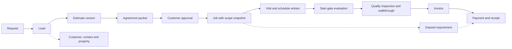

### 2.3 Immutability classes

| Class | Rule | Correction path | Examples |
|---|---|---|---|
| **M** mutable, audited | Current-state record; changes to protected fields write an audit event (NFR-008) | Edit with audit | Customer, Contact, Property, Visit status |
| **V** versioned content | Each change creates a new version; an approved or active version is immutable; versions referenced by any retained record are kept | New version, then retire the old one | Service card version, SOP version, Price book version, Business policy version |
| **F** frozen at commit | Editable only while draft; frozen when sent, approved, issued or completed | New version, supersede or void; never an edit | Estimate version, Change order, Invoice, Quality inspection |
| **A** append-only | Inserted once; never updated or deleted | Compensating record (reversal, supersede, correction request) | Payment, Payment adjustment, Time entry, Stock movement, Acknowledgement, Note, Audit event |
| **S** snapshot | Immutable copy of upstream data at a moment, with source-version references and a content hash | A new snapshot version | Job scope snapshot, Briefing snapshot, a request's original submission |

Requirement basis: class V implements NFR-013 ("retain versions and effective dates"); class F implements EST-006 ("Every revision must preserve the prior version") and REC-001 ("must not be silently rewritten"); class A implements FIN-006 ("auditable adjustment/void/reversal, not by overwriting history") and NFR-008; class S implements EST-007 ("retain the approved estimate snapshot") and RECT-005.

Protected records have no delete path (PERM-005; D-27-14 in [27](27-roles-and-permissions.md)). Drafts are discarded by status. The only removals are retention disposal and privacy erasure through the [13](13-privacy-data-governance.md) procedure; both are audited and keep the financial and audit records that law or a legal hold requires (**HUMAN REVIEW: attorney, CPA**). Archiving or hiding is not deletion (privacy playbook: "Distinguish deletion from hiding/archive.").

### 2.4 Sensitivity classes (PROPOSED for 13)

PROPOSED DECISION D-05-16; [13](13-privacy-data-governance.md) owns the final classes. An entity takes the class of its most sensitive field; Section 5 names the restricted fields. [13](13-privacy-data-governance.md) D-13-02 adopts these classes with amendments that govern where they differ: health details, worker-related complaint narratives and privacy records are Restricted; government ID and biometrics are never stored; worker location sits in a "not collected unless approved" group.

| Class | Meaning | Examples in this model | Default handling (detail in 13 and 27) |
|---|---|---|---|
| Public | Approved for publication | Published service descriptions and their approved translations | Published only through the claims gate of [32](32-website-and-customer-experience.md) |
| Internal | Business-internal, no personal data | SOP versions, hazard templates, checklist items, the item master | Staff only |
| Confidential | Commercially sensitive | Price books, labor cost rates, internal cost and margin, vendor terms, audit events | Named roles only (FIN-007; [27](27-roles-and-permissions.md) Section 4.7) |
| Personal | Identifies or relates to a person or a residence | Customer and contact details, service address, job history, communications, exterior photos | Need to know; sensitive reads logged where 27 lists them (REC-005) |
| Restricted | High harm if exposed | Access secrets; photos carrying the restricted identifier flag (people, children, documents, screens or keypads, valuables, items that reveal private traits, injuries; [13](13-privacy-data-governance.md) Sections 5.3 and 5.5); check images and bank references; injury and medical details; employee HR and pay data; worker location; legal and fraud notes; payee bank details | Encrypted or separately stored; reveal or read logged; never in SMS, email, exports or AI context unless 27 allows it |
| Never stored | Must not enter the system | Card numbers (provider components only, once a provider exists); customers' device or account credentials (D-27-16) | Rejected by validation; staff instructions forbid it |

### 2.5 Retention classes (PROPOSED hints for 13)

PROPOSED DECISION D-05-17. No durations are given (privacy playbook: "Do not invent a universal retention period."; REC-004). Each class names the event that starts the clock and who must set the duration in [13](13-privacy-data-governance.md). A legal hold suspends disposal in every class.

| Class | Clock starts when | Typical records | Duration set by (HUMAN REVIEW) |
|---|---|---|---|
| `lead` | Lead closed or lost without a job | Request, Lead, Duplicate candidate, site-assessment visit | Privacy owner + attorney |
| `contract` | Job closed and any complaint or dispute resolved | Estimate versions, agreement packets, customer approvals, signatures, change orders, substitutions, job scope snapshots, walkthroughs, customer-supplied item checks | Attorney |
| `operational` | Job closed | Visits, schedule entries, tasks, checklists, job item lines and material usage, waste records, briefing snapshots, non-incident photos, notes, communications | Privacy owner |
| `safety` | Incident, hold or hazard closed | Incidents, stop-work events, condition reports, site hazards, acknowledgements, gate evaluations, overrides | Attorney + insurer + qualified safety professional |
| `financial` | Accounting period closed | Invoices, payments, receipts, adjustments, allocations, credits and credit applications, refunds, write-offs, expenses, purchases, bank deposits, reconciliation sign-offs, job cost | CPA |
| `consent` | Consent withdrawn or the relationship ends | Consent records and the notice versions shown | Attorney + privacy owner |
| `workforce` | Employment or engagement ends | Employee, worker, qualification, time entries, availability | Attorney + payroll professional |
| `audit` | Event time | Audit events, role policy versions, role and capability grants, AI output records, automation runs | IT/security + attorney |
| `content` | Version retired and no retained record references it | All versioned catalog and configuration content | Owner |
| `transient` | Creation | Sessions, upload reservations, unattached uploads (deleted after 24 hours under WEB-020 in [32](32-website-and-customer-experience.md)), export files | IT/security |
| `secret` | Job closeout, unless the customer instructs retention for recurring service | Access secrets ([27](27-roles-and-permissions.md) Section 4.6, Property row) | Privacy owner |

### 2.6 Money, quantities and time

PROPOSED DECISIONS D-05-13 (money and quantities) and D-05-14 (time).

| Concern | Convention (PROPOSED) | Basis |
|---|---|---|
| Money amount | Signed 64-bit integer count of minor units (cents for USD); never floating point; the sign follows the line kind (charges zero or positive, discounts and credits zero or negative), enforced by constraint as in [28](28-pricing-estimating-and-job-costing.md) Section 12.1 | Master §9; NFR-020 |
| Unit rates | Exact decimal with 4 fractional digits plus currency, because area and unit rates can need fractions of a cent; never floating point | [28](28-pricing-estimating-and-job-costing.md) Section 12.1 |
| Currency | ISO 4217 code on every money-bearing document (estimate version, invoice, payment, credit, refund, expense, purchase); one currency per document; USD only unless the owner decides otherwise; SAR figures in draft price files are never imported | Owner L7 "Minimum \$150 USD"; DOM-009 |
| Rounding | Line extended amount = quantity × unit rate computed exactly, then rounded once to the minor unit (PROPOSED: half up, away from zero at .5); document totals are sums of rounded lines; allocations use the largest-remainder method and the last installment absorbs any remainder ([28](28-pricing-estimating-and-job-costing.md) Section 12.2); tax calculation and rounding follow CPA-approved settings | swe-architecture "define rounding"; **HUMAN REVIEW: CPA** (Q-05-08) |
| Quantity | Fixed-scale decimal (PROPOSED scale: 3 places, as in [28](28-pricing-estimating-and-job-costing.md) Section 12.1) plus a unit-of-measure code from one controlled list (for example sq ft, linear ft, each, hour); never floating point; conversions only by an explicit rule; US customary units are canonical unless the owner decides otherwise | Draft agreements allow "Sq. M"; Q-05-11 |
| Percentages | Integer basis points wherever a policy uses a percentage; no value is set | Owner L9 (deposit terms undecided) |
| Instants | UTC timestamp with time-zone context for every recorded event (created, sent, approved, started, collected) | NFR-020 |
| Property time zone | IANA zone name stored on each property, confirmed from the address and never inferred solely from the state | Scheduling playbook; Q-05-07 |
| Visit windows | Local date, local start and end times and the property's zone, plus derived UTC instants; the "service day" is the local date in the property's zone | [27](27-roles-and-permissions.md) Section 5.2; daylight-saving tests |
| Durations | Integer minutes (expected duration, preparation time, person-hours) | Job-costing "crew elapsed time from person-hours" |
| Calendar dates | Local dates (estimate valid-until, invoice due date) in the business time zone that [32](32-website-and-customer-experience.md) uses for display | NFR-020 |

### 2.7 Identifiers, business numbers and names

PROPOSED DECISION D-05-24.

- **Internal identifiers** are opaque and system-generated (format in [08](08-data-model-and-database.md)); clients may generate identifiers for offline-captured field records (DOM-030). Non-sequential public identifiers are defense in depth, never the access control ([27](27-roles-and-permissions.md) Section 5.4).
- **Business numbers.** Estimates, jobs, change orders, invoices, receipts, credits, refunds, purchases and incidents carry unique human-readable numbers (master §9 "define uniqueness and numbering strategy"). Formats are set in [08](08-data-model-and-database.md) and must not reuse requirement-ID prefixes (EST-, JOB-, FIN-, QA-, REC-, COM-, SCH-, START-), so a job number is never mistaken for a requirement ID in search, tickets or the [03](03-requirements-traceability-matrix.md) matrix (DOM-003). Numbering continuity rules for invoices and receipts need **HUMAN REVIEW: CPA**.
- **Service references** use the canonical code (HI-01 ... CL-07, spec Appendix B) and the slug kept in [04](04-service-registry.md); free-text service names and file names are never keys (DOM-002).
- **Names.** Entity names in this document are final for code and schema (Section 8.2 maps them to the resources of [27](27-roles-and-permissions.md)). Code names are singular PascalCase (`EstimateVersion`); modules use the lowercase context codes of Section 4.

## 3. Ubiquitous language

One name per concept, used the same way in UI copy (English and Spanish), code, the database, tests and documents. Spanish labels come from reviewed translation entries; the canonical code name never changes with the display language (PERM-007).

### 3.1 The distinctions that matter most

| Distinction | Rule of thumb | HandyHub example |
|---|---|---|
| Customer / Contact / Property | The customer pays and is bound; a contact is a person we talk to; the property is where we work. | A landlord company (customer) owns a rental house (property); the tenant (a contact with a site-access authority) lets the worker in for a CL-03 move-out clean; invoices go to the landlord. |
| Request / Lead / Estimate / Job | What was asked; what we are pursuing; what we offered; what we committed to do. | A web request for HI-04 TV mounting and DW-01 patching creates one lead; the estimator sends estimate versions 1 and 2; the customer approves version 2; one job with two work packages is created. |
| Visit / Schedule entry / Job | A dated occurrence; one version of its window; the whole commitment. | A DW-03 job is planned as several visits (the estimate-assistant playbook prices drywall by "repaired size/finish/visits" and counts "drying revisits"); moving the second visit adds a schedule entry and keeps the original window in history. |
| Work package / Task | The assignable unit of approved scope (usually one service in named work areas); one ordered step inside it. | "PT-01 living-room walls" is a work package; "mask trim" and "second coat" are tasks. |
| Service / Service card version / SOP version | What we sell; how we scope and check it now; how we perform it now. | HI-05 is the service; the active service card version lists intake questions, hazards and QA checks; the active SOP version holds the reviewed steps. |
| Deposit / Payment / Credit / Refund | A requirement to pay in advance; money received; a reduction without money moving; money paid back. | A PT-03 job meets the configured large-job rule (no threshold is set yet): a deposit requirement appears; the customer's check is a payment, received but not cleared; a billing correction is a credit; returning part of the deposit is a refund. |
| Incident / Complaint / Punch item | Harm or near-harm; dissatisfaction; a known unfinished item. | During HI-04 the worker damages a wall (incident, property damage); a week later the customer says the TV is crooked (complaint, then a rework case); at the walkthrough a missing cable cover is noted (punch item). |
| Quality inspection / QA check / Customer walkthrough | The inspection event; one criterion's result; the customer's acceptance outcome. | The lead worker's inspection of a CL-02 job records verified, failed, not inspected or not applicable for each QA criterion; the customer then accepts with one punch item. |
| Condition report / Site hazard / Job hold | What was found; the hazard it implies; the block it causes. | A DW-02 worker finds an untested popcorn ceiling: condition report, site hazard (suspect hazardous material), and a critical hold until a qualified assessment is recorded (risk-triage: "Unknown popcorn-ceiling material is not cleared by wet scraping."). |

### 3.2 Parties, people and places

| Term | Definition | Not to be confused with | Source |
|---|---|---|---|
| Customer | The person or organization HandyHub contracts with and bills: a household, landlord, property manager, short-term-rental host or builder. Party to estimates, approvals and invoices. | Contact; user account | ENT-001; owner L14 |
| Contact | A person reached about a customer's work (the customer in person, spouse, tenant, site contact, manager's staff, builder's superintendent). Belongs to exactly one customer and has no authority by default. | Customer; user account | LAUNCH-002; BRF-002 "Primary site contact" |
| Contact authority | An explicit, evidenced grant that a contact may approve estimates or change orders, receive financial records or give access instructions, scoped to an account, property or job. | Being listed as a contact | [27](27-roles-and-permissions.md) Section 5.5 (AUTH-028) |
| Property (site) | A service location (address and unit) with its serviceability result, time zone, site profile and access instructions. Several customers can relate to it over time. | Billing address ("Separate a customer's billing address from job location when needed.") | ENT-002 |
| Work area | A named part of a property (room, elevation, deck, ceiling) used to scope work packages, tasks, measurements and photos. | Property | BRF-004; QA-003 |
| Access secret | A lockbox, gate, alarm or door code or a key location, kept in an encrypted record and revealed only to assigned workers on the service day; a physical customer key held by HandyHub is a custody item of the same record. | Access instructions (parking, gate, HOA notes, which are not secret) | COM-002; D-27-16; [27](27-roles-and-permissions.md) Section 4.6 |
| Worker | A person who can be assigned field work: an employee, or later a subcontractor's worker. Holds qualifications and availability. | User account; employee | ROLE-003; ROLE-010 |
| Employee | A person employed by HandyHub, in the field or the office. HR and pay data are restricted. | Worker (the owner is not counted as a worker without confirmation, owner L6) | Master §5 file 05 |
| Subcontractor | A future business or individual engaged to perform assigned work packages under an agreement with insurance and license evidence. Not provisioned at launch. | HandyHub acting as subcontractor to a builder in the DW-04 draft agreement, where the builder is a customer | ROLE-010; NEAR-004; HND-007 |
| User account | A login identity for a staff member, customer contact or future subcontractor worker; permissions come from role assignments and capability grants. | Worker; contact | [27](27-roles-and-permissions.md) |

### 3.3 Demand, offers and commitments

| Term | Definition | Not to be confused with | Source |
|---|---|---|---|
| Request | One inbound submission as received (web form, phone call or email logged by staff), stored immutably with consent, disclosure versions, source and attachments. Aliases: inquiry, estimate request. | Lead; appointment (CX-002) | RECT-001; [32](32-website-and-customer-experience.md) Section 6.4 |
| Lead | The working sales record created from one or more requests: qualification, estimate route, follow-up, outcome and lost reason. | Customer; estimate | ENT-003; STM-001 |
| Duplicate candidate | A flagged possible duplicate among requests, leads, customers, contacts or properties, awaiting a human decision; never merged automatically. | Repeat request at the same address, which may be a new job (lead-intake playbook) | LAUNCH-002 |
| Estimate route | How a lead will be priced: nonbinding preliminary range, remote review, or on-site assessment. | A price | Estimate-assistant playbook |
| Preliminary range | A nonbinding price range given before a firm estimate; recorded as a communication; never approvable, convertible or billable. | Estimate version | PROPOSED DECISION D-05-26 |
| Site assessment | A visit to measure and assess before estimating, linked to the lead. Whether it is charged is an owner decision. | Work visit | STG-003; owner L7 "estimate-visit exceptions" |
| Estimate | The priced offer for defined scope at one property for one customer: a container with a stable estimate number and one or more versions. Aliases: quote, proposal, bid. | Invoice; job | ENT-004 |
| Estimate version | One complete, numbered version of an estimate (scope, options, lines, assumptions, exclusions, totals, deposit terms, validity). Frozen when sent; immutable when approved; each new version states its reason. Master: "Estimate revision". | Change order | EST-006; REC-001 |
| Estimate option | A separately identifiable choice within a version: base scope, alternate or optional add-on. | Line item | EST-005 |
| Line item | One priced row on an estimate version or an invoice: labor, material, equipment or rental, disposal, travel, fee, add-on, discount, minimum-charge adjustment or tax. | Task | EST-002; FIN-003 |
| Work package | A coherent, assignable unit of approved scope, normally one service in named work areas, carrying its service card version, SOP versions, requirements and QA checks. Planned on the estimate, instantiated on the job. | Task | ENT-006; ROLE-010 "assigned work package" |
| Customer approval | The recorded decision of the customer or an authorized contact, given on an agreement packet, to accept one estimate version with selected options, or one change-order version, with method, time and evidence. Spec name: work authorization. | Viewing an estimate; walkthrough acceptance | CX-003; STG-005; RECT-003 |
| Customer signature | The evidence captured for an approval or walkthrough outcome (typed or drawn signature, or an authenticated action), bound to the exact document version. Never created by AI. | Customer approval (the decision) | AIC-004; enforceability: **HUMAN REVIEW: attorney** |
| Agreement packet | The rendered documents a customer reviews before approving: the estimate or change-order version with the scope schedule and terms from active agreement template versions and the policy versions they cite, per language, with content hashes; immutable once sent. | Agreement template version | RECT-003; RECT-004; [30](30-service-agreement-standards.md) Section 9.4 |
| Job | The operational commitment created from one origin (normally one customer approval): approved scope snapshot, work packages, visits, readiness, execution, quality and closeout. | Visit; lead; estimate | ENT-005; STM-003 |
| Job scope snapshot | An immutable copy of the approved scope and customer price on the job; version 1 at conversion, one more version per approved change order. | Estimate version | EST-007; AT-032 |
| Visit (appointment) | One scheduled occurrence of on-site work or of a site assessment, with a local date and arrival window and its own status. A job may need several visits. | Job | Owner L14 "appointment"; CX-002 |
| Booking | Confirming a visit for a job and sending the confirmation; an inquiry is never a booking. | Request | CX-002 |
| Schedule entry | One version of a visit's scheduled window; a reschedule, delay update or cancellation adds an entry and keeps the earlier ones with reason, actor and customer-notification result. | Visit | CX-006; SCH-007 |
| Job assignment | The link of a worker to a job (optionally to specific visits) as lead worker or member, with a validity period that ends on reassignment. | Share grant | SCH-002; JOB-011 |
| Availability block | Working hours, approved time off or other unavailable time of a worker, used in conflict checks. | Visit | SCH-003 |
| Quoted visit bundle | The set of services quoted together for one job or visit; the PROPOSED unit to which the minimum charge applies once. | A line item | Owner L7 (proposed default) |
| Recurring service plan | An approved arrangement for repeated visits (CL-01 frequency, CL-05 turnovers, CL-06 weekly visits) that generates one job per occurrence. Planned for later (P1). | A multi-visit job | D-05-27; Q-05-01 |
| Referral | A record that requested or discovered work will not be performed by HandyHub (out of catalog, licensed trade, suspect hazardous material, structural) and that the customer was told. No partner is named until the owner approves one. | Change order | HND-005 |

### 3.4 Catalog, procedures and configuration

| Term | Definition | Not to be confused with | Source |
|---|---|---|---|
| Service | The canonical identity of one of the 26 services (code such as HI-04, slug, category, lifecycle status `proposed-active`, `active`, `paused` or `retired`, and the computed booking-enabled flag of [04](04-service-registry.md) Sections 2.3 and 2.4). Stable across renames. | Service card version; SOP | Spec Appendix B; [04](04-service-registry.md) |
| Service card version | A versioned, effective-dated template of a service: intake fields (`.INT`), estimating drivers, typical tools (`.TLS`) and materials (`.MAT`), hazards (`.HAZ`), safety and stop-work guidance (`.SAF`), quality checks (`.QAC`), exclusions and permit, license and qualification flags. | Service | ENT-007; NFR-013 |
| SOP | A controlled procedure, identified once and versioned: service-specific, a shared module written once for several services (for example pressure washing or ladder access, [31](31-sop-standard.md) Section 5.8), or the company field checklist of Appendix A items that apply to every service ([31](31-sop-standard.md) Section 4.3). | SOP version | ENT-008 |
| SOP version | An approved, effective-dated version of an SOP with ordered service tasks, prerequisites, controls, prohibited actions and review records (competent review; the Spanish review every version needs, [31](31-sop-standard.md) D-31-06). Only an active version reaches a briefing. | A draft SOP file in the vault | Owner L20 |
| SOP step | One ordered step of an SOP version (master: "Service task"), with a stable step ID kept across versions while its meaning is unchanged. | Task (the job instance) | Master §5 file 05; [31](31-sop-standard.md) Section 4.2 |
| Task | One ordered step instance in a job's work package, with status, notes, photos, measurements and exceptions; completion never erases evidence. | SOP step; checklist item | JOB-001 |
| Checklist item | One item of the condensed field checklist, generated from an SOP version and approved with it, never edited on its own; phases APXA-001..APXA-007; types action, check, hold, photo, measurement, acknowledgement, decision, info. | Job checklist response | BRF-006; spec Appendix A; [31](31-sop-standard.md) D-31-07 |
| Job checklist | The job's responses to the checklist items of the SOP versions it uses: done, not applicable or exception, with actor, time and evidence. | Checklist item | Master §5 file 05 |
| Price book version | A versioned, effective-dated set of pricing rules activated by the owner. Estimate versions record the price book version they used; approved prices never change when a new version activates. | Estimate | Master §13 |
| Price item | One sellable unit of work, add-on or material in a price book version, with pricing model, unit, rate and optional price tiers. No values are approved yet. | Item (the inventory catalog) | Owner L8; [28](28-pricing-estimating-and-job-costing.md) Section 3.2 |
| Pricing rule | A calculation rule in a price book version that sets or changes an amount: minimum job rule, service floor, fee schedule item, conditional surcharge, travel rule, discount limits, deposit policy, payment schedule template, rounding, tax configuration placeholder (PROPOSED DECISION D-05-28). | Business policy version | [28](28-pricing-estimating-and-job-costing.md) Section 3.2 |
| Business policy version | A versioned parameter set for one policy that sets terms or behavior rather than an amount: estimate validity, payment terms, cancellation and no-access, late payment, warranty and callback, preparation checklist, stop-work notice, refund and credit, auto-send, timekeeping, substitution, the START-015 low-risk start exception, the worker access window, retention, change-order validity, escalation contacts, the business time zone. Alias: policy version ([30](30-service-agreement-standards.md)). | Pricing rule | NFR-019; D-05-28 |
| Service-area rule | The versioned coverage configuration used to judge serviceability. No coverage list is approved yet. | A city list on the website | BIZ-001; HND-002 |
| Notification template version | A versioned English or Spanish template for one notification event, previewed before activation. | Notification | COM-001 |
| Translation entry | Reviewed text of one controlled-content item in one language, with reviewer and review status; safety text needs human review. | Machine translation of customer text (COM-006) | NFR-010; owner L11 |
| Agreement template version | An attorney-approved, versioned template for master terms, a service scope schedule, a work authorization, a change order or a consent form; immutable once approved. | Agreement packet | NFR-013; [30](30-service-agreement-standards.md) Section 9.4; **HUMAN REVIEW: attorney** |
| Review sign-off | The recorded review of one controlled-content version by a named, qualified reviewer (competent trade or safety review, Spanish review, attorney approval), with scope, decision, evidence and date. | A customer approval | Owner L20; COM-006; [31](31-sop-standard.md) Section 11.1 |

### 3.5 Readiness and field safety

| Term | Definition | Not to be confused with | Source |
|---|---|---|---|
| Readiness | The job-level summary Ready, Needs Attention or Blocked, computed from holds and missing prerequisites before a visit. Never set by hand. | Job status; start-gate outcome | UXE-001; SCH-001 |
| Job hold | A recorded block on progress until released: a critical hold (suspect hazardous material, structural concern, unapproved licensed-trade scope, failed or incomplete inspection, hazard flagged critical, missing permit, license or qualification) or a prerequisite hold (deposit, SOP not active, customer confirmation, site mismatch, information missing; moisture or an active leak as [11](11-worker-job-execution.md) D-11-29 proposes, pending [06](06-state-machines.md)). Critical holds are never overridden; a prerequisite hold is overridable only where [27](27-roles-and-permissions.md) Section 6.3 allows it (for example an ADM deposit waiver), and an SOP-not-active hold never is. | Override | START-010; owner L20; D-27-06; [27](27-roles-and-permissions.md) Section 6.3 |
| Briefing snapshot | An immutable, versioned composition of the worker briefing (BRF-001..BRF-014): scope version, SOP versions, hazards, tools, materials, documents and contacts. Alias: worker job packet. | Job packet export | RECT-005; START-002 |
| Acknowledgement | A personal, immutable confirmation by a worker bound to one briefing snapshot version: scope acknowledgement (START-003; operational, not a legal waiver), **safety acknowledgement** (START-004), SOP-version acknowledgement or a supervisor's high-risk confirmation. A scope or hazard change supersedes it. | Customer approval | START-003; START-004; job-planner playbook |
| Start-gate evaluation | The immutable record of one Start Job attempt: each gate check and the outcome (master §12: READY_TO_START, READY_WITH_WARNING, BLOCKED, REQUIRES_ADMIN_REVIEW, REQUIRES_CUSTOMER_CONFIRMATION). | Readiness | Master §12; START-001..START-015 |
| Override | An authorized, recorded bypass of an overridable gate (who, why, when, pre-override state). Not available for critical holds. | Exception; waiver of a deposit | PERM-006 |
| Exception | A recorded deviation with its resolution where a rule allows one (missing tool, QA exception). | Override | START-005; QA-001 |
| Hazard template | A reusable hazard definition (type, default severity, controls, PPE, stop-work trigger, critical flag) reviewed by a qualified person. | Site hazard | ENT-009; AT-018 |
| Site hazard | A hazard identified at a specific property or job (from intake, estimate, an earlier visit or the field), with status and reviewer; it never overwrites a template. | Hazard template | ENT-009; AT-018 |
| Condition report | A field record of concealed damage, substrate failure, moisture or an active leak, suspected hazardous material, an access issue, a missing customer item, pre-existing damage or weather, with photos and severity (scale in [11](11-worker-job-execution.md) Section 6.3). It may raise a site hazard, a hold, a change order or a referral. | Incident | JOB-004 |
| Stop-work event | A worker's recorded decision to stop, or not to start (No Start), for a listed condition, with evidence and escalation. It stays open until a person other than the reporter resolves it, or ADM voids a duplicate ([06](06-state-machines.md) Section 16.4). | Incident | START-011; SCH-008; UXE-004 |
| Emergency stabilization | Minimal action to prevent immediate injury or damage, recorded separately from change orders. | Change order | JOB-006; AT-034 |
| Incident | An unplanned event during HandyHub work that caused or nearly caused harm: injury, property damage, near miss, customer conflict, tool or equipment failure, suspected hazardous-material exposure. | Complaint; condition report | ENT-014; JOB-008 |

### 3.6 Materials, tools and procurement

| Term | Definition | Not to be confused with | Source |
|---|---|---|---|
| Item | The catalog definition of a tool, equipment item, PPE item or material, classified by item class (tool, consumable incorporated, consumable supply, PPE, specialty equipment) and default source (owned stock, vehicle stock, rental, customer-provided, job purchase). Master "Tool", "Material" and "Inventory item" are views of it. | Price item | ENT-010; ENT-011; master §14; [29](29-inventory-and-procurement.md) D-29-01 |
| Kit | A named, versioned group of items reused across services. | Job item line | UXE-005; [29](29-inventory-and-procurement.md) Section 5 |
| Service item requirement | A template line on a service card version: item or kit, criticality (safety-critical, critical, required, optional), quantity rule, default source, substitution policy and the SOP steps that use it. | Job item line | ENT-007; START-005; START-006 |
| Job item line | One item needed on a job's work package (tool, equipment, PPE or material): source, criticality, planned quantity, readiness (loaded, verified, missing, exception) and the totals of its usage events. | Material usage | ENT-010; ENT-011; START-005; START-006 |
| Material usage | An append-only event recording a quantity loaded, used, returned, wasted or damaged on a job item line (mainly consumables; tool and equipment lines track loading and return through their readiness); it never changes customer price. | Stock movement | JOB-003; AT-037 "Material usage" |
| Substitution | A proposed replacement for a job item line with its effect flags (appearance, specification, warranty, safety, cost, customer expectation), approver and change-order link. | Change order | JOB-007; AT-021 |
| Customer-supplied item | A product the customer provides (TV and mount, lock, closet kit, paint, rental restock items); its condition, model and quantity are recorded before work when liability depends on it. | Material bought by HandyHub | START-009; BRF-010 |
| Equipment asset | One owned, individually tracked unit of a tool or specialty-equipment item (serial, condition, inspection or calibration due, location). | Item | ENT-010 "inspection/calibration notes" |
| SDS document | The current safety data sheet for a chemical product, with revision date and source, shown in briefings. | Hazard template | BRF-008 "chemical/SDS references" |
| Waste record | The disposal of one waste stream from a job: quantity, destination and evidence. | Material usage (a wasted quantity) | QA-002; BRF-014 |
| Stock policy | Minimum stock, reorder point and par level for one item at one location. | Item | Master §14 |
| Stock location | A place stock is held: the shop or a vehicle ("vehicle stock" in master §14). | Property | Master §14 |
| Stock movement | An append-only change of an item's quantity at a location (receive, transfer or loadout, consume, return, waste or damage, count adjustment). | Material usage | Master §14 |
| Vendor | A supplier of materials, tools, rentals or services, and later the payee for a subcontractor. | Subcontractor | ROLE-008 "vendor/subcontractor records" |
| Purchase | Buying goods (materials, tools, rentals) from a vendor, for stock or a job, with lines, approval within the purchasing limit and receipt evidence. | Expense | FIN-007 "approved purchasing limits" |
| Expense | A business cost that is not a stocked item (fuel, tolls, parking, disposal fees, permit fees, service charges, subcontractor bills, reimbursable employee spending), optionally charged to a job. | Purchase | Master §5 file 05; job-costing playbook |

### 3.7 Money

| Term | Definition | Not to be confused with | Source |
|---|---|---|---|
| Customer price / internal cost | Price is what the customer is charged; cost is what the work costs HandyHub. Stored apart; cost and margin are restricted. | Margin vs markup ("A 30% margin is not a 30% markup", estimate-assistant playbook) | FIN-007 |
| Minimum-charge adjustment | An estimate line that raises a quoted visit bundle to the configured minimum, or the record of an authorized exception; never applied per line. | Trip fee in a draft price file | BIZ-003; FIN-001; owner L7 |
| Discount | An authorized reduction on an estimate version, recorded with its authorization. | Credit | EST-004 |
| Deposit | An advance payment required by the configured deposit policy for larger jobs. Modeled as a deposit requirement on the job plus the payments allocated to it. Threshold, amount, timing and terms are owner decisions. | Bank deposit; progress payment | BIZ-006; FIN-002; owner L9 |
| Bank deposit | Taking collected cash and checks to the bank, tracked in bank deposit batches for reconciliation. | Deposit | FIN-005 "deposit/reconciliation status" |
| Payment | Money received from a customer by cash, check or, later, a selected provider; immutable once recorded; its status separates recorded (received), deposited, cleared, returned, voided and reversed ([06](06-state-machines.md) Section 10.1). | Invoice; receipt | ENT-017; owner L10 |
| Payment allocation | Applying all or part of a payment to an invoice or a deposit requirement; a deposit held against a deposit requirement reaches the final or progress invoice through a new allocation, never as an invoice line. | Payment | FIN-003 "prior payments/deposits" |
| Receipt | The numbered customer-facing acknowledgement of one payment. | Invoice | FIN-004; FIN-005 |
| Payment adjustment | An append-only record that reverses or voids a recorded payment (for example a returned check); the only way to correct a payment. | Refund | FIN-006 |
| Invoice | A billing document issued electronically for approved work: deposit, progress or final; immutable once issued; corrected by void-and-reissue or a credit. | Estimate; receipt | ENT-016; FIN-003; STM-005 |
| Progress invoice | An invoice for part of the approved price under the approved payment schedule. | Deposit invoice | FIN-003 "final or progress invoice" |
| Payment milestone | One installment of an approved payment schedule on a job, with its trigger (a work package or visit completed, a quality inspection passed, or a date) and the progress invoice that bills it. | Deposit | FIN-003; G-094 |
| Credit | A reduction of what a customer owes without money moving (billing correction or authorized concession), applied to one or more invoices through credit applications or refunded later. An overpayment is not a credit: money did move, so it stays the unallocated part of its payment, is shown to the customer as account credit and is later allocated or refunded against that payment (treatment: Q-05-16, **HUMAN REVIEW: CPA**). | Refund; write-off; discount; unallocated payment | PERM-004; ENT-016 "deposits/credits" |
| Refund | Money paid back to a customer against a specific payment or credit balance, after approval. A refund request is a review item, not a refund. | Payment adjustment | PERM-004; customer-service playbook |
| Write-off | Recognition that an invoice balance is uncollectible; reduces the balance without payment or concession. | Credit | PERM-004; **HUMAN REVIEW: CPA** |
| Balance due | Invoice total minus allocated payments, credits and write-offs, shown with the part still pending clearance; always computed, never edited. | Payment status | FIN-003 |
| Job cost entry | An append-only actual-cost record on a job: labor from time entries at an approved loaded rate, net materials, equipment, subcontractor, travel, disposal, rework. | Customer price | Job-costing playbook |
| Reconciliation | Matching recorded payments, bank deposits and provider settlements to bank records and invoices, signed off by a person who did not collect the payments covered; the result is kept as a reconciliation sign-off record. | Clearance | AIR-015 "Human controls books, reconciliation signoff"; RECT-010; [27](27-roles-and-permissions.md) Sections 6.2 and 9 |

### 3.8 Quality and aftercare

| Term | Definition | Not to be confused with | Source |
|---|---|---|---|
| Quality inspection | One inspection event of a job or work package: inspection type (worker self-check, supervisor inspection, reinspection), inspector, checklist version, overall result. Master: "Quality inspection"; its lifecycle is the "quality review" of master §5 file 06. | QA check result | Master §5 files 05 and 06 |
| QA check result | The result for one QA criterion: verified, failed, not inspected or not applicable, with evidence. Spec name: Quality Check. | Quality inspection | ENT-015; quality-assistant playbook |
| Customer walkthrough | The customer's recorded acceptance outcome: accepted, accepted with punch items, unavailable or disputed. It does not waive rights or clear safety holds. | Quality inspection (quality-assistant playbook: "Customer acknowledgment is distinct from competent safety inspection") | QA-004 |
| Punch item | A specific unfinished or defective item within approved scope found before or at closeout, with owner, due date and evidence; it persists through invoicing. | Rework case | QA-005; STM-007 |
| Complaint | A customer's expression of dissatisfaction about work, conduct, schedule or billing, recorded without assigning blame. | Incident; punch item | CX-007; ROLE-007; customer-service playbook |
| Rework case | Return work after closeout to address a defect or complaint, linked to the original job and classified; aliases: return visit, callback. | Punch item | CX-007; QA-010; AT-059 |
| Lessons-learned tag | A tag marking a recurring defect, hazard, estimate miss, material miss or process issue for SOP or service-card improvement. | Complaint | QA-012 |

### 3.9 Records, communications and automation

| Term | Definition | Not to be confused with | Source |
|---|---|---|---|
| File object | The stored binary (photo, document, video) in private object storage with checksum, verified type and processing status. | Attachment | NFR-004 |
| Attachment | The link of a file object to a business record (request, estimate, job, task, incident, payment, expense) with purpose and visibility class. | File object; photo | Master §5 file 05 |
| Photo | An image attachment captured as evidence at a workflow moment (arrival, existing condition, protection, concealed condition, progress, completion, cleanup, incident) with work area or task, caption, uploader and time; internal-only by default. | Marketing image | ENT-012; REC-002; UXE-006 |
| Note | Free text attached to a record with a note class (customer-visible, internal operational, risk and safety, payment, complaint, employee/HR, legal, fraud); append-only; never holds secrets. | Communication | PERM-003; [27](27-roles-and-permissions.md) Section 4.8 |
| Communication | A logged exchange with a customer, contact or worker that matters to the record: call summary, message, email, SMS, portal message. | Notification | ENT-018; JOB-009; RECT-012 |
| Notification | An automated, template-based outbound communication triggered by an event (NTF-001..NTF-011 or a staff alert), with recipients, channel, language and delivery states; sent only under the owner-approved auto-send policy or a human release. | Communication log entry | COM-003; owner L18 |
| Consent record | An append-only record of a contact granting or withdrawing one permission (marketing by channel, or photo publication for a defined asset or job) with notice version, language, method, source and evidence. | Contact preference for operational messages | COM-004; REC-003 |
| Audit event | An append-only record of a protected action: actor type and ID, on-behalf-of user, action, object and version, previous and new values or a summary, reason, step-up, time. | Domain event (an internal message between modules) | ENT-019; RECT-011 |
| Job packet export | A permission-filtered export of a job's scope, approvals, operational record, selected evidence, QA and punch items, invoices and payments. | Briefing snapshot | REC-006; AT-060 |
| AI output record | A draft or recommendation from an AI role with its source records, assumptions and the human decision applied to it. | An approval | AIC-003; master §23 "Log important AI-assisted decisions." |

### 3.10 Terms to avoid or qualify

| Avoid or qualify | Use instead | Why |
|---|---|---|
| "Paid" for a check or an unsettled payment | recorded (received), deposited, cleared | Owner L10 "Received checks are not cleared money." |
| "Booked" or "appointment" for a request | request, until a visit is confirmed and the confirmation sent | CX-002 |
| "Quote", "bid", "proposal" in code | estimate (aliases only in approved UI copy) | One name per concept |
| "Deposit" for taking checks to the bank | bank deposit | FIN-005 |
| "Receipt" for a vendor's purchase slip | purchase receipt evidence (an attachment on the purchase or expense) | "Receipt" is the customer payment acknowledgement (FIN-004); see Section 7.4 |
| "Warranty" or "guarantee" in records and templates | rework case and its classification; warranty text only from owner-approved, attorney-reviewed templates | No approved warranty exists (master §1.4); QA-008 |
| "Approved SOP" without a review record | draft SOP | Owner L20 |
| "Safe" or "cleared" set by AI or by an acknowledgement | hold released by a named qualified person | AIR-001 "Cannot declare site safe"; owner L20 |
| "Subcontractor" for HandyHub working under a builder | customer of segment builder; "subcontractor" means HandyHub's own future subcontractors | [contract-new-construction](../Service%20Agreements/contract-new-construction.md) casts HandyHub (its "[Your Drywall Company Name]" placeholder) as the "Subcontractor" |
| "Work order" | briefing snapshot (worker packet) or job | Ambiguous |
| "Inspection" for the customer walkthrough | customer walkthrough | Quality-assistant playbook |
| Carpentry as a service category | the four categories of spec Appendix B | The owner deleted the Carpentry plan file (owner action 2026-10-03; to be confirmed) |
| "Tenant" in the multi-tenant sense | customer, assignment, work-package or AI-invocation scope | [27](27-roles-and-permissions.md) Assumption 2 |

## 4. Bounded contexts and modules

PROPOSED DECISION D-05-01: fourteen contexts, each a module (folder, package and schema namespace) of one application with one relational database.

### 4.1 Context catalog

| # | Context (module code) | Responsibility | Entities owned (Section 5) | Main upstream contexts | Skill lens |
|---|---|---|---|---|---|
| 1 | People and access (`people`) | Identities, roles, capabilities, workers, employees, future subcontractors, qualifications | User account, Role policy version, Role assignment, Capability grant, Share grant, Separation-of-duties exception, Session and registered device, Worker, Employee, Subcontractor, Qualification | None | business-it-security-administrator and business-systems-administrator through [27](27-roles-and-permissions.md) |
| 2 | Customers and properties (`crm`) | Parties, places, authority and consent | Customer, Contact, Contact authority, Property, Customer-property link, Work area, Access secret, Consent record | people | handyhub-lead-intake; business-privacy-data-owner |
| 3 | Intake and leads (`intake`) | Inbound requests, qualification, duplicates | Request, Lead, Duplicate candidate | crm, catalog | handyhub-lead-intake |
| 4 | Catalog and configuration (`catalog`) | Versioned services, procedures, checklists, item master, price books, policies, coverage, agreement and message templates, translations | Service, Service card version, Service item requirement, SOP, SOP version, SOP step, Checklist item, Review sign-off, Hazard template, Item, Kit, SDS document, Price book version, Price item, Price tier, Pricing rule, Labor cost rate, Business policy version, Service-area rule, Agreement template, Agreement template version, Notification template version, Translation entry | None | handyhub-job-planner, safety-liability-manager, handyhub-estimate-assistant, legal-compliance-administrator (content through [04](04-service-registry.md), [28](28-pricing-estimating-and-job-costing.md), [29](29-inventory-and-procurement.md), [30](30-service-agreement-standards.md), [31](31-sop-standard.md)) |
| 5 | Estimating and approvals (`estimating`) | Offers, versions, approvals, referrals, recurring plans | Estimate, Estimate version, Estimate option, Estimate work package, Estimate line item, Pricing exception, Agreement packet, Customer approval, Customer signature, Referral, Recurring service plan | crm, intake, catalog | handyhub-estimate-assistant |
| 6 | Scheduling and dispatch (`scheduling`) | Visits, schedule history, assignments, availability | Visit, Schedule entry, Job assignment, Availability block | jobs, people, crm | handyhub-scheduling |
| 7 | Job execution (`jobs`) | The job, its scope snapshots, work packages, tasks, checklists, change orders, items, waste and time | Job, Job scope snapshot, Work package, Task, Job checklist, Measurement, Change order, Emergency stabilization record, Job item line, Material usage, Substitution, Customer-supplied item check, Waste record, Time entry | estimating, catalog, scheduling | handyhub-job-planner |
| 8 | Readiness and field safety (`safety`) | Briefings, acknowledgements, start gates, holds, overrides, hazards, conditions, stop-work, incidents | Briefing snapshot, Briefing view, Acknowledgement, Start-gate evaluation, Job hold, Override record, Site hazard, Condition report, Stop-work event, Incident | jobs, catalog, crm | safety-liability-manager; handyhub-risk-triage |
| 9 | Quality and aftercare (`quality`) | Inspections, punch items, walkthroughs, complaints, rework, lessons learned | Quality inspection, QA check result, Punch item, Customer walkthrough, Complaint, Rework case, Lessons-learned tag | jobs | handyhub-quality-assistant; handyhub-customer-service |
| 10 | Inventory and procurement (`inventory`) | Stock, assets, rentals, PPE issue, vendors, purchases | Stock policy, Stock location, Stock movement, Stock lot, Equipment asset, Asset reservation, Rental agreement, PPE issue, Vendor, Vendor item, Purchase, Purchase line | catalog | No HandyHub skill covers procurement (expertise gap; owner assignment in [29](29-inventory-and-procurement.md)) |
| 11 | Finance (`finance`) | Invoices, payment milestones, payments, deposits, credits, refunds, write-offs, expenses, job cost | Invoice, Invoice line item, Payment milestone, Deposit requirement, Payment, Payment allocation, Receipt, Payment adjustment, Bank deposit batch, Reconciliation sign-off, Credit, Refund, Write-off, Expense, Job cost entry | estimating, jobs, inventory | bookkeeping-accounting-assistant; handyhub-job-costing |
| 12 | Records and communications (`records`) | Files, photos, notes, communications, notifications, audit, exports | File object, Attachment, Photo, Note, Communication, Notification, Delivery attempt, Audit event, Job packet export | All (shared kernel) | business-privacy-data-owner; business-systems-administrator |
| 13 | AI workspace and automation (`ai`) | AI drafts and deterministic automation runs | AI output record, Automation run | All, read through the invoking user's scope | [33](33-ai-and-automation-governance.md) |
| 14 | Reporting (`reporting`) | Read models for the dashboards | None (derived only) | All | handyhub-owner-analyst |

### 4.2 MOD-001..MOD-011 coverage

| Spec module | Implemented by | Notes |
|---|---|---|
| MOD-001 Public website | intake (request submission), catalog (published service content, service-area rule), crm (consent capture) | Public form design in [32](32-website-and-customer-experience.md) |
| MOD-002 Lead intake / CRM | intake, crm | Duplicate handling is P0 (LAUNCH-002) |
| MOD-003 Estimate workspace | estimating (reads catalog) | Approval capture also serves MOD-006 |
| MOD-004 Scheduling & dispatch | scheduling (reads people qualifications) | Capacity is a storage-level rule (DOM-021) |
| MOD-005 Job operations | jobs, safety, quality | The Start Job briefing lives in safety (LAUNCH-005) |
| MOD-006 Customer portal | No own entities: customer-visible projections of crm, estimating, scheduling, quality, finance and records | Filtered by the customer scope and field classes of [27](27-roles-and-permissions.md) (AT-047, AT-048) |
| MOD-007 Documents & records | records, plus rendered documents of estimating, jobs, safety and finance | Documents are renderings of frozen records, not separate sources of truth |
| MOD-008 Finance operations | finance, with cost inputs from inventory and jobs | Job costing is P1 (NEAR-003) |
| MOD-009 AI role workspace | ai | Disabled at launch (D-27-13) |
| MOD-010 Administration | catalog, people | Configuration changes are previewed and audited (NFR-019) |
| MOD-011 Reporting | reporting | RPT-001..RPT-010 read models |

### 4.3 Context map

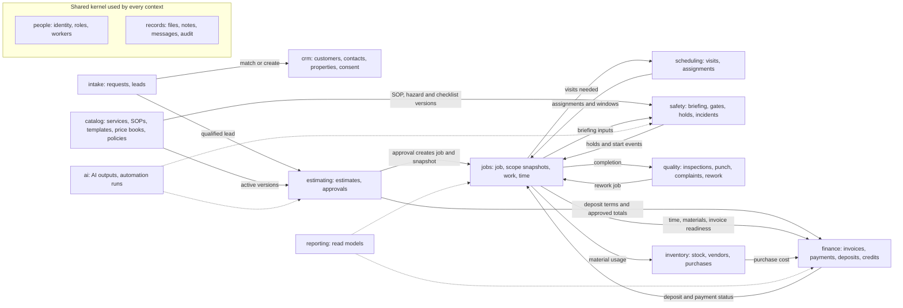

### 4.4 Integration rules between contexts

1. A context writes only its own entities. Cross-context effects happen by calling the owning module's command, or by reacting to its domain event (for example, a recorded customer approval leads the jobs module to create the job).
2. Snapshots, not live joins, cross commitment boundaries: jobs copies the approved scope, safety copies the briefing inputs, and finance derives invoice lines from the job's scope snapshot versions.
3. Every event consumer is idempotent by event ID (NFR-012; owner L18 "deduplicate effects"). One approval event creates one job (scheduling playbook: "A duplicated acceptance event creates one scheduling task.").
4. records and people are a shared kernel: attachments, notes, communications and audit events reference any entity by type and identifier and never change the referenced entity.
5. MOD-006 Customer portal owns no entities: it is a set of customer-visible projections.
6. reporting builds read models only and is never a source of truth; reports inherit the object scopes and field classes of their sources ([27](27-roles-and-permissions.md) Section 4.6).

## 5. Entity catalog

**How to read it.** Each context has a relationship diagram (Mermaid `erDiagram`, crow's-foot cardinality), an entity table and a governance table.

- **Entity table:** definition; key attributes (enough to start the schema, not the full schema; [08](08-data-model-and-database.md) owns columns); relationships written from the row entity's side (`1 : 0..*` means one of this entity relates to zero or more of the other).
- **Governance table:** data owner, the accountable role, using the role codes of [27](27-roles-and-permissions.md) Section 3.1 (WKR worker, LWK lead worker, DSP dispatcher, ESTR estimator, CSR customer service, BKP bookkeeper, ADM administrator/owner, SYS system identity; OWN-007 privacy owner). Lifecycle in [06](06-state-machines.md): `STM-nnn` is a spec state list that 06 revises; `new:` is a machine 06 must add; `simple:` is a short status set given here for 06 to confirm; `none` means append-only or snapshot. Sensitivity follows Section 2.4, immutability Section 2.3 and retention Section 2.5.
- **Owning module:** the context named in each heading owns every entity in its tables and is their only writer. **P1** marks entities modeled now but built after launch (spec §19.2, NEAR-001..NEAR-004); all others support a P0 capability (LAUNCH-001..LAUNCH-009).

### 5.1 People and access (`people`)

Owning module `people`; spec modules MOD-010 (users and roles) and MOD-004 (capability tags). PROPOSED DECISION D-05-21: a login (user account), a field worker, an employee and a subcontractor are four different things, so the model scales to subcontractors "without redesigning core jobs, scheduling, documentation, or audit history" (BIZ-005). Permissions themselves are defined in [27](27-roles-and-permissions.md).

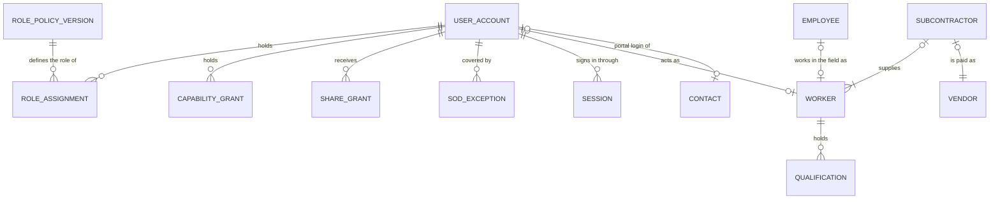

| Entity | Definition | Key attributes | Relationships |
|---|---|---|---|
| **User account** `UserAccount` | Login identity for a staff member, a customer contact (portal) or a future subcontractor worker. Authentication uses a maintained identity provider ([07](07-system-architecture.md), [12](12-security-threat-model.md)). | account type (staff, customer contact, subcontractor); status (invited, active, disabled); login identifier; preferred language; MFA enrolment state; created and disabled times | 1 : 0..* role assignments, capability grants, share grants, sessions; 1 : 0..1 worker; 1 : 0..1 contact |
| **Role policy version** `RolePolicyVersion` | The versioned role definitions (ROLE-001..ROLE-011 and SYS as capability bundles), named capabilities and permission-matrix cells of [27](27-roles-and-permissions.md), stored as policy data and activated by ADM with step-up (AUTH-002 "Roles are versioned capability bundles stored as policy data"; D-27-01). [27](27-roles-and-permissions.md) Section 14 lists it as "Role". | version; status (draft, active, superseded); role definitions; capability definitions; matrix cells and field-class rules; change summary; approved by; effective from | 1 : 0..* role assignments and capability grants that cite it |
| **Role assignment** `RoleAssignment` | Grant of one application role (ROLE-001..ROLE-011) to a user, from versioned policy data. | role code; policy version; granted by; reason; valid from and to | N : 1 user account; N : 1 role policy version |
| **Capability grant** `CapabilityGrant` | Grant of one named capability (collect, field-override, qa-verify, share-grant, photo-share, customer-contact) to one user, with step-up and reason ([27](27-roles-and-permissions.md) Section 4.1). | capability code; granted by; reason; valid from and to | N : 1 user account |
| **Share grant** `ShareGrant` | Time-limited explicit access to one job or work package for a user who is not assigned (PERM-002). | object; grantee; granter; reason; read or edit; expires at; revoked at | N : 1 user account; N : 1 job or work package |
| **Separation-of-duties exception** `SodException` | Owner-accepted record that one person holds incompatible roles, with compensating controls ([27](27-roles-and-permissions.md) Section 9). | conflicting roles; compensating controls; approver; next review date | N : 1 user account |
| **Session** `Session` and **Registered device** `RegisteredDevice` | Two entities, split as in [08](08-data-model-and-database.md) D-08-22: an authenticated session, and the phone or browser it runs on, used for revocation and lost-phone handling (lifetimes in [12](12-security-threat-model.md)). A registered device keeps an append-only device delivery log of the job packages and access secrets sent to it, so a lost phone's exposure can be listed ([12](12-security-threat-model.md) SEC-036; Section 7.5). | device label; platform; first and last seen; revoked at and reason | N : 1 user account |
| **Worker** `Worker` | A person who can be assigned field work: an employee's field profile or, later, a subcontractor's worker. | kind (employee, subcontractor worker); name shown to customers (policy Q-27-08); default language; working-hours profile; lead-eligible flag; active flag | Exactly one of: 1 : 1 employee, or N : 1 subcontractor; 1 : 0..* qualifications, job assignments, availability blocks, time entries, acknowledgements |
| **Employee** `Employee` | A person employed by HandyHub, in the field or the office. Payroll is outside this model unless the owner decides otherwise. | legal name; employment start and end; employment status; job title; HR fields (restricted) | 1 : 0..1 worker; 1 : 0..1 user account |
| **Subcontractor** `Subcontractor` - P1 | A future business or individual engaged for assigned work packages, provisioned only after the policy and insurance/compliance workflow exists (NEAR-004; HND-007 "do not pre-grant future subcontractor permissions"). | legal name; agreement reference and version; insurance-certificate evidence and expiry; license evidence; status | 1 : 1..* workers; 1 : 1 vendor (payee) |
| **Qualification** `Qualification` | A verified capability or certification held by a worker, used by scheduling (SCH-003) and start gates (START-010); set by ADM with evidence, never self-asserted. The list of qualification types is an owner decision; none is assumed here. | qualification type code; evidence attachment (including training evidence where training grants the qualification, [26](26-business-process-map.md) BPM-019); issued and expiry dates; verified by; status | N : 1 worker; referenced by service card versions as required qualifications |

| Entity | Data owner | Lifecycle (06) | Sensitivity | Immutability | Retention |
|---|---|---|---|---|---|
| User account | ADM (technical: OWN-006) | new: User account (invited, active, disabled) | Personal | M | `workforce` (staff); `operational` (customer) |
| Role policy version | ADM (owner approval) | new: Controlled content | Internal | V | `audit` |
| Role assignment | ADM | none (validity period) | Internal | A (ended by a new fact) | `audit` |
| Capability grant | ADM | none | Internal | A | `audit` |
| Share grant | DSP, ADM | none (expiry) | Internal | A (revocation is a new fact) | `audit` |
| Separation-of-duties exception | ADM | none | Confidential | V | `audit` |
| Session; Registered device | ADM (technical: OWN-006) | simple: active, revoked | Confidential | A | `transient` (sessions); `audit` (devices) |
| Worker | ADM | simple: active, inactive | Personal (location never collected unless separately approved, SCH-004) | M | `workforce` |
| Employee | ADM | simple: active, ended | Restricted (HR and pay) | M | `workforce` (**HUMAN REVIEW: attorney, payroll professional**) |
| Subcontractor | ADM, BKP | new (P1): Subcontractor onboarding | Confidential (payee bank details Restricted) | M; agreement references V | `workforce` and `financial` |
| Qualification | ADM | simple: pending, verified, expired, revoked | Restricted (evidence) | M (verification events audited) | `workforce` |

### 5.2 Customers and properties (`crm`)

Owning module `crm`; spec modules MOD-002 and MOD-006. PROPOSED DECISION D-05-03: the customer is the contracting and billing party, contacts belong to one customer, and customers relate to properties through dated links, because landlords, tenants, property managers, hosts and builders (CL-03.INT "lease/landlord checklist", CL-05.INT "host checklist", DW-04.INT "builder plans") are different parties at the same address.

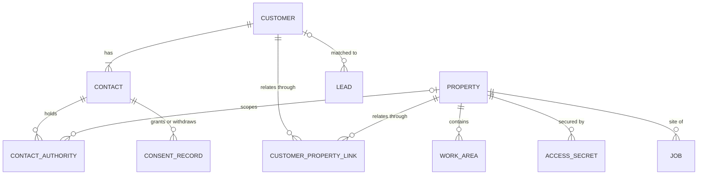

| Entity | Definition | Key attributes | Relationships |
|---|---|---|---|
| **Customer** `Customer` (ENT-001) | The person or organization HandyHub contracts with and bills: a household, landlord, property manager, short-term-rental host or builder. | customer number; type (individual, organization); segment (owner-occupant, landlord, property manager, short-term-rental host, builder or GC, commercial, other; launch list pending Q-05-05); display and legal name; preferred language (en, es); operational communication preferences; billing address and billing contact; invoice delivery preference; tax status (placeholder until a CPA defines it; any exemption evidence the CPA requires is an attachment, G-086, Q-05-08); status (active, inactive, merged into) | 1 : 1..* contacts; N : M properties through customer-property links; 1 : 0..* leads, estimates, jobs, invoices, payments, credits, complaints |
| **Contact** `Contact` | A person reached about the customer's work. Belongs to exactly one customer (a person who acts for two customers is two contacts) and has no authority by default. | name; phone numbers (E.164); email; preferred language and channel; relationship to the customer (self, household member, tenant, site contact, manager staff, builder staff, other); primary flag; status | N : 1 customer; 1 : 0..* contact authorities, consent records; 1 : 0..1 user account |
| **Contact authority** `ContactAuthority` | An evidenced grant that a contact may approve estimates or change orders, receive financial records or give access instructions ([27](27-roles-and-permissions.md) Section 5.5, AUTH-028). Who may legally authorize work on a property is **HUMAN REVIEW: attorney** (Q-27-07). | authority type (approve estimates and change orders, receive financial records, give access instructions, site contact); scope (account, property or job); evidence; recorded by (CSR or ADM); valid from and to | N : 1 contact; N : 0..1 property or job (scope) |
| **Property** `Property` (ENT-002 Property/Site) | A service location where work is done. Several customers can relate to it over time (owner, tenant, manager); billing addresses live on the customer. | address and unit; normalized address; IANA time zone; serviceability result and service-area rule version; property type; year built with provenance (customer-reported or verified); occupancy (occupied, vacant, unknown); pets and occupants notes with provenance; parking and access instructions (non-secret); utility and shut-off notes; recurring site facts; status | N : M customers through links; 1 : 0..* work areas, access secrets, site hazards, visits, jobs, photos |
| **Customer-property link** `CustomerPropertyLink` | The relationship of one customer to one property, with its role and period. | relationship type (owner-occupant, landlord, tenant, property manager, short-term-rental host, builder or GC, other); valid from and to; evidence | N : 1 customer; N : 1 property |
| **Work area** `WorkArea` | A named part of a property used to scope work and evidence (QA-003 "mapped to work areas or tasks"). | name; level or floor; area type (room, ceiling, wall run, deck, fence line, driveway, exterior elevation, duct run); notes | N : 1 property; referenced by work packages, tasks, measurements, photos, punch items |
| **Access secret** `AccessSecret` | An encrypted lockbox, gate, alarm or door code or key location, revealed only to assigned workers on the service day (D-27-04, D-27-16). Customers' device or account credentials are never stored. A physical customer key held by HandyHub (the CL-01 draft agreement offers entry by "Key / Lockbox Code / In-Person Entry") is recorded here as a custody item: issue and return are logged per person and the key tag carries a code, never the address ([27](27-roles-and-permissions.md) Section 4.6). | secret type (code, key location, physical key in HandyHub custody); encrypted value; validity (single job, or recurring service on the customer's instruction); reveal window; key tag code and custody log (issued to, issued at, returned at); created by; cleared at | N : 1 property; N : 0..1 job; each reveal and each key issue or return writes an audit event |
| **Consent record** `ConsentRecord` | An append-only record of a contact granting or withdrawing one permission. Operational service messages are not marketing (COM-004); photo publication is separate from job documentation (REC-003). | purpose (marketing email, marketing SMS, photo publication for a defined asset or job, electronic-records consent where the attorney requires it ([30](30-service-agreement-standards.md)), other approved purpose); channel; state (granted, withdrawn); time; source and method; notice version shown; language; evidence; recorded by | N : 1 contact; N : 0..1 photo or job (publication scope) |

| Entity | Data owner | Lifecycle (06) | Sensitivity | Immutability | Retention |
|---|---|---|---|---|---|
| Customer | CSR | simple: active, inactive, merged | Personal (tax status Confidential) | M | `operational` (billing data also `financial`) |
| Contact | CSR | simple: active, inactive | Personal | M | `operational` |
| Contact authority | CSR, ADM | none (validity period) | Personal | A | `contract` |
| Property | CSR (profile), DSP (access instructions) | simple: active, inactive | Personal (occupancy and availability patterns treated as sensitive) | M | `operational` |
| Customer-property link | CSR | none (validity period) | Personal | A | `operational` |
| Work area | DSP, LWK | none | Internal | M | `operational` |
| Access secret | DSP (custodian); OWN-007 (policy) | simple: active, cleared | Restricted | M (value); reveals A | `secret` |
| Consent record | CSR; OWN-007 (policy) | none (append-only stream; the latest record is the current state) | Personal | A | `consent` |

### 5.3 Intake and leads (`intake`)

Owning module `intake`; spec modules MOD-001 and MOD-002. PROPOSED DECISION D-05-02: the request is the immutable submission; the lead is the working record. The public form of [32](32-website-and-customer-experience.md) creates both.

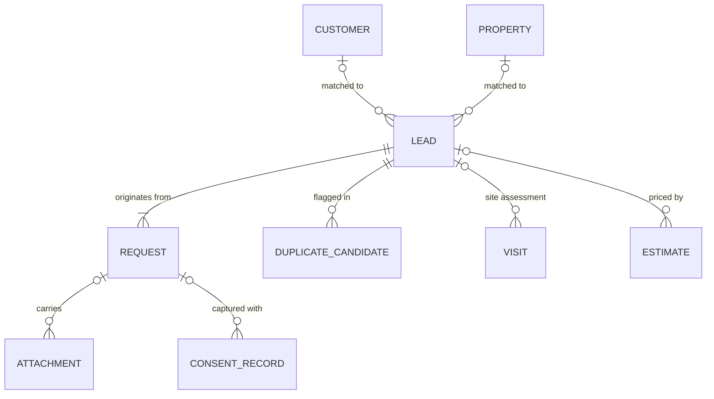

| Entity | Definition | Key attributes | Relationships |
|---|---|---|---|
| **Request** `Request` (RECT-001) | One inbound submission exactly as received (web form, phone call or email logged by staff, referral), stored immutably: "Original submission, consent, source and attachments" (RECT-001). A request is not an appointment (CX-002). | request reference; channel; received at; submit language and preferred contact language; services requested (codes or `unsure`; several services map to one request, lead-intake playbook); description; service-specific answers; urgency (flexible, soon, safety concern); timing preference (not an appointment); relationship to the property; contact snapshot; property snapshot (ZIP required, street address optional); minimum-charge disclosure acknowledgement and disclosure version; privacy notice version; form version; source and campaign; serviceability result and rule version; spam signals; idempotency key; original payload snapshot | N : 1 lead; 1 : 0..* attachments, consent records |
| **Lead** `Lead` (ENT-003) | The working sales record created from a request and enriched by staff. Lead statuses that mirror the estimate ("Estimate Needed", "Estimate Sent") are derived from the linked estimate, not set by hand (for [06](06-state-machines.md) to confirm). | lead number; status (STM-001); owner (CSR); services of interest; qualification (serviceable, scope fit, urgent or safety flag, information complete); estimate route (preliminary range, remote review, site assessment); risk-triage flags; next action and due date; lost or closed reason code (RPT-001 "reason codes"); matched customer and property; merged-into lead | 1 : 1..* requests; N : 0..1 customer; N : 0..1 property; 1 : 0..* estimates, site-assessment visits, communications, notes |
| **Duplicate candidate** `DuplicateCandidate` | A flagged possible duplicate awaiting a human decision; merges keep both originals linked (LAUNCH-002; [27](27-roles-and-permissions.md) Section 4.6). | candidate pair (request, lead, customer, contact or property); match signals; status (open, merged, not a duplicate); decided by and at | N : 1 lead, customer or property record |

| Entity | Data owner | Lifecycle (06) | Sensitivity | Immutability | Retention |
|---|---|---|---|---|---|
| Request | CSR | none (immutable) | Personal | S (original submission) | `lead`; after conversion it follows the job (`operational`) |
| Lead | CSR | STM-001 | Personal | M (transitions validated server-side, NFR-020) | `lead` |
| Duplicate candidate | CSR | simple: open, merged, not a duplicate | Personal | A (one decision) | `lead` |

### 5.4 Catalog and configuration (`catalog`)

Owning module `catalog`; spec module MOD-010 ("Service catalog, SOPs, hazard templates, pricing rules, service area, ... notification templates, language content and business policies") and the published content of MOD-001. Every entity here is controlled content: versioned, previewed, reviewed, approved and audited (NFR-013, NFR-019). PROPOSED DECISION D-05-28 gives every rule one home: a rule that sets or changes an amount lives in the price book version; a rule that sets terms or behavior lives in a business policy version; estimate versions, agreement packets and change orders pin the versions they used. Business policy versions, service-area rules and labor cost rates stand alone and are referenced by the contexts that apply them. The item master follows [29](29-inventory-and-procurement.md) (D-05-29), the SOP structure follows [31](31-sop-standard.md) (PROPOSED DECISION D-05-30: SOP steps and the generated checklist are approved together, and every review is a review sign-off), the price book follows [28](28-pricing-estimating-and-job-costing.md) and agreement templates follow [30](30-service-agreement-standards.md) (D-05-31), with the names reconciled in Section 7.4.

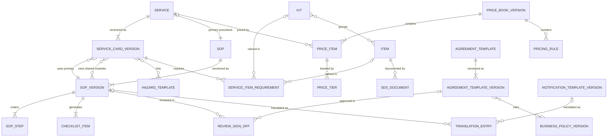

| Entity | Definition | Key attributes | Relationships |
|---|---|---|---|
| **Service** `Service` | The canonical identity of one of the 26 services of spec Appendix B; stable across renames; registry fields in [04](04-service-registry.md). | service code (HI-01 ... CL-07); canonical name; slug; category (Home Improvement, Drywall, Painting, Cleaning); lifecycle status (`proposed-active`, `active`, `paused`, `retired`; [04](04-service-registry.md) Section 2.3, D-04-04); web status (`hidden`, `estimate-requests`; [04](04-service-registry.md) Section 2.3, [32](32-website-and-customer-experience.md) WEB-006); booking enabled (computed from the status and the ten gate items of [04](04-service-registry.md) Section 2.4, never edited; DOM-007); service gate evidence per gate item (per line type only if [04](04-service-registry.md) Q-04-16 approves per-line-type gating); aliases ([04](04-service-registry.md) D-04-03); first-jobs watch remaining after activation ([18](18-release-and-launch-plan.md) REL-010) | 1 : 1..* service card versions; 1 : 0..* service gate evidence records, aliases; 1 : 1 primary SOP; 1 : 0..* price items; referenced by requests and by estimate and job work packages |
| **Service card version** `ServiceCardVersion` (ENT-007 Service Card) | A versioned, effective-dated template of a service. "Service-card defaults never override a site-specific hazard, manufacturer instruction, permit/licensing requirement, or approved change order" (spec §17). | version; status; effective from and to; intake field definitions (`<CODE>.INT`); estimating drivers and method; service item requirements (`.TLS`, `.MAT`); hazard template references (`.HAZ`); safety and stop-work guidance (`.SAF`); QA criteria (`.QAC`); inclusions; exclusions; customer preparation; permit, license and qualification flags; required qualifications; required photos (START-008); customer-supplied item rules; approvers | N : 1 service; N : 1 primary SOP version; N : M shared-module SOP versions, hazard templates; 1 : 0..* service item requirements |
| **Service item requirement** `ServiceItemRequirement` | A template line on a service card version naming an item or kit, with criticality, quantity rule, default source, substitution policy and the SOP steps that use it. A line with no SOP step, or an SOP step with no line, is a template defect ([29](29-inventory-and-procurement.md) Section 4.3). | item or kit; line role (tool, equipment, PPE, material, kit); criticality (safety-critical, critical, required, optional); quantity rule type and parameters; default source; substitution policy override; SOP step references; briefing text key | N : 1 service card version; N : 0..1 item or kit; 1 : 0..* job item lines |
| **SOP** `Sop` | A controlled procedure: one per service; a shared module used by several services, for example one pressure-washing module for HI-03, PT-02 and PT-03 ([31](31-sop-standard.md) Section 5.8 "Shared safety modules", D-31-11; PROPOSED DECISION D-05-10); or the company field checklist that holds the Appendix A items every service uses ([31](31-sop-standard.md) Section 4.3: "versioned like an SOP"). | SOP code; title; kind (service, shared module, company field checklist); owner | 1 : 1..* SOP versions; primary for 0..1 service |
| **SOP version** `SopVersion` (ENT-008) | An approved, effective-dated version of an SOP with its steps and its generated field checklist. Only an active version whose review sign-offs are complete, including the Spanish review that every version needs ([31](31-sop-standard.md) D-31-06; owner L11, L20), reaches a briefing (HND-004). Every SOP in the vault is a draft today. | version; status (draft, in review, approved, active, suspended, superseded, retired); effective from and to; master §16 sections (purpose, scope, preconditions, required qualifications, preparation, PPE, tools, materials, hazards, stop-work conditions, setup, steps, quality checkpoints, cleanup, waste handling, photo requirements, customer communication, completion criteria, escalation, incident reporting); do-not-perform list (UXE-010); prohibited actions; required review plan (reviewer qualifications derived from its hazards, [31](31-sop-standard.md)); revision reason; source vault file | N : 1 SOP; 1 : 1..* SOP steps, checklist items; 1 : 0..* review sign-offs, translation entries |
| **SOP step** `SopStep` (master: Service task) | One ordered step of an SOP version; its stable step ID is kept across versions while its meaning is unchanged ([31](31-sop-standard.md) Section 4.2). | step ID; sequence; section; instruction key; hold-point flag and release requirement; required evidence (photo, measurement); item, hazard and do-not-perform references; expected result | N : 1 SOP version; 1 : 0..* checklist items, job tasks |
| **Checklist item** `ChecklistItem` | One item of the condensed field checklist, generated from an SOP version and approved with it; never edited on its own ([31](31-sop-standard.md) D-31-07). A job's field checklist combines the items of its service and module SOP versions with the active company field checklist items. Its quality-checkpoint items, with the service card's `.QAC` criteria, are what quality inspections check. | step ID; phase (APXA-001..APXA-007); order; type (action, check, hold, photo, measurement, acknowledgement, decision, info); text key; applies-when condition; evidence requirement; hold release (critical holds name a qualified assessment); hazard, item and do-not-perform references; safety-critical flag (no exception allowed) | N : 1 SOP version; N : 0..1 SOP step; 1 : 0..* job checklist responses, QA check results |
| **Review sign-off** `ReviewSignOff` | The recorded review of one controlled-content version by a named reviewer: competent trade or safety review and Spanish review for SOPs and hazard templates (owner L20), attorney approval for agreement templates ([30](30-service-agreement-standards.md)), bilingual review for translations (COM-006). | content version reference; review type; reviewer and qualification; scope reviewed; decision (approved, changes requested, rejected); evidence; signed at | N : 1 controlled-content version |
| **Hazard template** `HazardTemplate` (ENT-009, template side) | A reusable hazard definition reviewed by a qualified person; reusable across services (a ladder hazard applies to many). | hazard code; type; default severity; controls (hierarchy of controls, PPE last); PPE; stop-work trigger; critical-hold flag; escalation path; review sign-off; version and status | N : M service card versions; 1 : 0..* site hazards |
| **Item** `Item` (master: Tool, Material, Inventory item) | The catalog definition of every tool, equipment item, PPE item and material, classified on two axes: what it is (item class) and where it normally comes from (default source) ([29](29-inventory-and-procurement.md) D-29-01). | item code; name (Spanish name through a reviewed translation entry); item class (tool, consumable incorporated, consumable supply, PPE, specialty equipment); default source (owned stock, vehicle stock, rental, customer-provided, job purchase); unit of measure and pack size (unit list shared with [28](28-pricing-estimating-and-job-costing.md)); manufacturer and model where identity matters; specification attributes (ratings only from manufacturer data); status (draft, in review, active, retired); hazardous flag and SDS requirement; storage constraints; shelf-life tracking; inspection profile; qualification tag; asset-tracked flag; substitution policy; job-cost category; unit cost basis (Confidential); source reference for seeded items | 1 : 0..* service item requirements, job item lines, SDS documents, equipment assets, stock policies; N : M kits |
| **Kit** `Kit` | A named, versioned group of items reused across services (UXE-005 loadout; [29](29-inventory-and-procurement.md) Section 5). | kit code; name; version; lines (item, quantity, criticality); status | N : M items; 1 : 0..* service item requirements |
| **SDS document** `SdsDocument` | The current safety data sheet for a chemical product (BRF-008 "chemical/SDS references"). The hazard summary is transcribed by the safety reviewer, never generated by AI. | item; revision date; source (manufacturer); file; hazard summary; reviewer; status (current, superseded) | N : 1 item |
| **Price book version** `PriceBookVersion` | A versioned, effective-dated set of price items and pricing rules. No version can be activated until the owner approves values (owner L8); draft figures in `Pricing/` are not imported (DOM-009). | version; status; effective from and to; currency (USD); activated by (ADM with step-up); approval reason; change summary; supersedes | 1 : 1..* price items; 1 : 0..* pricing rules; 1 : 0..* estimate versions |
| **Price item** `PriceItem` | One sellable unit of work, add-on or material; its code stays stable across versions so versions and variances can be compared ([28](28-pricing-estimating-and-job-costing.md) Section 3.2). | item code; service; pricing model (flat, hourly, unit, area, tiered); unit; rate (exact decimal) and currency; optional minimum quantity or minimum billable person-hours; customer description keys (EN, ES); customer-visible flag; tax category reference; internal cost reference (Confidential); provenance note | N : 1 price book version; N : 0..1 service; 1 : 0..* price tiers, estimate line items |
| **Price tier** `PriceTier` | A quantity band of a price item; tiers are contiguous and do not overlap. | lower bound (inclusive); upper bound (exclusive; empty for the top tier); rate or flat amount | N : 1 price item |
| **Pricing rule** `PricingRule` | A calculation rule in a price book version that sets or changes an amount (D-05-28): minimum job rule, service floor, fee schedule item, conditional surcharge (applied only by change order), travel rule (disabled until approved), discount limits and reason codes, deposit policy, payment schedule template, rounding policy and the tax configuration placeholder ([28](28-pricing-estimating-and-job-costing.md) Section 3.2). | rule type; parameters validated per type (amounts in minor units, rates as exact decimals, percentages in basis points); scope (service, customer segment, state); effective dates; customer wording keys (EN, ES) where shown; agreement clause reference where terms apply; status | N : 1 price book version; N : 0..1 service |
| **Labor cost rate** `LaborCostRate` - P1 | The approved loaded cost per hour used for job costing (job-costing playbook: "actual person-hours times the approved loaded cost rate"). No rate has been supplied (owner L8; Q-05-14). | rate basis (role or person); loaded cost per hour (minor units); burden components reference; effective dates; approved by | Referenced by job cost entries |
| **Business policy version** `BusinessPolicyVersion` | A versioned parameter set for one policy that sets terms or behavior rather than an amount (D-05-28); [30](30-service-agreement-standards.md) calls it PolicyVersion. Values come only from owner decisions; privacy-notice versions belong to [13](13-privacy-data-governance.md). | policy key (estimate validity, payment terms, cancellation and no-access, late payment, warranty and callback, preparation checklist, stop-work notice, refund and credit, auto-send, timekeeping, substitution, START-015 low-risk start exception (disabled by default; unknown risk is not low risk, [27](27-roles-and-permissions.md) Section 6.3), worker access window, retention, change-order validity ([06](06-state-machines.md) CO5), escalation contacts ([11](11-worker-job-execution.md) Section 6.5, Q-11-01), business time zone ([06](06-state-machines.md) Q-06-12); key codes as in [08](08-data-model-and-database.md) `catalog.business_policy_version`); scope (service, customer segment, state); parameters validated per key; version; status; effective dates; approver; review sign-offs; preview and validation record (NFR-019) | Referenced by estimate versions, agreement template versions and packets, notifications (auto-send) and time entries (timekeeping) |
| **Service-area rule** `ServiceAreaRule` | The versioned coverage configuration used to judge serviceability (BIZ-001 "configured coverage rules rather than ... a hard-coded city list"). No coverage is approved yet (HND-002). | version; coverage definition (configured units such as ZIP codes; the unit is an owner decision); override authority; effective dates; status | 1 : 0..* serviceability results on requests and properties |
| **Agreement template** `AgreementTemplate` | One family of customer-facing legal documents: master terms, service scope schedule, work authorization, change order or consent form, by customer segment and service ([30](30-service-agreement-standards.md) Section 9.4). | family; customer segment; service code (scope schedules); jurisdiction (as the attorney specifies) | 1 : 1..* agreement template versions |
| **Agreement template version** `AgreementTemplateVersion` | An approved, versioned template body; immutable once approved; Spanish text only from an approved translation (**HUMAN REVIEW: attorney licensed in KY and/or IN**). | version; status (draft, legal review, approved, active, superseded, retired); structured body with section keys; content hash; effective dates; attorney approval sign-off; review due date; cited policy versions; lint report | N : 1 agreement template; 1 : 0..* translation entries, review sign-offs, agreement packets; N : M business policy versions |
| **Notification template version** `NotificationTemplateVersion` | A versioned English or Spanish template for one notification event, previewed before activation (COM-001). | event (NTF-001..NTF-011 or staff alert); channel; language; body with placeholders; version; status (draft, previewed, active, retired); reviewer; auto-send eligibility | 1 : 0..* notifications, translation entries |
| **Translation entry** `TranslationEntry` | Reviewed text of one controlled-content item in one language (NFR-010; COM-006); [30](30-service-agreement-standards.md) calls it TemplateTranslation and [31](31-sop-standard.md) Translation Record. | content reference (item and version); language (en, es); text; content hash; critical or safety flag; translator; reviewer sign-off; status | N : 1 controlled-content version |

| Entity | Data owner | Lifecycle (06) | Sensitivity | Immutability | Retention |
|---|---|---|---|---|---|
| Service | Owner decides activation, pause and retirement; ADM records them (L2) | [04](04-service-registry.md) Section 2.3 service lifecycle (booking enabled is computed); [06](06-state-machines.md) Section 16.7 still shows inactive and active and is to align (Section 10) | Public (published fields); otherwise Internal | M (code never changes) | `content` |
| Service card version | ADM; **HUMAN REVIEW: qualified trade and safety reviewers** | new: Controlled content (draft, in review, approved, active, retired) | Internal (published subset Public) | V | `content` |
| Service item requirement | ADM | part of its service card version | Internal | V | `content` |
| SOP | ADM | none | Internal | M | `content` |
| SOP version | ADM; **HUMAN REVIEW: competent reviewer per trade; qualified bilingual reviewer** | new: Controlled content (adds suspended) | Internal | V | `content` |
| SOP step | ADM | part of its SOP version | Internal | V | `content` |
| Checklist item | ADM (generated and approved with the SOP version) | part of its SOP version | Internal | V | `content` |
| Review sign-off | The reviewer; ADM records it | none | Internal (reviewer identity Personal) | A | `content` |
| Hazard template | ADM; **HUMAN REVIEW: qualified safety professional** | new: Controlled content | Internal | V | `content` |
| Item | ADM; safety reviewer for hazardous, PPE and rated items | new: Controlled content (draft, in review, active, retired) | Internal (unit cost Confidential) | M (code stable; status changes audited; job item lines keep their own copies) | `content` |
| Kit | ADM | new: Controlled content | Internal | V | `content` |
| SDS document | Safety reviewer | simple: current, superseded | Internal | V | `content` |
| Price book version | ADM (owner decision) | new: Controlled content | Confidential | V | `content`; `financial` once used |
| Price item | ADM | part of its price book version | Confidential (customer-visible text Public once published) | V | `content` |
| Price tier | ADM | part of its price item | Confidential | V | `content` |
| Pricing rule | ADM; **HUMAN REVIEW: CPA** (tax), **attorney** (deposit and payment-schedule terms) | part of its price book version | Confidential | V | `content` |
| Labor cost rate | ADM; **HUMAN REVIEW: CPA, payroll professional** | new: Controlled content | Confidential | V | `financial` |
| Business policy version | ADM | new: Controlled content | Internal (cost-related keys Confidential) | V | `content` |
| Service-area rule | ADM | new: Controlled content | Internal (public summary Public) | V | `content` |
| Agreement template | ADM | none | Internal | M | `content` |
| Agreement template version | ADM; **HUMAN REVIEW: attorney licensed in KY and/or IN** | new: Controlled content (adds legal review) | Internal (customers see it inside packets) | V | `content`; `contract` once used in a packet |
| Notification template version | ADM (activation); CSR (drafts) | new: Controlled content | Internal | V | `content` |
| Translation entry | ADM; **HUMAN REVIEW: qualified bilingual reviewer** (safety and legal text) | new: Controlled content | Internal | V | `content` |

### 5.5 Estimating and approvals (`estimating`)

Owning module `estimating`; spec modules MOD-003 and MOD-006. PROPOSED DECISION D-05-04: an estimate is a container of versions; a customer approval binds exactly one version and its selected options; after conversion, scope and price change only through change orders. PROPOSED DECISION D-05-31: the customer approves an agreement packet rendered from approved agreement template versions, and the approval stores the packet's hash.

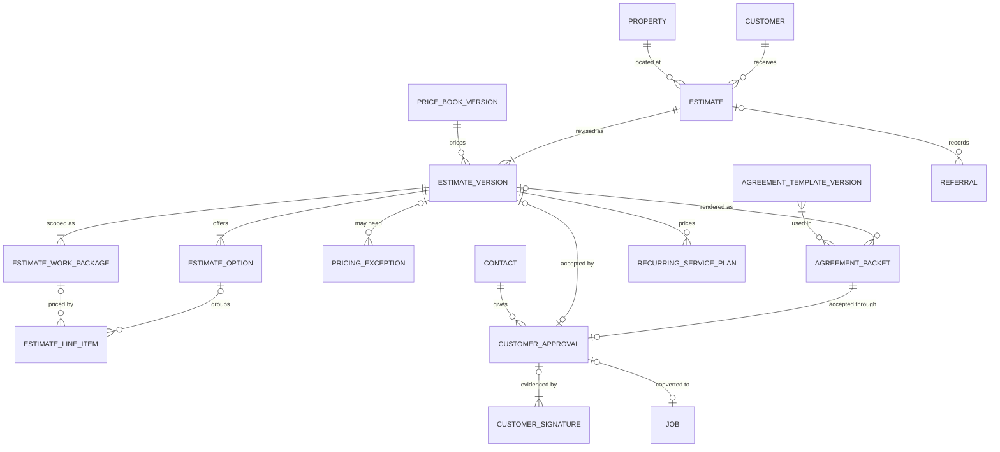

| Entity | Definition | Key attributes | Relationships |
|---|---|---|---|
| **Estimate** `Estimate` (ENT-004) | The priced offer for defined scope at one property for one customer: a container with a stable number. Its status is derived from its versions. | estimate number; customer; property; lead; preparer (ESTR); services; current version | N : 1 customer; N : 1 property; N : 0..1 lead; 1 : 1..* versions; 1 : 0..* referrals |
| **Estimate version** `EstimateVersion` (master: Estimate revision) | One complete, numbered version of the offer (EST-001..EST-007). | version number; status (STM-002); revision reason (EST-006); prepared by and date; valid until (from the estimate-validity policy, an owner decision); price book version, pricing rules and business policy versions used (the pricing snapshot of [28](28-pricing-estimating-and-job-costing.md) Section 5.5, frozen at send); scope narrative; assumptions; exclusions; customer responsibilities; access, concealed-condition and schedule assumptions; permit and licensing dependencies (EST-003); subtotal; discounts; minimum-charge adjustment; tax lines (treatment per CPA); total and currency; deposit terms from policy; payment schedule; rendered-document hash; sent and viewed times | N : 1 estimate; 1 : 1..* options, estimate work packages; 1 : 0..* pricing exceptions; 1 : 0..1 customer approval |
| **Estimate option** `EstimateOption` (EST-005) | A separately identifiable choice: base scope, alternate (mutually exclusive group) or optional add-on, so acceptance is unambiguous. | option code; kind (base, alternate, add-on); exclusive group; label; subtotal | N : 1 estimate version; 1 : 0..* line items |
| **Estimate work package** `EstimateWorkPackage` (ENT-006, planned side) | The planned scope unit for one service in named work areas; becomes a job work package on conversion. | sequence; service; service card version; work areas; scope statement; labor assumption in person-hours (no rates invented); planned visits | N : 1 estimate version; 1 : 0..* line items; 1 : 0..1 job work package |
| **Estimate line item** `EstimateLineItem` | One priced row. Lines belong to one option; document-level adjustments (minimum-charge adjustment, document discount, tax) are version lines evaluated for the selected options. | line kind (labor, material, equipment or rental, disposal, travel, fee, add-on, discount, minimum-charge adjustment, tax); description key and text; quantity (fixed-scale decimal) and unit; unit rate (exact decimal) and extended amount (minor units); price item and pricing rule references; internal cost basis (Confidential); material allowance or named material; tax treatment code | N : 0..1 option; N : 0..1 estimate work package |
| **Pricing exception** `PricingException` | An authorized deviation from a pricing rule: a below-minimum exception (FIN-001) or a discount above the limit (EST-004); ADM decides until the owner delegates (D-27-10). | type; requested by; reason; amount effect; approver; decision; decided at | N : 1 estimate version or change order |
| **Agreement packet** `AgreementPacket` (RECT-003, RECT-004) | The immutable set of documents a customer reviews and approves: the estimate or change-order version with the scope schedule and terms rendered from active agreement template versions and the policy versions they cite, per language, with content hashes ([30](30-service-agreement-standards.md) Section 9.4). It replaces agreement files that cite editable vault files (Section 1.3 row 9); it cannot be sent while a required template version, translation or policy version is missing (DOM-060). | kind (work authorization, change order); estimate version with options, or change-order version; customer; property and its state; customer segment; agreement template versions; price book and policy versions; rendered documents per language with hashes; status (prepared, sent, viewed, accepted, declined, expired, superseded, void; [06](06-state-machines.md) Section 5.8); expires at; created by; sent at | N : 1 estimate version or change order; N : 1 customer; 1 : 0..1 customer approval |
| **Customer approval** `CustomerApproval` (RECT-003 Work authorization) | The recorded decision of the customer or an authorized contact, given on one agreement packet, to accept one estimate version with its selected options, or one change-order version (CX-003, STG-005). [28](28-pricing-estimating-and-job-costing.md) calls it Acceptance and [30](30-service-agreement-standards.md) AcceptanceRecord. | agreement packet and its hash at acceptance; target (estimate version with selected options, or change-order version); approving contact and authority basis; method (authenticated portal action, single-use version-bound link, in person on a staff device, signed paper scanned in; final list per attorney, Q-05-06 and [30](30-service-agreement-standards.md) Q-30-06); electronic-records consent reference where the attorney requires it; approved at; accepted total; accepted deposit terms; languages shown and language accepted; capturing worker for in-person approvals | 0..1 : 1 agreement packet; 0..1 : 1 target; N : 1 contact; 1 : 1..* customer signatures; 1 : 0..1 job |
| **Customer signature** `CustomerSignature` (master) | The evidence captured for an approval or a walkthrough outcome. AI never creates one (AIC-004). Enforceability is **HUMAN REVIEW: attorney** (KY/IN). | signer contact; type (typed name, drawn signature, authenticated action, scanned paper signature); signed at; signed document hash; capture channel; device or IP data only if [13](13-privacy-data-governance.md) justifies it (RECT-011); evidence file | N : 1 customer approval or customer walkthrough |
| **Referral** `Referral` - P1 | A record that requested or discovered work will not be performed by HandyHub (out of catalog, licensed trade, suspect hazardous material, structural) and that the customer was told (HND-005 "specialist referral"). No partner is named until the owner approves one. | reason category; description; source (lead, estimate, condition report, change order); customer informed at; referred-to (owner-approved names only); status | N : 0..1 lead, estimate or job |
| **Recurring service plan** `RecurringServicePlan` - P1 | An approved arrangement for repeated visits (candidates: CL-01, CL-05, CL-06) that generates one job per occurrence (D-05-27). Whether recurring service launches is an owner decision (Q-05-01). | plan number; services; approved estimate version; occurrence rule (frequency or event-driven turnovers); property; start and end; billing cadence (per visit or per plan period); skip, makeup and proration rules and the minimum evaluation scope as pinned price-book and policy versions ([28](28-pricing-estimating-and-job-costing.md) Section 3.12); term, renewal, price-change notice and termination through its agreement packet (G-093; **HUMAN REVIEW: attorney**); status | N : 1 customer; N : 1 property; N : 1 estimate version; 1 : 0..* jobs |

| Entity | Data owner | Lifecycle (06) | Sensitivity | Immutability | Retention |
|---|---|---|---|---|---|
| Estimate | ESTR | derived from its versions | Personal | M (header only) | `contract` |
| Estimate version | ESTR | STM-002 (per version) | Personal (customer price); Confidential (cost and margin fields) | F (frozen when sent; immutable when approved) | `contract` |
| Estimate option | ESTR | part of its version | Personal | F | `contract` |
| Estimate work package | ESTR | part of its version | Internal | F | `contract` |
| Estimate line item | ESTR | part of its version | Personal (price); Confidential (cost basis) | F | `contract` |
| Pricing exception | ADM | simple: requested, approved, rejected, withdrawn ([06](06-state-machines.md) Section 16.11) | Confidential | A | `contract` |
| Agreement packet | ESTR (custodian) | new: Agreement packet | Personal | F (immutable once sent; void or supersede only) | `contract` |
| Customer approval | ESTR (custodian) | none (a fact; a withdrawal is a new fact) | Personal | A | `contract` (**HUMAN REVIEW: attorney**) |
| Customer signature | ESTR (custodian) | none | Personal | A | `contract` |
| Referral | CSR, ESTR | simple: open, communicated, closed | Personal | M | `operational` |
| Recurring service plan | ESTR, DSP | new (P1): Recurring service plan | Personal | F (terms); M (schedule settings) | `contract` |

### 5.6 Scheduling and dispatch (`scheduling`)

Owning module `scheduling`; spec module MOD-004. PROPOSED DECISION D-05-06: the visit is the appointment; schedule entries keep every window it had; job assignments link workers to the job. Scheduling playbook: "Start with two employees, not two crews."

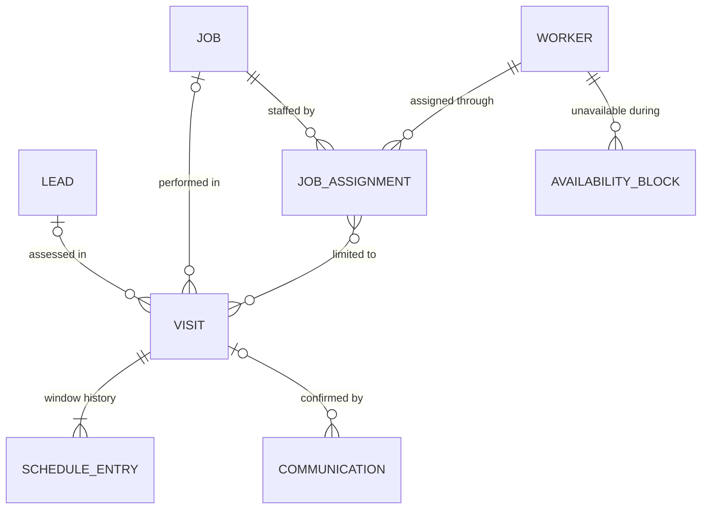

| Entity | Definition | Key attributes | Relationships |
|---|---|---|---|
| **Visit** `Visit` (owner L14 "appointment") | One scheduled occurrence of on-site work or of a site assessment. A job may need several visits (multi-day, drying or curing waits; scheduling playbook "Model multiple visits separately."). | visit number; parent (exactly one of: job, or lead for a site assessment); purpose (site assessment, work, return or punch, rework); status (requested, tentative, confirmed, en route, arrived, in progress, completed, no start, cancelled; [06](06-state-machines.md) Section 6.2: a customer no-show is a No-start reason, not a status, and there is no paused visit status); current schedule entry; expected duration and preparation time (minutes); dependencies (for example a drying wait after the previous visit); confirmation communication | N : 1 job, or N : 1 lead; 1 : 1..* schedule entries; N : M job assignments; 1 : 0..* time entries, start-gate evaluations |
| **Schedule entry** `ScheduleEntry` (master) | One version of a visit's window; every reschedule, delay update or cancellation adds an entry and keeps the earlier ones (CX-006, SCH-007, AT-012, AT-029). | sequence; local date; arrival window start and end (local) and zone; UTC instants; change type (initial, reschedule, ETA or delay update, cancellation); reason code and text; actor; customer-notification result; created at | N : 1 visit; exactly one current entry per visit |
| **Job assignment** `JobAssignment` (master) | The link of a worker to a job as lead worker or member (SCH-002), optionally limited to listed visits. Reassignment ends it (JOB-011); the worker's access window derives from the visits ([27](27-roles-and-permissions.md) Section 5.2). | worker; job; visit scope (all or listed visits); role (lead worker, member); assigned by; valid from and to; end reason (reassignment, cancellation, completion); handoff reviewed at | N : 1 job; N : 1 worker; N : M visits (optional scope) |
| **Availability block** `AvailabilityBlock` | Working hours, approved time off or other unavailable time of a worker (SCH-003). | worker; type (working hours, approved time off, training, other); local start and end with zone; recurrence; approval status | N : 1 worker |

| Entity | Data owner | Lifecycle (06) | Sensitivity | Immutability | Retention |
|---|---|---|---|---|---|
| Visit | DSP | new: Visit (appointment) | Personal | M (transitions validated server-side) | `operational` (`lead` for site assessments without a job) |
| Schedule entry | DSP | none | Personal | A | `operational` |
| Job assignment | DSP | simple: active, ended | Internal | A (ended by its validity) | `operational` |
| Availability block | DSP, ADM | simple: requested, approved, rejected, cancelled ([06](06-state-machines.md) Section 16.11) | Personal (time-off reason Restricted) | M | `workforce` |

### 5.7 Job execution (`jobs`)

Owning module `jobs`; spec module MOD-005. PROPOSED DECISIONS D-05-05 (job origin and structure), D-05-07 (separate status dimensions) and D-05-29 (one job item line for tools, equipment, PPE and materials, following [29](29-inventory-and-procurement.md) Section 4.3).

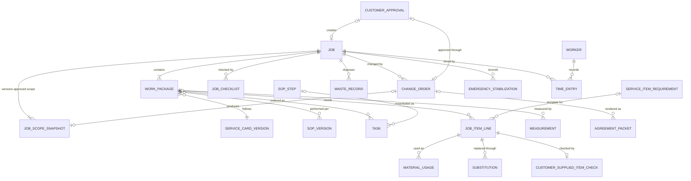

| Entity | Definition | Key attributes | Relationships |
|---|---|---|---|
| **Job** `Job` (ENT-005) | The operational commitment created from exactly one origin: a customer approval, a rework case, or (P1) a recurring-plan occurrence. Multi-service jobs are normal (BRF-001 "service(s)"). | job number; customer; property; origin; lifecycle status (STM-003 as revised in [06](06-state-machines.md)); current scope snapshot version; readiness (computed: Ready, Needs Attention, Blocked); designated lead worker (through assignment); key times (created, first start, work complete, closed); operational and financial closeout flags; cancellation reason | N : 1 customer; N : 1 property; 1 : 1..* scope snapshots, work packages; 1 : 0..* visits, assignments, briefing snapshots, holds, change orders, time entries, incidents, punch items, payment milestones, invoice lines |
| **Job scope snapshot** `JobScopeSnapshot` (EST-007; RECT-003) | An immutable copy of the approved scope and customer price on the job. Version 1 comes from the approval; each approved change order adds a version; earlier versions stay retrievable (AT-032). | snapshot version; source (approval or change order); approved lines and selected options; assumptions, exclusions, customer responsibilities, permit and licensing dependencies; customer expectations (priority outcome, finish preference, items to protect, noise or dust sensitivity, communication cadence, cleanup expectation, approved special instructions; [11](11-worker-job-execution.md) Section 3.2 item 8); customer-facing totals and currency; payment schedule; service card versions; content hash; created at | N : 1 job; the second and later versions each come from 1 change order |
| **Work package** `WorkPackage` (ENT-006) | The assignable unit of approved scope, normally one service in named work areas; a future subcontractor sees only assigned work packages (ROLE-010). | sequence; service; service card version; primary and module SOP versions; work areas; scope statement; status (planned, ready, in progress, complete, blocked, removed by an applied change order; [06](06-state-machines.md) Section 16.3); performer scope (employee team, or a future subcontractor) | N : 1 job; 1 : 0..* tasks, job item lines, measurements, quality inspections |
| **Task** `Task` (ENT-006; JOB-001) | One ordered step instance; completion never erases notes, photos, measurements or exceptions (JOB-001). | sequence; source SOP step; instruction; status (not started, in progress, done, skipped with reason, blocked); hold point; evidence links; exceptions; completed by and at | N : 1 work package; N : 0..1 SOP step |
| **Job checklist** `JobChecklist` (master) | The job's responses to the checklist items of the SOP versions it uses (pre-start, cleanup and closeout phases). | SOP version; phase; checklist item responses (done, not applicable, exception) with actor, time and evidence; for a checklist item of type decision used as an on-site customer confirmation, the confirming contact and the confirmation method ([11](11-worker-job-execution.md) Section 3.2 item 30; AUTH-028) | N : 1 job (or work package); N : 1 SOP version |
| **Measurement** `Measurement` | A recorded quantity with unit, method and provenance; customer-provided measurements stay unverified until checked (job-planner playbook). | what was measured; quantity (fixed-scale decimal) and unit; method; provenance (customer-reported, estimator-measured, field-verified); recorded by and at | N : 1 work area, estimate work package, work package or task |
| **Change order** `ChangeOrder` (ENT-013) | A versioned delta to approved scope, price or time, stored like an estimate as a container with numbered change-order versions ([08](08-data-model-and-database.md) `jobs.change_order` and `jobs.change_order_version`); the status belongs to the version. A worker or customer request is recorded but is not approval (JOB-005, AT-033). | change-order number; version; origin (worker proposal, customer request, estimator, emergency follow-up); status (STM-004 plus a Requested state); scope delta; price delta (minor units); time delta; reason; linked condition report; agreement packet and customer approval; resulting scope snapshot version | N : 1 job; 1 : 1..* change-order lines (same structure as estimate line items, holding the delta); 1 : 0..* agreement packets; 1 : 0..1 customer approval; 1 : 0..1 scope snapshot |
| **Emergency stabilization record** `EmergencyStabilization` (JOB-006) | Minimal action to prevent immediate injury or damage, recorded separately from change orders (AT-034). | trigger condition; actions taken; why necessary; evidence; supervisor and customer notification times; follow-up (change order or referral) | N : 1 job |
| **Job item line** `JobItemLine` (ENT-010 Tool/Equipment Item; ENT-011 Material Item) | One item needed on a work package, whether tool, equipment, PPE or material (START-005, START-006); its template line and version are frozen at job creation. Used, returned and wasted quantities are totals of its material usage events. | item (or an unlisted description mapped before costing closes); template line and version; line role; source (owned stock, vehicle stock, rental, customer-provided, job purchase); criticality; planned quantity and unit; size, color, model; readiness state per [29](29-inventory-and-procurement.md) Section 6.3 (for example planned, reserved, loaded, verified, exception) with by and at; exception and resolution; reserved equipment asset; rental agreement or purchase line that supplies it; derived used, returned and waste totals; restricted cost fields | N : 1 work package; N : 0..1 service item requirement; 1 : 0..* material usages, substitutions; 1 : 0..1 customer-supplied item check; N : 0..1 equipment asset |
| **Material usage** `MaterialUsage` | An append-only quantity event on a job item line: loaded, used, returned, wasted or damaged (JOB-003; AT-037 "Material usage"). It applies mainly to consumables; tool and equipment lines track loading and return through their readiness. It never changes customer price (AT-037). | event type; quantity and unit; recorded by and at; location; linked stock movement | N : 1 job item line; 1 : 0..1 stock movement |
| **Substitution** `Substitution` (JOB-007) | A proposed replacement for a job item line. A substitution that affects appearance, specification, warranty, safety, cost or customer expectation needs approval under the substitution policy and, where the customer is affected, a change order; nothing is silently marked equivalent (AT-021). | original and proposed item; effect flags; reason; proposed by; approver; decision; change-order link | N : 1 job item line; N : 0..1 change order |
| **Customer-supplied item check** `CustomerSuppliedItemCheck` (START-009) | The pre-work record of a customer-supplied product where liability depends on it; START-009 is not overridable ([27](27-roles-and-permissions.md) Section 6.3). Which services and items trigger it, and who bears defects in customer-supplied products, is **HUMAN REVIEW: attorney**. | item description; model and serial; quantity; visible condition; photos; recorded by and at; customer acknowledgement where required (an operational record, not a waiver); outcome (accepted; accepted with noted defects, only when there is no safety effect, an unknown effect counting as one; rejected, which leads to No Start, Blocked or a substitution with a change order); later disposition of leftover parts and old hardware appended as a new record ([29](29-inventory-and-procurement.md) Section 9.1) | N : 1 job item line |
| **Waste record** `WasteRecord` (QA-002) | The disposal of one waste stream from a job: what, how much, where it went and the evidence. Hazardous-waste handling (for example oily rags or suspect material) needs **HUMAN REVIEW: qualified safety professional**. | waste stream; quantity and unit; disposal destination; evidence; recorded by and at | N : 1 job |
| **Time entry** `TimeEntry` (master; JOB-002, START-014) | An append-only time event per person per job. Person-hours and crew elapsed time are derived separately ("Two workers for three hours equals six person-hours", job-costing playbook). | worker; job; visit; event type (start, pause, resume, complete; travel, break and preparation per the timekeeping policy); occurred at (UTC with zone); source device and offline flag; corrects (reference); correction approved by | N : 1 worker; N : 1 job; N : 0..1 visit |

| Entity | Data owner | Lifecycle (06) | Sensitivity | Immutability | Retention |
|---|---|---|---|---|---|
| Job | DSP (operations); ADM | STM-003 (lifecycle only; readiness and visits are separate) | Personal | M (transitions validated; closeout lock QA-011) | `operational` |
| Job scope snapshot | ESTR (source); generated by SYS | none | Personal (customer price; no cost fields) | S | `contract` |
| Work package | LWK, DSP | new: Work package | Internal | M | `operational` |
| Task | WKR (assigned) | simple: see attributes | Internal | M (status); evidence A | `operational` |
| Job checklist | WKR (assigned) | none | Internal | A (responses) | `operational` |
| Measurement | Recorder | none | Internal | A (corrections supersede) | `operational` |
| Change order | ESTR (price); LWK (scope) | STM-004 (add Requested) | Personal (price); Confidential (cost) | F (frozen when sent; immutable when approved) | `contract` |
| Emergency stabilization record | LWK, ADM | simple: recorded, reviewed | Personal | A | `safety` |
| Job item line | LWK | new: Job item line readiness ([29](29-inventory-and-procurement.md) Section 6.3) | Internal (cost fields Confidential) | M (readiness changes audited; quantities derived) | `operational` |
| Material usage | WKR | none | Internal | A | `operational`; `financial` as a cost input |
| Substitution | LWK, ESTR; the customer through a change order | simple: proposed, approved, rejected, withdrawn ([06](06-state-machines.md) Section 16.11) | Internal | A (one decision) | `contract` |
| Customer-supplied item check | WKR | none | Personal (photos) | A | `contract` |
| Waste record | WKR | none | Internal | A | `operational` (`safety` for hazardous waste) |
| Time entry | WKR (own); ADM approves corrections | new: Time-entry correction (requested, approved, rejected) | Personal | A | `workforce`; `financial` as a cost input (**HUMAN REVIEW: payroll professional**) |

### 5.8 Readiness and field safety (`safety`)

Owning module `safety`; spec modules MOD-005 (Start Job briefing and gates) and MOD-007 (safety and incident records). PROPOSED DECISIONS D-05-07 (holds), D-05-08 (gate outcomes) and D-05-18 (separate safety records). The content these records carry (hazards, controls, stop-work conditions) needs **HUMAN REVIEW: qualified safety professional**; the software only enforces it (owner L20).

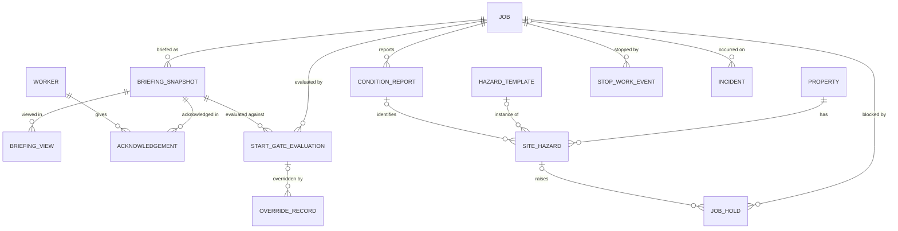

| Entity | Definition | Key attributes | Relationships |
|---|---|---|---|
| **Briefing snapshot** `BriefingSnapshot` (RECT-005) | An immutable, versioned composition of the worker briefing (BRF-001..BRF-014); alias: worker job packet. A new version is created whenever an input changes, and the worker sees what changed since the version they last viewed (START-002, UXE-003, AT-027). | snapshot version; job; scope snapshot version; SOP versions; hazard set (template versions and site-hazard versions); job item line states; documents; site contact and access instructions (access secrets excluded and revealed separately); emergency and escalation contacts; closeout preview; available languages; change summary against the previous version; content hash; created at | N : 1 job; 1 : 0..* briefing views, acknowledgements, start-gate evaluations |
| **Briefing view** `BriefingView` | The fact that a worker opened a snapshot version; it drives the highlight of "changes made after the worker last viewed the briefing" (START-002). | worker; snapshot version; viewed at; device; offline flag; language shown; projection rules version (the field-class and access-window filter applied on the server, [11](11-worker-job-execution.md) Section 3.1 rule 3) | N : 1 briefing snapshot; N : 1 worker |
| **Acknowledgement** `Acknowledgement` (master: **Safety acknowledgement**; START-003, START-004) | A personal, immutable confirmation bound to one briefing snapshot version: scope acknowledgement (operational, not a legal waiver), safety acknowledgement, SOP-version acknowledgement (AT-017; the Worker SOP Acknowledgement of [31](31-sop-standard.md)) or a supervisor's high-risk confirmation. Nobody acknowledges for another person; a scope or hazard change supersedes earlier acknowledgements; an acknowledgement never releases a critical hold. | type; worker (self only); snapshot version; items acknowledged (hazards, controls, PPE, stop-work conditions); statement version (the versioned acknowledgement statement shown, a notice version, Section 7.5); language shown; acknowledged at; superseded by | N : 1 briefing snapshot; N : 1 worker |
| **Start-gate evaluation** `StartGateEvaluation` (master §12) | The immutable record of one Start Job attempt (START-001..START-015). A start event requires a passing evaluation on the current snapshot. | job; visit; worker; snapshot version; gate rule-set version ([11](11-worker-job-execution.md) Section 5.1); attempt kind (start, start of the next visit, resume after a block); per-check results, each with a status (pass, warn, pending worker, pending customer, pending admin, fail prerequisite, fail critical), scope, reason code, resolver role and evidence, for the checks (assignment, eligibility and qualifications, customer and property identity, scope acknowledgement, SOP availability, hazard review, PPE, critical tools, critical materials, permit or license, pre-job photos, access, unresolved blocking issues); offline-start flag; outcome (READY_TO_START, READY_WITH_WARNING, BLOCKED, REQUIRES_ADMIN_REVIEW, REQUIRES_CUSTOMER_CONFIRMATION; mapping to the UXE-001 banner in [11](11-worker-job-execution.md)); evaluated at; resulting start event | N : 1 job; N : 1 visit; N : 1 briefing snapshot; 1 : 0..* override records |
| **Job hold** `JobHold` | A recorded block that keeps a job, visit or work package from progressing until released (SCH-001 missing prerequisites; START-010). Critical holds release only with a recorded qualified assessment, or for a permit, license or qualification hold with the evidence ADM records, never by override ([27](27-roles-and-permissions.md) D-27-06 and Section 6.3, where START-010 is a critical hold; owner L20). A prerequisite hold is overridable only where 27 Section 6.3 allows it (for example an ADM deposit waiver); an SOP-not-active hold is never overridden. A hold that a worker's report creates is written in the same transaction as the report, under the job lock, never through the outbox (Section 6.3; [07](07-system-architecture.md) ARC-037). | hold class (critical, prerequisite); type (critical: suspect hazardous material, structural concern, unapproved licensed-trade scope, failed or incomplete inspection, hazard flagged critical, missing permit, license or qualification; prerequisite: deposit, SOP not active, customer confirmation, site mismatch, information missing ([06](06-state-machines.md) Section 6.4), and moisture or an active leak as [11](11-worker-job-execution.md) D-11-29 proposes, pending 06); scope (job, visit, work package, line type, work area or task; [11](11-worker-job-execution.md) Section 5.4); overridable flag from 27 Section 6.3; source record; created by and at; stop requested at (a stop of work in progress was requested, [11](11-worker-job-execution.md) Section 15); status (active, released, voided; [06](06-state-machines.md) Section 6.4); release requirement; release or void record (evidence, released by and their qualification, released at; a void only for a hold entered in error, ADM with L2) | N : 1 job (or visit or work package); N : 0..1 site hazard or condition report |
| **Override record** `OverrideRecord` (PERM-006) | The record of an authorized bypass of an overridable gate or rule; who may override what is set in [27](27-roles-and-permissions.md) Section 6.3. | gate or rule; pre-override state; actor; role and capability used; reason code and text; evidence; step-up level; time | N : 1 start-gate evaluation or other gated record (schedule conflict, deposit waiver, QA exception) |
| **Site hazard** `SiteHazard` (ENT-009, instance side) | A hazard at a specific property or job, from intake, the estimate, an earlier visit, risk triage or the field. It never overwrites a template and a template never overwrites it (AT-018). | property; job (optional); hazard template (optional); source; type; severity (critical, high, moderate, low; [11](11-worker-job-execution.md) Section 6.3); controls; PPE; stop-work trigger; status (identified, controlled, escalated, resolved, not applicable); reviewer; evidence | N : 1 property; N : 0..1 job; N : 0..1 hazard template; 1 : 0..* job holds |
| **Condition report** `ConditionReport` (JOB-004) | A field record of an unexpected condition with photos and severity. | job; visit; task or work area; condition type (concealed damage, substrate failure, moisture or active leak, suspected hazardous material, access issue, missing customer-supplied item, pre-existing damage, weather, other; the last two requested by [11](11-worker-job-execution.md) Section 6.4 and used by [06](06-state-machines.md) Section 7.5); severity (critical, high, moderate, low: the one scale of [11](11-worker-job-execution.md) Section 6.3, D-11-11, for condition reports, site hazards and incidents; **HUMAN REVIEW: qualified safety professional**, Q-11-03); before or after start; people or pets at risk (yes, no, unknown); immediate actions taken; customer informed on site (yes, no, not present); description; photos; reported by and at; outcomes (site hazard, hold, change order, referral, stop work) | N : 1 job; 1 : 0..* site hazards, holds, change orders |
| **Stop-work event** `StopWorkEvent` (START-011, SCH-008) | A worker's recorded decision to stop, or not to start (No Start), for a listed condition, with evidence and escalation (AT-030, AT-036). | job; visit; trigger (unsafe condition, concealed damage, suspect hazardous material, unapproved electrical, plumbing, gas or structural scope, aggressive occupant or animal, severe weather, site materially different, material mismatch, inaccessible site, customer absent, missing prerequisite, permit or license issue, wrong address or unit, customer cancelled or refused on site, worker unable to work with no detail recorded; [11](11-worker-job-execution.md) Section 5.3 row 20; physical codes in [08](08-data-model-and-database.md) `safety.stop_work_event`); before or after start; evidence; escalated to; time; linked condition report and incident; disposition (resolved by a person other than the reporter, or voided by ADM for a duplicate or wrong-job record; [06](06-state-machines.md) Section 16.4) | N : 1 job; N : 0..1 visit; 1 : 0..1 incident |
| **Incident** `Incident` (ENT-014) | An unplanned event during HandyHub work that caused or nearly caused harm (JOB-008). Injury and medical details sit in a restricted section (DOM-035). | incident number; type (injury, property damage, near miss, customer conflict, tool or equipment failure, suspected hazardous-material exposure); severity (critical, high, moderate, low; [11](11-worker-job-execution.md) Section 6.3, pending the qualified safety professional, Q-11-03); escalation level (Routine, Supervisor, Owner immediate, External; stored, set at reporting from the type and severity floor by the [11](11-worker-job-execution.md) D-11-28 mapping, raised but never lowered at triage; [06](06-state-machines.md) Section 12.1); occurred at and where; people and property affected; immediate action; evidence; follow-up and corrective actions (including the insurer and legal review item of [26](26-business-process-map.md) BPM-024); restricted injury and medical section; closure approver | N : 0..1 job; links to stop-work events, site hazards and complaints |

| Entity | Data owner | Lifecycle (06) | Sensitivity | Immutability | Retention |
|---|---|---|---|---|---|
| Briefing snapshot | DSP (generated by SYS) | none | Personal (site details; secrets excluded) | S | `operational`; acknowledged snapshots `safety` |
| Briefing view | SYS | none | Internal | A | `operational` |
| Acknowledgement | WKR (personal); ADM accountable | none (superseded flag) | Personal | A | `safety` |
| Start-gate evaluation | SYS; ADM accountable | none | Internal | A | `safety` |
| Job hold | ADM; **HUMAN REVIEW: qualified professional** to release critical holds; local permitting or licensing authority and attorney for permit, license and qualification evidence | new: Job hold (active, released, voided; [06](06-state-machines.md) Section 6.4) | Internal | M (status only through a release record); release A | `safety` |
| Override record | The overriding actor; ADM reviews | none | Internal | A | `safety` and `audit` |
| Site hazard | LWK, ADM; **HUMAN REVIEW: qualified safety professional** | new: Site hazard | Internal (Personal where it describes occupants) | M (status changes audited) | `safety` |
| Condition report | WKR | none (outcome links) | Personal | A | `safety` |
| Stop-work event | WKR (reports); a resolver other than the reporter: LWK, DSP or ADM; ADM (voids) | new ([06](06-state-machines.md) Section 16.4): open, resolved, voided, derived from the disposition record (open while none exists) | Personal | A (event and disposition) | `safety` |
| Incident | ADM; **HUMAN REVIEW: insurer, attorney, qualified safety professional; medical decisions by qualified medical professionals** | STM-006 as revised in [06](06-state-machines.md) Section 12.1 (reported, triaged, action required, under external review, follow-up, closed, voided) | Personal; injury and medical section Restricted | M (follow-ups A) | `safety` |

### 5.9 Quality and aftercare (`quality`)

Owning module `quality`; spec modules MOD-005, MOD-006 and the quality inputs of MOD-011. PROPOSED DECISIONS D-05-18 and D-05-19.

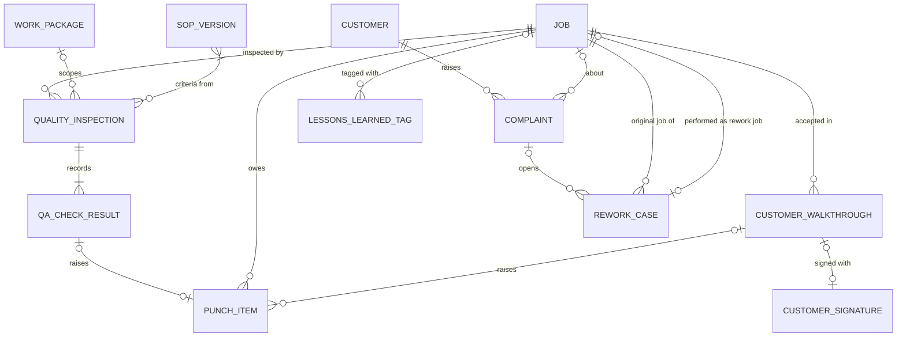

| Entity | Definition | Key attributes | Relationships |
|---|---|---|---|
| **Quality inspection** `QualityInspection` (master) | One inspection event of a job or work package. A worker's self-check never satisfies a supervisor-required inspection (quality-assistant playbook). | job; work package; inspection type (worker self-check, supervisor inspection, reinspection); inspector; SOP versions in scope and their quality-checkpoint checklist items; started and completed at; overall result (passed, passed with punch items, failed, not inspected); exception approvals | N : 1 job; N : 0..1 work package; N : 1..* SOP versions; 1 : 1..* QA check results |
| **QA check result** `QaCheckResult` (ENT-015 Quality Check) | The result for one QA criterion from the service card (`.QAC`), with evidence (QA-001). Missing evidence is "not inspected", not a pass or a fail. | criterion key (a `.QAC` criterion or a quality-checkpoint checklist item); result (verified, failed, not inspected, not applicable); evidence (photos, measurements, functional tests); note; exception and approver (non-safety checks only); safety-critical flag | N : 1 quality inspection; 1 : 0..1 punch item |
| **Punch item** `PunchItem` (STM-007) | A specific unfinished or defective item within approved scope, found before or at closeout; it stays linked to the job and survives invoicing (QA-005, AT-041). | punch number; job; work area or task; defect description; source (QA check, walkthrough, customer); priority; assignee; due date; evidence before and after; reinspection criterion; status | N : 1 job; N : 0..1 QA check result or walkthrough |
| **Customer walkthrough** `CustomerWalkthrough` (QA-004) | The customer's recorded acceptance outcome. It does not waive rights or clear safety holds (quality-assistant playbook: "Customer acknowledgment is distinct from competent safety inspection and does not waive rights."). | job; visit; outcome (accepted, accepted with punch items, unavailable, disputed); contact present; signature or acknowledgement; care, cure or warranty notes delivered (QA-008, approved templates only); time | N : 1 job; 1 : 0..1 customer signature; 1 : 0..* punch items |
| **Complaint** `Complaint` | A customer's expression of dissatisfaction, recorded without assigning blame (customer-service playbook); review requests stay suppressed while it is open (QA-009, NTF-011). | complaint number; customer; contact; job (optional); channel; category (work quality, conduct, schedule, billing, damage claim, other); facts; received at; severity; status; linked records (incident, rework case, refund or credit review); owner | N : 1 customer; N : 0..1 job; 1 : 0..* rework cases |
| **Rework case** `ReworkCase` (CX-007, QA-010) | Return work after closeout (aliases: return visit, callback), linked to the original job and classified with one canonical list (owner decision Q-05-04). Warranty position is a human decision (AIR-004). | original job; classification; decided by; cost responsibility; rework job; status; callback cost tracked to the original job and episode (job-costing playbook) | N : 1 original job; 1 : 0..1 rework job; N : 0..1 complaint |
| **Lessons-learned tag** `LessonsLearnedTag` (QA-012) | A tag marking a recurring defect, hazard, estimate miss, material miss or process issue for SOP or service-card improvement; a tag that targets an SOP version is the SOP Review Item of [31](31-sop-standard.md). | tag type; target (service card, SOP version, estimate); source record (QA result, rework case, complaint, incident, stop-work event, condition report, SDS or manufacturer-instruction change); created by (a person, or SYS for the deterministic SOP review triggers of [31](31-sop-standard.md) SOP-018; an AI suggestion needs human approval, AIC-005); review status | N : 1 source record |

| Entity | Data owner | Lifecycle (06) | Sensitivity | Immutability | Retention |
|---|---|---|---|---|---|
| Quality inspection | LWK (qa-verify), ADM | new: Quality review ([06](06-state-machines.md) Section 14.1: required, in progress, passed, passed with punch items, failed, cancelled) | Internal | F (frozen on completion) | `operational` |
| QA check result | Inspector | part of its inspection | Internal | F | `operational` |
| Punch item | LWK, ADM | STM-007 | Personal | M (transitions validated) | `operational` |
| Customer walkthrough | WKR; the customer | none | Personal | A | `contract` ("disputed": **HUMAN REVIEW: owner, attorney** where exposure is material) |
| Complaint | CSR | new: Customer complaint | Personal (legal-claim notes Restricted) | M | `operational` (**HUMAN REVIEW: attorney** for material disputes) |
| Rework case | CSR, ADM | new: Rework case | Personal | M | `operational` |
| Lessons-learned tag | ADM | simple: proposed, accepted, actioned, rejected ([06](06-state-machines.md) Section 16.11) | Internal | M | `content` |

### 5.10 Inventory and procurement (`inventory`)

Owning module `inventory`; spec module MOD-008 (job-costing inputs); the item master lives in `catalog` (Section 5.4). PROPOSED DECISION D-05-22: the item master, the job's need (job item line), stock rules and the stock ledger, individually tracked assets and their reservations, rentals and purchases are separate records, and buying goods (purchase) is separate from other costs (expense). This follows the entity proposals of [29](29-inventory-and-procurement.md) Section 4.1, reconciled in Section 7.4; stock policy values, receiving and reorder rules belong to [29](29-inventory-and-procurement.md). GAP: no HandyHub skill covers inventory and procurement, and no file defines minimum stock, reorder points or vendors. Tiering follows [29](29-inventory-and-procurement.md): purchase receipt capture is P0; stock, assets, reservations, rentals, PPE issue and vendor items are **P1** unless the owner pulls them forward (Q-05-12).

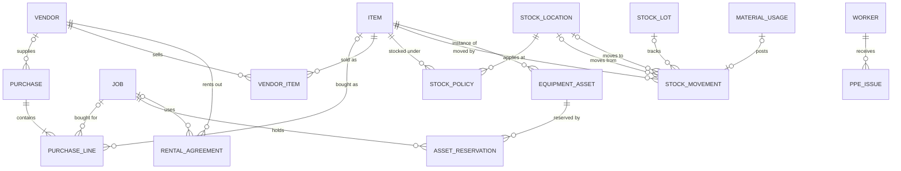

| Entity | Definition | Key attributes | Relationships |
|---|---|---|---|
| **Stock policy** `StockPolicy` - P1 | Minimum stock, reorder point and par level for one item at one location (master §14 "minimum stock, reorder threshold"). Values are owner decisions; none is set. | item; stock location; minimum stock; reorder point; par level; effective dates; set by | N : 1 item; N : 1 stock location |
| **Stock location** `StockLocation` - P1 | A place stock is held: the shop or a vehicle ("vehicle stock", master §14). | code; type (shop, vehicle, job staging); assigned vehicle or worker; active | 1 : 0..* stock policies, stock movements, equipment assets |
| **Stock movement** `StockMovement` - P1 | An append-only quantity change; on-hand stock is the sum of movements, never an edited number. [29](29-inventory-and-procurement.md) calls it StockTransaction. | item; from and to locations; type (receive, transfer or loadout, consume, return, waste or damage, count adjustment); quantity and unit; stock lot; job; purchase line; recorded by and at; reason | N : 1 item; N : 0..2 stock locations; N : 0..1 stock lot; 1 : 0..1 material usage |
| **Stock lot** `StockLot` - P1 | A received quantity of an item with a lot reference and expiry, for shelf-life tracking (master §14 "shelf-life/expiration where applicable"). | item; lot reference; received at; expiry; quantity received | N : 1 item; 1 : 0..* stock movements |
| **Equipment asset** `EquipmentAsset` - P1 | One owned, individually tracked unit of a tool or specialty-equipment item (ENT-010 "inspection/calibration notes"); [29](29-inventory-and-procurement.md) calls it ToolAsset. | asset tag; item; serial and model; condition; inspection or calibration due and records; location; status (in service, out for repair, retired); owned or rented | N : 1 item; N : 0..1 stock location; 1 : 0..* asset reservations, job item lines |
| **Asset reservation** `AssetReservation` - P1 | A job-window hold on one equipment asset, so two jobs cannot plan the same unit (scheduling playbook: "equipment exclusivity"). | equipment asset; job; visit or window; status (held, released) | N : 1 equipment asset; N : 1 job |
| **Rental agreement** `RentalAgreement` - P1 (P0 if a launch service needs rentals) | Equipment HandyHub rents for a period, with the terms document, inspection out and in, and cost ([29](29-inventory-and-procurement.md) Section 9.2). Terms need **HUMAN REVIEW: attorney and insurance broker**. | vendor; item; job; rental period; terms document; inspection out and in; cost (Confidential); status | N : 1 vendor; N : 0..1 job |
| **PPE issue** `PpeIssue` - P1 | PPE issued to a named worker: item, size, date and condition. Selection and any fit requirements come from a qualified safety professional, never from this model. | worker; item; size; issued at; condition; returned or replaced at | N : 1 worker; N : 1 item |
| **Vendor** `Vendor` - P1 | A supplier of materials, tools, rentals or services, and later a subcontractor payee (ROLE-008 "vendor/subcontractor records"). No vendor facts are assumed. | name; kind (supplier, rental company, service provider, subcontractor payee); contact details; terms as supplied; payee bank details (Restricted); status | 1 : 0..* purchases, vendor items, rental agreements, expenses; 1 : 0..1 subcontractor |
| **Vendor item** `VendorItem` - P1 | A vendor's offer for one item: vendor SKU, pack size, lead time and last cost. | vendor; item; vendor SKU; pack size; lead time; last cost and as-of date (Confidential) | N : 1 vendor; N : 1 item |
| **Purchase** `Purchase` (master) - P0 for receipt capture; P1 for the request and order workflow | Buying goods for stock or for a job, approved within the purchasing limit (FIN-007 "approved purchasing limits"; no limit is set, Q-27-04). The vendor's slip is stored as purchase receipt evidence, an attachment, not as a Receipt, which names the customer payment acknowledgement (FIN-004). | purchase number; vendor (optional until vendors are set up); purpose (stock replenishment, job-specific, rental); job (optional); requested by; approval; status; purchase receipt evidence; totals and currency; payment method used | N : 0..1 vendor; 1 : 1..* purchase lines; N : 0..1 job |
| **Purchase line** `PurchaseLine` | One line of a purchase, allocated to a job, a work package or overhead. | item or unlisted description; quantity and unit; unit cost and extended cost (minor units); job or work package allocation; received quantity | N : 1 purchase; N : 0..1 item; N : 0..1 job |

| Entity | Data owner | Lifecycle (06) | Sensitivity | Immutability | Retention |
|---|---|---|---|---|---|
| Stock policy | ADM (inventory owner to be assigned in [29](29-inventory-and-procurement.md)) | none (values versioned by effective date) | Internal | V | `operational` |
| Stock location | ADM | simple: active, inactive | Internal | M | `operational` |
| Stock movement | Recorder | none | Internal | A | `operational` (`financial` when it carries cost) |
| Stock lot | ADM | simple: active, expired, consumed | Internal | M | `operational` |
| Equipment asset | ADM | new (P1): Equipment asset | Internal | M (inspection records A) | `operational` |
| Asset reservation | DSP | simple: held, released | Internal | A (release is a new fact) | `operational` |
| Rental agreement | ADM | new (P1): Rental agreement | Confidential | F after signature | `financial` and `contract` |
| PPE issue | ADM; **HUMAN REVIEW: qualified safety professional** | none | Personal (employee data; [13](13-privacy-data-governance.md)) | A | `workforce` |
| Vendor | BKP, ADM | simple: active, inactive | Confidential (bank details Restricted) | M (bank-detail changes verified out of band, [27](27-roles-and-permissions.md) Section 4.7) | `financial` |
| Vendor item | ADM | simple: active, inactive | Confidential | M | `financial` |
| Purchase | ADM approves; BKP records | new: Purchase | Confidential | F after approval; receiving A | `financial` |
| Purchase line | As its purchase | part of its purchase | Confidential | F | `financial` |

### 5.11 Finance (`finance`)

Owning module `finance`; spec modules MOD-008 and MOD-006. PROPOSED DECISIONS D-05-11 and D-05-12. The finance context is an operational receivables and cost record, not the general ledger: no accounting system or chart of accounts is chosen yet, and accounting treatment (deposits as liabilities, revenue timing, write-offs) is **HUMAN REVIEW: CPA** (bookkeeping skill: "Distinguish cash movement from revenue/expense recognition when timing differs."). The model keeps that distinction in its structure: invoice lines carry charges only; payments, held deposits and credits reduce a balance through payment allocations and credit applications, never through invoice lines; cash received before the work it pays for (a deposit, or a plan-period prepayment if the owner keeps one) is identifiable as such, so reports never read it as earned revenue ([28](28-pricing-estimating-and-job-costing.md) Sections 11.4 and 11.6). Gross margin, contribution margin, overhead allocation and allocated operating profit are measures computed in reporting from customer price and job cost entries under the definitions of [28](28-pricing-estimating-and-job-costing.md) Section 6.1 (master §13 lists them with customer price, labor cost and material cost as values to keep separate); no overhead allocation method exists (Q-28-13), so none is stored or seeded.

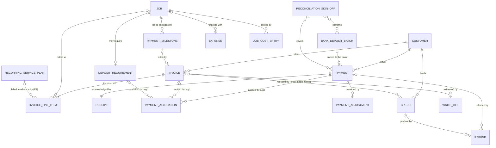

| Entity | Definition | Key attributes | Relationships |
|---|---|---|---|
| **Invoice** `Invoice` (ENT-016) | A billing document issued electronically for approved work (FIN-003): deposit, progress or final (which services use progress invoices, and their triggers, is Q-05-10). Issued invoices are immutable; corrections use void-and-reissue or a credit. Payment instructions are limited to cash and check until a provider is selected (owner L10). | invoice number; kind; customer; billing contact; issue date; due date (payment-terms policy, an owner decision); currency; subtotal; tax lines (treatment per CPA); total; balance section (allocated payments including applied deposits, credit applications, write-offs, balance due and the part pending clearance; all derived); document status (draft, issued, void, discarded) and dispute status (no dispute, disputed, resolved), both stored, with settlement, due and delivery values derived ([06](06-state-machines.md) Section 9.1, STM-005 as revised); replaces and replaced-by references; readiness-check record (QA-006) | N : 1 customer; 1 : 1..* invoice line items; 1 : 0..* payment allocations, credit applications, write-offs |
| **Invoice line item** `InvoiceLineItem` | One billed charge line, traced to its source so unapproved work never appears (AT-043). Lines carry the job, so one invoice can bill several jobs (weekly CL-05 turnovers, D-05-27). Payments, held deposits and credits are never invoice lines: they reach the invoice through payment allocations and credit applications and show in its balance section (D-05-11). | job (or, P1, a recurring service plan and period billed in advance, only if the owner keeps prepaid plan terms, Q-05-01; **HUMAN REVIEW: CPA** for prepayments); source (scope snapshot line, approved change-order line, minimum-charge adjustment, payment milestone, tax line; a deduction of an earlier deposit or progress invoice only if the CPA-approved method bills deposits by invoice, Q-05-03); description; quantity and unit; unit rate; extended amount; tax treatment code | N : 1 invoice; N : 1 job, or (P1) N : 1 recurring service plan |
| **Payment milestone** `PaymentMilestone` | One installment of the approved payment schedule on a job, copied from the frozen snapshot, with its trigger and the progress invoice that bills it; it links phases, inspections and progress invoices (G-094). No schedule is active until the owner and an attorney approve one (Q-05-10). | job; sequence; trigger (a work package or visit completed, a quality inspection passed, a date or acceptance); amount (minor units; the last installment absorbs rounding, [28](28-pricing-estimating-and-job-costing.md) Section 12.2); status (pending, due, invoiced, paid, cancelled; [06](06-state-machines.md) Section 16.2); progress invoice | N : 1 job; 1 : 0..1 invoice |
| **Deposit requirement** `DepositRequirement` (master: Deposit) | The job's obligation to pay in advance, computed from the deposit policy version in force at approval; "The system must not assume every job requires a deposit." (FIN-002). Threshold, amount, timing, refundability and any forfeiture are owner decisions (Q-05-03; **HUMAN REVIEW: attorney** for refund and forfeiture terms; **CPA** for accounting treatment). | job; policy version; required flag and basis; amount (minor units); due point (for example before scheduling or before purchasing, per policy); status (policy not configured, not required, required, partly satisfied, satisfied, waived, applied, refund review, refunded, retained; [06](06-state-machines.md) Section 11.1; there is no "released" status, and "retained" is offered only once an attorney-approved retention term exists, **HUMAN REVIEW: attorney; CPA**); waiver override record | 0..1 per job; 1 : 0..* payment allocations |
| **Payment** `Payment` (ENT-017) | Money received from a customer; immutable once recorded. "Received checks are not cleared money" (owner L10), so the status separates recorded (received), deposited, cleared, returned, voided and reversed ([06](06-state-machines.md) Section 10.1); every status change is an appended payment status event. | payment number; customer; method (cash, check; electronic only after a provider is selected); amount and currency; received at (UTC with zone); collector (user) or processor; reference (check number or provider transaction); payer name; purpose (deposit, progress, final, other); status; unallocated amount (derived; shown to the customer as account credit); reconciliation status (unreconciled, reconciled, exception; set only through a reconciliation sign-off); bank deposit batch; check image attachment (Restricted); note | N : 1 customer; 1 : 1 receipt; 1 : 0..* allocations, adjustments, refunds; N : 0..1 bank deposit batch |
| **Payment allocation** `PaymentAllocation` | Application of all or part of a payment to an invoice or a deposit requirement; reversed by a new allocation, never edited. A deposit held against a deposit requirement is applied to the final or progress invoice by a new allocation that names the deposit allocation it consumes, so the deposit history stays intact and the invoice total is not reduced. | payment; target (invoice or deposit requirement); amount; consumes (the deposit allocation being applied, if any); allocated by and at; reversed by | N : 1 payment; N : 1 invoice or deposit requirement |
| **Receipt** `Receipt` (FIN-004, FIN-005) | The numbered customer-facing acknowledgement of one payment. | receipt number; payment; issued at; delivery communication; language; voided-by reference when the payment is reversed | 1 : 1 payment |
| **Payment adjustment** `PaymentAdjustment` (FIN-006) | The only way to correct a recorded payment: an append-only reversal, void or returned-check record ("A bounced \$500 check reopens the balance through reversal, not deletion."). | payment; type (reversal, void, returned check, correction); amount; reason code and text; actor; approver; time | N : 1 payment |
| **Bank deposit batch** `BankDepositBatch` | The custody hand-over and bank deposit of collected cash and checks (FIN-005 "deposit/reconciliation status"); it keeps collection separate from reconciliation when one person holds several roles ([27](27-roles-and-permissions.md) Section 9). | batch number; prepared by; custody hand-over (collector to depositor); deposited at; bank reference; total; status (prepared, deposited, confirmed) | 1 : 1..* payments (cash and check); N : M reconciliation sign-offs |
| **Reconciliation sign-off** `ReconciliationSignOff` | A person's sign-off that the recorded payments and bank deposit batches of a period, and provider settlements once a provider exists, match the bank records, with the exceptions listed (AIR-015; RECT-010 "reconciliation and correction events"). The bank reconciliation itself is bookkeeping work in records the bookkeeper keeps (the accounting system is not chosen, [28](28-pricing-estimating-and-job-costing.md) Q-28-25); this record carries its result into the application. It is never signed by the collector of the payments it covers ([27](27-roles-and-permissions.md) Section 9). | period; bank account reference (masked; never a full account number); payments and bank deposit batches covered; matched totals (minor units); exceptions (unmatched, duplicate, stale or returned items) with follow-up; prepared by; signed off by (BKP or ADM); signed at; step-up level (L2, [27](27-roles-and-permissions.md) Section 6.2) | N : M payments and bank deposit batches; sets their reconciliation status |
| **Credit** `Credit` (master) | A reduction of what a customer owes without money moving (billing correction or approved concession), applied to one or more invoices or refunded later. An overpayment is not a credit; it stays the unallocated part of its payment (Section 3.7; Q-05-16). | credit number; customer; reason; amount; approver (ADM until delegated, D-27-10); credit applications (invoice, amount, applied by and at; reversed by a new application, never edited); remaining balance (derived); status (requested, issued, partly applied, applied, refunded, rejected, voided; [06](06-state-machines.md) Section 11.3) | N : 1 customer; 1 : 0..* credit applications, each N : 1 invoice; 1 : 0..* refunds |
| **Refund** `Refund` (master) | Money paid back against one payment or one credit balance. A refund request is a review item, not a refund; ADM approves and BKP executes ([27](27-roles-and-permissions.md) Section 4.6). Refund terms are owner decisions (**HUMAN REVIEW: attorney**). | refund number; customer; source (payment or credit); amount; reason; requested by; status (requested, approved, rejected, withdrawn, executed; [06](06-state-machines.md) Section 11.2); approver; executed by; method; executed at; evidence | Exactly one source: N : 1 payment or N : 1 credit |
| **Write-off** `WriteOff` (PERM-004) | Recognition that an invoice balance is uncollectible (**HUMAN REVIEW: CPA**). | invoice; amount; reason; approver (ADM); CPA review flag; time | N : 1 invoice |
| **Expense** `Expense` (master) - P1 | A business cost that is not a stocked item, optionally charged to a job; categories wait for the chart of accounts (owner and CPA). | expense number; category; vendor; amount and currency; incurred at; paid by (company, employee reimbursable); job or work package allocation; receipt attachment; approval; status (submitted, approved, rejected, reimbursed) | N : 0..1 job; N : 0..1 vendor |
| **Job cost entry** `JobCostEntry` - P1 | An append-only actual-cost line on a job (job-costing playbook inputs), kept apart from customer price (FIN-007). Missing inputs make the entry "incomplete", never zero. | job; cost type (labor, materials net of returns, equipment rental, subcontractor, travel, disposal, rework; allocated overhead only under an owner- and CPA-approved method, [28](28-pricing-estimating-and-job-costing.md) Q-28-13); source record (time entry, material usage, purchase line, expense); quantity; cost (minor units); labor cost rate version; completeness; period | N : 1 job; N : 1 source record |

| Entity | Data owner | Lifecycle (06) | Sensitivity | Immutability | Retention |
|---|---|---|---|---|---|
| Invoice | BKP | STM-005 (revised: delivery separate; received versus cleared balances; void and reissue) | Personal | F (frozen on issue) | `financial` |
| Invoice line item | BKP | part of its invoice | Personal | F | `financial` |
| Payment milestone | BKP | simple: pending, due, invoiced, paid, cancelled ([06](06-state-machines.md) Section 16.2) | Personal | M (status follows trigger and invoice events) | `financial` |
| Deposit requirement | BKP; ADM (waiver) | new: Deposit | Personal | M (status derived from allocations); waiver A | `financial` |
| Payment | BKP (the collector creates it) | new: Payment | Personal; check image Restricted; card data Never stored | A (status changes appended as events) | `financial` |
| Payment allocation | BKP | none | Personal | A | `financial` |
| Receipt | BKP (issued by SYS) | none | Personal | A | `financial` |
| Payment adjustment | BKP, ADM | none | Personal | A | `financial` |
| Bank deposit batch | BKP | simple: prepared, deposited, confirmed | Confidential | A after deposit | `financial` |
| Reconciliation sign-off | BKP; ADM (never the collector of the payments covered) | none (a fact; a correction is a new sign-off) | Confidential | A | `financial` (**HUMAN REVIEW: CPA** for the accounting close) |
| Credit | BKP; ADM approves | new: Credit | Personal | F after issue; credit applications A | `financial` (**HUMAN REVIEW: CPA**) |
| Refund | ADM approves; BKP executes | new: Refund | Personal | F after approval; execution A | `financial` (**HUMAN REVIEW: attorney, CPA**) |
| Write-off | ADM | none | Confidential | A | `financial` (**HUMAN REVIEW: CPA**) |
| Expense | BKP | new: Expense | Confidential (employee reimbursement data Personal) | F after approval | `financial` |
| Job cost entry | BKP | none | Confidential | A | `financial` |

### 5.12 Records and communications (`records`)

Owning module `records`; spec modules MOD-007 and MOD-006. Attachments, notes and communications reference their owner record by type and identifier (polymorphic), so the diagram does not repeat every owner. PROPOSED DECISION D-05-20.

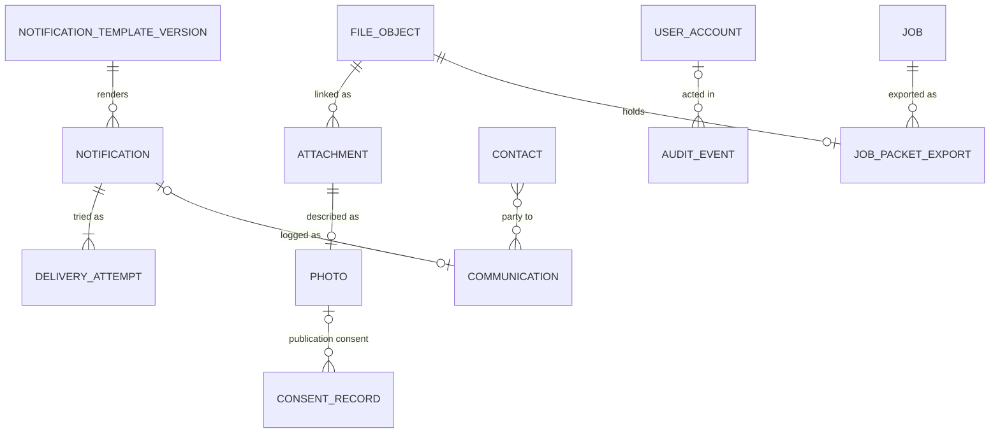

| Entity | Definition | Key attributes | Relationships |
|---|---|---|---|
| **File object** `FileObject` | The stored binary in private object storage; previews are optimized and originals kept where required (NFR-004). | storage key; content hash; verified media type; size; metadata-stripped flag; malware-scan status; original-retention flag; uploaded by and at; upload channel | 1 : 0..* attachments |
| **Attachment** `Attachment` (master) | The link of a file object to a business record, with purpose and visibility. | owner record (type and identifier: request, lead, estimate, job, task, change order, incident, payment, expense, purchase, complaint and others); file object; purpose; visibility class; caption; language | N : 1 file object; N : 1 owner record |
| **Photo** `Photo` (master; ENT-012 Photo/File) | An image attachment captured in the app at a workflow moment (UXE-006); internal-only by default (D-27-15). Publication needs a consent record; "Lack of a complaint is not consent." (privacy verification). | attachment; workflow moment (arrival, existing condition, protection, concealed condition, progress, completion, cleanup, incident, check image, customer-supplied item); job, task and work area; captured at (device and server time); visibility (internal-only, customer-shareable); marketing eligibility; retention status (RECT-006); restricted identifier flag with its reasons (people, children, documents, screens or keypads, valuables, items that reveal private traits, injury, check image; [13](13-privacy-data-governance.md) Sections 5.3 and 5.5, D-13-02; [08](08-data-model-and-database.md) `records.photo.restricted_reasons`); vehicles, plates, house numbers and street signs do not make a photo Restricted and are removed at the publication review instead ([13](13-privacy-data-governance.md) Section 5.7) | 1 : 1 attachment; 1 : 0..* consent records (publication) |
| **Note** `Note` (master) | Free text attached to a record with a note class (PERM-003); append-only; never a place for access codes or credentials ("Do not use free-text notes as a secret vault."). | owner record; note class ([27](27-roles-and-permissions.md) Section 4.8: customer-visible, internal operational, risk and safety, payment, complaint, employee/HR, legal, fraud); body; language; author; created at; supersedes | N : 1 owner record |
| **Communication** `Communication` (ENT-018) | A logged exchange that matters to the record (JOB-009, RECT-012). | channel (phone, SMS, email, portal, in person); direction; participants (contacts, staff roles); related records (lead, job, estimate, invoice, complaint); summary, body or template version; authorization basis; occurred at; delivery state for outbound messages | N : 0..1 related record; N : 1..* contacts or staff; 1 : 0..1 originating notification |
| **Notification** `Notification` (master) | An automated, template-based outbound message triggered by an event; sent only under the owner-approved auto-send policy or a human release (owner L18; UXE-008). | event (NTF-001..NTF-011 or a staff alert); template version; recipients (computed at send time from linked contacts); channel; language; idempotency key; authorization basis (auto-send policy version or releasing user); status (draft, queued, held, sent, delivered, failed, cancelled; [06](06-state-machines.md) Section 16.1) | N : 1 template version; 1 : 1..* delivery attempts; 1 : 0..1 communication |
| **Delivery attempt** `DeliveryAttempt` (COM-003) | One provider attempt to deliver a notification; no email or SMS provider is selected yet. | attempt number; provider message reference; status; error code; time | N : 1 notification |
| **Audit event** `AuditEvent` (ENT-019) | An append-only record of a protected action, with the fields [27](27-roles-and-permissions.md) Section 6.4 lists (RECT-011, NFR-008). | event identifier; UTC time with zone context; actor type (user, AI on behalf of a user, SYS); actor and on-behalf-of user; effective roles and capabilities; action; object type, identifier and version; previous and new values or a change summary; reason code and text; step-up level; second approver; evidence links; correlation identifier; client type (web, mobile, offline sync); IP or device data only where [13](13-privacy-data-governance.md) justifies it; result (allowed, denied) | References any record; N : 0..1 user account |
| **Job packet export** `JobPacketExport` (REC-006) | A permission-filtered export of a job's record (AT-060); customer-facing packets exclude internal classes (AT-048). | job; audience (internal, customer-facing); requested by; filters and field classes applied; generated file object; expires at | N : 1 job; 1 : 1 file object |

| Entity | Data owner | Lifecycle (06) | Sensitivity | Immutability | Retention |
|---|---|---|---|---|---|
| File object | SYS; OWN-007 (policy) | simple: pending, available, quarantined, disposed | Inherits the class of its attachments | A (content immutable) | Inherits its owner record; unattached uploads `transient` |
| Attachment | Data owner of the owner record | none | Inherits | A (visibility changes audited) | Inherits |
| Photo | Uploader; photo-share holders; ADM (marketing eligibility) | none (visibility changes are audited facts) | Personal; Restricted when the restricted identifier flag is set (Section 2.4); check images Restricted | A (content); M (visibility, audited) | `operational`; `safety` for incident photos; `financial` for check images |
| Note | Author (class rules in [27](27-roles-and-permissions.md)) | none | By class, Personal to Restricted | A (supersede) | Inherits its owner record |
| Communication | CSR | none | Personal | A | `operational` |
| Notification | CSR; sent by SYS | new: Notification delivery | Personal | A (status events) | `operational` |
| Delivery attempt | SYS | none | Personal | A | `operational` |
| Audit event | ADM (read); OWN-006 (custodian) | none | Confidential (may contain Personal data) | A | `audit` |
| Job packet export | ADM, BKP, CSR | simple: generated, expired | Inherits (Restricted when internal) | A | `transient` |

### 5.13 AI workspace and automation (`ai`)

Owning module `ai`; spec module MOD-009. The AI workspace is disabled at launch ([27](27-roles-and-permissions.md) D-27-13; NEAR-002); automation runs are needed at launch for the SYS workflows of [27](27-roles-and-permissions.md) Section 10.4. Task policies are defined in [33](33-ai-and-automation-governance.md).

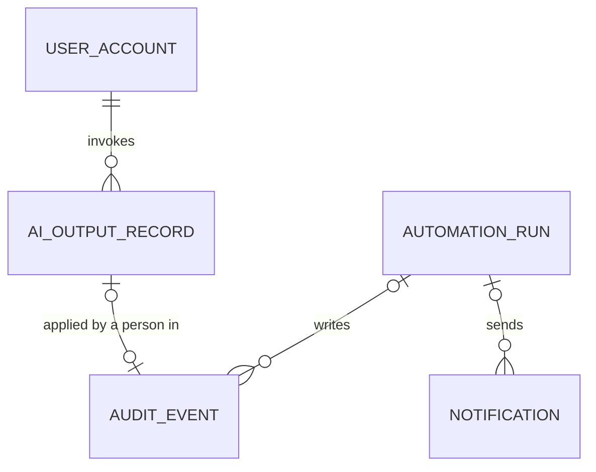

| Entity | Definition | Key attributes | Relationships |
|---|---|---|---|
| **AI output record** `AiOutputRecord` - P1 | A draft or recommendation produced by an AI role (AIR-001..AIR-016) inside the invoking user's permissions (AIC-002). It changes nothing until a person applies it through their own permissions (AIC-001; master §23 "Log important AI-assisted decisions."). | AI role; invoking user; task; source record references; prompt or template version; output; assumptions and unknowns (AIC-003); guardrail and disposition events; status (generated, withheld, draft, under review, applied, rejected, expired, frozen; the [33](33-ai-and-automation-governance.md) Section 7.4 lifecycle adopted by [06](06-state-machines.md) Section 16.9); applied by; applied-to record | N : 1 user account; N : M source records |
| **Automation run** `AutomationRun` | One execution of a deterministic workflow under a SYS identity, with idempotency and visible failures (NFR-011, NFR-012, AT-054). | workflow (SYS identity, an automation workflow of the [33](33-ai-and-automation-governance.md) Section 12.3 registry); trigger record; idempotency key; attempt; status (pending, succeeded, retrying, failed, dead-lettered; [06](06-state-machines.md) Section 16.9); error; records created | N : 1 trigger record; 1 : 0..* audit events, notifications |

| Entity | Data owner | Lifecycle (06) | Sensitivity | Immutability | Retention |
|---|---|---|---|---|---|
| AI output record | Invoking user; ADM | [33](33-ai-and-automation-governance.md) Section 7.4 lifecycle (P1; Wave 2, AI module disabled at launch) | Inherits its sources (may be Personal); vendor handling per [13](13-privacy-data-governance.md) and [33](33-ai-and-automation-governance.md) (AIC-006) | A | `audit` |
| Automation run | ADM (OWN-005 maintains the workflows) | simple: see attributes | Internal | A | `audit` |

### 5.14 Reporting (`reporting`)

Owning module `reporting`; spec module MOD-011. This context owns no entities: it builds read models for RPT-001..RPT-010 from the contexts above. Read models are never edited and never a source of truth, and they inherit the object scopes and field classes of their sources ([27](27-roles-and-permissions.md) Section 4.6). The domain supports the dashboards by storing codes at the source: lost and closed reason codes on leads (RPT-001); revision reasons and pricing exceptions on estimate versions (RPT-002); readiness-failure, no-start and reschedule reasons (RPT-003); planned durations on visits against recorded time entries (RPT-004); QA results, punch items, rework classifications and lessons-learned tags (RPT-005); incident, stop-work and hazard types (RPT-006); payment, reconciliation and deposit statuses and invoice due dates for A/R aging (RPT-007); complaint status and timings (RPT-008); AI output and automation statuses (RPT-009); notification failures and privileged changes from audit events (RPT-010). Measure definitions and formulas belong to [17](17-observability-and-operations.md) and [28](28-pricing-estimating-and-job-costing.md); none is defined here.

## 6. Aggregates and invariants

An aggregate is a consistency boundary: everything inside it changes in one transaction under one version check. Rules that span aggregates run through domain events (Section 6.3) or, for scarce resources, a storage-level constraint.

### 6.1 The five core invariants

Each invariant has an acceptance check in Given/When/Then form for [16](16-testing-quality-strategy.md).

| # | Invariant | Acceptance check | Requirements |
|---|---|---|---|
| 1 | Approved estimate versions are immutable | Given estimate version 2 is approved, when anyone (staff, AI or an import) tries to change its lines, totals, assumptions, options or deposit terms, then nothing is written and the actor is offered a new version (only before conversion, Q-05-15) or a change order (after conversion). | DOM-010, DOM-011; EST-006, REC-001, AT-005, AT-053 |
| 2 | The job keeps its approved snapshot | Given job J was created from approved version 2, when the price book, the service card or the SOP changes, then J's scope snapshot version 1 and the versions recorded on its work packages are unchanged; when change order CO-1 is approved, snapshot version 2 equals version 1 plus CO-1 and version 1 stays retrievable. | DOM-016, DOM-017, DOM-018; EST-007, AT-010, AT-032 |
| 3 | Payments are corrected only by reversal | Given a recorded check payment allocated to an invoice, when the bank returns the check, then the payment row is unchanged, a returned-check payment adjustment and a reversing allocation are appended, the balance due reopens, the receipt shows as voided and any deposit requirement it satisfied reverts. | DOM-040, DOM-041, DOM-044; FIN-006, AT-045 |
| 4 | Money is integer minor units with a currency | Given any money amount, it holds an integer number of minor units and its document carries one ISO 4217 code (USD), while unit rates are exact decimals; when an amount with a fractional minor unit, a floating-point value or a second currency on the same document is submitted, then it is rejected. | DOM-036, DOM-037; NFR-020, master §9 |
| 5 | Timestamps are time-zone aware | Given a property whose configured zone is Z, when a visit is booked for a local window, then the schedule entry stores the local date and times, the zone Z and the UTC instants; when the visit is moved across a daylight-saving change, customer and worker see the local window that was chosen, and audit events keep UTC with zone context. | DOM-046; NFR-020 |

### 6.2 Aggregate catalog

| Aggregate (root) | Members inside the boundary | Invariants (DOM) | Concurrency and idempotency |
|---|---|---|---|
| Customer | Contacts, contact authorities | A contact belongs to one customer; authority needs evidence; merges are human-approved (DOM-005, DOM-011) | Optimistic version |
| Property | Work areas, customer-property links, access secrets | Time zone set before a visit is confirmed (DOM-046); secrets only in access secrets (DOM-049) | Optimistic version |
| Consent stream (per contact, purpose and channel) | Consent records | Append-only; the latest record is the current state (DOM-050) | Insert-only |
| Lead | Requests, duplicate candidates | Requests immutable (DOM-001); merges human-approved, both originals kept (DOM-005) | Request idempotency key from the form ([32](32-website-and-customer-experience.md) WEB-023) |
| Service | Service card versions | One active version per effective time; active versions immutable; bookability computed (DOM-006, DOM-007) | Activation with step-up ([27](27-roles-and-permissions.md) Section 6) |
| SOP | SOP versions with their SOP steps, checklist items and review sign-offs | Active only with complete review sign-offs; checklist items change only with a new version (DOM-006, DOM-007, DOM-063) | Activation with step-up |
| Price book version | Price items, price tiers, pricing rules | Immutable once active; never changes a sent or approved estimate (DOM-006, DOM-012, DOM-059) | Activation with step-up |
| Business policy (per key) | Business policy versions | One active version per key; no unapproved values (DOM-009) | Activation with step-up |
| Agreement template | Agreement template versions, their review sign-offs and translations | Approved versions immutable; Spanish only with an approved translation (DOM-006, DOM-060) | Activation with step-up |
| Item | SDS documents (kits and service item requirements reference the item) | Only active items reach templates and job lines; status changes audited (DOM-006) | Optimistic version |
| Estimate | Versions, options, estimate work packages, line items, pricing exceptions, agreement packets, customer approvals and signatures for its versions | DOM-010..DOM-014, DOM-060; at most one approval per version; approval only on the latest sent, unexpired, unsuperseded version and its current packet; at most one effective approval per estimate ([28](28-pricing-estimating-and-job-costing.md) Section 13.2 "one acceptance per estimate") unless the owner allows a newly approved version to supersede it before conversion (Q-05-15) | Optimistic version; the approve command carries an idempotency key |
| Job | Scope snapshots, work packages, task statuses, job checklists, job item lines, holds, briefing snapshots, start-gate evaluations | DOM-016..DOM-019, DOM-022, DOM-024, DOM-025: start only with a passing evaluation on the current snapshot and no active critical hold | Optimistic version on the job. Field evidence (photos, notes, material usage, waste records, time events, briefing views, acknowledgements, condition reports) are separate insert-only records keyed to the job, so two devices never conflict (DOM-030) |
| Visit | Schedule entries | Exactly one current entry; history append-only (DOM-020) | Optimistic version |
| Worker calendar (per worker) | Job assignments, availability blocks | No overlapping confirmed assignments when the policy is "prevent"; under "warn" an overlap needs an override record (DOM-021, DOM-026) | Enforced at the storage boundary (exclusion constraint or per-worker lock) |
| Change order | Lines, customer approval | Applied only when approved; applying creates the next scope snapshot in the same transaction (DOM-018) | Optimistic version on the change order and the job |
| Incident | Follow-up actions, restricted injury and medical section | DOM-031, DOM-035; closure by ADM only | Optimistic version |
| Quality inspection | QA check results | DOM-032; frozen on completion | Single writer (the inspector) |
| Punch item | None | DOM-033 | Optimistic version |
| Complaint; Rework case | None | DOM-031, DOM-034 | Optimistic version |
| Invoice | Invoice line items | DOM-042: frozen on issue; total equals the sum of its lines | Issue command idempotent |
| Payment | Receipt, status events, payment adjustments | DOM-040, DOM-041: amount and method never change | Create command idempotent by a client key (offline collection) |
| Allocation set (per invoice and per deposit requirement) | Payment allocations; credit applications to the invoice | Allocated payments plus applied credits and write-offs never exceed the invoice total, and no payment or credit is applied beyond its unallocated amount (DOM-044); an applied deposit consumes its deposit allocation exactly once (DOM-042) | Row locks on the invoice, the payment and the credit |
| Deposit requirement | Waiver (allocations are referenced) | Satisfied only by allocations in a status the policy accepts, or by a waiver (DOM-039, DOM-041) | Recomputed on allocation and payment-status events |
| Payment milestone | None | Due only when its trigger is recorded; billed by exactly one progress invoice (DOM-062) | Recomputed on trigger and invoice events |
| Credit; Refund; Write-off | Credit applications (inside the credit) | DOM-043 | Approval with step-up ([27](27-roles-and-permissions.md) Section 6.2) |
| Reconciliation sign-off | None (references payments and batches) | DOM-064: never signed by the collector of a covered payment; it is the only writer of payment reconciliation status | Step-up L2; insert-only |
| Purchase | Purchase lines, receiving | DOM-057 | Optimistic version |
| Stock ledger (per item and location) | Stock movements | DOM-056 | Insert-only |
| Notification | Delivery attempts | One notification per idempotency key (DOM-051) | Idempotency key |

### 6.3 Cross-aggregate reactions

All reactions run through the transactional outbox with idempotent consumers ([07](07-system-architecture.md)); none is promised "exactly once" across systems.

**Safety exception (added 2026-10-03 after the independent review of [07](07-system-architecture.md); PROPOSED, HUMAN REVIEW: qualified safety professional):** the "Critical job hold" reaction in the table below does **not** go through the outbox. The hold is written in the same database transaction as the hazard flag or condition report, under the job lock, and the Start Job gate reads holds under the same lock, so no start can pass during outbox dispatch lag, a stalled jobs process or a paused workflow ([07](07-system-architecture.md) section 4.5 rule 3 "Safety holds never lag", ARC-037; DOM-025). Notifications about the hold may still be sent through the outbox.

| Trigger | Reaction | Requirements |
|---|---|---|
| Customer approval recorded | Create the job once; compute the deposit requirement from the policy version; recompute readiness; create one scheduling task (scheduling playbook: "A duplicated acceptance event creates one scheduling task.") | DOM-016, DOM-039 |
| Change order approved | Next scope snapshot; new briefing snapshot; earlier acknowledgements superseded; the worker sees "What changed?" (UXE-003) | DOM-018, DOM-022, DOM-023 |
| Any other briefing input changed (window, access instructions, hazards, SOP, tools, materials, documents) | New briefing snapshot with a change summary; acknowledgements superseded where scope or hazards changed | DOM-022, DOM-023 |
| Site hazard flagged critical, or a condition report of suspect hazardous material or a structural concern | Critical job hold **written synchronously in the same transaction (safety exception above; not via the outbox)**; readiness Blocked; start-gate outcome BLOCKED until a qualified release is recorded | DOM-025, ARC-037 |
| Payment cleared, returned or reversed | Recompute deposit satisfaction, balances and readiness; returned items go to BKP | DOM-039..DOM-041, DOM-044 |
| Work complete, with QA passed or excepted | Invoice readiness check (QA-006); walkthrough prompt; open punch items carried forward | DOM-032, DOM-033, DOM-042 |
| Final or progress invoice issued | Payments held against the job's deposit requirement are applied to it, as the deposit policy specifies (Q-05-03), by new allocations that consume the deposit allocations; the deposit requirement reads "applied to invoice"; the invoice total is unchanged | DOM-039, DOM-042 |
| Payment-milestone trigger recorded (work package or visit completed, inspection passed) | Milestone becomes due; one progress-invoice draft is created for BKP review | DOM-062 |
| Rework case accepted | Rework job with origin "rework case"; callback cost tracked to the original job | DOM-034, DOM-045 |
| Job closed | Retention clocks start for the `operational` and `contract` classes; access secrets cleared unless kept for recurring service on the customer's instruction; any physical key held by HandyHub is returned or its continued custody recorded | Section 2.5; DOM-049 |

### 6.4 Concurrency, idempotency and offline

- Every aggregate root carries a version number; a stale write is rejected and the client re-reads (owner L18: "reject stale versions, deduplicate effects and report failures without silent overwrite").
- Every command that creates a financial, customer-visible or job-creating effect carries an idempotency key: request submission, approval, job creation, invoice issue, payment recording, notification send (NFR-012, AT-054).
- Offline capture: clients generate identifiers; captured facts are insert-only; state transitions captured offline are re-validated at sync against the current state and the permissions in force ([27](27-roles-and-permissions.md) Section 5.4); a rejected transition becomes a review item, never a silent overwrite (DOM-030). The sync and conflict experience belongs to [11](11-worker-job-execution.md).
- A worker's time is a scarce resource and is protected at the storage boundary, not only in application code (swe-architecture: "For scarce resources enforce correctness at the authoritative storage boundary.").

## 7. Traceability to the spec and the master list

### 7.1 Spec ENT-001..ENT-019 mapping

| ENT | Spec entity | Modeled as | Context | Change from the spec | Why |
|---|---|---|---|---|---|
| ENT-001 | Customer | Customer; Contact; Contact authority; Consent record; Customer-property link | crm | Contact persons, consent history and property links become their own entities | Landlords, hosts and builders act through contacts with explicit authority ([27](27-roles-and-permissions.md) Section 5.5); consent needs history and notice versions (COM-004) |
| ENT-002 | Property/Site | Property; Work area; Access secret; Site hazard (property-level) | crm, safety | Access secrets and hazards split out; time zone, property type and year built with provenance added | D-27-16; BRF-003 "approximate age if known"; AT-018 |
| ENT-003 | Lead | Request; Lead; Duplicate candidate | intake | The immutable request is split from the working lead; consent, minimum-charge acknowledgement, serviceability result and duplicate links added | RECT-001; owner L14; LAUNCH-002 |
| ENT-004 | Estimate | Estimate; Estimate version; Estimate option; Estimate work package; Estimate line item; Pricing exception; Agreement packet; Customer approval; Customer signature | estimating | Versions split from the container; validity, preparer, tax treatment, options, revision reason and price-book version added | EST-001..EST-007; CX-003 |
| ENT-005 | Job | Job; Job scope snapshot; Visit; Schedule entry; Job assignment; Briefing snapshot; Job hold | jobs, scheduling, safety | Schedule, assignments, readiness and briefing become entities with history | CX-006; SCH-001; SCH-008; RECT-005 |
| ENT-006 | Work Package/Task | Work package; Task; Job checklist; Estimate work package | jobs, estimating | The assignable package is split from the ordered step | ROLE-010 "assigned work package"; JOB-001 |
| ENT-007 | Service Card | Service; Service card version; Service item requirement | catalog | Identity split from versioned content; version, status and effective dates added; tool and material rows become service item requirements | NFR-013; master §3 |
| ENT-008 | SOP Version | SOP; SOP version; SOP step; Checklist item; Review sign-off; Translation entry | catalog | SOP identity, shared safety modules, generated checklist and review sign-offs added | Owner L20; HND-004; [31](31-sop-standard.md) |
| ENT-009 | Hazard | Hazard template; Site hazard; Job hold | catalog, safety | Template split from instance; critical hazards raise holds | AT-018; owner L20 |
| ENT-010 | Tool/Equipment Item | Item; Service item requirement; Job item line; Equipment asset; Asset reservation | catalog, jobs, inventory | Catalog item, template line, job need and owned asset separated | Readiness per job (START-005); inspection per asset; [29](29-inventory-and-procurement.md) Section 4.1 |
| ENT-011 | Material Item | Item; Job item line; Material usage; Substitution; Customer-supplied item check; Stock movement | catalog, jobs, inventory | Specification, job need, usage events, substitutions and stock separated | Master §14; AT-037; JOB-007; START-009 |
| ENT-012 | Photo/File | File object; Attachment; Photo; Consent record | records | Binary, link and photo metadata split; workflow moment and retention status added | RECT-006; REC-002; REC-003 |
| ENT-013 | Change Order | Change order; Agreement packet; Customer approval; Job scope snapshot | jobs, estimating | Requested state and origin added; approval through an agreement packet and Customer approval; result is a new snapshot | AT-032; AT-033; CX-003 |
| ENT-014 | Incident | Incident; Stop-work event; Condition report; Emergency stabilization record | safety, jobs | Stop-work, condition and stabilization records separated | RECT-007; JOB-004; JOB-006 |
| ENT-015 | Quality Check | Quality inspection; QA check result; Punch item; Customer walkthrough | quality | Inspection header and punch item entity added | STM-007; QA-001; QA-004; QA-005 |
| ENT-016 | Invoice | Invoice; Invoice line item; Payment milestone; Payment allocation; Credit; Write-off | finance | Kind (deposit, progress, final), currency, tax lines, void-and-reissue chain, job-linked charge lines, payment milestones and a derived balance section (payment allocations, credit applications, write-offs) added | FIN-003; QA-006 |
| ENT-017 | Payment | Payment; Receipt; Payment adjustment; Payment allocation; Bank deposit batch; Reconciliation sign-off; Refund | finance | Received-versus-cleared status, date-time with zone, receipt, reversal and reconciliation sign-off records added | FIN-004..FIN-006; RECT-010; owner L10 |
| ENT-018 | Communication | Communication; Notification; Delivery attempt; Notification template version | records, catalog | Template version, authorization basis and delivery attempts added | COM-001..COM-004 |
| ENT-019 | Audit Event | Audit event | records | Actor type, on-behalf-of user, previous and new values, reason, step-up and correlation fields added | RECT-011; [27](27-roles-and-permissions.md) Section 6.4 |

### 7.2 Master file 05 entity coverage

"Spec status" compares master §5 file 05 with the spec before this model: present (a spec §14 ENT row exists for it), partial (it appears only as a field of an ENT row, or as named record content elsewhere in the spec such as a briefing section or a record type, with no entity of its own), missing (only a role, a permission or a passing mention). [02](02-gap-analysis.md) G-040 classifies seven rows differently: it counts Service, Service task, Attachment and Quality inspection as present (an entity under another name exists) and Contact, Safety acknowledgement and Schedule entry as missing (no record of their own exists), giving 19 present, 6 field-only and 13 missing. The modeled entities are the same under either count.

| # | Master entity | Modeled as | Context (definition in Section) | Spec status |
|---|---|---|---|---|
| 1 | Customer | Customer | crm (5.2) | Present (ENT-001) |
| 2 | Lead | Lead, with Request | intake (5.3) | Present (ENT-003) |
| 3 | Property | Property | crm (5.2) | Present (ENT-002) |
| 4 | Contact | Contact, Contact authority | crm (5.2) | Partial (ENT-001 "identity/contact") |
| 5 | Estimate | Estimate | estimating (5.5) | Present (ENT-004) |
| 6 | Estimate revision | Estimate version | estimating (5.5) | Partial (ENT-004 "version") |
| 7 | Job | Job | jobs (5.7) | Present (ENT-005) |
| 8 | Job assignment | Job assignment | scheduling (5.6) | Partial (ENT-005 "assignments") |
| 9 | Worker | Worker | people (5.1) | Missing |
| 10 | Employee | Employee | people (5.1) | Missing |
| 11 | Future subcontractor | Subcontractor (P1) | people (5.1) | Missing |
| 12 | Service | Service, Service card version | catalog (5.4) | Partial (ENT-007 Service Card) |
| 13 | Service task | SOP step (template), Task (instance) | catalog (5.4), jobs (5.7) | Partial (ENT-008 "steps") |
| 14 | Job checklist | Job checklist (responses), Checklist item (generated with the SOP version) | jobs (5.7), catalog (5.4) | Partial (BRF-006 "condensed field checklist") |
| 15 | SOP | SOP, SOP version | catalog (5.4) | Present (ENT-008) |
| 16 | Hazard | Hazard template, Site hazard | catalog (5.4), safety (5.8) | Present (ENT-009) |
| 17 | Safety acknowledgement | Acknowledgement (type safety) | safety (5.8) | Partial (RECT-007; START-004) |
| 18 | Tool | Item (class tool or specialty equipment), Job item line, Equipment asset | catalog (5.4), jobs (5.7), inventory (5.10) | Present (ENT-010) |
| 19 | Material | Item (consumable classes), Job item line, Material usage | catalog (5.4), jobs (5.7) | Present (ENT-011) |
| 20 | Inventory item | Item with a Stock policy, Stock location, Stock movement | catalog (5.4), inventory (5.10) | Missing |
| 21 | Purchase | Purchase, Purchase line, Vendor | inventory (5.10) | Missing |
| 22 | Expense | Expense | finance (5.11) | Missing |
| 23 | Change order | Change order | jobs (5.7) | Present (ENT-013) |
| 24 | Invoice | Invoice, Invoice line item | finance (5.11) | Present (ENT-016) |
| 25 | Payment | Payment, Receipt, Payment adjustment, Payment allocation | finance (5.11) | Present (ENT-017) |
| 26 | Deposit | Deposit requirement (with allocated payments) | finance (5.11) | Partial (ENT-004 "minimum/deposit rule"; ENT-016 "deposits/credits") |
| 27 | Refund | Refund | finance (5.11) | Missing |
| 28 | Credit | Credit | finance (5.11) | Partial (ENT-016 "deposits/credits") |
| 29 | Attachment | Attachment, File object | records (5.12) | Partial (ENT-003 "attachments"; ENT-012) |
| 30 | Photo | Photo | records (5.12) | Present (ENT-012) |
| 31 | Note | Note | records (5.12) | Missing |
| 32 | Notification | Notification, Delivery attempt, Communication | records (5.12) | Partial (ENT-018 Communication) |
| 33 | Schedule entry | Schedule entry, Visit | scheduling (5.6) | Partial (ENT-005 "schedule") |
| 34 | Time entry | Time entry | jobs (5.7) | Missing |
| 35 | Quality inspection | Quality inspection, QA check result | quality (5.9) | Partial (ENT-015, per criterion only) |
| 36 | Incident | Incident | safety (5.8) | Present (ENT-014) |
| 37 | Customer signature | Customer signature, Customer approval | estimating (5.5) | Missing |
| 38 | Audit event | Audit event | records (5.12) | Present (ENT-019) |

Totals before this model: 15 present, 13 partial, 10 missing. After this model: all 38 are modeled, and every entity in the "Modeled as" column has a definition row and a governance row in the Section named (checked in the independent review of 2026-10-03, which also found all 129 Section 5 entities listed in Section 4.1).

### 7.3 Required additional entities

| Additional entity | Modeled as | Context | Why it is needed |
|---|---|---|---|
| User/account | User account | people | Login identity separate from workers and contacts ([27](27-roles-and-permissions.md)) |
| Role assignment | Role assignment (with Capability grant) | people | Least privilege as policy data (PERM-001) |
| Price book version | Price book version, Pricing rule | catalog | Approved prices never rewritten (master §13) |
| Estimate line item | Estimate line item | estimating | EST-002, EST-004 line detail |
| Invoice line item | Invoice line item | finance | FIN-003; AT-043 traceability to approved scope |
| Complaint | Complaint | quality | CX-007; master §5 file 06 complaint lifecycle |
| Punch item | Punch item | quality | STM-007 had no entity; QA-005 |
| Start-gate evaluation | Start-gate evaluation | safety | Master §12 outcomes; START-014 |
| Briefing snapshot | Briefing snapshot (with Briefing view) | safety | RECT-005; START-002 |
| Consent record | Consent record | crm | REC-003; COM-004 |
| Service-area rule | Service-area rule | catalog | BIZ-001; HND-002 |
| Vendor | Vendor | inventory | ROLE-008 vendor records; purchases; future subcontractor payees |

Other entities this model adds: Request, Duplicate candidate, Contact authority, Customer-property link, Work area, Access secret, Visit, Availability block, Job scope snapshot, Measurement, Job hold, Override record, Acknowledgement, Condition report, Stop-work event, Emergency stabilization record, Job item line, Material usage, Substitution, Customer-supplied item check, Waste record, Customer approval, Agreement packet, Pricing exception, Estimate option, Estimate work package, Referral, Recurring service plan, SOP step, Checklist item, Review sign-off, Service item requirement, Item, Kit, SDS document, Price item, Price tier, Business policy version, Labor cost rate, Agreement template, Agreement template version, Notification template version, Translation entry, Rework case, Lessons-learned tag, Quality inspection, Customer walkthrough, Stock policy, Stock location, Stock movement, Stock lot, Equipment asset, Asset reservation, Rental agreement, PPE issue, Vendor item, Purchase line, Payment milestone, Payment allocation, Receipt, Payment adjustment, Bank deposit batch, Reconciliation sign-off, Write-off, Job cost entry, File object, Delivery attempt, Job packet export, AI output record, Automation run, Role policy version, Share grant, Separation-of-duties exception, Session and registered device, Qualification.

### 7.4 Reconciliation with entity proposals in 28, 29, 30 and 31

[28](28-pricing-estimating-and-job-costing.md), [29](29-inventory-and-procurement.md), [30](30-service-agreement-standards.md) and [31](31-sop-standard.md) were written in parallel with this document and leave final entity names and keys to it. Each proposal is accepted, renamed, merged or rejected below (PROPOSED DECISION D-05-25); the reason column is what the authoring documents should cite when they adopt the names.

| Source | Proposed entity | Decision in this model | Reason |
|---|---|---|---|
| [28](28-pricing-estimating-and-job-costing.md) Section 3.2 | PriceBookVersion | Accepted: Price book version | Same concept and name |
| 28 Section 3.2 | PriceItem, PriceTier | Accepted: Price item, Price tier | Stable item codes make versions and variances comparable |
| 28 Section 3.2 | MinimumJobRule, ServiceFloorRule, FeeScheduleItem, ConditionalSurchargeRule, DiscountPolicy, TravelRule, TaxConfiguration, DepositPolicy, PaymentScheduleTemplate, RoundingPolicy | Accepted as typed Pricing rules inside the price book version | Each sets or changes an amount (D-05-28) |
| 28 Section 3.2 | EstimateValidityPolicy | Moved to Business policy version (key: estimate validity) | It sets a term, not an amount (D-05-28); estimate versions still pin it |
| 28 Sections 3.2 and 3.10 | PaymentTermsMatrix | Moved to Business policy version (key: payment terms, scoped by customer segment and service) | It sets billing events, due dates, accepted methods and late-payment and collection references, not amounts (D-05-28); its deposit or prepayment column points to the price-book deposit policy (D-28-12) |
| 28 Section 3.2 | LaborCostRate | Accepted: Labor cost rate (catalog, P1) | Internal cost, never customer-visible |
| 28 Section 13.2 | ESTIMATE_LINE | Renamed: Estimate line item | The required entity list and EST-002 say "line"; same structure |
| 28 Section 13.2 | PRICING_SNAPSHOT | Merged into Estimate version (its content frozen at send) | The snapshot is the version's frozen state (class F); a second record would duplicate it |
| 28 Section 13.2 | LINE_COST_ESTIMATE | Merged into Estimate line item as its Confidential internal cost basis | Price and cost stay apart by field class (FIN-007) |
| 28 Section 13.2 | ACCEPTANCE | Renamed: Customer approval | Spec vocabulary: CX-003 "Versioned approvals", REC-001 "Immutable approvals" |
| 28 Section 13.2 | COST_ALLOCATION | Merged into Job cost entry (source: purchase line or expense) | One append-only cost record per source |
| 28 Section 13.2 | MATERIAL_USAGE | Accepted: Material usage, as append-only events on a job item line | Spec AT-037 is titled "Material usage"; tool and equipment lines track loading and return through their readiness (D-05-29) |
| 28 Section 3.12 | ServicePlan | Renamed: Recurring service plan (P1) | Avoids confusion with Service; same rule that each visit is still a job |
| [29](29-inventory-and-procurement.md) Section 4.1 | Item | Accepted: Item (catalog) | Two-axis class and source model (D-29-01); master "Tool", "Material" and "Inventory item" become views of it |
| 29 Section 4.1 | SdsDocument | Accepted: SDS document | BRF-008 "chemical/SDS references" |
| 29 Section 4.1 | Kit, KitLine | Accepted: Kit, with its lines inside the kit | UXE-005 loadout |
| 29 Section 4.1 | ServiceItemRequirement | Accepted: Service item requirement | Template lines tied to SOP steps |
| 29 Section 4.1 | JobItemLine | Accepted: Job item line; its used, returned and waste quantities become totals of material usage events | Field capture stays insert-only for offline sync (D-05-23) |
| 29 Section 4.1 | Substitution | Accepted: Substitution | JOB-007; AT-021 |
| 29 Section 4.1 | CustomerItemCheck | Renamed: Customer-supplied item check | Spec wording "customer-supplied products" (START-009) |
| 29 Section 4.1 | Purchase, PurchaseLine | Accepted: Purchase, Purchase line | Same concept |
| 29 Section 4.1 | Receipt (vendor receipt) | Rejected as an entity name; kept as purchase receipt evidence, an attachment on the purchase or expense | "Receipt" names the customer payment acknowledgement (FIN-004, FIN-005); one name cannot mean both |
| 29 Section 4.1 | Vendor, VendorItem | Accepted: Vendor, Vendor item (P1) | Same concept |
| 29 Section 4.1 | StockLocation, StockPolicy, StockLot | Accepted: Stock location, Stock policy, Stock lot (P1) | Stock rules belong to an item at a location, not to the item |
| 29 Section 4.1 | StockTransaction | Renamed: Stock movement | Keeps "transaction" for money records in the finance context |
| 29 Section 4.1 | ToolAsset | Renamed: Equipment asset | Covers specialty equipment as well as tools |
| 29 Section 4.1 | AssetReservation | Accepted: Asset reservation (P1) | Scheduling playbook "equipment exclusivity" |
| 29 Section 4.1 | RentalAgreement | Accepted: Rental agreement (P1; P0 if a launch service needs rentals) | Same concept |
| 29 Section 4.1 | WasteRecord | Accepted: Waste record (P0 capture) | QA-002 |
| 29 Section 4.1 | PpeIssue | Accepted: PPE issue (P1) | Same concept; employee data handled under [13](13-privacy-data-governance.md) |
| 29 Section 4.2 | Item master fields | Accepted as the attributes of Item with two changes: Spanish names are translation entries with review status rather than a free column (COM-006; DOM-054), and the preferred-vendor reference waits for Vendor (P1) | One translation model for all controlled content |
| [30](30-service-agreement-standards.md) Section 9.4 | AgreementTemplate, AgreementTemplateVersion | Accepted: Agreement template, Agreement template version | Agreement text becomes versioned controlled content (NFR-013) |
| 30 Section 9.4 | TemplateTranslation | Merged into Translation entry | One translation model for all controlled content |
| 30 Section 9.4 | PolicyVersion | Renamed: Business policy version, with the keys 30 adds (cancellation and no-access, refund and credit, late payment, warranty and callback, preparation checklist, stop-work notice); deposit policy, payment-schedule templates and fee-schedule items sit in price-book pricing rules, and privacy-notice versions belong to [13](13-privacy-data-governance.md) | One home per rule (D-05-28); [28](28-pricing-estimating-and-job-costing.md) D-28-12 keeps the deposit policy in the price book |
| 30 Section 9.4 | AgreementPacket | Accepted: Agreement packet | The versioned document the customer approves (RECT-003, RECT-004) |
| 30 Section 9.4 | AcceptanceRecord | Renamed: Customer approval; its signature artifact is a Customer signature | Spec vocabulary; master entity "Customer signature" |
| 30 Section 9.4 | ConsentRecord | Accepted: Consent record (`crm`), adding the purpose "electronic-records consent"; the "communication preferences" 30 lists stay attributes of the contact unless they are marketing choices | Policy and retention owned by [13](13-privacy-data-governance.md); COM-004 keeps marketing preferences "separate from operational service messages" |
| [31](31-sop-standard.md) Section 11.1 | SOP (kind service or shared module), SOP version | Accepted: SOP with kinds service, shared module and company field checklist, and SOP version | ENT-008; 31 Section 5.8 (D-31-11) already models modules this way |
| 31 Section 11.1 | Service task (one ordered SOP step; item fields in 31 Section 4.2) | Accepted as SOP step for the template; Task names the job instance | One name per concept: the master's "Service task" is the template step, and JOB-001 tasks are job instances |
| 31 Sections 4.1 and 4.2 | Condensed checklist items (D-31-07) | Accepted: Checklist item, generated and approved with its SOP version | Replaces the separately versioned checklist template of this document's first draft |
| 31 Sections 4.3 and 11.1 | Checklist template (Appendix A phase checks APXA-001..APXA-007 kept once for every service) | Modeled as an SOP of kind company field checklist, whose checklist items join each service's items | 31 Section 4.3 has it "versioned like an SOP"; a separate template entity would duplicate the SOP lifecycle and review |
| 31 Sections 5.3 and 11.1 | Review plan and review sign-off | Review plan accepted as the required-review list on each SOP version; Review sign-off accepted as an entity for all controlled content | One evidence pattern for SOPs, hazard templates, agreement templates and translations |
| 31 Section 11.1 | Translation entries per SOP version | Accepted: Translation entry | One translation model for all controlled content |
| 31 Section 5.8 | Shared safety modules and their versions (D-31-11) | Accepted as SOP (kind: shared module) and SOP version | Same lifecycle and review as any SOP (D-05-10); some modules are not safety topics (photo capture, credentials and access codes), hence "shared module" |
| 31 Sections 5.5 and 11.1 | SOP review item (change trigger, SOP-018) | Merged into Lessons-learned tag that targets an SOP version, created by a person or by SYS for the deterministic SOP-018 triggers | QA-012 already defines the trigger; one record per trigger |
| 31 Section 11.1 | Acknowledgement (SOP-version acknowledgement bound to a briefing snapshot) | Accepted: Acknowledgement (type: SOP version) | One acknowledgement model bound to the briefing snapshot |

## 8. Ownership and access summary

Who may read and change each entity, field class and note class is defined once in [27 Roles and permissions](27-roles-and-permissions.md); this section only states accountable data ownership and maps names. Role codes as in Section 5.

### 8.1 Data ownership by context

| Context | Accountable data owner | Main writers | Customer-visible projection (MOD-006) | Restricted field classes ([27](27-roles-and-permissions.md) Section 4.7) | Access defined in [27](27-roles-and-permissions.md) resource rows |
|---|---|---|---|---|---|
| people | ADM | ADM | Own profile, language and MFA factors | Employee and HR data; worker location (not collected) | Users, roles, capabilities |
| crm | CSR | CSR, DSP; customers for their own profile | Own customer record, contacts, properties, consent | Site access secret; customer device credentials (never stored); marketing consent | Customer; Contact and representative authority; Property / site |
| intake | CSR | Public form (write-only), CSR | None after submission (no read-back) | None beyond Personal | Lead / request |
| catalog | ADM | ADM and named reviewers | Published service content only | Internal cost and margin (price books, labor cost rates) | SOP / service card; Hazard template; Price book and pricing rules; Notification template; Configuration and business policy; agreement template activation (to add) |
| estimating | ESTR | ESTR; customers (approval) | Sent versions and own approvals | Internal cost and margin | Estimate and revisions |
| scheduling | DSP | DSP; WKR (status events) | Own visits and windows; worker details only as policy allows (Q-27-08) | Worker personal data | Schedule, appointment, availability |
| jobs | DSP | WKR and LWK (assigned), ESTR (change-order price), DSP | Approved scope; change orders awaiting approval | Internal cost and margin; customer price for field roles without the collect capability | Job; Materials, tools, inventory; Change order; Time entry |
| safety | ADM | WKR, LWK, DSP; SYS (snapshots, evaluations) | Customer-appropriate "work blocked" messages only (NTF-007) | Injury and medical detail; site access secret | Briefing and acknowledgements; Incident and emergency-stabilization record |
| quality | LWK (inspections), CSR (complaints) | LWK, WKR, CSR; customers (walkthrough, punch items, complaints) | Own punch items, walkthroughs and complaints | Legal notes on complaints | QA check and punch item; Complaint and rework case |
| inventory | ADM (inventory owner to be assigned in [29](29-inventory-and-procurement.md)) | ADM, LWK, BKP | None | Payee bank details; cost | Materials, tools, inventory; Purchase / expense |
| finance | BKP | BKP, ADM; collectors with the collect capability | Own invoices, payments, receipts, credits and refunds | Check image and bank reference; card data (never stored); payee bank details | Invoice; Payment; Deposit, refund, credit, write-off |
| records | Data owner of the referenced record; OWN-007 for policy | Everyone within their scope | Customer-shareable photos and documents; customer-visible notes; own messages | Note classes ([27](27-roles-and-permissions.md) Section 4.8); restricted photos | Photo / file; Internal and sensitive notes; Communication; Audit log; Exports |
| ai | ADM | Invoking users; SYS | None | Inherits the invoking user's filters | AI workspace |
| reporting | ADM | SYS | None | Inherits source classes | Reports and dashboards |

### 8.2 Entity names for 27 (handoff)

[27](27-roles-and-permissions.md) Section 14 asks this document for "Final entity names". PROPOSED DECISION D-05-25: these names are final for [08](08-data-model-and-database.md), [09](09-api-contracts.md) and code.

| [27](27-roles-and-permissions.md) resource | Entities in this model |
|---|---|
| Lead / request | Request, Lead, Duplicate candidate |
| Customer | Customer, Consent record (the "Marketing and photo-publication consent" field class of [27](27-roles-and-permissions.md) Section 4.7) |
| Contact and representative authority | Contact, Contact authority |
| Property / site | Property, Customer-property link, Work area, Access secret |
| Estimate and revisions | Estimate, Estimate version, Estimate option, Estimate work package, Estimate line item, Pricing exception, Agreement packet, Customer approval, Customer signature |
| Price book and pricing rules | Price book version, Price item, Price tier, Pricing rule, Labor cost rate |
| Job | Job, Job scope snapshot, Work package, Task, Job checklist, Measurement |
| Briefing and acknowledgements | Briefing snapshot, Briefing view, Acknowledgement, Start-gate evaluation |
| SOP / service card | Service, Service card version, Service item requirement, SOP, SOP version, SOP step, Checklist item, Review sign-off |
| Hazard template | Hazard template |
| Schedule, appointment, availability | Visit, Schedule entry, Job assignment, Availability block, Recurring service plan |
| Time entry | Time entry |
| Materials, tools, inventory | Item, Kit, SDS document, Job item line, Material usage, Substitution, Customer-supplied item check, Waste record, Stock policy, Stock location, Stock movement, Stock lot, Equipment asset, Asset reservation, Rental agreement, PPE issue |
| Purchase / expense | Purchase, Purchase line, Vendor, Vendor item, Expense |
| Change order | Change order |
| Incident and emergency-stabilization record | Incident, Emergency stabilization record, Stop-work event, Condition report |
| QA check and punch item | Quality inspection, QA check result, Punch item, Customer walkthrough |
| Complaint and rework case | Complaint, Rework case, Lessons-learned tag |
| Invoice | Invoice, Invoice line item, Payment milestone |
| Payment | Payment, Payment allocation, Receipt, Payment adjustment, Bank deposit batch, Reconciliation sign-off |
| Deposit, refund, credit, write-off | Deposit requirement, Refund, Credit, Write-off |
| Photo / file | File object, Attachment, Photo |
| Internal and sensitive notes | Note |
| Communication | Communication, Notification, Delivery attempt |
| Notification template | Notification template version, Translation entry |
| Users, roles, capabilities | User account, Role policy version, Role assignment, Capability grant, Share grant, Separation-of-duties exception, Session and registered device, Worker, Employee, Subcontractor, Qualification |
| Configuration and business policy | Business policy version, Service-area rule, Agreement template, Agreement template version |
| Audit log | Audit event |
| AI workspace | AI output record, Automation run |
| Exports | Job packet export |
| Reports and dashboards | Read models (reporting); Job cost entry for financial reports |

Entities that no [27](27-roles-and-permissions.md) matrix row names explicitly, for 27 to add or confirm: Job hold, Override record and Site hazard (27 Section 6.3 sets override authority but has no matrix row), Referral, Recurring service plan, Agreement packet and agreement template activation (also requested by [30](30-service-agreement-standards.md)), Review sign-off, Payment milestone, Bank deposit batch, Reconciliation sign-off (27 Section 6.2 sets its authority), Role policy version (the "Role" of 27 Section 14), Labor cost rate, Equipment asset, Asset reservation, Rental agreement, PPE issue, Job cost entry, Delivery attempt and Automation run.

## 9. PROPOSED DOM requirements

All `DOM-` requirements are **PROPOSED** (owner approval pending). Tier: P0 supports a launch-critical capability (spec §19.1); P1 follows NEAR-001..NEAR-004. Verification names an existing acceptance test where one applies; new test cases get `TC-` IDs in [16](16-testing-quality-strategy.md).

| ID | Requirement (PROPOSED) | Tier | Basis | Verification |
|---|---|---|---|---|
| DOM-001 | Request, lead, customer, contact, property, estimate version, customer approval, visit, job, invoice and payment are separate entities with their own identifiers and lifecycles; none is stored as a field group of another. | P0 | Owner L14; LAUNCH-002; RECT-001 | Scenario: one customer, two properties, one lead with two requests, two estimate versions, one approval, one job with two visits, one invoice, two payments; every record retrievable and correctly linked |
| DOM-002 | Every service-linked record references a Service by its canonical code; free-text names and file names are never keys; aliases resolve through the [04](04-service-registry.md) alias map. | P0 | Master §3; spec Appendix B | Referential constraint; alias-resolution test |
| DOM-003 | Estimates, jobs, change orders, invoices, receipts, credits, refunds, purchases and incidents carry unique business numbers separate from internal identifiers; number formats must not reuse requirement-ID prefixes. | P0 | Master §9 numbering; master §10 identifier leakage | Uniqueness constraint; format lint against the prefix list |
| DOM-004 | Measurements, property age, occupancy, pets and other site facts store their source (customer-reported, staff-observed, field-verified), recorder, time and unit; customer-reported values are never shown as verified. | P0 | BRF-003 "customer-provided information clearly labeled"; lead-intake and job-planner playbooks | UI and data test with a customer-reported measurement |
| DOM-005 | Possible duplicates are recorded as duplicate candidates; merges need a human decision, keep both originals linked with provenance, and never merge people only because they share an address or phone. | P0 | LAUNCH-002; lead-intake playbook; [32](32-website-and-customer-experience.md) WEB-024 | Duplicate scenarios: same phone, same address, true duplicate |
| DOM-006 | Service cards (with their item requirements), SOPs (with their steps and checklist items), hazard templates, kits, SDS documents, price books (price items, tiers and pricing rules), business policies, service-area rules, agreement templates, notification templates and translations are stored as versions with status, effective dates, approver and review sign-offs; an active or approved version is never edited; versions referenced by retained records are kept. | P0 | NFR-013; NFR-019; LAUNCH-009 | Editing an active version creates a new draft; existing references unchanged |
| DOM-007 | A service accepts bookings only when it has an active service card version, an active primary SOP version with a recorded competent review (and a Spanish review where Spanish is served), an approved hazard set and QA checklist, and owner activation. | P0 | HND-004; owner L20; [32](32-website-and-customer-experience.md) WEB-006 | Bookability toggles off when any input is missing |
| DOM-008 | Site hazards, job item lines, job checklist responses and tasks reference the template version they came from (hazard template, service item requirement, checklist item, SOP step); template edits never change instances and instances never change templates. | P0 | AT-018; spec §17 "Service-card defaults never override a site-specific hazard" | AT-018 |
| DOM-009 | No price, rate, minimum, deposit, tax, coverage or retention value is loaded from vault draft files; values enter only through an owner-approved version; SAR amounts and draft margins are never imported. | P0 | Owner L8, L9; Section 1.2 | Seed-data review checklist in [08](08-data-model-and-database.md) and [18](18-release-and-launch-plan.md) |
| DOM-010 | Estimate version content is editable only while draft or in internal review, frozen when sent and immutable when approved; every later change creates a new version with a reason; all versions stay retrievable. | P0 | EST-006; REC-001; AT-005 | AT-005; negative test editing an approved version |
| DOM-011 | A customer approval references exactly one agreement packet and, through it, one estimate version with its selected options or one change-order version, plus the approving contact and authority basis, method, time, accepted total and the packet's content hash; approval of an expired, superseded or unsent version or packet is refused. | P0 | CX-003; STG-005; RECT-003; EST-005; [27](27-roles-and-permissions.md) AUTH-027, AUTH-028 | Approving version 1 after version 2 is sent is refused |
| DOM-012 | An estimate version records the price book version, pricing rules and policy versions it used and stores its computed amounts (its pricing snapshot); activating new versions never changes a sent or approved estimate. | P0 | Master §13; EST-007; [28](28-pricing-estimating-and-job-costing.md) D-28-13 | Activate a new price book; a sent version is unchanged |
| DOM-013 | The minimum-charge rule is evaluated per quoted visit bundle on the estimate version (unit pending owner, Q-05-02), never per line, from the active policy version; a below-minimum result adds a minimum-charge adjustment line or needs a pricing exception approved before sending; the approved customer total never changes silently. | P0 | BIZ-003; FIN-001; AT-006; owner L7; estimate-assistant playbook | AT-006; a multi-service visit receives one minimum |
| DOM-014 | Preliminary ranges are stored as nonbinding communications on the lead and cannot be approved, converted or invoiced. | P0 | Estimate-assistant playbook; CX-002 | Converting a range is refused |
| DOM-015 | Work HandyHub will not perform is recorded as a referral with reason and customer communication; no referral partner is stored as approved until the owner approves it. | P1 | HND-005 | Referral created from a condition report |
| DOM-016 | Converting a customer approval creates exactly one job, even on retries or duplicate events. | P0 | NFR-012; AT-054; scheduling playbook | AT-054 with a replayed approval event |
| DOM-017 | The job stores an immutable scope snapshot (version 1) copied at conversion: selected options, lines, assumptions, exclusions, customer responsibilities, customer-facing totals and service card versions; later catalog, price-book or SOP changes never alter it. | P0 | EST-007; AT-010; master §13 | AT-010; change the price book after conversion |
| DOM-018 | An approved change order creates the next scope snapshot version in the same transaction; earlier versions stay retrievable; requested or unapproved change orders never appear in active scope or on invoices. | P0 | FIN-008; JOB-005; AT-032; AT-033; AT-043 | AT-032, AT-033, AT-043 |
| DOM-019 | Job lifecycle status, readiness and visit status are separate; readiness is computed from holds and missing prerequisites and never set by hand; a job can be tentatively scheduled while not ready. | P0 | SCH-001; UXE-001; STM-003 | AT-009; AT-020; a tentative visit on a blocked job |
| DOM-020 | Every schedule change appends a schedule entry with reason, actor and customer-notification result; the original window stays retrievable. | P0 | CX-006; SCH-007; AT-012; AT-029 | AT-012, AT-029 |
| DOM-021 | Overlapping confirmed assignments of one worker are detected at the storage boundary; the configured policy either prevents them or requires an override record. | P0 | SCH-003; AT-011; swe-architecture | AT-011 with two concurrent requests |
| DOM-022 | Any change to briefing inputs creates a new immutable briefing snapshot with a change summary and content hash; acknowledgements and start events reference the exact snapshot version. | P0 | RECT-005; START-002; START-014; AT-017; AT-027 | AT-027; AT-017 |
| DOM-023 | Acknowledgements are recorded only by the acknowledging worker in their own session, are immutable, and are superseded when scope or hazards change. | P0 | START-003; START-004; job-planner playbook; [27](27-roles-and-permissions.md) Section 4.6 | Changing scope after acknowledgement requires re-acknowledgement |
| DOM-024 | Each Start Job attempt writes an immutable start-gate evaluation with per-check results and an outcome from the enumeration set in [06](06-state-machines.md) and [11](11-worker-job-execution.md); a start event requires a passing evaluation on the current snapshot. | P0 | START-001..START-015; master §12; AT-014 | AT-014; AT-020..AT-024 |
| DOM-025 | Critical and prerequisite holds are records with source, release requirement and release evidence; critical holds, including a missing permit, license or qualification (START-010), are released only with a recorded qualified assessment or the required evidence; no acknowledgement or override releases them; a prerequisite hold is overridden only where [27](27-roles-and-permissions.md) Section 6.3 allows it, and an SOP-not-active hold never is. | P0 | Owner L20; START-010; [27](27-roles-and-permissions.md) D-27-06 | AT-024; an override attempt on a critical hold is refused |
| DOM-026 | Every override records the gate, pre-override state, actor, role, capability, reason, evidence, step-up level and time. | P0 | PERM-006 | Inspect override records produced in AT-011 and AT-020 |
| DOM-027 | Customer-supplied items are job item lines with source "customer-provided" and, where the service card requires it, a pre-work check of condition, model and quantity with photos; they never enter HandyHub stock. | P0 | START-009; BRF-010; [29](29-inventory-and-procurement.md) Section 9.1 | Start blocked until the check exists where required |
| DOM-028 | Material usage, returns and waste update job-cost inputs only and never change customer price. | P0 | AT-037; FIN-007 | AT-037 |
| DOM-029 | Time is recorded as append-only events per person per job; person-hours and crew elapsed time are derived separately; corrections are approved by someone other than the worker. | P0 | JOB-002; START-014; job-costing playbook; **HUMAN REVIEW: payroll professional** | Pause and resume test (master §19 time tracking) |
| DOM-030 | Field-captured records use client-generated identifiers and are insert-only; resubmission is idempotent; state transitions captured offline are re-validated at sync and rejected ones become review items, never silent overwrites. | P0 (model); P1 (sync hardening, NEAR-001) | START-012; NFR-005; AT-026; [27](27-roles-and-permissions.md) Section 5.4 | AT-026 with a duplicate submission |
| DOM-031 | Incident, complaint, punch item, rework case, condition report and stop-work event are separate entities that can reference each other; resolving one never closes another. | P0 | JOB-004; JOB-008; CX-007; QA-005; START-011 | Closing a complaint leaves its linked incident open |
| DOM-032 | A quality inspection records type, inspector, checklist version, per-criterion results (verified, failed, not inspected, not applicable) and an overall result; a self-check cannot satisfy a supervisor-required inspection; safety-critical checks cannot be excepted. | P0 | QA-001; quality-assistant playbook; [27](27-roles-and-permissions.md) Section 6.3 | AT-039; self-verification attempt refused |
| DOM-033 | Punch items are entities linked to the job and to a work area or task; invoicing never closes or hides them. | P0 | QA-005; AT-041 | AT-041 |
| DOM-034 | Every return visit is a rework case linked to the original job and classified with one canonical code list; rework costs are tracked against the original job. | P0 (linkage); code list pending owner (Q-05-04) | CX-007; QA-010; AT-059 | AT-059 |
| DOM-035 | Injury and medical details are stored in a restricted section of the incident, separate from operational facts. | P0 | JOB-008; REC-005; [27](27-roles-and-permissions.md) Section 4.7 | Field-class test on incident views and exports |
| DOM-036 | Money amounts are stored as integer minor units and unit rates as exact decimals, with an ISO 4217 code on every money-bearing document; one currency per document; floating point is prohibited everywhere in the money path. | P0 | NFR-020; master §9; owner L7; [28](28-pricing-estimating-and-job-costing.md) Section 12.1 | Schema check; negative tests |
| DOM-037 | Line extended amounts are computed exactly and rounded once to the minor unit with one documented mode; totals are sums of rounded lines; allocations and installments distribute remainders deterministically; quantities are fixed-scale decimals with units from one controlled list. | P0 | swe-architecture "define rounding"; [28](28-pricing-estimating-and-job-costing.md) Section 12.2; **HUMAN REVIEW: CPA** for tax rounding | Arithmetic property tests |
| DOM-038 | Customer price and internal cost are separate attributes or entities; cost and margin never appear in customer or field projections unless [27](27-roles-and-permissions.md) allows it. | P0 | FIN-007; AT-046; AT-052 | AT-046 |
| DOM-039 | The deposit requirement is computed from the active deposit policy version at approval and is never assumed; it is satisfied only by allocations in a status the policy accepts or by an ADM waiver; while no policy is approved, the requirement reads "policy not configured", is flagged for ADM review, and no amount is computed or demanded. | P0 | FIN-002; BIZ-006; HND-003; AT-008; AT-009 | AT-008, AT-009 |
| DOM-040 | Recorded payments are never edited or deleted; corrections are payment adjustments (reversal, void, returned check) with reason and actor; a returned check reopens the balance. | P0 | FIN-006; AT-045; job-costing playbook | AT-045; returned-check scenario |
| DOM-041 | Payment status separates recorded, deposited, cleared, returned and reversed; balances and deposit satisfaction show the part pending clearance; a check awaiting clearance does not satisfy a cleared-funds rule. | P0 | Owner L10; FIN-005; scheduling playbook | Deposit gate with an uncleared check |
| DOM-042 | Invoice lines are charges derived from the job's active scope snapshot, approved change orders, the minimum-charge adjustment and payment milestones (plus, only if the CPA-approved method bills deposits by invoice, a deduction of the earlier deposit or progress invoice, Q-05-03); payments, held deposits and credits reach the invoice only through payment allocations and credit applications, never as lines, and a held deposit is applied exactly once; an issued invoice is immutable and is corrected by void-and-reissue or a credit. | P0 | FIN-003; QA-006; AT-043; systems playbook; bookkeeping skill "Distinguish cash movement from revenue/expense recognition when timing differs."; **HUMAN REVIEW: CPA** | AT-043; editing an issued invoice is refused; applying one deposit to two invoices is refused |
| DOM-043 | Credits, refunds and write-offs are separate records with requester, approver, reason and amount linked to their source; credits reach invoices through append-only credit applications; an overpayment stays the unallocated part of its payment rather than becoming a credit; a refund never exceeds the refundable amount of its source; a refund request is a review item until approved. | P0 | PERM-004; customer-service playbook; **HUMAN REVIEW: CPA, attorney** | Refund and credit tests (master §19) |
| DOM-044 | Balance due, deposit satisfaction, unallocated payment amounts, credit balances and account credit are computed from immutable records (payments, allocations, credit applications, adjustments, write-offs) and are never editable fields; any stored cache can be rebuilt. | P0 | FIN-006; systems playbook "Preserve audit trails" | Rebuild-and-compare test |
| DOM-045 | Job cost is computed from person-hours times an approved labor cost rate version, net materials, purchases, expenses, equipment, subcontractor, travel, disposal and rework entries; a missing input marks the result incomplete, never zero; allocated overhead and margins are derived only under the owner- and CPA-approved definitions of [28](28-pricing-estimating-and-job-costing.md) Section 6.1 (Q-28-13). | P1 | NEAR-003; job-costing playbook | A variance report with a missing rate shows "incomplete" |
| DOM-046 | Instants are stored in UTC with zone context; each property has an IANA time zone; visit windows store local date, local times and zone plus UTC instants; durations are integer minutes; the service day is the local date at the property. | P0 | NFR-020; scheduling playbook | Daylight-saving boundary tests |
| DOM-047 | Every photo has a workflow moment, a job, task or work-area link and a visibility class that defaults to internal-only; marketing eligibility requires an active consent record for that asset or job; photos are captured and shared through the app. | P0 | REC-002; REC-003; AT-049; AT-050; [27](27-roles-and-permissions.md) D-27-15, D-27-19 | AT-049, AT-050 |
| DOM-048 | Notes carry a note class from [27](27-roles-and-permissions.md) Section 4.8, are append-only (corrections supersede) and are excluded from customer projections unless customer-visible. | P0 | PERM-003; AT-048 | AT-048 per class |
| DOM-049 | Access secrets live only in the encrypted access-secret entity and are revealed under [27](27-roles-and-permissions.md) rules; they never appear in notes, property free text, messages, exports, AI context or logs; customers' device or account credentials are never stored. | P0 | COM-002; owner L17; D-27-16 | Content scan of notes and outbound messages; reveal audit |
| DOM-050 | Consent records are append-only per contact, purpose and channel, with notice version, language, method, source and evidence; marketing consent is separate from operational messages and from photo publication. | P0 | COM-004; REC-003; privacy playbook | Withdrawal is honored at send time (dry run, no real message) |
| DOM-051 | Automated notifications render from an active template version, carry an idempotency key, record delivery states and attempts, create a communication log entry, and are sent only under the auto-send policy or a human release. | P0 | COM-001..COM-003; NFR-012; owner L18; UXE-008 | AT-028; AT-055; replay test |
| DOM-052 | Protected actions write append-only audit events with the fields of [27](27-roles-and-permissions.md) Section 6.4, including actor type (user, AI on behalf of a user, SYS). | P0 | NFR-008; RECT-011; AT-057 | AT-057 |
| DOM-053 | Protected records have no delete path; drafts are discarded by status; disposal and privacy erasure run only through the audited [13](13-privacy-data-governance.md) procedure. | P0 | PERM-005; [27](27-roles-and-permissions.md) D-27-14 | Negative API tests for delete |
| DOM-054 | Statuses, reasons, categories and answers are stored as language-neutral codes; free text keeps its original language; display language never changes canonical data. | P0 | PERM-007; NFR-010; AT-002 | AT-002 |
| DOM-055 | Customer approvals, customer signatures, receipts, QA verifications, hold releases, overrides and incident closures are created only by a human actor, never by an AI identity. | P0 | AIC-004; AIC-005; AT-053 | AT-053; AI-identity negative tests |
| DOM-056 | Stock on hand is derived from append-only stock movements per item and location; stock policies hold the minimum, reorder and par values; there is no direct quantity edit. | P1 | Master §14; [29](29-inventory-and-procurement.md) | Ledger rebuild test |
| DOM-057 | Purchases and expenses can be linked to a job and cost type, carry receipt evidence, and need approval above the owner-set purchasing limit. | P1 | FIN-007; master §5 file 05 | Approval-limit test once a limit exists |
| DOM-058 | A recurring service plan generates one job per occurrence from its approved estimate version; invoice lines reference their job so one invoice can bill several occurrences. | P1 | Unapproved CL-01, CL-05 and CL-06 drafts; Q-05-01 | A plan generates one job per occurrence; one invoice bills them |
| DOM-059 | Every rule that sets or changes an amount lives in the price book version (price items, tiers, pricing rules); every rule that sets terms or behavior lives in a business policy version; estimate versions, agreement packets and change orders pin the versions they used. | P0 | Master §13 "Version pricing rules."; [28](28-pricing-estimating-and-job-costing.md) Section 3.2; [30](30-service-agreement-standards.md) Section 9.4 | Changing a policy after sending leaves sent versions and packets unchanged |
| DOM-060 | Every customer approval is given on an immutable agreement packet rendered from active, attorney-approved template versions, the estimate or change-order version and the price book and policy versions it cites; a packet cannot be sent while a required template version, translation or policy version is missing. | P0 | RECT-003; RECT-004; [30](30-service-agreement-standards.md) Section 9.4; **HUMAN REVIEW: attorney** | Sending is blocked while the Spanish master terms are unapproved |
| DOM-061 | A substitution that affects appearance, specification, warranty, safety, cost or customer expectation is a substitution record approved under the substitution policy, and by change order where the customer is affected; no substitution is silently marked equivalent. | P0 | JOB-007; AT-021 | AT-021 |
| DOM-062 | An approved payment schedule becomes payment milestones on the job; a milestone falls due only when its trigger (work package or visit completed, quality inspection passed, date) is recorded, and exactly one progress invoice bills it. | P0 (structure; inactive until a schedule is approved, Q-05-10) | FIN-003; QA-006; G-094 | A completed milestone work package creates one progress-invoice draft |
| DOM-063 | Each SOP version holds its steps and the checklist items generated from them; checklist items never change apart from their SOP version, and job checklists record responses against a specific SOP version. | P0 | BRF-006; START-014; [31](31-sop-standard.md) D-31-07 | AT-017; editing a checklist item creates a new SOP version |
| DOM-064 | Payment reconciliation status changes only through a reconciliation sign-off that lists the payments and bank deposit batches it covers, its matched totals and exceptions, and is signed with step-up by BKP or ADM, never by the collector of a covered payment. | P0 (cash and check at launch) | AIR-015; FIN-005; RECT-010; [27](27-roles-and-permissions.md) Sections 6.2 and 9; **HUMAN REVIEW: CPA** for the close | A collector's sign-off covering their own collection is refused; a returned check after sign-off appears as an exception in the next sign-off |

## 10. Handoffs to other documents

| Document | Takes from 05 | 05 needs back |
|---|---|---|
| [03 RTM](03-requirements-traceability-matrix.md) | Data Entity column; DOM IDs | Confirmation that every requirement maps to an entity |
| [04 Service registry](04-service-registry.md) | Service attributes and bookability inputs (DOM-007) | Final alias map and status values |
| [06 State machines](06-state-machines.md) | Lifecycle references; separate status dimensions (DOM-019); the machines listed below | Transition tables; job closure criteria (Q-05-09) |
| [07 System architecture](07-system-architecture.md) | Module boundaries; outbox events; idempotency (Section 6) | Identity provider, storage and queue choices |
| [08 Data model and database](08-data-model-and-database.md) | Entities, attributes, cardinality, classes, immutability, numbering rule | Physical schema, numbering formats, constraints |
| [09 API contracts](09-api-contracts.md) | Resources and commands per context | Operation list to cross-check |
| [11 Worker job execution](11-worker-job-execution.md) | Briefing snapshot, acknowledgement, start-gate evaluation, job hold, stop-work and condition report models | Gate inputs per service; critical-hold list; incident severity scale |
| [12 Security threat model](12-security-threat-model.md) | Restricted classes; access secret; audit event fields | Encryption and tamper-evidence design |
| [13 Privacy and data governance](13-privacy-data-governance.md) | Sensitivity and retention classes; consent record; photo model | Durations (Q-05-13); final classes; erasure procedure |
| [14 Performance](14-performance-scalability-plan.md) | Hot read paths (day list, briefing load, estimate document) | Measured scaling triggers |
| [16 Testing](16-testing-quality-strategy.md) | Five core invariants; DOM verification hooks | TC IDs |
| [22 Backlog](22-backlog.md) | Entities per epic; P0 and P1 tiers | Stories |
| [26 Business process map](26-business-process-map.md) | Record chain (Section 2.2) | Swimlanes that use these names |
| [27 Roles and permissions](27-roles-and-permissions.md) | Final entity names (Section 8.2); entities needing matrix rows | Confirmation |
| [28 Pricing, estimating and job costing](28-pricing-estimating-and-job-costing.md) | Final names for its Section 3.2 objects and Section 13.2 sketch (Section 7.4); the rule home of D-05-28; the invoice-line, deposit-application and credit-application structure of D-05-11 for its bookkeeping hand-off (its Section 11.5) | Rule values (owner); adoption of the names; overhead and margin definitions (Q-28-13) |
| [29 Inventory and procurement](29-inventory-and-procurement.md) | An accept or reject decision for every entity of its Section 4.1 and for its Section 4.2 field list (Section 7.4) | Stock policy values; inventory owner (Q-05-12); adoption of the names |
| [30 Service agreement standards](30-service-agreement-standards.md) | Agreement template, agreement packet and customer approval names (Section 7.4); job scope snapshot; customer-supplied items | Template fields; adoption of the names |
| [31 SOP standard](31-sop-standard.md) | SOP, SOP version, SOP step, checklist item, review sign-off and shared safety module names (Section 7.4) | Review workflow; adoption of the names |
| [33 AI and automation governance](33-ai-and-automation-governance.md) | AI output record, automation run, human-only fact types (DOM-055) | Task policies; automation registry |

**Lifecycles that [06](06-state-machines.md) must define or revise:**
- Revise the spec lists: STM-001 Lead (derived estimate statuses, duplicate merge, not serviceable); STM-002 Estimate, per version (pending exception, withdrawn, expiry from the validity policy); STM-003 Job (lifecycle only, with cancellation; readiness and visits separate); STM-004 Change order (Requested, expired or withdrawn); STM-005 Invoice (delivery separate; void and reissue; received versus cleared); STM-006 Incident (severity-based escalation; closure authority); STM-007 Punch item (disputed, waived).
- Add the master §5 file 06 machines the spec lacks: Payment, Customer complaint, Quality review.
- Add for this model: Visit; Deposit; Refund; Credit; Expense; Purchase; Agreement packet; Payment milestone; Job hold; Site hazard; Rework case; Work package; Job item line readiness; Time-entry correction; Notification delivery; Controlled content (service card, SOP with its steps and checklist, hazard template, item, kit, price book, policy, role policy, agreement template, notification template, translation); Service activation; User account; and, for P1, Recurring service plan, Subcontractor onboarding, Equipment asset and Rental agreement.

## Assumptions

1. HandyHub is one business, not a multi-tenant product; the isolation units are the customer, the assignment or work package and the AI invocation ([27](27-roles-and-permissions.md) Assumption 2).
2. The custom application is the system of record for every entity here. No accounting system or chart of accounts is chosen, so the finance context is an operational receivables and cost record, not the general ledger.
3. USD is the only currency (owner L7).
4. No payment provider exists at launch; payments are cash and check, and provider fields stay unused (owner L10).
5. Subcontractors are not provisioned at launch; the model supports them without redesign (BIZ-005, NFR-018, HND-007).
6. The AI workspace is disabled at launch ([27](27-roles-and-permissions.md) D-27-13); AI output records are P1.
7. English and Spanish are the only languages (BIZ-002); right-to-left layout is out of scope.
8. The traceability IDs now present in the spec (ENT, STM, RECT, BRF, NTF and others) are final.
9. Nothing in this document is implemented; every entity and rule is a plan until built and verified.

## Decisions

| ID | Decision | Kind | Approver | Section |
|---|---|---|---|---|
| D-05-01 | Fourteen bounded contexts are modules of one application with one relational database; the owning context is the only writer; cross-context effects run through module interfaces and outbox events | PROPOSED DECISION | Owner; architecture review in [07](07-system-architecture.md) | 2.1, 4 |
| D-05-02 | The request (immutable submission) and the lead (working record) are separate; a lead holds one or more requests after human-approved merges | PROPOSED DECISION | Owner | 3.3, 5.3 |
| D-05-03 | The customer is the contracting and billing party; a contact belongs to exactly one customer; customers and properties relate many-to-many through dated links; authority is an explicit contact-authority record | PROPOSED DECISION | Owner; attorney for authority (Q-27-07) | 5.2 |
| D-05-04 | An estimate is a container of versions, options, work packages and lines; an approval binds one version and its selected options; after conversion, changes go through change orders | PROPOSED DECISION | Owner (Q-05-15) | 5.5 |
| D-05-05 | A job has exactly one origin (customer approval, rework case or, in P1, a recurring-plan occurrence) and holds work packages and visits; multi-service jobs are normal | PROPOSED DECISION | Owner | 5.7 |
| D-05-06 | Visit (appointment) with append-only schedule entries; job assignments at job level with optional visit scope; availability blocks for capacity | PROPOSED DECISION | Owner | 5.6 |
| D-05-07 | Job lifecycle status, computed readiness and visit status are separate dimensions; job holds record blocks | PROPOSED DECISION | Owner; [06](06-state-machines.md) | 5.7, 5.8 |
| D-05-08 | Start-gate evaluations store the five master §12 outcomes; the UXE-001 banner is derived from them | PROPOSED DECISION | Owner; [06](06-state-machines.md), [11](11-worker-job-execution.md) | 5.8 |
| D-05-09 | Templates are versioned and jobs use instances and snapshots; the briefing snapshot is the versioned worker job packet; the job scope snapshot is the versioned approved scope | PROPOSED DECISION | Owner | 2.1, 5.7, 5.8 |
| D-05-10 | A service card version references one primary SOP version and optional shared-module SOP versions (for example pressure washing, height and access, chemicals and SDS), the shared modules of [31](31-sop-standard.md) Section 5.8 (D-31-11); the company field checklist of Appendix A items is an SOP of its own kind; module content needs competent review | PROPOSED DECISION | Owner; qualified safety professional | 5.4 |
| D-05-11 | Finance vocabulary and structure: deposit = deposit requirement plus allocated payments, applied to the final or progress invoice by allocation; invoice kinds deposit, progress and final; invoice lines carry charges only, while payments, held deposits and credits reach an invoice through payment allocations and credit applications; credit, refund, write-off and payment adjustment are separate; an overpayment stays an unallocated payment amount; one receipt per payment; bank deposit batches track cash and check custody; reconciliation sign-offs record the human reconciliation | PROPOSED DECISION | Owner; **HUMAN REVIEW: CPA** | 3.7, 5.11 |
| D-05-12 | Payment status separates recorded, deposited, cleared, returned and reversed; reconciliation status is separate | PROPOSED DECISION | Owner; CPA | 5.11 |
| D-05-13 | Money as integer minor units with one ISO currency per document (USD); line-level rounding (half up, pending CPA); quantities as fixed-scale decimals with unit codes; US customary units canonical | PROPOSED DECISION | Owner; CPA | 2.6 |
| D-05-14 | Time as UTC instants plus an IANA zone per property; local service day; integer-minute durations | PROPOSED DECISION | Owner | 2.6 |
| D-05-15 | Immutability classes M, V, F, A and S assigned to every entity; no hard delete of protected records | PROPOSED DECISION | Owner; attorney and CPA for disposal | 2.3 |
| D-05-16 | Sensitivity classes Public, Internal, Confidential, Personal, Restricted and Never stored | PROPOSED DECISION | Privacy owner through [13](13-privacy-data-governance.md) | 2.4 |
| D-05-17 | Retention classes defined by trigger, without durations | PROPOSED DECISION | Privacy owner, attorney, CPA through [13](13-privacy-data-governance.md) | 2.5 |
| D-05-18 | Incident, complaint, punch item, rework case, condition report and stop-work event are separate, cross-linkable entities | PROPOSED DECISION | Owner | 5.8, 5.9 |
| D-05-19 | Quality inspection header with per-criterion QA check results; the customer walkthrough is separate | PROPOSED DECISION | Owner; quality reviewer | 5.9 |
| D-05-20 | File object, attachment and photo are split; notes carry the classes of [27](27-roles-and-permissions.md); communication log and notification are distinct | PROPOSED DECISION | Owner; privacy owner | 5.12 |
| D-05-21 | User account, worker, employee and subcontractor are separate; qualification is an evidenced entity; role definitions are versioned role policy data (AUTH-002); the owner is not a worker without confirmation | PROPOSED DECISION | Owner | 5.1 |
| D-05-22 | Item master (catalog), job item lines (job), stock policies with an append-only stock ledger, equipment assets with reservations, rentals and PPE issue; purchase (goods) versus expense (other costs) | PROPOSED DECISION | Owner (through [29](29-inventory-and-procurement.md)) | 5.4, 5.7, 5.10, 5.11 |
| D-05-23 | Field-captured facts are insert-only records with client-generated identifiers | PROPOSED DECISION | Owner; [11](11-worker-job-execution.md) | 2.1, 6.4 |
| D-05-24 | Business numbers are separate from internal identifiers; formats must not reuse requirement-ID prefixes | PROPOSED DECISION | Owner; [08](08-data-model-and-database.md) | 2.7 |
| D-05-25 | The entity names of Sections 7.4 and 8.2 are final for [27](27-roles-and-permissions.md), [28](28-pricing-estimating-and-job-costing.md), [29](29-inventory-and-procurement.md), [30](30-service-agreement-standards.md), [31](31-sop-standard.md), [08](08-data-model-and-database.md), [09](09-api-contracts.md) and code | PROPOSED DECISION | Owner | 7.4, 8.2 |
| D-05-26 | Preliminary price ranges are nonbinding communications, not estimate versions | PROPOSED DECISION | Owner | 3.3 |
| D-05-27 | Recurring services (P1): a recurring service plan generates one job per occurrence; invoice lines carry the job so one invoice can bill several jobs | PROPOSED DECISION | Owner (Q-05-01) | 5.5, 5.11 |
| D-05-28 | One home per rule: amounts and calculation rules in the price book version; terms and behavior in business policy versions; estimate versions, agreement packets and change orders pin the versions used | PROPOSED DECISION | Owner; CPA for tax and deposit treatment | 5.4 |
| D-05-29 | One item master and one job item line for tools, equipment, PPE and materials (adopting [29](29-inventory-and-procurement.md) D-29-01), with append-only material usage events supplying the line's quantities | PROPOSED DECISION | Owner (through [29](29-inventory-and-procurement.md)) | 5.4, 5.7 |
| D-05-30 | SOP versions hold SOP steps and the generated checklist items, approved together (adopting [31](31-sop-standard.md) D-31-07); review sign-offs record every competent, Spanish, attorney or bilingual review of controlled content | PROPOSED DECISION | Owner; qualified reviewers | 5.4 |
| D-05-31 | Customer approvals are given on agreement packets rendered from approved agreement template versions (adopting [30](30-service-agreement-standards.md) Section 9.4); the approval stores the packet hash | PROPOSED DECISION | Owner; **HUMAN REVIEW: attorney** | 5.5 |
| D-05-32 | Payment milestones link job phases and inspections to progress invoices (G-094) | PROPOSED DECISION | Owner; CPA; attorney for payment-schedule terms | 5.11 |
| D-05-33 | Spanish review is an unconditional activation gate for every SOP version and every service: owner facts L11 and L20 are stricter than START-013 ("where translations exist"), and the more protective rule applies; adopts [31](31-sop-standard.md) D-31-06 and [04](04-service-registry.md) section 2.4 gate item 3 | PROPOSED DECISION | Owner; qualified bilingual reviewer; qualified safety professional | Precedence paragraph |

Recorded owner decisions (FACT, [operating context](../Skills/Business%20direction/handyhub-job-planner/references/operating-context.md), recorded 2026-10-02) that shape this model:
- "Keep customer, property, request, accepted estimate version, appointment, job, invoice and payment separate." (L14)
- "Minimum \$150 USD. Proposed default is once per separately quoted job/visit bundle before applicable tax; owner must confirm recurrence, callbacks and estimate-visit exceptions. Do not apply it to every line." (L7)
- "Deposits for large jobs; threshold, amount, timing and terms remain owner decisions." (L9)
- "Payment provider not selected. Received checks are not cleared money." (L10)
- "Unknown is not safe; acknowledgment cannot bypass critical holds." (L20)
- Owner action observed 2026-10-03: the owner deleted the empty Carpentry plan file and its MOC entry, so the service categories are the four of spec Appendix B (to be confirmed with the owner and recorded in [20](20-decision-log.md)).

## Open questions

| ID | Question | Owner / reviewer | Blocks |
|---|---|---|---|
| Q-05-01 | Are recurring services (CL-01 frequency, CL-05 turnovers, CL-06 weekly visits) offered at launch? Is one job per occurrence acceptable, and is billing per visit, weekly or monthly? | Owner; attorney for subscription terms | D-05-27; DOM-058 |
| Q-05-02 | What is the unit of the minimum charge: per estimate version, per visit or per quoted bundle? How does it apply to recurring visits, callbacks, estimate visits and multi-service visits? | Owner | DOM-013 |
| Q-05-03 | How is a deposit requested (deposit invoice or payment request), when is it due, is it refundable or forfeitable, and how is it accounted for? | Owner; CPA; attorney | DOM-039; Deposit lifecycle |
| Q-05-04 | Which single code list replaces the rework classifications of CX-007, QA-010 and AT-059? | Owner; quality reviewer; attorney for warranty wording | DOM-034 |
| Q-05-05 | Which customer segments are in scope at launch (individual, landlord, property manager, short-term-rental host, builder or GC, commercial)? | Owner; attorney; CPA | Customer segment values |
| Q-05-06 | Which approval and signature methods are accepted, what identity check applies, what is hashed, and is device or IP data captured? | Owner; attorney (with Q-27-06, Q-27-07) | DOM-011 |
| Q-05-07 | Which time zones does the configured coverage span, and which business time zone is used for display? | Owner | DOM-046 |
| Q-05-08 | Which rounding mode, tax-line structure and tax-exemption evidence apply (Kentucky and Indiana separately)? | CPA or tax professional | DOM-037; DOM-042 |
| Q-05-09 | May a job close with open punch items, an uncleared check, an unpaid balance or an open complaint? | Owner; CPA | STM-003 revision; QA-011 |
| Q-05-10 | Which services use progress invoicing or payment schedules, and what triggers a progress invoice? | Owner; CPA; attorney | Invoice kinds; STM-005 revision |
| Q-05-11 | Are US customary units the only canonical units? | Owner | DOM-037 |
| Q-05-12 | Is inventory tracked at launch as job-level lists only, or with a stock ledger and equipment assets, and who owns inventory data given that no skill covers procurement? | Owner (with [29](29-inventory-and-procurement.md)) | DOM-056; context 5.10 tier |
| Q-05-13 | What are the retention durations and legal-hold rules for each retention class? | Privacy owner; attorney; CPA; payroll professional | Section 2.5 |
| Q-05-14 | Who supplies and maintains loaded labor cost rates, and which burdens do they include? | Owner; CPA; payroll professional | DOM-045 |
| Q-05-15 | May an approved estimate be superseded by a newly approved version before the job starts, or must every post-approval change be a change order? | Owner (recorded in [06](06-state-machines.md)) | D-05-04 |
| Q-05-16 | How are overpayments and other unapplied cash held and applied: as the unallocated part of the payment (this model's default) or converted to a credit record; when are they applied to a later invoice or refunded; and how are plan-period prepayments (if the owner keeps them) treated? Refund tender for cash and check payments is [28](28-pricing-estimating-and-job-costing.md) Q-28-27. | Owner; CPA | D-05-11; DOM-043; Credit and Refund lifecycles |

## Risks

| ID | Risk | Category | Likelihood | Impact | Mitigation | Owner |
|---|---|---|---|---|---|---|
| R-05-01 | The model is too large for a two-person launch and delays P0 delivery | Delivery | Medium | Medium | P1 tiers marked per entity; build P0 entities only; one modular application and one database (D-05-01) | Owner; developers |
| R-05-02 | Undecided owner policies (deposit, minimum unit, refund terms, tax, validity) leave financial entities without rules | Business rules | High | High | Versioned policy records with no seed values; gates flag instead of passing; Q-05-02, Q-05-03, Q-05-08 | Owner; CPA |
| R-05-03 | Draft vault values (SAR prices, margins, fees, deposit percentages) are imported as live data and customers are charged wrongly | Financial and legal | Medium | High | DOM-009; seed-data review in [08](08-data-model-and-database.md) and [18](18-release-and-launch-plan.md) | Developers; owner |
| R-05-04 | A worker acts on a stale scope or hazard list | Safety | Medium | High | DOM-022, DOM-023; AT-027 | Owner; qualified safety professional |
| R-05-05 | A received check is treated as cleared money and releases a deposit gate or closes a job | Financial | Medium | High | DOM-041; deposit gate accepts only policy statuses | BKP |
| R-05-06 | Access codes or private details leak through free text, photos or messages | Privacy and security | Medium | High | DOM-047..DOM-049; [27](27-roles-and-permissions.md) field classes | Privacy owner |
| R-05-07 | Business numbers collide with requirement IDs and confuse traceability | Traceability | Low | Medium | DOM-003 | Developers |
| R-05-08 | Conflicting rework classifications make quality and callback analytics unusable | Data quality | High | Medium | One code list (Q-05-04, DOM-034) | Owner |
| R-05-09 | Offline sync duplicates or overwrites field records | Data integrity | Medium | High | DOM-030; AT-026 | Developers |
| R-05-10 | Approval evidence fails in a dispute | Legal | Medium | High | DOM-011; **HUMAN REVIEW: attorney** (Q-05-06) | Owner |
| R-05-11 | Recurring services are added late and force a job redesign | Delivery | Medium | Medium | D-05-27 designed now (job per occurrence; job-linked invoice lines) | Owner |
| R-05-12 | Nobody owns inventory and procurement, so inventory records decay and job cost stays incomplete | Operations | High | Medium | Q-05-12; owner assignment in [29](29-inventory-and-procurement.md); P1 tier | Owner |
| R-05-13 | Parallel plan documents keep different names for the same entity (for example JobItemLine, CustomerItemCheck, AcceptanceRecord, ServicePlan) | Traceability | Medium | Medium | Section 7.4 mapping; D-05-25; naming review in [34](34-naming-and-migration-plan.md) | Orchestrator |

## Acceptance criteria

1. Every master §5 file 05 entity (38) and every spec entity ENT-001..ENT-019 maps to at least one modeled entity (Sections 7.1 and 7.2), and every required additional entity of Section 7.3 is present.
2. Every entity in Section 5 states its definition, key attributes, owning module, data owner, relationships with cardinality, lifecycle reference, sensitivity class, immutability class and retention class.
3. Each of the five core invariants in Section 6.1 has an executable acceptance check in [16](16-testing-quality-strategy.md) linked to its DOM requirement.
4. [06](06-state-machines.md) confirms or amends every lifecycle reference and defines every new machine listed in Section 10.
5. [27](27-roles-and-permissions.md) confirms the names in Section 8.2 and adds rows for the entities listed there; [13](13-privacy-data-governance.md) adopts or amends Sections 2.4 and 2.5.
6. A CPA or bookkeeper has reviewed Sections 3.7 and 5.11 and DOM-036..DOM-045 and DOM-064; an attorney has reviewed DOM-011, DOM-027, DOM-043 and DOM-050; a qualified safety professional has reviewed DOM-022..DOM-026 and DOM-035; a payroll professional has reviewed DOM-029.
7. The owner has answered or deferred Q-05-01..Q-05-05 and Q-05-15 in [20](20-decision-log.md).
8. This document proposes no price, rate, percentage, tax, deposit threshold or retention duration; the only amounts and periods it contains are quoted owner facts (the \$150 minimum), quoted draft vault text and requirements quoted from other plan documents.
9. Every relative link resolves to an existing vault file or a planned control-center file.
10. [28](28-pricing-estimating-and-job-costing.md), [29](29-inventory-and-procurement.md), [30](30-service-agreement-standards.md) and [31](31-sop-standard.md) use the names of Section 7.4, or record in [20](20-decision-log.md) why not.

## Revision history

| Date | Change | Author |
|---|---|---|
| 2026-10-03 | Initial draft created from the repository audit | AI orchestrator (Claude) |
| 2026-10-03 | Independent review: corrected 35 crow's-foot cardinalities that contradicted the entity tables (for example every job forced to have a rework case or a customer approval) and added 7 missing relationships; aligned job holds with 27 Section 6.3 (a missing permit, license or qualification is a critical hold, an SOP-not-active hold is never overridden); bookkeeping corrections (invoice lines carry charges only, held deposits applied by allocation, credit applications, overpayments stay unallocated payment amounts, new Reconciliation sign-off entity and DOM-064, overhead and margins derived per 28 Section 6.1, Q-05-16); added Role policy version (the "Role" 27 Section 14 asks for; AUTH-002); reconciled Section 7.4 with 28 PaymentTermsMatrix and the current 31 names (company field checklist as an SOP kind; stale "Safety Module" quote replaced); restated the Section 7.2 classification rule, explained the 02 G-040 count difference and added Section 5 locations to the master-entity checklist; aligned customer-supplied item outcomes, key custody, approval methods and photo sensitivity with 29, 27, 30 and Section 2.4; added G-086 and G-039 routing, quote attributions and precision fixes | AI reviewer (Claude) |
| 2026-10-03 | Orchestrator cross-document fix from the 07 review: section 6.3 now states the safety exception (critical job hold written synchronously under the job lock, never via the outbox; ARC-037) | AI orchestrator (Claude) |
