# 06 - State Machines

> **Status:** Draft - AI-generated planning document, not approved · **Owner/domain:** Software architecture / workflow · **Last updated:** 2026-10-03
> **Human review required:** Owner (the PROPOSED lifecycles, job closure criteria, cancellation and on-hold rules, and every policy value that drives a guard or a timer); CPA or bookkeeper (payment, deposit, invoice, refund, credit and write-off states, clearance and reconciliation); attorney licensed in KY and/or IN (voiding customer approvals, cancellation after work starts, refund and retention terms, dispute and complaint escalation, collection messages); qualified safety professional (start-gate outcome table, critical-hold release, stop-work resolution, incident lifecycle, the risk and readiness crosswalk); insurance broker or carrier (incident and damage-claim states that raise insurer-notification questions); local permitting or licensing authority (release of permit and license holds); privacy owner OWN-007 (estimate view tracking, review-request suppression, retention triggers); payroll professional (pause and time-entry rules).
> **Related:** [Requirements spec](../Requierments/HandyHub_Requirements_Specification_Reconstructed.md) · [Master prompt](../HandyHub%20Master.md) · [05 Domain model](05-domain-model.md) · [27 Roles and permissions](27-roles-and-permissions.md) · [11 Worker job execution](11-worker-job-execution.md) · [13 Privacy](13-privacy-data-governance.md) · [28 Pricing and job costing](28-pricing-estimating-and-job-costing.md) · [30 Service agreements](30-service-agreement-standards.md) · [33 AI and automation governance](33-ai-and-automation-governance.md) · [16 Testing strategy](16-testing-quality-strategy.md) · [02 Gap analysis](02-gap-analysis.md)

## 1. Purpose, scope and evidence

### 1.1 What this document governs

Master §5 file 06 asks for one thing: "Document explicit lifecycle states and valid transitions for: Leads. Estimates. Jobs. Change orders. Invoices. Payments. Incidents. Customer complaints. Quality reviews." and "Prevent arbitrary status changes." This document is the single source of truth for HandyHub's lifecycle states and valid transitions. For each machine it gives the states with definitions, a Mermaid `stateDiagram-v2` diagram, a transition table (from, to, command or event, allowed roles, guards, side effects, reversibility), terminal states, invalid-transition examples, timers and expiry, and concurrency notes. It also:

- defines the master §12 start-gate outcome set and how it drives the Job and Visit machines (Section 7);
- reconciles the spec's seven state lists STM-001..STM-007 state by state, marking every difference **PROPOSED** (Section 17);
- defines the lifecycles that [05 Domain model](05-domain-model.md) Section 10 hands to this document (deposit, refund, credit, visit, job hold, agreement packet and others), confirms the short status sets 05 marks `simple:`, and confirms the privacy-request and legal-hold lifecycles that [13](13-privacy-data-governance.md) hands over (Section 16);
- states PROPOSED `SMR-` requirements and transition test hooks for [16](16-testing-quality-strategy.md) (Sections 19 and 20).

Owned elsewhere and linked instead of repeated:

| Topic | Owner document |
|---|---|
| Entity names, attributes, aggregates and invariants | [05 Domain model](05-domain-model.md) |
| Who may run each command, scopes, step-up levels L1-L3, override authority, SoD rules | [27 Roles and permissions](27-roles-and-permissions.md) (this document cites its cells; differences are listed in Section 21) |
| Briefing content, gate inputs and critical holds per service, field screens, offline sync experience | [11 Worker job execution](11-worker-job-execution.md) |
| Status columns, transition-log table, constraints, numbering | [08 Data model](08-data-model-and-database.md) |
| Operations, HTTP status codes and error shape | [09 API contracts](09-api-contracts.md) |
| Minimum rule, deposit policy fields, payment-terms matrix, validity policy, change-order pricing basis | [28 Pricing, estimating and job costing](28-pricing-estimating-and-job-costing.md) |
| Agreement templates, packet rendering, acceptance evidence | [30 Service agreement standards](30-service-agreement-standards.md) |
| SOP version review and activation evidence | [31 SOP standard](31-sop-standard.md) |
| Automation registry, auto-send policy, retries, exception list, kill switches | [33 AI and automation governance](33-ai-and-automation-governance.md) |
| Public request form and its server behavior | [32 Website and customer experience](32-website-and-customer-experience.md) |
| Test case IDs | [16 Testing strategy](16-testing-quality-strategy.md) |

**Precedence.** Requirement text in the [requirements spec](../Requierments/HandyHub_Requirements_Specification_Reconstructed.md) wins over this document. Spec §14.1 gives "Allowed high-level states"; this document refines them into implementable machines. Every state the spec names survives here as a state, a sub-state or a derived display label (Section 17), so nothing the spec allows is lost. Added states, moved states, guards, actors and timers are **PROPOSED** until the owner approves them. Nothing here is implemented; the vault contains no code.

### 1.2 Evidence baseline

- **FACT** (spec §14.1, STM-001..STM-007): seven linear state lists, for example STM-003 Job "Preparation → Ready → Scheduled → En Route → Arrived → Started → Paused/Blocked → Work Complete → QA/Punch → Customer Closeout → Invoiced → Closed". No actor, guard, side effect, reversal or terminal rule is given.
- **FACT** (spec NFR-020): "status transitions are validated server-side, not only in UI". PERM-005 requires "retention/void/supersede patterns instead of silent deletion"; PERM-006 requires recording "who overrode it, why, when, and the pre-override state"; REC-001 "Approved estimates, change orders, safety acknowledgements and payment events must not be silently rewritten."; FIN-006 "Changes to recorded payments must be corrected by auditable adjustment/void/reversal, not by overwriting history."; NFR-012 "Retries must not create duplicate jobs, invoices, payments or customer communications."
- **FACT** (master §9): the database design must include "locking/race-condition analysis", "idempotent write patterns" and "preserve immutable history where required". Master §12 lists the start outcomes `READY_TO_START`, `READY_WITH_WARNING`, `BLOCKED`, `REQUIRES_ADMIN_REVIEW`, `REQUIRES_CUSTOMER_CONFIRMATION` and says "Never encourage workers to continue through an unsafe or legally restricted condition merely to keep the schedule."
- **FACT** (owner operating context, [operating-context.md](../Skills/Business%20direction/handyhub-job-planner/references/operating-context.md), recorded 2026-10-02): "Received checks are not cleared money." (L10) · "Keep customer, property, request, accepted estimate version, appointment, job, invoice and payment separate." (L14) · "Re-read current state before consequential action, reject stale versions, deduplicate effects and report failures without silent overwrite." (L18) · "Unknown is not safe; acknowledgment cannot bypass critical holds." (L20) · "Deposits for large jobs; threshold, amount, timing and terms remain owner decisions." (L9)
- **FACT** ([02 Gap analysis](02-gap-analysis.md)): G-033 (Job list contradicts SCH-001 and SCH-008; no Cancelled state; approved-estimate revision versus change orders; closure versus check clearance; progress invoices; readiness banner versus master outcomes), G-034 (inconsistent enumerations), G-039 (money states ignore received versus cleared), G-084 (collections), G-086 and G-152 (refund and credit), G-089 (change-order procedure), G-092 (missing machines and transition tables), G-093 (recurring service), G-094 (phased jobs and progress invoices) and G-098 (complaint workflow) are routed to this document.
- **FACT** ([05](05-domain-model.md) Section 10): 05 asks this document to revise STM-001..STM-007, add Payment, Customer complaint and Quality review, and add Visit, Deposit, Refund, Credit, Expense, Purchase, Agreement packet, Payment milestone, Job hold, Site hazard, Rework case, Work package, Job item line readiness, Time-entry correction, Notification delivery, Controlled content, Service activation and User account, plus four P1 lifecycles. 05 D-05-07 separates job lifecycle, computed readiness and visit status; 05 Q-05-09 (job closure) and Q-05-15 (superseding an approved estimate) are answered provisionally here.
- **FACT** ([27](27-roles-and-permissions.md)): the role codes, scopes and capabilities (Section 3.1, 4.1), the sensitive action register (6.2), the gate override table (6.3) with non-overridable critical holds (D-27-06), and nine declared SYS workflows (10.4). [33](33-ai-and-automation-governance.md) workflow 6 waits for "the invoice point set in [06]".
- **FACT** (plan documents drafted in parallel, read 2026-10-03): [11 Worker job execution](11-worker-job-execution.md) maps each field action to the transitions of this document (its Section 2.3, which has adopted the names used here) and proposes one deterministic start-gate evaluator with per-check statuses, an incomplete-request rule, narrowest-scope holds and an override cap (its Sections 5.1-5.5), a four-level severity scale with an incident escalation mapping (its Section 6.3, D-11-28) and a readiness crosswalk (its Section 5.2, which now records the Section 7.6 amendment as accepted). [13 Privacy and data governance](13-privacy-data-governance.md) hands this document simple lifecycles for privacy requests and legal holds (its Sections 7.4, 8 and handoff table). Section 7 and Section 16.12 adopt or amend these proposals; Section 21 lists what remains to align.
- **GAP**: no deposit, refund, cancellation, validity, payment-terms, warranty or auto-send policy has an approved value; every guard that needs one fails closed (Section 2.1).

### 1.3 Issues resolved or routed by this document

Format: Problem -> Evidence -> Impact -> Correct expertise -> Proposed change -> Dependencies -> Validation.

| # | Problem | Evidence | Impact | Correct expertise | Proposed change | Dependencies | Validation |
|---|---|---|---|---|---|---|---|
| 1 | The Job list mixes readiness, scheduling and progress | STM-003 "Preparation → Ready → Scheduled"; SCH-001 "A job may be tentatively scheduled before all preparation is complete"; G-033 | Tentative bookings have no valid state, so users edit status to work around it | swe-architecture; scheduling playbook: "Distinguish requested window, temporary slot hold, confirmed visit and active assignment." | Separate job lifecycle, computed readiness and visit status (D-06-02, D-06-05, D-06-18) | 05 D-05-07 | Hooks 25, 35, 36 |
| 2 | A pre-start block has no state | SCH-008 "record No Start/Blocked with evidence and escalation rather than forcing job start"; STM-003 places Blocked after Started; AT-030 | Workers would have to "start" a job to report a problem; timers and pay records go wrong | safety-liability-manager: "Never encourage proceeding through an uncontrolled serious hazard merely because a customer wants the work completed quickly." | Visit outcome No start with a stop-work event; job stays in Preparation (D-06-06) | [11](11-worker-job-execution.md) | Hook 30 |
| 3 | No cancellation, reschedule or on-hold state | CX-006 "Cancellations and reschedules must retain prior schedule history, reason, actor and customer notification result."; G-033 | History and customer-notification results are lost | customer-service playbook: "do not silently move confirmed appointments" | Job Cancelled and On hold; append-only schedule entries on visits | Cancellation policy ([30](30-service-agreement-standards.md) Q-30-10) | Hooks 32, 33, 35 |
| 4 | Three master machines are missing | Master §5 file 06 lists Payments, Customer complaints and Quality reviews; spec §14.1 has none of them; G-092 | Money, complaint and quality status become free text | bookkeeping-accounting-assistant; customer-service and quality-assistant playbooks | Sections 10, 13 and 14 | 05 entities | Hooks 48-50, 54, 56 |
| 5 | Money states ignore clearance, refunds, credits and disputes | STM-005 "Partially Paid → Paid"; owner fact L10; G-039, G-086, G-152 | A check awaiting clearance releases a deposit gate or closes a job; refunds are untracked | job-costing playbook: "A check received is not cleared money"; business-systems-administrator: "Distinguish invoice sent, provider payment pending, paid, settled, refunded, and disputed." | Invoice dimensions, payment states per method, deposit, refund and credit machines (D-06-10..D-06-13) | **HUMAN REVIEW: CPA**; [28](28-pricing-estimating-and-job-costing.md) Q-28-27 | Hooks 46, 48-52 |
| 6 | Transitions have no actors, guards or side effects | Spec §14.1 lists states only; NFR-020; G-092 | Status changes are arbitrary and cannot be tested | swe-architecture: "Document lifecycle, valid state transitions, invariants, and deletion semantics."; business-systems-administrator: "Define who may move each state and what evidence is required." | Command pipeline and transition tables (D-06-01) | [27](27-roles-and-permissions.md) matrix | Hooks 1-3 |
| 7 | Readiness vocabularies disagree | UXE-001 "Ready / Needs Attention / Blocked"; master §12 five outcomes; safety skill four classes; risk-triage five dispositions; G-034; [35](35-skills-coverage-matrix.md) section 6.3 row 29 | Policy, triage and software gates give different answers | safety-liability-manager; risk-triage playbook | Outcome definitions, check-to-outcome table and one crosswalk that adopts the [11](11-worker-job-execution.md) Section 5.2 proposal (D-06-07, D-06-08) | **HUMAN REVIEW: qualified safety professional** (Q-06-15) | Hooks 38-40, 64 |
| 8 | Approved estimates can be "Revised" while change orders also exist | STM-002 "Approved / Declined / Expired → Revised/Superseded"; CX-003; FIN-008; G-033; 05 Q-05-15 | Two paths change approved scope; the job snapshot becomes ambiguous | estimate-assistant playbook: "freeze accepted version and price additions only as separately approved change orders" | After conversion, only change orders (D-06-04) | Owner (Q-06-03) | Hook 24 |
| 9 | Lead terminal states are undefined; no duplicate, spam or out-of-area outcome | STM-001 "Converted / Lost / Closed"; LAUNCH-002 "duplicate handling"; AT-003; [32](32-website-and-customer-experience.md) WEB-018 | The RPT-001 funnel and duplicate handling are unreliable | lead-intake playbook: "Do not merge separate people solely because they share an address or phone." | Lead machine (D-06-03) | [32](32-website-and-customer-experience.md) | Hooks 16-19 |
| 10 | Job closure versus payment and check clearance is undefined; progress invoices do not fit the list | QA-011; APXA-007 "close only when required operational/financial steps are complete"; FIN-003 "A final or progress invoice"; G-033, G-094; 05 Q-05-09 | Jobs close with money outstanding, or never close | bookkeeping-accounting-assistant: "Coordinate customer deposits, progress payments, final payments, change orders, credits, and write-offs with operational systems." | Invoiced and Closed criteria; invoice point; payment milestones (D-06-10, D-06-19) | Owner + CPA (Q-06-04) | Hooks 34, 59 |
| 11 | No complaint lifecycle, so review requests are not suppressed | CX-007; QA-009 "must not interfere with unresolved complaint/rework cases"; G-098 | Review requests reach customers during disputes | customer-service playbook: "Record complaint facts without assigning blame." | Complaint machine with suppression (D-06-15) | Owner; **HUMAN REVIEW: attorney** for material disputes | Hook 54 |
| 12 | Collections exist only as "Past Due" | STM-005; G-084; job-costing playbook: "Never overwrite reconciled entries, invent tax rates, file returns, transfer funds or initiate collection messages without authorization." | Automated dunning could go out without legal review | bookkeeping-accounting-assistant | Past due is a derived flag with no automated collection transition (D-06-10) | **HUMAN REVIEW: attorney** ([33](33-ai-and-automation-governance.md) Q-33-05) | Hook 47 |
| 13 | Draft agreements charge and resume work outside any controlled state | C-PT04-01 (mid-job price escalation without change-order approval); C-CL03-01 (surcharge applied without a change order); C-DW02-01 (work resumes after asbestos "encapsulation"); X-14 (final payment due before cleanup and readiness checks) | Customers billed for unapproved work; unsafe resumption | risk-triage playbook: "Name the exact evidence and qualified role required to release each hold." | Change-order Requested state; non-overridable critical holds; invoice readiness guard | [30](30-service-agreement-standards.md); **HUMAN REVIEW: attorney** | Hooks 37, 41, 45 |

### 1.4 Specialist expertise applied

| Skill | Rule applied (quoted) | Where |
|---|---|---|
| [swe-architecture](../Skills/Website%2C%20software%2C%20and%20cybersecurity/swe-architecture/references/contracts-security.md) | "Document lifecycle, valid state transitions, invariants, and deletion semantics." · "Define transaction boundaries, isolation needs, lock/optimistic concurrency strategy, conflict behavior, and retry semantics. For scarce resources enforce correctness at the authoritative storage boundary." · "Define idempotency-key scope, request-payload matching, retention, and behavior after a crash. Do not trust a payment success redirect as proof of payment." · [architecture](../Skills/Website%2C%20software%2C%20and%20cybersecurity/swe-architecture/references/architecture.md): "Evaluate transactional outbox, idempotent consumers, sagas/compensation, and reconciliation before adding event sourcing or CQRS." · [discovery](../Skills/Website%2C%20software%2C%20and%20cybersecurity/swe-architecture/references/discovery.md): "Never define only the happy path." and "Assign stable IDs, priority, rationale, dependencies, acceptance evidence, and owner when known." | Sections 2, 18, 19, 20 |
| [handyhub-customer-service](../Skills/Branding%2C%20marketing%2C%20social%20media%2C%20and%20sales/handyhub-customer-service/references/playbook.md) | "Distinguish requested from confirmed appointments, estimate from accepted quote, completion from inspection and check receipt from clearance." · "Record complaint facts without assigning blame. Capture affected location, dates and evidence; open a linked issue/callback and preserve records. Escalate injury, damage, threats, legal disputes and suspected fraud." · "For rescheduling, create a request and await the scheduling decision; do not silently move confirmed appointments." · "A refund request creates a review item, not an automatic refund." | Sections 6.2, 10, 11, 13 |
| [handyhub-quality-assistant](../Skills/LLC%2C%20legal%20administration%2C%20and%20risk/handyhub-quality-assistant/references/playbook.md) | "Mark each requirement verified, failed, not inspected or not applicable with evidence and responsible inspector." · "Create a punch list with location, defect, evidence, priority, remedy owner, due date and reinspection criterion. Prevent a worker's self-check from replacing required supervisor inspection." · "Recommend readiness for human sign-off; do not set final completion, charge a card or mark an invoice paid. Customer acknowledgment is distinct from competent safety inspection and does not waive rights." · "Missing photos are unknown evidence, not proof of defective work." | Sections 6.1, 14, 15 |
| [safety-liability-manager](../Skills/LLC%2C%20legal%20administration%2C%20and%20risk/safety-liability-manager/SKILL.md) | "Classify work as routine, elevated, high-risk / specialist review, or stop-work / emergency." (bold markers removed) · "For an active emergency, prioritize immediate safety and emergency response over paperwork." · "Maintain incident and near-miss procedures: immediate safety response, evidence preservation, customer communication, internal reporting, insurer notification questions, corrective actions, and follow-up." | Sections 6.4, 7, 12 |
| [bookkeeping-accounting-assistant](../Skills/bookkeeping%2C%20taxes%2C%20profitability%2C%20and%20cash/bookkeeping-accounting-assistant/SKILL.md) | "Never invent transactions." · "Maintain an audit trail for adjustments. Distinguish cash movement from revenue/expense recognition when timing differs." · "Run bank/credit-card reconciliation workflows and investigate unmatched items, duplicates, stale checks, and unexplained transfers." | Sections 9, 10, 11 (11.5 maps transitions to the bookkeeping hand-off) |
| [swe-quality-delivery](../Skills/Website%2C%20software%2C%20and%20cybersecurity/swe-quality-delivery/references/verification.md) | Technique table row "Model/state-machine": "Complex transitions, protocols, concurrency" (avoid "Overmodeling trivial behavior") · "Cover normal, empty, boundary, invalid, missing, duplicate, unauthorized, cross-tenant, stale, timeout, canceled, retried, concurrent, and partially completed behavior as relevant." · "Keep integration tests realistic about transaction behavior, database constraints, delivery semantics, and authentication." · "For scheduling verify time zones, daylight-saving gaps/overlaps, conflicting bookings, and cancellation races." · "Reproduce flaky failures and identify cause; retries must not conceal them." | Section 20 |
| Consulted for specific rules | [risk-triage](../Skills/LLC%2C%20legal%20administration%2C%20and%20risk/handyhub-risk-triage/references/playbook.md): "Assign disposition: routine with approved controls, needs information, on-site assessment, specialist/permit required, or stop work." · [job-planner](../Skills/Business%20direction/handyhub-job-planner/references/playbook.md): "Acknowledging a warning cannot clear a hard safety hold." and "A scope revision invalidates the old acknowledgment." · [scheduling](../Skills/Business%20direction/handyhub-scheduling/references/playbook.md): "A duplicated acceptance event creates one scheduling task. A check awaiting clearance does not satisfy a cleared-deposit gate." · [job-costing](../Skills/bookkeeping%2C%20taxes%2C%20profitability%2C%20and%20cash/handyhub-job-costing/references/playbook.md): "A bounced \$500 check reopens the balance through reversal, not deletion." · [business-systems-administrator](../Skills/Website%2C%20software%2C%20and%20cybersecurity/business-systems-administrator/references/playbook.md): "Define who may move each state and what evidence is required." · [business-automation-specialist](../Skills/Website%2C%20software%2C%20and%20cybersecurity/business-automation-specialist/references/playbook.md): "Trigger only on verified acceptance of the current estimate version. Deduplicate by business/estimate/version and action." · [lead-intake](../Skills/Branding%2C%20marketing%2C%20social%20media%2C%20and%20sales/handyhub-lead-intake/references/playbook.md): "Unsupported or boundary addresses go to human review rather than a false availability promise." | Sections 4-16 |

No skill was used to reach a legal, tax, payroll, insurance, medical or safety conclusion; those items carry a **HUMAN REVIEW** marker.

## 2. Transition principles

### 2.1 Principles (PROPOSED DECISION D-06-01)

1. **One write path per status (NFR-020).** A status field changes only through a named command (for example `SendEstimate`, `MarkReturned`) or a declared system reaction. There is no generic "set status" field in any API, admin screen, import, report tool, AI tool or SYS workflow. Direct database edits are allowed only through the audited break-glass path of [27](27-roles-and-permissions.md) Section 3.3.
2. **The server validates every transition.** The machine definition (states, commands, allowed from-states, guards, actors, side effects) is declarative data that the server evaluates; the client only renders the commands the server says are available. Hiding a button is never the control ([27](27-roles-and-permissions.md) AUTH-001).
3. **Commands in, events out.** An actor issues an imperative command; a successful command commits the new state and emits a past-tense domain event (for example `EstimateVersionSent`) through the transactional outbox in the same transaction. Reactions in other machines consume events idempotently. The model is not event-sourced: the record holds its current state and the transition log holds history (swe-architecture: "Evaluate transactional outbox, idempotent consumers, sagas/compensation, and reconciliation before adding event sourcing or CQRS."). **Safety exception (orchestrator, 2026-10-03; PROPOSED; HUMAN REVIEW: qualified safety professional):** a critical hold is never created by an outbox reaction. A hold caused by a condition report, a stop-work report or a site hazard flagged critical is written in the same transaction as that report or flag, under the job lock (H1, J5, J10; [07](07-system-architecture.md) ARC-037; [05](05-domain-model.md) Section 6.3; [11](11-worker-job-execution.md) Section 6.8), so no `StartWork` can commit in between. Only the follow-on reactions to `HoldRaised` (readiness, queue items, notifications) run through the outbox.
4. **Every transition is recorded.** Each transition appends a transition record; protected transitions (the [27](27-roles-and-permissions.md) Section 6.4 list) also write an audit event in the same transaction, and a failed audit write fails the transition ([33](33-ai-and-automation-governance.md) workflow 9).
5. **Overrides follow PERM-006.** An override is its own command that writes an override record with the pre-override state; the original command then runs again and passes only the guard that was overridden. Critical holds and the gates [27](27-roles-and-permissions.md) Section 6.3 marks "No" have no override command at all (D-27-06).
6. **Idempotency.** Every command carries an idempotency key scoped to actor, command type and target; a replay returns the recorded result and creates no new effect (NFR-012, AT-054).
7. **Optimistic concurrency.** Every aggregate root carries a version number; a command names the version the actor saw and is rejected as stale if the record moved on (owner fact L18 "reject stale versions"). Invariants that span records are enforced at the storage boundary with row locks or constraints (Section 2.4).
8. **Fail closed on missing policy.** A guard that needs an owner policy value that does not exist (validity period, deposit policy, payment terms, auto-send class) blocks or flags; it never passes silently (05 principle 5; owner fact L20 "Unknown is not safe").
9. **Unknown is a value.** Readiness, safety, payment and quality inputs that are unknown or not recorded never count as passed, cleared, paid or verified.
10. **Separate dimensions stay separate (D-06-02).** Where a record has independent aspects (job lifecycle and readiness, invoice document and settlement, payment and reconciliation), each has its own field and machine; derived values are computed, never commanded (Section 3.2).
11. **Terminal means terminal.** Terminal states are immutable. Corrections use only the void, reverse, supersede or reopen transitions listed in each table, with the reason and control level of [27](27-roles-and-permissions.md) Section 6.2.
12. **Humans make consequential decisions.** Approvals, sends, issues, clearances, releases, overrides and closures are human-only; AI identities are refused (AIC-004, AIC-005, [27](27-roles-and-permissions.md) AUTH-026, 05 DOM-055); SYS performs only the reactions [27](27-roles-and-permissions.md) Section 10.4 declares.
13. **Language-neutral states.** States and reason codes are stored as codes; display language never changes a state, reason or approval (PERM-007).

### 2.2 Command pipeline

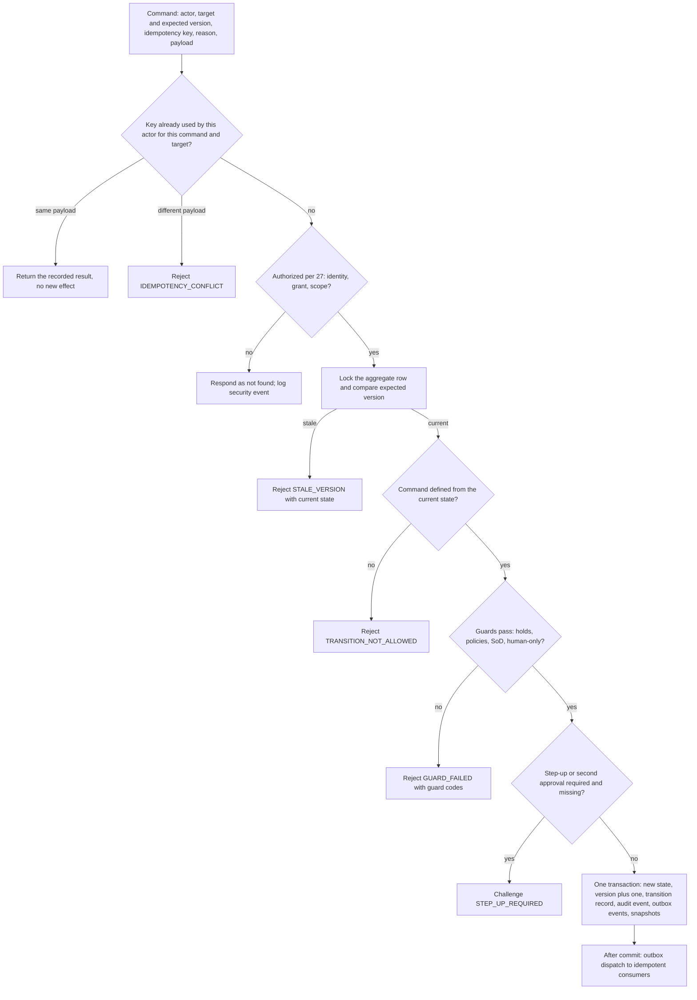

### 2.3 Error contract for transitions

Codes are stable, language-neutral and shown to users through translation keys; HTTP status codes and the error envelope belong to [09](09-api-contracts.md).

| Code | Raised when | What the client does |
|---|---|---|
| `TRANSITION_NOT_ALLOWED` | The command is not defined from the record's current state | Shows the current state and the commands now available |
| `GUARD_FAILED` | One or more guards failed; the response lists guard codes such as `HOLD_ACTIVE`, `NOT_ASSIGNED`, `EXCEPTION_PENDING`, `VERSION_SUPERSEDED`, `EXPIRED`, `QA_UNANSWERED` | Shows the exact missing items (UXE-001) |
| `STALE_VERSION` | The expected version differs from the current one | Re-reads and lets the user decide again; never retries blindly |
| `IDEMPOTENCY_CONFLICT` | A key is reused with a different payload | Generates a new key only after the user confirms a new action |
| `STEP_UP_REQUIRED` | An L2 action lacks fresh re-authentication, or an L3 action lacks the second approval ([27](27-roles-and-permissions.md) Section 6.1) | Prompts for step-up; L2 actions are online-only |
| `POLICY_NOT_CONFIGURED` | A required owner policy has no active version | Routes the item to ADM; nothing is assumed |
| `STEPS_INCOMPLETE` | A `StartWork` request arrives while a worker step is still pending (view of changes, acknowledgement, photo, site check, customer-supplied item check); nothing is recorded ([11](11-worker-job-execution.md) Section 5.1) | Lists the missing steps; the Start control stays disabled until they are done |
| `HUMAN_ONLY` | An AI or SYS identity calls a human-only command | Logged as a security event ([27](27-roles-and-permissions.md) AUTH-026) |
| Not found | The record is outside the actor's scope | Same response as a missing record ([27](27-roles-and-permissions.md) AUTH-004) |

### 2.4 Idempotency and concurrency rules

- **Key scope and retention.** Keys are scoped to actor, command type and target record; the server stores the key, a hash of the payload and the result. Retention of keys is set in [09](09-api-contracts.md) and must exceed the longest offline sync delay that [11](11-worker-job-execution.md) allows. Field devices generate keys for offline commands (05 DOM-030).
- **Optimistic version.** Commands carry `expected_version`. Status never uses last-write-wins.
- **Storage-boundary invariants** (swe-architecture "For scarce resources enforce correctness at the authoritative storage boundary."):

| Invariant | Enforcement (detail in [08](08-data-model-and-database.md)) | Source |
|---|---|---|
| At most one customer approval per estimate version and one effective approval per estimate | Unique constraint plus a lock on the estimate row during approval | 05 Section 6.2; CX-003 |
| One job per approval; one applied scope snapshot per change-order version | Unique keys `estimate version + create-job` and `change order version + apply` | DOM-016, DOM-018 |
| One open draft version per estimate and per change order | Partial unique constraint | Section 5.4 |
| No overlapping confirmed or tentative assignments for one worker (unless an override record exists) | Exclusion constraint or a per-worker lock | DOM-021, AT-011 |
| Allocations and credit applications never exceed an invoice total or a payment's unallocated amount | Row locks on the invoice, the payment and the credit, recompute inside the transaction | DOM-044 |
| A start event needs no active hold covering the job or the visit at commit time (narrower holds only lock their tasks) | Start and hold creation both lock the job row; the gate is evaluated inside the transaction | DOM-024, DOM-025 |

- **Lock order.** When a command touches several aggregates it locks them in a fixed order (by aggregate type, then identifier) to avoid deadlocks; [08](08-data-model-and-database.md) records the order.
- **No exactly-once promise.** Reactions run through the outbox with idempotent consumers and per-aggregate version ordering; an event whose prerequisite does not exist yet waits and then becomes an exception item ([33](33-ai-and-automation-governance.md) Section 12.4).

### 2.5 Transition record and audit

Every transition appends one transition record: machine; record type, identifier and version before and after; from-state; to-state; command; event identifier; actor type (user, AI on behalf of a user, SYS); actor and on-behalf-of user; roles and capabilities used; reason code and text; evidence links; idempotency key; correlation identifier; client type (web, mobile, offline sync); client-captured time and offline flag; server commit time (UTC with time-zone context, NFR-020). Transitions that are protected events in [27](27-roles-and-permissions.md) Section 6.4 also write the audit event with the fields listed there. In the tables below, **audit P** marks a protected event; every row also writes the transition record.

### 2.6 Overrides, holds and human-only transitions

- **Override pattern.** `OverrideGate` (target record, gate code, reason code and text, evidence) creates an override record (05 `OverrideRecord`) with the pre-override state and the actor's role and capability, adds it to the owner/supervisor queue (JOB-012), and leaves the target state unchanged. The blocked command is then re-issued and passes that one guard. Who may override which gate is [27](27-roles-and-permissions.md) Section 6.3.
- **Never overridable** (no `OverrideGate` exists for them): critical holds (suspect hazardous material, structural concern, unapproved licensed-trade scope, failed or incomplete inspection, any hazard flagged critical); START-001 (fix by reassignment, D-27-05), START-002, START-003, START-009, START-010 (released only by ADM recording the approved prerequisite with evidence); an SOP-not-active hold; safety-critical QA checks; human-only rules.
- **Human-only commands** (AI and SYS refused): customer approvals of estimates and change orders; estimate and change-order sends; invoice issue and void; payment clear, return, void and reverse; reconciliation sign-off; refund and credit approval; write-off; deposit waiver; hold release and void (a condition hold ends only with the human-recorded fact that satisfies it, H2); stop-work resolution (Section 16.4); overrides; job cancel, close and reopen; incident triage and closure; complaint escalation, resolution and closure; QA verification and punch verification; lead merge, spam and not-serviceable confirmation; controlled-content activation; legal hold placement and release; privacy request decisions and erasure (Section 16.12).
- **Effects inside a person's command.** Where a table row names SYS for a step that follows directly from a person's command, the step commits in that command's transaction and is attributed to that person: E9 inside E4; J5, J10 and J11 inside the command that raised the hold, released it or resolved the stop; J15 to J18 inside J14 or QR3; J19 and DR6 inside I2; J20 inside I4; DR7 inside J24 or J25; DR8 and CR5 inside RF4; PU1 inside J14 or QR3; PU6 inside PU4; RW5 inside the rework job's J21 or J22. SYS takes no decision of its own there, and it never changes a financial status on its own account ([27](27-roles-and-permissions.md) AUTH-003).
- **SYS reactions** (declared in [27](27-roles-and-permissions.md) Section 10.4): job creation from an approval and change-order application (workflow 2), readiness recomputation (3), start record (4), notification dispatch (5), invoice draft (6), escalation flags and review suppression (7), media processing (8), audit writing (9); plus timer commands that only expire offers or raise flags (Section 2.7). Four SYS writes in this document go beyond the current Section 10.4 grants and are listed in Section 21 for 27 to confirm: a scheduler identity for timer commands (E8, CO9, flags); Lead, Deposit requirement and Estimate writes in workflow 2 (LD6, DR1, other drafts Discarded); condition-hold records in workflow 3 (H1, H2); notification drafts for events outside the auto-send policy in workflow 5 (Section 16.1). Until 27 adds them, they are not built.

### 2.7 Timers and expiry (PROPOSED DECISION D-06-21)

- Timer commands run under a SYS scheduler identity and are re-checked at command time: the approve command itself refuses an expired version, so correctness never depends on the timer running.
- Timers only expire offers (estimate versions, change orders), mark derived flags (late visit, past due, overdue punch item, stale lead, punch confirmation window lapsed) and raise alerts; where the owner configures it, a timer may also release an aged tentative slot (a capacity reservation on a visit, not a job hold, Section 6.2). A timer never clears a payment, releases a job hold, resolves a stop-work event, closes an incident, complaint, punch item or job, or sends a legally sensitive notice.
- Instants are compared in UTC on the server clock; local-date deadlines (estimate valid until, invoice due date) end at the end of that local date in the configured business time zone (05 D-05-14; Q-06-12). Visit windows use the property's zone and are tested across daylight-saving changes (05 DOM-046).
- Every duration is an owner decision and is shown as `<owner decision>`; none is invented here. Section 18.5 lists them.

### 2.8 Offline field transitions (PROPOSED DECISION D-06-20)

- Field commands allowed offline: `SetEnRoute`, `SetArrived`, `StartWork` (against the cached briefing, see Section 7.4), `PauseWork`, `ResumeWork`, `RecordStopWork`, `RecordNoStart`, `ReportIncident`, `RecordPunchItem`, `RecordPunchCorrection`, `CompleteWork` (as a request), `RecordPayment` (collect capability only) and evidence capture. Customer approvals, overrides, releases and every L2 action are online-only (D-06-23; [27](27-roles-and-permissions.md) Section 6.1).
- Each queued command keeps its idempotency key, client-captured time and the record version the device saw. At sync the server re-authorizes it (AUTH-033) and re-validates it against the current state. An accepted command commits normally with the offline flag; a rejected one becomes a review item for ADM (or DSP for schedule items) and the worker sees why. Nothing is silently overwritten (05 DOM-030).
- Safety facts are never lost: a stop-work event, condition report or incident captured offline is always stored as a record, even when the state transition it implied is rejected (for example because the job was cancelled meanwhile).

### 2.9 How to read the machine sections

- **Roles** use the codes of [27](27-roles-and-permissions.md) Section 3.1: GST, CUS, WKR, LWK, DSP, ESTR, CSR, BKP, ADM, SUB, AI, SYS. `(asg)` means assigned scope inside the access window, `(own)` the actor's own records, `(cap x)` a named capability. L1, L2 and L3 are the control levels of [27](27-roles-and-permissions.md) Section 6.1. SUB rows apply only after NEAR-004.
- **Labels.** Each state carries **FACT** (named in the spec, with its ID) or **PROPOSED**. Guards, actors and timers are PROPOSED unless a cited requirement states them.
- **Side effects** list notifications (NTF-001..NTF-011 and their send mode from [33](33-ai-and-automation-governance.md) Section 12.6), snapshots, records created and **audit P**.
- **Rev.** says whether and how a transition can be undone: "No" (terminal or irreversible fact), "Yes: command" (a named reverse transition), or "Corr." (only by void, reverse or supersede).
- **Row labels** in the transition tables are local references inside this document, not requirement IDs. Prefixes: LD lead, E estimate version, J job, V visit, H job hold, CO change order, I invoice, PY payment, RC reconciliation, DR deposit requirement, RF refund, CR credit, IN incident, CP complaint, RW rework case, QR quality review, PU punch item. They are chosen so that no label reads like a control level (L1-L3), a tier (P0, P1) or a decision, risk or question ID.

## 3. Machine catalog and status dimensions

### 3.1 Catalog

| Machine | Entity ([05](05-domain-model.md)) | Spec key | In master §5 file 06 list | Tier | Section |
|---|---|---|---|---|---|
| Lead | Lead | STM-001 | Leads | P0 | 4 |
| Estimate version (container status derived) | Estimate version, Estimate | STM-002 | Estimates | P0 | 5 |
| Agreement packet (coupled) | Agreement packet | RECT-003, RECT-004 | - | P0 | 5.8 |
| Job | Job | STM-003 | Jobs | P0 | 6.1 |
| Visit (appointment) | Visit, Schedule entry | CX-002, CX-006, SCH-006..SCH-008 | - | P0 | 6.2 |
| Readiness (computed) | Job attribute | UXE-001, SCH-001 | - | P0 | 6.3 |
| Job hold | Job hold | START-010, PERM-006 | - | P0 | 6.4 |
| Start-gate evaluation outcomes | Start-gate evaluation | Master §12; START-001..START-015 | - | P0 | 7 |
| Change order | Change order | STM-004 | Change orders | P0 | 8 |
| Invoice (document, settlement, due, delivery, dispute) | Invoice | STM-005 | Invoices | P0 | 9 |
| Payment (status and reconciliation) | Payment, Payment adjustment, Reconciliation sign-off | FIN-004..FIN-006 | Payments | P0 | 10 |
| Deposit requirement | Deposit requirement | BIZ-006, FIN-002 | - | P0 | 11.1 |
| Refund | Refund | PERM-004 | - | P0 | 11.2 |
| Credit | Credit | PERM-004 | - | P0 | 11.3 |
| Field incident | Incident | STM-006 | Incidents | P0 | 12 |
| Customer complaint | Complaint | CX-007, QA-009 | Customer complaints | P0 | 13.1 |
| Rework case | Rework case | CX-007, QA-010, AT-059 | - | P0 | 13.2 |
| Quality review | Quality inspection | QA-001 | Quality reviews | P0 | 14 |
| Punch item | Punch item | STM-007 | - | P0 | 15 |
| Supporting lifecycles | Notification, payment milestone, work package, task, job item line, site hazard, stop-work event, time-entry correction, controlled content, service, user account, purchase, expense, AI output, automation run, privacy request, legal hold, P1 records | - | - | P0 and P1 | 16 |

"Incident" in this document always means a field incident (ENT-014). System and security incidents belong to [17](17-observability-and-operations.md) and [12](12-security-threat-model.md).

### 3.2 Status dimensions (PROPOSED DECISION D-06-02)

| Record | Dimension | Stored or derived | Values | Machine |
|---|---|---|---|---|
| Lead | Lifecycle | Stored | New, Contacted, Qualified, Converted, Lost, Closed, Merged, Spam, Not serviceable | 4 |
| Lead | Estimate progress | Derived from estimates and visits | Estimate needed, Assessment scheduled, Estimate sent | 4 |
| Estimate | Container status | Derived from versions | Draft, Open, Approved, Ended | 5.1 |
| Job | Lifecycle | Stored | Preparation, Started (Working, Paused, Blocked, Between visits), On hold, Work complete, Quality review, Customer closeout, Invoiced, Closed, Cancelled | 6.1 |
| Job | Readiness | Derived (computed) | Ready, Needs attention, Blocked | 6.3 |
| Task | Status | Stored; Blocked while a narrower hold or failing check locks its scope (Section 7.3) | Not started, In progress, Done, Skipped with reason, Blocked | 16.3 |
| Visit | Lifecycle | Stored | Requested, Tentative, Confirmed, En route, Arrived, In progress, Completed, No start, Cancelled | 6.2 |
| Visit | Confirmation delivery | Derived from the notification | Not sent, Sent, Delivered, Failed | 16.1 |
| Visit | Lateness | Derived (timer flag) | On time, Late | 6.2 |
| Invoice | Document | Stored | Draft, Issued, Void, Discarded | 9 |
| Invoice | Settlement | Derived from allocations, credits, write-offs and payment statuses | Unpaid, Partially paid, Paid pending clearance, Paid, Written off | 9 |
| Invoice | Due | Derived (date) | Not yet due, Past due | 9 |
| Invoice | Delivery | Derived from the notification | Not sent, Sent, Delivered, Failed, Viewed | 9 |
| Invoice | Dispute | Stored | None, Disputed, Resolved | 9 |
| Payment | Status | Stored (appended status events) | Recorded, Deposited, Cleared, Returned, Voided, Reversed | 10 |
| Payment | Reconciliation | Stored, written only by a reconciliation sign-off | Unreconciled, Reconciled, Exception | 10 |
| Deposit requirement | Status | Mixed: decisions stored, satisfaction derived | Policy not configured, Not required, Required, Partly satisfied, Satisfied, Waived, Applied, Refund review, Refunded, Retained | 11.1 |
| Incident | Escalation level | Stored attribute | Routine, Supervisor, Owner immediate, External | 12 |

A derived value is computed from source records on write or on read and is never the target of a command; a cached copy must be rebuildable from the sources (05 DOM-044).

### 3.3 How the machines connect

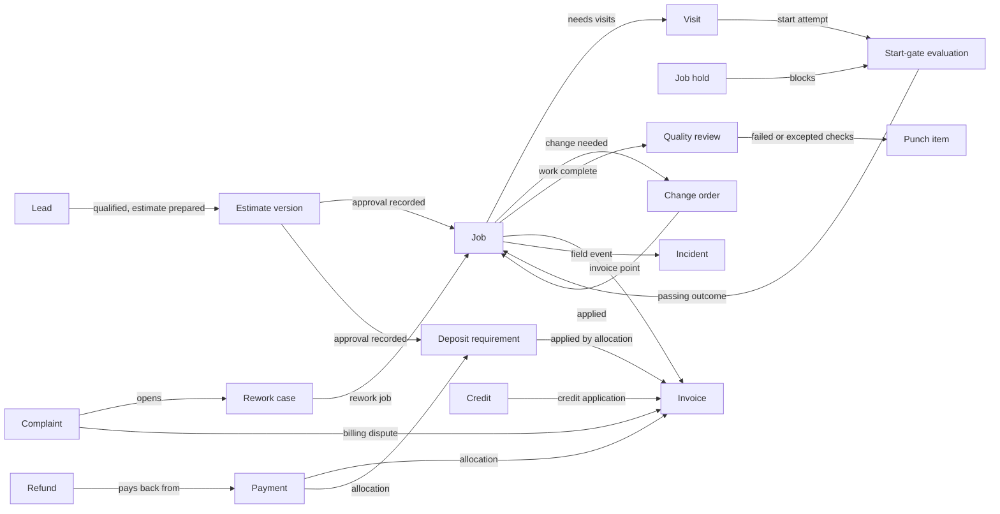

## 4. Lead (STM-001)

PROPOSED DECISION D-06-03. The lead is the working sales record created from one or more immutable requests (05 D-05-02). Its stored lifecycle is short; the spec's "Estimate Needed" and "Estimate Sent" become sub-statuses derived from the linked estimate and visits, as 05 asked ("derived from the linked estimate, not set by hand"), so the two machines can never disagree.

### 4.1 States

| State | Stored or derived | Definition | Label |
|---|---|---|---|
| New | Stored | Created from a request: the public form through SYS workflow 1, or a call, email or referral logged by CSR or ADM. Carries the serviceability result and rule version, duplicate-candidate flags, spam signals and urgency (WEB-016, WEB-018, WEB-024). | FACT (STM-001) |
| Contacted | Stored | A logged two-way communication with the requester after the request: an answered outbound call or message, or an inbound reply (JOB-009). The automatic NTF-001 acknowledgement does not count (CX-002). | FACT; definition PROPOSED |
| Qualified | Stored | Staff confirmed serviceability under the active service-area rule, matched every requested service to a registry code whose web status accepts requests (WEB-006), recorded the minimum-charge disclosure (CX-001, WEB-017, AT-001), recorded a risk-triage disposition for any safety flag, and chose the estimate route (preliminary range, remote review or site assessment). | FACT; guards PROPOSED |
| Estimate needed | Derived sub-status of Qualified | No linked estimate version is Sent or Viewed and no site-assessment visit is Confirmed. | FACT name; PROPOSED as derived |
| Assessment scheduled | Derived sub-status of Qualified | A site-assessment visit for this lead is Confirmed (STG-003 "whether site visit/remote estimate is appropriate"). | PROPOSED, derived |
| Estimate sent | Derived sub-status of Qualified | A linked estimate has a current version in Sent or Viewed. | FACT name; PROPOSED as derived |
| Converted | Stored, terminal | A customer approval was recorded on an estimate version of this lead; set only by that event. | FACT; trigger PROPOSED |
| Lost | Stored, reopenable | Ended after HandyHub made an offer (a sent estimate version, or a preliminary range recorded as a communication, 05 D-05-26) and no approval followed. Needs a lost reason code (RPT-001 "losses and reason codes"). | FACT; definition PROPOSED |
| Closed | Stored, reopenable | Ended before any offer: the requester withdrew, could not be reached, asked for work HandyHub does not offer, was referred out, or the request belongs to an existing job. Needs a close reason code. | FACT; definition PROPOSED |
| Merged | Stored, terminal | Confirmed duplicate of another lead; its requests now belong to the surviving lead, with provenance (LAUNCH-002; 05 DOM-005). | PROPOSED |
| Spam | Stored, reopenable | Staff confirmed a spam-suspected submission. It is kept, never silently discarded (WEB-018), for the retention period of [13](13-privacy-data-governance.md) (Q-32-19) and excluded from funnel measures. | PROPOSED |
| Not serviceable | Stored, reopenable | The address is outside the configured coverage, or coverage is unknown and staff confirmed it cannot be served (BIZ-001, AT-003, WEB-016); the requester is told so without any booking language. | PROPOSED |

### 4.2 Diagram

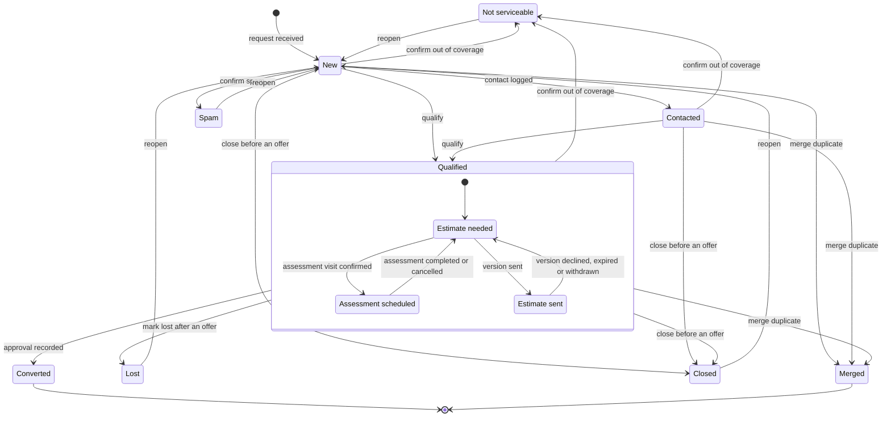

### 4.3 Transitions

| # | From | To | Command or event | Allowed roles | Guards | Side effects | Rev. |
|---|---|---|---|---|---|---|---|
| LD1 | - | New | `SubmitRequest` (public form) or `LogRequest` (staff); event `LeadCreated` | GST through SYS workflow 1 (write-only, no read-back); CSR, ADM | Server-side field validation (WEB-015); idempotency key from the form (WEB-023); serviceability computed under the active rule version (WEB-016); possible duplicates flagged, never merged (WEB-024); spam signals flagged (WEB-018) | Immutable request snapshot (WEB-028); NTF-001 only under an owner-approved auto-send class, otherwise staff release (WEB-025), and held while spam is suspected; staff alert with the reference only (WEB-026); audit (SYS write) | No |
| LD2 | New | Contacted | `LogContact` | CSR, ESTR, ADM | A two-way communication with a contact of this lead is logged (JOB-009) | Communication record | No |
| LD3 | New, Contacted | Qualified | `QualifyLead` | CSR, ESTR, ADM | Serviceability "in coverage" under the active rule, or an ADM coverage decision with reason (HND-002); every requested service resolves to a registry code whose web status accepts requests (05 DOM-002, WEB-006); minimum-charge disclosure recorded (CX-001, AT-001); a person recorded the risk-triage disposition for any safety flag (AIR-001 is advisory); estimate route chosen; no open duplicate candidate | Qualification record with rule versions; derived sub-status Estimate needed | No (close or mark lost instead) |
| LD4 | Qualified (Estimate needed) | Qualified (Assessment scheduled) | Event `VisitConfirmed` for a site-assessment visit | DSP, ADM through the Visit machine | - | NTF-004 for the assessment visit | Derived |
| LD5 | Qualified | Qualified (Estimate sent) | Event `EstimateVersionSent` | ESTR, ADM through the Estimate machine | - | NTF-002 (Section 5) | Derived |
| LD6 | Qualified | Converted | Event `CustomerApprovalRecorded` | SYS (workflow 2) only, a [27](27-roles-and-permissions.md) grant to confirm (Section 21); nobody sets it by hand | The approval is valid under Section 5; idempotent by approval identifier | Job created (Section 6.1); RPT-001 conversion; audit P | No |
| LD7 | Qualified | Lost | `MarkLeadLost` | CSR, ADM | An offer exists; no version is Sent or Viewed (withdraw it first, Section 5); lost reason code | Pending NTF-003 reminders cancelled | Yes: `ReopenLead` |
| LD8 | New, Contacted, Qualified | Closed | `CloseLead` | CSR, ADM | No offer exists (otherwise LD7); close reason code; a referral record where work is referred (05 DOM-015, P1) | Pending lead messages cancelled | Yes: `ReopenLead` |
| LD9 | New, Contacted, Qualified | Merged | `MergeLeads` (decides a duplicate candidate) | CSR, ADM; L1 with reason ([27](27-roles-and-permissions.md) Section 6.2) | Human decision; the surviving lead is not terminal; the merged lead has no estimate version in Sent, Viewed or Approved (otherwise merge the other way or close); never merged only because two people share an address or phone | Requests re-linked to the survivor with provenance; duplicate candidate set to merged; both originals retained; audit P | No |
| LD10 | New | Spam | `ConfirmSpam` | CSR, ADM | Spam suspected or staff judgment with reason; no two-way communication with a real person logged (otherwise LD8) | NTF-001 never sent; excluded from funnel measures; retention under [13](13-privacy-data-governance.md) | Yes: `ReopenLead` |
| LD11 | New, Contacted, Qualified | Not serviceable | `ConfirmNotServiceable` | CSR, ADM | Serviceability "out of coverage" or "unknown", confirmed by staff; no version sent | Staff-released, non-confirming message with no booking language (AT-003, CX-002); counted in the out-of-area measure ([32](32-website-and-customer-experience.md) Section 7.8) | Yes: `ReopenLead` when coverage changes or the address is corrected |
| LD12 | Lost, Closed, Spam, Not serviceable | New | `ReopenLead` | CSR, ADM | Reason code; serviceability recomputed under the current rule; if the original request is older than `<owner decision>`, log a new request instead | Lead re-enters triage | - |

### 4.4 Terminal states and invalid transitions

Terminal: Converted and Merged. Lost, Closed, Spam and Not serviceable are end states that only `ReopenLead` leaves.

| Invalid attempt | Result | Rule |
|---|---|---|
| Any role or API sets a lead to Converted, Estimate needed or Estimate sent | `TRANSITION_NOT_ALLOWED` | Converted comes only from the approval event; sub-statuses are derived |
| `MarkLeadLost` while version 2 of its estimate is Sent | `GUARD_FAILED` (`OPEN_OFFER`) | Withdraw the version first, so an approval cannot race the loss |
| `CloseLead` after an estimate version was sent | `GUARD_FAILED` (`OFFER_EXISTS`) | Use Lost, so RPT-001 counts it as a loss with a reason |
| `MergeLeads` into a Merged or Converted lead | `GUARD_FAILED` | The survivor must be live |
| `ConfirmSpam` on a lead with a logged two-way conversation | `GUARD_FAILED` | Close it with a reason instead |
| `QualifyLead` with no minimum-charge disclosure on record | `GUARD_FAILED` (`MIN_DISCLOSURE_MISSING`) | CX-001, AT-001 |
| The Lead Intake AI (AIR-010) qualifies, merges or closes a lead | `HUMAN_ONLY` | AIR-010 drafts only |
| A guest reads back the status of a submitted request | Not found | [27](27-roles-and-permissions.md) Section 4.6: public submissions are write-only |

### 4.5 Timers

| Timer | Effect | Value |
|---|---|---|
| First-response expectation for New leads | Overdue flag and CSR alert; no transition | `<owner decision>` ([32](32-website-and-customer-experience.md): "Respond within the owner-set expectation") |
| Stale lead (no activity) | Listed for CSR review; no automatic Lost or Closed, because RPT-001 needs a human reason code | `<owner decision>` (Q-06-01) |
| Spam review queue age | Alert | `<owner decision>` |

### 4.6 Concurrency and races

- Double submits and network retries reuse the form's idempotency key and return the original reference; no second lead exists (WEB-023).
- Two staff merging crosswise (A into B while B into A): both leads are locked in identifier order; the second command finds a terminal lead and fails.
- `MarkLeadLost` against a customer approval: the approval needs a current sent version and the loss needs none, and both lock the estimate row, so only one can commit.
- A service-area rule change during qualification: the qualification reads the rule version inside its transaction and stores it; a later rule change never rewrites the lead.

## 5. Estimate version (STM-002) and agreement packet

PROPOSED DECISION D-06-04. An estimate is a container with a stable number; each version has its own lifecycle (05 D-05-04). After an approval is converted into a job, scope and price change only through change orders (Section 8). This answers 05 Q-05-15 provisionally ("May an approved estimate be superseded by a newly approved version before the job starts, or must every post-approval change be a change order?"): every post-approval change is a change order, because the job and its scope snapshot exist from the moment of approval and one change path keeps CX-003 and FIN-008 testable. The owner confirms or replaces this (Q-06-03).

### 5.1 Estimate container status (derived)

| Container status | Rule |
|---|---|
| Draft | Only Draft, Internal review or Discarded versions exist |
| Open | One version is Sent or Viewed |
| Approved | One version is Approved (at most one effective approval per estimate, 05 Section 6.2) |
| Ended | No version is open or approved, and the latest sent version is Declined, Expired, Withdrawn or Voided |

### 5.2 Version states

| State | Definition | Content editable | Label |
|---|---|---|---|
| Draft | ESTR composes the version, priced under a recorded price-book version; the Estimate Assistant (AIR-011) may draft lines through the estimator | Yes | FACT (STM-002) |
| Internal review | Automated checks run and any pricing exception waits for ADM; reviewers may still correct content (05 DOM-010). While a pricing exception is requested, the derived sub-status is "awaiting exception" | Yes | FACT; checks PROPOSED |
| Sent | Frozen: pricing snapshot and content hash stored (D-28-13, PRC-017), agreement packet rendered, valid-until set; delivered by NTF-002 or presented in person | No | FACT |
| Viewed | The customer or an authorized contact first opened the version through an authenticated session or a verified version-bound link (AUTH-027, AUTH-029); email open tracking is not used (D-06-24) | No | FACT; recording rule PROPOSED |
| Approved | One customer approval recorded on the current packet with the selected options (CX-003, 05 DOM-011) | No (immutable, REC-001) | FACT |
| Declined | The customer declined in the portal, or ESTR or ADM recorded a verbal decline with a communication log entry | No | FACT |
| Expired | Valid-until passed while Sent or Viewed; the version can no longer be approved (PRC-012) | No | FACT |
| Superseded | A newer version of the same estimate was sent while this one was Sent or Viewed | No | FACT (the spec's "Revised/Superseded") |
| Withdrawn | HandyHub withdrew a sent offer before the customer decided (pricing error, hazard found, capacity, lead lost) | No | PROPOSED |
| Discarded | A Draft or Internal review version abandoned before sending ([27](27-roles-and-permissions.md): drafts are discarded, never deleted) | No | PROPOSED |
| Voided | ADM voided the approval because it was invalid (recorded in error, unauthorized approver, failed identity check) before any work started | No | PROPOSED |

"Revised" in the spec is the `ReviseEstimate` command: it copies a version into a new Draft with a revision reason (EST-006); the older version keeps its own state until the new one is sent. A customer who cancels a valid approval before work starts cancels the job (Section 6.1); the version stays Approved because the approval really happened.

### 5.3 Diagram

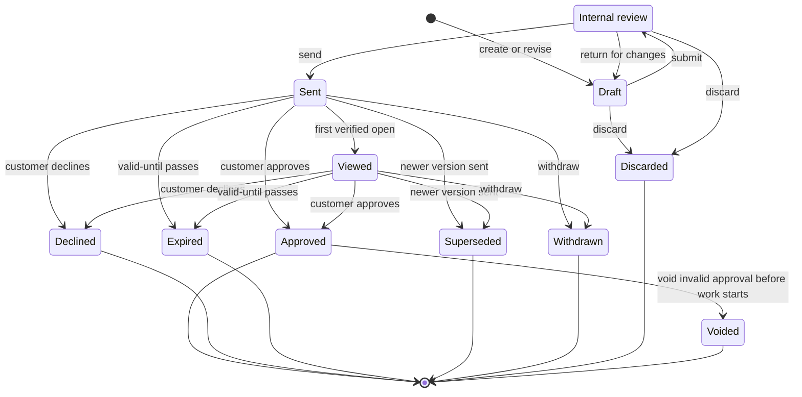

### 5.4 Transitions

| # | From | To | Command or event | Allowed roles | Guards | Side effects | Rev. |
|---|---|---|---|---|---|---|---|
| E1 | - | Draft | `CreateEstimate`, `ReviseEstimate` | ESTR, ADM; AI drafts content only | Lead Qualified (or an existing customer and property); at most one open draft per estimate; a revision reason for version 2 and later (EST-006); no version of this estimate is Approved (use a change order, D-06-04) | The draft records the active price-book version | Yes: `DiscardEstimateVersion` |
| E2 | Draft | Internal review | `SubmitEstimateForReview` | ESTR, ADM | Automated checks: EST-001..EST-005 fields; exclusions and assumptions present (AT-007); options well formed (EST-005); minimum rule evaluated once per estimate version and never per line (FIN-001, PRC-008; whether the unit is the quoted job or visit bundle, the owner's proposed default, is open in 05 Q-05-02); price-book version still active or re-priced (PRC-018); every line has a CPA-approved tax treatment (PRC-023); a recorded hazard disposition where the service or site needs one (estimate-assistant: "Missing hazardous-condition decisions block a firm quote."); deposit policy evaluated (05 DOM-039) | Pricing exceptions created as "requested" where the minimum or the discount limit needs one (FIN-001, EST-004) | Yes: E3 |
| E3 | Internal review | Draft | `ReturnEstimateToDraft` | ESTR, ADM | Reason | - | - |
| E4 | Internal review | Sent | `SendEstimate` | ESTR when no exception is pending; ADM; never AI or SYS (AT-053) | All E2 checks still pass; every required pricing exception approved by ADM (D-27-10); the packet renders from active template, translation and policy versions (05 DOM-060; [30](30-service-agreement-standards.md) AGR-026); the recipient is the customer or a contact with approval authority (AUTH-028); valid-until computed from the active validity policy (`POLICY_NOT_CONFIGURED` if none, Q-28-11) | Pricing snapshot and hash frozen; packet Prepared, then Sent; NTF-002 with a version-bound link (AUTH-029) as part of the estimator's own send ([33](33-ai-and-automation-governance.md) Section 12.6); every older Sent or Viewed version of the estimate becomes Superseded in the same transaction; lead sub-status Estimate sent; NTF-003 reminders scheduled only where the owner has approved them; audit P | Corr.: `WithdrawEstimate` or a newer version |
| E5 | Sent | Viewed | Event `EstimateViewed` (first verified open) | CUS (own) or authorized contact | Version current; recorded only from an authenticated session or verified link | First-viewed time; packet Viewed | No |
| E6 | Sent, Viewed | Approved | `ApproveEstimate` | CUS (own) or a contact with approval authority (AUTH-028); in-person capture on a staff device records the capturing worker (AUTH-027); never staff on the customer's behalf, never AI or SYS | Version is the current sent version, not expired at server time, not superseded or withdrawn; the packet hash matches the packet shown; selected options valid (one per exclusive group, EST-005); identity re-verified (AUTH-027); online (D-06-23); idempotency key | Customer approval and signature records (05 DOM-011, DOM-055); packet Accepted; deposit requirement computed (Section 11.1); event `CustomerApprovalRecorded` makes SYS workflow 2 create exactly one job with scope snapshot version 1 (05 DOM-016, AT-010); lead Converted; NTF-003 cancelled; other open drafts of this estimate Discarded; audit P | Corr.: `VoidApproval` |
| E7 | Sent, Viewed | Declined | `DeclineEstimate` | CUS (own); ESTR, ADM record a verbal decline with a communication log entry | Version current; optional reason code (RPT-002) | NTF-003 cancelled; packet Declined | No (revise instead) |
| E8 | Sent, Viewed | Expired | `ExpireEstimate` (timer) | SYS scheduler | Server time is at or after the version's expiry, re-checked in the transaction | NTF-003 cancelled; packet Expired; lead sub-status Estimate needed | No (revise; the new version is priced under the active price book, PRC-012) |
| E9 | Sent, Viewed | Superseded | Event `NewerVersionSent` inside E4 | SYS within the estimator's send | - | Packet Superseded; NTF-003 for this version cancelled | No |
| E10 | Sent, Viewed | Withdrawn | `WithdrawEstimate` | ADM, L1 with reason ([27](27-roles-and-permissions.md) Section 6.2 limits ESTR to unsent versions; Section 21 asks 27 to confirm) | Not approved; reason code (pricing error, hazard found, capacity, lead lost, other) | Packet Void; NTF-003 cancelled; staff-released message to the customer; audit P | No |
| E11 | Draft, Internal review | Discarded | `DiscardEstimateVersion` | ESTR, ADM, L1 | Never sent | Requested pricing exceptions withdrawn | No |
| E12 | Approved | Voided | `VoidApproval` | ADM, L2 with reason | The approval is invalid (recorded in error, unauthorized approver, failed identity check); the job has no start event; **HUMAN REVIEW: attorney** where the customer disputes it | The customer approval is marked withdrawn by a new fact (the original stays); packet Void; job Cancelled with reason "approval voided" (Section 6.1); held deposit money goes to refund review (Section 11); staff-released message; audit P | No |

### 5.5 Terminal states and invalid transitions

Terminal: Approved (unless voided), Declined, Expired, Superseded, Withdrawn, Discarded and Voided.

| Invalid attempt | Result | Rule |
|---|---|---|
| Editing a line, option, exclusion or deposit term of a Sent version | `TRANSITION_NOT_ALLOWED` (frozen) | EST-006; revise instead (AT-005) |
| Approving version 1 after version 2 was sent | `GUARD_FAILED` (`VERSION_SUPERSEDED`) | CX-003; AT-005 |
| Approving one second after valid-until, even if the expiry timer has not run | `GUARD_FAILED` (`EXPIRED`) | Server time decides; PRC-012 |
| ESTR sends a version below the minimum with no approved exception | `GUARD_FAILED` (`EXCEPTION_PENDING`) | FIN-001; AT-006; [27](27-roles-and-permissions.md) hook 30 |
| The Estimate Assistant sends a version or marks it approved | `HUMAN_ONLY` | AT-053 |
| `ReviseEstimate` on an estimate that has an Approved version | `GUARD_FAILED` (`USE_CHANGE_ORDER`) | FIN-008; D-06-04 |
| A forwarded link used by someone other than the verified recipient | Approval refused; nothing recorded | AUTH-027 ([27](27-roles-and-permissions.md) hook 23) |
| Customer B opens customer A's version by changing an identifier | Not found | AT-047 |
| `VoidApproval` after the first start event | `GUARD_FAILED` (`WORK_STARTED`) | Use a change order, or cancellation with settlement (Section 6.1) |

### 5.6 Timers and expiry

| Timer | Effect | Value |
|---|---|---|
| Valid-until of a Sent or Viewed version | E8 Expired; reminders stop | Estimate validity policy, `<owner decision>` (Q-28-11) |
| NTF-003 reminder schedule | Reminders, suppressed after approval, rejection or expiration (spec NTF-003 "suppress after approval/rejection/expiration") and, PROPOSED, after supersede or withdrawal | `<owner decision>`; staff release until the owner approves the class ([33](33-ai-and-automation-governance.md) Section 12.3 row 10) |
| Pricing exception awaiting ADM | Alert to ADM | `<owner decision>` |
| Draft with no activity | Listed for ESTR; never discarded automatically | `<owner decision>` |

### 5.7 Concurrency and races

- **Approval against a newer send.** Both commands lock the estimate row. If E4 for version 2 commits first, version 1 is Superseded and its approval fails; if the approval commits first, the send of version 2 fails (an approved version exists) and version 2 is Discarded.
- **Approval against expiry.** The approve command compares server time with the stored expiry inside its transaction; the timer re-checks the state before expiring. Client clocks are never used.
- **Double approval** (double tap, retry, two contacts at once): the idempotency key and the unique one-approval-per-version constraint leave one customer approval and one job (05 DOM-016; scheduling playbook: "A duplicated acceptance event creates one scheduling task.").
- **Price-book activation during review:** E4 re-checks that the recorded price-book version is still active; if not, the estimator re-prices and sees the line-by-line difference (PRC-018).
- **Two estimators editing one draft:** optimistic version; the second save is stale.

### 5.8 Agreement packet (coupled to the version)

[30](30-service-agreement-standards.md) Section 9.3 proposes the packet lifecycle (D-30-12). This document adopts it with three differences for 30 to align (Section 21). First, Void also follows the withdrawal of a sent version (E10, CO10). Second, Accepted and Declined can follow Sent directly, because an in-person approval or a recorded verbal decline need not come after a recorded view (E6, E7). Third, 30's transition from Accepted to Superseded ("material change re-approved") is not used while D-06-04 stands: a change after approval is a change order with its own packet (Q-06-03). A packet never moves on its own command except Void: its transitions are side effects of the estimate-version or change-order transitions and commit in the same transaction, so a packet and its version can never disagree.

| Packet state | Driven by | Notes |
|---|---|---|
| Prepared | Pre-render step of E4 or CO5 | Render checks fail closed (AGR-026) |
| Sent | E4 or CO5 | One current packet per version |
| Viewed | E5 or the change-order equivalent | - |
| Accepted | E6 or CO6 | The customer approval stores the packet hash (05 DOM-011; AGR-006) |
| Declined | E7 or CO8 | - |
| Expired | E8 or CO9 | - |
| Superseded | E9; or a re-render of the same version before acceptance (for example after a Spanish translation is approved) | The old packet stays retrievable |
| Void | E10 or CO10 withdrawal (PROPOSED addition to the [30](30-service-agreement-standards.md) diagram); E12 or CO11 approval void | ADM with reason; accepted packets are otherwise immutable (AGR-007) |

## 6. Job (STM-003), visit, readiness and job holds

PROPOSED DECISIONS D-06-05 (job lifecycle), D-06-06 (pre-start No start), D-06-18 (visit), D-06-19 (closure) and D-06-25 (job hold). Following 05 D-05-07, the spec's single Job list is split into three dimensions: the job lifecycle (stored, this section), readiness (computed, Section 6.3) and the status of each visit (stored, Section 6.2). The spec's "Ready", "Scheduled", "En Route" and "Arrived" survive as readiness values, visit states and display labels (Section 18.2), so a tentatively scheduled job that is not ready (SCH-001) and a pre-start No Start (SCH-008) both have a valid representation.

### 6.1 Job lifecycle

**States.**

| State | Definition | Label |
|---|---|---|
| Preparation | Created from exactly one origin (a customer approval, an accepted rework case, or a P1 recurring-plan occurrence) with scope snapshot version 1, work packages, job item lines and the deposit requirement. No start event yet. Visits may be Requested, Tentative or Confirmed; readiness is computed separately. | FACT (STM-003) |
| Started - Working | At least one start event exists and a visit is In progress with work not paused. | FACT ("Started"); sub-state PROPOSED |
| Started - Paused | Work paused during a visit (break, cure or dry wait, material run, customer request); resumes on the same visit (JOB-002). | FACT ("Paused") |
| Started - Blocked | Work stopped by a stop-work event, a hold raised after the first start whose scope covers the job or the visit in progress (condition report, site hazard flagged critical, SOP version suspended), or an incident type that stops work; work cannot resume until the cause is released. The state holds on site and off site: a job that leaves the site while blocked stays here until the release (J8, J11). A hold scoped to one work package, line type or task blocks only those tasks while the rest of the job continues ([11](11-worker-job-execution.md) Section 5.4). | FACT ("Blocked") |
| Started - Between visits | The last visit ended with work remaining (multi-day work, drying or cure waits, a return visit after a failed inspection); a next visit is needed. | PROPOSED |
| On hold | The office suspended the job for an extended reason: permit or inspection pending, customer decision or change-order approval pending, material backorder, weather, payment or deposit issue, dispute, legal or insurer review. No visit can be confirmed and no start is possible. On hold is a business decision; the blockers themselves are job holds (Section 6.4). | PROPOSED |
| Work complete | The worker's completion request was accepted: tasks done or skipped with reason, required QA checks answered or excepted by an authorized person (QA-001), completion photos mapped to areas or tasks (QA-003), cleanup done (QA-002), materials reconciled (AT-037). | FACT |
| Quality review | A supervisor inspection is required and is pending, in progress, or failed awaiting a decision (Section 14). Punch items run on their own machine (Section 15) and may stay open after this state (AT-041). | FACT ("QA/Punch"), renamed |
| Customer closeout | Walkthrough and handoff: walkthrough outcome recorded (QA-004), care notes from approved templates only (QA-008), invoice readiness checked (QA-006). | FACT |
| Invoiced | The final invoice of the job is issued; when the job is billed by a payment schedule, the invoice that bills the last milestone is the final one. | FACT; definition PROPOSED |
| Closed | Operational and financial closeout complete (criteria below); the closeout lock of QA-011 applies. | FACT; criteria PROPOSED |
| Cancelled | Ended before completion with reason, actor and customer-notification outcome (CX-006). | PROPOSED |

**Diagram.**

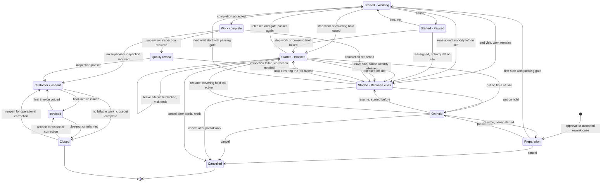

**Transitions.**

| # | From | To | Command or event | Allowed roles | Guards | Side effects | Rev. |
|---|---|---|---|---|---|---|---|
| J1 | - | Preparation | Event `CustomerApprovalRecorded` handled by `CreateJobFromApproval`; `CreateReworkJob` from an accepted rework case | SYS (workflow 2); ADM for rework jobs | Exactly one job per approval (key: estimate version plus "create-job", 05 DOM-016); the approval is not voided; customer and property active | Scope snapshot version 1 (05 DOM-017, AT-010); work packages and job item lines from the service card versions; deposit requirement (Section 11.1); readiness computed; one scheduling task, no automatic visit confirmation (automation playbook: "Do not automatically confirm an appointment"); audit (SYS write) | No (cancel instead) |
| J2 | Preparation | Started - Working | `StartWork` on a visit | WKR, LWK (asg, inside the access window); SUB after NEAR-004; never an unassigned person, including ADM (D-27-05) | Every worker step done, otherwise `STEPS_INCOMPLETE` and nothing is recorded ([11](11-worker-job-execution.md) Section 5.1); start-gate outcome READY_TO_START, or READY_WITH_WARNING with each warning confirmed (Section 7); scopes locked by a narrower hold stay locked and their tasks Blocked (Section 7.3); visit Arrived; job not On hold or Cancelled; idempotency key (job, assignment and client start key) | Start event (START-014): worker, time, job and briefing snapshot versions, acknowledgements, exceptions; visit In progress; time entry where the timekeeping policy says (SYS workflow 4); access window "service day" ([27](27-roles-and-permissions.md) Section 5.2) | No; an offline start against stale data is flagged for ADM review (Section 7.4) |
| J3 | Started - Working | Started - Paused | `PauseWork` | WKR, LWK (asg) | Visit In progress; reason code (break, cure or dry wait, material run, customer request, other) | Time entries per the timekeeping policy (JOB-002; **HUMAN REVIEW: payroll professional**) | Yes: `ResumeWork` |
| J4 | Started - Paused | Started - Working | `ResumeWork` | WKR, LWK (asg) | No active hold and no open stop-work event; briefing changes since the last view were viewed (START-002, AT-027); changed scope or hazards re-acknowledged (05 DOM-023) | Time entries | Yes: J3 |
| J5 | Started - Working, Started - Paused | Started - Blocked | `RecordStopWork`; event `HoldRaised` whose scope covers the job or the visit in progress (critical hold, SOP version suspended, START-007 finding after start); event `FieldIncidentReported` of type injury or suspected hazardous-material exposure (PROPOSED; **HUMAN REVIEW: qualified safety professional**, Q-06-10). A hold scoped to part of the work locks only its work package or tasks (task status Blocked) and the job stays Working (Section 7.3) | WKR, LWK, SUB (asg) for stop-work, always available and never refused for permission reasons while assigned (UXE-004, AT-036); SYS for hold and incident events | None that can delay a stop; accepted offline | Stop-work event (START-011) with evidence; critical hold where the trigger is critical; owner/supervisor queue (JOB-012); NTF-007 draft for DSP or ADM release, never automatic ([33](33-ai-and-automation-governance.md) Section 12.6); time entries paused; incident form offered where harm occurred. A hold raised by the office while workers are on site also sends them a "stop at a safe point and contact the office" notice; work recorded between the hold and the worker's confirmation is flagged for review, never penalized ([11](11-worker-job-execution.md) Section 5.8) | Yes: J6 or J8 after release |
| J6 | Started - Blocked | Started - Working | `ResumeWork` after release | WKR, LWK (asg) | Every hold raised by the stop is released by its authorized releaser (Section 6.4); the stop-work event is resolved (Section 16.4); a fresh start-gate evaluation on the current briefing snapshot passes (05 DOM-024) | New evaluation record; time entries | - |
| J7 | Started - Working | Started - Between visits | `EndVisit` (work remains) | WKR, LWK (asg) | Site left in the state the SOP requires (protection, containment, utilities); materials status recorded | Visit Completed; time entries stopped; next-visit scheduling task for DSP; optional customer update, staff-released | Yes: J9 |
| J8 | Started - Blocked | Started - Blocked (the visit ends), or Started - Between visits when nothing blocking remains | `EndVisit` (leave site while blocked) | WKR, LWK (asg) | Site made safe or emergency services engaged; stop-work evidence recorded | Visit Completed with outcome "stopped"; DSP queue. The job stays Started - Blocked while a hold covering the job or the next visit is active or the stop-work event is still open, and leaves only by J11, so a job blocked off site is in one state whichever path led there (J10, J13). It moves straight to Started - Between visits only when the stop was resolved and no covering hold remains when the worker leaves | - |
| J9 | Started - Between visits | Started - Working | `StartWork` on the next visit | WKR, LWK (asg) | As J2: a fresh evaluation for every visit | As J2 | - |
| J10 | Started - Between visits | Started - Blocked | Event `HoldRaised` whose scope covers the job or the next visit | SYS | - | Readiness Blocked; queue | Yes: J11 |
| J11 | Started - Blocked | Started - Between visits | Event `HoldReleased` or `StopWorkResolved` while no visit is In progress | SYS inside the release or resolution command (Sections 6.4, 16.4) | No other active hold covering the job or the next visit, and no open stop-work event | Readiness recomputed | - |
| J12 | Preparation, Started - Between visits, Started - Blocked | On hold | `PutJobOnHold` | DSP, ADM (CSR asks through DSP) | No visit In progress; reason code (permit or inspection pending, customer decision, change order pending, material backorder, weather, payment or deposit issue, dispute, legal or insurer review, other); review date | Confirmed visits cancelled or rescheduled by DSP with their notification results (CX-006); reminders suspended; NTF-007 draft in customer-appropriate wording for DSP release; audit P | Yes: `ResumeJob` |
| J13 | On hold | Preparation, Started - Between visits or Started - Blocked | `ResumeJob` | DSP, ADM | The hold reason is resolved or accepted; the target is Preparation if no start event exists, otherwise Between visits, or Blocked while a hold covering the job is still active | Readiness recomputed; scheduling task | Yes: J12 |
| J14 | Started - Working | Work complete | `CompleteWork` (completion request) | WKR, LWK (asg); SUB for its work packages | All tasks done or skipped with reason; every required QA check answered, or excepted by LWK with qa-verify (not the performer) or ADM, safety-critical checks never excepted (QA-001, AT-039; [27](27-roles-and-permissions.md) Section 6.3); required completion photos mapped to areas or tasks (QA-003, AT-040); cleanup checklist done (QA-002); job item lines reconciled with used, returned and wasted quantities (AT-037); no active hold and no open stop-work event; no other assigned worker still clocked in; no change order in Requested..Sent that covers work already performed (FIN-008; flagged to ADM) | Visit Completed; time entries stopped; the worker self-check inspection frozen (Section 14); punch items from excepted checks; NTF-009 completion draft for worker or admin release (UXE-008); quality review created when a supervisor inspection is required | Yes: J26 |
| J15 | Work complete | Quality review | Event `WorkCompleted` when a supervisor inspection is required | SYS inside J14 | The service card or risk class requires one (owner decision, Q-06-05) | Quality inspection Required (Section 14); owner/supervisor queue | - |
| J16 | Work complete | Customer closeout | Event `WorkCompleted` when no supervisor inspection is required | SYS inside J14 | - | Walkthrough prompt; invoice point reached (Section 9) | - |
| J17 | Quality review | Customer closeout | Event `InspectionPassed` (passed, or passed with punch items) | SYS on the inspector's command | Inspector is not the performer (05 DOM-032); safety-critical checks verified | Punch items open for excepted non-safety checks; walkthrough prompt; invoice point reached | - |
| J18 | Quality review | Started - Between visits | Event `InspectionFailed` | SYS on the inspector's command | Failures are correctable within approved scope; safety findings raise holds instead | Correction tasks; return-visit scheduling task; customer update, staff-released; reinspection Required after correction | - |
| J19 | Customer closeout | Invoiced | Event `FinalInvoiceIssued` | BKP or ADM through the Invoice machine (Section 9) | Invoice readiness (QA-006) passed or overridden by ADM with reason; walkthrough outcome recorded: accepted, accepted with punch items, or unavailable with the attempt recorded; a disputed outcome needs an ADM decision (QA-004) | Deposit allocations applied (Section 11.1); NTF-010 | Corr.: invoice void (J20) |
| J20 | Invoiced | Customer closeout | Event `FinalInvoiceVoided` with no replacement issued in the same transaction | SYS inside I4 | - | Job awaits the reissued invoice | - |
| J21 | Invoiced | Closed | `CloseJob` | ADM; BKP once [27](27-roles-and-permissions.md) grants it (Matrix B gives BKP view-only access to jobs; Section 21); SYS flags "ready to close" but never closes | All closeout criteria below, including the operational closeout recorded by LWK or ADM and the financial closeout recorded by BKP or ADM; L1 | Closeout lock (QA-011); retention clocks start (05 Section 6.3); access secrets cleared unless kept for recurring service on the customer's instruction; NTF-011 follow-up scheduled only when no complaint or rework case is open (QA-009); audit P | Corr.: J23 |
| J22 | Customer closeout | Closed | `CloseJob` (no billable work) | ADM | The job has no billable lines (for example rework that a person classified as HandyHub's responsibility); operational criteria below | As J21; audit P | Corr.: J23 |
| J23 | Closed | Invoiced or Customer closeout | `ReopenJob` | ADM, L2 with reason | A correction record (QA-011); **HUMAN REVIEW: bookkeeper or CPA** for financial corrections | Lock lifted for the correction scope only; audit P | Re-close by J21 or J22 |
| J24 | Preparation, On hold | Cancelled | `CancelJob` | DSP, ADM; a customer's request is recorded by CSR first | Reason code (customer cancelled, approval voided, unsafe or out of scope found before start, HandyHub cannot perform, duplicate, other); confirmed visits cancelled with notification results (CX-006, AT-012) | Open change orders withdrawn; held deposit or payments go to refund review, never an automatic refund or forfeiture (Section 11; **HUMAN REVIEW: attorney**); cancellation message staff-released, and any cancellation fee only under an approved policy (D-30-07); access windows closed; audit P | No |
| J25 | Started - Between visits, Started - Blocked | Cancelled | `CancelJob` after partial work | ADM, L2 with reason | As J24, plus: the work performed is documented (evidence, time, materials); the site is left safe; open holds, stop-work events and incidents stay open under their own machines | Invoice draft for work performed only where the approved cancellation policy provides one (BKP decides; Q-06-07); refund review; audit P | No |
| J26 | Work complete | Started - Between visits | `ReopenWork` | LWK (not the requester), ADM; L1 with reason | Completion requested by mistake; no quality inspection completed after it | Correction tasks; punch items unaffected | - |
| J27 | Started - Working, Started - Paused (Started - Blocked stays Blocked) | Started - Between visits | `ReassignJob` (JOB-011, AT-038) removing the last worker with a personal start on the visit in progress; the job moves inside that command | DSP, LWK (own crew) or ADM, L1 with reason (D-27-05; [27](27-roles-and-permissions.md) hook 5) | None that can delay removing a worker (for example after an injury); if another assigned worker with a personal start remains, the job and visit do not move | The removed worker's time entries stop and access ends (AUTH-006); their queued offline actions dated after the end are quarantined for ADM (AUTH-033); visit Completed with outcome "reassigned"; DSP confirms the site was left safe or sends someone to secure it, and an unknown site state becomes an item for the next site check; next-visit scheduling task. The incoming worker views the handoff ([11](11-worker-job-execution.md) Section 8.11) and starts personally with a full evaluation (J9; Section 7.4 rule 2); acknowledgements never transfer (05 DOM-023) | - |

**Closeout criteria (PROPOSED DECISION D-06-19, provisional answer to 05 Q-05-09; HUMAN REVIEW: CPA for the financial part).**

| Part | Criterion | Evidence |
|---|---|---|
| Operational | Operational closeout recorded by LWK or ADM against the ten-item checklist of [11](11-worker-job-execution.md) Section 9.9 (work packages, QA, photos, cleanup and restoration, materials, walkthrough, linked reports, empty device outboxes, time entries, field collections) | [11](11-worker-job-execution.md) Section 9.9 |
| Operational | Every punch item Closed or Waived | Section 15 |
| Operational | Walkthrough recorded (accepted, accepted with punch items, or unavailable with the attempt recorded) | QA-004 |
| Operational | No active job hold, no open stop-work event; evidence synced | Sections 6.4, 2.8 |
| Operational | Materials, rentals and waste reconciled; physical customer keys returned or custody recorded | APXA-007; 05 Section 6.3 |
| Financial | Every invoice of the job issued, none in Draft; balance due zero | Section 9 |
| Financial | No allocated payment still Recorded or Deposited (all cleared), no open refund or credit request, the deposit requirement Applied, Not required, Waived with nothing held, Refunded, Retained, or ended with nothing held (DR11) | Sections 10, 11; owner fact L10 |
| Financial | No invoice of the job Disputed; no open complaint in the billing or damage-claim category | Sections 9, 13 |
| Financial | Financial closeout recorded by BKP or ADM after the bookkeeping hand-off | [28](28-pricing-estimating-and-job-costing.md) Section 11.5 |

An open complaint of another category, an open incident follow-up or an open rework case does not block closure; each stays open on its own machine (05 DOM-031). [11](11-worker-job-execution.md) Section 9.9 lets the operational closeout be recorded while punch items are only assigned with due dates; this document additionally requires every punch item Closed or Waived before the job is Closed, because a Closed job accepts no punch transitions (PU1, PU7) and the item would otherwise be stranded (QA-005). **OPEN QUESTION** for the owner and CPA: Q-06-04.

**Terminal states and invalid transitions.** Terminal: Closed (only `ReopenJob` leaves it) and Cancelled.

| Invalid attempt | Result | Rule |
|---|---|---|
| Any API or screen sets the job to "Ready", "Scheduled", "En Route" or "Arrived" | `TRANSITION_NOT_ALLOWED` | These are readiness values, visit states or display labels (D-06-02) |
| `StartWork` while the visit is only Confirmed | `TRANSITION_NOT_ALLOWED` | The worker records arrival first (the app can do both in one flow) |
| `StartWork` by an unassigned worker or by ADM who is not assigned | Not found or `GUARD_FAILED` (`NOT_ASSIGNED`) | START-001; D-27-05 |
| `StartWork` while the hazard list is unacknowledged or arrival photos are missing | `STEPS_INCOMPLETE`; no evaluation, start event or time entry | AT-014; AT-022; [11](11-worker-job-execution.md) Section 5.1 |
| `CompleteWork` with an unanswered required QA check or a missing completion photo | `GUARD_FAILED` (`QA_UNANSWERED`, `PHOTO_MISSING`) | AT-039; AT-040 |
| `CompleteWork` while Blocked | `TRANSITION_NOT_ALLOWED` | Release first |
| `CancelJob` or `PutJobOnHold` while a visit is In progress | `GUARD_FAILED` (`VISIT_IN_PROGRESS`) | End or stop the visit first |
| `CloseJob` with a check still Deposited, or with a punch item open | `GUARD_FAILED` | D-06-19 |
| Moving a Closed job back to Started for a callback | `TRANSITION_NOT_ALLOWED` | Open a rework case; it creates a rework job (Section 13.2) |
| An AI role closes, cancels or starts a job | `HUMAN_ONLY` | AUTH-026 |

**Timers.**

| Timer | Effect | Value |
|---|---|---|
| Paused longer than the limit | Alert to LWK and DSP; no transition | `<owner decision>` with the payroll professional (Q-06-17) |
| Blocked without a release decision | Owner/supervisor queue age alert | `<owner decision>` |
| Between visits with no next visit confirmed | DSP queue item | `<owner decision>` |
| On hold review date reached | Alert to DSP and ADM; no automatic resume | Set per hold by DSP or ADM |
| Work complete or Quality review waiting for an inspection | Alert | `<owner decision>` |
| Closeout criteria met | "Ready to close" flag for BKP or ADM | Checked on every relevant event |

**Concurrency and races.**

- `StartWork`, `HoldRaised`, `CancelJob`, `PutJobOnHold` and reassignment all lock the job row; the start gate is evaluated inside the transaction. A hold or cancellation committed first refuses the start (or, for a narrower hold, starts the job with that scope locked); a start committed first means the hold then moves the job to Blocked (J5) or locks its scope, and the cancellation needs the J25 path.
- Two workers on one job: the first passing start moves the job; the second records a personal start event and time entry only (acknowledgements are personal, 05 DOM-023).
- A change order applied while the job is Working creates a new briefing snapshot; the workers are prompted with "What changed?" at once, and the next resume or start requires re-acknowledgement where scope or hazards changed (UXE-003). Work in progress is not stopped automatically unless a hold is raised.
- An offline `CompleteWork` that reaches the server after the job was put On hold or cancelled becomes a review item; the evidence is kept.

### 6.2 Visit (appointment)

The visit is the owner's "appointment" (owner fact L14) and carries the spec's "Scheduled", "En Route" and "Arrived" (05 D-05-06). Every window it ever had is an append-only schedule entry (CX-006, SCH-007).

**States.**

| State | Definition | Label |
|---|---|---|
| Requested | A requested window from the customer, CSR, ESTR (site assessment), DSP or a scheduling task; not a commitment and never shown as booked (CX-002) | PROPOSED |
| Tentative | A temporary slot hold by DSP; conflict-checked; allowed while the job is not ready (SCH-001 "tentatively scheduled"); not shown to the customer as booked | PROPOSED; term FACT (SCH-001) |
| Confirmed | DSP confirmed the date and window with an assigned lead worker and the confirmation is queued; the customer sees "booked" only once the confirmation is sent or a staff phone confirmation is logged (CX-002) | PROPOSED; term FACT (CX-002 "confirmed appointment") |
| En route | A worker set en route (SCH-006) | FACT (STM-003 "En Route") |
| Arrived | A worker set arrived (SCH-006) | FACT (STM-003 "Arrived") |
| In progress | Work on this visit started through a passing start gate | PROPOSED |
| Completed | The visit ended: work complete, work remaining, stopped while blocked, or a site assessment done | PROPOSED |
| No start | The worker could not or would not start for a listed reason (SCH-008), with evidence and escalation. A customer no-show is the reason "customer absent where required", so 05's candidate "no-show" is a reason, not a separate state | PROPOSED |
| Cancelled | Cancelled before arrival with reason, actor and customer-notification result (CX-006) | PROPOSED |

**Diagram.**

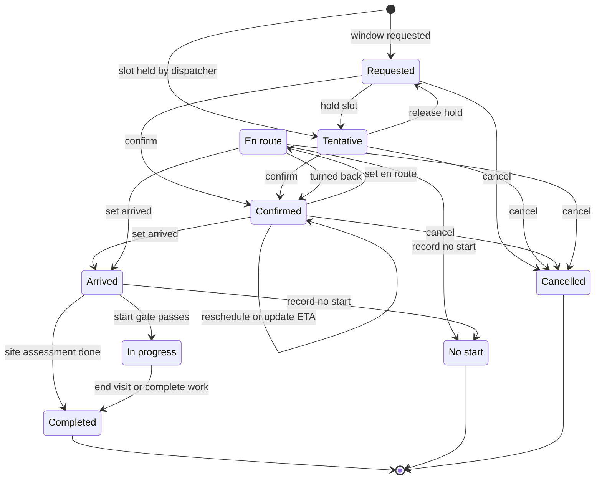

**Transitions.**

| # | From | To | Command or event | Allowed roles | Guards | Side effects | Rev. |
|---|---|---|---|---|---|---|---|
| V1 | - | Requested | `RequestVisitWindow` | CUS (own; a request, not a change, [27](27-roles-and-permissions.md) Section 4.6), CSR, ESTR (site assessment), DSP, ADM; DSP or CSR acting on the scheduling task that J1 creates (SYS creates no visit: [27](27-roles-and-permissions.md) Matrix B gives SYS view-only access to schedules) | Parent job not Cancelled, Closed or On hold, or a Qualified lead for a site assessment | Initial schedule entry; no confirmation message | Yes: V11 |
| V2 | -, Requested | Tentative | `HoldSlot` | DSP, ADM | Worker calendar check at the storage boundary (05 DOM-021; SCH-003 working hours, time off, qualification tags); a conflict needs an override record by DSP or ADM with reason (AT-011); the job may be not ready (SCH-001); job not On hold | Schedule entry; the dispatcher view lists missing prerequisites (SCH-001) | Yes: `ReleaseSlot` |
| V3 | Requested, Tentative | Confirmed | `ConfirmVisit` | DSP, ADM; never AI (AIR-008 suggests only) | Lead worker assigned and qualified (SCH-002); calendar check passes or an override exists; job not On hold or Cancelled; property time zone set (05 DOM-046); a critical hold on the job allows confirmation only by ADM with reason (Q-06-20); a deposit gate set to "block confirmation" is satisfied or waived (Section 11.1) | NTF-004 transmitted after the dispatcher's confirm ([33](33-ai-and-automation-governance.md) Section 12.6) with delivery tracked; "booked" label after sending (CX-002); NTF-005 reminders scheduled; access window "upcoming" ([27](27-roles-and-permissions.md) Section 5.2); audit | Yes: V4, V11 |
| V4 | Confirmed | Confirmed | `RescheduleVisit`; `UpdateEta` (delay) | DSP, ADM for reschedules; WKR, LWK (asg) and DSP for ETA or delay updates (SCH-007) | Reason code; calendar check for a new window; a customer's change is first recorded as a request (customer-service playbook: "do not silently move confirmed appointments") | New append-only schedule entry, the original kept (CX-006, AT-012, AT-029); NTF-004 re-confirmation or NTF-006 delay update; customer-notification result recorded; reminders rescheduled | n/a |
| V5 | Confirmed | En route | `SetEnRoute` | WKR, LWK (asg); ESTR on a site-assessment visit (Section 21) | The visit date is today in the property's zone (or inside the lead time set in [11](11-worker-job-execution.md)); job not On hold or Cancelled | NTF-006 by the send mode the owner chooses (Q-33-04; AT-028); access window "service day" | Yes: V12 |
| V6 | Confirmed, En route | Arrived | `SetArrived` | WKR, LWK (asg); ESTR on a site-assessment visit (Section 21) | No location tracking required (SCH-004) | Arrival time; on-arrival checklist (APXA-002) | No |
| V7 | Arrived | In progress | Event `WorkStarted` (J2, J9) | Through `StartWork` | Passing start-gate evaluation (Section 7) | - | No |
| V8 | Arrived | Completed | `CompleteAssessment` (site-assessment visit) | ESTR, LWK, WKR (asg) | Assessment notes and photos stored. [11](11-worker-job-execution.md) Section 5.11 (D-11-27) proposes the assessment briefing subset, checklist and access limits: no entry into an attic, crawlspace or roof, or opening of equipment, without an approved module and qualification tag, and no disturbance or sampling of a suspect material. Areas not reached are recorded as "not inspected". Q-06-13 stays open until the qualified safety professional confirms them | Lead sub-status back to Estimate needed (Section 4) | No |
| V9 | In progress | Completed | Event `VisitEnded` (J7, J8, J14) | SYS | - | Time entries stopped | No |
| V10 | En route, Arrived | No start | `RecordNoStart` | WKR, LWK, SUB (asg); ESTR on a site-assessment visit (Section 21); accepted offline | Reason code from SCH-008 (inaccessible, unsafe, materially different, customer absent where required, prerequisite missing), master §12 (weather issue, permit or license issue) or [11](11-worker-job-execution.md) Section 5.3 row 20 (wrong address or unit, customer cancelled or refused on site, worker unable to work with no detail recorded); the evidence the reason requires (photo unless unsafe or private, note, call attempts with times); escalation sent or queued | Stop-work event marked "before start"; job hold for a site mismatch or critical finding; readiness Blocked; owner/supervisor queue (JOB-012, AT-030); no start event and no work timer; NTF-007 draft for DSP or ADM release; no fee unless an approved no-access policy provides one (D-30-07, Q-06-07); the job stays in Preparation or Between visits (D-06-06) | No (DSP plans a new visit) |
| V11 | Requested, Tentative, Confirmed, En route | Cancelled | `CancelVisit` | DSP, ADM; a customer's cancellation is recorded by CSR as a request first | Reason code; customer-notification result; the worker is told if en route | Cancellation schedule entry; reminders cancelled; tentative capacity released; staff-released message | No |
| V12 | En route | Confirmed | `CancelEnRoute` | WKR, LWK (asg); DSP | Reason code (tapped by mistake, turned back on the dispatcher's instruction, vehicle or personal issue) | Access window back to "upcoming"; if an NTF-006 went out, DSP releases a corrected update; DSP decides whether to reschedule (V4) | Yes: V5 |

**Field proposals from 11.** [11](11-worker-job-execution.md) proposed the visit statuses `in progress` and `paused`; its Section 2.3 now records the outcome and uses the names of this document. In progress is adopted (V7). Pause and block stay on the job lifecycle only (Started - Paused, Started - Blocked, Section 6.1), so one record answers whether work may continue; the visit stays In progress while the job is Paused or Blocked during it. Leaving the site because work cannot resume on this visit is J8 here: the visit ends Completed with outcome "stopped". The direct move from Confirmed to Arrived is V6. Staff labels such as "Scheduled" and "In progress" are display labels over Preparation with a Confirmed visit and over Started - Working (Section 18.2).

**Derived visit flags.** Late: the window end plus `<owner decision>` grace passed without Arrived (SCH-005 dispatcher view). Unconfirmed by customer: a day-of confirmation is required by policy and missing (SCH-005). Confirmation not delivered: NTF-004 failed (COM-003), which opens an exception item with an alternative-contact path (AT-055).

**Invalid examples.** Confirming an overlapping assignment without an override record (`GUARD_FAILED`, AT-011); a customer's portal action moving a confirmed visit (it becomes a request; the visit is unchanged); editing an existing schedule entry (append-only; refused); `RecordNoStart` from Confirmed while nobody is travelling (`TRANSITION_NOT_ALLOWED`; DSP reschedules or cancels instead); a worker setting en route on a visit not assigned to them (not found).

**Timers.** NTF-005 lead time (`<owner decision>`; spec "Appropriate lead time"); late flag (above); tentative hold age alert (`<owner decision>`; a tentative slot is released automatically only if the owner configures it, because it is a capacity reservation, not a job hold, Section 2.7); Arrived with neither a start nor a No start after `<owner decision>`: prompt to the worker and alert to DSP.

**Races.** Two dispatchers confirming overlapping windows: the storage-level exclusion lets one commit. A reschedule committed before the worker's `SetEnRoute` makes the en-route command stale; the worker sees the new window. An offline en-route or arrival recorded against an old window becomes a review item. Reminder messages re-check validity at send time ([33](33-ai-and-automation-governance.md) Section 12.4: invalid "once the appointment changes").

**Terminal.** Completed, No start and Cancelled. A visit is never reopened: DSP plans a new visit, and the old visit keeps its history.

### 6.3 Readiness (computed)

Readiness is the job-level summary of UXE-001, "Ready / Needs Attention / Blocked", computed from holds and missing prerequisites by SYS workflow 3 in the triggering transaction or on read; it is never set by hand (05 DOM-019). It serves dispatch and the worker's day list (AT-013). The start gate (Section 7) is the enforcement point at the moment of starting; readiness cannot evaluate on-site checks such as acknowledgements, pre-start photos or the site check.

| Input | Ready when | Needs attention when | Blocked when | Source |
|---|---|---|---|---|
| Assignment | A lead worker is assigned for each confirmed visit | Assignment missing for a tentative visit | No assignment for a confirmed visit | SCH-002 |
| Qualifications | Required tags verified and current | A tag expires before the visit date | A required tag missing or expired | SCH-003, START-010 |
| SOP | An active version for every work package's service | A newer version awaits worker acknowledgement | No active version, or the version is suspended | HND-004; [31](31-sop-standard.md) |
| Deposit | Not required, satisfied or waived | Required and unsatisfied with gate effect "flag"; policy not configured (ADM review, 05 DOM-039) | Required and unsatisfied with gate effect "block" | FIN-002, AT-009 |
| Tools and materials | Critical lines reserved or loaded | Non-critical lines missing; critical lines not yet loaded before the visit day | A critical line in Exception; a safety-critical item missing | START-005, START-006; [29](29-inventory-and-procurement.md) Section 6.3 |
| Permit, license or qualification flags | Prerequisite approved with evidence | - | Pending (critical hold) | START-010 |
| Job holds | None active | A hold scoped to part of the work while another work package can proceed | A critical or prerequisite hold covering the job or the next visit, or an SOP-not-active hold | Section 6.4; [11](11-worker-job-execution.md) Section 5.4 |
| Customer confirmations | Access, occupants, pets and work areas reconfirmed for this job | Reconfirmation pending | - (becomes REQUIRES_CUSTOMER_CONFIRMATION at start) | CX-005 |
| Change orders | None open for planned work | Open for another work package | Open for the work package of the next visit | FIN-008 |
| Briefing completeness | Every BRF-001..BRF-014 element present | A non-critical element missing | Address, site contact, hazard list or emergency contacts missing | LAUNCH-005 |
| Stop-work | None open | - | An open stop-work event | START-011 |

An input that cannot be evaluated counts as Needs attention or Blocked, never Ready (owner fact L20). The banner always lists the exact items (UXE-001).

### 6.4 Job hold

05 models a job hold as a record that blocks a job, visit or work package until released; 27 Section 6.3 sets who may release or override each kind. This document gives it a lifecycle (D-06-25).

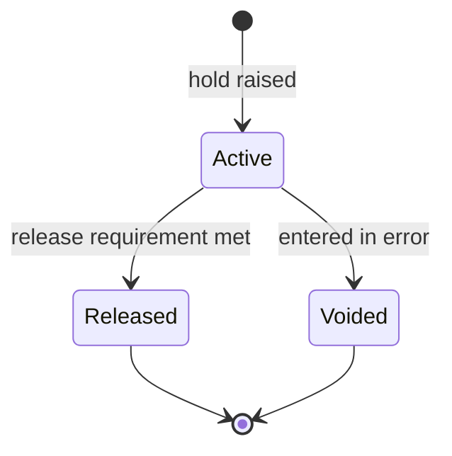

| Class | Hold type | Typical source | Released by | Overridable |
|---|---|---|---|---|
| Critical | Suspect hazardous material (asbestos, lead paint, mold) | Condition report; site hazard; DW-02.SAF, CL-07.SAF | ADM records the qualified assessment and the assessor's qualification: an accredited asbestos inspector, an EPA RRP-certified renovator or a qualified mold assessor, as the material requires ([11](11-worker-job-execution.md) Section 6.8; which qualification applies in the actual jurisdiction is confirmed by those professionals and the licensing reviewer, Q-27-15; **HUMAN REVIEW**) | No |
| Critical | Structural concern | Condition report (for example HI-10, HI-11, DW-03) | ADM records structural engineer or building official evidence | No |
| Critical | Unapproved electrical, plumbing, gas or HVAC scope | Condition report; site check | Licensed-trade involvement recorded, or the scope removed by change order | No |
| Critical | Failed or incomplete inspection before concealment | DW-03.SAF, DW-04.SAF | Inspection-passed evidence recorded by ADM | No |
| Critical | Hazard flagged critical | Hazard template flag; risk-triage disposition "specialist/permit required" or "stop work" | The release requirement named on the hazard, by a qualified person | No |
| Critical | Missing permit, license or qualification | START-010; service card flag | ADM records the approved prerequisite with evidence (**HUMAN REVIEW: local permitting or licensing authority; attorney**) | No |
| Prerequisite (condition hold) | SOP not active or suspended | Catalog | Ends when ADM activates a version (H2) | No, never overridden |
| Prerequisite (condition hold) | Deposit required and unsatisfied | Deposit requirement | Ends with an accepted allocation (DR3) or the ADM waiver (L2 override, DR5) | Yes, ADM only |
| Prerequisite (condition hold) | Customer confirmation needed | CX-005; start gate | Ends when the customer's confirmation is recorded (H2) | No (it is satisfied, not overridden) |
| Prerequisite | Site mismatch, not critical | START-007 | LWK (not the performer) or ADM with a site-check record | Released, not overridden |
| Prerequisite | Information missing | Risk-triage disposition "needs information" | ESTR, LWK or ADM records the information | No |

| # | From | To | Command or event | Allowed roles | Guards | Side effects | Rev. |
|---|---|---|---|---|---|---|---|
| H1 | - | Active | `RaiseHold`; events from a condition report, site hazard, SOP suspension, policy evaluation or start gate | WKR, LWK, SUB (asg) through condition reports and stop-work, in the reporting transaction ([11](11-worker-job-execution.md) Section 6.8); DSP, ESTR, ADM; condition holds kept by SYS workflow 3 from policy evaluation (a [27](27-roles-and-permissions.md) grant to confirm, Section 21) | Class and type set; release requirement named (risk-triage: "Name the exact evidence and qualified role required to release each hold.") | Readiness recomputed; a started job moves to Blocked for a critical hold (J5, J10); queue item | - |
| H2 | Active | Released | `ReleaseHold` by a person; a condition hold ends inside the human-recorded fact that satisfies it (an SOP activation, an accepted payment allocation or the deposit waiver, the customer's confirmation), never by a SYS decision, a timer or AI | As in the table above; a lead worker never releases their own hold ([31](31-sop-standard.md) Section 8.3 rule 3); never by acknowledgement, never by AI, never by `OverrideGate` for a critical hold (D-27-06, AUTH-012) | Release evidence matches the release requirement; the releaser's qualification recorded for critical holds | Readiness recomputed; J6, J11 or J13 possible; audit P | A new hold must be raised if the condition returns |
| H3 | Active | Voided | `VoidHold` | ADM, L2 with reason | Entered in error only: a wrong job or property (the hold is re-raised on the correct record in the same transaction) or a duplicate of another Active hold covering the same condition and scope. A dispute about whether the condition exists is never a void reason; it needs the qualified release (H2). For a critical hold, a second person's confirmation also where one exists (L3), otherwise after-the-fact review ([27](27-roles-and-permissions.md) Section 9); when the owner is the only ADM, the void is listed for the qualified safety professional's periodic review (Q-06-15) | Listed in the override review; audit P | No |

Invalid: any `OverrideGate` on a critical hold or START-010 (refused, [27](27-roles-and-permissions.md) hook 14); a worker's acknowledgement or a customer's signed form releasing a hold (quality-assistant playbook: "A signed customer form does not clear an unresolved safety hold."); SYS releasing a critical hold.

Terminal: Released and Voided; if the condition returns, a new hold is raised. Timers: nothing releases a hold by time; an Active hold older than `<owner decision>` raises a queue-age alert. Races: raising, releasing and starting all lock the job row (Section 2.4), so a start never commits against a hold raised a moment earlier; two releases of one hold serialize and the second fails as stale.

**DECISION (owner, 2026-10-05, [OWN-DEC-38](20-decision-log.md#OWN-DEC-38)):** nobody releases a hold they raised (the software applies H2's lead-worker rule to every person), and no second administrator is created yet. A hold the owner raises therefore stays Active until a second administrator exists. Voids (H3) are not changed by this decision; `VoidHold` is not built in the software yet.

## 7. Start-gate outcomes and the Job machine (master §12)

PROPOSED DECISIONS D-06-07 and D-06-08. Each Start Job attempt in which every worker step is done writes an immutable start-gate evaluation with every check result and one outcome from the master §12 set (05 D-05-08, DOM-024). One deterministic server-side evaluator computes it from server-side state under a versioned rule set; it runs in preview mode for the readiness banner and the dispatcher's board, and in attempt mode when the worker taps Start Job ([11](11-worker-job-execution.md) Section 5.1). This section defines what the outcomes mean and how they drive the Job and Visit machines. The per-check rule table (data evaluated, pass condition, scope, release or override) is [11](11-worker-job-execution.md) Section 5.3, and the gate content per service (which checks apply, which items are critical) is configured there with a qualified safety professional.

### 7.1 Outcome definitions

Per-check statuses ([11](11-worker-job-execution.md) Section 5.1): `pass`, `warn`, `pending_worker`, `pending_customer`, `pending_admin`, `fail_prerequisite` (a prerequisite hold, overridable only where [27](27-roles-and-permissions.md) Section 6.3 allows) and `fail_critical` (a critical hold, never overridable). A request with any `pending_worker` check (a view of changes, an acknowledgement, a photo, the site check, a customer-supplied item check) is refused with `STEPS_INCOMPLETE` and the list of missing steps; nothing is recorded and no start event or time entry exists (AT-014). The outcomes below apply to complete attempts.

| Outcome | Produced when | Start allowed | Who resolves | The worker sees | Banner (UXE-001) |
|---|---|---|---|---|---|
| `READY_TO_START` | Every check `pass` | Yes, in the same command | - | Start confirmed; the start event records versions and acknowledgements (START-014) | Ready |
| `READY_WITH_WARNING` | Nothing blocking or pending; at least one `warn`: an approved resolution of a critical non-safety tool exception, an approved non-critical material exception, a recorded override, an authorized photo reason, a hold that locks only part of the work, an advisory (weather, recorded pre-existing damage), a provisional offline start | Yes, after the worker confirms each warning (L1) in the same command. Locked scopes stay locked: their tasks are Blocked and listed under "Do not perform" (UXE-010). Confirming a warning never clears a hold (job-planner playbook: "Acknowledging a warning cannot clear a hard safety hold.") | The worker; LWK or ADM for the underlying exception or override | Each warning with its control, and every locked scope | Needs attention |
| `REQUIRES_CUSTOMER_CONFIRMATION` | A `pending_customer` check and nothing blocking or waiting for the office: reconfirmation of access, occupants, pets and work areas for a reused property profile (CX-005); on-site confirmations configured for the service; an appointment confirmation where the policy requires one (SCH-005); a person on site without recorded authority whom the recorded contact can confirm (AUTH-028); approval of a change order or customer-affecting substitution that the work about to start depends on (FIN-008, JOB-007); acknowledgement of customer-supplied items accepted with noted defects (START-009) | No, until the confirmation is recorded (an authenticated customer action, or an in-person acknowledgement captured on the staff device with evidence) | The customer or an authorized contact (AUTH-028); CSR by phone; ESTR prices any change order | "Waiting for customer", with the request sent | Needs attention (start disabled) |
| `REQUIRES_ADMIN_REVIEW` | A `pending_admin` check and nothing blocking: the second-person high-risk confirmation (START-004); a critical non-safety tool exception awaiting approval of its resolution (START-005); a missing critical material that is not safety- or competence-critical, awaiting an LWK or ADM decision (START-006); a material site difference (START-007); a photo exception awaiting an authorized reason (START-008); a contact-authority question for CSR or ADM; any other prerequisite that needs an office decision | No, until the decision is recorded; then the worker runs the start again. An overridden check shows as `warn`, so an override never produces `READY_TO_START` ([11](11-worker-job-execution.md) Section 5.5) | LWK holding field-override on jobs where they are the designated lead, never for their own start; ADM; DSP for a reassignment ([27](27-roles-and-permissions.md) Section 6.3) | "Waiting for office review", with the items | Blocked (waiting for office) |
| `BLOCKED` | A `fail_critical` or `fail_prerequisite` check, not overridden, whose scope covers the job or the visit or leaves no independent work package (Section 7.3): a critical hold so scoped; a START-010 permit, license or qualification prerequisite pending or `unknown`; SOP not active or suspended; the worker's assignment not covering this visit, or a required qualification missing or expired; a safety-critical item (PPE, access equipment, isolation means) missing; an open stop-work event; an unsatisfied deposit whose gate effect is "block start", until it is satisfied or ADM waives it (L2); a crew short for two-person tasks with no other work possible; no approved safety content in the worker's language (START-013); the job On hold or Cancelled; the service paused | No | The qualified releaser for critical holds; ADM evidence for START-010 and qualifications; DSP or ADM for prerequisites; nobody overrides a critical hold | The exact missing items, with Stop Work and No Start always offered | Blocked |

### 7.2 Check-to-outcome summary

The authoritative rule table, one row per check with its data, pass condition, scope and release or override, is [11](11-worker-job-execution.md) Section 5.3. This summary shows how each master §12 input and each extra spec rule reaches an outcome.

| Check (master §12 input or spec rule) | Requirement | Worker step (request refused as incomplete until done) | Outcome when not met | Resolution |
|---|---|---|---|---|
| Worker assignment | START-001 | - | BLOCKED | DSP, LWK (own crew) or ADM reassigns; the newly assigned worker starts normally (D-27-05) |
| Worker eligibility and certifications | SCH-003, START-010 | - | BLOCKED for the affected work; a short crew locks the two-person tasks (READY_WITH_WARNING), or BLOCKED when nothing else can proceed | ADM records evidence, never self-asserted; DSP assigns a second worker |
| Customer and property identity | BRF-001, APXA-002, AUTH-028 | Site check confirms address, unit and work area | Wrong address or unit: No start (V10). Person without recorded authority: REQUIRES_CUSTOMER_CONFIRMATION, or REQUIRES_ADMIN_REVIEW when CSR or ADM must verify | Worker confirms with the recorded contact; CSR or ADM records authority with evidence |
| Scope acknowledgement | START-003 | Yes | Incomplete | Worker acknowledges (an operational confirmation, not a legal waiver) |
| Briefing freshness | START-002, AT-027 | Yes: open "What changed?" (UXE-003) | Incomplete | Worker |
| Required SOP availability | HND-004; [31](31-sop-standard.md) Section 5.4 | - | BLOCKED (SOP-not-active hold) | Never overridden; activation path only |
| Hazard review | START-004, BRF-007 | Yes: safety acknowledgement | High-risk confirmation missing: REQUIRES_ADMIN_REVIEW. Unreleased critical hazard: BLOCKED | Second person (LWK not performing, or ADM); critical: recorded qualified assessment |
| PPE confirmation | START-004, BRF-008 | Yes: inside the safety acknowledgement | Safety-critical PPE missing: BLOCKED for the tasks that need it | Load the item; never overridden ([29](29-inventory-and-procurement.md) INV-009) |
| Critical tools | START-005, AT-020 | Yes: on-site verification | Critical non-safety: REQUIRES_ADMIN_REVIEW until the resolution is approved, then READY_WITH_WARNING. Safety-critical: BLOCKED for its tasks | LWK (not for their own start) or ADM approves; a safety-critical item clears only when loaded |
| Critical materials | START-006, AT-021 | Yes: on-site verification | Safety- or competence-critical: its tasks locked (BLOCKED when nothing else can proceed). Otherwise: REQUIRES_ADMIN_REVIEW until LWK or ADM decides, then READY_WITH_WARNING. A customer-affecting substitution: REQUIRES_CUSTOMER_CONFIRMATION | LWK or ADM; a change order for substitutions that affect the customer (JOB-007; [29](29-inventory-and-procurement.md) Section 4.6) |
| Permit or license prerequisite | START-010, AT-024 | - | BLOCKED for the flagged line type (critical); `unknown` counts as not approved | ADM records the evidence after the licensing reviewer's determination; **HUMAN REVIEW: local authority; attorney** |
| Required pre-job photos | START-008, AT-022 | Yes | Capture impossible (customer refusal, unsafe, privacy): REQUIRES_ADMIN_REVIEW until LWK or ADM records an authorized reason, then READY_WITH_WARNING | Never self-authorized |
| Pre-start site check | START-007, AT-023 | Yes | Material difference: REQUIRES_ADMIN_REVIEW plus a triage task. Critical finding: critical hold, BLOCKED | LWK or ADM release; Risk Triage output is advisory (AIR-001) |
| Customer-supplied products | START-009 | Yes | Accepted with noted defects and no safety effect: REQUIRES_CUSTOMER_CONFIRMATION where the service requires the customer's acknowledgement. Rejected: the affected tasks locked, a No start, or a substitution through a change order | Not overridable |
| Access instructions | BRF-002 | Yes: view changed instructions | Missing: REQUIRES_CUSTOMER_CONFIRMATION (CSR obtains them) or REQUIRES_ADMIN_REVIEW. Inaccessible site: No start (V10) | DSP or CSR |
| Unresolved blocking issues | UXE-001, JOB-012 | - | Critical hold, open stop-work event or paused service: BLOCKED. Prerequisite hold: BLOCKED until released, or overridden where [27](27-roles-and-permissions.md) Section 6.3 allows (then READY_WITH_WARNING). A change order the visit's tasks depend on: REQUIRES_CUSTOMER_CONFIRMATION. Narrower holds lock only their scope | Section 6.4 |
| Customer confirmations | CX-005, SCH-005 | - | REQUIRES_CUSTOMER_CONFIRMATION | Customer or site contact |
| Deposit | SCH-001, AT-009 | - | Gate effect "flag": READY_WITH_WARNING. Gate effect "block start": BLOCKED until satisfied with policy-accepted payment statuses or waived | ADM waiver (L2) or satisfaction (Section 11.1) |
| Language | START-013, COM-006 | - | BLOCKED for that worker | ADM supplies a reviewed translation through the activation path |
| Weather and conditions | START-011 "severe weather"; master §12 "weather issue" | - | READY_WITH_WARNING for an advisory; for an unsafe condition the worker records No start or stop-work | Worker judgment; never pushed to proceed |
| No blind start; low-risk exception | START-015, AT-014 | The request names the snapshot version and this worker's views and acknowledgements | Incomplete. The low-risk exception flow is disabled by default and never available while any BLOCKED condition or an unknown risk exists | ADM may enable it per service (L2) ([27](27-roles-and-permissions.md) Section 6.3; [11](11-worker-job-execution.md) Section 5.10) |

Which items count as critical or safety-critical for each service is set in [11](11-worker-job-execution.md) with a qualified safety professional (Q-27-15).

### 7.3 Precedence, scope and overrides

1. **Precedence.** `BLOCKED` > `REQUIRES_ADMIN_REVIEW` > `REQUIRES_CUSTOMER_CONFIRMATION` > `READY_WITH_WARNING` > `READY_TO_START`, the same order as [11](11-worker-job-execution.md) Section 5.4. Internal decisions come before customer requests because the office often has to act first (for example, ESTR prices a change order before the customer can approve it).
2. **Narrowest scope.** Every failing check and every hold carries the narrowest scope it applies to: job, visit, work package, line type, work area or task ([11](11-worker-job-execution.md) Section 5.4). Suspect hazardous material, a structural concern, an aggressive person or animal and any unsafe site condition cover the whole job until a qualified person narrows them (owner fact L20). A visit may start with some scopes locked only when at least one work package has no locked scope and the service template does not mark the packages as dependent; the outcome is then READY_WITH_WARNING and the locked tasks are Blocked. Example from [11](11-worker-job-execution.md): an HI-04 job whose wire-hiding line has an `unknown` permit flag may start the mounting work with wire hiding locked. **RISK** (R-06-15): a scope drawn too narrowly lets work start next to a hazard that should stop the whole job, so the whole-job defaults above apply until a qualified person narrows them.
3. **Overrides.** Only where [27](27-roles-and-permissions.md) Section 6.3 allows; each writes an override record and a queue item (Section 2.6); an overridden check shows as `warn`, so the best outcome after an override is READY_WITH_WARNING.
4. **Transparency.** The evaluation stores every check result, and the worker sees every unresolved item with the role that resolves it, not only the top outcome (UXE-001).

### 7.4 Interaction with the Job and Visit machines

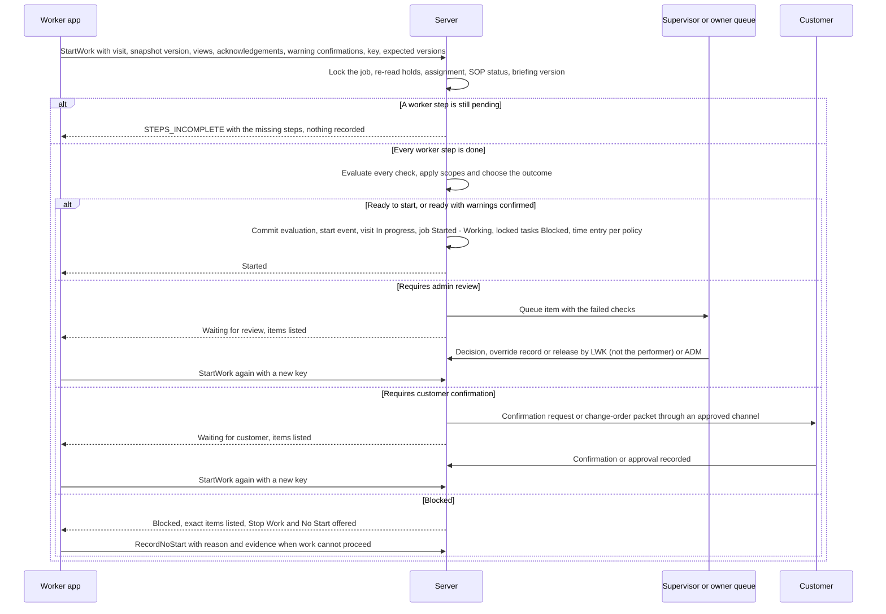

| Outcome | Job | Visit | Notifications | Queue |
|---|---|---|---|---|
| Incomplete request | No change; nothing recorded | Stays Arrived | None | None |
| READY_TO_START | Preparation or Between visits to Started - Working (J2, J9); Blocked to Working (J6) | Arrived to In progress | None (arrival was already notified) | - |
| READY_WITH_WARNING | As above; confirmed warnings stored; tasks of locked scopes Blocked | As above | None | Warnings and locked scopes visible to LWK and DSP |
| REQUIRES_ADMIN_REVIEW | No change | Stays Arrived | NTF-007 only if the wait affects the customer, released by DSP or ADM | Item for LWK or ADM (JOB-012) |
| REQUIRES_CUSTOMER_CONFIRMATION | No change | Stays Arrived | Confirmation request, or NTF-008 through the estimator's send of a change order | Item for DSP or ESTR |
| BLOCKED | No change: a pre-start block never moves the job to Blocked (D-06-06) | Stays Arrived until the worker records No start | NTF-007 draft for DSP or ADM release | Item for LWK or ADM; critical holds for the qualified releaser |

Rules:

1. Every first start, every start on a new visit and every resume after Blocked runs a full evaluation on the current briefing snapshot (05 DOM-024); each visit renews the safety acknowledgement by default ([11](11-worker-job-execution.md) Section 5.8; Q-11-15 asks whether a daily renewal is needed when nothing changed). A resume after a pause checks briefing freshness and holds only.
2. Each assigned worker starts personally; the job moves on the first passing start, and later starts record personal start events and time entries.
3. No shortcut: there is no start from a notification or list row (START-015, AT-014); `StartWork` must reference the views and acknowledgements recorded in the briefing flow.
4. Offline start (START-012): a provisional offline start is allowed only under the conditions of [11](11-worker-job-execution.md) Section 5.9: the cached snapshot was current at the last successful sync, the local result is READY_TO_START or READY_WITH_WARNING, no check needs an online action (L2 actions, overrides and evidence entry are online-only), no suspension or critical hold was known at the last sync, and the visit is in its service-day phase. The maximum cache age is open ([11](11-worker-job-execution.md) Q-11-05, the same question as [31](31-sop-standard.md) Q-31-17). The start event carries an offline flag. At sync the server re-evaluates against its state at the claimed start time: if a hold, suspension or reassignment existed that the device did not know about, the start is kept as a record (the work did happen) marked "not confirmed", an ADM review item is created (AUTH-033) and the worker is told to stop at a safe point and call the office; it is never silently accepted as a normal start.
5. A hold raised during work moves the job to Blocked only when its scope covers the job or the visit in progress (J5); a narrower hold locks its tasks and the job stays Working.
6. Stop Work and Report Hazard stay available in every outcome and state (UXE-004, AT-036). Master §12: "Never encourage workers to continue through an unsafe or legally restricted condition merely to keep the schedule."

### 7.5 Worker report types (master §12)

[11](11-worker-job-execution.md) Section 6.4 specifies the report forms, routing and customer messages; this table shows the records and machine effects. Severity floors are the four-level scale proposed in [11](11-worker-job-execution.md) Section 6.3 (critical, high, moderate, low), pending the qualified safety professional (Q-11-03).

| Report | Record created | Severity floor | Machine effect |
|---|---|---|---|
| Unexpected hazard | Condition report and site hazard; stop-work event when work stops | high; critical for gas odor, fire, electrical contact, structural movement or threatened harm | Critical: a job hold covering the job, so the visit ends in No start before the first start or the job is Blocked after it; otherwise the site hazard is Controlled with reviewed controls |
| Property damage discovered before work | Condition report "pre-existing damage" with photos, the pre-existing-condition evidence the drafts rely on (X-02) | low; moderate when it affects the work; high when it creates a hazard | READY_WITH_WARNING once recorded; affected tasks locked until a change order, referral or release; REQUIRES_CUSTOMER_CONFIRMATION where the service requires the customer's acknowledgement |
| Incorrect scope | Site-check difference (START-007); change order in Requested | moderate; high when hazardous or licensed | REQUIRES_ADMIN_REVIEW; a change order where scope or price changes, then REQUIRES_CUSTOMER_CONFIRMATION for the dependent tasks |
| Missing material | Job item line exception | moderate; high when safety-critical | Affected tasks locked; REQUIRES_ADMIN_REVIEW or BLOCKED (Section 7.2) |
| Missing tool | Job item line exception | moderate; high when safety-critical | REQUIRES_ADMIN_REVIEW for a non-safety tool; BLOCKED for the tasks of a safety-critical one |
| Unsafe condition | Stop-work event and site hazard | high; critical when harm is imminent or threatened | Visit No start before the first start; job Blocked after it |
| Customer-requested scope change | Change order in Requested (AT-033) | low; moderate when it blocks the visit | Work continues on the approved scope only |
| Inaccessible work area | Stop-work event "inaccessible" (whole visit) or condition report (one area) | moderate | Visit No start, or the affected tasks locked while other areas proceed |
| Weather issue | Condition report "weather"; stop-work event or pause with reason "weather" | moderate; high when exposure is unsafe now | No start, Paused or Blocked; exterior tasks locked; DSP reschedules |
| Permit or license issue | Critical hold on the line type (START-010) | high | BLOCKED for that line type; a started job moves to Blocked when the hold covers the work in progress |

### 7.6 Risk and readiness vocabulary crosswalk (PROPOSED DECISION D-06-08)

[35](35-skills-coverage-matrix.md) section 6.3 row 29 assigns this crosswalk to safety-liability-manager (policy) and handyhub-risk-triage (application) and asks this document to implement it; [11](11-worker-job-execution.md) Section 5.2 proposes it for adoption here with a severity link. This is the one crosswalk: 11's proposal is adopted, with the high-risk-flag row split out (amendment) so that a START-004 confirmation and a specialist hold are not confused. **HUMAN REVIEW: qualified safety professional** before use (Q-06-15).

| Safety class (safety-liability-manager) | Triage disposition (risk-triage) | Severity ([11](11-worker-job-execution.md) Section 6.3) | Hold or record | Readiness (UXE-001) | Start-gate outcome | Release |
|---|---|---|---|---|---|---|
| Routine | Routine with approved controls | low items only | None | Ready | READY_TO_START, or READY_WITH_WARNING for minor advisories | - |
| Elevated: approved controls with per-hazard acknowledgement | Routine with approved controls, plus added controls | moderate | Per-hazard acknowledgement | Needs attention | READY_WITH_WARNING | The worker confirms each warning |
| Elevated with a START-004 high-risk service or site flag (amendment) | Routine with approved controls, plus added controls | moderate or high | High-risk flag on the job | Needs attention before the visit; Blocked (waiting for office) at start until confirmed | REQUIRES_ADMIN_REVIEW until the second-person confirmation, then READY_WITH_WARNING | LWK (not the performer) or ADM |
| Any class with an information gap | Needs information | - | Prerequisite hold "information missing" | Needs attention before the estimate is sent | REQUIRES_CUSTOMER_CONFIRMATION when the customer must supply it; REQUIRES_ADMIN_REVIEW when the office must; BLOCKED when the unknown is safety-relevant, such as an unknown material or permit flag (owner fact L20 "Unknown is not safe") | ESTR, LWK or ADM records the information; a person reclassifies |
| Any class needing a site look | On-site assessment | - | Site-assessment visit before a firm estimate (Section 4); START-007 at start | Needs attention | REQUIRES_ADMIN_REVIEW for a material difference | LWK or ADM release |
| High-risk / specialist review | Specialist/permit required | high, or critical where a floor says so | Critical hold at the narrowest safe scope | Blocked | BLOCKED | Qualified assessment, licensed trade or permit evidence recorded by ADM |
| Stop-work / emergency | Stop work | critical | Stop-work event and a critical hold covering the job; incident where harm or near harm occurred | Blocked | BLOCKED | Emergency response first ("prioritize immediate safety and emergency response over paperwork"), then the qualified release |

A hazard template's critical-hold flag corresponds to the "High-risk / specialist review" row. "Stop-work / emergency" is never a service default ([04](04-service-registry.md) Section 6) but a job-level state raised by a report or hold. Severity levels and floors come from [11](11-worker-job-execution.md) Section 6.3, pending the qualified safety professional; this document invents none.

## 8. Change order (STM-004)

PROPOSED DECISION D-06-09. A change order is a versioned delta to the job's approved scope, price or time (05 `ChangeOrder`). The pricing basis (D-28-14) and minimum re-evaluation (D-28-06) belong to [28](28-pricing-estimating-and-job-costing.md); the packet and acceptance evidence to [30](30-service-agreement-standards.md) (AGR-010: "Change orders are version-bound packets approved before added work proceeds, except documented emergency stabilization; no surcharge is applied automatically.").

### 8.1 States

| State | Definition | Label |
|---|---|---|
| Requested | A proposal or request recorded: by a worker, LWK or SUB in the field, the customer's verbal request recorded by the worker, or a customer request taken by CSR or ESTR. It is not approval; the added work must not proceed (FIN-008, AT-033), except documented emergency stabilization (JOB-006), which is a separate record | PROPOSED (05) |
| Draft | LWK prepares the scope and time delta; ESTR prices the delta under the approved pricing basis | FACT (STM-004) |
| Internal review | Checks: pricing exception where needed; minimum re-evaluated (D-28-06); referral routing for work no catalog service owns (X-05); substitution policy; hazards of added scope and an active SOP for any new service | FACT |
| Sent | Frozen; packet rendered; NTF-008 sent; valid-until set | FACT |
| Approved | Customer approval bound to this version (CX-003; AUTH-027) | FACT |
| Declined | The customer declined | FACT |
| Applied | SYS applied the delta and created the next job scope snapshot in the same transaction (05 DOM-018, AT-032) | FACT |
| Superseded | A newer version of the same change order was sent | FACT |
| Expired | Valid-until passed without a decision | PROPOSED |
| Withdrawn | HandyHub did not pursue it or withdrew it (not needed, covered by existing scope, referred out, replaced by another request) | PROPOSED |
| Void | ADM voided an approval recorded in error before it was applied | PROPOSED |

### 8.2 Diagram

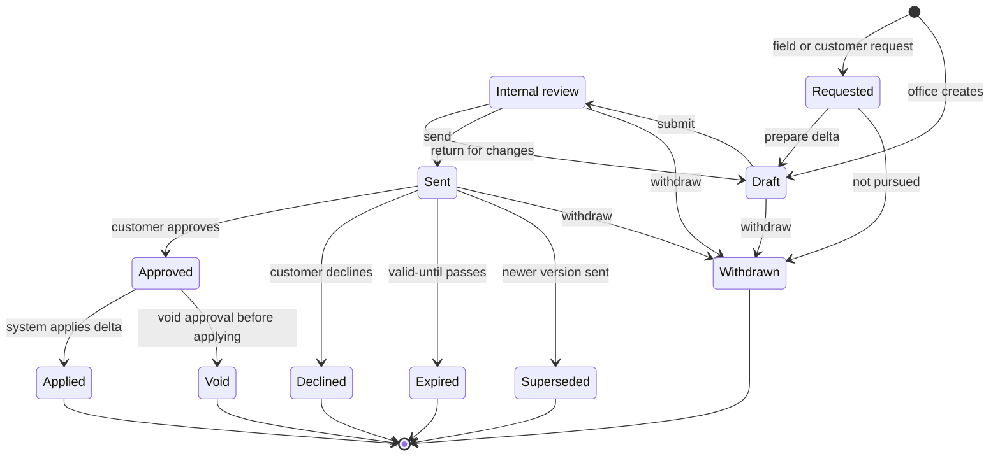

### 8.3 Transitions

| # | From | To | Command or event | Allowed roles | Guards | Side effects | Rev. |
|---|---|---|---|---|---|---|---|
| CO1 | - | Requested | `RequestChange` | WKR, LWK, SUB (asg); CSR, ESTR, ADM for customer requests; AI drafts only | Job not Closed or Cancelled; the condition report linked where a site condition caused it (JOB-004); no price shown to field roles without collect | Owner/supervisor queue item for a major change (JOB-012); the customer's request recorded as "not approved" (AT-033); work needing the change can be paused, blocked or put on hold by their own commands | Yes: CO10 |
| CO2 | Requested | Draft | `DraftChangeOrder` | LWK (scope and time delta, asg), ESTR, ADM | Delta lines reference scope-snapshot lines; added work belongs to a catalog service, otherwise a referral (05 DOM-015; X-05) | - | Yes: CO10 |
| CO3 | - | Draft | `CreateChangeOrder` (office-originated, including the follow-up to an emergency stabilization) | ESTR, ADM | Job not Closed or Cancelled | - | Yes: CO10 |
| CO4 | Draft | Internal review | `SubmitChangeOrderForReview` | ESTR, ADM | Price delta set by ESTR, never by LWK ([27](27-roles-and-permissions.md) hook 31); pricing basis recorded (D-28-14); minimum re-evaluated (D-28-06); tax treatment configured (PRC-023); hazards of added scope reviewed and an active SOP for any new service; fees only from the approved fee schedule (PRC-020, PRC-021) | Pricing exception requested where needed | Yes: return to Draft |
| CO5 | Internal review | Sent | `SendChangeOrder` | ESTR when no exception is pending; ADM; never AI or SYS | Packet renders (05 DOM-060; AGR-010, AGR-026); recipient has approval authority (AUTH-028); valid-until from the change-order validity setting (`POLICY_NOT_CONFIGURED` if none, Q-06-11) | NTF-008 with a version-bound link as part of the estimator's send; packet Sent; older sent versions Superseded; the customer sees old total, delta and new total (PRC-010); audit P | Corr.: CO10 |
| CO6 | Sent | Approved | `ApproveChangeOrder` | CUS (own) or authorized contact; in person on a staff device with the capturing worker recorded; never staff on the customer's behalf, AI or SYS | Current, unexpired version; identity re-verified (AUTH-027); online (D-06-23); idempotency key | Customer approval record; packet Accepted; event `ChangeOrderApproved` to SYS workflow 2; audit P | Corr.: CO11 before it is applied |
| CO7 | Approved | Applied | `ApplyChangeOrder` | SYS (workflow 2) | Job not Closed or Cancelled; idempotency key (change-order version plus "apply"); the change order's base snapshot version equals the job's current one, otherwise the delta is rebased line by line and a conflict on the same lines becomes an exception item for ESTR or ADM | In one transaction: the next job scope snapshot (05 DOM-018; AT-032). Then: a new briefing snapshot with acknowledgements superseded (05 DOM-022, DOM-023; UXE-003 "What changed?"); job item lines updated; payment milestones recomputed only where the approved schedule depends on the total; the delta becomes billable (AT-043); audit P | No: a new change order with the opposite delta |
| CO8 | Sent | Declined | `DeclineChangeOrder` | CUS (own); ESTR, ADM record a verbal decline with a communication log entry | - | Packet Declined; the job continues on the existing scope; DSP may put dependent work on hold, or a referral is recorded | No |
| CO9 | Sent | Expired | `ExpireChangeOrder` (timer) | SYS scheduler | Server time past valid-until | Packet Expired | No (new version) |
| CO10 | Requested, Draft, Internal review, Sent | Withdrawn | `WithdrawChangeOrder` | ESTR, ADM for unsent versions; ADM for a Sent version (as E10) | Reason code | Packet Void if it was sent; staff-released message if it was sent | No |
| CO11 | Approved | Void | `VoidChangeOrderApproval` | ADM, L2 with reason | Not yet Applied (for example while the automation is paused, [33](33-ai-and-automation-governance.md) Section 12.7); the approval is invalid | Packet Void; audit P | No |

**Emergency stabilization** (JOB-006, AT-034) is not a change order: the worker records the emergency stabilization record (trigger, actions, reason, evidence; simple lifecycle "recorded, reviewed" confirmed from 05), LWK and ADM are notified at once, and any follow-up work becomes a change order in Requested with origin "emergency follow-up", or a referral.

### 8.4 Terminal states and invalid transitions

Terminal: Applied, Declined, Expired, Superseded, Withdrawn and Void.

| Invalid attempt | Result | Rule |
|---|---|---|
| An invoice draft includes a Requested, Sent or Approved-but-not-applied change | Impossible by construction: invoice lines come only from applied changes | 05 DOM-042; AT-043 |
| A worker marks a change order approved, or the briefing shows it as approved scope | `HUMAN_ONLY` for approval; the briefing shows applied scope only | JOB-005; JOB-010 |
| LWK sets the price delta | `GUARD_FAILED` | [27](27-roles-and-permissions.md) hook 31 |
| Applying a Declined or Expired change order | `TRANSITION_NOT_ALLOWED` | CO7 needs Approved |
| Applying the same version twice (retry) | One snapshot only; the replay returns the first result | NFR-012 |
| A surcharge added on site without approval (C-PT04-01, C-CL03-01) | No command exists; only an approved change order changes price | FIN-008; AGR-010 |
| Editing a Sent change order | `TRANSITION_NOT_ALLOWED` (frozen) | REC-001 |

### 8.5 Timers and races

- Validity of a Sent change order: `<owner decision>` (Q-06-11). A Requested change with no action after `<owner decision>` raises a queue alert, because work may be waiting.
- Two change orders approved close together: applications are serialized on the job row; the second rebases; conflicting lines become an exception item, never a silent merge.
- An approval arriving after the job was cancelled: CO7 is refused and an exception item is opened; any money involved goes to refund review (Section 11).
- Invoice issue and job closure are refused while an approved change order waits to be applied (I2, J21).

## 9. Invoice (STM-005)

PROPOSED DECISION D-06-10. The spec's list "Draft → Issued → Partially Paid → Paid / Past Due / Void/Adjusted according to policy" mixes four independent questions: where the document is in its life, how much of it is settled, whether it is overdue, and whether it reached the customer. This document gives each its own dimension (D-06-02) and adds a dispute sub-machine ([28](28-pricing-estimating-and-job-costing.md) Section 11.5: the disputed state "belongs to [06]").

**Invoice point** (for [33](33-ai-and-automation-governance.md) workflow 6): the final-invoice draft is created when the job enters Customer closeout (J16, J17); a progress-invoice draft is created when a payment milestone becomes Due (Section 16.2). A disputed walkthrough holds the automatic draft for BKP or ADM. Issuing is always a human BKP or ADM action (AT-043).

### 9.1 Dimensions

**Document (stored).**

| State | Definition | Label |
|---|---|---|
| Draft | Lines derived only from the job's active scope snapshot, applied change orders, the minimum-charge adjustment and payment milestones (05 DOM-042); editable by BKP | FACT |
| Issued | Frozen, numbered and delivered electronically (FIN-003) | FACT |
| Void | An issued invoice voided with reason and replaced by a reissued invoice or corrected by a credit; the number is never reused | FACT ("Void") |
| Discarded | A draft abandoned without being issued | PROPOSED |

**Settlement (derived; PROPOSED, HUMAN REVIEW: CPA).** With T the invoice total, A the allocated cleared payments plus allocated cash (cash is received money; its custody and banking are reconciled separately), P the allocated check payments (and later electronic payments) not yet cleared, K the credit applications and W the write-offs, the balance due is B = T - A - P - K - W.

| Value | Rule |
|---|---|
| Unpaid | A + P + K + W = 0 |
| Partially paid | 0 < A + P + K + W < T |
| Paid pending clearance | B = 0 and P > 0 |
| Paid | B = 0, P = 0 and W = 0 |
| Written off | B = 0, P = 0 and W > 0 |

The spec's "Partially Paid" and "Paid" are these derived values; "Paid" now separates received from cleared money (owner fact L10). A returned check recomputes the value immediately.

**Due (derived).** Not yet due; Past due when B > 0 and the business-local date is after the due date. PROPOSED: amounts covered by received but uncleared checks do not count as past due unless the check returns (Q-06-14). Past due is a flag for A/R aging (RPT-007), never a trigger for an automatic message (G-084).

**Delivery (derived from the notification, Section 16.1).** Not sent, Sent, Delivered, Failed, Viewed (first verified open in the portal).

**Dispute (stored).** No dispute, Disputed, Resolved. While Disputed, reminders and collection messages are suppressed, the job cannot close financially, and no write-off is posted unless the resolution says so.

### 9.2 Diagrams

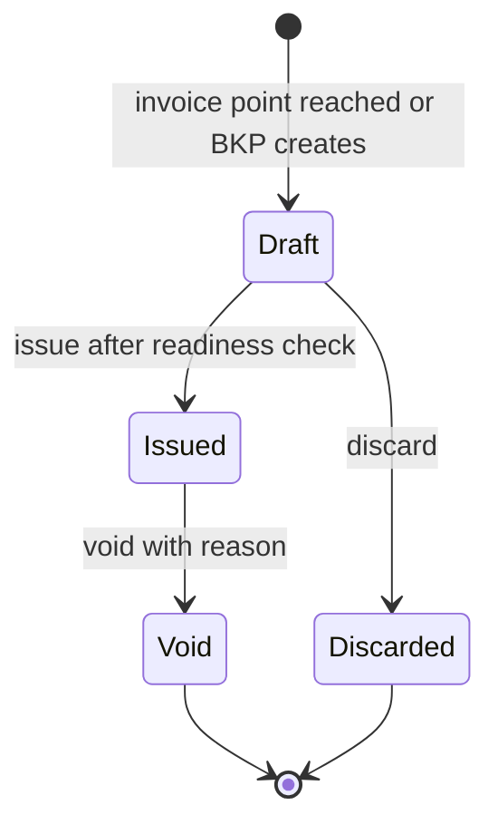

Settlement is recomputed from records, never commanded; the arrows show recomputation results.

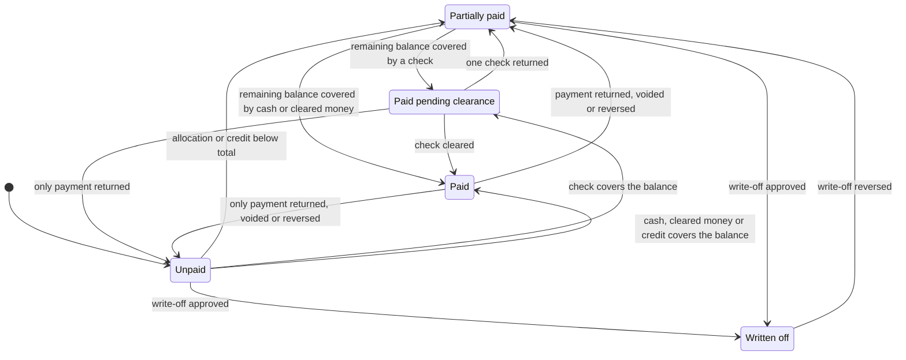

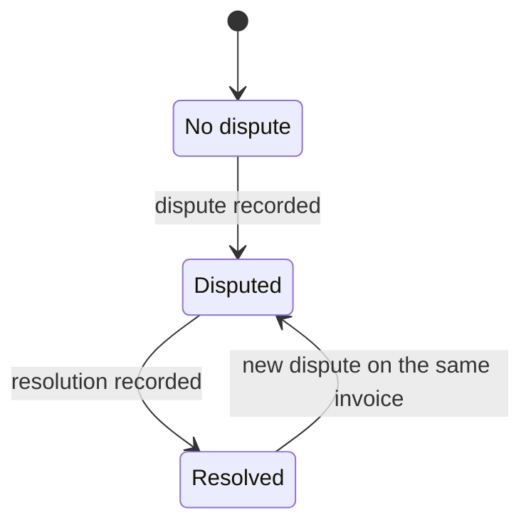

### 9.3 Transitions

| # | From | To | Command or event | Allowed roles | Guards | Side effects | Rev. |
|---|---|---|---|---|---|---|---|
| I1 | - | Draft | `CreateInvoiceDraft` | SYS (workflow 6) at the invoice point; BKP, ADM | One open draft per job and kind (key: job, invoice kind and source versions); lines derived only from the active scope snapshot, applied change orders, the minimum-charge adjustment and milestones (AT-043); deposits and earlier progress amounts reach the invoice through allocations, never as charge lines (05 DOM-042) | - | Yes: I3 |
| I2 | Draft | Issued | `IssueInvoice` | BKP, ADM; never SYS or AI ([27](27-roles-and-permissions.md) hook 18) | Readiness record (QA-006): only the approved snapshot and applied change orders are billed; no approved change order waits to be applied; completion fits the kind (final: job in Customer closeout; progress: milestone Due); no pending pricing exception; a CPA-approved tax treatment for every line (PRC-023); a due date from the active payment-terms policy (PRC-043; `POLICY_NOT_CONFIGURED` if none). ADM may override readiness with reason ([27](27-roles-and-permissions.md) Section 6.3). The final balance is never due before the QA-006 checks (X-14, C-DW02-08) | Invoice frozen and numbered; held deposit allocations applied by new allocations (05 D-05-11); NTF-010 with a secure link as part of BKP's issue action (AUTH-029); delivery tracked; job Invoiced for the final kind (J19); bookkeeping hand-off event ([28](28-pricing-estimating-and-job-costing.md) Section 11.5); audit P | Corr.: I4 |
| I3 | Draft | Discarded | `DiscardInvoiceDraft` | BKP, ADM | Never issued | - | No |
| I4 | Issued | Void | `VoidInvoice` | BKP with L2 and reason; ADM approval (L2, or L3 when BKP and ADM are different people and the amount exceeds an owner-set limit) when payments are allocated or the job is Closed ([27](27-roles-and-permissions.md) Sections 6.2, 6.3) | A replacement draft created in the same transaction (void and reissue) or a credit used instead; never used to hide a collection ([27](27-roles-and-permissions.md) Section 9) | Allocations and credit applications moved to the replacement by new records or left unallocated, never deleted; staff-released void notice; job back to Customer closeout when the final invoice is voided and no replacement is issued in the same transaction (J20); the number is retired; audit P | No |
| I5 | No dispute | Disputed | `RecordInvoiceDispute` | CSR, BKP, ADM | A linked complaint in the billing or damage-claim category (Section 13.1) | Reminders and collection messages suppressed; job financial closeout blocked; **HUMAN REVIEW: attorney** where the exposure is material | Yes: I6 |
| I6 | Disputed | Resolved | `ResolveInvoiceDispute` | ADM | Outcome recorded with any credit, void and reissue, or no change | Customer told by staff, with an attorney-reviewed template where the exposure is material (never automated, [33](33-ai-and-automation-governance.md) Q-33-05); suppression lifted unless another case is open | - |
| I7 | Settlement other than Paid | Written off (derived) | `WriteOffBalance` | ADM, L2; L3 when BKP is a separate person ([27](27-roles-and-permissions.md) Section 6.2); **HUMAN REVIEW: CPA** | Not while Disputed unless the resolution says so; amount not above the balance | Append-only write-off record; settlement recomputed; audit P | Corr.: a reversing write-off record |

Payment allocations are Section 10; credit applications are Section 11.3.

### 9.4 Invalid transitions

| Invalid attempt | Result | Rule |
|---|---|---|
| Editing a line of an Issued invoice | `TRANSITION_NOT_ALLOWED` (frozen) | 05 DOM-042; void and reissue, or credit |
| SYS or AI issues an invoice | `HUMAN_ONLY` | AT-043; AUTH-003 |
| Marking an invoice "Paid" by hand | No such command; settlement is derived | Owner fact L10 |
| Allocating more than the balance due | `GUARD_FAILED`; the remainder stays unallocated on the payment | 05 DOM-044 |
| A collector voids an invoice | Forbidden | [27](27-roles-and-permissions.md) Section 4.4 |
| An automatic collection message when the invoice becomes Past due | No transition or workflow exists; staff only, with owner authorization and an attorney-reviewed template | G-084; [33](33-ai-and-automation-governance.md) Section 12.6 |
| Write-off while Disputed | `GUARD_FAILED` | I7 |

Terminal: Void and Discarded (document dimension). An Issued invoice stays Issued while its settlement, due, delivery and dispute values change.

### 9.5 Timers and races

- Due date: Past due is derived from the business-local date (Q-06-12). A draft not issued after `<owner decision>` alerts BKP. Aging feeds RPT-007; no automatic messages.
- Concurrent allocations lock the invoice and the payment; a void and an allocation on the same invoice serialize on the invoice row; I2 is refused while an approved change order awaits application; a returned check recomputes settlement and due status at once.

## 10. Payment

PROPOSED DECISION D-06-11. The spec has no payment machine; master §5 file 06 requires one. Rules carried in: FIN-004, FIN-005, FIN-006; owner fact L10 "Received checks are not cleared money."; [27](27-roles-and-permissions.md) Section 4.6 "A collector creates the payment and receipt and cannot edit or reverse them afterwards. Cleared or returned status is set only by BKP or ADM". Electronic payments have no provider (owner fact L10), so their states are placeholders only (Section 10.4).

### 10.1 Payment status

| State | Definition | Applies to | Label |
|---|---|---|---|
| Recorded | Payment received and recorded with collector, amount, method, date and time, job or invoice, check number for checks, payer name if needed; a numbered receipt issued (FIN-004, FIN-005). Amount and method never change afterwards (05 DOM-040) | Cash, check | PROPOSED |
| Deposited | Included in a bank deposit batch that was taken to the bank, with the custody hand-over recorded (FIN-005 "deposit/reconciliation status") | Cash, check | PROPOSED |
| Cleared | BKP or ADM confirmed from a bank record that the funds are good; for cash, the bank confirmed the deposit | Cash, check | PROPOSED |
| Returned | The bank returned the check unpaid or took it back; a payment adjustment of type "returned check" exists | Check | PROPOSED |
| Voided | The record should never have existed (duplicate entry, wrong amount, wrong customer); a payment adjustment of type "void" exists and a corrected payment is recorded separately | Cash, check | PROPOSED |
| Reversed | An accepted payment was taken back for a reason other than a bank return (mainly a lost provider chargeback, P1) | Electronic (P1); exceptional for checks | PROPOSED |

Status changes are appended as status events and payment adjustments (05 immutability class A).

### 10.2 Diagram

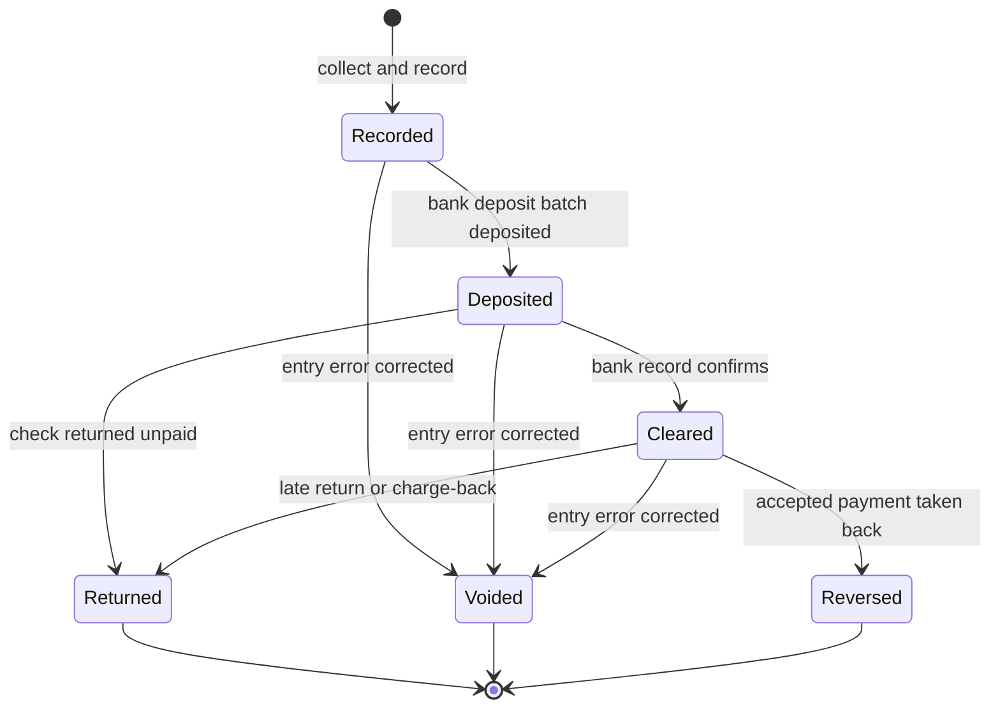

### 10.3 Transitions

| # | From | To | Command or event | Allowed roles | Guards | Side effects | Rev. |
|---|---|---|---|---|---|---|---|
| PY1 | - | Recorded | `RecordPayment` | Collector with the collect capability on an assigned job (WKR, LWK); BKP, ADM; accepted offline with a client key | Amount above zero in minor units, currency USD (05 DOM-036); method cash or check (electronic only after a provider exists); check number for checks; payer; target is an invoice, the deposit requirement, or the job (unallocated); no card number in any field (AUTH-035) | Receipt numbered and NTF-010 receipt sent as part of the human record action ([33](33-ai-and-automation-governance.md) Section 12.6); allocation in the same transaction when a target is given; deposit satisfaction and invoice settlement recomputed; check image restricted (FIN-005); the collector cannot edit afterwards (AUTH-024); audit P | Corr.: PY5 |
| PY2 | Recorded | Deposited | `RecordBankDeposit` (batch) | BKP, ADM; the custody hand-over from the collector is recorded | Payment included in a batch whose total matches the deposit slip | Batch state Deposited; custody record | - |
| PY3 | Deposited | Cleared | `MarkCleared` | BKP, ADM, never the collector ([27](27-roles-and-permissions.md) Sections 6.2, 9); L1 | Bank record reference | Deposit satisfaction recomputed for a cleared-funds rule; invoice settlement moves from pending clearance to paid; closeout criteria re-checked; audit P | Corr.: PY4 |
| PY4 | Deposited, Cleared | Returned | `MarkReturned` | BKP, ADM, never the collector; L1 with reason ([27](27-roles-and-permissions.md) Section 6.2) | Bank evidence; reason code | Returned-check payment adjustment; reversing allocations; balance reopens (05 invariant 3; job-costing playbook: "A bounced \$500 check reopens the balance through reversal, not deletion."); receipt voided; deposit requirement reverts (DR4); readiness recomputed; a Closed job is flagged for an ADM reopen decision (J23); customer contact by staff using an attorney-reviewed template only; audit P | No: a new payment records any re-payment |
| PY5 | Recorded, Deposited, Cleared | Voided | `VoidPayment` | BKP, ADM; L2 (L3 when BKP and ADM are different people and the amount exceeds an owner-set limit); never the collector | Reason code (duplicate, wrong amount, wrong customer); a corrected payment recorded separately when needed | Void adjustment; allocations reversed; receipt voided; audit P | No |
| PY6 | Cleared | Reversed | `ReversePayment` | BKP, ADM; L2 | Provider or bank evidence (P1 mostly) | As PY4 | No |
| PY7 | (allocation) | (allocation) | `AllocatePayment`; `ReverseAllocation` | BKP, ADM; the collector only at recording time to the assigned job's invoice or deposit requirement | Allocation within the unallocated amount and the target's balance, checked under locks (05 DOM-044) | Append-only allocation records; settlement recomputed | Reversal by a new allocation |

**Reconciliation status (separate dimension; written only by a reconciliation sign-off, 05 DOM-064).**

| # | From | To | Command | Allowed roles | Guards | Side effects |
|---|---|---|---|---|---|---|
| RC1 | Unreconciled | Reconciled | `SignOffReconciliation` covering the payment | BKP (never for payments they collected), ADM; L2 | Matched to bank records; the sign-off lists the payments and batches it covers and its matched totals | Status set for every covered payment and batch; audit P |
| RC2 | Unreconciled | Exception | The same sign-off listing the item as unmatched, duplicate, stale or returned | As RC1 | - | Follow-up task for BKP |
| RC3 | Exception | Reconciled | A later sign-off | As RC1 | Follow-up evidence | - |
| RC4 | Reconciled | Exception | A later sign-off after a return or reversal of a reconciled payment | As RC1 | - | Follow-up task |

### 10.4 Electronic payments (placeholder until a provider is selected)

States from the business-systems-administrator playbook ("Distinguish invoice sent, provider payment pending, paid, settled, refunded, and disputed."): Pending, Settled, Failed, Disputed (charge-back), Reversed. Nothing is built until the owner selects a provider (owner fact L10; Q-06-18). When built: provider webhooks are verified and deduplicated by provider event ID ([33](33-ai-and-automation-governance.md) workflow 14); status follows the provider's authoritative state, never a browser redirect (swe-architecture: "Do not trust a payment success redirect as proof of payment."); card data never enters HandyHub records (D-27-20).

### 10.5 Invalid transitions, timers and races

| Invalid attempt | Result | Rule |
|---|---|---|
| A collector marks their own check Cleared or voids their own payment | `GUARD_FAILED` (SoD) | AUTH-023, AUTH-024; [27](27-roles-and-permissions.md) hooks 7, 17 |
| Editing the amount or method of a recorded payment, or deleting it | No such command | FIN-006; AUTH-010 |
| Marking a check Cleared before it is Deposited | `TRANSITION_NOT_ALLOWED` | A check clears only through the bank |
| A collector records a payment on a job they are not assigned to | Not found | AUTH-006 |
| A card number typed into a reference, note or reason | Rejected or masked; attempt logged | AUTH-035 |

Timers (alerts only; a timer never clears money): a check neither Cleared nor Returned `<owner decision>` business days after deposit alerts BKP; cash or checks in custody not deposited after `<owner decision>` alert BKP and ADM (custody cadence, Q-27-03); reconciliation cadence `<owner decision>` (Q-28-25).

Races: an offline payment synced twice is deduplicated by its client key; a check returned after the job closed alerts BKP and asks ADM to decide on a reopen (J23); a void and an allocation lock the payment and the invoice in a fixed order; a return after a reconciliation sign-off appears as an exception in the next sign-off (DOM-064). The returned check is the launch case of master §19 "failed payment".

Custody exceptions: a check lost, destroyed or stolen before deposit, or cash missing at the custody hand-over, is neither a void (the record was not an entry error) nor a return (no bank returned anything). The payment stays Recorded; the gap becomes a reconciliation exception (RC2) and an owner queue item; the system neither reopens nor settles the customer's balance on its own. Whether the customer is asked to stop payment and reissue a check, with the original voided only after the replacement is recorded, and how the loss is booked, is **OPEN QUESTION** Q-06-21 (owner; **HUMAN REVIEW: CPA**; attorney before any customer contact about it).

Terminal: Returned, Voided and Reversed. Cleared is final unless a late return or a reversal arrives (PY4, PY6).

## 11. Deposit requirement, refund, credit and write-off

### 11.1 Deposit requirement (PROPOSED DECISION D-06-12)

BIZ-006: "The threshold, percentage or fixed amount, exceptions, refund/cancellation treatment, and approval authority must be configurable by an administrator." FIN-002: "The system must not assume every job requires a deposit." The policy fields are [28](28-pricing-estimating-and-job-costing.md) D-28-12 (enabled, applies to, threshold basis and amount, amount type and value, timing, refund and cancellation reference, exceptions and waiver authority, cleared funds required). This document needs two more fields, for [28](28-pricing-estimating-and-job-costing.md) to adopt: `gate_effect` (flag, block visit confirmation, or block start) and `accepted_statuses` (which payment statuses satisfy the deposit). No value is set (owner fact L9; HND-003); the gate effect and accepted statuses are an **OPEN QUESTION** (Q-06-06).

| State | Definition | Label |
|---|---|---|
| Policy not configured | No active deposit policy when the estimate was approved; no amount is computed or demanded; flagged for ADM review (05 DOM-039). A deposit cannot be added later without the customer's agreement, because the approved version carried no deposit term | PROPOSED |
| Not required | The policy in force at approval does not require a deposit for this job (AT-008) | PROPOSED |
| Required | The policy requires an amount, due at the policy's timing point; no accepted allocation yet | PROPOSED |
| Partly satisfied | Derived: allocations in accepted statuses are below the amount | PROPOSED |
| Satisfied | Derived: allocations in accepted statuses reach the amount | PROPOSED |
| Waived | ADM waived it with reason through an override record ([27](27-roles-and-permissions.md) Section 6.3; L2) | PROPOSED |
| Applied | Held deposit allocations were applied to a final or progress invoice by new allocations (05 D-05-11) | PROPOSED |
| Refund review | The job was cancelled, or approved scope fell so that held money exceeds what is owed; a refund request exists (Section 11.2) | PROPOSED |
| Refunded | The refund review ended with a refund executed | PROPOSED |
| Retained | The refund review ended with money retained under an active, attorney-approved retention term and an ADM decision; unavailable until such a term exists (**HUMAN REVIEW: attorney; CPA**) | PROPOSED, conditional |

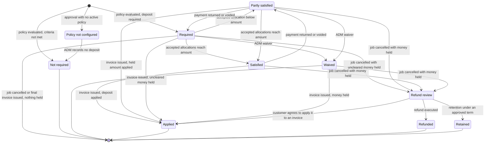

| # | From | To | Command or event | Allowed roles | Guards | Side effects | Rev. |
|---|---|---|---|---|---|---|---|
| DR1 | - | Policy not configured, Not required or Required | Event `CustomerApprovalRecorded`, handled by `EvaluateDepositRequirement` | SYS workflow 2 with J1 (a [27](27-roles-and-permissions.md) grant to confirm, Section 21) | Evaluated against the policy version in force at approval, per estimate version (D-28-12); the amount equals the deposit terms accepted on the approved version | Readiness recomputed; a prerequisite hold when the gate effect blocks (Section 6.4); the packet carried a deposit section only if one was required (AGR-011) | - |
| DR2 | Policy not configured | Not required | `RecordNoDepositDecision` | ADM, L1 with reason | - | Review flag cleared | No |
| DR3 | Required, Partly satisfied | Partly satisfied, Satisfied | Event `PaymentAllocated` or `PaymentCleared` (derived) | SYS | Only allocations whose payment status is in the policy's accepted statuses count; "A check awaiting clearance does not satisfy a cleared-deposit gate." (scheduling playbook) when the policy requires cleared funds | Readiness recomputed; prerequisite hold released | Derived |
| DR4 | Satisfied, Partly satisfied | Partly satisfied, Required | Event `PaymentReturned` or `PaymentVoided` (derived) | SYS | - | Readiness recomputed; DSP and BKP alerted; a started job is not stopped automatically, the owner decides (Q-06-06) | Derived |
| DR5 | Required, Partly satisfied | Waived | `WaiveDeposit` (an override record) | ADM, L2 with reason; DSP cannot ([27](27-roles-and-permissions.md) hook 30) | - | Override record; hold released; audit P. The waiver covers only the unpaid part: money already held stays allocated and follows DR6 or DR7, so a waiver never strands received money | No |
| DR6 | Satisfied, Partly satisfied; Required or Waived while money is held | Applied | Event `InvoiceIssued` (final or progress, as the policy specifies, 05 Q-05-03) | SYS inside I2 | New allocations consume every held deposit allocation exactly once, whatever its payment status (05 DOM-042); an uncleared check counts as pending clearance on the invoice (Section 9.1) | The invoice's balance section shows the applied deposit | No |
| DR7 | Required (uncleared money held), Partly satisfied, Satisfied, Waived (money held) | Refund review | Event `JobCancelled`; or an applied change order leaves held money above the new total | SYS inside J24 or J25 (or CO7) | - | Refund request created as a review item for ADM (customer-service playbook: "A refund request creates a review item, not an automatic refund.") | - |
| DR8 | Refund review | Refunded | Event `RefundExecuted` | SYS inside RF4 | - | - | No |
| DR9 | Refund review | Retained | `RetainDeposit` | ADM, L2 | An active, attorney-approved retention term in the policy version the customer accepted; never a term from a draft agreement (C-CL02-02, C-DW02-06, X-04); **HUMAN REVIEW: attorney; CPA** | Customer notice only through an attorney-approved template ([33](33-ai-and-automation-governance.md) Section 12.6, legally sensitive notices); audit P | No |
| DR10 | Refund review | Applied | `ApplyHeldDepositToInvoice` | BKP, ADM | The customer's agreement recorded | - | No |
| DR11 | Required (nothing held) | Ended, nothing held | Event `JobCancelled`, or `InvoiceIssued` for the final invoice | SYS inside J24, J25 or I2 | No allocation of any status exists | At final invoice issue the unpaid requirement is listed for BKP and ADM (a policy breach to review when the gate effect was "block"); nothing is added to the invoice for it, because the invoice already bills the full approved scope | No |

**Terminal, invalid, timers and races.** Terminal: Not required, Waived (when no money is held), Applied, Refunded and Retained, plus the end with nothing held at cancellation or final invoice issue (DR11). Without DR11 and the held-money paths of DR5 to DR7, a job whose deposit was flagged but never paid, or waived after a part payment, could never meet the D-06-19 closeout criteria. Invalid: setting Satisfied by hand (derived only, SMR-010); a DSP waiver ([27](27-roles-and-permissions.md) hook 30); counting a Deposited check under a cleared-funds policy; `RetainDeposit` without an active attorney-approved term (the command is not offered); adding a deposit to a job approved under "Policy not configured" without the customer's agreement. Timers: the due point comes from the policy's timing; an unsatisfied deposit at its due point raises a DSP and BKP alert and never cancels the job or a visit automatically. Races: allocations, payment-status events and the waiver recompute or change the requirement under its row lock; a check returned after a waiver leaves the requirement Waived (the waiver is a recorded decision) while the invoice balance reopens.

### 11.2 Refund (PROPOSED DECISION D-06-13)

A refund pays money back against exactly one payment or one credit balance (05 `Refund`). It draws only on the unallocated amount of that payment or the remaining balance of that credit; money allocated to an invoice must first be released by a reversing allocation, which reopens that invoice's balance, so an invoice never shows paid with the money gone (05 DOM-043, DOM-044). How cash and check payments are refunded (tender) is [28](28-pricing-estimating-and-job-costing.md) Q-28-27.

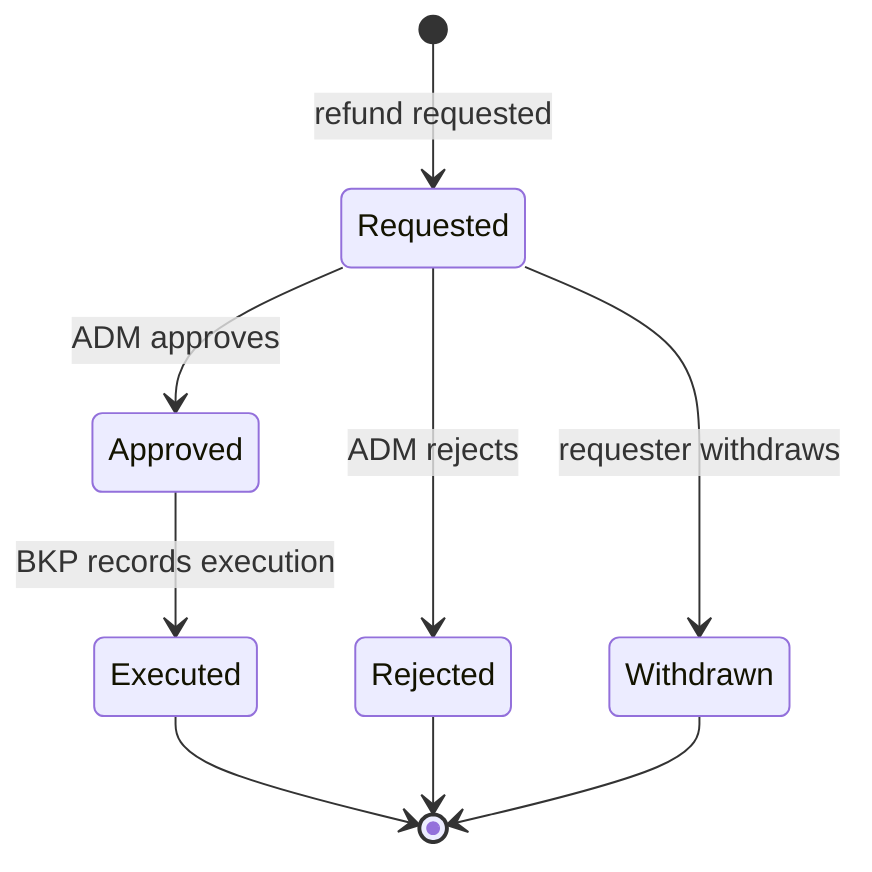

| # | From | To | Command or event | Allowed roles | Guards | Side effects | Rev. |
|---|---|---|---|---|---|---|---|
| RF1 | - | Requested | `RequestRefund` | CUS (own), CSR, BKP, ADM; SYS from DR7 | One source (payment or credit); amount not above the refundable amount; reason | Review item in the ADM queue; staff-released acknowledgement with no promise (customer-service playbook: "Do not promise availability, free work, deposit refund, warranty coverage or a discount without approval.") | Yes: RF5 |
| RF2 | Requested | Approved | `ApproveRefund` | ADM, L2; L3 when BKP is a separate person ([27](27-roles-and-permissions.md) Section 6.2); never the requester (AUTH-023) | Refundable amount re-checked under lock; an active refund and credit policy version, or an ADM exception with reason (Q-28-27, [30](30-service-agreement-standards.md) Q-30-22); **HUMAN REVIEW: attorney** for consumer-term or dispute questions, **CPA** for treatment | Approval record; customer informed by staff | No |
| RF3 | Requested | Rejected | `RejectRefund` | ADM | Reason; attorney-reviewed wording where the exposure is material | Customer informed by staff, never automatically | No |
| RF4 | Approved | Executed | `RecordRefundExecution` | BKP, ADM | Tender (cash or check until a provider exists), amount not above the approved amount, evidence; refundable amount re-checked under lock | Refund record; the source's refundable amount reduced; credit Refunded where the source is a credit (CR5); bookkeeping hand-off ([28](28-pricing-estimating-and-job-costing.md) Section 11.5); audit P | No |
| RF5 | Requested | Withdrawn | `WithdrawRefundRequest` | CUS (own), CSR, ADM | - | - | No |

A refund whose execution fails later (for example a refund check that is never cashed) is handled as a bookkeeping exception with a new record; an executed refund record is never edited.

Terminal: Executed, Rejected and Withdrawn. Invalid: approval by the requester (AUTH-023); a refund above the refundable amount of its source; a refund created automatically by a complaint, a cancellation or an AI draft (customer-service playbook: "A refund request creates a review item, not an automatic refund."); execution before approval. Timers: a request waiting for approval longer than `<owner decision>` alerts ADM; no timer approves, rejects or executes a refund. Races: approval and execution re-check the refundable amount under the source's row lock, so a concurrent allocation, credit application or second refund cannot overdraw the source (Section 18.4 row 12).

### 11.3 Credit (PROPOSED DECISION D-06-13)

A credit reduces what a customer owes without money moving (05 `Credit`). An overpayment is not a credit: it stays the unallocated part of its payment, is shown to the customer as account credit, and is later allocated or refunded against that payment (05 Q-05-16; **HUMAN REVIEW: CPA**).

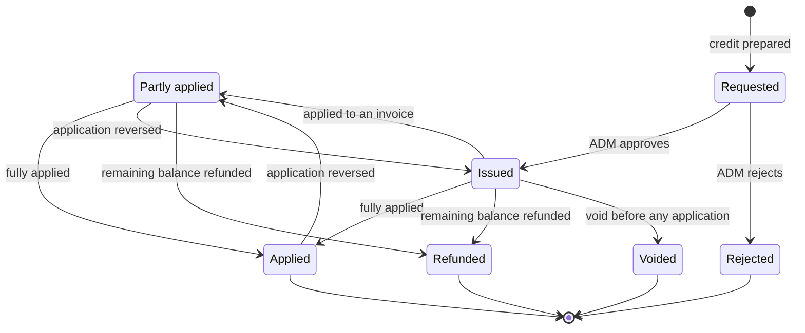

| # | From | To | Command or event | Allowed roles | Guards | Side effects | Rev. |
|---|---|---|---|---|---|---|---|
| CR1 | - | Requested | `RequestCredit` | CSR, BKP (prepare), ADM | Customer; amount; reason (billing correction, concession, complaint resolution; a skipped recurring visit only under an approved policy, P1) | ADM queue item | Yes: CR3 |
| CR2 | Requested | Issued | `IssueCredit` | ADM, L2; L3 when BKP is a separate person ([27](27-roles-and-permissions.md) Section 6.2); never the requester (AUTH-023) | **HUMAN REVIEW: CPA** for treatment | Credit number; customer informed by staff; audit P | Corr.: CR6 |
| CR3 | Requested | Rejected | `RejectCredit` | ADM | Reason | - | No |
| CR4 | Issued, Partly applied | Partly applied, Applied | `ApplyCredit` | BKP, ADM | Target invoice Issued (not Void); application not above the lower of the remaining credit and the invoice balance, checked under locks | Append-only credit application; invoice settlement recomputed | Yes: `ReverseCreditApplication` (BKP, ADM, L1 with reason, for example after an invoice void) |
| CR5 | Issued, Partly applied | Refunded | Event `RefundExecuted` against the credit balance | SYS inside RF4 | - | - | No |
| CR6 | Issued | Voided | `VoidCredit` | ADM, L2 | No active application (reverse them first) | Audit P | No |

Terminal: Applied, Refunded, Rejected and Voided. Invalid: issue by the requester; an application above the remaining credit or the invoice balance; an application to a Draft or Void invoice; voiding a credit that still has active applications. Timers: a request awaiting approval longer than `<owner decision>` alerts ADM. Races: applications and refunds against one credit serialize on the credit row; an invoice void reverses or moves its credit applications in the same transaction (I4).

### 11.4 Write-off

A write-off has no lifecycle: `WriteOffBalance` (I7) creates an append-only record (ADM, L2; **HUMAN REVIEW: CPA**), never while the invoice is Disputed unless the resolution says so. A mistaken write-off is corrected by a reversing write-off record, never by deletion (FIN-006).

### 11.5 Bookkeeping hand-off and accounting treatment

The states in Sections 9 to 11 are operational records. They do not decide revenue recognition, how a held deposit is booked, or how a returned check, refund, credit or write-off is posted (bookkeeping-accounting-assistant: "Distinguish cash movement from revenue/expense recognition when timing differs."; its chart of accounts lists "deposits/customer liabilities when appropriate"). Each transition below emits one hand-off event to the [28](28-pricing-estimating-and-job-costing.md) Section 11.5 bookkeeping hand-off. The event is keyed by its transition record, so a retry never duplicates it (NFR-012). The treatment of every event is decided by the CPA (**HUMAN REVIEW: CPA**). Nothing here is tax or accounting advice.

| Transition | [28](28-pricing-estimating-and-job-costing.md) Section 11.5 hand-off row | Note |
|---|---|---|
| I2 issue; I4 void | Invoice issued, voided or adjusted | A void and its replacement are two events; a number is never reused |
| PY1 record | Cash or check received; Deposit received when the allocation targets a deposit requirement | A check is handed off as received, not cleared (owner fact L10) |
| PY2 deposited; PY3 cleared | Cash or check received (deposit-to-bank status) | Clearance is never inferred from a deposit batch |
| PY4 returned | Check returned (reversal linked to the original) | Never a deletion (FIN-006) |
| PY5 voided; PY6 reversed | Cash or check received, as a void or reversal linked to the original | 28 has no separate row for these corrections yet (Section 21) |
| DR6 applied; DR8 refunded; DR9 retained | Deposit received (its application, refund or retention) | Retention exists only under an attorney-approved term; its treatment is a CPA decision |
| RF4 executed; CR2 issued; CR4 applied; I7 write-off and its reversal | Refund, credit, write-off | Tender per [28](28-pricing-estimating-and-job-costing.md) Q-28-27 |
| Custody exception (Section 10.5) | Cash or check received, marked as an exception | Q-06-21 |

## 12. Field incident (STM-006)

PROPOSED DECISION D-06-14. JOB-008: "Injury, property damage, near miss, customer conflict, tool/equipment failure and suspected hazardous-material exposure must have a structured incident form and escalation." Master §7 sets the lifecycle: "Hazard identified -> stop work if necessary -> secure site -> report -> evidence -> escalation -> customer communication -> remediation decision -> insurance/legal review if required -> corrective action -> lessons learned". Closing is ADM-only and AI may never close an incident or declare a site safe ([27](27-roles-and-permissions.md) Section 4.6). **HUMAN REVIEW: insurer and attorney; qualified safety professional for OSHA conclusions; medical decisions by qualified medical professionals.**

### 12.1 States

| State | Definition | Label |
|---|---|---|
| Reported | The structured form was submitted (offline allowed): type, severity (the four-level scale proposed in [11](11-worker-job-execution.md) Section 6.3, to be confirmed by a qualified safety professional), when and where, people and property affected, immediate action, evidence; injury and medical details in the restricted section (05 DOM-035). Emergency response comes first and the form never delays a call to emergency services (safety-liability-manager: "For an active emergency, prioritize immediate safety and emergency response over paperwork.") | FACT (STM-006) |
| Triaged | A person confirmed severity and escalation level, checked evidence, recorded whether insurer, attorney or regulatory questions arise, and set a customer-communication plan | FACT |
| Action required | Remediation and corrective actions assigned with owners and due dates | FACT |
| Under external review | Waiting for an insurer, attorney or qualified safety professional; customer statements only with their review | PROPOSED |
| Follow-up | Actions done; verification, customer-communication record, lessons-learned tag (QA-012) and SOP review trigger ([31](31-sop-standard.md) Section 5.5) completed | FACT |
| Closed | ADM closed it against the closure checklist | FACT; authority PROPOSED |
| Voided | Reported in error or a duplicate of another incident; the record is kept | PROPOSED |

**Escalation level** (stored attribute, PROPOSED): Routine, Supervisor, Owner immediate, External. Set at reporting from the type and the severity floors of [11](11-worker-job-execution.md) Section 6.3, with the mapping [11](11-worker-job-execution.md) D-11-28 supplies: critical and high are Owner immediate (AT-035 "high severity triggers required escalation queue"); any injury and any suspected hazardous-material exposure are Owner immediate whatever their grade; moderate is Supervisor; low is Routine. External is added when emergency services were called, or at triage when an insurer, attorney, regulator or qualified safety professional must review (IN5). A person may raise the level at triage; nobody lowers it below the floor, and AI never grades (05 DOM-055).

### 12.2 Diagram

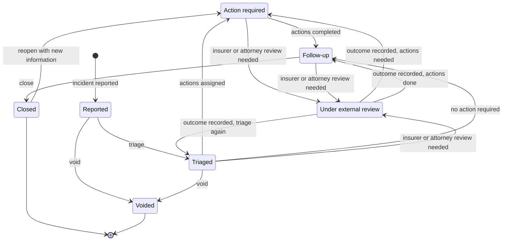

### 12.3 Transitions

| # | From | To | Command or event | Allowed roles | Guards | Side effects | Rev. |
|---|---|---|---|---|---|---|---|
| IN1 | - | Reported | `ReportIncident` | WKR, LWK, SUB (asg), DSP, ADM; accepted offline. A customer's damage claim is recorded by CSR as a complaint and ADM opens the incident | Required fields present; reporting is never refused for permission reasons to an assigned worker | Escalation level set; injury or suspected hazardous-material exposure during a started job moves the job to Blocked (J5; PROPOSED, Q-06-10); owner alert and queue for Owner immediate (AT-035, JOB-012; SYS workflow 7); customer communication drafted only for staff release, with no liability admission (AIR-012 boundary; **HUMAN REVIEW: insurer, attorney**); SOP review item ([31](31-sop-standard.md) Section 5.5); audit | n/a |
| IN2 | Reported | Triaged | `TriageIncident` | ADM; LWK for Routine or Supervisor level on assigned jobs; never AI (AIR-001 and AIR-003 advise only) | Severity confirmed; escalation level set; evidence checked | Queue updated | - |
| IN3 | Triaged | Action required | `AssignIncidentActions` | ADM | Each action has an owner, a due date and an evidence requirement | Action tasks | - |
| IN4 | Triaged | Follow-up | `RecordNoActionRequired` | ADM | Reason recorded | - | - |
| IN5 | Triaged, Action required, Follow-up | Under external review | `RequestExternalReview` | ADM | Reviewer type recorded (insurer, attorney, qualified safety professional) | Customer statements locked to reviewed wording | Yes: IN6 |
| IN6 | Under external review | Triaged, Action required or Follow-up | `RecordExternalReviewOutcome` | ADM | Outcome evidence attached | - | - |
| IN7 | Action required | Follow-up | `CompleteIncidentActions` | ADM; LWK for actions assigned to them | Every action done with evidence | Lessons-learned tag (QA-012) | - |
| IN8 | Follow-up | Closed | `CloseIncident` | ADM only, L1 with reason; never AI | Closure checklist: actions complete with evidence; external review outcome recorded where it was required; customer communication logged; the status of any linked complaint or claim noted (closing the incident never closes them, 05 DOM-031); lessons learned recorded; restricted data handled under [13](13-privacy-data-governance.md) | Audit P (incident closure) | Yes: IN9 |
| IN9 | Closed | Action required | `ReopenIncident` | ADM | New information (for example a delayed injury report or a claim) | Audit P | - |
| IN10 | Reported, Triaged | Voided | `VoidIncident` | ADM, L2 with reason | Duplicate or entered in error; an Owner immediate incident also gets owner after-the-fact review ([27](27-roles-and-permissions.md) Section 9); never used to hide an event | Audit P | No |

### 12.4 Invalid transitions, timers and races

Invalid: LWK or AI closing an incident (`HUMAN_ONLY` or forbidden); deleting one (no delete path, PERM-005); `CloseIncident` while a required external review has no recorded outcome (`GUARD_FAILED`); injury or medical details appearing in a customer view or message (field class, [27](27-roles-and-permissions.md) Section 4.7).

Timers: Owner immediate alerts at once; triage target `<owner decision>` set with a qualified safety professional; action due dates as assigned; follow-up review date as set. No timer closes an incident.

Races: two reports of one event are linked, or one is voided by ADM; an incident synced from an offline device after the job closed is accepted, and ADM decides whether the job is reopened (J23).

Terminal: Closed (reopenable by IN9) and Voided.

## 13. Customer complaint and rework case

PROPOSED DECISION D-06-15. [35](35-skills-coverage-matrix.md) splits ownership: handyhub-customer-service owns complaint intake and communication; handyhub-quality-assistant owns classification and corrective action. QA-009: follow-up "must not interfere with unresolved complaint/rework cases"; NTF-011: "Feedback/review request only when case is not in active complaint/rework handling."

### 13.1 Complaint

| State | Definition | Label |
|---|---|---|
| Received | Recorded without assigning blame: customer, contact, job where known, channel, category (work quality, conduct, schedule, billing, damage claim, other), facts, location, dates and evidence (customer-service playbook). Review requests are suppressed | PROPOSED |
| Under review | CSR gathers facts; the Quality Assistant may draft a classification and evidence matrix for a person to decide (AIR-004: "Human decides acceptance, warranty position and disciplinary actions."); links to a rework case, incident, refund or credit review, or invoice dispute as needed | PROPOSED |
| Escalated | Material legal or financial exposure, injury, property-damage claim, threats or suspected fraud (customer-service playbook: "Escalate injury, damage, threats, legal disputes and suspected fraud."); the owner takes over; messages only with attorney or insurer review | PROPOSED |
| Resolution proposed | A decided remedy (rework visit, credit, refund, explanation) offered to the customer, with its approvals recorded | PROPOSED |
| Resolved | The customer accepted the resolution, or the remedy was delivered (rework job closed, credit issued, refund executed) | PROPOSED |
| Closed | Closed with an outcome code: resolved and accepted; resolved and delivered; no fault, explained; withdrawn by the customer; unresolved with HandyHub's final position recorded | PROPOSED |

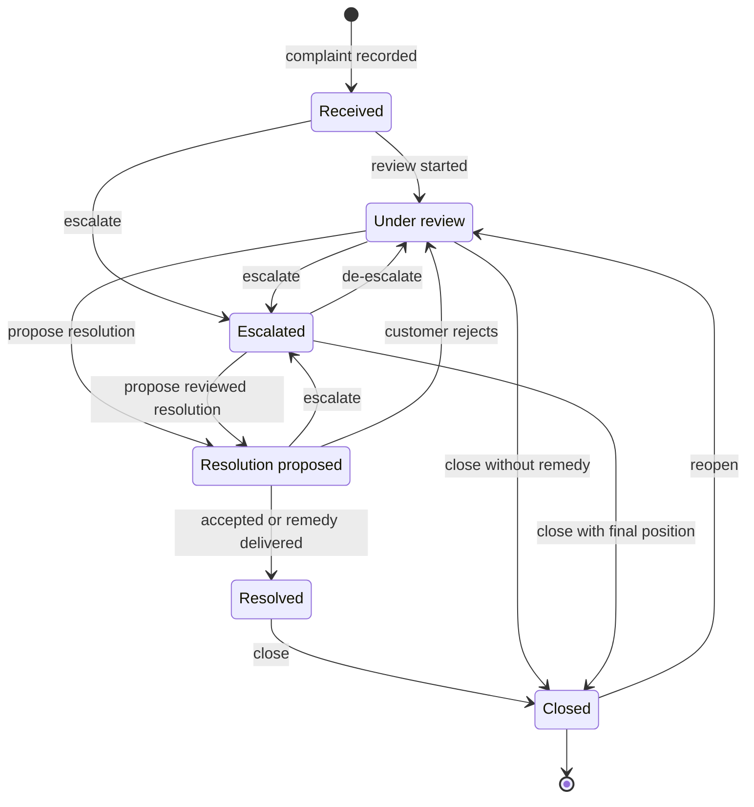

| # | From | To | Command or event | Allowed roles | Guards | Side effects | Rev. |
|---|---|---|---|---|---|---|---|
| CP1 | - | Received | `RecordComplaint` | CUS (own, portal), CSR, ADM; field staff log a communication and CSR records the complaint | Category and facts; linked job where known (CX-007) | SYS workflow 7 suppresses NTF-011 for the customer; acknowledgement drafted for staff release with no liability admission (AIR-012); a billing category opens an invoice dispute (I5); a damage claim or injury prompts ADM to open an incident (IN1) | - |
| CP2 | Received | Under review | `StartComplaintReview` | CSR, ADM | Owner assigned | - | - |
| CP3 | Received, Under review, Resolution proposed | Escalated | `EscalateComplaint` | CSR, ADM. When a linked incident reaches Owner immediate, SYS workflow 7 only flags the complaint in the owner queue and a person records the escalation ([27](27-roles-and-permissions.md) Section 10.4: workflow 7 never re-grades an item) | Reason; **HUMAN REVIEW: attorney or insurer** | Owner queue; messages limited to reviewed templates ([33](33-ai-and-automation-governance.md) Q-33-05) | Yes: CP4 |
| CP4 | Escalated | Under review | `DeescalateComplaint` | ADM | Reviewer agreement recorded | - | - |
| CP5 | Under review, Escalated | Resolution proposed | `ProposeResolution` | CSR for the communication; ADM records the approvals | The remedy's own approvals exist (refund RF2, credit CR2, rework case accepted RW3); warranty position and acceptance decided by a person; no liability admission without attorney review | Staff-released message to the customer | Yes: CP6 |
| CP6 | Resolution proposed | Under review | `RecordResolutionRejected` | CSR, ADM | - | - | - |
| CP7 | Resolution proposed | Resolved | `RecordResolutionAccepted`; or `RecordRemedyDelivered` after the event `RemedyDelivered` (rework job Closed, credit Issued, refund Executed) has flagged the complaint | CSR, ADM; SYS only flags the event (workflow 7 never resolves an item) | For a delivered remedy, its delivery record exists | - | - |
| CP8 | Resolved | Closed | `CloseComplaint` | CSR, ADM | Outcome code; lessons-learned tag created or marked not applicable (QA-012) | Review-request suppression lifted when no other complaint or rework case is open for the customer (QA-009); audit P | Yes: CP10 |
| CP9 | Under review, Escalated | Closed | `CloseComplaint` without a remedy | ADM; CSR only for "withdrawn by the customer" | Outcome code; "unresolved, final position" needs **HUMAN REVIEW: attorney** where the exposure is material | As CP8 | Yes: CP10 |
| CP10 | Closed | Under review | `ReopenComplaint` | CSR, ADM | New information | Suppression re-applied | - |

Invalid: closing a complaint does not close a linked incident or rework case (05 DOM-031); NTF-011 is never sent while a complaint is open (the dispatch re-checks open cases at send time, [33](33-ai-and-automation-governance.md) Section 12.4); an AI role closing a complaint or deciding a warranty position (`HUMAN_ONLY`); an acknowledgement promising a refund, credit or warranty coverage (blocked at staff review; customer-service playbook). Timers: acknowledgement and resolution targets are `<owner decision>` (G-098; Q-06-09) and raise overdue alerts only.

Terminal: Closed (reopenable by CP10). Races: a complaint recorded while a follow-up message is queued wins, because the dispatch re-checks open cases at send time; two staff acting on one complaint at once serialize on its row and the stale command fails.

### 13.2 Rework case

A rework case is return work after closeout (a callback), linked to the original job and classified with one canonical code list (05 DOM-034; the list is owner decision Q-05-04, replacing the different lists of CX-007, QA-010 and AT-059).

| State | Definition | Label |
|---|---|---|
| Open | Created from a complaint, a punch dispute after job closure, or a direct callback request; linked to the original job (CX-007, AT-059) | PROPOSED |
| Classified | A person chose the class (candidate list from QA-010: warranty or workmanship, incomplete punch, new scope, customer damage or change, manufacturer or product issue, other) and the cost responsibility | PROPOSED |
| Accepted | HandyHub will perform the return work: a rework job exists with origin "rework case" (J1); callback cost is tracked to the original job (job-costing playbook) | PROPOSED |
| Declined | Not HandyHub's responsibility under the classification; the customer is told with reviewed wording; new scope goes to a new lead or estimate | PROPOSED |
| Completed | The rework job is Closed | PROPOSED |
| Cancelled | The customer withdrew before the work | PROPOSED |

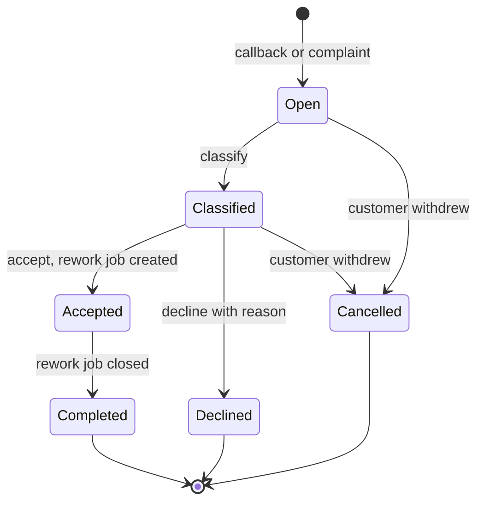

| # | From | To | Command or event | Allowed roles | Guards | Side effects | Rev. |
|---|---|---|---|---|---|---|---|
| RW1 | - | Open | `OpenReworkCase` | CSR, ADM; LWK for punch disputes after closure | The original job is Closed; before closure the issue is a punch item (Section 15) | Complaint linked | Yes: RW6 |
| RW2 | Open | Classified | `ClassifyRework` | ADM; the Quality Assistant drafts only | Code from the canonical list; **HUMAN REVIEW: attorney** for any warranty wording (no warranty policy exists; master §1.4) | - | Corr.: a superseding classification by ADM with reason, before acceptance |
| RW3 | Classified | Accepted | `AcceptRework` | ADM | - | Rework job (J1); visit planning; complaint updated | No (cancel the rework job instead, J24) |
| RW4 | Classified | Declined | `DeclineRework` | ADM | Reason; staff-released message with reviewed wording | A lead or estimate for new scope where the customer wants one | No (new evidence opens a new rework case) |
| RW5 | Accepted | Completed | Event `JobClosed` for the rework job | Inside the person's `CloseJob` of the rework job (J21, J22) | - | The linked complaint is flagged for CP7 | No |
| RW6 | Open, Classified | Cancelled | `CancelReworkCase` | CSR, ADM | Customer withdrew | - | No |

Terminal: Completed, Declined and Cancelled. Invalid: opening a rework case while the original job is not Closed (record a punch item instead); accepting before classification; a rework job created without a person's classification, or by AI (AIR-004: "Human decides acceptance, warranty position and disciplinary actions."). Timers: a case open longer than `<owner decision>` alerts CSR and ADM. Races: one rework job per case (key: case plus "create-job"); a customer withdrawal racing acceptance serializes on the case row.

## 14. Quality review (quality inspection)

PROPOSED DECISION D-06-16. Master §5 file 06 "Quality reviews"; 05 models the inspection header (worker self-check, supervisor inspection, reinspection) and per-criterion QA check results. QA-001: "Worker cannot mark complete without answering required checks or recording an exception."

### 14.1 States and rules

| State | Definition | Label |
|---|---|---|
| Required | An inspection is needed: a worker self-check at the completion request, a supervisor inspection when the service card or risk class requires one (Q-06-05), or a reinspection after a correction | PROPOSED |
| In progress | The inspector is recording a result per criterion (verified, failed, not inspected, not applicable) with evidence | PROPOSED |
| Passed | Every required criterion verified, or not applicable with a reason | PROPOSED |
| Passed with punch items | Non-safety criteria failed and were excepted by an authorized person, each creating a punch item ([27](27-roles-and-permissions.md) Section 6.3) | PROPOSED |
| Failed | A required criterion failed and was not excepted, or a safety-critical criterion failed | PROPOSED |
| Cancelled | No longer needed (job cancelled, or the inspection type no longer required), with reason | PROPOSED |

Rules:

- A completed inspection is frozen; a reinspection is a new record (05 immutability class F).
- "Not inspected" is never a pass ("Missing photos are unknown evidence, not proof of defective work."); an inspection cannot complete while a required criterion is "not inspected".
- The inspector of a supervisor inspection is never the performer of the work (05 DOM-032; AUTH-023; "Prevent a worker's self-check from replacing required supervisor inspection."). When only one person was on site, the [27](27-roles-and-permissions.md) Section 9 compensating control applies: the walkthrough outcome plus required photos, and owner review of the photos before closeout.
- Photos never establish hidden fasteners, structural adequacy, hazardous-material clearance or electrical safety (quality-assistant playbook).

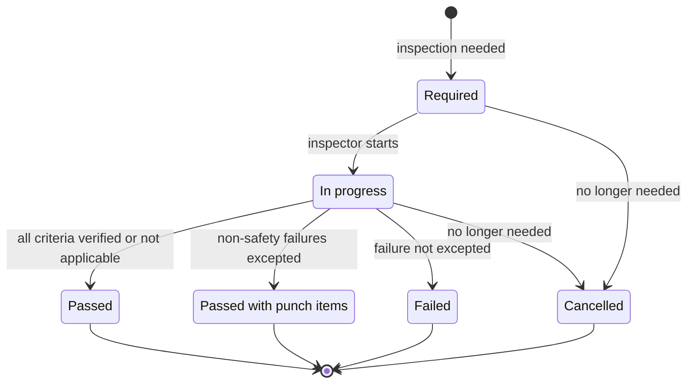

### 14.2 Transitions

| # | From | To | Command or event | Allowed roles | Guards | Side effects | Rev. |
|---|---|---|---|---|---|---|---|
| QR1 | - | Required | Events `WorkCompletionRequested` (self-check), `WorkCompleted` (supervisor inspection required), `CorrectionCompleted` (reinspection) | SYS; LWK or ADM may schedule a reinspection | - | - | - |
| QR2 | Required | In progress | `StartInspection` | The inspector: WKR (asg) for a self-check; LWK with qa-verify (not the performer) or ADM for a supervisor inspection or reinspection | Inspector eligibility; the SOP versions and checklist items in scope are pinned | - | - |
| QR3 | In progress | Passed, Passed with punch items or Failed | `CompleteInspection` | The inspector | Every required criterion answered with evidence (completion photos mapped to areas or tasks, QA-003); safety-critical criteria verified and never excepted; exceptions for non-safety criteria only by LWK with qa-verify (not the performer) or ADM, each with a punch item; a failed safety-critical criterion raises a critical hold and goes to Risk Triage (quality-assistant playbook: "Route suspected hazards to Risk Triage and stop affected work when appropriate.") | Inspection frozen; job transitions J14 (self-check), J17 or J18 (supervisor inspection); punch items (Section 15); audit P for supervisor verification | No: a reinspection is a new record |
| QR4 | Required, In progress | Cancelled | `CancelInspection` | ADM | Reason | - | No |

**Customer walkthrough (QA-004)** is a recorded outcome, not a machine: accepted, accepted with punch items, unavailable (with the attempt recorded) or disputed. "Customer acknowledgment is distinct from competent safety inspection and does not waive rights." Accepted with punch items creates punch items (AT-041, AT-042); disputed opens a complaint (CP1) and holds the automatic invoice draft; unavailable triggers the compensating control above. A walkthrough outcome is required before J19 (final invoice).

Invalid: a supervisor inspection by the performer (`GUARD_FAILED`, SoD); excepting a safety-critical check (`GUARD_FAILED`); completing with "not inspected" criteria (`GUARD_FAILED`); an AI role marking a criterion verified (`HUMAN_ONLY`; AIC-004 "AI must not fabricate completed inspections"); editing a completed inspection (frozen). Timer: a supervisor inspection pending longer than `<owner decision>` raises an alert.

Terminal: Passed, Passed with punch items, Failed and Cancelled; a reinspection is a new record. Races: one inspector writes an inspection (05 single writer); a completion request and a reinspection on the same work package serialize on the job row.

## 15. Punch item (STM-007)

PROPOSED DECISION D-06-17. QA-005: "Open punch items remain linked to the job with owner, due date and completion evidence. They cannot disappear when an invoice is issued." Quality-assistant playbook: a punch item has "location, defect, evidence, priority, remedy owner, due date and reinspection criterion".

### 15.1 States

| State | Definition | Label |
|---|---|---|
| Open | Recorded with location (work area or task), defect, evidence, priority and source (QA check, walkthrough, customer, staff) | FACT (STM-007) |
| Assigned | Remedy owner, due date (QA-005) and reinspection criterion set | FACT |
| Corrected | The assignee recorded the correction with after-evidence | FACT |
| Verified | Someone other than the corrector confirmed that the reinspection criterion is met | FACT |
| Closed | Verified and, for a customer-raised item, confirmed by the customer or the confirmation window lapsed with the attempt recorded | FACT |
| Disputed | The customer disputes the correction or whether the item is within scope | PROPOSED |
| Waived | ADM waived it with reason (the customer declines the correction; out of approved scope and moved to a change order; customer-caused; duplicate); never an item from a safety-related check | PROPOSED |

```mermaid
stateDiagram-v2
    [*] --> Open: punch item recorded
    Open --> Assigned: assign owner and due date
    Assigned --> Assigned: reassign
    Assigned --> Corrected: correction recorded
    Corrected --> Assigned: verification failed
    Corrected --> Verified: verified by another person
    Verified --> Closed: close
    Open --> Disputed: customer disputes
    Assigned --> Disputed: customer disputes
    Corrected --> Disputed: customer disputes
    Verified --> Disputed: customer disputes
    Closed --> Disputed: customer disputes, job still open
    Disputed --> Assigned: correction agreed
    Disputed --> Waived: waived with reason
    Open --> Waived: waived with reason
    Assigned --> Waived: waived with reason
    Closed --> [*]
    Waived --> [*]
```

### 15.2 Transitions

| # | From | To | Command or event | Allowed roles | Guards | Side effects | Rev. |
|---|---|---|---|---|---|---|---|
| PU1 | - | Open | `RecordPunchItem` | CUS (own; walkthrough or portal), WKR, LWK, SUB (asg), ADM; for an excepted or failed QA check, inside the excepting person's command (J14, QR3); accepted offline | Job not Cancelled or Closed (after closure, open a rework case, Section 13.2) | Visible to the customer when customer-raised or of customer-visible class; survives invoicing (QA-005, AT-041) | Yes: PU9 |
| PU2 | Open, Assigned | Assigned | `AssignPunchItem` | LWK (asg), ADM; DSP plans any return visit (visit purpose "punch") | Assignee, due date and reinspection criterion | Return-visit request where needed | - |
| PU3 | Assigned | Corrected | `RecordPunchCorrection` | The assignee (WKR, LWK, SUB; asg); accepted offline | After-evidence (photos) and a note | - | Yes: PU5 |
| PU4 | Corrected | Verified | `VerifyPunchItem` | LWK with qa-verify (not the corrector), ADM | Reinspection criterion met; evidence | Customer confirmation requested for a customer-raised item | - |
| PU5 | Corrected | Assigned | `RejectPunchCorrection` | LWK (not the corrector), ADM | Reason | - | - |
| PU6 | Verified | Closed | `ClosePunchItem` | Inside the verifier's PU4 for items not raised by the customer; CUS (own) confirms a customer-raised item. When the confirmation window lapses with the attempt recorded (`<owner decision>`, Q-06-08), the timer only flags the item and LWK (not the corrector) or ADM closes it, L1 with the attempt as evidence (a timer never closes a record, D-06-21) | - | Closeout criteria re-checked (D-06-19) | Yes: PU7 while the job is not Closed |
| PU7 | Open, Assigned, Corrected, Verified, Closed | Disputed | `DisputePunchItem` | CUS (own); ADM recording the customer's dispute | Reason (not corrected, quality, scope); the job is not Closed | CSR opens or links a complaint (CP1); NTF-011 suppressed | Yes: PU8, PU9 |
| PU8 | Disputed | Assigned | `ResolvePunchDispute` | LWK, ADM | Agreed correction | - | - |
| PU9 | Open, Assigned, Disputed | Waived | `WaivePunchItem` | ADM, L1 with reason | Reason code; never for an item from a safety-related check (it becomes a hold or a new inspection instead); scope items move to a change order or a new estimate | Linked change order or rework case; audit | No |

Invalid: verifying one's own correction (`GUARD_FAILED`, SoD); closing a punch item by issuing an invoice (no such effect; QA-005); deleting a punch item (no delete path); waiving an item from a safety-related check (`GUARD_FAILED`); disputing or reopening a punch item after the job is Closed (use a rework case); a customer acting on another customer's item (not found). Timers: the due date sets an overdue flag and alerts the assignee and LWK; the customer confirmation window is `<owner decision>`, and its lapse only flags the item for a person to close (PU6).

Terminal: Closed and Waived (a Closed item can still move to Disputed while the job is open, PU7). Races: a verification and a customer dispute on one item serialize on its row; `CloseJob` re-checks open punch items inside its transaction, so an item recorded a moment earlier blocks the close.

## 16. Supporting lifecycles

These lifecycles complete the list 05 Section 10 hands to this document. They follow the principles of Section 2; their tables are compact because their guards are simple or are owned by the cited document.

### 16.1 Notification delivery (COM-003)

| From | To | Trigger | Who | Notes |
|---|---|---|---|---|
| - | Draft | A notification event whose class has no owner-approved auto-send | SYS | Staff release required (owner fact L18; [33](33-ai-and-automation-governance.md) Section 12.6) |
| -, Draft | Queued | Approved auto-send class, or staff `ReleaseNotification` | SYS; CSR, DSP, BKP or ADM per event | Idempotency key: event, recipient contact and channel (05 DOM-051); active template version in the recipient's language (COM-001) |
| Queued | Held | A workflow, channel or class switch is off | SYS | Nothing is dropped ([33](33-ai-and-automation-governance.md) Section 12.7) |
| Held | Queued | Switch back on | SYS | Validity re-checked |
| Queued | Sent | The provider accepted the message | SYS | Validity re-checked first: nothing is sent for a superseded, cancelled or expired source ([33](33-ai-and-automation-governance.md) Section 12.4) |
| Sent | Delivered | The provider reports delivery where supported | SYS | COM-003 |
| Queued, Sent | Failed | Permanent error or retries exhausted | SYS | Exception item with an alternative-contact path (AT-055) |
| Failed | Queued | `RetryNotification` | CSR, DSP, ADM | The destination is checked first after an ambiguous outcome |
| Draft, Queued, Held, Failed | Cancelled | No longer valid, or a staff cancel | SYS; staff | Reason recorded |

### 16.2 Payment milestone

05's set (pending, due, invoiced, paid) is confirmed with one addition, Cancelled. Pending becomes Due only when its trigger is recorded (a work package or visit completed, a quality inspection passed, or a date) (05 DOM-062); Due becomes Invoiced when exactly one progress invoice bills it (I1, I2); Invoiced becomes Paid when that invoice's settlement is Paid (derived). Pending or Due becomes Cancelled when an applied change order replaces the schedule or the job is cancelled. No payment schedule is active until the owner and an attorney approve one (05 Q-05-10).

### 16.3 Work package, task and job item line

- **Work package** (05 new): Planned, Ready (its prerequisites met), In progress, Complete, Blocked (a hold on the package) and Removed (by an applied change order).
- **Task** (05 simple set confirmed): not started, in progress, done, skipped with reason, blocked; completion never erases notes, photos, measurements or exceptions (JOB-001).
- **Job item line readiness**: the [29](29-inventory-and-procurement.md) Section 6.3 diagram is adopted as canonical (Planned, Reserved, ToPurchase, AwaitingRental, AwaitingCustomer, Loaded, Exception, Verified, SubstitutionPending, Consumed, Reconciled, Costed, Rejected, Removed), including its rule that a safety-critical line leaves Exception only when the item itself is loaded (INV-009). Mapping: a critical line in Exception gives readiness Needs attention, a safety-critical one gives Blocked (Section 6.3); an unknown critical quantity gives Needs attention ([29](29-inventory-and-procurement.md) Section 4).

### 16.4 Site hazard and stop-work event

**Site hazard.** Identified → Controlled (controls recorded and reviewed); Identified or Controlled → Escalated (critical: raises a critical hold, Section 6.4) → Resolved (qualified release recorded); Identified → Not applicable (reviewer with reason); Controlled → Escalated when conditions change; Resolved → Identified when the hazard reappears with new evidence. A site hazard never overwrites its template and a template never overwrites it (AT-018). Reviewer: LWK or ADM; a critical hazard needs a qualified professional (**HUMAN REVIEW**).

**Stop-work event** (05 `StopWorkEvent`, which carries a resolution attribute but no lifecycle; PROPOSED). The guards of J4, J6, J8, J11, J14 and the closeout criteria depend on whether a stop is still open, so it gets one:

- Open → Resolved by `ResolveStopWork`. Guards: every hold raised from the stop is released or voided (Section 6.4); the resolution is recorded with reason and evidence; L1. The resolver is a person other than the reporter: LWK who did not report it, DSP or ADM, in line with [31](31-sop-standard.md) Section 8.3 rule 3 ("a lead worker never releases their own hold"). Online only, like other releases (Section 2.8). Effects: J11 when no visit is in progress; resuming on site still needs J6 with a fresh evaluation.
- Open → Voided by `VoidStopWork`, ADM, L2 with reason. Only for a duplicate or a record on the wrong job; never because the condition is disputed.
- Whether the reporting worker may resolve some non-critical triggers themselves (for example severe weather that has passed) is **OPEN QUESTION** Q-06-22 for the owner and the qualified safety professional. Until it is answered, they may not.
- No timer and no AI resolves a stop. Resolving a stop never closes a linked incident or condition report (05 DOM-031), and the stop-work event itself is kept (PERM-005).

### 16.5 Time-entry correction

Requested (by the worker) → Approved or Rejected by ADM, never by the worker for their own entry ([27](27-roles-and-permissions.md) Section 9). Original time events never change; an approved correction is a new event that references the original (05 DOM-029). **HUMAN REVIEW: payroll professional** for the timekeeping policy (Q-06-17).

### 16.6 Controlled content (PROPOSED DECISION D-06-22)

Canonical lifecycle: Draft → In review → (Changes requested → In review) → Approved → Active → Superseded or Retired; Suspended for safety-relevant content; Withdrawn before activation. "Active" in 05 and 27 is the same state as "Effective" in [31](31-sop-standard.md).

| Content | Review evidence before Approved | Suspended allowed | Source of the detailed lifecycle |
|---|---|---|---|
| SOP version with its steps and checklist items | Competent review, Spanish review and owner approval as review sign-offs | Yes: a safety trigger; starts for the service become BLOCKED | [31](31-sop-standard.md) Section 5.2 (D-31-05) |
| Service card version | Qualified trade and safety reviewers | Yes | 05 |
| Hazard template | Qualified safety professional | Yes | 05 |
| Agreement template version | Attorney approval (its review step is called Legal review) | No; retire instead | [30](30-service-agreement-standards.md) Section 9.3 |
| Price book version | Owner approval with step-up; becomes Active at its effective date; may be Withdrawn before that | No | [28](28-pricing-estimating-and-job-costing.md) Section 10.2 |
| Business policy version, service-area rule, labor cost rate | Owner approval; attorney or CPA review where the key needs it | No | 05 |
| Notification template version | Preview, plus bilingual review for critical text | No | 05 (adds a Previewed step); COM-001 |
| Translation entry | Qualified bilingual reviewer | No | 05; COM-006 |
| Item, kit | Safety reviewer for hazardous, PPE and rated items | No | [29](29-inventory-and-procurement.md) Section 6.3 |
| Role policy version | Owner approval with step-up | No | 05; [27](27-roles-and-permissions.md) AUTH-002 |

Rules: one Active version per content key and scope at any effective time; Active, Superseded, Suspended and Retired versions are immutable (05 DOM-006); activation is ADM L2 and suspension ADM L1, because suspension strengthens safety ([27](27-roles-and-permissions.md) Section 6.2; [31](31-sop-standard.md) Section 5.1); restoring a Superseded SOP version needs the recorded competent review [31](31-sop-standard.md) Section 5.2 requires, never a role decision alone.

### 16.7 Service activation and user account

- **Service** (05 new): Inactive → Active (owner as ADM, L2, when the bookability inputs of 05 DOM-007 hold) → Inactive (ADM). "Bookable" is computed and turns false at once when an input fails (for example the primary SOP version is suspended). The public web status is a separate field ([32](32-website-and-customer-experience.md) WEB-006).
- **User account** (05 new): Invited → Active → Disabled → Active (re-enable, ADM L2); an expired invitation is reissued, which invalidates the old one. Procedures are in [27](27-roles-and-permissions.md) Section 8; disabling is L1 so it is never delayed.

### 16.8 Purchase and expense

- **Purchase**: the [29](29-inventory-and-procurement.md) Section 6.3 states are adopted (Draft, Submitted, Approved, Purchased, Received, Closed, or Cancelled); a within-limit field purchase may go from Draft to Purchased with a receipt; above the owner-set limit ADM approves (FIN-007; no limit is set, Q-27-04).
- **Expense** (P1): Submitted → Approved → Reimbursed, or Rejected; BKP records, ADM approves above the limit, nobody approves their own.

### 16.9 AI output record, automation run and exception item

- **AI output record** (P1): the [33](33-ai-and-automation-governance.md) Section 7.4 lifecycle is adopted as canonical (Generated, Withheld, Draft, Under review, Applied, Rejected, Expired, Frozen); 05's simple set (draft, applied, rejected, expired) is its subset. Applied means a person applied it through their own permissions; until then it changes no record (AIC-001).
- **Automation run**: Pending → Succeeded, or Retrying → Failed → Dead-lettered, which opens an exception item.
- **Exception item** ([33](33-ai-and-automation-governance.md) Section 12.5): Open → In progress → Resolved, or Abandoned with reason; never discarded silently.

### 16.10 P1 lifecycles (deferred)

| Lifecycle | Proposed states | Blocked by |
|---|---|---|
| Recurring service plan | Draft, Active, Paused, Ended | 05 Q-05-01; [28](28-pricing-estimating-and-job-costing.md) Q-28-18; **HUMAN REVIEW: attorney** for subscription terms |
| Subcontractor onboarding | Not eligible, Prerequisites recorded, Active, Ended | NEAR-004; HND-007; [27](27-roles-and-permissions.md) AUTH-030 |
| Equipment asset | The [29](29-inventory-and-procurement.md) Section 6.3 tool-asset states (Available, Reserved, Checked out, Returned, Quarantined, In repair, Retired, Lost) | 05 Q-05-12 |
| Rental agreement | The [29](29-inventory-and-procurement.md) Section 6.3 states (Requested, Approved, Booked, Out, Returned, Reconciled, Closed; damage-claim branch) | Rental terms (**HUMAN REVIEW: attorney, insurance broker**) |

### 16.11 Short status sets from 05 (confirmation)

| Entity | 05 `simple:` set | This document |
|---|---|---|
| Session and registered device | active, revoked | Confirmed |
| Worker | active, inactive | Confirmed |
| Employee | active, ended | Confirmed |
| Qualification | pending, verified, expired, revoked | Confirmed; "expired" follows the expiry date and feeds the START-010 check |
| Customer | active, inactive, merged | Confirmed; merge only by a CSR or ADM decision |
| Contact | active, inactive | Confirmed |
| Property | active, inactive | Confirmed |
| Access secret | active, cleared | Confirmed; a one-time secret is cleared at J21 |
| Duplicate candidate | open, merged, not a duplicate | Confirmed (LD9) |
| SDS document | current, superseded | Confirmed |
| Pricing exception | requested, approved, rejected | Amended: add "withdrawn" when its estimate version is discarded (E11) |
| Referral (P1) | open, communicated, closed | Confirmed |
| Job assignment | active, ended | Confirmed |
| Availability block | requested, approved, cancelled | Amended: add "rejected" |
| Task | 05 attributes | Confirmed (Section 16.3) |
| Emergency stabilization record | recorded, reviewed | Confirmed (Section 8.3) |
| Substitution | proposed, approved, rejected | Amended: add "withdrawn" |
| Lessons-learned tag | proposed, accepted, actioned | Amended: add "rejected" |
| Stock location (P1) | active, inactive | Confirmed |
| Stock lot (P1) | active, expired, consumed | Confirmed |
| Asset reservation (P1) | held, released | Confirmed |
| Vendor, vendor item (P1) | active, inactive | Confirmed |
| Payment milestone | pending, due, invoiced, paid | Amended: add "cancelled" (Section 16.2) |
| Bank deposit batch | prepared, deposited, confirmed | Confirmed; a batch total that the bank does not match becomes a reconciliation exception (RC2) |
| File object | pending, available, quarantined, disposed | Confirmed |
| Job packet export | generated, expired | Confirmed |
| AI output record | draft, applied, rejected, expired | Amended to the [33](33-ai-and-automation-governance.md) Section 7.4 set (Section 16.9) |
| Automation run | 05 attributes | Confirmed (Section 16.9) |

### 16.12 Privacy request and legal hold (from 13)

[13](13-privacy-data-governance.md) hands these two lifecycles to this document; both are confirmed with the guards below. Procedures, response templates and retention effects belong to [13](13-privacy-data-governance.md) Sections 7.4 and 8 (**HUMAN REVIEW: attorney licensed in KY and/or IN** for deadlines, exceptions and hold scope).

- **Privacy request** (PRIV-019): Received → Verifying → In progress → Responded → Closed; Verifying → Closed with outcome "unverified" when verification through the contact on file fails ([13](13-privacy-data-governance.md) Section 8.3). CSR records intake; ADM decides and executes, with L2 step-up for copies and erasure ([27](27-roles-and-permissions.md) Section 6.2); a request that would change the contact on file is never fulfilled in the same interaction; erasure runs only through the audited procedure and skips records under legal hold; AI drafts searches and redactions only. Timer: the legal deadline is `<owner decision: deadline set on the attorney's advice>` and the internal target `<owner decision>`; an overdue request raises an alert, never an automatic response.
- **Legal hold** (PRIV-018): Active → Released. ADM places a hold on attorney advice, or at once on a trigger with attorney review to follow; CSR and LWK may request one; placing and releasing need L2 and are audited; release happens only on attorney instruction. While a hold is Active, disposal and erasure of every record in its scope are refused (05 Section 2.5: "A legal hold suspends disposal in every class"); the business machines of this document continue normally.

## 17. Reconciliation with spec STM-001..STM-007

### 17.1 State by state

"Kept" means the spec state exists here with the same meaning (**FACT**). Every other disposition is **PROPOSED** and needs owner approval (Q-06-16).

| Spec | Spec state (FACT) | In this document | Disposition | Label | Reason |
|---|---|---|---|---|---|
| STM-001 | New | New | Kept | FACT | - |
| STM-001 | Contacted | Contacted (logged two-way contact; NTF-001 excluded) | Kept; definition added | PROPOSED (definition) | CX-002 |
| STM-001 | Qualified | Qualified (coverage, services, minimum disclosure, triage, route) | Kept; guards added | PROPOSED (guards) | STG-003; CX-001 |
| STM-001 | Estimate Needed | Derived sub-status of Qualified | Moved to a derived value | PROPOSED | One fact, one owner: the Estimate machine (05 Section 5.3) |
| STM-001 | Estimate Sent | Derived sub-status of Qualified | Moved to a derived value | PROPOSED | As above |
| STM-001 | Converted | Converted, set only by the approval event | Kept; trigger defined | PROPOSED (trigger) | Owner fact L18; AUTH-026 |
| STM-001 | Lost | Lost: ended after an offer | Kept; definition added | PROPOSED (definition) | The spec does not say how Lost differs from Closed; RPT-001 needs loss reason codes |
| STM-001 | Closed | Closed: ended before an offer | Kept; definition added | PROPOSED (definition) | As above |
| STM-001 | - | Merged, Spam, Not serviceable; derived Assessment scheduled; reopen | Added | PROPOSED | LAUNCH-002; WEB-018; AT-003; STG-003 |
| STM-002 | Draft | Draft | Kept | FACT | - |
| STM-002 | Internal Review | Internal review with automated checks and the "awaiting exception" sub-status | Kept; checks added | PROPOSED (checks) | FIN-001; EST-004; AT-007 |
| STM-002 | Sent | Sent (frozen, packet, valid-until) | Kept | FACT | EST-006; D-28-13 |
| STM-002 | Viewed | Viewed, recorded only from verified opens | Kept; recording rule added | PROPOSED (rule) | Privacy (Q-06-02) |
| STM-002 | Approved | Approved | Kept | FACT | CX-003 |
| STM-002 | Declined | Declined | Kept | FACT | - |
| STM-002 | Expired | Expired, by server time and timer | Kept; timer rule added | PROPOSED (timer) | EST-001; PRC-012 |
| STM-002 | Revised/Superseded | Superseded (state) and `ReviseEstimate` (command) | Split | PROPOSED | A state and an action were merged |
| STM-002 | Approved → Revised/Superseded | Not allowed after conversion; change order instead | Restricted | PROPOSED | CX-003; FIN-008; G-033; 05 Q-05-15 (Q-06-03) |
| STM-002 | - | Withdrawn, Discarded, Voided | Added | PROPOSED | 05 Section 10; [27](27-roles-and-permissions.md) Section 6.2 |
| STM-003 | Preparation | Preparation | Kept | FACT | - |
| STM-003 | Ready | Readiness value Ready (computed) | Moved to the readiness dimension | PROPOSED | SCH-001 allows scheduling before readiness (G-033) |
| STM-003 | Scheduled | Visit Confirmed; staff label "Scheduled" | Moved to the Visit machine | PROPOSED | A job can need several visits; CX-002 |
| STM-003 | En Route | Visit En route | Moved | PROPOSED | SCH-006 is per visit |
| STM-003 | Arrived | Visit Arrived | Moved | PROPOSED | As above |
| STM-003 | Started | Started - Working | Kept | FACT | START-014 |
| STM-003 | Paused/Blocked | Started - Paused and Started - Blocked, each with resume transitions | Split | PROPOSED | JOB-002 pause versus START-011 stop-work |
| STM-003 | Work Complete | Work complete (J14 guards) | Kept; guards added | PROPOSED (guards) | QA-001..QA-003 |
| STM-003 | QA/Punch | Quality review; punch items on their own machine | Renamed and split | PROPOSED | AT-041 lets punch items outlive this step |
| STM-003 | Customer Closeout | Customer closeout | Kept | FACT | QA-004; QA-006 |
| STM-003 | Invoiced | Invoiced: final invoice issued | Kept; definition added | PROPOSED (definition) | FIN-003 progress invoices (G-094) |
| STM-003 | Closed | Closed with closeout criteria and lock | Kept; criteria added | PROPOSED (criteria) | QA-011; APXA-007; 05 Q-05-09 (Q-06-04) |
| STM-003 | - | Between visits, On hold, Cancelled | Added | PROPOSED | Multi-visit jobs; CX-006; G-033 |
| STM-003 | - (pre-start block) | Visit No start with a stop-work event; job unchanged | Added | PROPOSED | SCH-008; AT-030 |
| STM-004 | Draft, Internal Review, Sent, Approved, Declined, Superseded | Same names | Kept | FACT | - |
| STM-004 | Applied | Applied only by SYS, in one transaction with the next scope snapshot | Kept; trigger defined | PROPOSED (trigger) | DOM-018; AT-032 |
| STM-004 | - | Requested, Expired, Withdrawn, Void | Added | PROPOSED | AT-033; 05 Section 10 |
| STM-005 | Draft, Issued | Same names (document dimension) | Kept | FACT | FIN-003 |
| STM-005 | Partially Paid | Derived settlement value | Moved | PROPOSED | Settlement is computed from allocations |
| STM-005 | Paid | Derived: Paid pending clearance and Paid | Split | PROPOSED | Owner fact L10; G-039 |
| STM-005 | Past Due | Derived due flag, independent of settlement | Moved | PROPOSED | A partly paid invoice can be past due |
| STM-005 | Void/Adjusted according to policy | Void (document state); adjustments are credit applications and write-offs, not states | Split | PROPOSED | Two outcomes were merged (FIN-006) |
| STM-005 | - | Discarded; Written off (derived); delivery dimension; dispute sub-machine | Added | PROPOSED | RECT-009; G-039; [28](28-pricing-estimating-and-job-costing.md) Section 11.5 |
| STM-006 | Reported, Triaged, Action Required, Follow-up, Closed | Same names | Kept | FACT | JOB-008 |
| STM-006 | Closed | Closed by ADM only, against a checklist | Kept; authority added | PROPOSED (authority) | [27](27-roles-and-permissions.md) Section 4.6 |
| STM-006 | - | Under external review, Voided, escalation level, no-action path, reopen | Added | PROPOSED | Master §7 incident lifecycle |
| STM-007 | Open, Assigned, Corrected, Verified, Closed | Same names | Kept | FACT | QA-005 |
| STM-007 | - | Disputed, Waived, verification-failed path, customer confirmation | Added | PROPOSED | 05 Section 10; quality-assistant playbook |

### 17.2 Machines the master requires that the spec lacks

| Master §5 file 06 item | Spec | This document | Label |
|---|---|---|---|
| Payments | None (ENT-017 fields only) | Section 10 | PROPOSED (G-092) |
| Customer complaints | None (CX-007 linkage only) | Section 13.1 | PROPOSED (G-092, G-098) |
| Quality reviews | None (ENT-015 per-criterion result only) | Section 14 | PROPOSED (G-092) |
| Deposits, refunds and credits ("where needed" in this document's brief) | None | Section 11 | PROPOSED (G-086, G-152) |

### 17.3 Changes suggested for the spec (RECOMMENDATION)

This document edits no vault file. If the owner adopts these machines (Q-06-16), [36](36-file-modification-plan.md) and [25](25-change-log.md) carry the change to spec §14.1: keep the seven ID keys, replace the STM-003 and STM-005 lists with the dimension split of Sections 6 and 9 (or add a note that 06 refines them), add lines for Payment, Customer complaint and Quality review, and add the Lead outcomes Merged, Spam and Not serviceable. Until then the spec's lists remain the baseline and this document records every difference as PROPOSED.

## 18. Cross-machine reactions, labels, notifications, races and timers

### 18.1 Reactions

All reactions run through the transactional outbox with idempotent consumers (SMR-006).

| Trigger | Reactions | Executed by | Idempotency key |
|---|---|---|---|
| `CustomerApprovalRecorded` (E6) | Lead Converted (LD6); job created (J1); deposit requirement evaluated (DR1); packet Accepted; other drafts Discarded; one scheduling task | SYS workflow 2 | Estimate version plus "create-job" |
| `ChangeOrderApproved` (CO6) | CO7 Applied: scope snapshot, briefing snapshot, acknowledgements superseded, milestones recomputed where applicable | SYS workflow 2 | Change-order version plus "apply" |
| Any other briefing input changed | New briefing snapshot with a change summary; re-acknowledgement at the next start or resume where scope or hazards changed | SYS | Snapshot content hash |
| `HoldRaised` | Readiness recomputed; a started job to Blocked when the hold's scope covers the job or the visit (J5, J10), otherwise its tasks locked; queue item; stop notice to workers on site | SYS workflows 3 and 7 | Hold identifier |
| `HoldReleased` | Readiness recomputed; J11 where no visit is in progress | SYS workflow 3 | Hold identifier |
| SOP version suspended | A prerequisite hold on every job using it; started jobs Blocked ([31](31-sop-standard.md) Section 5.2: "Start gate BLOCKED for the service; scheduled jobs flagged") | SYS | SOP version plus job |
| Payment cleared, returned, voided or reversed | Deposit DR3 or DR4; invoice settlement and due status recomputed; readiness and closeout criteria re-checked | SYS | Payment status-event identifier |
| `WorkCompleted` (J14) | Supervisor inspection (QR1) or Customer closeout (J16); NTF-009 draft | SYS | Job plus completion event |
| Job enters Customer closeout | Final invoice draft (I1, the invoice point) | SYS workflow 6 | Job, invoice kind and source versions |
| Payment milestone Due | Progress-invoice draft (I1) | SYS workflow 6 | Milestone identifier |
| Final invoice issued | Job Invoiced (J19); deposit Applied (DR6), or ended with nothing held (DR11) | SYS inside I2 | Invoice identifier |
| Job cancelled (J24, J25) | Visits cancelled; open change orders withdrawn; deposit DR7 or DR11; refund review items; access windows closed | SYS; DSP for customer messages | Job plus cancel event |
| Complaint recorded (CP1) | NTF-011 suppressed; invoice dispute for billing complaints; incident prompt for damage or injury | SYS workflow 7 | Complaint identifier |
| Injury or suspected hazardous-material incident during a started job | Job Blocked (J5); owner alert | SYS workflow 7 | Incident identifier |
| Rework case accepted (RW3) | Rework job created (J1) | SYS on the ADM command | Rework case identifier |
| Job closed (J21, J22) | Retention clocks; access secrets cleared unless kept on instruction; NTF-011 scheduled when no case is open | SYS | Job plus close event |

### 18.2 Display labels

Staff screens show labels derived from the dimensions, so the spec's names stay visible without being stored as job states.

| Job lifecycle | Current visit | Readiness | Staff label | Spec state it covers |
|---|---|---|---|---|
| Preparation | None or Requested | Any | Preparing (with readiness badge) | Preparation |
| Preparation | Tentative | Any | Tentatively scheduled | SCH-001 |
| Preparation | Confirmed | Ready | Scheduled, ready | Ready; Scheduled |
| Preparation | Confirmed | Needs attention or Blocked | Scheduled, needs attention / blocked | Scheduled |
| Preparation | En route | Any | En route | En Route |
| Preparation | Arrived | Any | Arrived | Arrived |
| Preparation | Latest visit No start | Blocked | No start, awaiting decision | SCH-008 |
| Started - Working / Paused / Blocked | In progress or none | - | In progress / Paused / Blocked | Started; Paused/Blocked |
| Started - Between visits | None, Tentative or Confirmed | Any | Between visits (next visit date, or "not scheduled") | - |
| On hold | - | - | On hold (reason) | - |
| Later states | - | - | Same name | Same |

Customer-facing labels (portal and messages) never show internal hazard detail (NTF-007 "internal hazard details may remain private") and never say "booked" before a confirmation (CX-002). Final wording and Spanish text belong to [10](10-frontend-ux-plan.md) and [32](32-website-and-customer-experience.md), with reviewed translations (COM-006).

| Internal state | Customer sees (PROPOSED meaning, not final copy) |
|---|---|
| Lead New, Contacted or Qualified | Request received; estimate in preparation |
| Site-assessment visit Confirmed | Assessment visit confirmed (date and window) |
| Estimate version Sent or Viewed | Estimate ready for review, with its valid-until date |
| Estimate version Expired, Superseded or Withdrawn | No longer valid (and the newer version, if any) |
| Visit Requested or Tentative | Requested time, not yet confirmed |
| Visit Confirmed with the confirmation sent or logged | Appointment confirmed |
| Visit En route | On the way |
| Job Started - Working or Paused | Work in progress |
| Job Started - Blocked, On hold, or visit No start | Work paused; we will contact you about next steps |
| Job Work complete or Quality review | Work complete; final checks |
| Job Customer closeout | Walkthrough and completion |
| Change order Sent | Change awaiting your approval |
| Invoice settlement Unpaid or Partially paid | Balance due |
| Invoice settlement Paid pending clearance | Payment received, processing |
| Invoice settlement Paid | Paid |
| Punch item Open to Verified | Follow-up item in progress |
| Complaint in any open state | We are reviewing your concern |

### 18.3 Notification map (NTF-001..NTF-011)

| Event | Triggering transition | Send mode ([33](33-ai-and-automation-governance.md) Section 12.6) | Suppressed or invalid when |
|---|---|---|---|
| NTF-001 Lead received | LD1 | Automatic only under an approved class, otherwise staff release; held while spam is suspected | Spam confirmed; cutoff `<owner decision>` |
| NTF-002 Estimate ready | E4 | Part of the estimator's send | - |
| NTF-003 Estimate reminder | Timer while Sent or Viewed | Staff release until the class is approved | Approved, Declined or Expired (spec NTF-003); Superseded or Withdrawn (PROPOSED) |
| NTF-004 Appointment confirmation | V3, V4 | Transmitted after the dispatcher's confirm | The visit's window changed again |
| NTF-005 Appointment reminder | Timer before a Confirmed visit | Staff release first; automatic candidate later | Visit started, cancelled or rescheduled |
| NTF-006 En route or delay | V5; V4 for ETA | Owner chooses send on tap or a draft (Q-33-04) | The window ended or a newer ETA exists |
| NTF-007 Work blocked | V10, J5, J12, a BLOCKED or REQUIRES_ADMIN_REVIEW outcome | Always released by DSP or ADM | - |
| NTF-008 Change order | CO5 | Part of the estimator's send | Superseded or withdrawn |
| NTF-009 Completion | J14 | Draft for worker or admin release until care templates are approved (QA-008) | - |
| NTF-010 Invoice or receipt | I2; PY1 | Part of the human issue or record action | - |
| NTF-011 Follow-up | After J21, at the configured time | Staff release first | Any complaint or rework case open for the customer (QA-009) |

Legally sensitive notices (collections and late fees, cancellation fees, deposit retention, refund decisions, warranty positions, damage and incident responses, disputes) are never sent by an automatic transition ([33](33-ai-and-automation-governance.md) Q-33-05; **HUMAN REVIEW: attorney**).

### 18.4 Race-condition catalog

| # | Race | Resolution | Section |
|---|---|---|---|
| 1 | Approval of version 1 against the send of version 2 | Estimate row lock; the first commit wins | 5.7 |
| 2 | Approval against expiry | Server time inside the approval transaction | 5.7 |
| 3 | Duplicate approval or replayed approval event | Idempotency key and unique constraints; one job | 5.7; J1 |
| 4 | Marking a lead Lost against an approval | Open-offer guard; estimate row lock | 4.6 |
| 5 | Crosswise lead merges | Locks in identifier order | 4.6 |
| 6 | Overlapping visit confirmations for one worker | Storage-level exclusion; override record | 6.2 |
| 7 | Start against a hold, cancellation, reassignment or SOP suspension | Job row lock; gate evaluated inside the transaction | 6.1 |
| 8 | Offline start, arrival or completion against an office change | Re-validation at sync; review item; safety facts kept | 2.8; 7.4 |
| 9 | Two change orders approved together | Serialized application; rebase; exception on conflict | 8.5 |
| 10 | Invoice issue against a pending change-order application | Issue refused until applied | 9.5 |
| 11 | Concurrent allocations exceeding a total | Row locks on invoice and payment | 9.5; 10.5 |
| 12 | Refund against a credit application on the same credit | Credit row lock; refundable amount re-checked | 11.2 |
| 13 | Check returned after the job closed | BKP alert; ADM reopen decision | 10.5 |
| 14 | Reconciliation sign-off against a later return | Exception in the next sign-off | 10.3 |
| 15 | Complaint recorded while a follow-up message is queued | Validity re-checked at send | 13.1; 16.1 |
| 16 | A punch item verified by its corrector | SoD guard | 15.2 |
| 17 | A message for a record that changed meanwhile | Validity re-checked at send | 16.1 |
| 18 | Two workers starting the same visit | Personal start events; the job moves once | 6.1 |
| 19 | A reassignment against the removed worker's pause, completion or offline sync | Job row lock; the removed worker's later commands are refused or quarantined for ADM (J27, AUTH-033) | 6.1 |

### 18.5 Timer catalog

Every value is an owner decision; this document sets none (D-06-21).

| Timer | Machine | Effect | Value |
|---|---|---|---|
| First-response expectation; stale lead | Lead | Alert; review list | `<owner decision>` (Q-06-01) |
| Valid-until | Estimate | Expired | `<owner decision>` ([28](28-pricing-estimating-and-job-costing.md) Q-28-11) |
| Reminder schedule | Estimate | NTF-003 | `<owner decision>` |
| Validity | Change order | Expired | `<owner decision>` (Q-06-11) |
| Reminder lead time; late grace; tentative hold age | Visit | NTF-005; late flag; alert | `<owner decision>` |
| Pause limit; blocked, between-visits and on-hold reviews | Job | Alerts | `<owner decision>` (Q-06-17); review date per hold |
| Supervisor inspection pending | Quality review | Alert | `<owner decision>` |
| Due date; customer confirmation window | Punch item | Overdue flag; "ready to close" flag after a recorded attempt (a person closes, PU6) | Per item; `<owner decision>` (Q-06-08) |
| Due date | Invoice | Past due flag | Payment-terms policy ([28](28-pricing-estimating-and-job-costing.md) Q-28-10) |
| Clearance wait; custody wait; reconciliation cadence | Payment | BKP and ADM alerts | `<owner decision>` ([27](27-roles-and-permissions.md) Q-27-03; [28](28-pricing-estimating-and-job-costing.md) Q-28-25) |
| Awaiting approval | Refund, credit | Alert | `<owner decision>` |
| Acknowledgement and resolution targets | Complaint | Overdue alerts | `<owner decision>` (Q-06-09) |
| Triage target | Incident | Alert | `<owner decision>` with a qualified safety professional |
| Message validity | Notification | Cancelled when invalid | [33](33-ai-and-automation-governance.md) Section 12.4 |

## 19. PROPOSED SMR requirements

Every `SMR-` item is a **PROPOSED** requirement introduced by this document. Tier P0 supports a launch-critical capability (LAUNCH-001..LAUNCH-009); P1 follows NEAR-001..NEAR-004. Hooks refer to Section 20; [16](16-testing-quality-strategy.md) assigns the TC IDs.

| ID | Requirement (PROPOSED) | Tier | Basis | Hook |
|---|---|---|---|---|
| SMR-001 | No API, screen, import, report tool, AI tool or SYS workflow writes a status field directly; statuses change only through the named commands and declared reactions of this document; direct database edits happen only through the audited break-glass path. | P0 | NFR-020; master §5 file 06; [27](27-roles-and-permissions.md) Section 3.3 | 1, 2 |
| SMR-002 | Machine definitions (states, commands, from-states, guards, roles, side effects) are declarative data evaluated by one server-side transition service; clients render only the commands the server reports as available; invalid commands return the Section 2.3 error codes. | P0 | NFR-020; AUTH-001 | 1 |
| SMR-003 | Every transition appends a transition record with the Section 2.5 fields in the same transaction as the state change; protected transitions also write the [27](27-roles-and-permissions.md) Section 6.4 audit event, and a failed audit write fails the transition. | P0 | NFR-008; RECT-011; AT-057 | 3 |
| SMR-004 | Every command carries an idempotency key scoped to actor, command type and target; a replay with the same payload returns the original result with no new effect; the same key with a different payload is rejected. | P0 | NFR-012; AT-054 | 4 |
| SMR-005 | Every aggregate root has a version; commands carry the expected version; a mismatch is rejected as `STALE_VERSION` with the current state; no status uses last-write-wins. | P0 | Owner fact L18 | 5 |
| SMR-006 | Domain events are written to a transactional outbox in the transition's transaction; consumers are idempotent by event ID and process each aggregate's events in version order; a missing prerequisite becomes an exception item. | P0 | NFR-012; [33](33-ai-and-automation-governance.md) Section 12.4 | 6 |
| SMR-007 | The cross-record invariants of Section 2.4 are enforced at the storage boundary (unique, exclusion or check constraints, or row locks in a fixed order), not only in application code. | P0 | 05 DOM-016, DOM-021, DOM-044; swe-architecture | 7, 66 |
| SMR-008 | Timer transitions run under a SYS scheduler identity, use server UTC time and the configured business or property zone for local dates, and are re-checked inside the commands that depend on them; timers never clear money, release job holds, resolve stop-work events, close records or send legally sensitive notices (an owner-configured release of an aged tentative slot is not a job hold). | P0 | NFR-020; D-06-21 | 8 |
| SMR-009 | Terminal states are immutable; only the void, reverse, supersede, reopen and resume transitions listed here leave them, with reason and the [27](27-roles-and-permissions.md) Section 6.2 control level. | P0 | PERM-005; REC-001; FIN-006; QA-011 | 9 |
| SMR-010 | Derived values (lead estimate progress, estimate container status, readiness, invoice settlement, due and delivery status, deposit satisfaction, credit application status) are computed from source records, cannot be the target of a command, and any stored copy can be rebuilt to the same result. | P0 | 05 DOM-019, DOM-044 | 10 |
| SMR-011 | An override is a separate command that creates an override record with the pre-override state and a queue item; the gates Section 2.6 marks non-overridable have no override command for any role. | P0 | PERM-006; AUTH-011; AUTH-012 | 11 |
| SMR-012 | The human-only commands of Section 2.6 refuse AI and SYS identities and log the attempt; SYS performs only the reactions [27](27-roles-and-permissions.md) Section 10.4 declares (plus the Section 21 additions once 27 confirms them); a step that commits inside a person's command is attributed to that person. | P0 | AIC-004; AIC-005; DOM-055; AUTH-003; AUTH-026 | 12 |
| SMR-013 | Offline field commands keep their idempotency key, client time and seen version; at sync they are re-authorized and re-validated; rejected ones become review items, never silent writes; stop-work events, condition reports and incidents are always stored even when their implied transition is rejected. | P0 (rules); P1 (sync hardening, NEAR-001) | START-012; NFR-005; DOM-030; AUTH-033 | 13 |
| SMR-014 | States and reason codes are stored as language-neutral codes; the same commands in Spanish and English produce identical states, codes and records. | P0 | PERM-007; NFR-010 | 14 |
| SMR-015 | A guard that depends on an owner policy without an active version fails closed with `POLICY_NOT_CONFIGURED`, or raises the flag this document names; it never passes silently. | P0 | Owner fact L20; 05 Section 2.1 | 15 |
| SMR-016 | Lead lifecycle: stored states New, Contacted, Qualified, Converted, Lost, Closed, Merged, Spam, Not serviceable; Estimate needed, Assessment scheduled and Estimate sent are derived; Converted is set only by a recorded customer approval. | P0 | STM-001; LAUNCH-002 | 16 |
| SMR-017 | A lead is marked Lost only after an offer and with no version Sent or Viewed, and Closed only when no offer exists; both need reason codes; qualification needs a recorded minimum-charge disclosure. | P0 | RPT-001; CX-001; AT-001 | 16, 17 |
| SMR-018 | Possible duplicates are recorded as candidates and merged only by CSR or ADM; the surviving lead holds both requests with provenance; the merged lead is terminal; people are never merged only for a shared address or phone. | P0 | LAUNCH-002; WEB-024; DOM-005 | 18 |
| SMR-019 | Spam-suspected requests are stored and reviewed and never receive NTF-001; out-of-coverage leads end Not serviceable with a non-confirming message; both can be reopened. | P0 | WEB-018; AT-003; CX-002 | 19 |
| SMR-020 | Estimate versions follow Section 5: frozen when Sent, immutable when Approved, at most one open draft per estimate, a revision reason for each new version, all versions retrievable. | P0 | EST-006; DOM-010; AT-005 | 20 |
| SMR-021 | `SendEstimate` requires the Section 5.4 checks, every required pricing exception approved by ADM, a rendered packet, an authorized recipient and an active validity policy; AI and SYS cannot send. | P0 | FIN-001; AT-006; AT-007; AT-053; AGR-026 | 21 |
| SMR-022 | `ApproveEstimate` succeeds only for the current, unexpired, unsuperseded version with a matching packet hash and an authorized, re-verified approver, online, once per version; it creates exactly one job and discards the estimate's other drafts. | P0 | CX-003; DOM-011; DOM-016; AUTH-027 | 20, 22 |
| SMR-023 | Expiry is checked against server time at approval as well as by the timer; NTF-003 reminders stop on approval, decline, expiry, supersede and withdrawal. | P0 | EST-001; NTF-003; PRC-012 | 8, 23 |
| SMR-024 | After an approval is converted, scope and price change only through change orders; `VoidApproval` is ADM L2, only before the first start event, and cancels the job. | P0 | FIN-008; CX-003; D-06-04 | 24 |
| SMR-025 | The job stores only the Section 6.1 lifecycle; readiness and visit status are separate; Ready, Scheduled, En Route and Arrived are never job states. | P0 | STM-003; SCH-001; DOM-019 | 25 |
| SMR-026 | One customer approval creates exactly one job with scope snapshot version 1, whatever the retries or duplicate events. | P0 | DOM-016; AT-010; AT-054 | 26 |
| SMR-027 | Work starts only through `StartWork` by an assigned worker with a passing start-gate evaluation on the current briefing snapshot for that visit; each worker's start is personal; the start event records the START-014 data. | P0 | START-001; START-014; AT-014; DOM-024 | 27 |
| SMR-028 | Resuming after a pause needs no active hold and viewed briefing changes; resuming after Blocked needs every related hold released and a fresh evaluation. | P0 | JOB-002; START-002; AT-027 | 28 |
| SMR-029 | `RecordStopWork` is available to every assigned field role in every Started sub-state and in visits En route or Arrived, is never refused for permission reasons, and is accepted offline. | P0 | START-011; UXE-004; AT-036 | 29 |
| SMR-030 | An inability to start is recorded as a visit No start with reason, evidence and escalation; no start event or work timer is created and the job lifecycle does not move. | P0 | SCH-008; AT-030 | 30 |
| SMR-031 | `CompleteWork` requires the J14 guards: tasks resolved, QA checks answered or excepted by an authorized person, completion photos, cleanup, materials reconciled, no active hold or open stop-work. | P0 | QA-001..QA-003; AT-037; AT-039; AT-040 | 31 |
| SMR-032 | Cancellation happens only from the listed states (after partial work only by ADM L2), records reason, actor and customer-notification result, cancels confirmed visits with history, and sends held money to refund review. | P0 | CX-006; AT-012 | 32 |
| SMR-033 | While a job is On hold no visit can be confirmed and no work can start; resuming returns the job to the state its history requires. | P0 | D-06-05 | 33 |
| SMR-034 | A job closes only when the Section 6.1 closeout criteria hold; closing applies the closeout lock; reopening is ADM L2 with a correction record. | P0 | QA-011; APXA-007 | 34 |
| SMR-035 | Visit confirmation needs an assigned, qualified lead worker and a conflict-free calendar or an override; the customer sees "booked" only after the confirmation is sent or logged; every reschedule, delay or cancellation appends a schedule entry with the notification result. | P0 | CX-002; CX-006; SCH-002; SCH-003; SCH-007; AT-011; AT-012; AT-029 | 35 |
| SMR-036 | Readiness is computed from the Section 6.3 inputs, lists the exact missing items, and treats an unknown input as not ready. | P0 | UXE-001; SCH-001; AT-009; AT-020 | 36 |
| SMR-037 | Critical holds release only with recorded qualified evidence and never by acknowledgement or override; voiding a hold is ADM L2 with review. | P0 | START-010; AUTH-012; DOM-025; AT-024 | 37 |
| SMR-038 | Every complete start attempt stores an immutable evaluation with each check result and exactly one master §12 outcome, chosen by the Section 7.3 precedence; a request with a pending worker step is refused with `STEPS_INCOMPLETE` and writes no evaluation, start event or time entry. | P0 | Master §12; DOM-024; AT-014 | 27, 38 |
| SMR-039 | Only READY_TO_START and READY_WITH_WARNING (warnings confirmed) start work; REQUIRES_ADMIN_REVIEW creates a queue item for the authorized reviewer; REQUIRES_CUSTOMER_CONFIRMATION sends a confirmation request or change order; the next start re-evaluates; an overridden check counts as a warning, so an override never yields READY_TO_START. | P0 | UXE-001; JOB-012; FIN-008; PERM-006 | 39 |
| SMR-040 | The START-015 low-risk exception flow is disabled by default, enabled per service only by ADM L2, audited, and never bypasses a BLOCKED condition or an unknown risk. | P0 | START-015; AT-014 | 40 |
| SMR-041 | Change orders in Requested, Draft, Internal review or Sent never appear in active scope, in the briefing's approved scope or on invoices. | P0 | FIN-008; JOB-005; AT-033; AT-043 | 41 |
| SMR-042 | An approved change order is applied once, by SYS, creating the next scope snapshot in the same transaction; concurrent applications are serialized and conflicts become exception items. | P0 | DOM-018; AT-032 | 42 |
| SMR-043 | Only ESTR or ADM set a change-order price delta; emergency stabilization is a separate record with immediate notifications. | P0 | JOB-005; JOB-006; AT-034 | 43 |
| SMR-044 | Invoices are Draft, Issued, Void or Discarded; issued invoices are frozen; corrections use void and reissue or credits; numbers are never reused. | P0 | FIN-003; FIN-006; DOM-042 | 44 |
| SMR-045 | `IssueInvoice` needs a readiness record (QA-006), no change order awaiting application, a CPA-approved tax treatment for every line and an active payment-terms policy; only BKP or ADM issue. | P0 | QA-006; AT-043; PRC-023; PRC-043 | 45 |
| SMR-046 | Settlement, due status and delivery status are derived; "Paid pending clearance" is distinct from "Paid"; no command sets an invoice paid. | P0 | Owner fact L10; RECT-009 | 46 |
| SMR-047 | A disputed invoice suppresses reminders and collection messages and blocks financial closeout; no collection message is ever sent automatically for a past-due invoice. | P0 | G-039; G-084 | 47 |
| SMR-048 | Payment status follows Section 10; a collector can only record; Cleared, Returned, Voided and Reversed are set only by BKP or ADM, never by the payment's collector. | P0 | FIN-004; FIN-005; AUTH-024 | 48 |
| SMR-049 | A returned check appends an adjustment and reversing allocations, reopens the balance, voids the receipt, reverts deposit satisfaction and flags a closed job for review. | P0 | FIN-006; AT-045 | 49 |
| SMR-050 | Reconciliation status changes only through a reconciliation sign-off, never signed by a covered payment's collector. | P0 | DOM-064; AIR-015 | 48, 50 |
| SMR-051 | The deposit requirement is computed once from the policy version at approval, satisfied only by policy-accepted payment statuses, waived only by ADM L2, gated as the policy's gate effect says, and only flagged when no policy exists; money held against it is always applied to an invoice or sent to refund review, never stranded by a waiver, and an unpaid requirement ends at cancellation or final invoice issue. | P0 | FIN-002; BIZ-006; AT-008; AT-009; DOM-039 | 51 |
| SMR-052 | Cancelling a job with held deposit money creates a refund review; retention happens only under an active attorney-approved term with an ADM L2 decision. | P0 | BIZ-006; **HUMAN REVIEW: attorney** | 52 |
| SMR-053 | Refunds are requested, approved by an ADM who is not the requester, executed by BKP, and never exceed the refundable amount of their one source, checked under lock. | P0 | PERM-004; DOM-043 | 53 |
| SMR-054 | Credits have append-only applications; an overpayment stays an unallocated payment amount and is not a credit. | P0 | DOM-043; 05 Q-05-16 | 54 |
| SMR-055 | Incident reporting is never blocked for assigned field roles, works offline, alerts the owner at once for Owner immediate incidents and, for injury or suspected hazardous-material exposure, blocks the started job. | P0 | JOB-008; AT-035 | 55 |
| SMR-056 | Only ADM closes an incident, against the closure checklist; external review and voids follow Section 12. | P0 | STM-006; [27](27-roles-and-permissions.md) Section 4.6 | 55 |
| SMR-057 | Any open complaint or rework case suppresses NTF-011 for that customer; closing a complaint never closes a linked incident or rework case. | P0 | CX-007; QA-009; NTF-011; DOM-031 | 56 |
| SMR-058 | Every return visit after closeout is a rework case linked to the original job and classified by a person with one code list before a rework job is created. | P0 | CX-007; QA-010; AT-059 | 57 |
| SMR-059 | Quality inspections record results per criterion; "not inspected" is never a pass; completed inspections are frozen. | P0 | QA-001; DOM-032 | 58 |
| SMR-060 | A supervisor inspection is never performed by the performer of the work; safety-critical checks cannot be excepted; a failed supervisor inspection returns the job to Between visits. | P0 | DOM-032; AUTH-023 | 58 |
| SMR-061 | Punch items survive invoicing and are verified by someone other than the corrector; a customer-raised item needs the customer's confirmation or a recorded attempt. | P0 | QA-005; AT-041; AT-042 | 59 |
| SMR-062 | Only ADM waives a punch item, with reason, never for an item from a safety-related check; after job closure an issue becomes a rework case. | P0 | QA-005; D-06-17 | 59 |
| SMR-063 | Notifications re-check validity before sending, are never dropped while held, and show failures with retry and alternative contact. | P0 | COM-003; NFR-011; AT-055 | 60 |
| SMR-064 | A payment milestone becomes Due only from a recorded trigger and is billed by exactly one progress invoice. | P0 (structure) | DOM-062; FIN-003 | 61 |
| SMR-065 | Controlled content has one Active version per key and scope; Active and later versions are immutable; a suspended SOP version blocks starts for its service. | P0 | NFR-013; HND-004; DOM-006 | 62 |
| SMR-066 | Time-entry corrections are new records approved by someone other than the worker; original time events never change. | P0 | JOB-002; DOM-029 | 63 |
| SMR-067 | Failing checks and holds apply to their narrowest recorded scope; a scope covering the job or the visit, or leaving no independent work package, gives BLOCKED (and moves a started job to Blocked); a narrower scope locks only its tasks, gives at best READY_WITH_WARNING and leaves the job Working; hazardous-material, structural, threatening-person and unsafe-site holds cover the whole job until a qualified person narrows them. | P0 | START-010; START-011; DOM-025; owner fact L20 | 64, 66 |
| SMR-068 | Privacy requests and legal holds follow Section 16.12; while a legal hold is Active, disposal and erasure of records in its scope are refused; placing and releasing a hold need ADM with L2 step-up. | P0 | REC-004; PRIV-018; PRIV-019 | 65 |
| SMR-069 | A mid-job reassignment ends the removed worker's assignment, time entries and access at once; when no other assigned worker with a personal start remains on the visit, the visit ends with outcome "reassigned" and the job moves to Started - Between visits (or stays Started - Blocked); the incoming worker starts personally with a full evaluation after the handoff, and acknowledgements never transfer. | P0 | JOB-011; AT-038; DOM-023; AUTH-006; AUTH-033 | 67 |
| SMR-070 | A stop-work event stays open until a person other than the reporter resolves it after every hold it raised is released or voided; no timer or AI resolves it; a job blocked by an open stop or a covering hold stays Started - Blocked off site until both are cleared (J8, J11). | P0 | START-011; SCH-008; owner fact L20; [31](31-sop-standard.md) Section 8.3 | 68 |

## 20. Transition test hooks for 16

### 20.1 Approach

- **Generated from the machine data.** Because machine definitions are data (SMR-002), [16](16-testing-quality-strategy.md) generates for every machine an allowed case for each defined (state, command, role) cell and a refused case for every other state and role, run against the API, never the UI (master §19: "Security-sensitive tests must include negative cases.").
- **Invariant and sequence tests.** Property-based tests (the "Model/state-machine" technique of swe-quality-delivery) run random valid and invalid command sequences, including duplicate, stale, retried, cancelled and partially completed ones, and assert the invariants: no terminal state is left except by a listed transition, derived values equal their recomputation, money totals hold in minor units (05 Section 6.1). Each assertion must be able to fail for a plausible defect, for example a settlement that counts an uncleared check as paid.
- **Race tests** run the Section 18.4 pairs concurrently against a real database, never a mock of the transaction boundary (swe-quality-delivery: "Keep integration tests realistic about transaction behavior, database constraints, delivery semantics, and authentication."). Interleavings are seeded so that a failure can be replayed. A flaky race test is a finding to diagnose, never something to retry away ("Reproduce flaky failures and identify cause; retries must not conceal them.").
- **Timer tests** use a controllable clock and cover daylight-saving gaps and overlaps in the property's zone ("For scheduling verify time zones, daylight-saving gaps/overlaps, conflicting bookings, and cancellation races."). **Offline tests** replay queued commands after office changes.
- Staging only, with synthetic customers, jobs and payments (NFR-015, HND-008); test policy fixtures are test data, never owner values.
- [16](16-testing-quality-strategy.md) assigns TC IDs; the hooks below are scenarios, not IDs.

### 20.2 Hooks

| # | Scenario (Given / When / Then) | Covers | Type |
|---|---|---|---|
| 1 | Given the machine definitions, when the generated suite issues every command from every state with each role, then defined cells succeed when guards hold and every other combination returns `TRANSITION_NOT_ALLOWED` or a denial | SMR-001, SMR-002 | Generated API |
| 2 | Given any record, when a generic update containing a status field arrives (API patch, admin form, bulk import, an undeclared SYS write), then the status is unchanged and the attempt is logged | SMR-001 | API negative |
| 3 | Given a run from approval to payment, when the logs are queried, then every transition has a Section 2.5 record and every protected one an audit event; a forced audit-write failure rolls the transition back | SMR-003, AT-057 | Integration |
| 4 | Given a command with key K, when it is replayed with the same payload, then one effect exists and the same result returns; a different payload returns `IDEMPOTENCY_CONFLICT` | SMR-004, AT-054 | API |
| 5 | Given two users holding version N, when both act, then the second receives `STALE_VERSION` with the current state | SMR-005 | Concurrency |
| 6 | Given a committed transition and a crash before dispatch, when the dispatcher restarts, then the event is delivered once; a duplicate delivery is applied once | SMR-006, AT-054 | Fault injection |
| 7 | Given concurrent overlapping confirmations for one worker and concurrent allocations exceeding an invoice total, when both run, then one of each succeeds and the other is refused or needs an override record | SMR-007, AT-011 | Concurrency |
| 8 | Given a controllable clock, when an estimate is approved one second after valid-until with the timer disabled, then the approval is refused; a visit moved across a daylight-saving change keeps its local window | SMR-008, SMR-023, DOM-046 | Clock control |
| 9 | Given Closed jobs, Applied change orders, Executed refunds and Converted leads, when unlisted commands are sent, then they are refused; `ReopenJob` without fresh step-up is challenged | SMR-009 | API negative |
| 10 | Given seeded records, when derived caches are discarded and rebuilt, then every derived value is identical; a command targeting a derived value is refused | SMR-010 | Data integrity |
| 11 | Given a critical hold, a START-010 prerequisite and an SOP-not-active hold, when LWK or ADM tries to override, then no override exists; a DSP deposit waiver is refused; an ADM waiver with L2 creates an override record with the pre-override state | SMR-011; [27](27-roles-and-permissions.md) hook 14 | Permission negative |
| 12 | Given an AI identity and each SYS workflow, when they call the human-only commands (including SYS `IssueInvoice`), then `HUMAN_ONLY` is returned and logged | SMR-012, AT-053 | Security negative |
| 13 | Given a worker offline who records en route, arrival, start, stop-work and completion while DSP cancels the job, when the device syncs, then the stop-work event is stored, start and completion become review items, nothing duplicates and the worker sees why | SMR-013, AT-026, AUTH-033 | Offline, mobile |
| 14 | Given the same flow in Spanish and in English, when stored states and reason codes are compared, then they match | SMR-014, PERM-007 | i18n |
| 15 | Given no active validity, payment-terms or deposit policy, when sending, issuing and approving are attempted, then send and issue fail with `POLICY_NOT_CONFIGURED` and the deposit requirement reads "policy not configured" with an ADM flag | SMR-015 | API negative |
| 16 | Given a web request, when it moves through contact, qualification with minimum disclosure, an assessment visit, an estimate send and an approval, then the derived sub-statuses appear in turn and Converted comes only from the approval; a direct Converted write is refused | SMR-016, SMR-017, AT-001 | End-to-end |
| 17 | Given a lead with version 2 Sent, when `MarkLeadLost` is sent, then it is refused until the version is withdrawn; `CloseLead` after an offer is refused | SMR-017 | API negative |
| 18 | Given two people sharing an address and phone, and a true duplicate pair, when duplicate handling runs, then the first pair stays separate, the second is merged only by CSR or ADM with both requests kept, and crosswise merges leave one survivor | SMR-018; master §19 "duplicate lead handling" | End-to-end |
| 19 | Given a spam-suspected request and an out-of-coverage ZIP, when they are processed, then no NTF-001 goes to the spam one and the other ends Not serviceable with no booking language | SMR-019, AT-003 | End-to-end |
| 20 | Given v1 sent, when the estimator revises and sends v2, then v1 is Superseded and cannot be approved, v2 can, both stay retrievable, and the approval binds v2 and its options | SMR-020, SMR-022, AT-005 | End-to-end |
| 21 | Given a version below the minimum, a version without exclusions and an AI send attempt, when sending is attempted, then each is refused until an ADM exception exists, exclusions are added, or a human sends | SMR-021, AT-006, AT-007, AT-053 | API negative |
| 22 | Given approval racing a newer send, approval racing expiry, and a double-tapped approval, when they run concurrently, then the Section 5.7 outcomes hold and at most one job exists | SMR-022 | Concurrency |
| 23 | Given a sent version with reminders scheduled, when it is approved, declined, expires, is superseded or withdrawn, then no further NTF-003 is sent | SMR-023, NTF-003 | Integration |
| 24 | Given an approved estimate with a job, when `ReviseEstimate` is sent, then it is refused; `VoidApproval` after the first start is refused, and before it cancels the job and opens a refund review for held money | SMR-024 | API negative |
| 25 | Given a job with readiness Blocked, when DSP places a tentative visit, then it succeeds (SCH-001); a client setting job status "Scheduled" or "Ready" is refused | SMR-025 | API |
| 26 | Given an approval event replayed three times and a transient failure during job creation, when the workflow retries, then exactly one job and one scope snapshot exist | SMR-026, AT-010, AT-054 | Integration |
| 27 | Given an assigned and an unassigned worker, when each taps Start, then the unassigned one gets not found; the assigned one without acknowledgements gets `STEPS_INCOMPLETE` with the list and no evaluation, start event or time entry exists; after acknowledging, READY_TO_START records a start event with briefing and SOP versions | SMR-027, AT-014, AT-017, START-014; master §19 "unauthorized job access" | End-to-end |
| 28 | Given a paused job and an access-instruction change by DSP, when the worker resumes, then the changes must be viewed first; resuming after a released hold needs a fresh evaluation | SMR-028, AT-027 | End-to-end |
| 29 | Given each Started sub-state and visits En route or Arrived, when the worker presses Stop Work online or offline, then a stop-work event is recorded every time | SMR-029, AT-036 | Mobile |
| 30 | Given an unsafe site on arrival, when the worker records No start with evidence, then the visit is No start, no start event or timer exists, a queue item and an NTF-007 draft exist, and the job stays in Preparation | SMR-030, AT-030 | End-to-end |
| 31 | Given unanswered QA checks, missing completion photos or unreconciled materials, when `CompleteWork` is sent, then it is refused; a non-safety exception by an LWK who did not do the work lets it pass with a punch item; a safety-critical exception is refused | SMR-031, AT-037, AT-039, AT-040 | End-to-end |
| 32 | Given a job with a confirmed visit, when DSP cancels it, then visit history, reason, actor and notification result are kept; cancelling during a visit in progress is refused; after partial work only ADM with L2 can cancel | SMR-032, AT-012 | API |
| 33 | Given an On hold job, when DSP confirms a visit or a worker starts, then both are refused; `ResumeJob` returns the job to Preparation, Between visits or Blocked as its history requires | SMR-033 | API |
| 34 | Given an Invoiced job with a Deposited check and an open punch item, when `CloseJob` is sent, then it is refused; after clearance and punch closure it succeeds and the lock applies; `ReopenJob` needs ADM L2 | SMR-034 | End-to-end |
| 35 | Given a visit rescheduled twice and delayed once, when its history is read, then four schedule entries exist with reasons and notification results; the customer sees "confirmed" only after the confirmation is sent; a failed confirmation opens an exception item | SMR-035, AT-011, AT-012, AT-028, AT-029, AT-055 | End-to-end |
| 36 | Given a missing critical tool, an unsatisfied deposit with gate effect "flag" and an unknown input, when readiness is computed, then it is Needs attention or Blocked as configured, lists each item, and is never Ready with an unknown input | SMR-036, AT-009, AT-013, AT-020 | Unit |
| 37 | Given a critical hold, when a worker acknowledges, a customer signs or anyone overrides, then the hold stays Active; when ADM records the qualified assessment, it is Released | SMR-037, AT-024 | Permission negative |
| 38 | Given one scenario per outcome and one with failures of several classes, when the gate evaluates, then each outcome is produced as defined and the combined case returns the highest-precedence outcome with every item listed | SMR-038 | Table-driven unit |
| 39 | Given REQUIRES_ADMIN_REVIEW for a critical tool and REQUIRES_CUSTOMER_CONFIRMATION for a substitution, when an LWK who is not the performer approves the resolution and the customer approves the change order, then the next `StartWork` returns READY_WITH_WARNING showing the approved resolution, never READY_TO_START; an LWK approving their own start is refused | SMR-039, AT-021, AT-022, AT-023 | End-to-end |
| 40 | Given START-015 disabled, when a worker tries to start from a notification or list row, then nothing starts; with it enabled and a critical hold present, the start is still BLOCKED | SMR-040, AT-014 | API negative |
| 41 | Given a worker's change request and a customer's verbal request recorded in the field, when the invoice draft and briefing are produced, then neither includes the requested scope | SMR-041, AT-033, AT-043 | Integration |
| 42 | Given an approved change order whose apply event arrives twice, and a second change order approved concurrently, when both apply, then snapshot versions 2 and 3 exist in order, version 1 stays retrievable, and conflicting lines produce an exception item | SMR-042, AT-032 | Concurrency |
| 43 | Given a change order, when LWK sets its price delta, then it is refused; an emergency stabilization record stays separate from change orders and notifies LWK and ADM | SMR-043, AT-034 | API negative |
| 44 | Given an issued invoice with an allocated payment, when BKP voids it without ADM approval, then it is refused; with approval a replacement draft exists, allocations move by new records and the old number is never reused | SMR-044, AT-045 | API |
| 45 | Given an approved but unapplied change order, when `IssueInvoice` is sent, then it is refused until the change is applied; ADM can override readiness with a reason | SMR-045, AT-043 | API negative |
| 46 | Given an invoice paid by check, when the check is recorded, then cleared, and in another case returned, then settlement moves to Paid pending clearance, then Paid, or back to a balance due; no command sets Paid | SMR-046, SMR-049 | Integration |
| 47 | Given a disputed past-due invoice, when reminders or collection messages would be due, then none is sent and the job cannot close financially | SMR-047 | Integration |
| 48 | Given a collector's cash and check payments, when the collector tries to mark the check cleared or void a payment, then both are refused; a BKP who collected cannot sign off reconciliation of that payment | SMR-048, SMR-050, AT-044, AT-046 | Permission negative |
| 49 | Given a check allocated to an invoice and a deposit, when it is returned, then the 05 invariant 3 effects happen in one transaction | SMR-049, AT-045; master §19 "failed payment" | End-to-end |
| 50 | Given a reconciliation sign-off, when a covered payment is later returned, then it appears as an exception in the next sign-off | SMR-050, DOM-064 | Integration |
| 51 | Given a small job and a large job under a test policy fixture, when approvals are recorded, then only the large job requires a deposit; an uncleared check does not satisfy a cleared-funds rule; DSP cannot waive and ADM can with L2; a deposit waived after a part payment still applies the held money at invoice issue; a flagged deposit never paid ends at final invoice issue and the job can close | SMR-051, AT-008, AT-009; master §19 "deposit handling" | End-to-end |
| 52 | Given a cancelled job with held deposit money and no retention term, when cancellation completes, then a refund review exists and no retention command is available | SMR-052 | API negative |
| 53 | Given a refund request, when its requester approves it, when its amount exceeds the refundable amount, and when a credit application races it, then each is refused or serialized as specified | SMR-053; master §19 "refund/credit" | Concurrency |
| 54 | Given an overpayment and an issued credit applied to an invoice, when the invoice is voided, then the credit application is reversed by a new record and the overpayment stays unallocated on its payment | SMR-054 | Integration |
| 55 | Given an injury reported offline during a started job, when it syncs, then the incident is stored, the job is Blocked and the owner alerted at once; LWK and AI cannot close it; ADM closes only against the checklist | SMR-055, SMR-056, AT-035 | End-to-end |
| 56 | Given an open complaint, when a follow-up request falls due, then it is suppressed; closing the complaint leaves its linked incident open | SMR-057, QA-009, DOM-031 | Integration |
| 57 | Given a callback after closure, when it is opened, then it is a rework case linked to the original job; the AI may draft a class but a person classifies before a rework job exists | SMR-058, AT-059 | End-to-end |
| 58 | Given a service that requires supervisor inspection, when the performer tries to inspect, then it is refused; a failed inspection returns the job to Between visits; "not inspected" criteria block completion of the inspection | SMR-059, SMR-060; master §19 "QA failure" | End-to-end |
| 59 | Given a walkthrough accepted with punch items, when the final invoice is issued, then the punch items stay open and visible; the corrector cannot verify; an item from a safety-related check cannot be waived; a customer-raised item closes after confirmation or a recorded attempt | SMR-061, SMR-062, AT-041, AT-042; master §19 "customer signoff" | End-to-end |
| 60 | Given a queued estimate reminder for a version superseded meanwhile, when dispatch runs, then nothing is sent; a failed message is visible with retry and alternative contact | SMR-063, AT-055 | Integration |
| 61 | Given a payment-schedule fixture, when a milestone work package completes and the event is replayed, then exactly one progress-invoice draft exists | SMR-064 | Integration |
| 62 | Given an Active SOP version, when it is suspended, then starts for its service return BLOCKED; activating a version without the required sign-offs is refused | SMR-065, AT-017 | API |
| 63 | Given a worker's time-correction request, when the same worker approves it, then it is refused; ADM approval creates a new event referencing the original | SMR-066; master §19 "time tracking" | Permission negative |
| 64 | Given an HI-04 job whose wire-hiding line has an `unknown` permit flag, when the worker starts, then the outcome is READY_WITH_WARNING with the wire-hiding tasks Blocked and the mounting tasks open; given a suspect-material hold raised during work, then the whole job moves to Blocked; given a missing safety-critical ladder for one work package of a two-package job, then only that package's tasks are locked | SMR-067, AT-024; [11](11-worker-job-execution.md) Section 5.4 | Table-driven unit and end-to-end |
| 65 | Given a job under an Active legal hold, when the disposal workflow or an erasure request reaches its records, then both are refused for records in scope and listed in the run report; an unverified privacy request closes as "unverified" with nothing disclosed; releasing the hold without L2 is refused | SMR-068; [13](13-privacy-data-governance.md) PRIV-017..PRIV-019 | Integration, permission negative |
| 66 | Given a `StartWork` and, separately, a `RaiseHold` covering the job and a `CancelJob`, issued concurrently against one job with seeded random interleavings, when they commit, then no start ever commits after a covering hold or a cancellation: either the start is refused, or it commits first and the job then moves to Started - Blocked (J5) or the cancellation is refused (J25 needed) | SMR-007, SMR-027, SMR-067; Section 18.4 row 7 | Concurrency |
| 67 | Given worker A alone In progress on a visit, when DSP reassigns the job to worker B, then A's time entries stop and A's next request is denied, the visit is Completed with outcome "reassigned", the job is Started - Between visits, A's offline actions dated later are quarantined, and B cannot start until B has viewed the handoff and given B's own acknowledgements; with a second worker still In progress, the job and visit do not move | SMR-069, AT-038; [27](27-roles-and-permissions.md) hook 5 | End-to-end, offline |
| 68 | Given a stop-work event that raised a critical hold, when the reporting lead worker tries to resolve it, when anyone tries before the hold is released, and when the worker leaves the site, then both attempts are refused and the job stays Started - Blocked off site; after the qualified release and resolution by ADM the job moves to Started - Between visits (J11); a timer never resolves it | SMR-070 | Permission negative, integration |

### 20.3 Master §19 coverage

| Master §19 test | Hooks |
|---|---|
| Lead creation; duplicate lead handling | 16; 18 |
| Estimate creation; estimate revision; estimate acceptance | 21; 20; 20, 22 |
| Deposit handling | 51, 52 |
| Schedule conflict prevention; worker assignment | 7, 35; 27, 35, 67 |
| Unauthorized job access | 27 (and [27](27-roles-and-permissions.md) hook 3) |
| Job-start gates; hazard acknowledgement; missing-tool/material blocking | 27, 38, 39, 64, 66; 27, 38; 36, 39, 64 |
| Start/stop work; time tracking | 27, 29, 30, 68; 28, 63, 67 |
| Change-order approval; job completion | 41, 42; 31 |
| QA failure; customer signoff | 58; 59 |
| Invoice creation; payment recording; failed payment; refund/credit | 44, 45; 48; 49; 53, 54 |
| Audit history; permission boundaries | 3; 11, 12 (with the [27](27-roles-and-permissions.md) hooks) |
| Photo upload; account offboarding; backup restore | Not state-machine scenarios: [11](11-worker-job-execution.md) (field photo pipeline) and [32](32-website-and-customer-experience.md) (request photos) own photo upload, [27](27-roles-and-permissions.md) account offboarding and [15](15-devops-infrastructure.md) backup restore |

## 21. Handoffs to other documents

| Document | Takes from 06 | 06 needs back |
|---|---|---|
| [03 RTM](03-requirements-traceability-matrix.md) | SMR IDs; STM-001..STM-007 mapped to Sections 4-15 | Confirmation that every SMR traces to a test |
| [05 Domain model](05-domain-model.md) | Confirmed and amended status sets (16.11); final Visit, Deposit requirement and Payment status sets (05's "released" deposit status is not used; "voided" is added to payment status); a stop-work event lifecycle (16.4) for the `StopWorkEvent` resolution attribute; Incident escalation level and Invoice dispute status as stored attributes | Adoption of the amendments |
| [07 System architecture](07-system-architecture.md) | One transition service, outbox, SYS scheduler, no event sourcing (Section 2) | Framework and queue choices |
| [08 Data model](08-data-model-and-database.md) | A status column per stored dimension; the transition-log table; the Section 2.4 constraints and lock order | Schema |
| [09 API contracts](09-api-contracts.md) | One operation per command; Section 2.3 error codes; idempotency-key retention | Operation list to cross-check |
| [10 Frontend UX](10-frontend-ux-plan.md) | Display labels (18.2); outcome screens; available-command rendering | Wording in English and Spanish |
| [11 Worker job execution](11-worker-job-execution.md) | Outcome definitions and their effects on the Job and Visit machines (Section 7); the single crosswalk (7.6), which adopts 11's Section 5.2 proposal with the high-risk-flag row split out; the visit decision (Section 6.2: In progress adopted, pause and block kept on the job lifecycle); the job state names (the staff labels "Scheduled" and "In progress" map to Preparation with a Confirmed visit and to Started, Section 18.2); `STEPS_INCOMPLETE` as the error code for its incomplete-request rule; the closeout difference (6.1: punch items must be Closed or Waived before the job closes); J8 as revised in independent review (a job that leaves the site while a covering hold or the stop is still open stays Started - Blocked until J11; 11 Section 2.3 still shows J8 moving it to Between visits); the stop-work resolution rule (16.4); the reassignment transition J27, which uses 11 Section 8.11 as the field procedure; the escalation mapping D-11-28, adopted in Section 12.1 | Critical items per service; confirmation of the severity scale (Q-11-03); the site-assessment rules of 11 Section 5.11 (D-11-27), referenced in V8 pending Q-06-13; alignment of its Sections 2.2, 2.3 and 9.9 with the above. Because the two documents are drafted in parallel, the consistency review must compare 11 Section 5 with Section 7 here |
| [12 Security threat model](12-security-threat-model.md) | Human-only command list; break-glass status edits | Tamper evidence for the transition log |
| [13 Privacy and data governance](13-privacy-data-governance.md) | Terminal states that start retention clocks; Viewed recording rule (D-06-24); spam retention (the spam transition is row LD10); privacy request and legal hold lifecycles confirmed (16.12) | Durations; approval of the Viewed rule |
| [16 Testing strategy](16-testing-quality-strategy.md) | Section 20 hooks and approach | TC IDs |
| [17 Observability](17-observability-and-operations.md) | Timer alerts, queue ages and stuck-state detection (Sections 18.4, 18.5) | Alert routing |
| [18 Release](18-release-and-launch-plan.md) | Policies that must exist before launch for guards not to block (validity, payment terms, deposit, auto-send) | Go-live checklist |
| [22 Backlog](22-backlog.md), [26 Business process map](26-business-process-map.md) | One epic or swimlane per machine | - |
| [27 Roles and permissions](27-roles-and-permissions.md) | Actor sets per transition. To confirm or add: ADM-only withdrawal of a sent estimate (E10); ADM-only visit confirmation under a critical hold (V3); LWK triage of Routine and Supervisor incidents (IN2); matrix rows for job hold, override record, payment milestone, bank deposit batch and reconciliation sign-off (also requested by 05 Section 8.2), and for privacy request and legal hold (also requested by [13](13-privacy-data-governance.md)); CUS approval of change orders (`A:own`, already in Matrix B). Cells the matrices do not yet grant: CSR `RequestChange` for a customer's request (CO1; Matrix B gives CSR view only); CSR `RecordInvoiceDispute` (I5; Matrix C view only); BKP `CloseJob` (J21; Matrix B view only); ESTR en route, arrived and No start on site-assessment visits (V5, V6, V10; Matrix B gives ESTR V C on schedules); stop-work resolution and void (Section 16.4); the L3 limit on invoice voids (I4), which 27 Section 6.2 sets only for payment voids. SYS writes beyond the Section 10.4 grants (Section 2.6): a scheduler identity for timer commands (E8, CO9, flags and alerts); workflow 2 writes to Lead (LD6 Converted), Deposit requirement (DR1; DR7 after CO7) and Estimate (other drafts Discarded); workflow 3 keeps condition-hold records (H1, H2), which its "Never" column ("clear a hold") must allow when the hold ends with the satisfying fact; workflow 5 creates notification drafts for events outside the auto-send policy (16.1) | Confirmation |
| [28 Pricing, estimating and job costing](28-pricing-estimating-and-job-costing.md) | Deposit policy fields `gate_effect` and `accepted_statuses`; change-order validity; the invoice point; the settlement definitions; the transition-to-hand-off map of Section 11.5, including custody exceptions (Q-06-21) | Values (owner); CPA treatment of each hand-off event; a hand-off row for payment voids and reversals |
| [29 Inventory and procurement](29-inventory-and-procurement.md) | Readiness mapping of job item line states | - |
| [30 Service agreement standards](30-service-agreement-standards.md) | The three packet-lifecycle differences of 5.8 (Void on withdrawal; Accepted and Declined directly from Sent; no Accepted to Superseded while D-06-04 stands); cancellation, no-access and retention transitions that need wording | Attorney-approved wording and terms; alignment of its Section 9.3 diagram |
| [31 SOP standard](31-sop-standard.md) | "Effective" equals "Active"; suspension effects on jobs | - |
| [32 Website and customer experience](32-website-and-customer-experience.md) | Lead states for the "qualified request rate" and out-of-area measures; customer-facing labels | Wording |
| [33 AI and automation governance](33-ai-and-automation-governance.md) | Invoice point (Section 9); human-only list; NTF send modes by transition | Auto-send approvals |
| [20 Decision log](20-decision-log.md), [21 Risk register](21-risk-register.md) | D-06, R-06 and Q-06 items | Owner decisions |
| [25 Change log](25-change-log.md), [36 File modification plan](36-file-modification-plan.md) | Spec §14.1 change recommendation (17.3) | Owner approval (Q-06-16) |

## Assumptions

1. HandyHub runs one modular application over one relational database (05 D-05-01), so one database transaction can cover a transition, its transition record, its audit event and its outbox event.
2. The custom application is the system of record for every status in this document ([27](27-roles-and-permissions.md) Assumption 1); no external CRM, scheduler or accounting tool owns a status.
3. No payment provider exists at launch; payments are cash and check (owner fact L10), so electronic payment states stay placeholders.
4. The AI workspace is disabled at launch ([27](27-roles-and-permissions.md) D-27-13); AI rows in this document are tested as negative cases.
5. Subcontractors are not provisioned at launch (HND-007, NEAR-004); SUB rows apply later.
6. Recurring service plans are P1 unless the owner decides otherwise (05 Q-05-01); each occurrence is still a job on the Section 6.1 machine.
7. Instants are stored in UTC with zone context, and each property has an IANA time zone (05 D-05-14).
8. The traceability IDs now present in the spec (STM, NTF, ENT, RECT and others) are final.
9. Nothing described here is implemented; every machine is a plan until built and verified.

## Decisions

| ID | Decision | Kind | Approver | Section |
|---|---|---|---|---|
| D-06-01 | Statuses change only through named commands validated server-side against declarative machine definitions, with transition records, audit events for protected transitions, outbox events, idempotency keys, optimistic versions and fail-closed policy guards; no event sourcing | PROPOSED DECISION | Owner; architecture review in [07](07-system-architecture.md) | 2 |
| D-06-02 | Independent aspects are separate dimensions: job lifecycle, readiness and visit status; invoice document, settlement, due, delivery and dispute; payment status and reconciliation; derived values are never commanded | PROPOSED DECISION | Owner | 3.2 |
| D-06-03 | Lead stored states New, Contacted, Qualified, Converted, Lost, Closed, Merged, Spam, Not serviceable; Estimate needed, Assessment scheduled and Estimate sent are derived; Lost follows an offer and Closed precedes any offer | PROPOSED DECISION | Owner | 4 |
| D-06-04 | Estimate versions add Withdrawn, Discarded and Voided; one open draft per estimate; after an approval is converted, scope and price change only by change order (provisional answer to 05 Q-05-15) | PROPOSED DECISION | Owner (Q-06-03) | 5 |
| D-06-05 | Job lifecycle: Preparation; Started (Working, Paused, Blocked, Between visits); On hold; Work complete; Quality review; Customer closeout; Invoiced; Closed; Cancelled. A job blocked off site stays Started - Blocked until released (J8, J11); a mid-job reassignment that leaves nobody on site ends the visit (J27) | PROPOSED DECISION | Owner | 6.1 |
| D-06-06 | A pre-start inability to start is a visit No start with a stop-work event and readiness Blocked; the job lifecycle is never forced into Started or Blocked | PROPOSED DECISION | Owner; qualified safety professional | 6.1, 6.2 |
| D-06-07 | Start-gate outcome definitions over the per-check statuses of [11](11-worker-job-execution.md) Section 5.1, the incomplete-request rule (`STEPS_INCOMPLETE`, nothing recorded), precedence, check-to-outcome summary and effects on the Job and Visit machines; the UXE-001 banner is derived from them, with REQUIRES_ADMIN_REVIEW shown as Blocked (waiting for office) | PROPOSED DECISION | Owner; **HUMAN REVIEW: qualified safety professional** | 7 |
| D-06-08 | One crosswalk maps safety classes, risk-triage dispositions, severity, holds, readiness and start-gate outcomes (implements [35](35-skills-coverage-matrix.md) section 6.3 row 29; adopts the [11](11-worker-job-execution.md) Section 5.2 proposal with the high-risk-flag row split out) | PROPOSED DECISION | **HUMAN REVIEW: qualified safety professional**; owner | 7.6 |
| D-06-09 | Change orders add Requested, Expired, Withdrawn and Void; Applied is set only by SYS in the same transaction as the next scope snapshot | PROPOSED DECISION | Owner | 8 |
| D-06-10 | Invoice document states Draft, Issued, Void, Discarded with derived settlement, due and delivery values and a dispute sub-machine; the invoice point is the job entering Customer closeout (final) or a milestone becoming Due (progress); no automatic collection messages | PROPOSED DECISION | Owner; **HUMAN REVIEW: CPA**; attorney for collection practices | 9 |
| D-06-11 | Payment states Recorded, Deposited, Cleared, Returned, Voided, Reversed; a collector stops at Recorded; reconciliation status is written only by a sign-off; electronic states wait for a provider | PROPOSED DECISION | Owner; **HUMAN REVIEW: CPA** | 10 |
| D-06-12 | Deposit requirement lifecycle with policy-accepted payment statuses and a policy gate effect; held money is always applied to an invoice or sent to refund review, never stranded by a waiver; an unpaid requirement ends at cancellation or final invoice issue; no retention without an active attorney-approved term | PROPOSED DECISION | Owner; **HUMAN REVIEW: attorney, CPA** | 11.1 |
| D-06-13 | Refund (Requested, Approved, Rejected, Executed, Withdrawn) and credit (Requested, Issued, Rejected, Partly applied, Applied, Refunded, Voided) lifecycles, with the requester never the approver | PROPOSED DECISION | Owner; **HUMAN REVIEW: CPA, attorney** | 11.2, 11.3 |
| D-06-14 | Field incidents add Under external review, Voided, an escalation level, a no-action path and reopening; only ADM closes | PROPOSED DECISION | Owner; **HUMAN REVIEW: insurer, attorney, qualified safety professional** | 12 |
| D-06-15 | Complaint lifecycle (Received, Under review, Escalated, Resolution proposed, Resolved, Closed) with review-request suppression, and a rework-case lifecycle with human classification | PROPOSED DECISION | Owner; **HUMAN REVIEW: attorney** for material disputes | 13 |
| D-06-16 | Quality review lifecycle (Required, In progress, Passed, Passed with punch items, Failed, Cancelled); a failed supervisor inspection returns the job to Between visits | PROPOSED DECISION | Owner; quality reviewer | 14 |
| D-06-17 | Punch items add Disputed and Waived; the verifier is never the corrector; customer-raised items need customer confirmation or a recorded attempt; after job closure issues become rework cases | PROPOSED DECISION | Owner | 15 |
| D-06-18 | Visit lifecycle (Requested, Tentative, Confirmed, En route, Arrived, In progress, Completed, No start, Cancelled); a customer no-show is a No start reason; "booked" only after the confirmation is sent | PROPOSED DECISION | Owner | 6.2 |
| D-06-19 | Default job closeout criteria: the operational closeout (LWK or ADM) and the financial closeout (BKP or ADM) are recorded; open punch items, uncleared checks, a balance due, open refunds or credits and billing disputes block closure; other open cases do not (provisional answer to 05 Q-05-09) | PROPOSED DECISION | Owner; **HUMAN REVIEW: CPA** (Q-06-04) | 6.1 |
| D-06-20 | Offline field transitions are re-validated at sync and become review items when rejected; safety facts are always stored | PROPOSED DECISION | Owner; [11](11-worker-job-execution.md) | 2.8 |
| D-06-21 | Timers only expire offers, set flags and raise alerts (and, where the owner configures it, release an aged tentative slot); they never clear money, release job holds, resolve stop-work events, close records or send legally sensitive notices; every duration is an owner decision | PROPOSED DECISION | Owner | 2.7, 18.5 |
| D-06-22 | One controlled-content lifecycle; "Active" in 05 and 27 equals "Effective" in 31; suspension is ADM L1 and activation ADM L2 | PROPOSED DECISION | Owner; qualified reviewers | 16.6 |
| D-06-23 | Customer approvals of estimates and change orders need an online server round trip; no offline approvals at launch (with [30](30-service-agreement-standards.md) Q-30-06) | PROPOSED DECISION | Owner; **HUMAN REVIEW: attorney** | 2.8, 5.4, 8.3 |
| D-06-24 | Estimate "Viewed" is recorded only from authenticated or verified-link opens; email open tracking is not used | PROPOSED DECISION | Privacy owner OWN-007; owner (Q-06-02) | 5.2 |
| D-06-25 | Job hold lifecycle (Active, Released, Voided) with release authority per hold type; critical holds release only with qualified evidence; condition holds end only with the human-recorded fact that satisfies them; a void is limited to a wrong record or a duplicate | PROPOSED DECISION | Owner; **HUMAN REVIEW: qualified safety professional; local permitting or licensing authority** | 6.4 |
| D-06-26 | Failing checks and holds apply to their narrowest recorded scope; only a scope covering the job or the visit (or leaving no independent work package) blocks the start or moves a started job to Blocked; an override never yields READY_TO_START (adopting [11](11-worker-job-execution.md) Sections 5.4 and 5.5) | PROPOSED DECISION | Owner; **HUMAN REVIEW: qualified safety professional** | 6.1, 7.3 |
| D-06-27 | Privacy request (Received, Verifying, In progress, Responded, Closed) and legal hold (Active, Released) lifecycles as handed over by [13](13-privacy-data-governance.md); an Active legal hold refuses disposal and erasure in its scope | PROPOSED DECISION | Owner; privacy owner OWN-007; **HUMAN REVIEW: attorney** | 16.12 |
| D-06-28 | Stop-work event lifecycle (Open, Resolved, Voided): resolved only by a person other than the reporter after every hold it raised is released or voided; never by a timer or AI (added in independent review) | PROPOSED DECISION | Owner; **HUMAN REVIEW: qualified safety professional** (Q-06-22) | 16.4 |
| D-06-29 | Each money transition emits one idempotent hand-off event to the [28](28-pricing-estimating-and-job-costing.md) Section 11.5 bookkeeping hand-off; states never decide accounting treatment (added in independent review) | PROPOSED DECISION | Owner; **HUMAN REVIEW: CPA** | 11.5 |

Recorded owner decisions (FACT, [operating context](../Skills/Business%20direction/handyhub-job-planner/references/operating-context.md), recorded 2026-10-02) that shape these machines:

- "Received checks are not cleared money." (L10): Payment Deposited versus Cleared; invoice "Paid pending clearance"; deposit accepted statuses; closeout criteria.
- "Keep customer, property, request, accepted estimate version, appointment, job, invoice and payment separate." (L14): separate Lead, Estimate, Visit, Job, Invoice and Payment machines.
- "Re-read current state before consequential action, reject stale versions, deduplicate effects and report failures without silent overwrite." (L18): optimistic versions, idempotency keys and review items.
- "Sending messages, publishing, spending, refunds, binding commitments and access changes require applicable explicit authorization." (L18): staff release of notifications until the auto-send policy exists; human-only refund approval.
- "Unknown is not safe; acknowledgment cannot bypass critical holds." (L20): fail-closed guards; non-overridable critical holds.
- "Deposits for large jobs; threshold, amount, timing and terms remain owner decisions." (L9): deposit lifecycle without values.

## Open questions

| ID | Question | Owner / reviewer | Blocks |
|---|---|---|---|
| Q-06-01 | What first-response expectation applies to new leads, after what period is a lead "stale", and may SYS ever close a stale lead without a person? | Owner | Lead timers (4.5) · **Answered in part 2026-10-05 ([OWN-DEC-35](20-decision-log.md#OWN-DEC-35)):** first reply in less than an hour, every day; the stale period and SYS closing are not answered |
| Q-06-02 | May HandyHub record when a customer opens an estimate (the spec's "Viewed"), and only through authenticated or verified-link opens? | Privacy owner OWN-007; owner; attorney | D-06-24 · **Answered 2026-10-05 ([OWN-DEC-39](20-decision-log.md#OWN-DEC-39)):** yes, the first open of the estimate link, date and time only; the privacy-notice question goes to the attorney (ATT-Q41) |
| Q-06-03 | Confirm that every change after approval is a change order, or allow a newly approved estimate version to supersede the approval before work starts (05 Q-05-15) | Owner | D-06-04; E1, E12 |
| Q-06-04 | Confirm the closeout criteria: do open punch items, uncleared checks, a balance due and billing disputes block job closure, and may a job close with other open complaints, incidents or rework cases (05 Q-05-09)? [11](11-worker-job-execution.md) Section 9.9 allows the operational closeout with punch items only assigned; this document requires them Closed or Waived before closure | Owner; CPA | D-06-19; J21 |
| Q-06-05 | Which services or risk classes require a supervisor inspection, and how is it satisfied when only one person was on site ([27](27-roles-and-permissions.md) Q-27-10; the same question as [11](11-worker-job-execution.md) Q-11-16)? | Owner; qualified safety professional | J15; Section 14 |
| Q-06-06 | What gate effect does an unpaid required deposit have (flag, block visit confirmation, block start), which payment statuses satisfy it (cash in custody, a deposited check, cleared funds only), and what happens to a started job when a deposit check is returned? | Owner; CPA | D-06-12; readiness |
| Q-06-07 | When a job is cancelled after work started, how is performed work billed, and does any cancellation or no-access charge apply ([30](30-service-agreement-standards.md) Q-30-10)? | Owner; attorney | J25; V10 |
| Q-06-08 | How long does a customer have to confirm a corrected customer-raised punch item, and who verifies when the lead worker made the correction? | Owner; quality reviewer | PU6 |
| Q-06-09 | What acknowledgement and resolution targets apply to complaints, and which complaint categories hold invoicing or closure? | Owner; attorney for material disputes | Section 13.1 |
| Q-06-10 | Are the severity levels and floors proposed in [11](11-worker-job-execution.md) Section 6.3 right for incidents ([11](11-worker-job-execution.md) Q-11-03), which incident types automatically block a started job, and what is the triage target? | Qualified safety professional; owner | J5; Section 12 |
| Q-06-11 | How long is a sent change order valid: the estimate validity period or a shorter one? | Owner; attorney | CO5, CO9 |
| Q-06-12 | Which business time zone governs local-date deadlines such as estimate expiry and invoice due dates (05 Q-05-07)? | Owner | Timers (2.7) |
| Q-06-13 | Do site-assessment visits (attic, crawlspace, roof-edge or ladder inspections) need their own reduced safety checklist before the assessment starts? [11](11-worker-job-execution.md) Section 5.11 (D-11-27) proposes a briefing subset, a versioned checklist, access limits and no sampling; confirm or amend it | Owner; qualified safety professional | V8 |
| Q-06-14 | Is an invoice covered by a received but uncleared check counted as past due? | Owner; CPA | Invoice due status |
| Q-06-15 | Does a qualified safety professional approve the start-gate check-to-outcome table and the risk and readiness crosswalk ([27](27-roles-and-permissions.md) Q-27-15)? | Qualified safety professional; owner | D-06-07, D-06-08 |
| Q-06-16 | Should spec §14.1 be amended to these machines (through [25](25-change-log.md) and [36](36-file-modification-plan.md)), or stay high-level with 06 as the refinement? | Owner | Section 17.3 |
| Q-06-17 | How long may work stay paused before an alert, and which pauses are paid or unpaid? | Owner; payroll professional | J3; time entries |
| Q-06-18 | Once a payment provider is chosen, which provider events map to Pending, Settled, Failed, Disputed and Reversed, and who handles charge-backs? | Owner; CPA | Section 10.4 |
| Q-06-19 | May a lead merged in error be split back, and by whom? | Owner; CSR | LD9 |
| Q-06-20 | May a visit be confirmed while the job has an active critical hold (for example while test results are pending), and only by ADM? | Owner; qualified safety professional | V3 |
| Q-06-21 | When a received check is lost, destroyed or stolen before deposit, or cash is missing at the custody hand-over, is the customer asked to stop payment and reissue (by whom, with what wording), is the customer's balance reopened, and how is the loss booked? | Owner; CPA; attorney for customer contact | Section 10.5 custody exceptions; 11.5 |
| Q-06-22 | May the reporting worker resolve their own stop-work event for listed non-critical triggers (for example severe weather that has passed, or an animal the customer has secured), and which triggers? | Owner; qualified safety professional | Section 16.4; J11 |

## Risks

| ID | Risk | Category | Likelihood | Impact | Mitigation | Owner |
|---|---|---|---|---|---|---|
| R-06-01 | The full set of machines is too large for a two-person launch and delays P0 work | Delivery | Medium | Medium | Machine definitions as data with generated tests (SMR-002, hook 1); P1 lifecycles deferred (16.10); build the master-required machines plus visit, hold and deposit first | Owner; developers |
| R-06-02 | Undecided owner policies make fail-closed guards block daily work (estimate sends, invoice issue, deposits) | Business rules | High | High | Q-06 items routed to [20](20-decision-log.md); the [18](18-release-and-launch-plan.md) launch checklist requires the policies; flags instead of blocks where this document allows | Owner |
| R-06-03 | Derived values drift from their sources and show wrong balances or readiness | Data integrity | Medium | High | SMR-010 rebuild test (hook 10); compute on read where cheap | Developers |
| R-06-04 | Offline transitions conflict with office changes and field staff lose work or trust | Field operations | Medium | High | Review items, never silent overwrite (SMR-013); safety facts always stored; clear sync messages in [11](11-worker-job-execution.md) | Developers; owner |
| R-06-05 | Overrides, On hold and readiness exceptions become routine and normalize unsafe or unpaid work | Safety; financial control | Medium | High | Non-overridable critical holds; override queue and periodic review ([27](27-roles-and-permissions.md) AUTH-031); RPT-003 readiness failures | Owner; qualified safety professional |
| R-06-06 | A received check is treated as paid money and releases a deposit gate or closes a job | Financial | Medium | High | Payment status split; "Paid pending clearance"; deposit accepted statuses; closeout criteria (hooks 46, 49, 51) | BKP |
| R-06-07 | Customer-facing labels imply a booking, an approval or a safety judgment that does not exist | Customer trust; legal | Medium | Medium | Section 18.2 labels; the CX-002 "booked" rule; NTF-007 wording review | CSR; owner |
| R-06-08 | AI coding agents implement the spec's linear lists literally and ignore this document | Traceability | Medium | High | Q-06-16 decision; [24](24-ai-agent-development-guide.md) points agents to 06; [03](03-requirements-traceability-matrix.md) maps STM keys to Sections 4-15 | Orchestrator |
| R-06-09 | A failed timer leaves expired offers approvable or alerts missing | Reliability | Low | High | Commands re-check expiry themselves (SMR-008); timer health monitored in [17](17-observability-and-operations.md) | Developers |
| R-06-10 | State-driven messages carry legal positions (cancellation charges, deposit retention, collections) without attorney review | Legal | Medium | High | Such notices are never automatic; attorney-approved templates only ([33](33-ai-and-automation-governance.md) Q-33-05) | Owner; attorney |
| R-06-11 | The check-to-outcome table or the crosswalk is wrong for a hazard class and lets an unsafe start through | Safety | Medium | High | **HUMAN REVIEW: qualified safety professional** before use (Q-06-15); unknown and critical default to BLOCKED | Owner; qualified safety professional |
| R-06-12 | Jobs stay open for long periods because of uncleared checks or open punch items, hiding real performance | Operations | Medium | Low | Aging alerts; "ready to close" flag; the owner may adjust the criteria (Q-06-04) | Owner; BKP |
| R-06-13 | Voiding a critical hold becomes a way around the no-override rule | Safety | Low | High | Void limited to "entered in error", ADM L2 plus a second person or owner review, and listed in the override review (H3) | Owner |
| R-06-14 | This document and [11](11-worker-job-execution.md) drift apart, because the two are drafted in parallel (for example the banner mapping, the incomplete-request rule, visit pause or closeout criteria) | Traceability; safety | High | Medium | One owner per topic: 06 for outcomes, their machine effects and the crosswalk, 11 for per-check rules and field screens; the Section 21 alignment list; the consistency review compares 11 Section 5 with Section 7 before either is approved | Orchestrator |
| R-06-15 | Narrow-scope holds let work start next to an unresolved hazard that should have stopped the whole job | Safety | Low | High | Whole-job default for hazardous-material, structural, threatening-person and unsafe-site holds until a qualified person narrows them (SMR-067); packages marked dependent never start partially; **HUMAN REVIEW: qualified safety professional** (Q-06-15) | Owner; qualified safety professional |
| R-06-16 | Cash or a check lost in custody stays hidden, because the payment remains Recorded and no state names the loss | Financial | Low | Medium | Custody-wait alerts (Section 10.5); reconciliation exception and owner queue item; Q-06-21; [27](27-roles-and-permissions.md) Section 9 custody controls | BKP; owner |

## Acceptance criteria

1. Each machine the master lists for file 06 (leads, estimates, jobs, change orders, invoices, payments, incidents, customer complaints, quality reviews), plus punch items, deposits, refunds and credits, has states with definitions, a Mermaid `stateDiagram-v2` diagram, a transition table with roles, guards, side effects and reversibility, terminal states, invalid-transition examples, timers and concurrency notes.
2. Every spec state of STM-001..STM-007 appears in Section 17.1 with its disposition, and every difference from the spec is labelled PROPOSED.
3. The five master §12 outcomes, their precedence, the check-to-outcome table and their effects on the Job and Visit machines are defined, and a qualified safety professional has reviewed them together with the Section 7.6 crosswalk.
4. Every 05 lifecycle reference (STM keys, `new:` machines and `simple:` sets) is confirmed or amended in Sections 4-16, and 05 has adopted the amendments.
5. Every actor in the transition tables matches a [27](27-roles-and-permissions.md) matrix cell or Section 6.2 or 6.3 rule, or is listed in Section 21 for 27 to confirm.
6. Every SMR requirement has at least one hook in Section 20, and [16](16-testing-quality-strategy.md) has assigned TC IDs to the hooks.
7. The document invents no price, rate, fee, deposit value, duration, severity scale or tax treatment; every duration appears as `<owner decision>`.
8. A CPA or bookkeeper has reviewed Sections 9, 10 and 11; an attorney has reviewed E12, J24, J25, Section 11 and Section 13; a qualified safety professional has reviewed Sections 6.4, 7, 12 and the stop-work event lifecycle of 16.4; the privacy owner has reviewed D-06-24, the retention triggers and, with the attorney, Section 16.12.
9. The owner has answered or deferred Q-06-03, Q-06-04, Q-06-06 and Q-06-16 in [20](20-decision-log.md).
10. Every relative link resolves to an existing vault file or a planned control-center file.
11. [11](11-worker-job-execution.md) and this document agree on the outcome definitions, banner mapping, incomplete-request rule, scope and override rules and the crosswalk (Sections 7 and 21), and [13](13-privacy-data-governance.md) matches Section 16.12; any remaining difference is listed in [20](20-decision-log.md) with an owner.

## Revision history

| Date | Change | Author |
|---|---|---|
| 2026-10-03 | Initial draft created from the repository audit | AI orchestrator (Claude) |
| 2026-10-03 | Independent review: removed internal contradictions (a timer closing punch items; SYS escalating or resolving complaints and releasing holds against Section 2.6 and [27](27-roles-and-permissions.md) workflows 3 and 7); J8 keeps a job blocked off site in Started - Blocked; the deposit machine no longer strands held money or leaves unpaid requirements open, which blocked closure; added the missing settlement paths; corrected the NTF-003 attribution and the claimed packet alignment with [30](30-service-agreement-standards.md); added the stop-work lifecycle (16.4, D-06-28), mid-job reassignment J27 (JOB-011, AT-038), custody exceptions (Q-06-21, R-06-16) and the bookkeeping hand-off map (11.5, D-06-29); SMR-069, SMR-070 and hooks 66-68; swe-quality-delivery test rules; 27 cells and SYS grants to confirm listed in Section 21; aligned with [11](11-worker-job-execution.md) D-11-27, D-11-28 and Section 6.8 | AI reviewer (Claude) |
| 2026-10-03 | Orchestrator cross-document fix: principle 3 now states the safety exception (critical holds written in the reporting or flagging transaction under the job lock, never by an outbox reaction; ARC-037) | AI orchestrator (Claude) |
