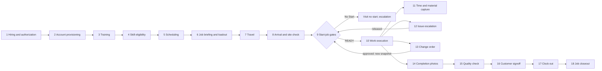
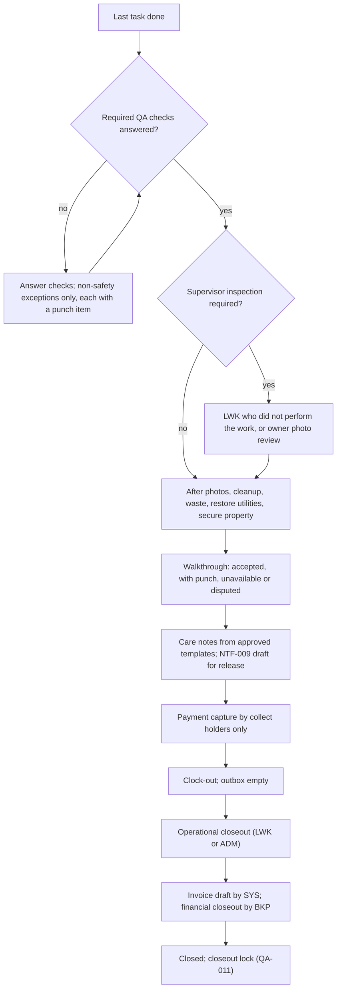

# 11 - Worker Job Execution

> **Status:** Draft - AI-generated planning document, not approved · **Owner/domain:** Field operations / safety / mobile UX (document primary handyhub-job-planner; the safety-liability-manager and handyhub-risk-triage sections bind it, [35](35-skills-coverage-matrix.md) D-35-07) · **Last updated:** 2026-10-04
> **Human review required:** Qualified safety professional (start-gate policy, the readiness and risk crosswalk, critical-hold list, severity scale, PPE rule, stop-work and escalation flow, emergency-stabilization boundaries, offline-start limits, every per-service seed in section 12); licensed electrician, plumber, gas and HVAC professionals, structural engineer or building official, EPA RRP-certified renovator, accredited asbestos inspector and qualified mold assessor (licensed boundaries and hazardous-material holds); local permitting and licensing authorities for each Kentucky and Indiana jurisdiction served (START-010 flags); attorney licensed in KY and/or IN (acknowledgement wording, incident and work-blocked wording, customer-supplied items, recording consent); privacy owner OWN-007 and employment attorney (location, voice notes, photos, device rules, lone-worker monitoring); payroll professional or wage-hour attorney (time events, travel, waiting and clock-out); CPA or bookkeeper (field cash and check capture); qualified bilingual reviewer (Spanish safety text); owner (escalation contacts, launch configuration, every PROPOSED value).
> **Related:** [Requirements spec](../Requierments/HandyHub_Requirements_Specification_Reconstructed.md) (sections 6 to 9, Appendix A) · [Master prompt](../HandyHub%20Master.md) (sections 5, 7, 12, 20, 22) · [05 Domain model](05-domain-model.md) · [06 State machines](06-state-machines.md) · [27 Roles and permissions](27-roles-and-permissions.md) · [04 Service registry](04-service-registry.md) · [31 SOP standard](31-sop-standard.md) · [29 Inventory and procurement](29-inventory-and-procurement.md) · [07 System architecture](07-system-architecture.md) · [13 Privacy and data governance](13-privacy-data-governance.md) · [26 Business process map](26-business-process-map.md) · [10 Frontend UX](10-frontend-ux-plan.md) · [16 Testing strategy](16-testing-quality-strategy.md) · [33 AI and automation governance](33-ai-and-automation-governance.md) · [02 Gap analysis](02-gap-analysis.md)

## 1. Purpose, scope and principles

### 1.1 What this document governs

The spec calls the Start Job experience "an operational control, not merely a timer button" (spec, core design principle) and makes the worker briefing "a launch-critical feature" (spec section 7; LAUNCH-005). This document is the single source of truth for how a HandyHub worker receives, checks, starts, performs, pauses, reports and closes field work on a phone:

- the single job briefing: all 34 master items with data source, briefing section, display priority, offline availability, change highlighting and sensitivity (sections 3 and 4);
- the Start Job gate: inputs, rule table, outcomes, overrides, re-evaluation and offline behaviour (section 5);
- worker-reportable conditions, the stop-work flow and emergency stabilization (sections 6 and 7);
- in-job execution and field closeout (sections 8 and 9);
- offline and poor-connectivity design and mobile UX rules (sections 10 and 11);
- per-service briefing specifics for all 26 services (section 12);
- field records and audit (section 13), the PROPOSED `WRK-` requirements and the test scenario list for [16](16-testing-quality-strategy.md) (section 14).

Owned elsewhere and linked instead of repeated:

| Topic | Owner document |
|---|---|
| Entities, attributes, immutability, sensitivity and retention classes | [05 Domain model](05-domain-model.md) (Sections 2, 5.6 to 5.9, 5.12) |
| Transition tables for Visit, Job, Job hold, Incident, Change order, Punch item, Quality review, Time-entry correction; outcome definitions, precedence and the readiness crosswalk as adopted | [06 State machines](06-state-machines.md) (Sections 6, 7, 12, 14-16; Section 2.3 here maps each field action to its transitions) |
| Who may view, create, approve or override; access window; step-up levels | [27 Roles and permissions](27-roles-and-permissions.md) (Sections 4.6, 4.7, 5.2, 6.2, 6.3) |
| SOP template, checklist model, stop-work text blocks, escalation path, critical-hold seeds | [31 SOP standard](31-sop-standard.md) (Sections 3.3, 4, 5.4, 5.6, 8, 10) |
| Service identity, risk classes, licensed boundaries, permit flags, activation gate | [04 Service registry](04-service-registry.md) (Sections 2.4, 6) |
| Item master, job item line states, kits, substitutions, customer-provided items | [29 Inventory and procurement](29-inventory-and-procurement.md) (Sections 4.3, 4.6, 5, 6.3, 9.1) |
| Screen design system, component states, copy and translation keys | [10 Frontend UX](10-frontend-ux-plan.md) |
| Endpoints and payloads | [09 API contracts](09-api-contracts.md) |
| Device baseline, offline-cache encryption, session lifetimes | [12 Security threat model](12-security-threat-model.md) |
| Field-app platform (installable PWA), local store, outbox, sync protocol and upload mechanism | [07 System architecture](07-system-architecture.md) (D-07-04, D-07-19; Sections 5.4, 9.2, 18); this document sets the per-action business rules those mechanisms carry |
| Retention durations, photo originals and metadata, capture rules, voice-note policy | [13 Privacy and data governance](13-privacy-data-governance.md) (D-13-09; Sections 5.2, 5.4, 5.5) |
| Worker day closeout, insurer and legal review item, owner inbox view | [26 Business process map](26-business-process-map.md) (BPM-021, BPM-024, BPM-003) |
| Performance budgets for briefing load and sync | [14 Performance](14-performance-scalability-plan.md) |
| Test case IDs (TC-) | [16 Testing strategy](16-testing-quality-strategy.md) |
| Alerts, dashboards and runbooks | [17 Observability](17-observability-and-operations.md) |
| AI roles, auto-send register | [33 AI and automation governance](33-ai-and-automation-governance.md) |

**Precedence.** Requirement text in the [spec](../Requierments/HandyHub_Requirements_Specification_Reconstructed.md) wins over this document, except where an owner fact is stricter on safety or privacy; then the stricter rule applies and the conflict is recorded (owner facts L20 "Unknown is not safe; acknowledgment cannot bypass critical holds"; [02](02-gap-analysis.md) G-037). Everything here that neither the spec nor the owner states is a **PROPOSED DECISION**. Nothing described here is implemented; the vault contains no code.

### 1.2 Evidence baseline

- **FACT** (spec section 7): the briefing must answer, before work begins: "Where am I going? Who is expecting me? What exactly is approved? What can hurt me or others? What must I check? What tools and materials do I need? What SOP applies? What would make me stop and escalate? What evidence must I capture?" It has 14 sections (BRF-001..BRF-014), 15 gating rules (START-001..START-015), 10 usability enhancements (UXE-001..UXE-010) and a 7-phase field checklist (Appendix A, APXA-001..APXA-007). AT-014..AT-042 test the field flow.
- **FACT** (master section 5, file 11): 33 briefing bullets, ending "Workers must not be forced to hunt through unrelated screens for critical job information." This document splits "clock-in / travel status" into two rows, giving the 34 items of Section 3.
- **FACT** (master section 12): "A worker must not be able to blindly start a job."; 14 evaluation inputs; 5 outcomes (`READY_TO_START`, `READY_WITH_WARNING`, `BLOCKED`, `REQUIRES_ADMIN_REVIEW`, `REQUIRES_CUSTOMER_CONFIRMATION`); 10 reportable conditions; "Never encourage workers to continue through an unsafe or legally restricted condition merely to keep the schedule."
- **FACT** (master sections 20 and 22): expected behaviour when the "worker loses internet" or a "file upload fails"; mobile topics from touch targets to "location permissions only when justified" and "battery impact".
- **FACT** (owner facts, [operating context](../Skills/Business%20direction/handyhub-job-planner/references/operating-context.md), recorded 2026-10-02): "Initially two employees" and "Do not count the owner as an additional worker without confirmation." (L6); "Received checks are not cleared money." (L10); "require human-reviewed safety translations" (L11); "Do not expose credentials, access codes, card details or private photos." (L17); "Sending messages ... require applicable explicit authorization." (L18); "No active field SOP until competent review ... Unknown is not safe; acknowledgment cannot bypass critical holds." (L20); "Verify the actual Kentucky/Indiana municipality; do not assume statewide trade permissions." (L21).
- **FACT** (vault state, audited 2026-10-03; [31](31-sop-standard.md) Section 2 and [02](02-gap-analysis.md)): no SOP is approved; 0 of 26 SOPs list PPE; 0 of 26 have an incident step; 3 of 26 contain any hold point; 1 of 26 (CL-05) asks for photos; no hazard library exists (G-007); no emergency kit appears in any inventory (X-10); the height and access, stabilization, utility-locate, guest-property and access-code policies the spec relies on do not exist (G-005); no timekeeping policy exists (G-145); no Spanish content exists (G-012); every permit, license and qualification flag is `unknown` ([04](04-service-registry.md) Section 6.1).
- **FACT** (consequence): under SOP-004 ("Start Job returns BLOCKED ... unless an effective approved SOP version exists"), SVC-009 (`unknown` blocks Start) and INV-018 (the vehicle safety kit stays an unresolved prerequisite until defined), every Start Job attempt for every service returns `BLOCKED` today. That is the intended safe state, not a defect to work around.
- **FACT** (plan documents drafted in parallel, read 2026-10-03): [06](06-state-machines.md) Section 7 adopts this document's per-check statuses, the incomplete-request rule (`STEPS_INCOMPLETE`, nothing recorded), the narrowest-scope rule, the outcome precedence and the crosswalk of Section 5.2 (D-06-07, D-06-08, with one amendment accepted in Section 5.2), and keeps pause and block on the job lifecycle rather than on the visit (Section 2.3). [07](07-system-architecture.md) proposes an installable PWA with a local store and outbox (D-07-04, D-07-19) and asks whether the provisional offline start is accepted (Q-07-05). [13](13-privacy-data-governance.md) answers Q-11-09 with D-13-09 (originals by workflow moment). [26](26-business-process-map.md) places the worker lifecycle of Section 2.2 in the process map and adds a worker day closeout (BPM-021). This revision aligns with those drafts; Section 15 lists what remains open.

### 1.3 Principles

1. **No blind start.** Start is reachable only from the briefing after the required views, checks and acknowledgements; there is no start action on a list row, a notification or a widget (START-015; AT-014; master section 12).
2. **Never continue through an unsafe or legally restricted condition to keep the schedule** (master section 12). The safety skill states the same rule for customer pressure: "Never encourage proceeding through an uncontrolled serious hazard merely because a customer wants the work completed quickly." Design consequences: the Stop Work / Report Hazard control is on every job screen; stop and No Start screens show no countdown, lateness or "customer is waiting" prompts; delay messages to the customer are the dispatcher's job (SCH-007), not the stopped worker's; stop-work and No Start counts never feed an individual performance score (D-11-14).
3. **Unknown is not safe** (owner facts L20). An unknown permit flag, property age, existing material, PPE selection, critical-tool status or customer-supplied item condition is a hold, never a pass.
4. **An acknowledgement is an operational confirmation, not a waiver, and never clears a critical hold** (START-003 "This is not a legal waiver"; owner facts L20; risk-triage playbook "Signing a checkbox cannot bypass an unresolved structural hazard."). The same applies to a customer request or signature.
5. **One briefing, critical first.** Every briefing item is on one screen, visible or one expansion away, ordered by what can hurt someone and what blocks start (master section 5; D-11-01, D-11-02).
6. **The server decides; the phone shows.** Gate outcomes, holds and transitions are evaluated on the server from versioned rules (NFR-020; [27](27-roles-and-permissions.md) AUTH-001; swe-implementation: "Enforce rules at the authoritative boundary."). The phone may compute a provisional result offline with the same rule set; the server result is authoritative.
7. **Approved content only.** Briefings show only effective SOP versions, approved hazard templates and approved Spanish safety text; draft seeds in this document and in [04](04-service-registry.md) and [31](31-sop-standard.md) never reach a worker as instructions (SOP-004; HND-004).
8. **Offline is a safety feature.** The latest authorized briefing, SOP checklist, hazards, stop-work criteria and escalation contacts work without signal; captured evidence is never lost (START-012; NFR-005; master section 22 "Critical safety/SOP content should remain easy to access.").
9. **Field facts are insert-only.** Views, acknowledgements, photos, notes, time events, material usage and reports are new records with client-generated identifiers; nothing is silently overwritten ([05](05-domain-model.md) D-05-23; owner facts L18 "report failures without silent overwrite").
10. **Least data on the phone.** The worker sees what the visit needs, inside the access window of [27](27-roles-and-permissions.md) Section 5.2; access secrets only on the service day; no prices, costs, billing data or other customers' records (FIN-007; COM-002; owner facts L17).
11. **AI is never in the Start Job path** ([33](33-ai-and-automation-governance.md): "AI is never in the Start Job, approval, payment, invoice or notification path."). "Risk Triage" in START-007 is the human lead worker or owner applying the risk-triage playbook. AI features are a second wave (**FACT**, owner direction 2026-10-04, [HANDOFF](../HANDOFF.md) section 2): in Wave 1 the AI module stays in its tested disabled state ([33](33-ai-and-automation-governance.md) AIG-002; AT-052, AT-053 in launch mode), and AI triage drafts, if the owner later approves them under 33, are advisory only (AIR-001 "Cannot declare site safe, waive controls, or authorize regulated work.").
12. **Bilingual through reviewed content.** Spanish safety text appears only from approved translations; job-specific free text shows an "untranslated" indicator; numbers, units and version IDs are identical in both languages (START-013; COM-006; [31](31-sop-standard.md) D-31-06).

### 1.4 Issues resolved or routed by this document

Format: Problem -> Evidence -> Impact -> Correct expertise -> Proposed change -> Dependencies -> Validation.

| # | Problem | Evidence | Impact | Correct expertise | Proposed change | Dependencies | Validation |
|---|---|---|---|---|---|---|---|
| 1 | Start-gate inputs are undefined although the mechanism is specified | [02](02-gap-analysis.md) G-088; START-004 "High-risk service/site flags"; START-010; PERM-006 | Developers guess gate logic; unsafe or blocked starts | job-planner, safety-liability-manager, risk-triage | Rule table (Section 5.3), per-service inputs (Section 12) | Approved SOPs, hazards, flags (HND-004, HND-005) | Scenarios 9-24 (Section 14.3) |
| 2 | Five gate outcomes, a three-state banner and a job state list do not match | Master section 12; UXE-001 "Ready / Needs Attention / Blocked"; STM-003; [02](02-gap-analysis.md) G-033, G-034 | Dashboards, banners and gates disagree | safety-liability-manager and risk-triage (crosswalk owners, [35](35-skills-coverage-matrix.md) 6.3 row 29) | Crosswalk D-11-03 (Section 5.2) | Adopted in [06](06-state-machines.md) Section 7.6 as D-06-08 with one amendment | Scenario 10 |
| 3 | A pre-start No Start has no state; "Blocked" exists only after "Started" | SCH-008; AT-030; STM-003 | No Start records are forced into a started job or lost | scheduling, job-planner | Visit status No start plus a stop-work event before start (Sections 2.3, 5.3 row 20) | Adopted in [06](06-state-machines.md) (D-06-06, V10) | AT-030; scenario 26 |
| 4 | START-015 allows a low-risk exception while AT-014 requires acknowledgement before any start | START-015; AT-014 | AT-014 fails whenever the exception is on | safety-liability-manager | Exception disabled at launch; criteria for any later use (D-11-09, Section 5.10) | Owner (Q-11-18) | Scenario 23 |
| 5 | Offline is P1 in the release list but AT-025, AT-026 and HND-009 must pass before launch | START-012; NFR-005; NEAR-001; HND-008; HND-009; [02](02-gap-analysis.md) G-032 | Launch blocked, or offline shipped untested | swe-implementation | P0 offline minimum versus P1 hardening (D-11-18, Section 10.1) | [18](18-release-and-launch-plan.md) | AT-025, AT-026 |
| 6 | The supervisor queue is P1 but AT-030 and AT-035 need it before launch | JOB-012; NEAR-003; AT-030; AT-035; [02](02-gap-analysis.md) G-032 | No-start and incident escalations have nowhere to go | job-planner, safety-liability-manager | Minimal P0 action queue (D-11-15, Section 8.12) | [17](17-observability-and-operations.md) | AT-030, AT-035 |
| 7 | QA-004 requires a customer to be present yet lists the outcome "unavailable" | QA-004 | Walkthrough outcome not recordable for unattended visits (CL-01, CL-05) | quality-assistant | "Unavailable" recorded when nobody is present (D-11-16) | Spec wording through [25](25-change-log.md) | AT-042 |
| 8 | Field incidents have no severity scale, contact tree, make-safe procedure or notification rule | [02](02-gap-analysis.md) G-090, G-087; JOB-006; JOB-008 | Inconsistent escalation; under-reported harm | safety-liability-manager | Severity scale (D-11-11), escalation (D-11-12), stabilization boundaries (D-11-13); insurer and attorney routing as HUMAN REVIEW steps | Owner, qualified safety professional, insurance broker (Q-11-01..Q-11-03) | AT-034, AT-035 |
| 9 | Time capture, travel and clock-out are undefined | G-097, G-145; JOB-002; START-014 | Payroll and job-cost inputs lost or disputed | job-costing (consulted); payroll professional | Event structure only (Sections 8.2, 9.9); policy left to payroll review | Q-11-06 | Scenario 33 |
| 10 | No lone-worker rule for attic work, vacant properties or single cleaners | G-156; HI-07.HAZ "heat stress, low clearance"; CL-03 vacant homes | A worker in trouble is not missed | safety-liability-manager | Interim rule and check-in design pending policy (Section 7.3) | Q-11-11 | Scenario 30 |
| 11 | Supervisor inspection level per service is undefined | G-155; quality-assistant playbook | A self-check passes as supervisor inspection | quality-assistant | Inspection type per service in the briefing closeout preview (Section 9.1) | Q-11-16 | AT-039 |
| 12 | Field-device security is undefined | G-114; START-012 | Lost phones expose addresses and access codes | IT security (through [27](27-roles-and-permissions.md) Section 8.6) | Cache scope, expiry and wipe (Section 10.9) | [12](12-security-threat-model.md) | Scenario 44 |
| 13 | Company safety policies the spec relies on do not exist | G-005; HI-06.SAF "approved height/access policy"; HI-10.SAF; DW-04.TLS | Work proceeds without the controls the cards require | safety-liability-manager | A gate that depends on a missing policy behaves as a critical hold ([31](31-sop-standard.md) Section 8.4 rule 4) | Policy approvals | Scenario 18 |
| 14 | No service-specific acceptance tests exist | G-105 | Per-service stop and gate rules go untested | quality-assistant, swe-quality-delivery | Per-service scenarios (Section 14.3, scenarios 47-56) | [16](16-testing-quality-strategy.md) | Section 14.3 |
| 15 | Site-assessment visits (attic, crawlspace, roof-edge or ladder inspections before an estimate) have no safety checklist, and no service has a default routing to on-site assessment | [06](06-state-machines.md) V8 and Q-06-13; STG-003 "whether site visit/remote estimate is appropriate"; risk-triage playbook "Route potential lead/asbestos, unresolved leaks/rot, unsafe deck structure, attic wiring/heat, elevated gutter work or unknown systems to competent assessment" | An assessor climbs, enters an attic or samples a material with no stop rule; or a hazardous service is estimated remotely | risk-triage, safety-liability-manager | Assessment checklist and routing seeds (Section 5.11, D-11-27) | Owner; qualified safety professional (Q-11-23) | Scenario 66 |

### 1.5 Specialist expertise applied

| Skill | Rule applied (quoted) | Where |
|---|---|---|
| [handyhub-job-planner](../Skills/Business%20direction/handyhub-job-planner/references/playbook.md) (primary) | "Generate departure and start-work gates: current assignment, reviewed scope, approved hazards/SOP, qualifications, permits where required, supplies, site access and supervisor release. Acknowledging a warning cannot clear a hard safety hold." · "Keep access secrets separately permissioned." · "A missing ladder or unverified permit keeps affected tasks blocked. A scope revision invalidates the old acknowledgment." · "Do not treat the two-person team as two independent crews when the job needs both." | Sections 3, 5, 8, 12 |
| [safety-liability-manager](../Skills/LLC%2C%20legal%20administration%2C%20and%20risk/safety-liability-manager/SKILL.md) | "Never encourage proceeding through an uncontrolled serious hazard merely because a customer wants the work completed quickly." · "For an active emergency, prioritize immediate safety and emergency response over paperwork." · "Prefer the hierarchy of controls: eliminate, substitute, engineer, administratively control, then PPE." · "Define when work must stop until a licensed trade professional, utility, engineer, remediation company, emergency service, or other qualified party is involved." · Incident procedure includes "evidence preservation" | Sections 3.1 (control order), 5.2, 6, 7, 8.8, 12 |
| [handyhub-risk-triage](../Skills/LLC%2C%20legal%20administration%2C%20and%20risk/handyhub-risk-triage/references/playbook.md) | "Treat photo/AI assessments as screening. Mark unknown hazards unknown; absence in a photograph is not absence on site." · "Assign disposition: routine with approved controls, needs information, on-site assessment, specialist/permit required, or stop work. Name the exact evidence and qualified role required to release each hold." · "Reassess on changed scope, substrate, weather, occupant conditions or newly exposed hazards" | Sections 5.2, 5.3, 6, 12 |
| [handyhub-quality-assistant](../Skills/LLC%2C%20legal%20administration%2C%20and%20risk/handyhub-quality-assistant/references/playbook.md) | "Prevent a worker's self-check from replacing required supervisor inspection." · "Do not infer hidden fasteners, structural adequacy, hazardous-material clearance or electrical safety from an image." · "Customer acknowledgment is distinct from competent safety inspection and does not waive rights." · "Missing photos are unknown evidence, not proof of defective work." | Sections 9, 12 |
| [handyhub-scheduling](../Skills/Business%20direction/handyhub-scheduling/references/playbook.md) | "Distinguish requested window, temporary slot hold, confirmed visit and active assignment." · "Evaluate exterior work against current conditions when needed; do not invent weather or use an old forecast." · "For reschedules/no-access/delays, preserve prior appointment history ... Send notifications only under explicit authorization." | Sections 2, 6, 7 |
| [swe-implementation](../Skills/Website%2C%20software%2C%20and%20cybersecurity/swe-implementation/references/specialized.md) | "Define which actions work offline and whether local data is authoritative or cached." · "Distinguish pending, confirmed, failed, and conflicting state in the UI. Do not silently overwrite valuable user changes." · "Request permissions when their purpose is clear; support denial and revocation." · [backend](../Skills/Website%2C%20software%2C%20and%20cybersecurity/swe-implementation/references/backend.md): "Make consumers idempotent; identify business operation keys" · [interface](../Skills/Website%2C%20software%2C%20and%20cybersecurity/swe-implementation/references/interface.md): "Never display success before an authoritative sensitive operation is confirmed." · [performance](../Skills/Website%2C%20software%2C%20and%20cybersecurity/swe-implementation/references/performance.md): "Measure the user experience" | Sections 5.1, 10, 11, 14 |
| [business-website-strategist](../Skills/Website%2C%20software%2C%20and%20cybersecurity/business-website-strategist/references/playbook.md) | "Walk through the primary task with representative scenarios: urgent inquiry, out-of-area customer, unclear job type, poor connection, and keyboard-only interaction. Record observed problems; distinguish a heuristic review from actual user research." (spec OWN-001 assigns "field-worker usability" to this role) | Sections 4, 11 (field usability test, HND-009) |

No skill was used to reach a legal, licensing, OSHA, EPA, structural, medical, payroll or tax conclusion; each such item names the human reviewer who decides (master section 1.3).

## 2. Worker lifecycle

### 2.1 Lifecycle flow (master section 7)

Master section 7 requires the worker lifecycle "Hiring/authorization -> account provisioning -> training -> skill eligibility -> scheduling -> job briefing -> travel -> arrival -> start-job gates -> work execution -> time/material capture -> issue escalation -> change order -> completion photos -> quality check -> customer signoff -> clock-out -> job closeout". Issue escalation and change orders can occur at any point between arrival and completion, and a stop sends the job back to the gate.



### 2.2 Step table with records and state links

"Records" use the entity names of [05](05-domain-model.md); "State link" names the machine, states and transition rows (J, V) of [06](06-state-machines.md), which revises STM-001..STM-007 and adds the machines 05 asked for. The status column starts with each step's coverage as counted in [02](02-gap-analysis.md) Section 8 (worker lifecycle: 7 covered, 9 partial, 2 missing; G-083 for the missing steps) and then says what the plan documents drafted since add.

| # | Step | Field behaviour and controls | Records | State link (06) | Requirements | Status |
|---|---|---|---|---|---|---|
| 1 | Hiring and authorization | Outside the app: hiring, screening and authorization to work follow the onboarding paperwork checklist that the legal-compliance-administrator skill is to produce (none exists yet; [26](26-business-process-map.md) Section 4.3, BPM-019). The app records an Employee and a Worker only after the owner authorizes the person. **HUMAN REVIEW: attorney or HR professional** for any screening rule | Employee, Worker | Employee (simple: active, ended) | Owner facts L6; [02](02-gap-analysis.md) G-074, G-083, G-151 | Missing (**GAP**): no hiring or authorization process |
| 2 | Account provisioning | Single-use invitation, MFA on the registered phone, device baseline, app-rules acknowledgement in English or Spanish, synthetic-job check ([27](27-roles-and-permissions.md) Section 8.1) | User account, Registered device, Role assignment | User account ([06](06-state-machines.md) Section 16.7) | AUTH-016, AUTH-018; HND-007 | Partial; now specified in [27](27-roles-and-permissions.md) Section 8.1 |
| 3 | Training | **PROPOSED**: a training record per SOP MAJOR version and for the app rules; a worker acknowledges a new MAJOR version before the first job using it ([31](31-sop-standard.md) Section 5.4 item 6); competence is verified by a human trainer, never by the app | Qualification (evidence), Acknowledgement (SOP version) | Qualification (simple: pending, verified, expired, revoked) | Safety skill ("PPE, training, equipment inspection"); master section 16; [02](02-gap-analysis.md) G-083 | Missing (**GAP**): no training program |
| 4 | Skill eligibility | Qualification tags per hazard class and licensed boundary ([04](04-service-registry.md) SVC-010), set by ADM with evidence, never self-asserted; scheduling refuses or flags unqualified assignment | Qualification | Qualification | SCH-003; START-010; [26](26-business-process-map.md) BPM-019 | Partial: tag list is an owner decision ([02](02-gap-analysis.md) G-161) |
| 5 | Scheduling | Visit confirmed with an arrival window; lead and member assignment; readiness computed; day-of list shows only assigned jobs with readiness summaries | Visit, Schedule entry, Job assignment, Availability block | Visit ([06](06-state-machines.md) Section 6.2: Requested, Tentative, Confirmed); readiness is computed, not a state (D-05-07; 06 Section 6.3) | SCH-001..SCH-003, SCH-005; AT-011..AT-013 | Covered |
| 6 | Job briefing | Briefing snapshot opened in the Upcoming phase of the access window; "What changed?"; loadout mode before departure (APXA-001, UXE-005); scope acknowledgement may be given here | Briefing snapshot, Briefing view, Acknowledgement (scope), Job item line | Job item line readiness (06 Section 16.3, adopting [29](29-inventory-and-procurement.md) Section 6.3: Planned, Reserved, Loaded) | BRF-001..BRF-014; START-002, START-003; UXE-001, UXE-003, UXE-005 | Partial: mechanism specified; content unapproved |
| 7 | Travel | "En Route" tap, accepted from the start of the visit's service day in the property's time zone ([06](06-state-machines.md) V5; any earlier lead time is `<owner decision: en-route lead time>`, Q-11-22, because En Route also opens the service-day access phase with the contact phone and access secrets, [27](27-roles-and-permissions.md) Section 5.2); customer en-route message per the auto-send decision ([33](33-ai-and-automation-governance.md) Q-33-04); ETA or delay update by worker or dispatcher; directions handoff to the phone's map app; no location tracking | Visit, Schedule entry (delay), Notification, Time entry (travel, only if the timekeeping policy tracks it) | Visit: Confirmed to En route (06 V5) | SCH-004, SCH-006, SCH-007; NTF-006; AT-028, AT-029 | Partial: travel-time policy open (Q-11-06) |
| 8 | Arrival | "Arrived" tap opens the service-day view (contact phone, access secret on reveal); the site check starts (APXA-002) | Visit, Briefing view | Visit: Confirmed or En route to Arrived (06 V6) | SCH-006; START-007; APXA-002 | Covered |
| 9 | Start-job gates | Guided "Before you start" sequence, server evaluation, outcome, start event; or No Start with reason and evidence (Section 5) | Start-gate evaluation, Acknowledgement, Photo, Customer-supplied item check, Override record, Stop-work event | Visit: Arrived to In progress (06 V7), or En route or Arrived to No start (V10); Job: Preparation or Started - Between visits to Started - Working (06 J2, J9) | START-001..START-015; SCH-008; AT-014..AT-027, AT-030 | Partial: mechanism specified; inputs defined here |
| 10 | Work execution | Ordered tasks with hold points, condensed checklist, scope protection, Do-not-perform list, resume card | Task, Job checklist, Measurement, Note, Photo | Work package and Task (06 Section 16.3) | JOB-001, JOB-003, JOB-010; UXE-009, UXE-010; APXA-004 | Partial: SOPs unapproved |
| 11 | Time and material capture | Append-only time events; material used, returned and wasted; substitutions | Time entry, Material usage, Substitution | Time-entry correction (06 Section 16.5); Job item line: Verified to Consumed to Reconciled (06 Section 16.3) | JOB-002, JOB-003, JOB-007; AT-021, AT-037 | Partial: timekeeping policy open (G-145) |
| 12 | Issue escalation | Stop Work / Report Hazard; condition reports; incidents; holds; owner/supervisor queue (Sections 6, 7) | Stop-work event, Condition report, Site hazard, Job hold, Incident, Emergency stabilization record | Job: Started - Working or Started - Paused to Started - Blocked when the stop or hold covers the work in progress (06 J5); Job hold (06 Section 6.4); Incident (06 Section 12); Site hazard (06 Section 16.4) | START-011; JOB-004, JOB-006, JOB-008, JOB-012; AT-034..AT-036 | Covered by spec; detail here |
| 13 | Change order | Worker records the request; lead worker prepares the scope and time delta; estimator prices; the customer approves one version; work on the added scope stays locked until approval | Change order, Communication | Change order (06 Section 8, with Requested) | JOB-005; FIN-008; AT-032, AT-033 | Covered |
| 14 | Completion photos | Area- or task-mapped after photos at the completion and cleanup moments (UXE-006) | Photo | none (insert-only) | QA-002, QA-003; AT-040 | Covered |
| 15 | Quality check | Service QA criteria; self-check versus supervisor inspection; punch items | Quality inspection, QA check result, Punch item | Quality review (06 Section 14); Punch item (06 Section 15) | QA-001, QA-005; AT-039, AT-041 | Partial: QA criteria unapproved |
| 16 | Customer signoff | Walkthrough outcome accepted, accepted with punch items, unavailable or disputed; care notes from approved templates only | Customer walkthrough, Customer signature, Communication | Job: Work complete to Quality review where a supervisor inspection is required, then Customer closeout (06 J14-J17) | QA-004, QA-008; AT-042 | Covered; signature method open ([05](05-domain-model.md) Q-05-06) |
| 17 | Clock-out | Final time event for the worker and visit; the app never clocks a worker out automatically; after the last visit of the day the worker day closeout of [26](26-business-process-map.md) (BPM-021) lists unsynced items and custody hand-overs | Time entry | Time-entry correction (06 Section 16.5) | JOB-002; START-014 | Partial: no end-of-shift definition (**GAP** G-097); [26](26-business-process-map.md) BPM-021 proposes the day closeout |
| 18 | Job closeout | Operational closeout checklist (Section 9.9); all evidence synced; materials and tools reconciled; invoice readiness handoff; closeout lock after operational and financial closeout | Job, Waste record, Material usage, Invoice (draft by SYS) | Job: Customer closeout to Invoiced to Closed (06 J19, J21), or Customer closeout to Closed when nothing is billable (J22); closeout criteria D-06-19 | QA-006, QA-011; APXA-007; AT-060 | Covered (QA-011, AT-060); closure criteria still open ([05](05-domain-model.md) Q-05-09; [06](06-state-machines.md) D-06-19 provisional) |

### 2.3 Field actions and their transitions (as adopted in 06)

[05](05-domain-model.md) D-05-07 separates job lifecycle status, computed readiness and visit status. This document proposed two more visit statuses, `in progress` and `paused`. [06](06-state-machines.md) Section 6.2 adopted `In progress` (V7) and keeps pause and block on the job lifecycle only (Started - Paused and Started - Blocked, 06 Section 6.1), so one record answers whether work may continue: the visit stays In progress while the job is paused or blocked during it, and a customer no-show is a No start reason, not a state. The field app uses 06's names. The table maps each worker action to the transitions it requests; 06 owns the guards, actors, invalid transitions and timers. Readiness is never a lifecycle state ([05](05-domain-model.md) DOM-019).

| Worker action in the app | Visit ([06](06-state-machines.md) Section 6.2) | Job ([06](06-state-machines.md) Section 6.1) | Rules in this document |
|---|---|---|---|
| En Route | Confirmed to En route (V5) | No change | Service day only unless the owner sets a lead time (Q-11-22); NTF-006 per [33](33-ai-and-automation-governance.md) Q-33-04 |
| Arrived | Confirmed or En route to Arrived (V6) | No change | No location collected (Section 11.5); the site check opens (Section 3.5 step 7) |
| Start Job with a passing evaluation | Arrived to In progress (V7) | Preparation or Started - Between visits to Started - Working (J2, J9) | Section 5; a scoped lock leaves its tasks Blocked while the rest starts (Section 5.4) |
| Can't start (No Start) | En route or Arrived to No start (V10) | No change: a pre-start block never moves the job (D-06-06) | Section 5.3 row 20; Section 6.7 |
| Pause (break, cure or dry wait, material run, customer request) | Stays In progress | Started - Working to Started - Paused (J3); resume J4 | Time events per the timekeeping policy (Section 8.2) |
| Stop Work, or a hold raised on the scope in progress | Stays In progress | Started - Working or Started - Paused to Started - Blocked (J5) when the stop or hold covers the job or the visit; a narrower hold locks only its tasks | Sections 5.8, 6.7 and 7 |
| Resume after a release | Stays In progress | Started - Blocked to Started - Working (J6) after the release and a new passing evaluation | Sections 5.8 and 7.6 |
| Leave the site while blocked | In progress to Completed with outcome "stopped" (V9 through J8) | Stays Started - Blocked while a hold covering the job or the next visit is active or the stop-work event is still open, and leaves later only through J11; moves to Started - Between visits only when the stop is resolved and no covering hold remains as the worker leaves (J8) | The site is made safe first, or emergency services are engaged. Leaving never waits for signal: while `EndVisit` is online-only ([09](09-api-contracts.md) Section 6.7, Q-09-10), the worker leaves and the visit end is recorded at the next contact (PROPOSED) |
| End the visit with work remaining | In progress to Completed (V9) | Started - Working to Started - Between visits (J7) | Multi-visit jobs (Section 5.8) |
| Complete work (completion request) | In progress to Completed (V9) | Started - Working to Work complete (J14) | Section 9.1; accepted offline as a request and validated at sync ([06](06-state-machines.md) D-06-20) |
| Complete a site assessment | Arrived to Completed (V8) | None: the visit belongs to a lead | Section 5.11 |

## 3. Single job briefing specification

### 3.1 How the briefing is composed

**PROPOSED DECISION D-11-01:** a worker sees one briefing screen per assigned visit, rendered from the job's current `BriefingSnapshot` (RECT-005; [05](05-domain-model.md) Section 5.8). Every one of the 34 items in Section 3.2 is on that screen, either visible or one expansion away. The only screens a worker leaves the briefing for are the full SOP view, the phone's own map application for directions, the camera, and the report forms opened from the briefing; each returns to the briefing. This implements master section 5 ("Workers must not be forced to hunt through unrelated screens for critical job information").

Composition rules:

1. **Inputs, in order.** Job and visit identity (Job, Visit, Schedule entry, Job assignment); customer and site (Customer, Contact with site-contact authority, Property, Work area, Access secret reference, Site hazard); approved scope (current Job scope snapshot, Work packages, applied Change orders, plus requested change orders listed as not approved); controlled content (Service card version, SOP versions with checklist items and module SOPs, Hazard template versions, SDS document references, translation entries); items (Job item lines with readiness, customer-supplied item expectations); gate configuration (required photos, customer confirmations, permit and license flags per line type and jurisdiction, qualification and crew requirements); escalation (escalation contact list version, utility notes); closeout preview (QA criteria, after photos, cleanup, waste, walkthrough, payment handoff for `collect` holders).
2. **Snapshot, not live joins.** SYS creates a new snapshot version whenever an input changes, with a change summary by category and a content hash (DOM-022; [05](05-domain-model.md) Section 6.3). The snapshot stores versions and references; restricted values (access secrets) are stored as references and revealed separately.
3. **Projection at render time.** The phone receives a projection of the snapshot filtered by the field classes of [27](27-roles-and-permissions.md) Section 4.7 and the access-window phase of [27](27-roles-and-permissions.md) Section 5.2 (Upcoming, Service day, Post-service). Filtering happens on the server; the phone never receives fields it may not show.
4. **Provenance.** Customer-reported facts (measurements, property age, pets, occupants) carry a "customer-reported" badge until verified; unknown values are shown as "unknown", never as blank or "no" (DOM-004; owner facts L20).
5. **Language.** Controlled content (hazards, controls, PPE, stop-work text, checklist items, Do-not-perform entries) renders from approved translation entries; staff free text shows its original language with an "untranslated" marker (COM-006). Hazards are coded (type, severity, control, PPE, stop trigger) so the safety-critical part of a site hazard is always translated even when its free-text note is not.
6. **Sizing.** Text first; photos as thumbnails; full images and the full SOP's diagrams load on demand (NFR-004; [31](31-sop-standard.md) Section 4.5). Load-time budgets are set and measured in [14](14-performance-scalability-plan.md); none is invented here.
7. **Control order (PROPOSED).** Each hazard card lists its approved controls in hierarchy-of-controls order (elimination, substitution, engineering controls, administrative controls, then PPE; safety-liability-manager: "Prefer the hierarchy of controls: eliminate, substitute, engineer, administratively control, then PPE."), so the worker reads PPE as the last layer of protection, not the only one. The controls and their order come only from the approved hazard template or site-hazard review (principle 7); the app never adds or reorders a control. **HUMAN REVIEW: qualified safety professional.**

### 3.2 The 34 briefing items

Legend:
- **Priority (D-11-02):** T0 persistent on every job screen · T1 critical (top area, expanded) · T2 standard (summary line; expanded automatically when it changed) · T3 reference (collapsed; opens on tap).
- **Offline:** C cached with the snapshot for the access window · C-SD cached encrypted for the service day only · Q worker action captured offline and queued in the outbox · L hand-off to another phone app · O online only.
- **Change handling (START-002, UXE-003):** R re-acknowledgement required before start or resume · V must be opened in "What changed?" before start or resume · H highlighted only · — immutable once created.
- **Sensitivity:** classes of [05](05-domain-model.md) Section 2.4 (Int internal, Pers personal, Restr restricted) with the field-class rules of [27](27-roles-and-permissions.md) Section 4.7. Entity names are those of [05](05-domain-model.md). Attribute names are logical and PROPOSED where 05 does not list the attribute (05 defines entities and key attributes, not every field; the request is in Section 15); [08](08-data-model-and-database.md) owns physical names.

| # | Master item | Data source (entity.attribute, [05](05-domain-model.md)) | BRF | Priority | Offline | Change | Sensitivity and handling |
|---|---|---|---|---|---|---|---|
| 1 | Customer | `Customer.display_name`, `Customer.preferred_language`; `Contact.name` and relationship of the person expecting the worker | BRF-001, BRF-002 | T1 header | C | H | Pers. No billing address, balance, payment status, complaint or other-customer data (AT-046); a new customer at a previously served address sees none of the earlier customer's records ([27](27-roles-and-permissions.md) Section 5.1) |
| 2 | Property | `Property.property_type`, `Property.year_built` with provenance, `Property.occupancy`, `Property.utility_notes` (water, power, bathroom availability), `Property.recurring_site_facts`; `WorkArea.name`, `WorkArea.area_type` | BRF-003 | T2; year built and occupancy appear in the T1 hazard card when the service uses old-property screening (Section 12) | C | V; R when year built or occupancy changes the hazard screening | Pers. "Customer-reported" badge until verified; "unknown" is shown as unknown |
| 3 | Map / address | `Property.address`, `Property.unit`, `Property.normalized_address`, `Property.time_zone` | BRF-001, BRF-002 | T1 | C; directions L (address handed to the phone's map app, SCH-004) | V | Pers. Visible from the Upcoming phase (exact timing [27](27-roles-and-permissions.md) Q-27-09 and Q-11-19); no location is sent back to HandyHub |
| 4 | Access instructions | Non-secret: `Property.access_instructions` (gate, building or unit, elevator and loading limits, HOA and security notes, access hours); secret: `AccessSecret` reference, value revealed on tap | BRF-002 | T1 | Non-secret C; secret C-SD (encrypted, cleared at the end of the service day) | V (AT-027) | Restr for secrets: every reveal logged (AUTH-009, AUTH-015); never in notifications, exports, photos, notes, AI context or logs (COM-002, DOM-049); a customer key held by HandyHub is a custody item ([27](27-roles-and-permissions.md) Section 4.6) |
| 5 | Parking | `Property.parking_instructions` (parking and loading) | BRF-002 | T2 inside the Arrival card | C | V | Pers |
| 6 | Pets | `Property.pets_notes` with provenance; this visit's reconfirmation in the site check (`JobChecklist` response, CX-005) | BRF-002, BRF-005 | T1 when animals are present or unknown; otherwise T2 | C | V; reconfirmed at every site check | Pers; risk-and-safety note class ([27](27-roles-and-permissions.md) Section 4.8); "unknown" until confirmed |
| 7 | Occupants | `Property.occupancy`, `Property.occupants_notes` (children or vulnerable occupants present, only as the work's safety needs); occupancy plan from `JobScopeSnapshot.customer_responsibilities` | BRF-002, BRF-005 | T1 | C | V; reconfirmed at every site check | Pers; no names or ages of children; minimum detail for safety |
| 8 | Customer preferences | `JobScopeSnapshot.customer_expectations` (priority outcome, finish preference, items to protect, noise or dust sensitivity, communication cadence, cleanup expectation, approved special instructions; **GAP**: not yet an attribute in [05](05-domain-model.md), Section 15); customer-visible job `Note` | BRF-005 | T2 | C | H; V when a special instruction is added | Pers; only approved instructions; free text keeps its language with the "untranslated" marker |
| 9 | Scope | Current `JobScopeSnapshot`: approved lines and selected options (task, quantity, unit, work area, finish, color, model); `WorkPackage.scope_statement`, `WorkPackage.work_areas`, `WorkPackage.service_card_version` | BRF-004 | T1 | C | R (START-003) | Pers; customer price removed from the field projection; a `collect` holder sees only the balance due ([27](27-roles-and-permissions.md) Section 4.7; FIN-007) |
| 10 | Approved estimate | `JobScopeSnapshot.version` and source; `CustomerApproval.approved_at` and method; `EstimateVersion` number and version; agreement packet reference | BRF-004, BRF-011 | T3 ("Approved: estimate `<number>` v`<n>` on `<date>`") | C | — (immutable; superseded only through a change-order snapshot) | Pers; no price; the agreement opens read-only |
| 11 | Exclusions | `JobScopeSnapshot.exclusions`, `JobScopeSnapshot.customer_responsibilities`; access, concealed-condition, schedule and permit or licensing assumptions (EST-003) | BRF-004 | T1 scope card; feeds the Do-not-perform list (Section 4.4) | C | R | Pers |
| 12 | Change orders | `ChangeOrder` with status Applied (scope delta, time delta, reason, resulting snapshot version); requested or sent change orders in a separate "Not approved yet" list | BRF-004, BRF-011 | T1 when applied since the worker's last view; otherwise T2 | C | R for applied; H for requested | Pers; price delta hidden from field roles; a requested change order is never shown as approved scope (AT-032, AT-033) |
| 13 | Schedule | `Visit.status`; current `ScheduleEntry` (local date, arrival window, time zone); number of earlier entries; `Visit.dependencies` (for example a drying wait) | BRF-001 | T1 header | C | V | Pers |
| 14 | Expected duration | `Visit.expected_duration_minutes`, `Visit.preparation_time_minutes`; person-hours from `EstimateWorkPackage` where recorded | BRF-001 | T2 | C | H | Int. Shown as planned time, never as a countdown (principle 2) |
| 15 | Team assignment | `JobAssignment` (worker, role lead or member, visit scope); crew requirement from the service card (for example HI-04.SAF "two-person lift when needed") | BRF-001 | T1 | C | V; a change that breaks a crew requirement re-runs the `crew` check (Section 5.3) | Pers; names and roles only; personal phone numbers hidden ([27](27-roles-and-permissions.md) Section 4.7) |
| 16 | Photos | `Photo` attachments from the request, the estimate, earlier visits and this job, with workflow moment, work area and caption | BRF-003, BRF-011 | T3 thumbnail strip | Thumbnails C; full images O unless the visit is set to prefetch on Wi-Fi | H for new photos | Pers, or Restr for interior photos that show people, documents or valuables ([05](05-domain-model.md) Section 2.4); internal-only photos are never shared from this screen (D-27-15) |
| 17 | Previous notes | `Note` of the classes customer-visible, internal operational, and risk and safety for this property and customer; earlier `ConditionReport` and `SiteHazard` records | BRF-003 | T2; risk-and-safety notes T1 | C | H; new risk-and-safety notes V | Pers; payment, complaint, employee/HR, legal and fraud classes excluded (PERM-003); an earlier customer's notes at the same address excluded; property-level site facts carry over only after reconfirmation (CX-005) |
| 18 | Property-specific hazards | `SiteHazard` (source, type, severity, controls, PPE, stop-work trigger, status, reviewer); active `JobHold` records | BRF-007 | T1 | C | R (START-004) | Int (Pers where it describes occupants, [05](05-domain-model.md) Section 5.8); coded fields from translated template text; free text secondary with the "untranslated" marker |
| 19 | Service-specific hazards | `HazardTemplate` versions referenced by the `ServiceCardVersion`; SOP section 9; shared module hazards ([31](31-sop-standard.md) Section 5.8) | BRF-007 | T1 | C | R | Int; merged with site hazards without overwriting either source (AT-018) |
| 20 | Required PPE | `JobItemLine` with line role PPE, criticality safety-critical (from `ServiceItemRequirement`); `HazardTemplate.ppe`; `SiteHazard.ppe` | BRF-008 | T1 | C | R | Int; selection only from the qualified safety professional's PPE matrix ([31](31-sop-standard.md) Section 3.5 rule 6); until selected the line reads "PPE not yet selected - start blocked" (**GAP**, Section 12) |
| 21 | Required tools | `JobItemLine` with line role tool or equipment (criticality, source truck, shop, rental or customer, readiness), including access equipment and the `vehicle-safety` kit (INV-018) | BRF-009 | T2 in loadout mode (UXE-005); a missing critical line is T1 | C | H; V when a critical line changes | Int; no cost fields |
| 22 | Required materials | `JobItemLine` with line role material (item, quantity, unit, size, color, model, source, substitution policy, customer-supplied flag) | BRF-010 | T2 in loadout mode; a missing critical line is T1 | C | H; V when a critical line or its model changes | Int; no cost or markup (FIN-007) |
| 23 | Inventory availability | `JobItemLine.status` (Planned, Reserved, To purchase, Awaiting rental, Awaiting customer, Loaded, Verified, Exception; [29](29-inventory-and-procurement.md) Section 6.3) with "as of" time; shared-asset conflicts (P1) | BRF-009, BRF-010 | T1 when any critical line is not Loaded or Verified; otherwise T2 | C (status as of last sync, time shown) | H | Int |
| 24 | SOP | Effective `SopVersion` per work package and module (version, effective date, language); generated `ChecklistItem`s by phase APXA-001..APXA-007; Do-not-perform entries | BRF-006 | T2 (the condensed checklist is the main in-job view; full SOP T3) | C (text first; images on demand) | R when a MAJOR version changes SOP sections 2, 6, 9 or 10 ([31](31-sop-standard.md) Section 5.4 item 4); otherwise H | Int; "SOP updated" banner; start blocked if the cached version is found suspended at sync ([31](31-sop-standard.md) Section 5.6), and held for re-acknowledgement of changed safety items if it was superseded (SOP-006) |
| 25 | Quality checklist | `ServiceCardVersion` QA criteria (`.QAC`) and SOP quality-checkpoint checklist items; required inspection type (self-check or supervisor) | BRF-014 | T3 in the closeout preview; T1 at completion | C | H | Int |
| 26 | Stop-work criteria | Universal stop-work rule ([31](31-sop-standard.md) Section 8.5, START-011); service `.SAF` and SOP section 10; `SiteHazard.stop_work_trigger` | BRF-007, BRF-008, BRF-013 | T0 persistent control and one-line statement; T1 card | C | R | Int; identical meaning in both languages from approved text |
| 27 | Emergency contact and process | Escalation contact list (owner-approved policy version; **GAP**: none exists, Q-11-01); emergency-services reminder; `Property.utility_notes` shutoff locations "if known and relevant" (customer-reported label); customer-not-home and unexpected-condition paths | BRF-013 | T0 one-tap escalate; T1 card | C (numbers display offline; calling needs cellular service) | V | Pers; business numbers preferred; staff personal numbers only if the owner approves |
| 28 | Permits and license notes | Per line type and jurisdiction: `required`, `not-required` or `unknown` with source, date and reviewer ([04](04-service-registry.md) SVC-009); evidence on the job; `JobHold` of type missing permit, license or qualification; licensed-boundary entries in the Do-not-perform list | BRF-011 | T1 when any flag on the visit is `unknown` or `required` without evidence; otherwise T3 | C | V | Int; status and the deciding role only, never a legal conclusion (master section 1.3) |
| 29 | Before-work photo requirements | `ServiceCardVersion.required_photos` (START-008); `ChecklistItem` type photo in APXA-002 and APXA-003 (arrival, existing condition, protection, customer-supplied item) | BRF-012 | T1 in "Before you start" | C; capture Q | H | Pers; captured in the app only, internal-only by default (D-27-15, AUTH-034); prompts avoid people, documents and valuables not needed for the work (CL-06.SAF) |
| 30 | Customer confirmation | (a) appointment confirmation state (SCH-005; NTF-004 and NTF-005 delivery and reply); (b) on-site confirmations configured per service (for example placement height, layout, test-section approval, HVAC-off or breaker permission) captured as `JobChecklist` responses of type decision with the confirming contact and method | BRF-005, BRF-012 | T1 while pending | C; capture Q | V | Pers; operational only: never a price or scope approval (those need a change order, CX-003) and never clears a safety hold; the confirming person needs the relevant contact authority (AUTH-028) |
| 31 | Safety acknowledgement | `Acknowledgement` of type safety bound to the current snapshot version (hazards, controls, PPE, stop-work conditions, language shown); high-risk confirmation record where required (START-004) | BRF-008 | T1 in "Before you start" | Q | Superseded by any R change | Pers; personal and immutable; nobody acknowledges for another person (DOM-023) |
| 32 | Clock-in status | Latest `TimeEntry` of this worker on this job (start, pause, resume, complete; travel or break only where the timekeeping policy tracks them) | BRF-001 | T1 header chip | Q | H | Pers; **HUMAN REVIEW: payroll professional** for the policy; no automatic clock-out |
| 33 | Travel status | `Visit.status` (confirmed, en route, arrived); ETA or delay `ScheduleEntry`; NTF-006 delivery result | BRF-001 | T1 header | Q (the status syncs; any customer message is sent by the server under the auto-send policy) | H | Pers; no GPS; the customer sees only what SCH-006 and [33](33-ai-and-automation-governance.md) allow |
| 34 | Inability-to-start reason capture | `StopWorkEvent` with `before_start = true`, reason code, evidence (photos; contact attempts with times); `Visit.status` no start | BRF-013 | T0 "Can't start" action beside Start | Q | — | Pers; reason codes in Section 5.3 row 20; a personal reason carries no medical detail |

### 3.3 Coverage of BRF-001..BRF-014

| BRF | Spec content (short) | Items in 3.2 | Additional handling |
|---|---|---|---|
| BRF-001 Job identity | Job number, services, customer, address, window, duration, team, status | 1, 3, 13, 14, 15, 32, 33 | Header shows job number, services and job and visit status |
| BRF-002 Arrival and access | Site contact and channel, gate, parking, lockbox, unit, elevator, HOA, hours, pets, occupants, utilities | 3, 4, 5, 6, 7, 27 | Site contact phone only in the service-day phase ([27](27-roles-and-permissions.md) Section 5.2); one-tap call (UXE-002) |
| BRF-003 Property and site profile | Type, age, occupancy, substrates, prior damage, utilities, photos, customer information labelled | 2, 16, 17 | Provenance badges (DOM-004) |
| BRF-004 Approved scope | Tasks, areas, quantities, options, inclusions, exclusions, responsibilities, version, change orders, finish details | 9, 10, 11, 12 | Three-zone scope display (Section 8.10) |
| BRF-005 Customer expectations | Outcome, finish, protection, sensitivity, occupancy plan, cadence, cleanup, instructions | 6, 7, 8, 30 | — |
| BRF-006 SOP | Approved version, full SOP and condensed checklist | 24 | [31](31-sop-standard.md) Section 4 |
| BRF-007 Hazards | Template plus site hazards with severity, control, PPE, stop trigger, escalation | 18, 19, 26 | Severity scale (Section 6.3) |
| BRF-008 Safety guidance | PPE, height, isolation, ventilation, SDS, manual handling, occupant protection, weather, prohibited actions | 20, 26, 31 | SDS links on chemical hazard cards; weather observation in the site check; prohibited actions in the Do-not-perform list |
| BRF-009 Tools and equipment | Required and optional tools, rentals, batteries, access equipment, containment, test devices | 21, 23 | Loadout mode (UXE-005) |
| BRF-010 Materials and consumables | Spec, quantity, supplier, loaded status, substitutions, customer-supplied check, waste allowance | 22, 23 | Customer-supplied item check (Section 5.3 row 17) |
| BRF-011 Documents and approvals | Estimate and authorization, deposit status, permit dependency, change orders, product instructions, drawings | 10, 12, 16, 28 | Deposit shown only as met, not met, waived or "policy not configured", never amounts (DOM-039); product instructions and drawings as attachments with purpose |
| BRF-012 Pre-start evidence | Arrival and existing-condition photos, damage notes, protection, serial/model check, measurement confirmation, customer acknowledgement | 29, 30 | Measurements with provenance; protection step and photo moment (Section 3.5 step 9); serial/model in the customer-supplied item check |
| BRF-013 Emergency and escalation | Contacts, incident button, stop-work button, emergency reminder, utility shutoffs, customer-not-home and unexpected-condition paths | 26, 27, 34 | Sections 6 and 7 |
| BRF-014 Closeout preview | QA checks, after photos, cleanup, returns and waste, walkthrough, invoice and payment handoff, follow-up | 25 | Payment handoff shown only to `collect` holders (Section 9.7) |

### 3.4 What the briefing never shows

- Customer price (except the balance due to `collect` holders), internal cost, margin or markup (FIN-007; [27](27-roles-and-permissions.md) D-27-09).
- Billing details, payment history, deposit amounts or card data (card data is never stored, D-27-20).
- Other jobs or other customers (PERM-002; AT-013).
- Payment, complaint, employee/HR, legal and fraud notes (PERM-003; AT-048).
- Injury and medical details of any incident (DOM-035).
- Customers' device or account credentials, which are never stored (D-27-16), and access secrets outside the service day.
- AI output presented as fact; the AI workspace is disabled at launch ([27](27-roles-and-permissions.md) D-27-13).

### 3.5 "Before you start" sequence (PROPOSED DECISION D-11-08)

The briefing carries a guided list that follows Appendix A. Each step is a checklist item of the company field checklist ([31](31-sop-standard.md) Section 4.3) or of the service SOP, so the list itself is versioned controlled content.

| Step | Phase | Action | Requirement |
|---|---|---|---|
| 1 | APXA-001 Before leaving | Open the briefing and clear "What changed?" | START-002; AT-027 |
| 2 | APXA-001 | Scope acknowledgement may be given now (it is bound to the snapshot version) | START-003 |
| 3 | APXA-001 | Loadout: each line Reserved to Loaded; record an exception for anything missing | START-005, START-006; UXE-005 |
| 4 | APXA-001 | Check that listed documents (product instructions, permit evidence, drawings) are present | BRF-011 |
| 5 | APXA-001 | Tap En Route (optional where travel is not tracked) | SCH-006 |
| 6 | APXA-002 On arrival | Tap Arrived (service-day view opens) | SCH-006 |
| 7 | APXA-002 | Site check: address, unit and work area; who is present; pets; access; conditions match the briefing or differences are recorded with photos; utilities and emergency constraints relevant to the task; weather observation for exterior tasks | START-007; CX-005 |
| 8 | APXA-002 | Required arrival and existing-condition photos | START-008 |
| 9 | APXA-002 | Protect the work area as the SOP setup requires (floor, surface and contents protection; items moved only within the service's approved limits) and take the protection photo where configured. Protection or containment that needs access equipment, utility isolation or chemicals is set up only after steps 12 and 13 (PPE confirmed, safety acknowledgement given), as the first SOP setup task; which photo moments are required before start is Q-11-04 (PROPOSED; **HUMAN REVIEW: qualified safety professional**) | APXA-002 "protect work area"; BRF-012; UXE-006 |
| 10 | APXA-002 | Customer-supplied item check where configured | START-009 |
| 11 | APXA-003 Before starting | On-site customer confirmations configured for the service | Section 5.3 row 18 |
| 12 | APXA-003 | Verify critical lines on site (Loaded to Verified) and confirm PPE | START-005, START-006 |
| 13 | APXA-003 | Safety acknowledgement, given on site after this visit's site check; SOP-version acknowledgement where a new MAJOR version applies | START-004; SOP-006 |
| 14 | APXA-003 | High-risk confirmation, where required, by a second person (LWK who is not performing, or ADM) | START-004; [27](27-roles-and-permissions.md) Section 6.3 |
| 15 | APXA-003 | Tap Start Job: server evaluation, outcome, confirmation of each warning, start event | START-014; Section 5 |

The safety acknowledgement is taken on site rather than before leaving because the site check can change what it covers (risk-triage playbook: "Reassess on changed scope, substrate, weather, occupant conditions or newly exposed hazards"). "Can't start" (item 34) is available at every step.

## 4. Briefing layout

### 4.1 Screen structure

Illustrative structure (placeholders in angle brackets; visual design, components and copy are owned by [10](10-frontend-ux-plan.md)):

```text
+------------------------------------------------------+
| BANNER: <Blocked | Needs attention | Ready> - <n>    |  T0  readiness (UXE-001)
|   - <missing item> . <who resolves> . <action>       |
|   as of <time> . <offline marker>                    |
+------------------------------------------------------+
| <job no.> . <service codes> . Visit <k> of <n>       |  T1  header
| <local date> <arrival window> . planned <minutes>    |
| Lead <name> . Visit <status> . Clock <status> . Sync |
+------------------------------------------------------+
| WHAT CHANGED? (<n>)  access . hazards . materials    |  T1  only when changes exist
+------------------------------------------------------+
| SAFETY: stop-work statement (one line)               |  T1  first card after arrival
| Hazards <n> . PPE <n> . Do not perform <n>           |
+------------------------------------------------------+
| ARRIVAL AND ACCESS: address . unit . parking . gate  |  T1  first card before arrival
| contact (service day) . pets . occupants             |
+------------------------------------------------------+
| SCOPE: tasks . areas . exclusions . change orders    |  T1
+------------------------------------------------------+
| BEFORE YOU START: <done> of <total>                  |  T1
+------------------------------------------------------+
| > Loadout (tools, materials, availability)           |  T2
| > SOP checklist v<version>                           |  T2
| > Customer preferences . > Previous notes            |  T2
| > Photos . > Documents . > Closeout preview          |  T3
+------------------------------------------------------+
| [Call contact] [Escalate] [Can't start] [Start job]  |  action bar
| [ STOP WORK / REPORT HAZARD ]                        |  T0  every job screen
+------------------------------------------------------+
```

### 4.2 Critical-first, phase-aware order (PROPOSED DECISION D-11-02)

| Position | Before Arrived (Upcoming and En route) | After Arrived (on site) | Why |
|---|---|---|---|
| 1 | Readiness banner | Readiness banner | UXE-001: the exact missing items and who resolves them |
| 2 | Header (identity, schedule, status chips) | Header | BRF-001 |
| 3 | What changed? (if any) | What changed? (if any) | START-002: changes block start until seen |
| 4 | Arrival and access | Safety card (hazards, PPE, stop-work, Do not perform) | "Where am I going?" before arrival; "What can hurt me or others?" on site |
| 5 | Safety card | Before you start | Pre-start evidence and acknowledgements |
| 6 | Scope, exclusions, change orders | Scope, exclusions, change orders | "What exactly is approved?" |
| 7 | Loadout | Arrival and access (collapsed to a summary) | Loadout matters before departure (APXA-001) |
| 8 | Before you start (read-only preview) | Loadout (on-site verification) | — |
| 9 | SOP checklist | SOP checklist | Main in-job view once started |
| 10 | Customer preferences, previous notes | Customer preferences, previous notes | Reference |
| 11 | Photos, documents, closeout preview | Photos, documents, closeout preview | Reference |

Persistent on every job screen in every phase: the Stop Work / Report Hazard control (UXE-004), the one-tap escalation (UXE-002) and the sync indicator (NFR-005). A T1 card is never collapsed automatically while it holds an unresolved item.

### 4.3 Readiness banner (UXE-001)

- **States:** Ready, Needs attention, Blocked, each shown with an icon and a word, never by colour alone ([10](10-frontend-ux-plan.md); swe-implementation interface rule "Never make color the only signal.").
- **Source:** the deterministic evaluator of Section 5 in preview mode, which computes the job readiness defined in [06](06-state-machines.md) Section 6.3. Readiness cannot see on-site steps, so before the worker taps Start the banner state comes from readiness alone and the worker's own pending steps (views, acknowledgements, photos, site check, item checks) are listed separately as "Your steps: `<n>` left" without changing the state. After a start attempt the banner shows the stored evaluation, mapped by the outcome table of Section 5.2 (the same mapping as [06](06-state-machines.md) Section 7.1).
- **Content:** every missing item with the role that resolves it ("You: take 3 arrival photos"; "Office: record permit evidence for wire hiding"; "Qualified assessor: ceiling texture test result") and a tap target that scrolls to the item.
- **Freshness:** "evaluated at `<time>`"; offline, the banner reads "as of last sync `<time>`" and marks the result provisional (Section 10.8).
- **No reassurance by omission:** if any input is unknown (for example the vehicle safety kit is not yet defined, INV-018), the banner cannot read Ready.

### 4.4 Do-not-perform list (UXE-010)

Composition, in this order:

1. The eight universal entries of [31](31-sop-standard.md) Section 3.3 (licensed electrical, plumbing, gas or HVAC work; structural work; disturbing suspect asbestos, lead paint or mold; unapproved scope; height beyond the approved policy; unapproved chemical mixing; recording or sending customer credentials or access codes; promising results, warranties, safety, health or code compliance).
2. Service entries from the effective SOP's section 2 (seeds in [31](31-sop-standard.md) Section 10, summarised per service in Section 12 below).
3. Job entries generated from the snapshot: exclusions that name hazardous, licensed or out-of-catalog work; refer-out tasks ([04](04-service-registry.md) Section 5.9, SVC-012); every line type whose permit or license flag is `unknown` or `required` without evidence (for example "In-wall wire hiding: not authorized on this job; permit status unknown"); every requested change order not yet approved ("Customer asked for `<task>`: not approved; record only").

Each entry states the prohibited action, the reason class (licensed trade, permit, hazardous material, structural, out of scope, policy), what to do instead (stop and escalate, refer, record a change request) and its source. The safety card shows the count; the full list is one tap away; entries linked to a task (`do_not_perform_refs`, [31](31-sop-standard.md) Section 4.2) also appear inline on that task. The list is visible from the Upcoming phase so the worker knows the limits before leaving.

### 4.5 "What changed?" panel (UXE-003, START-002, AT-027)

- Computed from the snapshot change summaries between the version of the worker's last `BriefingView` and the current version.
- Categories: scope, schedule, materials, hazards, customer instructions and access (the six UXE-003 names), plus SOP version, team, permit and license status, and documents.
- Each change shows old and new value, who changed it and when. An access-secret change reads "access code changed" and never shows either code; the new value is available only through reveal.
- R changes need re-acknowledgement and V changes must be opened before start or resume; H changes are listed. Until then the gate check `freshness` stays pending (Section 5.3 row 15).
- On the service day a push notification says only "Job `<number>`: briefing updated" (no details on the lock screen).

### 4.6 Resume card (UXE-009)

Shown when the worker reopens a visit that is in progress (including while the job is Started - Paused or Started - Blocked), after an app restart, or on the next visit day: last completed SOP or task step, the current step, unresolved exceptions and holds, open reports, pending outbox items, and changes since the pause. Resuming after a pause or on a later visit runs the gate again (Section 5.8); the card links straight to the steps that are pending.

### 4.7 Language (START-013)

A header toggle switches English and Spanish. Controlled content renders from approved translation entries; staff free text keeps its language with the "untranslated" marker; version identifiers, numbers, units and specifications are identical in both languages; acknowledgements store the language shown; switching language never changes data or permissions (PERM-007). If controlled safety content on the visit has no approved text in the worker's working language, the `language` check of Section 5.3 fails for that worker (owner facts L11 "require human-reviewed safety translations"; [31](31-sop-standard.md) D-31-06).

## 5. Start Job gate evaluation

### 5.1 Evaluation model (PROPOSED DECISION D-11-04)

- **One evaluator, server-side.** A single deterministic function evaluates every check of Section 5.3 from server-side state: the current briefing snapshot, job, visit, assignments, holds, acknowledgements, evidence records, job item lines, permit flags, qualifications, policy versions and the acting user's roles. Identity and scope come from the session, never from the request body ([27](27-roles-and-permissions.md) Section 5.4; swe-implementation backend: "Do not trust a client-provided owner, role, price, or tenant identifier.").
- **Versioned rule set.** The checks, their scopes and the outcome precedence are a versioned rule set (`gate_rules_version`), changed only through the controlled-content path (NFR-013, NFR-019). The same inputs and rule-set version always give the same per-check results and outcome.
- **Per-check result.** Each check returns a status, a scope, a reason code, the resolver role and evidence references. Statuses: `pass`, `warn`, `pending_worker`, `pending_customer`, `pending_admin`, `fail_prerequisite` (a prerequisite hold, overridable only where [27](27-roles-and-permissions.md) Section 6.3 allows) and `fail_critical` (a critical hold; never overridable). An overridable failure that waits for a LWK or ADM decision at the start (an exception resolution, a non-critical material, a photo reason) is reported as `pending_admin`; `fail_prerequisite` is used where the prerequisite is cleared by an action rather than a decision on site (reassignment, a second worker, loading an item, a reviewed translation) or by an online-only waiver (the ADM deposit waiver, L2). [06](06-state-machines.md) Section 7.1 uses the same statuses.
- **Two modes.** Preview mode feeds the readiness banner and the dispatcher's day board (no record written; readiness is recomputed by the SYS readiness workflow, [27](27-roles-and-permissions.md) Section 10.4 workflow 3). Attempt mode runs when the worker taps Start Job and writes an immutable `StartGateEvaluation` with every per-check result, the rule-set version, the snapshot version, the client operation ID and the offline flag (DOM-024).
- **Incomplete requests.** If any check is `pending_worker` (a view, acknowledgement, photo, site check or item check the worker has not yet done), the start request is refused with `STEPS_INCOMPLETE` ([06](06-state-machines.md) Section 2.3) and the list of missing steps; no start event, no time entry and no start-gate evaluation are written (AT-014), because only a request in which every worker step is done counts as a Start Job attempt under DOM-024 ([06](06-state-machines.md) Section 7). The phone never offers an enabled Start button in that state, so such a request comes only from a stale or non-conforming client.
- **Provisional client evaluation.** The phone carries the same rule-set version and evaluates locally for the banner and for offline starts (Section 5.9). The server result always wins; the phone never shows a start as confirmed before the server has confirmed it, except as an explicitly labelled provisional offline start (swe-implementation interface: "Never display success before an authoritative sensitive operation is confirmed.").
- **AI excluded.** No AI output is an input to the evaluator. In Wave 1 the AI module is disabled (principle 11); in the second wave, once [33](33-ai-and-automation-governance.md) approves it, a Risk Triage draft can at most create a review item for a human. A hold comes only from a person's report or decision (including the deterministic hold rules of Section 6.8 applied to a worker's report, and an ADM suspension), never from AI output; only a human grades or releases a hold (DOM-055 for releases; AIR-001).

### 5.2 Outcomes and the readiness crosswalk (PROPOSED DECISION D-11-03)

The table below connects the five master section 12 outcomes, the UXE-001 banner, the safety skill's risk classes, the risk-triage dispositions and the severity scale of Section 6.3. [35](35-skills-coverage-matrix.md) (6.3 row 29) assigns this crosswalk to safety-liability-manager and handyhub-risk-triage, with implementation in [06](06-state-machines.md). [05](05-domain-model.md) assigns the outcome-to-banner mapping of the start-gate evaluation to this document. [06](06-state-machines.md) Section 7.6 adopts this crosswalk as D-06-08 with one amendment, accepted here: elevated work that carries a START-004 high-risk service or site flag is its own case (second-person confirmation, `REQUIRES_ADMIN_REVIEW`), so that a START-004 confirmation and a specialist hold are never confused. 06 Section 7.6 is the safety-class view of the same mapping; the two tables must stay identical. **HUMAN REVIEW: qualified safety professional** (06 Q-06-15).

| Gate outcome (stored) | Banner (UXE-001) | Can the worker start? | Typical causes | Safety class (safety-liability-manager) | Triage disposition (risk-triage) | Severity link (Section 6.3) | Who resolves |
|---|---|---|---|---|---|---|---|
| `READY_TO_START` | Ready | Yes | Every check passes | routine (with approved controls) | routine with approved controls | low items only | Nobody |
| `READY_WITH_WARNING` | Needs attention: start allowed after each warning is confirmed | Yes, after confirming every warning; locked scopes stay locked | Non-critical exception with approved resolution; recorded override; scoped hold on part of the work; authorized photo reason; advisory (weather, recorded pre-existing damage); provisional offline start | elevated with approved controls and per-hazard acknowledgement; elevated with a START-004 high-risk flag once the second-person confirmation is recorded | routine with approved controls (plus added controls) | moderate | Worker confirms; LWK or ADM for the underlying exception or override |
| `REQUIRES_CUSTOMER_CONFIRMATION` | Needs attention: start disabled until recorded | No, until the confirmation is recorded | On-site confirmation pending; access information or appointment confirmation outstanding; a change order or customer-affecting substitution the work depends on; customer-supplied item accepted with noted defects where the service requires the customer's acknowledgement | — | needs information (from the customer) | — | Worker with the customer or an authorized contact; CSR by phone; ESTR prices any change order |
| `REQUIRES_ADMIN_REVIEW` | Blocked: waiting for office | No | Second-person high-risk confirmation needed; critical non-safety tool exception awaiting approval; non-critical material missing; START-007 material site difference; photo exception awaiting an authorized reason; contact-authority question; prerequisite needing an office decision | elevated with a START-004 high-risk service or site flag (confirmation pending); any class awaiting an office decision | routine with approved controls plus added controls (confirmation pending); needs information (from the office); on-site assessment (material difference found at start) | moderate or high | LWK who is not performing, or ADM; DSP for reassignment |
| `BLOCKED` | Blocked | No | Critical hold on the scope being started; SOP not active; permit, license or qualification unknown or missing; safety-critical line missing; worker not assigned or not qualified; open stop-work event; deposit gate set to block start; job On hold or cancelled; service paused | high-risk / specialist review with the specialist hold unreleased; stop-work / emergency; any class with a safety-relevant unknown | specialist/permit required; stop work; needs information where the unknown is safety-relevant, including a required assessment still pending (owner facts L20) | critical, or high with an active hold | The named qualified person for critical holds; ADM or DSP for prerequisites |

Rules: the outcome with the highest precedence wins (Section 5.4); an override never produces `READY_TO_START` (D-11-06); "stop-work / emergency" is never a service default ([04](04-service-registry.md) Section 6.1) but a job-level state raised by a report or hold. A request with a `pending_worker` check is not an outcome at all: it is refused as incomplete (Section 5.1).

### 5.3 Rule table

Rows 1-14 are the master section 12 inputs in master order; rows 15-21 are spec rules the master list does not name. Release and override authority follows [27](27-roles-and-permissions.md) Section 6.3 and is not redefined here.

| # | Input | Check code | Data evaluated | Passes when | On failure: status, outcome | Release or override (27 Section 6.3) | Spec | AT |
|---|---|---|---|---|---|---|---|---|
| 1 | Worker assignment | `assignment` | Active `JobAssignment` (lead or member) for this job and visit; access-window phase; account active; session valid; device not marked lost | The acting user holds an active assignment covering the visit, inside the window | `fail_prerequisite`, not overridable: `BLOCKED` | No override. DSP, LWK (own crew) or ADM reassigns; the newly assigned worker runs a normal start (D-27-05). A share grant never allows a start | START-001 | AT-013, AT-014 |
| 2 | Worker eligibility | `eligibility`, `crew` | Worker active; qualification tags required by the service card version for its hazard classes and licensed boundaries (SVC-010) verified and unexpired; crew requirement for tasks that need two people | Every required tag verified; crew requirement met for every task that needs it | Missing or expired tag: `fail_critical` for the affected work. Crew short: `fail_prerequisite` scoped to the tasks needing it | Tag: ADM records verified evidence; no override. Crew: DSP assigns a second worker; until then the tasks stay locked ("Do not treat the two-person team as two independent crews when the job needs both.") | START-001, START-010; SCH-003 | AT-024 |
| 3 | Required certifications, if applicable | `certification` | Admin policy marks the job, line type or task as certified-task or special-qualification dependent; certification record with evidence and expiry | Evidence verified and current | `fail_critical` scoped to the flagged line or task | ADM records evidence; never overridden (D-27-06). **FACT:** no certification type is defined yet ([02](02-gap-analysis.md) G-161) | START-010 | AT-024 |
| 4 | Customer and property identity | `identity` | Property time zone and serviceability recorded; site check confirms address, unit and work area; the person on site against the recorded site contact and contact authority (AUTH-028); for HI-05, authority to change the locks | Address and unit confirmed; recorded contact present, or the visit is configured for unattended access by an authorized instruction | Wrong address or unit: No Start (row 20). Person without recorded authority: `pending_customer` (confirm with the recorded contact) or `pending_admin` (CSR or ADM verifies) | No override of contact authority (AUTH-028); CSR or ADM records authority with evidence | START-007; CX-005 | AT-015 |
| 5 | Scope acknowledgement | `scope_ack` | `Acknowledgement` type scope by this worker on the current snapshot version | Present and not superseded | `pending_worker`: request incomplete | Personal; no override | START-003 | AT-014, AT-016 |
| 6 | Required SOP availability | `sop_effective` | Effective, non-suspended SOP version for every work package and its modules, with approved Spanish where Spanish is served; cached copy on the device | Effective and present | `fail_critical` (SOP-not-active hold): `BLOCKED` | Never overridden; cleared only by activation through [31](31-sop-standard.md) Section 5.2 (SOP-004, D-31-08). **FACT:** fails for all 26 services today | BRF-006; SOP-004 | AT-017 |
| 7 | Hazard review | `hazard_review` | Merged hazard set (templates and site hazards); each hazard card opened; safety acknowledgement covering every hazard, control, PPE item and stop-work condition; second-person high-risk confirmation where the job carries a START-004 high-risk service or site flag (Section 5.2; [06](06-state-machines.md) Section 7.6); no unreleased critical hazard | All viewed and acknowledged; confirmation present where required; no unreleased critical hazard | Acknowledgement missing: `pending_worker`. High-risk confirmation missing: `pending_admin`. Critical hazard: `fail_critical` | Acknowledgement: personal, no override. High-risk confirmation: LWK who is not performing, or ADM. Critical: recorded qualified assessment only | START-004, START-011 | AT-018, AT-019 |
| 8 | PPE confirmation | `ppe` | Safety-critical PPE lines for the visit's tasks; worker's confirmation of availability and usable condition inside the safety acknowledgement | Every PPE line Verified and a reviewer-approved selection exists | PPE not selected (**GAP** today) or missing: `fail_critical` scoped to the tasks that need it | No override: "an exception record, acknowledgement or override never moves" a safety-critical line ([29](29-inventory-and-procurement.md) INV-009); urgent replacement within the purchasing limit ([29](29-inventory-and-procurement.md) Section 10.1) | START-004, START-005 | AT-019, AT-020 |
| 9 | Critical tools confirmation | `tools` | Critical and safety-critical tool and equipment lines, including access equipment, isolation means and the `vehicle-safety` kit | Loaded or Verified; for safety-critical access equipment, fall protection and isolation means, Verified includes the pre-use condition check that the approved module or the manufacturer instructions require (PROPOSED; a failed check quarantines the item, [29](29-inventory-and-procurement.md) INV-014) | Safety-critical missing: `fail_critical` scoped (INV-009, INV-018). Critical non-safety missing: `pending_admin` until an exception with resolution is approved, then `warn` | Worker records the exception; LWK or ADM approves the resolution (START-005 row) | START-005 | AT-020 |
| 10 | Critical materials confirmation | `materials` | Critical material lines with quantity and model matched; pending substitutions | Matched and Verified | Missing or not matched where the task cannot be done safely or competently without it: `fail_prerequisite` scoped to the tasks that use it, cleared only by verifying the item or by removing or rescheduling the tasks through the scope process (INV-009). Missing but not safety- or competence-critical: `pending_admin` until LWK or ADM decides (override to `warn`, or lock the tasks for this visit). Substitution pending: S1 `pending_admin`; S2 `pending_customer` (change order); S3 `fail_prerequisite` for its tasks until the safety reviewer approves | Override only when not safety- or competence-critical (START-006 row): LWK (never for their own start) or ADM. Substitutions per [29](29-inventory-and-procurement.md) Section 4.6: S1 by LWK on own jobs, S2 by the customer through a change order, S3 by the qualified safety reviewer | START-006; JOB-007 | AT-021 |
| 11 | Permit or license prerequisite | `permit_license` | Flag for each line type on the visit in the property's jurisdiction; recorded evidence | `not-required`, or `required` with approved evidence | `unknown` or `required` without evidence: `fail_critical` scoped to the line type | ADM records the evidence after the licensing reviewer's determination; never overridden (AUTH-012). **HUMAN REVIEW: local permitting or licensing authority for the actual municipality; attorney licensed in KY and/or IN** (owner facts L21). **FACT:** every flag is `unknown` today | START-010; HND-005 | AT-024 |
| 12 | Required pre-job photos | `prestart_photos` | Required photo moments for the configured work areas, captured in the app on this visit | All present | `pending_worker`. When capture is impossible (customer refusal, unsafe to photograph, privacy), the worker asks for an authorized reason: `pending_admin` until LWK or ADM records it, then `warn` | LWK or ADM records the reason; never self-authorized (START-008 row) | START-008 | AT-022 |
| 13 | Access instructions | `access` | Instructions present for the visit; changes viewed; access secret available for reveal when needed; site accessible per the site check | Present, viewed, accessible | Missing: `pending_customer` (CSR obtains them) or `pending_admin`. Inaccessible: No Start (row 20) | DSP or CSR obtains; no override | START-002, START-007; SCH-008 | AT-015, AT-027, AT-030 |
| 14 | Unresolved blocking issues | `open_issues` | Active job holds on the visit's scope; open stop-work events; unreleased condition reports of severity high or critical; service status `paused` (SVC-008); job On hold or cancelled ([06](06-state-machines.md) J12, J24); deposit requirement per policy with its gate effect, "flag" or "block start" ([06](06-state-machines.md) Section 11.1; a check awaiting clearance does not satisfy a cleared-funds rule; "policy not configured" is flagged for ADM review, DOM-039); pending change order the visit's tasks depend on | None active | Critical hold or paused service: `fail_critical`. Job On hold or cancelled: `fail_prerequisite`, not overridable. Other prerequisite hold: `fail_prerequisite`. Deposit with gate effect "flag", or policy not configured: `warn` plus an ADM review item (FIN-002 and AT-008: no deposit is assumed); "block start": `fail_prerequisite` until satisfied or waived. Change order awaiting approval: `pending_customer` | Per hold type (DOM-025); the ADM deposit waiver (L2) is the only launch prerequisite override | START-010, START-011; SCH-001 | AT-009, AT-023, AT-024 |
| 15 | Briefing freshness | `freshness` | `BriefingView` by this worker of the current snapshot; R items re-acknowledged and V items opened | Yes | `pending_worker` | Not overridable (START-002 row) | START-002 | AT-027 |
| 16 | Pre-start site check | `site_check` | Site check record of this visit: matches the briefing, or differences recorded with photos; weather observation for exterior tasks | Matches, or differences judged non-material by LWK or ADM (what counts as material per service is Q-11-14) | Not done: `pending_worker`. Material difference: `pending_admin` plus a triage task. Critical finding: critical hold, `fail_critical`. Weather advisory: `warn`; weather unsafe now: No Start or a stop-work report (row 20; Section 6.4), never "work through it" | Human release by LWK or ADM; Risk Triage output is advisory (START-007 row) | START-007 | AT-023 |
| 17 | Customer-supplied products | `customer_items` | `CustomerSuppliedItemCheck` for each customer-provided line where the service card requires it | Accepted | Not recorded: `pending_worker`. Accepted with noted defects that have no safety effect (an unknown effect counts as a safety effect): `pending_customer` where the service requires the customer's acknowledgement, otherwise `warn`. Rejected, which includes any defect with a safety effect or an unknown effect: `fail_prerequisite` for the affected tasks (No Start, Blocked, or an S2 substitution with a change order) | Not overridable (START-009 row) | START-009 | none (new scenario) |
| 18 | Customer confirmation | `customer_confirmation` | (a) appointment confirmation where the policy requires it (SCH-005); (b) on-site confirmations configured per service | Recorded by an authorized contact | `pending_customer`: `REQUIRES_CUSTOMER_CONFIRMATION` | (b) not overridable; (a) DSP decides under the confirmation policy | SCH-005; CX-005 | none (new scenario) |
| 19 | Language | `language` | Approved controlled safety content in the worker's working language | Available | `fail_prerequisite` for that worker | ADM supplies a reviewed translation through the activation path; no override. PROPOSED strengthening: [27](27-roles-and-permissions.md) Section 6.3 treats START-013 as no gate, but owner facts L11 require human-reviewed safety translations ([04](04-service-registry.md) Section 2.4 gate item 3; adopted in [06](06-state-machines.md) Section 7.1) | START-013; COM-006; owner facts L11 | none (new scenario) |
| 20 | Inability to start | `no_start` (an alternative path, not a check) | Reason code: site inaccessible; wrong address or unit (row 4); customer or required representative absent; unsafe condition; site materially different; missing prerequisite (tool, material, PPE, permit, SOP); weather; customer cancelled or refused on site; worker unable to work (no detail recorded). Evidence: photos unless unsafe or private; contact attempts with times for absence (how long to wait and how many attempts: Q-11-21) | — | Visit No start; no work timer; owner/supervisor queue item; NTF-007 draft for DSP or ADM release | DSP or ADM decides reschedule, cancellation or reassignment (CX-006 history kept) | SCH-008 | AT-030 |
| 21 | No blind start | `entry_path` | The start request names the snapshot version and this worker's `BriefingView` and acknowledgement IDs for it; no start endpoint exists for list, notification or widget contexts | Present and current | Request rejected as incomplete | The low-risk exception flow is disabled (Section 5.10) | START-015 | AT-014 |

### 5.4 Outcome determination and scoped holds (PROPOSED DECISION D-11-05)

**Scope.** Every failing check and every hold carries the narrowest scope it applies to: job, visit, work package, line type, work area or task. Defaults: suspect hazardous material, structural concern, aggressive person or animal and any unsafe site condition apply to the whole job until a qualified person narrows them (conservative default, owner facts L20); an `unknown` permit or license flag applies to its line type (PROPOSED per-line-type gating, [04](04-service-registry.md) Section 2.4 and D-04-05, pending 04 Q-04-16; without it, an `unknown` flag on any line pauses the whole service under SVC-008); a missing PPE, tool or material line applies to the tasks whose SOP steps reference it ([29](29-inventory-and-procurement.md) Section 4.3 `sop_step_refs`); a short crew applies to the tasks flagged two-person; an inactive SOP applies to its work package. A visit may start with some scopes locked only when at least one work package has no locked scope and the service template does not mark the packages as dependent. Example: an HI-04 job with the wire-hiding line flagged `unknown` may start the mounting work with wire hiding locked and listed in the Do-not-perform list; the job planner playbook states the same rule ("A missing ladder or unverified permit keeps affected tasks blocked.").

**Precedence.** `BLOCKED` > `REQUIRES_ADMIN_REVIEW` > `REQUIRES_CUSTOMER_CONFIRMATION` > `READY_WITH_WARNING` > `READY_TO_START`. [06](06-state-machines.md) Section 7.3 adopts the same order and the scope rule above; a hold raised during work moves the job to Started - Blocked only when its scope covers the job or the visit in progress (06 J5).

```text
# Illustrative only - PROPOSED logic, not implemented code
results = evaluate_all_checks(snapshot_version, visit, worker, gate_rules_version)
if any(r.status == "pending_worker"):        reject("STEPS_INCOMPLETE", missing_steps)   # nothing recorded, no start (06 Section 2.3)
locked = [r.scope for r in results if r.status in ("fail_critical", "fail_prerequisite") and not r.overridden]
if any(covers_job_or_visit(s) for s in locked) or no_independent_package_left(locked):
                                             outcome = "BLOCKED"
elif any(r.status == "pending_admin"):       outcome = "REQUIRES_ADMIN_REVIEW"
elif any(r.status == "pending_customer"):    outcome = "REQUIRES_CUSTOMER_CONFIRMATION"
elif locked or any(r.status == "warn" or r.overridden):
                                             outcome = "READY_WITH_WARNING"
else:                                        outcome = "READY_TO_START"
write StartGateEvaluation(results, outcome, snapshot_version, gate_rules_version, client_op_id, offline_flag)
if outcome in ("READY_TO_START", "READY_WITH_WARNING") and warnings_confirmed:
    write start event (START-014); time entry only where the timekeeping policy says so
```

### 5.5 Override rules (PERM-006; PROPOSED DECISION D-11-06)

| Check (Section 5.3) | Overridable? | Who | Level | Typical reason codes (PROPOSED) |
|---|---|---|---|---|
| 1 `assignment`, 5 `scope_ack`, 15 `freshness`, 21 `entry_path` | No | Reassignment or the worker's own step | — | — |
| 2 `eligibility` (tags), 3 `certification`, 11 `permit_license` | No (critical) | Evidence recorded by ADM | L2 for the evidence entry | — |
| 2 `crew` | No; tasks stay locked until a second worker is assigned | DSP assigns | L1 | — |
| 6 `sop_effective`, 19 `language` | No | Activation path only | L2 (activation) | — |
| 7 `hazard_review`: acknowledgement | No | Worker | — | — |
| 7 `hazard_review`: high-risk confirmation | Not an override; a second-person confirmation | LWK who is not performing, or ADM | L1 field; L2 remote | — |
| 7, 14, 16: critical hazard or critical hold | No | Recorded qualified assessment | — | — |
| 8 `ppe`; 9 safety-critical tools | No | Load the item | — | — |
| 9 critical non-safety tools | Exception resolution approval | LWK (designated lead, not for own start) or ADM | L1 field; L2 remote | Borrowed or bought equivalent tool; task not in this visit; other (text required) |
| 10 `materials` (not safety- or competence-critical) | Yes | LWK (designated lead, not own start) or ADM | L1 field; L2 remote | Material not needed for this visit's tasks; quantity on site sufficient for the visit; other (text required) |
| 12 `prestart_photos` | Authorized reason | LWK or ADM, never the capturing worker alone | L1 field; L2 remote | Customer refused; unsafe to photograph; privacy (people or documents in frame); other (text required) |
| 14 deposit prerequisite | Yes (waiver) | ADM only | L2 | Owner-approved exception (reason required) |
| 17 `customer_items`, 18 on-site customer confirmation | No | — | — | — |

Rules:

1. Every override writes an `OverrideRecord`: check, full pre-override check result, actor, role and capability used, reason code and text, evidence, step-up level, time, linked `StartGateEvaluation` (PERM-006; DOM-026; AUTH-011).
2. An overridden check shows as `warn` with the override reference, so the best possible outcome is `READY_WITH_WARNING`; the worker sees who overrode, when and why (D-11-06).
3. A lead worker never overrides or confirms their own start (D-27-18; [27](27-roles-and-permissions.md) Section 9 "LWK overrides for the worker; ADM overrides for the lead"). With two employees, a start by the designated lead that needs an override or a high-risk confirmation goes to the owner, which needs connectivity because remote ADM actions are L2 and online-only ([27](27-roles-and-permissions.md) Section 6.1); see Q-11-10.
4. Every override enters the owner/supervisor queue (JOB-012) and the RPT-003 readiness-failure report; repeated overrides on one service open an SOP review item ([31](31-sop-standard.md) Section 5.5) and are reviewed at the access review (AUTH-031).

### 5.6 Mapping to START-001..START-015

| Spec rule | Implemented by | WRK |
|---|---|---|
| START-001 Assigned worker only | Check 1; reassignment instead of override (D-27-05) | WRK-010, WRK-013 |
| START-002 Briefing freshness | Check 15; "What changed?" (Section 4.5); stale-snapshot rejection (Section 5.8) | WRK-003, WRK-004 |
| START-003 Scope acknowledgement | Check 5; Section 3.5 step 2; not a waiver | WRK-016 |
| START-004 Safety acknowledgement | Check 7 (acknowledgement and high-risk confirmation), check 8 | WRK-016 |
| START-005 Tools readiness | Check 9; loadout (Section 3.5 step 3) | WRK-011 |
| START-006 Materials readiness | Check 10 | WRK-011 |
| START-007 Pre-start site check | Check 16 (and check 4 for identity) | WRK-011 |
| START-008 Required photos | Check 12 | WRK-011 |
| START-009 Customer-supplied products | Check 17 | WRK-011 |
| START-010 Permit, license, qualification | Checks 2, 3, 11 | WRK-014 |
| START-011 Stop-work clarity | T0 statement and control (Sections 4.1, 7.1); check 7 covers stop-work conditions in the acknowledgement | WRK-019 |
| START-012 Offline field access | Sections 5.9 and 10 | WRK-040..WRK-045 |
| START-013 Language support | Section 4.7; check 19 | WRK-046 |
| START-014 Start event | Section 5.4; record contents in Section 13.3 | WRK-017 |
| START-015 No blind start | Check 21; Section 5.10 | WRK-009 |

### 5.7 Mapping to AT-014..AT-027 and AT-030

| AT | What proves it here | Checks or sections |
|---|---|---|
| AT-014 Briefing required | Tapping Start from the day list or a notification opens the briefing; a start request without the views and acknowledgements is rejected and writes no start event (exception flow disabled) | 5, 7, 15, 21; Section 5.10 |
| AT-015 Site access info | Briefing shows address, site contact, access, parking and site notes for the job | Items 3-7, 27; check 13 |
| AT-016 Approved scope | Briefing shows current approved scope, exclusions and applied change orders, and requested ones separately | Items 9-12; check 5 |
| AT-017 SOP version | Briefing shows the SOP and checklist; the start event stores the acknowledged SOP version | Item 24; check 6; Section 13.3 |
| AT-018 Hazards | Template and site hazards merged without overwriting either | Items 18, 19; check 7 |
| AT-019 Safety controls | Each high-priority hazard shows control, PPE and stop-work guidance with acknowledgement status | Items 18-20, 26, 31; checks 7, 8 |
| AT-020 Tools checklist | A missing critical tool keeps the job Needs attention or Blocked per configuration and records the resolution or override | Check 9; Section 5.5 |
| AT-021 Materials checklist | Quantity and model visible and verifiable; a substitution needing approval cannot be marked equivalent | Item 22; check 10 |
| AT-022 Pre-start photos | Start impossible until photos exist or an authorized reason is recorded | Check 12 |
| AT-023 Site mismatch | A material difference blocks start and creates a triage and escalation task | Check 16; Section 6 |
| AT-024 Permit/license prerequisite | Admin-marked licensed or permit-dependent work cannot start while pending | Checks 2, 3, 11 |
| AT-025 Offline briefing | After loading, the worker sees scope, site information, SOP, hazards, tools, materials and escalation contacts offline | Section 10.2 |
| AT-026 Offline evidence sync | Offline notes and photos show pending and attach to the right job without duplicates | Sections 10.3-10.5 |
| AT-027 Briefing change highlight | A dispatcher's change to access instructions shows the "changed" indicator before start or resume | Section 4.5; check 15 |
| AT-030 No-start blocked site | Unsafe or inaccessible recorded with reason and evidence; no timer; supervisor follow-up queued | Row 20; Sections 6, 8.12 |

### 5.8 Re-evaluation on change and multi-visit jobs (PROPOSED DECISION D-11-07)

**Triggers.** The SYS readiness workflow ([27](27-roles-and-permissions.md) Section 10.4 workflow 3) recomputes the preview result when any of these change: snapshot version; a hold created or released; an acknowledgement superseded; a job item line status; a permit flag or its evidence; a qualification or its expiry; an SOP version activated, suspended or superseded; an assignment; a schedule entry; deposit status; a customer confirmation; service status (SVC-008); the access-window phase; or a device sync. The worker's banner updates at the next contact; a change to a T1 item on the service day also sends the content-free "briefing updated" notification (Section 4.5).

**Stale-attempt protection.** A start request carries the snapshot version and a client operation ID used as the idempotency key. If the server's current snapshot differs, the request is rejected with `STALE_VERSION` ([06](06-state-machines.md) Section 2.3 error contract) and the change summary, and the worker reviews the changes. A repeated request with the same operation ID returns the original result and creates nothing new (master section 20 "user submits twice"; swe-implementation backend: "Make consumers idempotent; identify business operation keys").

**Changes during work.** When a critical hold is created or the SOP version is suspended for work already started (for example the other worker reports a suspect material, or an SOP version is suspended under [31](31-sop-standard.md) Section 5.6), the server records the hold with a "stop requested" flag and alerts the assigned workers. At the next contact the app shows a blocking notice to stop at a safe point and contact the office, matching the conservative default of [31](31-sop-standard.md) Section 5.6 item 3 until the owner decides Q-31-14. The job moves to Started - Blocked when the worker confirms the stop and the hold covers the work in progress ([06](06-state-machines.md) J5; a narrower hold locks only its tasks); work recorded between the hold and the confirmation is flagged for review, never penalized.

**Multi-visit jobs.** Each visit of a multi-visit job (for example DW-03 phases or a PT-02 job that waits for drying) runs its own start attempt: site check, configured pre-start photos for that visit, PPE confirmation and a renewed safety acknowledgement. The scope acknowledgement carries forward while the scope part of the snapshot is unchanged. The renewed safety acknowledgement shows changed items in full and unchanged items as a one-screen summary; whether a daily renewal is required when nothing changed is for the qualified safety professional (Q-11-15). PROPOSED default: renew each visit (strengthening only).

**Two-person crews.** Each assigned worker passes their own start attempt with their own views and acknowledgements; the first passing start moves the job, and each later start records that worker's own evaluation, start event and time entry ([06](06-state-machines.md) Section 7.4 rule 2). PROPOSED: a worker whose own start has not passed on the current snapshot cannot complete or check off the job's tasks (principle 1), and the lead's start never stands in for the second worker's acknowledgements (DOM-023).

**Resume within a visit.** Resuming after a Stop Work or hold requires the release, re-acknowledgement of changed items and a new passing evaluation (06 J6). Resuming after a pause (06 J4) checks briefing freshness and active holds only ([06](06-state-machines.md) Section 7.4 rule 1); changed scope or hazards are re-acknowledged first.

### 5.9 Offline behaviour of the gate (PROPOSED DECISION D-11-19)

A worker in a basement, an attic or a rural part of Kentuckiana may have no signal at the moment of start. **RISK** either way: blocking every offline start would push workers to paper or to skipping the app; allowing unchecked offline starts would hide holds created after the last sync (R-11-03, R-11-08). The rule:

1. **Evaluable on the phone:** assignment as of the last sync, cached SOP and hazards, PPE, tool and material line states, cached permit flags, photos, acknowledgements, site check, customer-supplied item checks, on-site confirmations, freshness relative to the cached snapshot.
2. **A provisional offline start is allowed only when** a maximum cache age is configured and the last successful sync is within it (item 3); the cached snapshot was current at the last successful sync; the local result is `READY_TO_START` or `READY_WITH_WARNING` under the cached rule-set version; no check needs an online action (every override and second-person confirmation, permit evidence entry and every L2 action are online-only, item 7); no suspension or critical hold was known at the last sync; every acknowledgement was given on the cached snapshot; and the visit is in its service-day phase.
3. **Maximum cache age.** **OPEN QUESTION** (Q-11-05): the owner and the qualified safety professional set the maximum age of the last successful sync for an offline start (Q-11-05, the same question as [31](31-sop-standard.md) Q-31-17). No number is assumed here. Until it is set, the provisional offline start is unavailable and fails closed (PROPOSED, strengthening added in independent review; owner facts L20 "Unknown is not safe"; principle 3): an unbounded cache age would let a start proceed on hold information of unknown staleness. The worker then starts once the phone has signal, or records No Start, which works offline. Once the value is set, the offline start screen shows the last-sync time prominently ([31](31-sop-standard.md) Section 5.4 item 5), the start is recorded as provisional, and starts beyond the maximum age are refused offline. Because HND-009 includes an offline start, Q-11-05 must be answered before that field test.
4. **Record.** The start event carries the "offline start" flag, device time, cached snapshot, SOP and rule-set versions, and the client operation ID; the time entry carries the offline flag.
5. **At sync** the server re-evaluates against its state at the claimed start time and now. If valid, the start is confirmed. If not (a critical hold created before the start time, the snapshot superseded with R changes, the assignment ended), the start is marked "not confirmed", an ADM review item is created (AUTH-033 quarantine), and the worker gets the blocking notice to stop at a safe point and call the office. Evidence captured in the meantime is kept and attached; nothing is discarded.
6. **Always available offline:** Stop Work / Report Hazard, Can't start (No Start), incident reports, photos, notes, time events, material usage and the reveal of a cached service-day access secret (the reveal is logged on the phone and synced).
7. **Never offline:** every override and every second-person high-risk confirmation, including a lead worker's field decision on site (PROPOSED, fail closed; answers [10](10-frontend-ux-plan.md) Q-10-13 from this side and matches [06](06-state-machines.md) Section 2.8 and [09](09-api-contracts.md) Section 6.7: the decision must reach the server before the starting worker's phone can rely on it), ADM remote confirmations, permit or qualification evidence entry, release of any hold, resolution of a stop-work event, SOP activation, and anything else listed as L2 in [27](27-roles-and-permissions.md) Section 6.2.
8. **Alignment.** [06](06-state-machines.md) D-06-20 lists the field commands accepted offline and [07](07-system-architecture.md) Section 18.5 the mechanism for each; both follow this section. [07](07-system-architecture.md) Q-07-05 records the simpler alternative of an online-only start until the owner and the qualified safety professional accept this rule. RECOMMENDATION: keep the provisional offline start, because HND-009 requires the sequence "go offline, start, capture photo ..." on an actual phone and an online-only start pushes workers in basements, attics and rural sites toward paper (R-11-02); answer Q-11-05 and Q-07-05 together.
9. **Per-service offline rule (PROPOSED; HUMAN REVIEW: qualified safety professional).** The rule above applies to every service by default; no whole service is online-only. A task whose effect cannot be undone if a hold was created after the last sync starts online only: covering framing, utilities or assemblies before an inspection (DW-03, DW-04), disturbing a material whose test result gates the work (DW-02 removal), and any other task the qualified safety professional marks "online start only" on the service card version (Section 12.1). Other tasks of the same visit may still start offline. This answers the per-service part of [07](07-system-architecture.md) Q-07-05.

### 5.10 START-015 low-risk exception (PROPOSED DECISION D-11-09)

START-015 allows "an admin-configured low-risk exception flow" that starts a job without first opening the briefing, if "intentionally enabled and audited". **PROPOSED:** disabled at launch for every service, because no service has approved controls yet and "unknown risk is not low risk" ([27](27-roles-and-permissions.md) Section 6.3). Enabling it later needs ADM step-up L2 with a recorded risk basis per service ([27](27-roles-and-permissions.md) Section 6.2) and, PROPOSED, all of these per visit: the service's default risk class is routine with every control approved; no site hazard, hold, unknown flag or customer-supplied item on the visit; not the first visit at the property; the same worker acknowledged the current snapshot on an earlier visit and nothing has changed since. Even then the exception only shortens the path: the start screen still shows the stop-work statement and the Do-not-perform list, records the start against the current snapshot and runs every check of Section 5.3. AT-014 is executed with the exception disabled; scenario 23 covers the enabled path. Whether it is ever enabled is Q-11-18.

### 5.11 Site-assessment visits (PROPOSED DECISION D-11-27)

[06](06-state-machines.md) V8 lets an estimator or field worker complete a site-assessment visit whose parent is a lead, not a job ([05](05-domain-model.md) Visit: "parent (exactly one of: job, or lead for a site assessment)"), and asks whether such visits need their own reduced safety checklist (06 Q-06-13). No work is performed, so there is no Start Job gate, but reaching and looking at the work area carries the same hazards: ladders, attics, crawlspaces, roof edges, decks, suspect materials, occupants and animals. At launch the owner, who holds the estimator role ([27](27-roles-and-permissions.md) Section 11), is the likely assessor; the rules apply to the owner as to anyone else. PROPOSED (strengthening only; **HUMAN REVIEW: qualified safety professional**):

1. **Briefing subset.** The assessor sees the Section 3.2 items that exist before an estimate: customer and contact with authority (items 1, 27); address, access, parking, pets and occupants (items 3-7, reconfirmed on arrival); the request and customer photos with "customer-reported" badges (items 2, 16); known site hazards (item 18); the stop-work statement and the universal and service Do-not-perform entries (item 26, Section 4.4); escalation contacts (item 27). The Stop Work / Report Hazard and Can't start controls work unchanged (Section 7.1), offline included.
2. **Assessment checklist.** A company checklist template, versioned and approved like an SOP ([31](31-sop-standard.md) Section 4.3): confirm address, unit and the person present with their authority (check 4 logic); identify pets and occupants; choose how each area will be seen before entering it; capture existing-condition photos under the capture rules of [13](13-privacy-data-governance.md) Section 5.2.
3. **Access limits.** Entering an attic, crawlspace or roof, climbing above the approved height, walking an elevated deck, or opening equipment (HVAC cabinets, electrical panels, gas components) is allowed only where an approved module covers it (height and access, isolate-verify-restore; [31](31-sop-standard.md) Section 5.8) and the assessor holds the qualification tag. Otherwise the area is viewed from a safe position and recorded as "not inspected" ("Missing photos are unknown evidence, not proof of defective work."). Until the modules exist, no such entry is allowed (owner facts L20).
4. **No disturbance or sampling.** The assessor never samples, scrapes, cuts, probes or tests a suspect asbestos, lead or mold material (risk-triage playbook: "Do not provide DIY abatement or speculative structural repair instructions."); who may sample is an open question for the accredited professionals ([04](04-service-registry.md) Section 6.3 DW-02). The material is recorded as unknown for the estimate.
5. **Stop rule and reports.** The universal stop-work triggers apply; emergencies come first; an assessor who finds an unsafe condition records a stop-work report before or instead of continuing (Section 6).
6. **Outputs.** Notes, measurements with provenance "estimator-measured" (DOM-004), existing-condition photos (internal-only), site hazards stored on the property so later jobs merge them (AT-018), and the inputs for the risk-triage disposition. The visit completes through V8. No price, schedule or safety assurance is given on site: prices come only through a sent estimate version (EST-001..EST-007), an assessment is not a booking (CX-002), binding commitments need authorization (owner facts L18), and nobody certifies a site as safe (risk-triage skill: "never certify site safety").
7. **Default routing to on-site assessment (seed).** Risk-triage playbook step 3 routes "potential lead/asbestos, unresolved leaks/rot, unsafe deck structure, attic wiring/heat, elevated gutter work or unknown systems to competent assessment". Applied to the [04](04-service-registry.md) Section 6.2 drivers, these services default to an on-site assessment before a firm estimate: HI-06 (elevated gutter work), HI-07 (attic wiring, heat and existing material), HI-10 (digging where utilities are unconfirmed; leaning sections), HI-11 (deck structure), DW-02 (untested texture), DW-03 (structural and permit interfaces, older plaster), PT-01 and PT-04 (disturbing older coatings), CL-07 (unknown systems, suspect duct materials, mold). Any other service also routes there when the intake reports a suspect material, an active leak or rot, or an unknown build year where older coatings would be disturbed. What an estimate may say before the assessment is an estimating decision ([28](28-pricing-estimating-and-job-costing.md); owner). **HUMAN REVIEW: qualified safety professional; owner** (Q-11-23).

## 6. Worker-reportable conditions

### 6.1 One control, one report list (PROPOSED DECISION D-11-10)

The Stop Work / Report Hazard control (UXE-004) opens one type picker. The first-level choices are the ten conditions master section 12 requires; the further choices complete the union proposed in [31](31-sop-standard.md) Section 8.1 from START-011 and JOB-004. One submission creates the records its type needs: a `StopWorkEvent` when work stops or cannot start, a `ConditionReport` (JOB-004), a `SiteHazard` for a hazard, a `JobHold` when a hold rule applies, an `Incident` for harm or near harm (JOB-008), a requested `ChangeOrder` for a scope request, a job item line exception for a missing tool or material, and a communication log entry. Every type works offline and is queued.

### 6.2 Common form fields (minimal typing)

| Field | Input | Required | Notes |
|---|---|---|---|
| Report type | Large-button picker | Yes | Code stored language-neutral (PERM-007) |
| Before or after start | Automatic from the visit status | Automatic | Decides No Start versus Started - Blocked (Section 2.3) |
| Work area or task | Picker; current task preselected | Yes | Links the report to the work package scope (Section 5.4) |
| Photos | In-app camera | Yes for physical conditions; skippable with a reason code (unsafe to photograph, people or documents in frame) | Internal-only by default; captured at the "incident" or "concealed condition" moment (UXE-006) |
| Severity suggestion | Four large buttons with one-line descriptions (Section 6.3) | Yes | The system floor for the type applies; the worker may raise it, not lower it |
| People or pets at risk now | Yes / no / unknown | Yes for hazard types | Unknown counts as yes for alerting |
| Immediate action taken | Chips: moved people away; called emergency services; stopped the task; isolated the area as an approved module allows; none | Yes | Feeds the stabilization record when relevant (Section 7.5) |
| Description | Optional short text; voice note only if enabled (Section 11.3) | No | Keeps its language with the "untranslated" marker |
| Customer informed on site | Yes / no / not present | For conditions the customer can see | No fault or liability statements (AIR-012 boundary) |
| Escalate to | Default from the escalation list; changeable | Automatic | Section 6.5 |
| Time | Device time; server time added at sync | Automatic | Device clock error is visible in the record ([05](05-domain-model.md) Photo "device and server time") |
| Location | Not collected | — | No GPS (Section 11.5) |

### 6.3 Severity scale (PROPOSED DECISION D-11-11)

[05](05-domain-model.md) leaves the incident severity scale to this document "with a qualified safety professional". One scale is used for condition reports, stop-work events, site hazards and incidents, so dashboards (RPT-006) and the crosswalk of Section 5.2 read the same way. **HUMAN REVIEW: qualified safety professional** for the levels and floors; **HUMAN REVIEW: insurance broker** for any insurer-notification link; medical decisions belong to emergency services and medical professionals, and the scale only routes escalation.

| Level | Meaning | System floor examples | Effect on work | Alert | Who may change it |
|---|---|---|---|---|---|
| `critical` | Immediate danger to life or health, or a condition that must not be disturbed or continued until a qualified person decides | Gas odor; fire or smoke; electrical contact or exposed live parts; structural movement; injury where emergency services are called; suspected disturbance of or exposure to asbestos, lead paint or mold; a person or animal threatening harm | Stop; critical hold, whole-job scope by default (Section 5.4); incident when harm or near harm | Immediately to the lead worker and the owner on every configured channel, after emergency services where needed | The worker may raise to it; it is never lowered while a hold exists; the hold is released only by a recorded qualified assessment |
| `high` | Continuing the affected work would be unsafe, unlicensed or outside approved scope until a qualified or authorized decision | Licensed-trade scope found; permit or license issue; structural concern without movement; concealed damage; active leak; unsafe access or height beyond the approved policy; weather making exterior work unsafe now; any injury (classification pending safety review) | Stop the affected scope; hold; triage task | Immediately to the lead worker and the owner | LWK or ADM may re-grade with a reason (audited), never below a system floor |
| `moderate` | Planned work cannot proceed as approved; no immediate danger | Scope mismatch; customer-requested change; missing non-safety material or tool; inaccessible area; customer absent; pre-existing damage that affects the work | Pause the affected tasks; queue item | Lead worker and dispatcher (the owner at launch) | LWK or ADM with a reason |
| `low` | Recorded for the job history; no change to the work | Minor pre-existing cosmetic damage photographed before work; a note for future visits | None | None; visible in the job record | LWK or ADM with a reason |

Rules: the floor for each type is part of the versioned rule set; AI never grades or re-grades (the SYS escalation workflow of [27](27-roles-and-permissions.md) Section 10.4 lists "Close, resolve or re-grade any item" under "Never"); a grade never releases a hold; the same codes feed RPT-006.

**Escalation level of incidents (PROPOSED DECISION D-11-28).** [06](06-state-machines.md) Section 12.1 stores an escalation level on each incident (Routine, Supervisor, Owner immediate, External), set at reporting from the type and the severity floors of Section 6.3 here. This document supplies the mapping, which 06 Section 12.1 now states in the same terms: `critical` and `high` give Owner immediate, and any injury and any suspected hazardous-material exposure always do, because their floors are at least `high` (table above and Section 6.4); `moderate` gives Supervisor; `low` gives Routine; External is added when emergency services were called, or at triage when an insurer, attorney, regulator or qualified safety professional must review (06 IN5). Triage (06 IN2) confirms the level and may raise it; nobody lowers it below the level its severity floor gives. For `critical` and `high` reports the app prompts the worker to call the first escalation contact as well as sending the push alert, because a push is never the only channel for urgent safety escalation ([07](07-system-architecture.md) Section 5.4).

### 6.4 The ten master section 12 conditions

| Condition | When | Type-specific fields | Default severity (floor) | Routing | Customer notification (NTF-007 rules, Section 6.6) | Job and visit effect | Records |
|---|---|---|---|---|---|---|---|
| Unexpected hazard | Any time | Hazard class (height or fall, electrical, gas, chemical, structural movement, fire, biological or sharps, animal, occupant conduct, other); whether the area is isolated as an approved module allows | `high`; `critical` for gas odor, fire, electrical contact, structural movement or threatened harm | Lead worker (if not the reporter) and owner; queue; triage task | Only if the visit stops: NTF-007 draft released by DSP or ADM; never hazard details by text or email | Before start: No Start; after start: Started - Blocked when the hold covers the work in progress; `critical`: critical hold on the job | `StopWorkEvent`, `SiteHazard`, `JobHold`, `ConditionReport`; `Incident` for a near miss or harm |
| Property damage discovered before work | Before start, or before touching an area | Object and area; in the work area or not; affects the work (yes, no, unknown); customer present and shown; photos required | `low`; `moderate` when it affects the work; `high` when it creates a hazard (leak, structural) | `low`: record only; higher: lead worker and owner | A present customer may be told the condition was documented before work, with approved wording (Q-11-17); no fault or liability statements | The recorded damage is a warning on the start (`READY_WITH_WARNING`); where the service requires the customer's acknowledgement of pre-existing conditions, `pending_customer` until it is recorded ([06](06-state-machines.md) Section 7.5); tasks the damage affects stay locked until a change order, referral or release | `ConditionReport` (pre-existing damage; a type [05](05-domain-model.md) should add, Section 15), photos with the original kept ([13](13-privacy-data-governance.md) D-13-09) |
| Incorrect scope | Site check or during work | What differs (quantity, area, material, model, condition, access); measurement with unit and provenance; photos | `moderate`; `high` if the difference is hazardous or licensed | Lead worker prepares the scope and time delta; estimator prices ([27](27-roles-and-permissions.md) Section 4.6) | Change order by the estimator (NTF-008); NTF-007 only if the visit stops | Material difference: `REQUIRES_ADMIN_REVIEW` (check 16); affected work package locked until resolved | `ConditionReport`, requested `ChangeOrder`, `Measurement` |
| Missing material | Loadout or on site | Job item line; quantity short; reason (not loaded, damaged, wrong model or color, customer item missing); proposed resolution (purchase within the limit, approved alternate, reschedule) | `moderate`; `high` when the line is safety-critical | Lead worker; dispatcher | NTF-006 delay or NTF-007, released by DSP or ADM, if the visit cannot proceed | Line in Exception; tasks that use it locked; an S2 substitution goes to a change order | Job item line exception, `Substitution`, purchase record |
| Missing tool | Loadout or on site | Job item line; reason (not loaded, failed pre-use check, damaged, quarantined); resolution | `moderate`; `high` when safety-critical (access equipment, PPE, isolation means, vehicle safety kit) | Lead worker approves a non-safety resolution | As for missing material | Critical non-safety: exception and approved resolution (START-005); safety-critical: tasks locked, no override (INV-009) | Job item line exception |
| Unsafe condition | Any time | Condition (unstable surface or ladder footing, unsafe access, exposed wiring, missing guard, unsafe active construction under CL-04.SAF, aggressive person or animal); whether the worker left the area | `high`; `critical` when harm is imminent or threatened | Lead worker and owner immediately; queue | NTF-007 draft only after the owner decides; no automated message to a customer involved in a conflict | Stop; hold; No Start, or Started - Blocked | `StopWorkEvent`, `SiteHazard`; `Incident` (customer conflict) where applicable |
| Customer-requested scope change | Any time | Request in the customer's words (short text), area, photos, urgency; automatic match against the Do-not-perform list and refer-out list | `low`; `moderate` when it blocks the visit | Lead worker and estimator | The worker says the request is recorded and the office will send a change order for approval (approved script, Q-11-17); NTF-008 when the estimator sends it | Active scope unchanged; the request appears under "Not approved yet"; refer-out when out of catalog (SVC-012) | Requested `ChangeOrder`, `Communication`; `Referral` (P1) |
| Inaccessible work area | Arrival or during work | Area; reason (locked, occupied, blocked by contents, unsafe access, customer absent, pets loose); contact attempts with times; waiting time recorded (no fee is applied by the worker: waiting and lockout fees in the draft agreements need owner and attorney approval) | `moderate` | Dispatcher (the owner at launch) | NTF-006 or NTF-007 released by DSP; the customer is told the next step | Whole visit: No Start (Section 5.3 row 20); one area: its tasks locked | `StopWorkEvent` (before start) or `ConditionReport` (access issue), `Communication` |
| Weather issue | Before or during exterior work | Condition observed (rain, lightning, wind, heat, cold, ice, wet surfaces); affected tasks; product-label limits where the SDS or manufacturer instructions state them; no thresholds are invented (Q-11-20) | `moderate`; `high` when exposure is unsafe now (lightning, heat stress) | Lead worker and dispatcher | NTF-006 or NTF-007 released by DSP | Exterior tasks paused; reschedule through a new schedule entry; never "work through it" (scheduling playbook: "do not invent weather or use an old forecast") | `ConditionReport` (weather; a type [05](05-domain-model.md) should add, already used by [06](06-state-machines.md) Section 7.5); `StopWorkEvent` (trigger severe weather) when the visit cannot start or work must stop, otherwise a pause with reason weather; `ScheduleEntry` |
| Permit or license issue | Site check or during work | Issue (permit missing or not posted, inspection not passed, work found to need a licensed trade, customer asks for licensed work, flag unknown); documents photographed | `high` | ADM (evidence and decision); legal-compliance research | NTF-007 by ADM in neutral wording; no legal conclusions to the customer | Critical hold on the line type (START-010); Do-not-perform entry; referral where a licensed trade is needed | `JobHold`, `ConditionReport`; `Referral` (P1) |

Further types, with the same mechanics:

| Type | Floor | Specific rule | Human reviewer for release |
|---|---|---|---|
| Suspect hazardous material (asbestos, lead paint, mold) | `critical` | Do not disturb; isolate only as an approved module allows; whole-job critical hold (risk-triage playbook: "Unknown popcorn-ceiling material is not cleared by wet scraping.") | Accredited asbestos inspector; EPA RRP-certified renovator; qualified mold assessor |
| Concealed damage or substrate failure | `high` | Hold on the affected area; change order or referral | Lead worker or owner; structural engineer where structural |
| Moisture or active leak | `high` | Stop; do not close up or patch over (DW-01.SAF "confirm leak/source resolved") | Owner; licensed plumber or roofing professional where the source needs one |
| Unapproved electrical, plumbing, gas, HVAC or structural scope | `high` | Do-not-perform; refer | Licensed trade professional; structural engineer or building official |
| Missing customer-supplied item | `moderate` | START-009 "rejected" outcome path | Lead worker; customer through a change order for a substitute |
| Incident (injury, property damage caused during work, near miss, customer conflict, tool or equipment failure, suspected hazardous-material exposure) | per Section 6.3; any injury at least `high` | Incident form (Section 8.8); injury and medical details in the restricted section (DOM-035) | Owner; insurance broker and attorney for claim questions |
| Other | `moderate` | Text required | Lead worker or owner |

### 6.5 Routing and escalation contacts

1. **Emergencies first.** For fire, gas odor, injury, electrical contact or structural movement the worker moves people away and calls emergency services before using the app (BRF-013; safety skill: "For an active emergency, prioritize immediate safety and emergency response over paperwork.").
2. **Contact order (PROPOSED structure; names and numbers are owner decisions, OPEN QUESTION Q-11-01):** the designated lead worker of the job when the reporter is not the lead; the owner (ADM, also dispatcher at launch per [27](27-roles-and-permissions.md) Assumption 3); `<owner decision: backup contact>` when the owner does not answer. Contacts come only from the approved escalation list; none is invented here (risk-triage playbook: "Do not invent commitments, credentials, metrics or sources."; owner facts L16 "Never invent IDs or successful actions.").
3. **Channels.** Queue item plus a push notification to the recipient's phone; a business text message or call where the owner configures one (text messages need the channel decision of [32](32-website-and-customer-experience.md) Q-32-11). Alerts carry only the job number and severity ("Stop-work report, job `<number>`, open the app"); never hazard details, codes, injury data or customer content ([32](32-website-and-customer-experience.md) WEB-026 uses the same reference-only rule for staff alerts). A push is never the only channel for a `critical` or `high` report: the reporting worker is also prompted to call the first contact with one tap, which works wherever voice service exists even without data (Section 6.3; [07](07-system-architecture.md) Section 5.4).
4. **Acknowledgement.** The recipient taps "Acknowledged, handling"; the worker sees who acknowledged and when. The acknowledgement is an insert-only record linked to the report (Section 8.12; its physical record is a **GAP** routed to [08](08-data-model-and-database.md) and [09](09-api-contracts.md)). Acknowledgement times per severity are owner decisions with the qualified safety professional (`<owner decision: acknowledgement time per severity>`).
5. **Insurance and legal step.** For incidents with injury, property damage or a likely claim, the owner's queue item carries an "insurer and attorney questions" step (safety skill: insurer-notification questions, not conclusions). [26](26-business-process-map.md) Section 8.2 (BPM-024) gives this step its lifecycle as an insurer and legal review item, and the incident cannot close while it is open ([06](06-state-machines.md) Section 12.4). **HUMAN REVIEW: insurance broker; attorney licensed in KY and/or IN** ([02](02-gap-analysis.md) G-087).

### 6.6 Customer notification rules (NTF-007)

1. **Trigger:** a visit cannot start or cannot continue.
2. **Draft and release:** generated from the active "work blocked" template version in the customer's language (COM-001) and released by DSP or ADM; NTF-007 is never auto-sent ([33](33-ai-and-automation-governance.md) auto-send register: "Always released by DSP or ADM").
3. **Content:** business identity; that today's work is paused or cannot go ahead; the next step; a path to reach a person (COM-005). It excludes internal hazard details (spec NTF-007: "internal hazard details may remain private"), incident and injury details, access codes, internal notes, blame, fault or liability statements, legal conclusions, dates not yet scheduled and worker private data (SCH-006; COM-002).
4. **Delivery:** approved channels only; delivery state recorded (COM-003); a failure is visible to staff with retry or an alternative contact (AT-055).
5. **On-site conversation:** the worker uses approved short scripts (Q-11-17) and records a summary when it affects scope, access, timing, approval or a dispute (JOB-009).
6. **Exceptions:** warning people on site in an emergency needs no release; when the customer is the source of a conflict, no automated message is sent and the owner decides.

### 6.7 Effect on job and visit state

| Report outcome | Visit | Job | Holds and gate | Notes |
|---|---|---|---|---|
| Stop or no-start type before start | `No start` (or stays `Arrived` if resolvable now) | Unchanged | Banner Blocked or Needs attention | No start event; no work timer (AT-030) |
| Stop-work after start | Stays `In progress`; ends `Completed` with outcome "stopped" if the worker leaves the site (06 J8) | Started - Blocked (06 J5) | Re-evaluated | Work-timer pause event; paid-time treatment per the timekeeping policy (Q-11-06) |
| `critical` severity | Stays `In progress` (after start) or `No start` (before start) | Started - Blocked after start; unchanged before start (D-06-06) | Critical hold, job scope by default | Release by recorded qualified assessment only |
| Scoped issue (missing line, line-type hold) | Continues | Unchanged | Affected tasks locked | Remaining tasks may continue (`READY_WITH_WARNING` on resume) |
| Customer scope request | Unchanged | Unchanged | None | Requested change order; active scope unchanged (AT-033) |
| Incident | As for its stop effect | As for its stop effect; an injury or suspected hazardous-material exposure during a started job moves it to Started - Blocked (06 J5, IN1, PROPOSED pending Q-06-10) | As above | Incident Reported ([06](06-state-machines.md) Section 12), linked to the stop-work event; closing one never closes another (DOM-031) |
| Resumption | `In progress` | Started - Working (06 J6) | Hold released, briefing updated, changes re-acknowledged, new passing evaluation | Change order first when scope or price changes ([31](31-sop-standard.md) Section 8.3 rule 5) |

### 6.8 Reports that place a critical hold (PROPOSED DECISION D-11-29; 07 ARC-037)

[07](07-system-architecture.md) ARC-037 requires that a critical hold created by a report is written in the same database transaction as the report, under the job lock, and that the start-gate evaluation reads active holds under the same lock, so a start can never pass while a hold waits for outbox dispatch. 07 asks this document for the trigger list; it is below (PROPOSED; **HUMAN REVIEW: qualified safety professional**). Hold types are those of [05](05-domain-model.md) Job hold; release rules are those of [06](06-state-machines.md) Section 6.4. PROPOSED extension: every other hold a report creates (a prerequisite hold) is written in the same transaction too, so no report-created hold ever depends on the outbox. Two different outboxes must not be confused: the phone's outbox (Section 10.3) only carries a report captured offline to the server, while the server-side transactional outbox of [07](07-system-architecture.md) Section 4.5 (ARC-004) carries lagging reactions. Once the server accepts the report, the report and its hold commit together under the job lock; no step between them waits for server outbox dispatch, a queued job or a pausable workflow ([07](07-system-architecture.md) Section 4.5 rule 3; [08](08-data-model-and-database.md) Section 14.4; [09](09-api-contracts.md) Section 6.6). Scenario 72 (TC-472) and the canonical TC-307 ([16](16-testing-quality-strategy.md) Section 10.4) test this with the jobs process stopped.

| Report (Section 6.4) | Condition that creates a critical hold | Default scope (Section 5.4) | Hold type | Release evidence |
|---|---|---|---|---|
| Any type | Severity `critical`, by floor or raised by the worker | Whole job | Hazard flagged critical | Recorded qualified assessment for the hazard; emergency response first |
| Suspect hazardous material | Always (asbestos, lead paint, or suspected mold growth at a card stop trigger, [31](31-sop-standard.md) Section 8.4 rule 2) | Whole job | Suspect hazardous material | Accredited asbestos inspector, EPA RRP-certified renovator or qualified mold assessor, recorded by ADM |
| Unexpected hazard; unsafe condition | Gas odor, fire, electrical contact, structural movement, imminent or threatened harm (all floors `critical`) | Whole job | Hazard flagged critical | As above |
| Concealed damage or substrate failure | A structural member, ledger, joist, footing or load path is involved, or it is unknown whether one is | Whole job until a qualified person narrows it | Structural concern | Structural engineer or building official evidence |
| Unapproved electrical, plumbing, gas, HVAC or structural scope | Always | The affected line type or work area | Unapproved licensed-trade scope; Structural concern for structural scope | Licensed-trade involvement recorded (structural engineer or building official evidence for structural scope), or the scope removed by change order |
| Permit or license issue | Always | The line type (SVC-009) | Missing permit, license or qualification | ADM records the evidence after the licensing reviewer's determination |
| Inspection not passed or not done before concealment (DW-03, DW-04) | Always | The affected work area | Failed or incomplete inspection | Inspection-passed evidence recorded by ADM |

Not critical by default, though still written in the reporting transaction: moisture or an active leak without suspected mold (a prerequisite hold on the affected area, released with evidence that the source is resolved, DW-01.SAF "confirm leak/source resolved"); incorrect scope and material site differences (`REQUIRES_ADMIN_REVIEW`, Section 5.3 row 16); inaccessible areas and weather (No Start or locked tasks). An injury during a started job stops the work under [06](06-state-machines.md) J5 (PROPOSED, 06 Q-06-10); its hold is critical when the severity is `critical` (for example when emergency services are called), otherwise the owner releases the stop after review. A suspected hazardous-material exposure is always `critical` (Section 6.3) and so always places a whole-job hold. A missing safety-critical item is a job item line exception, not a hold; it locks its tasks under INV-009 and needs no transaction rule because the gate reads the line state directly.

## 7. Stop-work flow

### 7.1 Persistent control (UXE-004, AT-036)

- **Placement:** fixed at the bottom of every screen of an assigned job (briefing, checklist, task, report forms and the return from the camera) in every phase. From the day list, "Report hazard" asks which job it concerns, so nothing about starting appears on a list row (START-015).
- **Always available:** never hidden in settings or menus (UXE-004 "not hidden inside settings"); never disabled by sync state, gate outcome, job state or role. [27](27-roles-and-permissions.md) Section 6.3: "Stop Work and Report Hazard stay available to every field role (AT-036)".
- **Fast and deliberate:** one tap opens the type picker; one confirm sends. The stop takes effect on the phone immediately (affected tasks locked, work-timer pause event) and syncs when possible.
- **Readable:** a large control with a text label as well as an icon, an accessible name, both languages, and high contrast for outdoor light (Section 11).
- **Statement:** the one-line stop-work statement above it comes from the approved section 10 block of [31](31-sop-standard.md) Section 8.5 (START-011 "prominently state").

### 7.2 Flow

The canonical escalation path is [31](31-sop-standard.md) Section 8.2. The app behaviour along that path:

```mermaid
sequenceDiagram
    participant W as Worker
    participant A as App on the phone
    participant S as Server
    participant Q as Owner/supervisor queue
    participant L as Lead worker or owner
    participant D as Dispatcher (owner at launch)
    Note over W: Emergency: move people away and call emergency services first
    W->>A: Tap Stop Work / Report Hazard and choose the type
    A->>A: Lock affected tasks, record work-timer pause, show safe-stop guidance
    A->>S: Send report from the outbox (client operation ID, photos, severity)
    S->>S: Apply severity floor, write report and hold in one transaction under the job lock (ARC-037), re-evaluate the gate
    S->>Q: Queue item with severity
    S->>L: Content-free alert
    L->>S: Acknowledge ("handling")
    S->>A: Show the acknowledgement to the worker
    L->>D: Decide: qualified release, reschedule, change order or referral
    D->>S: Release the NTF-007 draft if the visit stops
    S->>A: Hold released; briefing snapshot updated
    W->>A: Review changes, re-acknowledge, pass the gate, resume
```

### 7.3 Timers, escalation and lone work (PROPOSED DECISION D-11-12)

1. If an alert is not acknowledged within the owner-set time for its severity, it is re-sent and then sent to the backup contact; the worker sees "No response yet. Stay stopped. Call `<backup>`" with a one-tap call.
2. Nothing releases itself: no timer, no worker action on their own hold, no customer statement and no AI can release a hold, a stop or a No Start (owner facts L20; [27](27-roles-and-permissions.md) Section 10.3).
3. An alert that cannot be delivered (for example a text-message provider failure, master section 20) shows "Alert not delivered: call" to the worker with a one-tap call, and is logged for system health (RPT-010; NFR-011).
4. After-hours coverage is an owner decision (Q-11-01); the app never suggests continuing because nobody answered.
5. **Lone work ([02](02-gap-analysis.md) G-156).** PROPOSED and not built until approved: jobs flagged lone-work (for example attic work in HI-07, vacant CL-03 properties, single-worker cleaning) carry a check-in at an owner-set interval, and a missed check-in alerts the owner. **HUMAN REVIEW: qualified safety professional; employment attorney** (worker monitoring). **OPEN QUESTION** Q-11-11.

### 7.4 Internal notifications

Alerts are reference-only, computed at send time from the job assignment and the current escalation list version, idempotent per report (one alert set per report even when the phone retries, NFR-012), and recorded with delivery state. They never contain customer content, so a locked phone shows nothing sensitive.

### 7.5 Emergency stabilization boundaries (JOB-006; PROPOSED DECISION D-11-13)

**FACT:** JOB-006 "Policy may allow minimal action necessary to prevent immediate injury or property damage; the worker records why it was necessary and what was done, with prompt supervisor/customer notification." FIN-008 exempts "immediate safety stabilization as allowed by policy" from the change-order-first rule. No stabilization policy exists ([02](02-gap-analysis.md) G-005); the make-safe module of [31](31-sop-standard.md) Section 5.8 is planned, not written.

PROPOSED boundaries (strengthening only; **HUMAN REVIEW: qualified safety professional; owner**):

1. Stabilization is allowed only when all are true: there is an immediate risk of injury or property damage; the action is the minimum needed; it is safe for the worker; it is within the worker's training and the approved make-safe module; and it creates no new scope.
2. Never stabilization (always stop, keep people away and escalate or refer): work on electrical, gas, plumbing or HVAC systems; disturbing suspect asbestos, lead paint or mold; structural repair, shoring, sistering or load transfer (the HI-11 "sister a fresh pressure-treated 2x4 block" step stays suspended, [31](31-sop-standard.md) Section 10); roof work; using a chemical outside an approved step; entering an unsafe area; anything that would otherwise be priced work.
3. Until the make-safe module is approved, the app gives no property-stabilization instruction. It guides only the protective steps any worker takes for people (move away, call emergency services, keep others out, stop), and records anything else the worker did for the owner's review. Whether a worker may operate a customer-accessible shutoff (a water main or appliance valve, a breaker) is part of that module (Q-11-02); the app shows the shutoff location only as recorded information (item 27), never as an instruction.
4. Record: an `EmergencyStabilization` record (trigger, actions, why necessary, evidence, times the supervisor and the customer were notified, follow-up change order or referral), separate from change orders (AT-034).
5. Notification: the owner through the escalation path at once; the customer in person if present and through a DSP- or ADM-released message. "Prompt" has no value yet (`<owner decision: notification time>`).
6. Charging: no stabilization action is billed without an approved change order; whether minimal stabilization is chargeable is an owner and attorney decision.

### 7.6 Resumption

Release follows [31](31-sop-standard.md) Section 8.3: the release names its role and evidence; critical holds clear only with a recorded qualified assessment; a lead worker never releases their own hold. In the app the release updates the snapshot, the worker reviews "What changed?", re-acknowledges changed items, passes a new start-gate evaluation and resumes; a change order comes first when scope or price changes; the dispatcher handles any new schedule entry and its customer message.

### 7.7 No schedule pressure (PROPOSED DECISION D-11-14)

- Stop, No Start and report screens show no ETA countdown, lateness indicator, "customer is waiting" prompt or pay information (principle 2).
- Delay updates and reschedules belong to the dispatcher (SCH-007), with the original window kept (AT-029; CX-006).
- RPT-006 counts stop-work events and near misses as safety signals; RPT-003 shows readiness failures by cause so planning is fixed upstream. Neither is used as a negative measure of an individual worker. **RISK** (R-11-05): stop-work suppressed by schedule pressure. Any use of field data for performance management needs owner approval and **HUMAN REVIEW: employment attorney**.
- When one of the two employees is stopped, the app offers the other only tasks outside the locked scope; it never suggests the other worker "finish" the stopped task.

## 8. In-job execution (JOB-001..JOB-012)

### 8.1 Tasks and checklist (JOB-001)

- Tasks are instances of the steps of the effective SOP versions; checklist items carry their type (action, check, hold, photo, measurement, acknowledgement, decision, info) and phase ([31](31-sop-standard.md) Section 4.2).
- A `hold` item unlocks the next step only when the named role records the release with evidence ([31](31-sop-standard.md) Section 4.2 `hold_release`); critical holds name a qualified assessment, never an override.
- Completing a task is a status event; its notes, photos, measurements and exceptions are separate insert-only records that stay linked after completion (JOB-001; AT-031).
- Skipping a step needs a reason code; items flagged safety-critical cannot be skipped. Locked tasks (Section 5.4) show the hold reason and the role that can release them.
- Steps run in SOP order unless the SOP marks them independent (PROPOSED). The resume card (Section 4.6) returns the worker to the last completed step.

### 8.2 Time events (JOB-002, START-014)

- `TimeEntry` is append-only per worker and job (DOM-029): start, pause, resume and complete; travel, break and preparation only if the timekeeping policy tracks them (JOB-002 "policy determines"). No timekeeping policy exists ([02](02-gap-analysis.md) G-145), so this document defines the event structure, not its pay meaning. **HUMAN REVIEW: payroll professional or wage-hour attorney** (Q-11-06).
- The start event may begin the work timer "according to timekeeping policy" (START-014). A Stop Work records a pause of type `stop_work` for job-progress timing (planned against recorded duration, RPT-004); whether the worker remains on paid time while stopped or waiting is a policy question, and the app never removes paid time by itself.
- No automatic clock-out: idle time, leaving the app or losing signal never ends a time entry.
- Corrections are requests with a reason, approved by ADM, never by the worker ([27](27-roles-and-permissions.md) Section 4.6). Person-hours and crew elapsed time are derived separately ([05](05-domain-model.md) Time entry).
- Offline events keep device time; the server adds its receipt time, and a device-clock difference is shown on the record rather than silently corrected.

### 8.3 Evidence (JOB-003, UXE-006)

- Photo prompts appear at workflow moments (arrival, existing condition, protection, concealed condition, progress, completion, cleanup, incident, customer-supplied item, check image for collectors), each linked to a work area or task; a free gallery upload never satisfies a required moment (UXE-006; QA-003).
- Measurements carry unit, method and provenance; customer-provided values stay unverified until checked ([05](05-domain-model.md) Measurement; DOM-004).
- Notes default to the internal operational class; hazard notes use the risk-and-safety class; customer-visible only by explicit choice ([27](27-roles-and-permissions.md) Section 4.8). Free-text fields reject card-number patterns (AUTH-035) and show "never type access codes or passwords here"; a content scan backs this up (DOM-049).
- Material usage can be attached to a task or milestone (Section 8.7).

### 8.4 Unexpected conditions (JOB-004)

Recorded through the report types of Section 6: concealed damage, substrate failure, moisture, hazardous-material suspicion, access issue, missing customer-supplied item or other, each with photos and severity.

### 8.5 Change orders from the field (JOB-005, FIN-008, AT-032, AT-033)

1. The worker records the customer's request or the discovered need: a `ChangeOrder` in state Requested with its origin (worker proposal or customer request) and linked condition report.
2. The lead worker prepares the scope and time delta; the estimator sets the price delta ([27](27-roles-and-permissions.md) Section 4.6 "LWK prepares the scope and time delta; ESTR sets the price delta.").
3. The estimator sends the change-order agreement packet ([30](30-service-agreement-standards.md)); the customer or an authorized contact approves one version (AUTH-027, AUTH-028). Accepted approval methods, including in person on a staff device, are an attorney question ([05](05-domain-model.md) Q-05-06).
4. On approval SYS applies it: next scope snapshot, new briefing snapshot, R changes, re-acknowledgement, and the added tasks unlock (DOM-018).

Rules: the worker never binds the customer (JOB-005); added material work does not start before approval, except stabilization within Section 7.5 (FIN-008); a verbal "go ahead" is recorded as a request, never as approval (AT-033); the requested work appears in the Do-not-perform list as "not approved" until applied; a worker asked "how much?" answers with the approved script that the office sends the price for approval (Q-11-17) and never quotes.

### 8.6 Emergency stabilization (JOB-006)

See Section 7.5; the record is separate from change orders (AT-034).

### 8.7 Material usage and substitution (JOB-003, JOB-007, AT-021, AT-037)

- `MaterialUsage` events record loaded, used, returned, wasted and damaged quantities per job item line and never change the customer price (AT-037; DOM-028).
- A substitution is proposed by the worker with six effect flags (appearance, specification, warranty, safety, cost, customer expectation; unknown counts as yes). Class S1 (like-for-like approved alternate) is approved by the lead worker on own jobs; S2 (customer-affecting) needs a change order; S3 (PPE, access or fall equipment, chemicals, rated fasteners, fire-rated material) needs the safety reviewer. The line stays SubstitutionPending and cannot be marked equivalent ([29](29-inventory-and-procurement.md) Section 4.6; AT-021).
- Urgent purchases stay within the owner-set purchasing limit with receipt evidence ([29](29-inventory-and-procurement.md) Section 10.1); no limit value has been supplied.

### 8.8 Incident reporting (JOB-008, AT-035)

| Field group | Content | Access |
|---|---|---|
| Classification | Type (injury, property damage caused during work, near miss, customer conflict, tool or equipment failure, suspected hazardous-material exposure); severity (Section 6.3) | Staff with job access |
| Facts | When, where (work area), what happened in plain facts, people involved by role, property affected, immediate actions (emergency services called; first response only within approved arrangements, none defined yet), photos | Staff with job access; photos internal-only, Restricted when people are visible |
| Restricted section | Injury and medical details | ADM and the injured or reporting worker only ([27](27-roles-and-permissions.md) Section 4.7; DOM-035) |
| Follow-up | Escalation, insurer and attorney questions (Section 6.5), corrective actions, lessons-learned tag (QA-012), SOP review trigger ([31](31-sop-standard.md) Section 5.5) | ADM |

Rules: report as soon as it is safe and before the job closes (APXA-007); preserve evidence (safety skill: incident procedures include "evidence preservation"): a tool or piece of equipment that failed is tagged and quarantined, not repaired, discarded or reused ([29](29-inventory-and-procurement.md) INV-014), and the scene is changed only as far as safety requires before it is photographed; photograph an injury only if the injured person agrees and the record needs it ([13](13-privacy-data-governance.md) Section 5.2 rule 7); the incident then follows the lifecycle of [06](06-state-machines.md) Section 12 (Reported, Triaged, Action required, Under external review, Follow-up, Closed) with the escalation level of Section 6.3; record facts, not causes or fault; never discuss fault or liability with the customer (AIR-012 "liability admissions require human review"); no injury details in customer-visible notes or messages (PERM-003; COM-002); `high` and `critical` incidents enter the queue (AT-035); only ADM closes an incident; AI never closes one or declares a site safe ([27](27-roles-and-permissions.md) Section 4.6). This is the field `Incident`; application outages are system incidents handled in [17](17-observability-and-operations.md). **HUMAN REVIEW:** insurer and attorney (claims), qualified safety professional (regulatory conclusions), medical professionals (medical decisions), payroll or HR professional (work-injury employment effects).

### 8.9 Customer communication log (JOB-009)

- Messages sent through the app are logged automatically; a one-tap call (UXE-002) creates a call entry, and the worker adds a one-line summary when the call affected scope, access, timing, approval or a dispute.
- Calls from personal phones leave numbers in personal call logs; whether calls go through a masked business number is [27](27-roles-and-permissions.md) Q-27-05.
- No call recording is proposed; recording consent is an attorney question.

### 8.10 Scope protection (JOB-010)

Three zones are shown together on the scope card, on each related task screen and on the completion screen: **Approved** (current snapshot), **Not approved yet - record only** (requested change orders and customer requests) and **Do not perform** (Section 4.4). Only approved items count toward completion; requested items are listed at completion as "not done - not approved". This makes the untestable "continually" of JOB-010 testable ([02](02-gap-analysis.md) G-036 lists "continually" as untestable wording): the three named screens always carry the three zones.

### 8.11 Reassignment and handoff (JOB-011, AT-038; PROPOSED DECISION D-11-26)

1. When DSP, the lead worker (own crew) or ADM reassigns a started job, the previous worker's assignment ends; their next request is denied, cached data for the job is wiped at the next contact, and their queued offline actions dated after the end are quarantined for ADM review (AUTH-006, AUTH-033; [27](27-roles-and-permissions.md) hook 5).
2. The new worker receives a handoff packet: unresolved tasks, open holds and hazards with release status, applied and requested changes, job item line status, evidence so far, open reports, the last resume point and communications that matter.
3. The new worker views the handoff and gives their own scope and safety acknowledgements before resuming; acknowledgements never transfer between people (DOM-023).
4. Unsynced evidence of the previous worker shows as "pending evidence from `<worker>`"; the dispatcher asks for a sync where that is safe ([27](27-roles-and-permissions.md) Section 8.4 item 4).

### 8.12 Owner/supervisor action queue (JOB-012; PROPOSED DECISION D-11-15)

A minimal queue is P0 because AT-030 and AT-035 require it before launch while the spec lists exception queues as P1 ([02](02-gap-analysis.md) G-032). Item types: high-risk exceptions and high-risk confirmations requested; incidents; stop-work events and No Starts; unresolved QA failures and disputed walkthroughs; change orders created in the field (PROPOSED meaning of "major" until the owner defines it); overrides; offline starts not confirmed; quarantined offline actions; undelivered alerts; "stop requested" notices not yet confirmed. Each item has type, severity, job, visit, age, owner and status (open, acknowledged, in progress, resolved, abandoned with reason). Items are never discarded silently; resolution needs a reason; AI never resolves, closes or re-grades an item; items older than `<owner decision>` alert again. At launch the owner works the queue; delegation is Q-11-01. Automation-failure items stay in the separate list of [33](33-ai-and-automation-governance.md) Section 12.5; the owner sees both lists, with returned checks, refund requests and other exception items, through the single owner inbox view of [26](26-business-process-map.md) (BPM-003), which adds no new entity. Analytics and SLAs are P1 (NEAR-003).

**Computed queue ([09](09-api-contracts.md) D-09-27, Section 4.21).** 09 computes the queue from its source records and notes that the item states `acknowledged` and `in_progress` above cannot be kept by a computed read. PROPOSED response from this document: a computed queue is accepted on two conditions, so that escalation tracking (D-11-12, WRK-023) is not lost: (1) the escalation acknowledgement of Section 6.5 item 4 ("Acknowledged, handling") and any in-progress marker are stored as insert-only records linked to the source report, stop-work event, incident or override, the queue derives acknowledged and in progress from them, and the re-alert timer of Section 7.3 item 1 reads the same record; (2) "abandoned with reason" is a resolution of the source record with its reason. **GAP:** [08](08-data-model-and-database.md) and [09](09-api-contracts.md) have no record or command for this escalation acknowledgement; routed to 08 and 09 (Section 15).

## 9. Completion and closeout (QA-001..QA-012)

### 9.1 Completion gate (QA-001, AT-039)

- A work package is complete when every task is done (or skipped with a reason where allowed) and every required QA check is answered as verified, failed, not inspected or not applicable, with evidence where the criterion needs it ([05](05-domain-model.md) QA check result). A failed check is corrected and re-checked or becomes a punch item.
- Safety-critical checks cannot be excepted; other exceptions need the lead worker with `qa-verify` (never on own work) or ADM, and always create a punch item ([27](27-roles-and-permissions.md) Section 6.3).
- **Inspection type.** A worker self-check always; a supervisor inspection where the service or job requires it. Which services require it is an owner decision ([02](02-gap-analysis.md) G-155, Q-11-16); PROPOSED default: services whose default risk class is high-risk / specialist review ([04](04-service-registry.md) Section 6.2) and any job with an override or a released critical hold. The performer never verifies their own supervisor-required checks; when only one person was on site, the walkthrough outcome, the required photos and an owner photo review before closeout stand in ([27](27-roles-and-permissions.md) Section 9).
- **Evidence limits.** Photos never prove hidden fasteners, structural adequacy, hazardous-material clearance or electrical safety (quality playbook). Evidence of work that will be covered is captured before it is covered (for example the HI-04 pre-hang photo of bracket fasteners, [04](04-service-registry.md#HI-04) completion evidence). A missing photo makes a check "not inspected", not failed ("Missing photos are unknown evidence, not proof of defective work.").

### 9.2 Cleanup, waste and restoration (QA-002, APXA-005)

- Cleanup items come from SOP sections 14 and 15. Removing the protection and containment the job installed is a required item wherever it was installed (QA-002 "removal of protection/containment"; draft SOPs install protection without a removal step, for example the DW-02 SOP has no closeout for containment removal, [04](04-service-registry.md#DW-02) SOP reference row).
- A `WasteRecord` per waste stream records quantity, destination and evidence; hazardous streams (for example oily rags in PT-02 or suspect material) need the reviewer-approved disposal method ([29](29-inventory-and-procurement.md) INV-014). **HUMAN REVIEW: qualified safety professional; local waste authority.**
- Utilities and components altered within scope are restored and confirmed (APXA-005 "restore utilities/components altered within scope"; isolate-verify-restore module of [31](31-sop-standard.md) Section 5.8), for example thermostat faces refitted (PT-01), grilles reinstalled (CL-07) and the freezer reset per the customer's instruction (CL-03).
- The property is secured at exit where the service requires it (HI-05.SAF "do not leave property unsecured"; CL-03.SAF "secure property at exit"; CL-05.SAF "verify lockup"); this is a critical item that no acknowledgement clears ([31](31-sop-standard.md) Section 8.4 rule 3). CL-06.QAC "secure closeout" makes it a required closeout item for CL-06 as well ([31](31-sop-standard.md) Section 5.8 lists CL-06 under the lock-up module); whether it is critical there is for the qualified safety professional (**OPEN QUESTION** Q-11-24, with [31](31-sop-standard.md) Q-31-18). 31 Section 8.4 rule 3 lists HI-05, CL-03 and CL-05 only, while the CL-06 SOP draft already treats its secure-closeout hold as critical; PROPOSED interim (strengthening only, owner facts L20): the stricter reading applies until the reviewer answers. Keys held by HandyHub are returned or their custody updated ([27](27-roles-and-permissions.md) Section 4.6).
- Cleanup photos are required where the service card or SOP requires them for dusty or dirty work (QA-002).

### 9.3 After photos (QA-003, AT-040)

Required completion photos are prompted per work area or task and only mapped photos satisfy the requirement. They are internal-only by default; a photo-share holder (the lead worker on assigned jobs) may reclassify them as customer-shareable, and they reach the customer only through the app (D-27-15; AUTH-034).

### 9.4 Customer walkthrough (QA-004, AT-042; PROPOSED DECISION D-11-16)

- Outcomes: accepted; accepted with punch items; unavailable; disputed. "Unavailable" is recorded when no customer or authorized representative is present or they decline the walkthrough, which resolves the QA-004 wording conflict (the rule applies "Where a customer/representative is present" yet lists "unavailable") through a proposed spec wording change in [25](25-change-log.md).
- The acceptance evidence follows the approved signature method ([05](05-domain-model.md) Q-05-06; **HUMAN REVIEW: attorney**). A walkthrough is not a waiver and never clears a safety hold (quality playbook: "Customer acknowledgment is distinct from competent safety inspection and does not waive rights.").
- A disputed outcome creates a queue item; no admissions are made on site; **HUMAN REVIEW: owner and attorney** where exposure is material.
- Care, cure and use notes (QA-008) come only from approved templates or manufacturer documents; no warranty statement is given without an approved, attorney-reviewed policy (none exists). Leftover materials handed to the customer (for example paint) are recorded.
- The completion message (NTF-009) is drafted for worker or admin release (UXE-008; [33](33-ai-and-automation-governance.md) auto-send register).

### 9.5 Punch list (QA-005, AT-041)

Punch items record work area or task, defect, evidence, priority, assignee, due date and reinspection criterion, and move Open, Assigned, Corrected, Verified, Closed (STM-007). A job can be work-complete with open punch items; invoicing never closes or hides them (DOM-033). Where supervisor inspection applies, the person who corrected the item does not verify it.

### 9.6 Invoice readiness handoff (QA-006)

The field supplies completion status, QA result, punch status, applied change orders, material usage and time entries. SYS creates the invoice draft ([27](27-roles-and-permissions.md) Section 10.4 workflow 6) and the bookkeeper issues it after the readiness check ([28](28-pricing-estimating-and-job-costing.md)). Field roles never edit an invoice or a price.

### 9.7 Field payment capture (QA-007; PROPOSED DECISION D-11-24)

- Only a worker granted the `collect` capability records payments; at launch nobody holds it until the owner decides ([27](27-roles-and-permissions.md) Q-27-03).
- Methods: cash and check (owner facts L10). No card number is ever entered (AUTH-035).
- Record: amount against the balance due shown to the collector, method, time, job and invoice, check number and payer name where needed, optional check image (Restricted; after sync visible only to BKP and ADM), receipt (FIN-004, FIN-005).
- The collector creates the payment and receipt but cannot edit, reverse, clear or reconcile them (AUTH-024; AT-046). A check is recorded as received, never as cleared money (owner facts L10). Custody hand-over at the end of the service day follows [27](27-roles-and-permissions.md) Section 9 (cadence Q-27-03).
- Offline: the payment is queued with a client operation ID, so a retry can never create a second payment ([05](05-domain-model.md) Section 6.2 "Create command idempotent by a client key"). The receipt number is assigned at sync and the receipt is delivered through an approved channel afterwards; the screen shows a pending reference the worker can give the customer. Receipt numbering and timing need **HUMAN REVIEW: CPA or bookkeeper**; **OPEN QUESTION** Q-11-07.
- Workers never accept payment for unapproved work, never discount and never promise refunds.

### 9.8 Clock-out

The worker ends their time for the visit with a complete event; the app warns about pending outbox items, cash or checks in custody, shared equipment not yet returned and open reports, but never clocks the worker out itself (Section 8.2). After the last visit of the day, the worker day closeout of [26](26-business-process-map.md) (BPM-021) lists unsynced evidence and queued actions, open punch items, change requests and incidents, and records the custody hand-over of collected cash or checks; it never creates or edits a time event and is separate from job closeout.

### 9.9 Operational closeout and closeout lock (QA-011, APXA-007; PROPOSED DECISION D-11-17)

Operational closeout checklist (closure criteria remain an owner decision, [05](05-domain-model.md) Q-05-09):

1. Every work package complete, or the remainder covered by an approved change order or a scheduled visit.
2. QA inspection recorded; supervisor inspection where required; open punch items assigned with due dates.
3. Required after and cleanup photos present and synced.
4. Protection removed; waste records complete; utilities and components restored; property secured; keys returned or custody updated.
5. Material usage, returns and waste recorded; shared tools returned; rentals returned (P1).
6. Walkthrough outcome recorded; care notes delivered where required.
7. Every incident, stop-work event and condition report of the job submitted and linked; no drafts left.
8. No pending, failed or quarantined outbox item for the job on any worker's phone.
9. Time entries complete for every worker; open corrections flagged.
10. Field collections recorded with receipts.

The lead worker or ADM sets operational closeout; BKP or ADM sets financial closeout ([28](28-pricing-estimating-and-job-costing.md)). Operational closeout may be recorded while punch items are still open but assigned (item 2); the job becomes Closed only when the closeout criteria of [06](06-state-machines.md) Section 6.1 (D-06-19) are met, which additionally require every punch item Closed or Waived, because a Closed job accepts no punch transitions (owner decides, 06 Q-06-04). Once Closed, the closeout lock applies: material edits to scope, approvals or payments only through the auditable correction process (QA-011; reopening is L2, [27](27-roles-and-permissions.md) Section 6.2). Evidence that arrives after closeout (for example a late sync) attaches as a new record flagged "received after closeout" with an audit event; closed records are never edited.



### 9.10 Follow-up, return visits and lessons learned (QA-009, QA-010, QA-012)

- **Feedback (QA-009):** the worker app never sends review or feedback requests; customer service sends them at the configured time, and they stay suppressed while a complaint or rework case is open (QA-009; NTF-011). Workers do not ask customers for reviews on site unless the owner approves a script (**HUMAN REVIEW: attorney** for review-request wording, [33](33-ai-and-automation-governance.md)).
- **Return visits (QA-010, CX-007):** a callback or return visit is a rework job linked to the original job and classified with the single code list of [05](05-domain-model.md) DOM-034 (pending Q-05-04). Customer service or the owner classifies it; the warranty position is a human decision (AIR-004), never the worker's. The rework briefing adds the original job's approved scope, after photos, open punch items and a factual summary of the issue; complaint-class notes stay limited to the lead worker on assigned rework jobs ([27](27-roles-and-permissions.md) Section 4.8). The rework visit runs the same start gate as any visit.
- **Lessons learned (QA-012):** stop-work events, condition reports, incidents, repeated overrides and failed QA checks can be tagged by the owner or the quality reviewer for SOP or service-card improvement, and SOP-related tags open review items under [31](31-sop-standard.md) Section 5.5. Field workers can add a "process issue" note at closeout; tagging and any SOP change remain human decisions (AIC-005).

## 10. Offline and poor-connectivity design

### 10.1 Scope: P0 minimum and P1 hardening (PROPOSED DECISION D-11-18)

The release list puts "Offline sync hardening" in P1 (NEAR-001), yet HND-008 runs AT-025 and AT-026 before launch and HND-009 tests "go offline ... and sync" on an actual phone ([02](02-gap-analysis.md) G-032). The minimum below is therefore P0; NEAR-001 covers the hardening.

| Capability | P0 at launch | P1 (NEAR-001) |
|---|---|---|
| Read the cached briefing for assigned visits in the Upcoming and Service-day phases | Yes | Delta sync; smarter prefetch |
| Capture photos, notes, measurements, checklist and QA responses, punch items, acknowledgements, site checks, customer-supplied item checks, time events, material usage, reports, incidents, No Start and completion requests (validated at sync, [06](06-state-machines.md) D-06-20) | Yes, queued | Background-sync improvements |
| Provisional offline start (Section 5.9) | Yes, under its conditions; unavailable until the maximum cache age is set (Q-11-05) | — |
| Field payment capture by `collect` holders | Yes, queued (only if the owner grants `collect`) | — |
| Quarantine and conflict review items | Yes | Richer resolution screens |
| Loadout check | Manual check-off | Scan or code check (NEAR-001 "scan/check loadout improvements") |
| Route and ETA integration | No | Yes (NEAR-001) |
| Offline maps | No; directions are handed to the phone's map app | — |

Online only: every override and second-person confirmation (lead worker field decisions included, Section 5.9 item 7), ADM remote confirmations, every L2 action, permit and qualification evidence entry, hold releases, SOP activation, revealing a secret that is not cached, and every customer message (sent by the server).

### 10.2 Cached briefing package

- **Contents:** the server projection of the current snapshot for each assigned visit in its Upcoming or Service-day phase; effective SOP versions (full text and checklist in the approved languages) with their modules; hazard templates and SDS summaries; job item lines; the escalation list; the Do-not-perform list; photo thumbnails; the access secret only on the service day (C-SD). Caching the secret offline needs the privacy owner's acceptance ([07](07-system-architecture.md) Q-07-09); the alternative is online-only reveals with a dispatcher phone fallback, which fails at sites without signal.
- **When:** downloaded when an assignment is published, refreshed at the start of the day and whenever the app opens with signal; full-size photos only on Wi-Fi or on request.
- **Integrity:** each package carries its snapshot version and content hash, checked before use.
- **Storage:** app-private and encrypted at rest with platform-protected keys (mechanism in [12](12-security-threat-model.md)); never in shared storage or the camera roll.
- **Expiry:** follows the access window of [27](27-roles-and-permissions.md) Section 5.2: secrets are cleared at the end of the service day; everything for a job is wiped at the next contact after unassignment, reassignment, cancellation, account disablement or a lost-device mark; logout wipes all job data.
- **Size:** a budget measured and set in [14](14-performance-scalability-plan.md); no figure is assumed here.

### 10.3 Outbox and sync (PROPOSED DECISION D-11-20)

1. Every worker action is written first to a durable local outbox: record type, client operation ID, client-generated record ID ([05](05-domain-model.md) DOM-030), dependencies (a photo belongs to a report), device time, app version, snapshot version and payload; attachments are tracked separately by chunk.
2. Per job, items send in order with their dependencies (a start before its time events, a report before the commands that attach its photos, photo bytes before those attach commands); safety records (stop work, hazard reports, incidents) go first; jobs sync in parallel within a bound ([07](07-system-architecture.md) Section 18.3).
3. Retries use bounded exponential backoff with jitter; they are safe because every operation is idempotent by its client operation ID (NFR-012; swe-implementation backend "Configure bounded retries, dead-letter or failure handling, and operator-visible status.").
4. The server re-authorizes each queued action against the assignment and roles in force when it was taken and now (AUTH-033): valid actions apply; lapsed ones are quarantined for ADM review; invalid transitions become review items; nothing is dropped or overwritten silently.
5. The server returns a result per item (accepted, duplicate, quarantined, rejected with reason; the stored values of [08](08-data-model-and-database.md) Section 15.2 and [09](09-api-contracts.md) Section 9.5) and the phone updates each item. A safety fact is stored even when the transition it implies is refused (accepted with a warning, [06](06-state-machines.md) Section 2.8).
6. An item that fails with a non-retryable error becomes "failed - needs attention" with its reason, visible to the worker and in the queue; the payload is kept.
7. The outbox survives app updates; a new app version reads the previous outbox format before the old version is retired ([15](15-devops-infrastructure.md), [18](18-release-and-launch-plan.md)).
8. Logout with pending items is refused with a warning; a lost device is handled under [27](27-roles-and-permissions.md) Sections 8.4 and 8.6.
9. **Longest offline delay.** The phone never discards an unconfirmed item, so no sync delay is "too late" for the phone; what changes with age is how the server treats the item. [06](06-state-machines.md) Section 2.4 asks this document for the longest delay it allows, so that idempotency keys outlive it. PROPOSED: the server keeps idempotency keys for field commands at least until the job is Closed plus the post-service grace period of [27](27-roles-and-permissions.md) Section 5.2 (Q-27-09); an item arriving after that is quarantined for ADM review (AUTH-033) rather than applied, and insert-only records still deduplicate on their client-generated record ID (DOM-030), so no duplicate can be created at any age. An item older than `<owner decision: outbox age alert>` raises a queue item so that the office asks for a sync (Section 8.12). The key retention value itself is set in [09](09-api-contracts.md) Section 9.3 (PROPOSED, Q-09-02), which follows this rule.

### 10.4 Sync status in the interface

- A global indicator on every job screen: synced; sending `<n>`; offline since `<time>`; attention `<n>` (failed or conflict).
- Per record: pending, confirmed, failed (with reason and retry) or conflict (needs review) (swe-implementation specialized: "Distinguish pending, confirmed, failed, and conflicting state in the UI.").
- Photos show upload progress or "waiting for Wi-Fi" when the worker chose Wi-Fi-only for non-safety media.
- A local save reads "saved on phone"; "confirmed" appears only after the server confirms.
- Clock-out and operational closeout list every pending item.

### 10.5 Conflict rules

| Record | Conflict possible? | Rule |
|---|---|---|
| Insert-only field facts (photos, notes, measurements, time events, material usage, views, reports, incidents, condition reports) | No | Unique client IDs; a resubmission is a duplicate and is ignored (AT-026) |
| Acknowledgement given on a superseded snapshot | Yes | Stored as given (immutable) with its snapshot version; it does not satisfy R items of the newer version; the worker re-acknowledges |
| Provisional offline start | Yes | Section 5.9 item 5 |
| Task status | Yes (two workers) | The server validates; the first valid transition wins; a conflicting later transition becomes a review item |
| Checklist and QA responses | Rare | Appended per worker; two workers disagreeing on a QA check create a review item, never an automatic merge |
| Notes | No | Append-only; corrections supersede |
| Job item line readiness | Yes | Server state machine ([29](29-inventory-and-procurement.md) Section 6.3); an invalid transition goes to review |
| Payment | No | Idempotent client key; never two payments |
| Visit status | Yes | Validated against [06](06-state-machines.md); a stale status from a phone is refused with the current status |
| Office changes made while the worker is offline | — | A new snapshot; "What changed?" at the next sync |

No business record uses last-write-wins ([07](07-system-architecture.md) Section 18.6); only local display preferences, which the server never trusts, simply keep the latest value (swe-implementation specialized: "Use last-write-wins only when loss is acceptable").

### 10.6 Photo pipeline (PROPOSED DECISION D-11-21)

1. Capture in the app into app-private storage, never the general camera roll (AUTH-034).
2. Tag with workflow moment, job, task or work area, optional caption, visibility (internal-only default) and the restricted (identifier) flag of [13](13-privacy-data-governance.md) Section 5.3, which is the identifier-review flag of the [05](05-domain-model.md) Photo entity: it is set automatically for check images (Section 9.7), and by the worker at capture or any staff member at review when people, children, documents, screens or keypads, or valuables are in frame; only ADM clears it, after a retake or a derivative (13 Section 5.3 table). Vehicles, plates, house numbers and street signs do not set it; they are removed at the publication review ([13](13-privacy-data-governance.md) Sections 5.5 and 5.7).
3. Before upload the phone creates a compressed, resized derivative and a thumbnail (master section 22 "compression before upload"; NFR-004). Formats and sizes start from the image parameters of [32](32-website-and-customer-experience.md) D-32-07 (image types, client downscale, chunking threshold), as [07](07-system-architecture.md) Section 9.2 proposes, and are adjusted from the field-app spike and the measurements of [14](14-performance-scalability-plan.md); no new figure is set here. Location metadata is removed from every derivative on the phone, and the server strips all metadata again at ingest, from originals too ([13](13-privacy-data-governance.md) Section 5.4).
4. The compressed derivative uploads first. The full-resolution original also uploads, and is kept, only for the moments listed in [13](13-privacy-data-governance.md) D-13-09: existing condition, concealed condition, incident, customer-supplied item check, completion, and any photo the worker marks as evidence. For arrival, protection, progress and cleanup the phone deletes the original after the derivative's confirmed upload. Until the owner and the attorney confirm that table (13 Q-13-09), the original of every moment stays in app-private storage until the server confirms, so nothing is lost, with a storage warning when space runs low.
5. Uploads are resumable in chunks and retried with bounded backoff. Unlike the public form, which stops after three automatic attempts ([32](32-website-and-customer-experience.md) D-32-07), the outbox keeps retrying until the server confirms, because evidence is never dropped (Section 10.3); the server verifies type and size, scans the file and builds previews ([27](27-roles-and-permissions.md) Section 10.4 workflow 8; [07](07-system-architecture.md) Section 9.2).
6. The local copy is removed only after the server confirms the required versions (AUTH-034).
7. A failed upload never loses the photo or the record it belongs to (NFR-016; master section 20 "file upload fails"); the record shows "photo pending".
8. A Wi-Fi-only option applies to non-safety media; report and incident photos always try at once in compressed form.
9. Customers receive photos only through the app's share function, as location-stripped copies, with a communication log entry (AUTH-034; [27](27-roles-and-permissions.md) Q-27-16).
10. Capture follows [13](13-privacy-data-governance.md) Section 5.2: frame the work area; never photograph codes, keypads, alarm panels or account screens; avoid personal records in occupied homes (CL-06.SAF); photograph injuries only with the injured person's agreement. PROPOSED: no video capture at launch, matching the public-form rule of [32](32-website-and-customer-experience.md) D-32-07.

### 10.7 Degraded modes (master section 20)

| Failure | What the worker sees | What the system does |
|---|---|---|
| Worker loses internet | Offline banner with last-sync time; every P0 offline capability works; a start is provisional only under Section 5.9 | The outbox holds items and retries |
| Slow or intermittent connection | Text-first screens, thumbnails, resumable uploads | Small payloads; compressed responses ([14](14-performance-scalability-plan.md)) |
| Server or database unavailable | "Saved on phone - will send" | Backoff; no duplicate effects |
| File upload fails | "Photo pending" with retry | Resumable upload; nothing lost |
| Object storage unavailable | "Photo pending"; capture continues; reports and other records still sync | Records commit without their files; file uploads wait in the outbox and retry until stored; nothing is lost (NFR-016) |
| External map or geocoding service fails | Address, unit and access text always show; the directions hand-off passes the address text to the phone's map app | The field app needs no geocoding to show a briefing, start or report; the property time zone is set before the visit is confirmed (DOM-046) |
| Session expires while offline | Captured items stay queued; sign-in with MFA once online, then sync | Queued actions re-authorized (AUTH-033) |
| Staff alert provider fails | "Alert not delivered: call" with one-tap call | Logged for system health (RPT-010) |
| Phone storage low | Warning; sync first; capture continues as compressed derivatives | — |
| Battery low | Battery-saving guidance (Section 11.4) | Sync batches deferred except safety reports |

### 10.8 Data-freshness warnings

- Every cached screen shows "as of `<last sync>`"; the banner and the start screen show the snapshot age prominently ([31](31-sop-standard.md) Section 5.4 item 5).
- A newer snapshot or an SOP suspension learned at sync triggers "What changed?" or a blocking "SOP suspended" notice.
- The owner-set maximum cache age (Q-11-05) governs offline starts; until it is set, offline starts are unavailable (Section 5.9 item 3), no threshold is assumed for display and cached screens show only their as-of time.
- Inventory availability shows its own "as of" time per line (item 23).
- Times display in the property's time zone with the zone label whenever the phone's zone differs ([05](05-domain-model.md) DOM-046).

### 10.9 Security of the offline cache

**RISK** (R-11-04): a lost or stolen phone exposes cached addresses, photos and codes. Controls: least data (the projection of Section 3.1); encrypted, app-private storage; wipe at the No-access phase, on logout and on a lost-device mark ([27](27-roles-and-permissions.md) Sections 5.2, 8.6); access secrets cached only for the service day; copying a revealed code to the clipboard disabled and, where the platform allows, screenshots blocked on the reveal screen (swe-implementation specialized: "Avoid sensitive information in logs, screenshots, clipboard, or notifications."); no secrets or customer content in notifications or logs. The device baseline and the company-versus-personal phone decision belong to [27](27-roles-and-permissions.md) Section 8.1, [12](12-security-threat-model.md) and Q-27-05 ([02](02-gap-analysis.md) G-114). This document confirms the field rules [12](12-security-threat-model.md) asks it to accept (all PROPOSED): the per-property "reveal online only" flag, set by DSP or ADM and off by default, for the most sensitive codes (12 Section 6.10, Section 7.2); device-time rollback detection that treats cached secrets as expired (12 Section 4.26); a lost or disabled device offers its outbox to an ADM-reviewed quarantine, safety records first, before the local wipe (12 Section 7.3; SEC-036); and no security control blocks or loses a safety record (SEC-052), which matches Section 7.1 and Section 5.9 item 6.

## 11. Mobile UX requirements

### 11.1 Touch targets and glove-friendly controls (UXE-007, NFR-001)

- **Baseline:** the WCAG 2.2 Level AA target-size requirement, the accessibility target [32](32-website-and-customer-experience.md) D-32-09 proposes for the public site, applied to the worker app for consistency (PROPOSED; [10](10-frontend-ux-plan.md) confirms).
- **Glove-friendly:** the primary field actions (Stop Work / Report Hazard, Start Job, Can't start, photo capture, checklist items, acknowledgements) are larger than the baseline and spaced to prevent mis-taps; the size is set from the HND-009 field test with the gloves the services actually use (no figure is invented here, Q-11-12).
- **Reach:** primary actions sit at the bottom of the screen for one-handed use; nothing critical sits in a top corner.
- **Responsive layout (master section 22 "responsive design"):** phone-first layouts that work in portrait and landscape and at the largest supported text size without horizontal scrolling of critical content; the Stop Work control, the readiness banner and the action bar stay visible at every supported width. Supported screen sizes follow the device decision (Q-11-13); the layout system is [10](10-frontend-ux-plan.md)'s.
- **No gesture-only actions:** every swipe or long press has a button alternative (swe-implementation interface: "Ensure pointer gestures have accessible alternatives where needed.").
- **Deliberate confirmation:** consequential actions use a clear second tap, not a long press or a timer.

### 11.2 Minimal typing

Structured fields use code lists, chips, toggles and defaults (reasons, types, severity, areas); evidence is photo-first; measurements use a numeric keypad with the unit preset from the item; job, task and work area prefill from the snapshot; free text is optional except for "other"; switching language keeps entered values.

### 11.3 Voice notes with privacy limits (UXE-007; PROPOSED DECISION D-11-23)

UXE-007 allows "voice-to-note support where privacy policy permits". No voice-note privacy policy exists ([02](02-gap-analysis.md) G-006), and speech-to-text is AI processing whose provider needs approval ([33](33-ai-and-automation-governance.md) D-33-10; Q-33-14). PROPOSED: voice notes are off at launch. [13](13-privacy-data-governance.md) keeps them disabled until its policy, an approved provider and attorney review exist (PRIV-037), drafts the policy outline for attorney review, and sets the audio retention in its Section 7.2 row 23 (audio deleted once the transcript is verified). If the owner later approves a policy and a provider:

1. The worker records only their own dictated note, never a conversation and never a customer or occupant.
2. Recording starts and stops with an explicit tap and a visible indicator; there is no wake word and no background listening.
3. The transcript is shown to the worker to confirm before it is saved, marked "transcribed"; audio and transcript are internal-only with retention set in [13](13-privacy-data-governance.md).
4. Voice is never used for access codes, passwords, card numbers, or injury and medical details.
5. The microphone permission is requested at first use with its purpose.

**HUMAN REVIEW: privacy owner; attorney licensed in KY and/or IN** (recording consent). **OPEN QUESTION** Q-11-08.

### 11.4 Battery and data

- No background location and no continuous polling: changes arrive by push notification; the app syncs on events, on opening and at a bounded interval during an active job (interval set from measurement).
- Batched uploads, compressed derivatives, thumbnails and the Wi-Fi-only option for non-safety media.
- The screen stays awake only on the checklist screen and only if the worker turns that on; camera and torch only on demand.
- Battery and data use are measured during the HND-009 field test (swe-implementation performance: "Measure the user experience").

### 11.5 Location permission only when justified (SCH-004; PROPOSED DECISION D-11-22)

- **FACT:** SCH-004 "exact geolocation tracking is not required unless separately approved"; [27](27-roles-and-permissions.md) Section 4.7: worker location is "Not collected unless separately approved by the owner and privacy owner".
- **PROPOSED:** the app requests no location permission at launch. Directions hand the address to the phone's map app; en route and arrived are taps; photo derivatives carry no location; there is no geofence and no breadcrumb trail.
- Any later location feature needs a stated purpose, the owner's and privacy owner's approval, **HUMAN REVIEW: employment attorney**, a request at the time of use, working denial and revocation, and no background tracking (swe-implementation specialized: "Request permissions when their purpose is clear; support denial and revocation.").
- Permissions at launch: camera at the first photo; notifications at onboarding, explained as safety alerts; microphone only if voice notes are enabled. If the camera is denied, required photos stay pending and the app explains how to allow it; LWK or ADM may record an authorized reason (check 12).

### 11.6 Accessibility and language

WCAG 2.2 AA as the proposed baseline: labelled controls with screen-reader names (for example "Stop work or report hazard"), logical focus order, no colour-only state, text scaling that never pushes the Stop Work control off screen, reduced motion and contrast checked in outdoor light during the field test. Translation keys with no hard-coded strings (master section 21); English fallback for interface wording only; safety content only from approved text (Section 4.7); locale formatting for dates and times with identical numbers and units.

### 11.7 Interaction safety

Double submission is prevented and retries are safe (master section 20 "user submits twice"); non-consequential ticks can be undone on the same screen, while starts, stops, reports and payments are records corrected only by new records; calls, camera use and app switching never lose entered data because forms save drafts locally (NFR-016); a session timeout never discards captured data.

### 11.8 Platform and device

PWA versus native is a [07](07-system-architecture.md) decision; the requirements here are platform-neutral: durable local storage, an outbox that survives restarts and updates, camera access, push notifications, platform-protected keys and remote wipe on revocation. [07](07-system-architecture.md) proposes an installable PWA for the MVP (D-07-04), final only after a field-app spike on the actual phones shows that it meets these requirements, with a native wrapper and then a native app as measured fallbacks; its Section 18.7 maps each requirement to the PWA design and the limit to verify. With a PWA, service-worker caching must never store private responses outside the encrypted cache and must keep the outbox across updates, and a new app version activates only when the outbox is idle or the worker confirms, never in the middle of a job ([07](07-system-architecture.md) Section 5.4; swe-implementation specialized: "Avoid caching private responses accidentally" and "Prevent stale scripts from calling incompatible server APIs."). The supported device list and minimum OS are an owner decision with [07](07-system-architecture.md) (Q-07-04; NFR-001 "modern phone" is untestable wording, [02](02-gap-analysis.md) G-036), verified on an actual phone (HND-009).

## 12. Per-service briefing specifics

### 12.1 Configuration each service must carry (PROPOSED DECISION D-11-25)

Every service card version carries the fields the briefing and the gate need; a service whose fields are incomplete or unapproved cannot be activated ([04](04-service-registry.md) Section 2.4 gate items 2, 4, 9 and 10; SVC-007; HND-004):

| Field | Feeds | Source of truth |
|---|---|---|
| Risk class, hazard classes, licensed boundaries | Banner, crosswalk, high-risk confirmation, qualification tags | [04](04-service-registry.md) Section 6; safety and triage reviewers |
| Required qualifications and crew requirement per task | Check 2 | Owner with the qualified safety professional (G-161) |
| PPE lines (safety-critical) | Item 20; check 8 | Qualified safety professional's PPE matrix |
| Critical and safety-critical tool and material lines | Items 21-23; checks 9, 10 | [29](29-inventory-and-procurement.md) service requirement templates |
| Required pre-start and completion photo moments | Item 29; check 12; Section 9.3 | [31](31-sop-standard.md) SOP section 16 |
| On-site customer confirmations | Item 30; check 18 | SOP section 17 and the agreement scope schedule ([30](30-service-agreement-standards.md)) |
| Permit, license and qualification flags per line type and jurisdiction | Item 28; check 11 | SVC-009 determinations |
| Service stop-work triggers and Do-not-perform entries | Items 26; Section 4.4 | SOP sections 2 and 10 |
| Inspection type (self-check or supervisor) | Section 9.1 | Owner (Q-11-16) |
| Lone-work flag, weather sensitivity, old-property screening applicability | Sections 6.4, 7.3; item 2 | [31](31-sop-standard.md) Section 5.8 modules |
| Default routing to an on-site assessment before a firm estimate | Section 5.11 item 7 | Risk-triage playbook step 3; owner with the qualified safety professional (Q-11-23) |
| Tasks marked "online start only" (default: none; seeds DW-02 removal, DW-03 and DW-04 concealment) | Section 5.9 item 9 | Qualified safety professional |

### 12.2 How to read the per-service tables

- The tables are draft seeds compiled from the [04](04-service-registry.md) cards (rows "PPE", "hazards", "stop-work conditions", "prerequisites", "permit/license flags", "completion evidence", "required tools"), the spec cards (`<CODE>.HAZ`, `.SAF`, `.TLS`, `.MAT`), [04](04-service-registry.md) Sections 6.2 and 6.3 and the hold seeds of [31](31-sop-standard.md) Section 10. None is approved; the briefing shows only approved, versioned content (principle 7). **HUMAN REVIEW: qualified safety professional** for every row; the licensed trades, structural, hazardous-material and licensing reviewers named in [04](04-service-registry.md) Section 6.3 for their columns.
- The "Permit and license flags" column lists the open questions of [04](04-service-registry.md) Section 6.3 for each Kentucky and Indiana jurisdiction. An entry such as "EPA RRP on pre-1978 painted surfaces" names the question and its reviewer (EPA RRP-certified renovator and attorney; municipal licensing office; licensed trade); it is not a conclusion that a rule applies or does not apply, and every flag stays `unknown` until the named reviewer's determination is recorded (SVC-009; owner facts L21). **HUMAN REVIEW: attorney licensed in KY and/or IN; local permitting and licensing authority.**
- "Criticality" (safety-critical, critical) is PROPOSED for the [29](29-inventory-and-procurement.md) templates. No pressure, load rating, temperature, distance or product is set here; such values come only from manufacturer instructions, SDS or an approved policy ([31](31-sop-standard.md) Section 3.5 rule 3).
- **Universal for all 26, not repeated per row:** the eight universal Do-not-perform entries ([31](31-sop-standard.md) Section 3.3); the START-011 stop triggers; the occupants, children and pets module (X-11); the `vehicle-safety` kit as a safety-critical line (INV-018); the photo, make-safe, waste and incident modules; arrival and existing-condition photos where the service configures them (START-008); in-app photo capture (AUTH-034).
- **FACT (2026-10-03):** for every service, PPE has not been selected (a **GAP** in every row), no SOP is effective and every permit, license and qualification flag is `unknown`. Every briefing therefore evaluates to `BLOCKED` today on checks 6, 8, 9 (vehicle safety kit undefined) and 11.

### 12.3 Home Improvement (HI)

| Service | Draft risk class and high-risk flags ([04](04-service-registry.md) 6.2) | PPE basis (selection status) | Critical tools and materials | Mandatory pre-start photos (PROPOSED) | Permit and license flags ([04](04-service-registry.md) 6.3; all `unknown`) | Service stop-work triggers and hold seeds | Extra gate inputs |
|---|---|---|---|---|---|---|---|
| [HI-01](04-service-registry.md#HI-01) Picture hanging | Elevated (hidden services, heavy lifts, ladder); high-risk for hammer-drilling masonry and older painted plaster until screened. Classes: height, electrical; silica, lead, asbestos conditional | HI-01.TLS "dust protection" only; drilling dust, masonry, ladder, heavy items. **GAP** | Stud and utility scanner (critical); drill and bits; level; ladder (safety-critical); anchors and fasteners rated by the manufacturer for item weight and substrate (critical); floor and wall protection | Wall and each item before work; customer artwork and hardware condition (START-009) | Electrical (picture lights out of scope); lead (c, EPA RRP on pre-1978 painted surfaces); handyman registration per municipality | Hidden-service risk or uncertain wall condition (HI-01.SAF); weight above the recorded hardware and substrate rating, or rating unknown; substrate the SOP does not cover (plaster, soft brick); two-person lift when required | Customer approves the layout before the first hole (confirmation); START-009 record; property age where painted plaster is drilled |
| [HI-02](04-service-registry.md#HI-02) Grill cleaning | Elevated (hot surfaces, sharp metal, grease, degreasers without SDS); high-risk for any fuel isolation, reconnection or leak check. Classes: gas, chemical | HI-02.TLS "PPE"; hot surfaces, sharp metal, chemical exposure per SDS. **GAP** | Approved degreaser with SDS (critical; INV-003); non-damaging scrapers; brushes; vacuum; coverings and absorbents; fire-response provision of the vehicle safety kit (X-10, contents by reviewer) | Cookbox, burners and heat shields; the gas-connection area without handling it | Gas (whether closing or disconnecting a fixed supply is licensed work; interim PROPOSED: no disconnection of fixed gas piping); grease and wastewater disposal | Unit not cool or off; gas odor or suspected leak (`critical`: stop, tag out of service, tell the customer, escalate); damaged burner, valve, hose or regulator; any gas-component repair request; fuel restore and leak check held until a reviewer writes the method (C-HI02-03); port-clearing step held (C-HI02-04) | Customer grants access to the shut-off or regulator; manufacturer instructions on file; product SDS on file |
| [HI-03](04-service-registry.md#HI-03) Driveway washing | High-risk until the pressure-washing and chemical modules are approved (injection injury, 12.5% hypochlorite soft-wash mix, electrical proximity, runoff). Classes: pressure, chemical, electrical, heat-weather | HI-03.TLS "PPE"; injection, flying debris, chemicals per SDS, engine noise. **GAP** | Pressure washer, surface cleaner and nozzles as the module approves (critical; no pressure set here); barriers for the exclusion zone (safety-critical); supply hose; protection for fixtures, openings and plants; approved cleaners with SDS; runoff controls | Existing cracks, etching and stains (supports the stain limitation, X-02); nearby doors, windows, plants and electrical fixtures | None of the eight boundaries; wash-water discharge, backflow at the spigot, biocide label use | People or pets inside the zone; damaged substrate (HI-03.SAF); unprotected electrical fixtures; water unavailable or frozen (SCH-008); unsafe weather (X-27); runoff not controllable | Vehicles moved; spigot available; chemicals approved with SDS; runoff decision recorded; test-area result before full washing |
| [HI-04](04-service-registry.md#HI-04) TV mounting | Elevated (heavy lifts, drilling, ladder); high-risk for in-wall routing through framing or fire blocking, masonry or fireplace mounts, older plaster. Classes: height, electrical; gas, silica, lead, asbestos conditional | None in SOP, inventory or card; drilling, drywall cutting, heavy lift, ladder. **GAP** | Stud and utility scanner (critical); level; drill and driver; torque and hand tools; ladder (safety-critical); fish tools only on an approved low-voltage path; fasteners per the mount manufacturer (critical); customer TV and mount (customer-provided, START-009); second worker for the lift (crew requirement) | Wall and outlet area; TV and mount model and rating labels (START-009); bracket fasteners before the TV covers them | Electrical: in-wall low-voltage routing per municipality (`unknown` locks the wire-hiding line, Section 5.4); line voltage is Do not perform; fire-blocking penetrations (building official); fireplace gas appliance (gas professional) | Mount or TV ratings unverified; uncertain substrate or utilities (HI-04.SAF); fish tape meets blocking, insulation, a pipe or a vent (do not bore, C-HI04-08); any line-voltage request; no second person for a two-person lift | Customer approves placement and height (confirmation); START-009 record; low-voltage permission status recorded |
| [HI-05](04-service-registry.md#HI-05) Smart locks | Elevated (property security, customer credentials, drilling); high-risk for fire-rated or egress doors. Classes: security-privacy; lead conditional | None named; pinch, cut and drilling. **GAP** | Drivers and bits; drill; chisels; measuring tools and templates; vacuum; lock and hardware (often customer-provided, START-009); batteries | Door and frame inside and out, never showing codes or account screens (COM-002) | Locksmith licensing per municipality; authority to change locks; egress and fire-rated doors | Any request to create, record or handle the customer's passwords, master or Wi-Fi codes (Do not perform; the customer owns the account, [31](31-sop-standard.md) D-31-16); compatibility failure after removing the old lock; suspected fire-rated door; frame movement; the door cannot be left closed, locked and manually operable (`critical`: never leave the property unsecured) | Requester's authority over the door confirmed (check 4); customer or representative present to create and own codes; START-009 lock record |
| [HI-06](04-service-registry.md#HI-06) Gutters | High-risk (roof-edge work near overhead power lines; elevated gutter work goes to competent assessment). Classes: height, electrical, heat-weather; lead conditional | HI-06.TLS "fall-protection equipment where policy requires, PPE"; no height or fall policy exists. **GAP** (whole SOP held, C-HI06-01) | Ladder with stabilizer matched to the approved height and access policy (safety-critical); fall protection where policy requires (safety-critical); scoops; hose; drill and driver; sealant; guard system for the guards line | Sags, leaks, fascia and roof edge before work (supports the fascia clause, X-02) | Overhead service drops (electric utility); contractor registration for guards, pitch and fascia work; roof-warranty effects | Overhead power line near the ladder path; unsafe roof or ground; height beyond the approved policy (the policy is missing, so this behaves as a critical hold, [31](31-sop-standard.md) Section 8.4 rule 4); unsafe weather; rotted fascia (change order first; fascia carpentry is refer-out) | Approved height and access policy; ladder qualification tag; weather and ground check |
| [HI-07](04-service-registry.md#HI-07) Attic insulation | High-risk (attic wiring and heat, fall-through, suspect existing material). Classes: heat-weather, height, electrical, mold-biological; asbestos conditional | Card: "respiratory PPE, coveralls", "use respiratory/skin protection"; inventory respirators listed for review only. Selection and fit testing **GAP** | Lighting; walk boards (pending review); depth markers; blower where used; approved insulation; baffles; approved fixture and penetration protection; vacuum | Existing insulation, wiring, fixtures, vents and any stains or moisture before work | Electrical; gas and HVAC (combustion venting); asbestos (c) in existing loose fill; retrofit permit | Mold, active leak or unsafe wiring (HI-07.SAF); unknown or suspect existing insulation such as vermiculite (do not disturb, `critical`); covering unsafe fixtures or vents; heat-stress conditions; fall-through risk; fixture-boxing step held for a licensed electrician (C-HI07-03) | Pre-work inspection of moisture, electrical and combustion concerns recorded before the first step; on-site assessment done; lone-work flag (Q-11-11) |
| [HI-08](04-service-registry.md#HI-08) Closet shelving | Elevated (drilling concealed cavities, falling loads, ladder). Classes: height, electrical; lead conditional | None named; drilling, cutting wire shelving, ladder. **GAP** | A scanner able to locate studs and utilities (critical; the stocked magnetic finder is not enough, C-HI08-10); level; drill and bits; saw if authorized; fasteners and anchors per the kit manufacturer (critical); customer kit (START-009) | Closet walls before work; fastener locations before shelves cover them | Electrical (closet lighting and outlets out of scope); lead (c) | Utility detected or unknown in the drilling path; substrate not covered (metal stud, plaster, masonry, tile); kit or fastener load rating unknown | Closet cleared by the customer; kit model and manufacturer load limits recorded; utility scan before drilling |
| [HI-09](04-service-registry.md#HI-09) Trim and molding | Elevated; high-risk when painted surfaces in pre-1978 housing are disturbed or electrical boxes would need extension. Classes: height, electrical; lead conditional | Card: "eye/hearing protection; dust collection". Selection **GAP** | Guarded miter saw; nailer and compressor or an approved fastening system; scanner for fastening paths (critical); level; caulk tools; dust control; trim stock (critical material) | Existing trim, walls and corners; any painted trim to be removed | Electrical (box extensions); lead (c, EPA RRP when painted trim is removed, cut or sanded in pre-1978 homes) | Wiring or pipes detected or unknown in a fastening path; suspect lead or asbestos on surfaces to be disturbed (pre-1978 or unknown year: hold); an outlet or switch box would need extension | Finish and paint responsibility agreed; property age captured where existing trim is disturbed |
| [HI-10](04-service-registry.md#HI-10) Fence repair | Elevated; high-risk for digging, augering or driving anchors where utilities are unconfirmed. Classes: electrical, gas, heat-weather; structural conditional | Card "PPE"; digging, auger, cutting, dry concrete mix per SDS. **GAP** | Digging tools and auger (only after a recorded locate status); saw; drill and driver; level; clamps; bracing for unstable sections (safety-critical); exterior structural fasteners; concrete only if in scope (SDS) | Existing fence, posts and leaning sections; locate marks; property-line context | Structural (c) for failed sections; utility-locate obligations; fence permits, zoning, HOA; pool-barrier gates | No locate status or property authorization (digging tasks locked, C-HI10-01); unstable section not braced (C-HI10-05); major structural or boundary uncertainty (HI-10.SAF); unknown fence material | Property authorization recorded; utility-locate status; customer disclosure of private buried lines |
| [HI-11](04-service-registry.md#HI-11) Deck repair | High-risk (unsafe deck structure goes to competent assessment). Classes: height, structural, heat-weather; lead conditional | Card "PPE" and "use fall controls as applicable". **GAP** | Saws; drill and driver; pry tools; clamps; socket tools; ladder and access; barricades to restrict access (safety-critical); deck boards; exterior structural screws; hangers only if approved | Deck, railings and stairs before work; exposed joists before any further work | Structural; permits for joist, ledger, guard, stair or framing repairs; lead (c) | Spongy or decayed joists, ledger or foundation issues: stop, make safe within Section 7.5, record and escalate (the sistering step stays suspended, C-HI11-01); support not inspected before boards are removed or loaded (C-HI11-03); elevated deck without fall controls; loose guard rail | Support and framing inspected before boards move (hold); structural-scope authority and referral path decided; access restriction in place |

### 12.4 Drywall (DW)

| Service | Draft risk class and high-risk flags | PPE basis (selection status) | Critical tools and materials | Mandatory pre-start photos (PROPOSED) | Permit and license flags (all `unknown`) | Service stop-work triggers and hold seeds | Extra gate inputs |
|---|---|---|---|---|---|---|---|
| [DW-01](04-service-registry.md#DW-01) Patching | Elevated; high-risk for water damage or suspected mold, pre-1978 painted surfaces and anything structural. Classes: height, electrical, silica-dust; mold, lead, structural conditional | Card "PPE"; sanding dust, cutting, overhead work. **GAP** | Scanner before cutting (critical); knife and saw; drill; taping knives; HEPA sanding and vacuum; light; ladder for ceilings (safety-critical); board, backing, screws, tape, compound; primer if included | Damage and the surrounding area; protection setup (BRF-012) | Electrical, plumbing, gas (c) found behind a patch (licensed trade and a START-010 hold); structural add-on path blocked (C-DW01-02); lead (c) | Leak or source not resolved; mold or suspect hazardous material; extensive concealed damage (DW-01.SAF); pre-1978 or unknown year before cutting or sanding painted surfaces (hold); structural members affected | Leak source resolved; work zone cleared; paint, primer and texture responsibility in the estimate; build year recorded |
| [DW-02](04-service-registry.md#DW-02) Popcorn removal | High-risk (suspect asbestos texture, lead paint, overhead work near fixtures; "Unknown popcorn-ceiling material is not cleared by wet scraping"). Classes: asbestos, lead, height, silica-dust, electrical | Card "PPE/respiratory equipment per plan"; respiratory protection and fit testing from the reviewer and the hazardous-material plan. **GAP** | Containment system (safety-critical); HEPA vacuum and extractor; sprayer; scrapers; access equipment above pole reach (safety-critical; none stocked); fixture protection | Ceilings including existing cracks (the agreement's crack disclaimer depends on them, X-02); containment setup | Asbestos (who samples, laboratory, chain of custody, abatement, disposal); lead (EPA RRP); electrical (fixtures); the test result is a START-010 prerequisite | Unknown build year or untested texture: `critical` hold at any property age; positive or inconclusive result: `BLOCKED` until documented clearance by a qualified asbestos professional accepted by the owner (C-DW02-01, C-DW02-02); painted texture in a pre-1978 or unknown-age home (lead hold); sagging ceiling or framing movement (C-DW02-07); fixtures not isolated by the approved method (C-DW02-04) | Test result recorded; rooms emptied; HVAC-off consent and duration (confirmation, pending review C-DW02-V01); occupants and pets plan |
| [DW-03](04-service-registry.md#DW-03) Remodeling | High-risk (structural interfaces, permits and inspections before concealment, demolition of older plaster, lifts and stilts). Classes: structural, electrical, height, silica-dust; mold, asbestos, lead conditional | Card "PPE"; dust, cutting, overhead, demolition. **GAP** | Framing tools; saws; screw guns; panel lifts; lasers; access equipment and stilts only under an approved policy (safety-critical); board system per the approved plans (critical) | Existing conditions at tie-ins; framing, penetrations and interfaces before concealment, with the inspection record | Structural; electrical, plumbing and HVAC relocations; building permits and inspections; asbestos and lead (c) | Unapproved utility work about to be concealed; required inspection not passed (`critical`: never cover); headers, load-bearing or addition framing (engineer or building official); pre-1978 or unknown painted surfaces or suspect materials, including horsehair plaster, before demolition (C-DW03-02); stilts or lifts without an approved policy (C-DW03-08) | Approved plans and scope on file; permit determination recorded by a reviewer; inspection status per phase, checked at each visit's start (Section 5.8) |
| [DW-04](04-service-registry.md#DW-04) New construction | High-risk (scaffolds and stilts, multi-employer sites, fire- and sound-rated assemblies). Classes: height, silica-dust; electrical conditional | Card "PPE"; the SOP relies on HEPA extraction (an engineering control). **GAP** | Panel lifts; screw guns; cutting tools; automatic finishing tools where used; scaffolds and stilts only under an approved policy (safety-critical); board and assembly materials per the builder plans and listed assembly (critical) | Each unit or room before hanging; GC-supplied material count | Structural (fire- and sound-rated assemblies); pre-cover inspections; contractor licensing; multi-employer site duties | Incomplete or failed inspection (`critical`: do not cover, DW-04.SAF); assembly specification not verified (C-DW04-02); the SOP's temperature precondition not met (kept as written and flagged unsourced; pricing cannot weaken it, C-DW04-04); unsafe staging or supplier lifting nearby; scaffold or stilts without an approved policy | MEP rough-in inspections passed and signed off; executed master subcontract (**HUMAN REVIEW: attorney**); assembly schedule from the builder plans |

### 12.5 Painting (PT)

| Service | Draft risk class and high-risk flags | PPE basis (selection status) | Critical tools and materials | Mandatory pre-start photos (PROPOSED) | Permit and license flags (all `unknown`) | Service stop-work triggers and hold seeds | Extra gate inputs |
|---|---|---|---|---|---|---|---|
| [PT-01](04-service-registry.md#PT-01) Interior painting | Elevated; high-risk for sanding or scraping coatings in pre-1978 housing and for work above the approved height limit. Classes: height, chemical, silica-dust; lead conditional | Card "PPE"; sanding existing coatings, VOC and chemical products per SDS, ladders. **GAP** | Ladders (safety-critical; none stocked, C-PT01-02); HEPA sanding and vacuum; brushes and rollers (sprayer only if approved); lighting; masking; approved paint and primer with SDS | Rooms and surfaces before work; protection setup (BRF-012) | Lead (EPA RRP firm and renovator certification for pre-1978 work); electrical (thermostat and HVAC controls) | Pre-1978 or unknown build year with sanding or scraping of existing coatings (hold pending a qualified lead disposition, C-PT01-01); inadequate ventilation (PT-01.SAF "ventilate"); work above the approved height policy; moisture or damage discovered | Color, sheen and brand signed off (confirmation); build year and coating disposition; occupancy and ventilation plan |
| [PT-02](04-service-registry.md#PT-02) Deck and fence staining | Elevated; high-risk for caustic stripping with acid brightening and for pressure washing. Classes: chemical, pressure, heat-weather; lead conditional | Inventory gloves and goggles cover the acid step only; stripper, pressure washing, airless spraying, sanding dust, oil stain per SDS. **GAP** | Washer at the pressure the module approves; moisture meter where the product sets a moisture limit (critical); sprayers dedicated per chemical; sanding tools; masking; container for oily rags (safety-critical: spontaneous combustion); products with SDS | Existing coating; wood condition including rot or loose structure; adjacent surfaces and plants | Lead (c); runoff and container disposal; HOA color approval; neighbor-side access for fences | Weather or temperature outside the product's stated limits (no thresholds invented, C-PT02-05); wood not dry per the product; rot or loose structure (route to HI-10 or HI-11 by change order); acid and caustic products sharing a sprayer; oily rags not controlled | Soundness check before stripping; product and SDS on file; neighbor permission for "both sides" fence work; weather window |
| [PT-03](04-service-registry.md#PT-03) Brick limewashing | High-risk (height on ladders or lifts, pressure washing, bleach and alkaline products). Classes: height, pressure, chemical, heat-weather; lead conditional | Card "PPE/skin/eye protection"; alkaline lime, cleaner mixing, pressure washing, airless spraying, wire-brush dust, height. **GAP** | Access equipment or lift under an approved access plan (safety-critical; operator qualification); washing equipment; masonry prep tools; masking for meters and fixtures; sprayer; approved coating system and cleaners with SDS | Each elevation; pre-existing masonry defects log; test section | Lead (c) for painted brick; historic-district or HOA approval; wash-water runoff; aerial-lift operator qualification | No mixing until an SDS-based product selection (C-PT03-01); roof-edge or elevated work without an approved access plan (C-PT03-04); active moisture source or efflorescence (hold until addressed, PT-03.SAF); incompatible or unknown existing coating; unsuitable weather; gas meters or regulators must not be wrapped or obstructed (not determined; gas utility and licensed gas professional) | Option A or B selected; test section approved by the customer (confirmation); moisture-source disposition; access and lift plan |
| [PT-04](04-service-registry.md#PT-04) Wallpaper removal | Elevated; high-risk for electrical isolation at outlets, suspected mold behind the paper, and older coatings or joint compound. Classes: electrical, chemical, height; mold, lead, asbestos conditional | Card "PPE"; steam and hot water, chemicals including oil-based primer per SDS, sanding dust, ladder. **GAP** | Steamer or sprayer; scorer only when appropriate; scrapers; HEPA sanding and vacuum; an approved voltage tester for the isolation check (critical; method by a licensed electrician); protection; removal solution and primer with SDS | Walls including existing damage; test patch; tear and damage log | Electrical; lead; asbestos (c) in older compound; mold-remediation credentials | Steam or wet work near an outlet or switch box before isolation is verified by the approved method (C-PT04-03); suspected mold or moisture behind the paper (stop; never a billed change order, C-PT04-02); pre-1978 or unknown walls or suspect compound before scoring, scraping or sanding (hold, C-PT04-04); saturation risk to the drywall face | Customer permission to switch breakers (confirmation); steamer power plan; hot water; access for multi-day drying; build year and coating disposition; substrate test |

### 12.6 Cleaning (CL)

| Service | Draft risk class and high-risk flags | PPE basis (selection status) | Critical tools and materials | Mandatory pre-start photos (PROPOSED) | Permit and license flags (all `unknown`) | Service stop-work triggers and hold seeds | Extra gate inputs |
|---|---|---|---|---|---|---|---|
| [CL-01](04-service-registry.md#CL-01) Routine cleaning | Routine only with approved controls (chemical compatibility, SDS, wet floors); elevated with pets, occupants, biohazard or sharps. Classes: chemical, sharps-biohazard, security-privacy | Nitrile gloves stocked; eye and other SDS-driven PPE not determined. **GAP** | Vacuum; mop; microfiber system; wet-floor signage (safety-critical, CL-01.SAF); approved cleaners with SDS; no ladder or step stool unless approved | None by default; pre-existing damage when noticed | None of the eight; municipal business licensing | Incompatible chemicals ("never mix incompatible chemicals"); sharps, biohazard (the agreement excludes "feces, mold"), unsafe animal or aggressive situation (CL-01.SAF); ceiling fan not stopped; hands never inside a disposal | Access method (key, lockbox, in person) reconfirmed every visit (CX-005); key custody; unattended visits record the walkthrough as unavailable |
| [CL-02](04-service-registry.md#CL-02) Deep cleaning | Elevated; high-risk for gas- or water-connected appliance moves and mold beyond surface staining; stop on chemical incompatibility or exposure symptoms. Classes: chemical, height, electrical, mold-biological; gas, lead conditional | Rubber gloves and splash goggles stocked; respiratory protection and ventilation for acid, chlorine, alkaline and oven-cleaner dwell not determined. **GAP** | Routine kit plus detail brushes and extension tools; approved steam and scrub equipment; ladder only under the height policy (safety-critical); surface-specific cleaners with SDS | Sensitive surfaces and existing damage before work | Gas, plumbing, electrical (appliance moves); mold; lead (c) | Chemical compatibility not reviewed (do not combine or sequence products, C-CL02-03); an appliance move that needs disconnecting gas, water or power (hold, C-CL02-04); mold beyond surface staining; height without controls; exposure symptoms | Clutter cleared; utilities on; appliance-move permission; fridge-contents handling (**GAP**) |
| [CL-03](04-service-registry.md#CL-03) Move-in and move-out | Elevated; high-risk for exterior windows at height, disposal of left-behind property and drain-opening chemicals; stop on biohazard, pests or unsafe utilities. Classes: chemical, sharps-biohazard, height, electrical, security-privacy; lead conditional | None stocked despite concentrated chemicals, drain gel, floor stripper and tenant debris (C-CL03-02). **GAP** | Deep-clean kit; vacuum and mop; glass tools; ladder only under the policy (safety-critical); sharps container (safety-critical); approved cleaners with SDS | Initial walkthrough of pre-existing damage and conditions (CL-03.SAF "photograph pre-existing issues if required"; PROPOSED required before start) | Plumbing (drain chemicals); lead (c); authority to discard tenant property; hauling and disposal | Biohazard, droppings or infestation; unsafe utilities; sharps; occupied property where the service assumes vacant ([04](04-service-registry.md) Section 5.1); discarding property without recorded authority | Who ordered the work and who may authorize disposal (contact authority); access method; utilities on; property secured at exit (critical item) |
| [CL-04](04-service-registry.md#CL-04) Post-construction | Elevated; high-risk for silica-generating dust, work above the approved height, acid treatment and suspect lead or asbestos debris. Classes: silica-dust, height, chemical, electrical, sharps-biohazard; asbestos, lead conditional | Respirators ("Mandatory" in the inventory) and safety glasses stocked for review; chemical gloves and splash protection for acid not stocked; respirator selection, fit testing, medical evaluation and exposure assessment undocumented. **GAP** | Class M HEPA vacuum; glass scrapers only after inspection; floor tools; ladder, extension pole or scaffold only under the policy (safety-critical); filters; no phosphoric-acid step until reviewed (C-CL04-02) | Glass condition before any blade scraping (C-CL04-05); each zone at release | Asbestos and lead (c) in renovation dust; debris disposal; certificate-of-insurance requests | Area not released for cleaning; unsafe active construction (CL-04.SAF); suspect lead or asbestos debris; height beyond the policy; unfinished electrical work or fixtures; dust-control method pending review (C-CL04-03) | Written release of each zone before each phase visit; power and water safety verified; GC certificate requests routed to legal-compliance |
| [CL-05](04-service-registry.md#CL-05) Airbnb turnover | Routine with approved controls; elevated for sharps or biohazard, overstaying guests and same-day time pressure. Classes: sharps-biohazard, security-privacy, chemical | None in inventory or SOP. **GAP** (C-CL05-01) | Cleaning kit; laundry resources; the app as the photo device (AUTH-034); sharps container (safety-critical); restock items in customer custody | Guest-damage scan at arrival, captured in the app (sharing channel Q-27-16) | None of the eight; property-management regulation for co-hosting; key and code custody | Guests present (do not enter, PROPOSED); sharps or biohazard beyond policy; discarding guest property without an approved policy (perishable-food step held, C-CL05-10); urgent maintenance or damage (escalate); lock-up cannot be verified (`critical`); the agreement's completion window never overrides a stop (C-CL05-02) | Checkout confirmed by the host's schedule; access codes only through restricted reveal; lock-up confirmation at exit; photo-sharing channel decided |
| [CL-06](04-service-registry.md#CL-06) Hotel-style housekeeping | Routine with approved controls; elevated for steam and iron work, lone work and high-value property. Classes: security-privacy, chemical | None in inventory or SOP. **GAP** (C-CL06-02) | Steamer; iron; quiet vacuum; organization tools; approved consumables with SDS; care labels | None by default: the privacy-preserving evidence method is open (CL-06.SAF "do not photograph/access personal records without need") | None of the eight; insurance for property in HandyHub's care; background checks (attorney) | Personal records, mail or valuables encountered (do not access; escalate); damage to delicate or high-value items; unclear care label; lone-work concern (Q-11-11) | Privacy boundaries and preferences from intake; key or alarm access through restricted reveal; per-visit reconfirmation (CX-005); secure closeout |
| [CL-07](04-service-registry.md#CL-07) Air duct cleaning | High-risk (site assessment, plus a specialist or permit hold for plenum access, biocide use, suspected mold or suspected asbestos). Classes: electrical, chemical, mold-biological, height; heat-weather, gas, asbestos conditional | None in SOP or inventory; respiratory protection with fit testing, eye and face protection for air whips, cut protection for duct edges. **GAP** | HEPA negative-pressure vacuum; rotary rods and air whips (after a duct-type check); register tools; ladder for ceiling registers only under the policy (safety-critical); isolation means by the method a licensed HVAC contractor or electrician approves; filters; no biocide until a product with label directions and SDS is approved (C-CL07-03) | Registers, accessible duct sections, the air-handler area and existing damage | HVAC; electrical; gas (c) at the furnace; mold; asbestos (c) in duct wrap, tape or mastic; sanitizer label use | Suspected significant mold, asbestos-containing material, damaged ducts or scope requiring licensed HVAC work (CL-07.SAF); plenum access or furnace connection (licensed HVAC only, C-CL07-07); isolation not verified by the approved method (C-CL07-06); any request for an indoor-air-quality claim (Do not perform) | On-site assessment; equipment capability confirmed; customer accepts a power interruption; grille reinstallation checked at closeout |

### 12.7 Critical-hold classes mapped to gate checks

[05](05-domain-model.md) and [27](27-roles-and-permissions.md) Q-27-15 ask for the per-service critical-hold list. The seeds are in [31](31-sop-standard.md) Section 10 and classified by its Section 8.4 rule; this table shows which gate check raises each class and which services carry it by default; Section 6.8 lists which field reports create these holds and how they are written. **HUMAN REVIEW: qualified safety professional and licensing reviewer** confirm the final list.

| Critical-hold class | Raised by | Services where it is a default seed |
|---|---|---|
| Suspect hazardous material (asbestos, lead paint, mold) | Checks 7, 14, 16; report types of Section 6.4 | Old-property screening module: DW-01, DW-02, DW-03, PT-01, PT-04, HI-01, HI-07, CL-04, CL-07; mold module: HI-07, DW-01, DW-03, PT-04, CL-01, CL-02, CL-03, CL-05, CL-07 ([31](31-sop-standard.md) Section 5.8); screening questions only: HI-04, HI-05, HI-06, HI-09, PT-02, PT-03, CL-02, plus HI-08, HI-11 and CL-03 added by [04](04-service-registry.md) Section 6.1 (pending the qualified safety professional's confirmation, 04 Q-04-18; 31 Section 5.8 is aligned after it) |
| Structural concern | Checks 7, 14, 16 | HI-10, HI-11, DW-01, DW-02, DW-03, DW-04 |
| Unapproved electrical, plumbing, gas or HVAC scope | Checks 7, 14; Do-not-perform | HI-01, HI-02, HI-04, HI-06, HI-07, HI-08, HI-09, DW-01, DW-02, DW-03, PT-01, PT-04, CL-02, CL-03 (plumbing: drain-opening chemicals, [04](04-service-registry.md) Section 6.3), CL-07 |
| Failed or incomplete inspection | Check 14 | DW-03, DW-04 |
| Required company policy missing (height and access, underground utilities, chemicals and SDS) | Checks 8, 9, 14 ([31](31-sop-standard.md) Section 8.4 rule 4) | Height: HI-06, PT-03, DW-03, DW-04 and every ladder use; utilities: HI-10; chemicals: every chemical service |
| Property cannot be left secured | Closeout item and check 14 | HI-05, CL-03, CL-05; CL-06 as a required closeout item (CL-06.QAC "secure closeout"); whether CL-06 is a critical seed is Q-11-24 for the qualified safety professional, treated as critical in the interim (Section 9.2) |
| Permit, license or qualification `unknown` or missing | Checks 2, 3, 11 | All 26 today |
| SOP not effective | Check 6 | All 26 today |

## 13. Records and audit

### 13.1 Briefing snapshot (RECT-005)

Spec RECT-005: "Briefing/SOP/hazard/tool/material versions acknowledged at job start." The `BriefingSnapshot` of [05](05-domain-model.md) Section 5.8 holds the snapshot version, job, scope snapshot version, SOP and module versions with the checklist version, the hazard set (template and site-hazard versions), job item line states, documents, site contact and non-secret access instructions with a reference to any access secret, escalation contacts, closeout preview, available languages, change summary and content hash. This document adds, for [05](05-domain-model.md) to confirm: the Do-not-perform list as composed for the job, the gate configuration in force (required photos, customer confirmations, permit flags as of the snapshot), the escalation list version and the creating trigger. Snapshots are immutable (class S); acknowledged snapshots fall in the `safety` retention class. To reproduce exactly what a worker saw, each `BriefingView` stores the snapshot version, the language and the projection-rules version.

### 13.2 Immutable acknowledgements (REC-001, PERM-005)

- **Record:** type (scope, safety, SOP version, change review, second-person high-risk confirmation), worker (self only), snapshot version, the IDs of the items acknowledged (hazards, controls, PPE lines, stop-work conditions, Do-not-perform entries), the version of the acknowledgement statement and the language shown, device, offline flag, client operation ID, device and server times, superseded-by reference.
- **Rules:** insert-only, with no edit or delete path (DOM-053); superseded, never rewritten, when an R change occurs (DOM-023); an operational confirmation, not a legal waiver (START-003), and the statement wording in both languages needs **HUMAN REVIEW: attorney licensed in KY and/or IN** (Q-11-17); never clears a critical hold (owner facts L20); never created by AI or SYS, because only the acknowledging worker records it, in their own session (DOM-023).
- The acknowledgement statement is versioned controlled content, so the record proves which words the worker confirmed.

### 13.3 Start event (START-014)

Job, visit, worker, device and server start times, start-gate evaluation ID and outcome, snapshot version, SOP and checklist versions, gate rule-set version, acknowledgement IDs, warnings confirmed, override IDs, recorded exceptions, language, offline flag and confirmation state (confirmed, not confirmed), client operation ID, and the time entry reference where the timekeeping policy starts the timer.

### 13.4 Field records

| Record | Entity ([05](05-domain-model.md)) | Immutability | Retention class | Protected event ([27](27-roles-and-permissions.md) Section 6.4) | Customer-visible |
|---|---|---|---|---|---|
| Briefing snapshot | `BriefingSnapshot` | S | `operational`; `safety` once acknowledged | Creation logged (SYS) | No |
| Briefing view | `BriefingView` | A | `operational` | — | No |
| Acknowledgement | `Acknowledgement` | A | `safety` | Yes (PROPOSED addition) | No |
| Start-gate evaluation | `StartGateEvaluation` | A | `safety` | Yes | No |
| Override | `OverrideRecord` | A | `safety`, `audit` | Yes | No |
| Job hold and release | `JobHold` | M (status only through a release record) | `safety` | Release | No |
| Site hazard | `SiteHazard` | M, audited | `safety` | Status changes | No |
| Condition report | `ConditionReport` | A | `safety` | — | No (customer told through an approved message) |
| Stop-work event and No Start | `StopWorkEvent` | A | `safety` | Yes (PROPOSED addition) | No |
| Incident | `Incident` | M; follow-ups A | `safety` | Closure | No |
| Emergency stabilization | `EmergencyStabilization` | A | `safety` | — | Summary through an approved message |
| Task status and checklist responses | `Task`, `JobChecklist` | M status; A responses | `operational` | — | No |
| Photo | `Photo`, `Attachment`, `FileObject` | A content; M visibility, audited | `operational`; `safety` for incident photos | Reclassification | Only after reclassification |
| Time entry | `TimeEntry` | A | `workforce` | Corrections | No |
| Material usage and waste | `MaterialUsage`, `WasteRecord` | A | `operational` | — | No |
| Customer-supplied item check | `CustomerSuppliedItemCheck` | A | `contract` | — | Acknowledgement only where required |
| Field change request | `ChangeOrder` (Requested) | F once sent | `contract` | Approval and application | Once sent |
| Walkthrough | `CustomerWalkthrough` | A | `contract` | — | Outcome |
| Payment and receipt | `Payment`, `Receipt` | A | `financial` | Creation | Receipt |
| Access-secret reveal | `AuditEvent` | A | `audit` | Yes | No |

### 13.5 Audit events emitted by field flows

Snapshot creation; briefing views of R or V changes; acknowledgements; start attempts and evaluations; start events and their offline confirmation or rejection; overrides; second-person high-risk confirmations; hold creation and release; access-secret reveals; stop-work events and No Starts; incident creation and closure; photo reclassification; payment capture; reassignment and quarantine decisions; time-entry corrections; operational closeout and reopening. Each carries the minimum fields of [27](27-roles-and-permissions.md) Section 6.4, with client type "mobile" or "offline sync". Acknowledgements and stop-work events are PROPOSED additions to the protected-event list of [27](27-roles-and-permissions.md) Section 6.4 (Section 15).

### 13.6 Job packet export (REC-006, AT-060)

The internal packet contains the approved scope and change history, every snapshot version acknowledged at a start, acknowledgements, gate evaluations and overrides, stop-work events, condition reports, incidents (restricted section only in an ADM export), selected evidence, QA and punch records, walkthrough, invoice, payments and receipts. The customer-facing packet excludes every internal class (AT-048): no internal notes, hazard internals, incident details, overrides or internal-only photos.

## 14. WRK requirements and test scenarios

### 14.1 Feature outline

| Step | Content |
|---|---|
| Goal | A worker never starts blind, never continues through an unsafe or restricted condition to keep the schedule, and never loses evidence, on a phone with poor signal (spec core design principle; master sections 12, 22) |
| Requirements | WRK-001..WRK-056 (Section 14.2); START-001..START-015; BRF-001..BRF-014; UXE-001..UXE-010; JOB-001..JOB-012; QA-001..QA-011; APXA-001..APXA-007; DOM-022..DOM-030; AUTH-006, AUTH-009, AUTH-011, AUTH-012, AUTH-033, AUTH-034 |
| Design | Sections 3 to 12 |
| Data | [05](05-domain-model.md) contexts `safety`, `jobs`, `quality`, `records`; additions requested in Section 15 |
| API (illustrative; [09](09-api-contracts.md) owns contracts) | Read the briefing projection for a visit (the snapshot version as entity tag); record a briefing view; record acknowledgements; submit a start attempt (idempotency key = client operation ID; snapshot version, acknowledgement IDs, offline flag, device time) returning the evaluation; record a No Start; submit reports and incidents; record time events and material usage; resumable photo upload sessions; batch outbox sync and a change feed by cursor; record overrides (L1 or L2) and hold releases. Each operation declares capability, scope and control level ([27](27-roles-and-permissions.md) Section 14) |
| UI | Sections 4, 7.1, 10.4 and 11; components in [10](10-frontend-ux-plan.md) |
| Security | Server-side authorization (AUTH-001), access window (AUTH-006), secrets (AUTH-009), offline re-authorization (AUTH-033), photo channel (AUTH-034), lost device (AUTH-022), field classes (AUTH-008) |
| Performance | The briefing renders from the local cache first; server and payload budgets from measurement in [14](14-performance-scalability-plan.md) (NFR-004) |
| Tests | Section 14.3; AT-014..AT-042; [27](27-roles-and-permissions.md) hooks 3, 4, 5, 14, 22, 26, 28, 29 |
| Rollback | A release never weakens a gate: the rule set is versioned data, and restoring an earlier rule-set version is a controlled-content change with owner approval; an app rollback keeps the outbox readable (Section 10.3 item 7); the server accepts the previous client's sync format until no registered phone uses it ([15](15-devops-infrastructure.md), [18](18-release-and-launch-plan.md)) |
| Monitoring ([17](17-observability-and-operations.md)) | Gate outcomes by service and check; overrides by reason; stop-work and No Start counts by type; queue age and unacknowledged alerts; offline starts not confirmed; outbox age and failed items per phone; photo upload failures; alert delivery failures; measured briefing load time. No target is set here |
| Documentation | This document; a worker quick guide in English and Spanish after human review; the onboarding app rules ([27](27-roles-and-permissions.md) Section 8.1 step 6); runbooks "worker blocked at the gate", "lost phone" and "alert not delivered" ([17](17-observability-and-operations.md)) |

### 14.2 PROPOSED WRK requirements

Every `WRK-` item is **PROPOSED** (owner approval pending). P0 supports a launch-critical capability (LAUNCH-004..LAUNCH-007, LAUNCH-008 for security items); P1 follows NEAR-001. Acceptance criteria are written for [16](16-testing-quality-strategy.md), which assigns the TC IDs.

| ID | Requirement | Priority | Basis | Acceptance criteria |
|---|---|---|---|---|
| WRK-001 | Selecting an assigned visit opens one briefing screen rendered from the current briefing snapshot; all 34 items of Section 3.2 are on it, visible or one expansion away, without navigating to another module | P0 | Master section 5 file 11; LAUNCH-005; BRF-001..BRF-014 | Given a visit with data for all 34 items, when the worker opens it, then a UI test finds every item on the briefing screen and none needs another module (full SOP, map hand-off, camera and report forms excepted) |
| WRK-002 | The briefing follows the phase-aware critical-first order of Section 4.2; T0 elements appear on every job screen; a T1 card holding an unresolved item is never collapsed automatically | P0 | UXE-001, UXE-004; master section 5 | Given one visit before and after Arrived, the card order matches Section 4.2 for each phase and the Stop Work control is on every job screen |
| WRK-003 | Any change to a briefing input creates a new immutable snapshot with a change summary and content hash; every view stores the snapshot version, language and projection version | P0 | RECT-005; START-002; DOM-022 | Given a dispatcher edits parking notes, then snapshot version n+1 exists with an "access" change summary and the worker's next view stores n+1; scenario 73 |
| WRK-004 | "What changed?" lists changes since the worker's last viewed version; R items need re-acknowledgement and V items must be opened before start or resume | P0 | START-002; UXE-003; AT-027 | AT-027; given a hazard added after the safety acknowledgement, a start request is incomplete until it is re-acknowledged |
| WRK-005 | The banner shows Ready, Needs attention or Blocked from the preview evaluation, lists every missing item with its resolver and the evaluation time, and is never Ready while any input is unknown | P0 | UXE-001; owner facts L20 | With the vehicle safety kit undefined the banner is not Ready; for each failing check the banner names it and its resolver |
| WRK-006 | The Do-not-perform list combines the universal, service and job entries of Section 4.4, is visible from the Upcoming phase and shows task-linked entries inline | P0 | UXE-010; JOB-010 | Scenario 62 |
| WRK-007 | The field projection excludes customer price (except the balance due for `collect` holders), cost, margin, billing data, other customers' records, restricted note classes and injury details; access secrets are revealed only to assigned field roles in the service-day phase and every reveal is logged | P0 | FIN-007; PERM-002, PERM-003; COM-002; AUTH-008, AUTH-009 | AT-046, AT-048; scenario 6 |
| WRK-008 | Customer-reported facts carry a provenance badge until verified; unknown values display as unknown | P0 | BRF-003; DOM-004 | Scenario 7 |
| WRK-009 | No start is possible from a list row, notification or widget; a start request must reference the current snapshot and the worker's view and acknowledgements; the START-015 exception is disabled unless ADM enables it with L2 for an eligible service | P0 | START-015; AT-014 | AT-014 with the exception disabled; scenarios 11 and 23 |
| WRK-010 | One deterministic server-side evaluator with a versioned rule set computes per-check results and the outcome; each attempt writes an immutable start-gate evaluation with the rule-set and snapshot versions | P0 | Master section 12; START-001..START-015; NFR-020; DOM-024 | Replaying stored inputs with the stored rule-set version reproduces the stored results; scenario 12 |
| WRK-011 | The evaluator implements the 21 rows of Section 5.3 with their statuses, scopes and outcomes and the precedence of Section 5.4 | P0 | Master section 12; START-002..START-009; SCH-001, SCH-005, SCH-008 | One positive and one negative test per row (scenarios 9-24) |
| WRK-012 | A failing check or hold locks only its recorded scope; a visit may start with locked scopes only when an independent work package remains; hazardous-material and structural holds default to the whole job | P0 | Job-planner playbook; [04](04-service-registry.md) Section 2.4 | Scenarios 14, 51, 54; a suspect-material hold blocks the whole job |
| WRK-013 | Overrides follow Section 5.5 and [27](27-roles-and-permissions.md) Section 6.3 only; each writes an override record and a queue item and leaves the outcome at best `READY_WITH_WARNING`; a lead worker cannot override or confirm their own start | P0 | PERM-006; AUTH-011; D-27-18 | [27](27-roles-and-permissions.md) hook 14; scenario 16 |
| WRK-014 | Critical holds, permit, license and qualification gaps, inactive SOPs, missing safety-critical lines, missing required policies and missing translations are never overridable and clear only through the qualified release or evidence path | P0 | START-010; AUTH-012; INV-009; SOP-004; owner facts L20 | AT-024; scenarios 13, 15, 17, 18 |
| WRK-015 | Readiness is recomputed on the triggers of Section 5.8; a start with a superseded snapshot is refused with the change summary; a repeated request with the same operation ID returns the original result; a hold created during work raises a "stop requested" notice | P0 | START-002; NFR-012; master section 20 | Scenarios 24 and 45 |
| WRK-016 | Scope, safety, SOP-version and second-person confirmations are personal, bound to a snapshot version, insert-only, superseded by R changes, never waivers and never able to clear a critical hold; the safety acknowledgement is given on site after the visit's site check | P0 | START-003, START-004; REC-001; DOM-023; owner facts L20 | Acknowledging for another worker, editing and deleting are refused; a safety acknowledgement before Arrived is not accepted; scenarios 59 and 80 |
| WRK-017 | A successful start records the fields of Section 13.3 and starts the work timer only where the timekeeping policy says so | P0 | START-014; AT-017 | AT-017; scenario 9 |
| WRK-018 | Every visit of a multi-visit job runs its own start attempt with site check, configured photos, PPE confirmation and safety acknowledgement; the scope acknowledgement carries forward while scope is unchanged | P0 | START-004, START-007 | Given the second visit of a DW-03 job with unchanged scope, the gate requires a new site check and safety acknowledgement but no new scope acknowledgement; scenario 74 |
| WRK-019 | The Stop Work / Report Hazard control is on every screen of an assigned job, in every phase, online or offline, for every field role, and opens in one tap | P0 | UXE-004; START-011; AT-036 | AT-036 on every job screen, offline included (scenario 25) |
| WRK-020 | "Can't start" records a No Start with a reason code and the evidence rules of Section 5.3 row 20, writes no start event and no work timer, and creates a queue item and an NTF-007 draft that is not sent automatically | P0 | SCH-008; AT-030 | AT-030; scenario 26 |
| WRK-021 | The report types of Section 6.4, with the common fields of Section 6.2, are available offline, and a submission creates the records its type requires | P0 | Master section 12; JOB-004; JOB-008 | One test per type verifying the records created (scenario 75) |
| WRK-022 | Severity uses the four levels of Section 6.3 with system floors by type; workers may raise it but not lower it; LWK or ADM re-grade with a reason; AI never grades | P0 | Master section 12; JOB-004; [05](05-domain-model.md) Incident | Scenario 61 |
| WRK-023 | Reports alert the escalation list with content-free messages, track acknowledgement, re-alert and fall back at owner-set times and never release anything automatically; an undelivered alert tells the worker to call | P0 | JOB-012; BRF-013; NFR-011 | Scenarios 29 and 63 |
| WRK-024 | A blocked visit produces an NTF-007 draft from the active template, released only by DSP or ADM, without hazard or incident details, codes, notes, fault statements or worker private data, with delivery state logged | P0 | NTF-007; COM-002, COM-003, COM-005; SCH-006 | Content scan of the rendered message; release by WKR refused; failed delivery visible (AT-055) |
| WRK-025 | Stop-work after start moves the job to Started - Blocked when the stop covers the work in progress, keeps the visit In progress until the worker ends it, and writes a work-timer pause event; resumption needs the release, re-acknowledgement of changes, a passing evaluation and a change order when scope or price changes ([06](06-state-machines.md) J5, J6, J8) | P0 | START-011; SCH-008; FIN-008 | Scenario 27 |
| WRK-026 | Emergency stabilization is recorded separately from change orders with trigger, actions, reason, evidence and notification times; licensed-trade, hazardous-material, structural, roof and chemical actions are not selectable; nothing is billed without an approved change order | P0 | JOB-006; FIN-008; AT-034 | AT-034; scenarios 31 and 52 |
| WRK-027 | The incident form records type, severity, facts, evidence and follow-up with a restricted injury and medical section visible only to ADM and the injured or reporting worker; `high` and `critical` incidents enter the queue; only ADM closes an incident | P0 | JOB-008; DOM-035; AT-035 | AT-035; scenario 32 |
| WRK-028 | Tasks follow the SOP with hold points; completion never erases evidence; safety-critical items cannot be skipped; the resume card restores the last step and the open items | P0 | JOB-001; UXE-009; AT-031 | AT-031; skipping a safety-critical item is refused; scenario 34 |
| WRK-029 | Time events are append-only per worker and job; there is no automatic clock-out; corrections need ADM approval; travel and break events exist only where the policy enables them | P0 | JOB-002; START-014; DOM-029 | Scenario 33 |
| WRK-030 | The scope card, task screens and completion screen show the Approved, Not approved yet and Do not perform zones; a customer request becomes a requested change order and never enters active scope or the invoice draft before approval | P0 | JOB-010; JOB-005; AT-033 | AT-033; scenario 28 |
| WRK-031 | Field change orders follow Section 8.5; added tasks unlock only after the approved scope snapshot exists | P0 | JOB-005; FIN-008; AT-032 | AT-032; scenario 76 |
| WRK-032 | Material usage events never change price; substitutions use the S1-S3 classes of [29](29-inventory-and-procurement.md) Section 4.6 and cannot be marked equivalent while pending | P0 | JOB-007; AT-021; AT-037 | AT-021, AT-037; scenarios 19 and 35 |
| WRK-033 | Reassignment ends the previous worker's access at the next request, wipes the job cache at the next contact, quarantines later queued actions, and gives the new worker the handoff packet with their own acknowledgements required | P0 | JOB-011; AT-038; AUTH-006, AUTH-033 | AT-038; scenario 36 |
| WRK-034 | A P0 owner/supervisor queue holds the item types of Section 8.12; items are never discarded silently; resolution needs a reason; AI never resolves or closes an item | P0 | JOB-012; AT-030; AT-035 | No Start and incident items appear; resolving without a reason is refused; scenario 77 |
| WRK-035 | A work package completes only when the required QA checks are answered; safety-critical checks cannot be excepted; the performer never verifies a supervisor-required check; non-safety exceptions create punch items | P0 | QA-001; AT-039; DOM-032 | AT-039; scenario 37 |
| WRK-036 | Closeout requires area-mapped after photos, removal of installed protection, waste records, restoration of altered utilities and components, and confirmation that the property is secured where the service requires it | P0 | QA-002, QA-003; APXA-005; AT-040 | AT-040; scenarios 38 and 48 |
| WRK-037 | The walkthrough records accepted, accepted with punch items, unavailable or disputed; "unavailable" covers no authorized person present; disputed creates a queue item; a walkthrough is never a waiver | P0 | QA-004; AT-042 | AT-042; scenario 39 |
| WRK-038 | Punch items persist through invoicing with owner, due date and evidence | P0 | QA-005; AT-041 | AT-041; scenario 40 |
| WRK-039 | Only `collect` holders record cash or check payments with receipts; collectors cannot edit, reverse, clear or reconcile; checks are recorded as received; offline capture is idempotent and receives its receipt number at sync | P0 (once `collect` is granted) | QA-007; FIN-004, FIN-005; AUTH-024; owner facts L10 | AT-044, AT-045, AT-046; scenario 41 |
| WRK-040 | The cached briefing package of Section 10.2 is available offline for assigned visits in their window, encrypted, integrity-checked and wiped according to the access window | P0 | START-012; NFR-005; AT-025 | AT-025; scenario 42; wipe after unassignment at the next contact |
| WRK-041 | Every field action is written to a durable outbox with a client operation ID and syncs idempotently in dependency order with a status per item; nothing is dropped or overwritten silently | P0 | NFR-005, NFR-012, NFR-016; AT-026; DOM-030 | AT-026; scenario 43 |
| WRK-042 | Conflicts follow Section 10.5; stale acknowledgements do not satisfy newer R items; QA disagreements and invalid transitions become review items | P0 | NFR-005; START-012 | Scenario 43 |
| WRK-043 | A provisional offline start is allowed only under the conditions of Section 5.9, is refused while no maximum cache age is configured, is flagged, is re-evaluated at sync and, when invalid, produces a review item and a stop notice while keeping all evidence | P0 | START-012; AUTH-033; SOP-006; owner facts L20 | Scenarios 45 and 68 |
| WRK-044 | Photos are captured in the app, compressed before upload, stripped of location in every derivative, uploaded resumably with retry, kept until the server confirms, and shared only through the app | P0 | Master section 22; NFR-004; NFR-016; REC-002; AUTH-034 | Scenario 46; [27](27-roles-and-permissions.md) hook 28 |
| WRK-045 | Every cached screen shows its as-of time; the sync indicator and the per-record states (pending, confirmed, failed, conflict) are visible; "confirmed" appears only after server confirmation | P0 | NFR-005; master section 22 | Scenarios 42 and 43 |
| WRK-046 | The worker app meets the WCAG 2.2 AA baseline, uses larger glove-friendly targets for primary field actions sized from the field test, minimises typing, serves English and Spanish from approved content with identical numbers and versions, and passes the HND-009 field test | P0 | NFR-001, NFR-003; UXE-007; START-013; HND-009 | Scenarios 8, 57 and 58; [27](27-roles-and-permissions.md) hook 29 |
| WRK-047 | No location permission is requested at launch and no worker location is collected; camera and notification permissions are requested at first use with their purpose, and denial is handled | P0 | SCH-004; [27](27-roles-and-permissions.md) Section 4.7 | Scenario 58 |
| WRK-048 | Voice notes stay disabled until an approved privacy policy and provider exist; once enabled they follow Section 11.3 | P1 | UXE-007; [02](02-gap-analysis.md) G-006; [33](33-ai-and-automation-governance.md) D-33-10 | Scenario 64; the Section 11.3 rules tested when enabled |
| WRK-049 | Sync is push- and event-driven rather than polling; uploads are batched; non-safety media can wait for Wi-Fi; the screen stays awake only on request; battery and data use are measured in the field test | P1 | Master section 22 | Field-test measurements recorded (no target invented); scenario 78 |
| WRK-050 | A service cannot be activated unless its card version carries the configuration of Section 12.1 with approved values | P0 | HND-004; SVC-007 | Activation refused when any field is missing (one negative case per field); scenario 79 |
| WRK-051 | Field actions write the audit events of Section 13.5 with the minimum fields of [27](27-roles-and-permissions.md) Section 6.4; field records follow the immutability classes of Section 13.4 | P0 | NFR-008; REC-001; RECT-011 | After scenario 9 the audit query shows the view, acknowledgement, evaluation and start events; scenario 59 |
| WRK-052 | The internal job packet includes acknowledged snapshots, acknowledgements, evaluations, overrides, stop-work events and reports; the customer-facing packet excludes internal classes | P0 | REC-006; AT-060; AT-048 | AT-060; scenario 60 |
| WRK-053 | Operational closeout requires the ten items of Section 9.9; the closeout lock then applies and late evidence attaches as flagged new records | P0 | QA-011; APXA-007 | Scenario 65 |
| WRK-054 | Site-assessment visits use the briefing subset and versioned assessment checklist of Section 5.11: Stop Work, Can't start and the Do-not-perform list are available; no sampling or disturbance of suspect material is possible as a checklist step; attic, crawlspace, roof, elevated-deck and equipment entry is allowed only under an approved module and qualification tag; the visit completes without any start event; a lead for a service in the routing seed of Section 5.11 item 7 is flagged for an on-site assessment (what an estimate may say before it is decided in [28](28-pricing-estimating-and-job-costing.md)) | P0 | [06](06-state-machines.md) V8 and Q-06-13; STG-003; risk-triage playbook step 3; AIR-001 | Scenario 66 |
| WRK-055 | Each report's severity sets the incident escalation level of Section 6.3 (`critical` and `high`, any injury and any suspected hazardous-material exposure: Owner immediate; `moderate`: Supervisor; `low`: Routine; External added when emergency services were called, or at triage when an insurer, attorney, regulator or qualified safety professional must review); for `critical` and `high` reports the app prompts a one-tap call in addition to the push alert | P0 | JOB-008; AT-035; [06](06-state-machines.md) Section 12.1; [07](07-system-architecture.md) Section 5.4 | Scenario 67 |
| WRK-056 | Each report condition of Section 6.8 creates its hold, with the stated type and default scope, in the same transaction as the report and under the job lock; prerequisite holds created by reports follow the same rule | P0 | [07](07-system-architecture.md) ARC-037; DOM-025; owner facts L20 | Scenario 72 |

### 14.3 Test scenario list for 16

Scenarios use synthetic customers, jobs and payments in staging only (NFR-015; HND-008). [16](16-testing-quality-strategy.md) Section 6.2 allocates TC = 400 + scenario number (TC-401..TC-480) and may split scenarios; scenario 72 also feeds the canonical ARC-037 test TC-307 ([16](16-testing-quality-strategy.md) Section 10.4), and the offline-start scenarios 45 and 68 (TC-445, TC-468) expect "offline start refused" while Q-11-05 is open (16 Section 5.3).

| # | Scenario (Given / When / Then) | Covers | Type |
|---|---|---|---|
| 1 | Given a visit with data for all 34 items, when the worker opens it, then every item is on the briefing screen, visible or one expansion away | WRK-001 | Functional |
| 2 | Given one visit, when it is viewed before and after Arrived, then the order follows Section 4.2 and Stop Work is on every job screen | WRK-002; UXE-004 | Functional |
| 3 | Given access instructions changed after the worker's last view, when the job opens, then "changed" shows and a start request stays incomplete until the change is opened | AT-027; WRK-004 | Functional |
| 4 | Given a change order applied after the scope acknowledgement, when Start is tapped, then scope re-acknowledgement is required | START-002, START-003; WRK-004, WRK-016 | Functional |
| 5 | Given a worker without `collect`, when the briefing loads, then the response holds no price, cost, margin, billing data, restricted note class or injury detail; with `collect`, only the balance due appears | AT-046, AT-048; WRK-007 | Security (negative) |
| 6 | Given a lockbox code on a multi-day job, when a reveal is requested on a service day, between the visit dates and after closeout, then only the first succeeds and is logged, and the code never appears in notifications, exports, photos or logs | AUTH-009; WRK-007; [27](27-roles-and-permissions.md) hook 22 | Security (negative) |
| 7 | Given a customer-reported build year and unknown occupancy, then "customer-reported" and "unknown" labels show | DOM-004; WRK-008 | Functional |
| 8 | Given a Spanish-preferring worker, then controlled content shows in approved Spanish, staff free text shows "untranslated", numbers and versions match English and switching language changes no data | START-013; PERM-007; WRK-046 | i18n |
| 9 | Given every check passing, when Start is tapped, then `READY_TO_START`, a start event with snapshot, SOP, checklist and rule-set versions, and a time entry only if the policy says so | AT-014, AT-017; WRK-010, WRK-017 | Functional |
| 10 | Given fixtures for each of the five outcomes, then the banner shows the crosswalk state and names every resolver | D-11-03; UXE-001; WRK-005 | Functional |
| 11 | Given no scope acknowledgement, when Start is requested through the API, then it is refused as incomplete and no start event or time entry exists | AT-014; WRK-009 | Negative |
| 12 | Given a worker not assigned to the job, when they try to start through a deep link, a search result or the API, then the response matches a missing object, nothing is recorded as a start and a security event is logged | START-001; [27](27-roles-and-permissions.md) hook 3; WRK-010 | Security (negative) |
| 13 | Given a missing qualification tag, then `BLOCKED`, and override attempts by LWK and ADM are refused and logged | AT-024; WRK-014; [27](27-roles-and-permissions.md) hook 14 | Negative |
| 14 | Given an HI-04 job whose wire-hiding line has an `unknown` flag, then `READY_WITH_WARNING` with wire hiding locked and in the Do-not-perform list, and the mounting tasks open. Applies only if per-line-type gating ([04](04-service-registry.md) D-04-05) is approved (Q-04-16); without it the `unknown` flag pauses the whole service under SVC-008 and the expected outcome is `BLOCKED` | WRK-012; SVC-009 | Functional |
| 15 | Given no effective SOP for the service, then `BLOCKED` and no role can override | SOP-004; WRK-014 | Negative |
| 16 | Given a critical non-safety tool missing, when the worker records an exception and a lead worker who is not performing approves the resolution, then `READY_WITH_WARNING` showing the override; a lead worker cannot approve their own start | AT-020; WRK-013 | Functional and negative |
| 17 | Given the ladder line not Loaded, or the vehicle safety kit undefined, then the affected tasks (all tasks for the kit) are locked and no exception, acknowledgement or override moves the line | INV-009, INV-018; WRK-014 | Negative |
| 18 | Given HI-06 elevated work while the height and access policy is missing, then the gate behaves as a critical hold and no override is offered | G-005; WRK-014 | Negative |
| 19 | Given an S2 substitution pending on a PT-01 paint line, then the tasks using it are locked and the line cannot be marked equivalent | AT-021; WRK-032 | Negative |
| 20 | Given required arrival photos missing, then a start request is incomplete; given the customer refuses photos and a lead worker records an authorized reason, then `READY_WITH_WARNING`; the capturing worker cannot self-authorize | AT-022; WRK-011 | Functional and negative |
| 21 | Given a material site difference, then `REQUIRES_ADMIN_REVIEW` and a triage task; given a suspected hazardous material, then a critical hold and `BLOCKED` | AT-023; WRK-011 | Functional |
| 22 | Given an HI-04 customer mount with no rating information recorded as rejected, then the mounting tasks are locked and no override exists | START-009; WRK-011 | Negative |
| 23 | Given the START-015 exception enabled for an eligible routine service, when the worker starts from the day list, then the stop-work statement and Do-not-perform list show, every check runs and the start is audited; in the default configuration the shortcut does not exist | START-015; D-11-09; WRK-009 | Functional and negative |
| 24 | Given the snapshot changed after the phone loaded it, then `STALE_VERSION` with the change summary; the same request repeated with the same operation ID returns the first result and creates nothing | START-002; NFR-012; WRK-015 | Negative |
| 25 | Given any job screen, online or offline, then Stop Work / Report Hazard is visible and opens in one tap for WKR and LWK | AT-036; WRK-019 | Functional, offline |
| 26 | Given an inaccessible site, when the worker taps Can't start, then reason and evidence are recorded, the visit is `No start`, no timer runs, a queue item exists and the NTF-007 draft waits for DSP release | AT-030; WRK-020, WRK-024 | Functional |
| 27 | Given a started job, when the worker reports a gas odor, then the emergency reminder shows, the job is Started - Blocked while the visit stays In progress, a critical hold exists, owner and lead get content-free alerts, and resuming needs a qualified release and a new evaluation | JOB-004; WRK-022, WRK-023, WRK-025 | Functional |
| 28 | Given a customer asks for extra work and says "go ahead", then a requested change order exists, active scope and the invoice draft are unchanged and the item shows "Not approved yet" | AT-033; WRK-030 | Negative |
| 29 | Given a `high` report not acknowledged within the owner-set time, then the alert repeats, goes to the backup contact and the worker sees "stay stopped, call"; nothing is released | D-11-12; WRK-023 | Functional |
| 30 | Given the lone-work policy enabled for an attic job (only after approval), when a check-in is missed, then the owner is alerted | G-156; Q-11-11 | Functional |
| 31 | Given water threatening contents, when the worker records emergency stabilization, then the record is separate from any change order, licensed and structural actions are not selectable and notifications are logged | AT-034; WRK-026 | Functional and negative |
| 32 | Given an injury incident, when ADM, the reporter, another worker and the customer view it, then only ADM and the reporter see the restricted section, the incident is queued and customer messages carry no injury detail | AT-035; WRK-027 | Security (negative) |
| 33 | Given a started job, when the worker pauses, resumes, stops work and completes, then append-only time events exist, no automatic clock-out happens and a correction needs ADM approval | JOB-002; WRK-029 | Functional |
| 34 | Given a measurement and a photo on a task, when the task completes, then both stay linked | AT-031; WRK-028 | Functional |
| 35 | Given material used, returned and wasted, then the customer price and the invoice draft are unchanged | AT-037; WRK-032 | Negative |
| 36 | Given a mid-job reassignment, when the old worker syncs actions taken after the end, then they are quarantined, and the new worker gets the handoff and must acknowledge personally | AT-038; WRK-033; [27](27-roles-and-permissions.md) hook 5 | Security, offline |
| 37 | Given a required QA check unanswered, completion is refused; a safety-critical check cannot be excepted; the performer cannot verify a supervisor-required check | AT-039; WRK-035 | Negative |
| 38 | Given configured completion photos, closeout requires area-mapped photos, removal of installed protection, utility restoration and the lock-up item | AT-040; WRK-036 | Functional |
| 39 | Given no customer present, "unavailable" is accepted; "disputed" creates a queue item | AT-042; WRK-037 | Functional |
| 40 | Given an open punch item, when the invoice is issued, then the item stays open and visible | AT-041; WRK-038 | Functional |
| 41 | Given a `collect` holder offline who records a check that is retried twice, then one payment exists with status received, the receipt number is assigned at sync and the collector cannot edit or reverse it | AT-044, AT-045, AT-046; WRK-039 | Offline, negative |
| 42 | Given a loaded briefing, when connectivity drops, then scope, site information, SOP, hazards, tools, materials and escalation contacts display with the as-of time | AT-025; WRK-040, WRK-045 | Offline |
| 43 | Given notes and photos captured offline and resubmitted, then each attaches once to the right job, pending, confirmed, failed and conflict states display correctly, and a stale acknowledgement does not satisfy a newer R item | AT-026; WRK-041, WRK-042, WRK-045 | Offline |
| 44 | Given a phone marked lost, when it reconnects, then its sessions are refused and HandyHub data is wiped, and no access secret was cached beyond its service day | AUTH-022; [27](27-roles-and-permissions.md) hook 26 | Security |
| 45 | Given a provisional offline start while a critical hold was created before the start time, when the phone syncs, then the start is not confirmed, an ADM review item exists, the worker sees the stop notice and all evidence is kept | WRK-043; AUTH-033 | Offline, negative |
| 46 | Given photos taken in poor signal, when uploads fail and resume, then no photo is lost, derivatives carry no location, the camera roll holds no copy and the local copy is removed only after confirmation | WRK-044; AUTH-034; [27](27-roles-and-permissions.md) hook 28 | Offline, privacy |
| 47 | HI-04: a customer mount with unknown ratings blocks the mount tasks; a line-voltage request is Do not perform; a two-person lift with one worker keeps the lift tasks locked | Section 12.3; WRK-012 | Per-service |
| 48 | HI-05: the worker is never prompted to record or photograph codes; closeout is refused until the door closes, locks and operates manually | Section 12.3; WRK-036 | Per-service |
| 49 | HI-06: an overhead power line recorded at the site check stops the ladder tasks; without an approved height policy elevated work stays blocked | Section 12.3 | Per-service |
| 50 | HI-07: suspect vermiculite reported creates a critical hold on the job; the fixture-boxing task stays locked for a licensed electrician | Section 12.3 | Per-service |
| 51 | HI-10: without a utility-locate status the digging tasks are locked while non-digging repairs can start | Section 12.3; WRK-012 | Per-service |
| 52 | HI-11: a spongy joist report leads to a stop, protective steps only, a condition report and a change order or referral; the sistering step cannot be performed | Section 12.3; WRK-026 | Per-service |
| 53 | DW-02: an unknown build year creates a critical hold; a positive or inconclusive result stays `BLOCKED` until documented clearance; painted texture in a pre-1978 home raises the lead hold | Section 12.4 | Per-service |
| 54 | PT-01: a pre-1978 or unknown build year locks the sanding tasks pending a lead disposition while masking tasks may proceed | Section 12.5; WRK-012 | Per-service |
| 55 | CL-05: guests present means no entry; damage photos are captured in the app only; closeout is refused until lock-up is confirmed | Section 12.6 | Per-service |
| 56 | CL-07: suspected asbestos duct wrap stops the work; plenum access is Do not perform; the completion message contains no indoor-air-quality claim | Section 12.6 | Per-service |
| 57 | HND-009 field test on an actual phone, with gloves and outdoors: load the briefing, go offline, start, capture a photo, report a hazard, create a change request, complete QA, record a payment and sync; observed problems are recorded separately from heuristic findings (strategist playbook) | HND-009; WRK-046 | Usability |
| 58 | With screen-reader and large-text settings the Stop Work control keeps its accessible name and stays on screen; no state relies on colour alone; no location permission is ever requested; a camera denial is handled | WRK-046, WRK-047; NFR-003 | Accessibility, privacy |
| 59 | Given an acknowledgement, attempts by any role to edit or delete it are refused; a scope change supersedes it; audit events exist | REC-001; WRK-016, WRK-051 | Negative |
| 60 | Given a closed job, the internal packet holds snapshots, acknowledgements, evaluations, overrides and reports, and the customer-facing packet holds none of the internal classes | AT-060, AT-048; WRK-052 | Security |
| 61 | A "gas odor" report saved as `low` is stored as `critical`; a lead-worker re-grade without a reason is refused; an AI identity cannot re-grade | WRK-022 | Negative |
| 62 | Given an HI-04 job with an `unknown` flag and a requested change order, the Do-not-perform list shows the universal, service and job entries | WRK-006 | Functional |
| 63 | Given a stop-work report, the push and text alerts contain only the job number and severity | WRK-023; COM-002 | Privacy |
| 64 | With voice notes disabled, the microphone permission is never requested and no voice control appears | WRK-048 | Privacy |
| 65 | Operational closeout is refused while an outbox item for the job is pending; a photo synced after closeout is stored as "received after closeout" with an audit event | WRK-053; QA-011 | Functional |
| 66 | Given a DW-02 lead with an unknown build year, when the estimator opens the site-assessment visit, then the briefing subset shows the stop-work statement and Do-not-perform entries, no checklist step allows sampling or scraping, attic or ladder entry is refused while the height module is missing, the ceiling material is recorded as unknown and the visit completes through V8 with no start event | WRK-054; 06 Q-06-13 | Functional and negative |
| 67 | Given a worker reports a `high` unsafe condition, then the incident escalation level is Owner immediate, the push alert carries only the job number and severity, and the app shows a one-tap call to the first contact; a `moderate` missing-material report gives Supervisor | WRK-055; AT-035 | Functional |
| 68 | Given a phone offline for longer than the owner-set maximum cache age, or a configuration with no maximum cache age set, then the cached briefing still displays with its as-of time, an offline start is refused, Stop Work, No Start and evidence capture still work, and every queued item syncs once on reconnect | WRK-040, WRK-043, WRK-045; Q-11-05 | Offline (long disconnection) |
| 69 | Given an app update released while a phone holds a non-empty outbox, then the new version activates only when the outbox is idle or the worker confirms, reads the previous outbox format and sends every item once | WRK-041; Section 10.3 item 7; [07](07-system-architecture.md) Section 5.4 | Offline (schema upgrade) |
| 70 | Given the app is force-closed during a chunked photo upload and the device clock is wrong, then on restart the upload resumes without loss or duplication, and the record shows device time and server time with the difference visible, never silently corrected | WRK-041, WRK-044; Section 8.2 | Offline (termination, clock error) |
| 71 | Given a shared or reassigned phone, when the first worker signs out with pending items, then sign-out is refused with the list; after sync, sign-out wipes job data and a second worker signing in sees none of the first worker's jobs, secrets or photos | WRK-040, WRK-041; AUTH-006 | Security, offline (account switch) |
| 72 | For each row of Section 6.8: with the jobs process stopped, one worker submits the report while the other taps Start at the same moment; the hold exists with its type and scope in the report's transaction and the start returns `BLOCKED` (or locks only the stated scope) | WRK-056; [07](07-system-architecture.md) ARC-037 | Concurrency, safety |
| 73 | Given a dispatcher edits the parking notes of a confirmed visit, then snapshot version n+1 exists with an "access" change summary and a new content hash, version n is unchanged and retrievable, and the worker's next briefing view stores n+1 with its language and projection-rules version | WRK-003; RECT-005; DOM-022 | Functional |
| 74 | Given the second visit of a DW-03 job with unchanged scope, when the worker taps Start, then a new site check, the photos configured for that visit, PPE confirmation, a renewed safety acknowledgement and the phase's inspection status are required, and the scope acknowledgement carries forward | WRK-018; D-11-07 | Functional |
| 75 | For each report type of Section 6.4 (the ten master conditions and the further types), submitted offline and synced, then each creates exactly the records its row lists (stop-work event, condition report, site hazard, job hold, incident, requested change order, line exception, communication) once, and a resubmission creates nothing new | WRK-021; JOB-004; JOB-008 | Functional, offline |
| 76 | Given a change order requested from the field, then its tasks stay locked and listed as "Not approved yet" until the customer approves one version; on approval a new scope snapshot and briefing snapshot exist, re-acknowledgement is required and only then do the added tasks unlock | AT-032; WRK-031 | Functional and negative |
| 77 | Given a No Start, an incident, an override and an undelivered alert, then each appears in the owner/supervisor queue with type, severity, job, visit, age and status; resolving without a reason is refused; an AI identity cannot resolve, close or re-grade an item; an item older than the owner-set age alerts again | WRK-034; JOB-012; AT-030, AT-035 | Functional and negative |
| 78 | During the HND-009 field test, battery and mobile-data use over a working day are measured and recorded with the sync settings of Section 11.4, and no location permission prompt or background polling is observed (no target is set) | WRK-049; HND-009 | Usability (measurement) |
| 79 | Given a service card version that lacks any field of Section 12.1 (one case per field) or carries an unapproved value, when ADM attempts activation, then activation is refused and names the missing or unapproved field | WRK-050; HND-004; SVC-007 | Negative |
| 80 | Given a two-person crew on one visit, when the lead passes the gate and starts, then the job moves to Started - Working, the second worker cannot complete or check off tasks until their own views, acknowledgements and start attempt pass, and each start records its own evaluation and start event | WRK-016; WRK-010; [06](06-state-machines.md) Section 7.4 rule 2 | Functional and negative |

### 14.4 Traceability summary

| Spec items | Sections | WRK |
|---|---|---|
| BRF-001..BRF-014 | 3.2, 3.3 | WRK-001..WRK-008 |
| START-001..START-015 | 5 (mapping in 5.6) | WRK-009..WRK-019, WRK-040..WRK-046 |
| UXE-001, UXE-003, UXE-004, UXE-009, UXE-010 | 4.3, 4.5, 7.1, 4.6, 4.4 | WRK-005, WRK-004, WRK-019, WRK-028, WRK-006 |
| UXE-002, UXE-005, UXE-006, UXE-007, UXE-008 | 4.1 and 6.5; 3.5 and 3.2 items 21-23; 8.3 and 10.6; 11; 6.6 and 9.4 | WRK-023; WRK-011; WRK-044; WRK-046, WRK-048; WRK-024 |
| APXA-001..APXA-007 | 3.5, 9.2, 9.9 | WRK-001, WRK-036, WRK-053 |
| JOB-001..JOB-012 | 8 | WRK-021, WRK-025..WRK-034 |
| QA-001..QA-012 | 9 (9.10 for QA-009, QA-010, QA-012) | WRK-035..WRK-039, WRK-053 |
| SCH-004, SCH-006..SCH-008 | 2, 5.3, 6, 11.5 | WRK-020, WRK-024, WRK-047 |
| NFR-001, NFR-003..NFR-005, NFR-012, NFR-016 | 10, 11 | WRK-040..WRK-047 |
| RECT-005, REC-001, REC-006 | 13 | WRK-003, WRK-016, WRK-051, WRK-052 |
| NTF-006, NTF-007, NTF-009 | 2, 6.6, 9.4 | WRK-024 |
| STG-003 (site visit or remote estimate); JOB-008 escalation; START-010 and START-011 holds under [07](07-system-architecture.md) ARC-037 | 5.11; 6.3; 6.8 | WRK-054; WRK-055; WRK-056 |
| AT-014..AT-042 | 5.7, 14.3 | Scenarios 1-46 |
| HND-009 offline edge cases (long disconnection, schema upgrade, termination, clock error, account switch) | 10, 11.8 | Scenarios 68-71 |
| WRK requirements whose criteria were inline only (WRK-003, WRK-018, WRK-021, WRK-031, WRK-034, WRK-049, WRK-050); two-person crew starts | 5.8, 14.2 | Scenarios 73-80 |

## 15. Handoffs to other documents

| Document | Takes from 11 | 11 needs back |
|---|---|---|
| [03 RTM](03-requirements-traceability-matrix.md) | WRK-001..WRK-056; the traceability table of Section 14.4 | Confirmation that every START, BRF, UXE, JOB, QA and APXA item maps to a WRK requirement and a scenario |
| [04 Service registry](04-service-registry.md) | The per-service configuration fields (Section 12.1), the seeds of Sections 12.3-12.6 and the on-site assessment routing seed (Section 5.11 item 7) as input to the card rows | Approved values per service; line types for per-line gating |
| [05 Domain model](05-domain-model.md) | **RECOMMENDATION**, requested additions: `JobScopeSnapshot.customer_expectations`; condition-report types pre-existing damage and weather (both already used by [06](06-state-machines.md) Section 7.5); the visit status `in progress` adopted by 06 (V7), with no `paused` visit status; `BriefingView` projection version and language; acknowledgement statement version; `StartGateEvaluation` rule-set version, per-check status set and scope; a `JobChecklist` response type for customer confirmations with the confirming contact and method; an escalation-contact policy key; a "stop requested" flag on job holds; the severity codes of Section 6.3; the stop-work trigger codes of Section 5.3 row 20 that the 05 list lacks (wrong address or unit, customer cancelled or refused on site, worker unable to work); and the attribute names of Section 3.2 that 05 does not list (for [08](08-data-model-and-database.md)). Status 2026-10-04: [08](08-data-model-and-database.md) already carries the condition-report types, stop-work codes, `customer_expectations` and `stop_requested_at` as PROPOSED physical names (D-08-25), pending 05; 05's Condition report entity still lists neither pre-existing damage nor weather | Confirmation or alternatives |
| [06 State machines](06-state-machines.md) | Already adopted in 06 Section 7: per-check statuses, the incomplete-request rule, the scope rule, the precedence and the crosswalk (D-06-07, D-06-08). Also from this revision: the field-action mapping (Section 2.3); the severity scale and the escalation-level mapping (Section 6.3, D-11-28); the site-assessment checklist answering Q-06-13 (Section 5.11); the en-route lead time for V5 (Q-11-22); the longest offline delay for key retention (Section 10.3 item 9). From the independent review: the provisional offline start fails closed while no maximum cache age is set (Section 5.9 item 3), to be added to 06 Section 7.4 rule 4 (still open on 2026-10-04) | 06 Sections 7.1, 7.2 and 7.6 kept identical to Sections 5.2 to 5.4 here on every revision; the escalation-level mapping confirmed in 06 Section 12.1 |
| [07 System architecture](07-system-architecture.md) | Business rules per offline action (Sections 5.9, 10), including the per-service online-only tasks (Section 5.9 item 9); field photo parameters and originals (Section 10.6); the report conditions that place a critical hold, for ARC-037 (Section 6.8); push never the only urgent channel (Section 6.5); platform-neutral requirements (Section 11.8) | Field-app spike result for D-07-04; answers to Q-07-04 (with Q-11-13), Q-07-05 (with Q-11-05), Q-07-09 and Q-07-10 (with Q-11-07) |
| [08 Data model](08-data-model-and-database.md) | The records of Section 13.4; hot read paths (day list, briefing projection, sync change feed); a record for the escalation acknowledgement of Section 6.5 item 4 (who acknowledged which report, stop-work event, incident or override, and when; insert-only), which 08 lacks (Section 8.12 GAP); no clock-skew limit is set here: a device-clock difference is shown, never corrected (Section 8.2), and 12's rollback rule covers cached secrets | Schema and indexes |
| [09 API contracts](09-api-contracts.md) | The illustrative operations of Section 14.1 with idempotency keys and declared capability, scope and level; the conditions under which this document accepts the computed queue of D-09-27 and a command to record the escalation acknowledgement, which 09 lacks (Section 8.12); confirmation that the offline catalog of 09 Section 6.7 matches Section 5.9 items 6 and 7 (overrides, releases, resolutions and L2 actions refused offline), with `EndVisit` open under Q-09-10 (Section 2.3) | Contracts |
| [10 Frontend UX](10-frontend-ux-plan.md) | Layout (Section 4); the Stop Work control, banner, "What changed?", resume card and sync indicator; accessibility and glove requirements (Section 11) | Component specifications; target size after the field test (Q-11-12) |
| [12 Security threat model](12-security-threat-model.md) | Offline cache, reveal-screen protections, device baseline and lost-phone needs (Sections 10.9, 11.8); confirmation of 12's field rules (reveal-online-only flag, clock-rollback rule, quarantine before wipe, SEC-052) in Section 10.9 | Encryption and device mechanisms; session lifetimes |
| [13 Privacy and data governance](13-privacy-data-governance.md) | Confirmation, requested by 13, that the photo pipeline uploads and keeps originals only for the D-13-09 moments (Section 10.6 item 4 now does) and uses the restricted (identifier) flag categories of 13 Section 5.3, including the automatic flag on check images (Section 10.6 item 2 now does); voice-note field rules (Section 11.3); retention classes of field records (Section 13.4) | Q-13-09 answer; retention durations; the voice-note policy once approved |
| [14 Performance](14-performance-scalability-plan.md) | Briefing load, sync payload and photo derivative needs | Measured budgets |
| [15 DevOps](15-devops-infrastructure.md), [18 Release](18-release-and-launch-plan.md) | Outbox compatibility across releases; HND-009 field test; P0 offline minimum (D-11-18) | Release sequencing; launch-blocking test set |
| [16 Testing strategy](16-testing-quality-strategy.md) | Scenarios 1-80 (Section 14.3), including the per-service scenarios 47-56, the offline edge cases 68-71, the hold-transaction test 72 and the coverage scenarios 73-80 | TC IDs: allocated in 16 Section 6.2 as TC = 400 + scenario (TC-401..TC-480); scenario 72 also feeds TC-307 |
| [17 Observability](17-observability-and-operations.md) | Field metrics (Section 14.1); queue age and undelivered-alert alerts; runbooks for a worker blocked at the gate, a lost phone and an undelivered alert | Alert routing |
| [20 Decision log](20-decision-log.md), [21 Risk register](21-risk-register.md), [22 Backlog](22-backlog.md) | D-11, R-11 and Q-11 items; epics "Worker job briefing", "Safety gates", "Job execution", "Offline field app", "Time tracking" | — |
| [26 Business process map](26-business-process-map.md) | Worker lifecycle (Section 2); field steps of the incident lifecycle (Sections 6, 7); clock-out and closeout (Sections 9.8, 9.9) | Swimlanes using these names; BPM-021 (worker day closeout) and BPM-024 (insurer and legal review item), referenced from Sections 9.8 and 6.5 |
| [27 Roles and permissions](27-roles-and-permissions.md) | **RECOMMENDATION**, requested additions: acknowledgements and stop-work events as protected events (Section 13.5); share grants never allow a start (check 1); SYS workflow 3 (readiness recomputation) triggered and granted reads for the full Section 5.8 list (holds, permit flags and evidence, acknowledgements, customer confirmations, service status, access-window phase), since 27 Section 10.4 names only deposit, materials, SOP version, qualification tags and assignment; answers to Q-27-03, Q-27-05, Q-27-09, Q-27-10 | Confirmation |
| [29 Inventory and procurement](29-inventory-and-procurement.md) | Criticality per line and the loadout states used by checks 8-10 | Vehicle safety kit contents; kit definitions |
| [28 Pricing, estimating and job costing](28-pricing-estimating-and-job-costing.md) | The on-site assessment routing seed (Section 5.11 item 7) | What an estimate may state before a required assessment |
| [31 SOP standard](31-sop-standard.md) | Report type list (aligned with its Section 8.1); checklist item types used for confirmations; the company site-assessment checklist template (Section 5.11 item 2); Q-11-05 linked to Q-31-17. From the independent review: align 31 Section 5.4 item 5 ("no default age is assumed") with Section 5.9 item 3 here (no offline start until the maximum cache age is set); consider CL-06.QAC "secure closeout" in the Section 8.4 rule 3 lock-up seeds (Section 9.2 here; Q-11-24 for the qualified safety professional, part of Q-31-18). Both items were still open on 2026-10-04 | Approved SOP text and modules |
| [32 Website and customer experience](32-website-and-customer-experience.md) | Field photo parameters start from D-32-07 (Section 10.6) | Notice of any change to the D-32-07 image parameters |
| [33 AI and automation governance](33-ai-and-automation-governance.md) | AI excluded from the Start path; voice notes behind the provider gate | Auto-send decision for NTF-006 (Q-33-04) |

## Assumptions

1. Field workers use smartphones with a camera, push notifications and a supported operating system (master section 22); whether phones are company-owned or personal is open ([27](27-roles-and-permissions.md) Q-27-05).
2. The owner holds ADM and the office roles at launch and is not a field worker unless confirmed ([27](27-roles-and-permissions.md) Assumption 3; owner facts L6).
3. Employee 1 is the designated lead worker and Employee 2 a worker, as [27](27-roles-and-permissions.md) Section 11 proposes (Q-27-10).
4. Customer messages follow the auto-send register of [33](33-ai-and-automation-governance.md); staff alerts are reference-only.
5. The AI workspace is disabled at launch ([27](27-roles-and-permissions.md) D-27-13) and AI is never an input to the start gate. Since 2026-10-04 this is backed by an owner direction (**FACT**, [HANDOFF](../HANDOFF.md) section 2): AI features are a second wave, and the AI module stays in its tested disabled state in Wave 1 ([33](33-ai-and-automation-governance.md) AIG-002).
6. No payment provider exists; field collection is cash and check only, and only once `collect` is granted (owner facts L10).
7. Connectivity at some field sites (basements, attics, rural areas) is intermittent. This is an **ASSUMPTION**, not a measurement; the offline design does not depend on how often it happens.
8. Spanish is served to workers (owner facts L11), so approved Spanish safety text is an activation gate for every service.
9. The entity names of [05](05-domain-model.md) are final (D-05-25) and the access-window phases of [27](27-roles-and-permissions.md) Section 5.2 apply.
10. Nothing in this document is implemented; the vault contains no code.

## Decisions

| ID | Decision | Kind | Approver | Section |
|---|---|---|---|---|
| D-11-01 | One briefing screen per visit, rendered from the briefing snapshot, with all 34 items visible or one expansion away | PROPOSED DECISION | Owner; [10](10-frontend-ux-plan.md) for design | 3.1 |
| D-11-02 | Display tiers T0-T3 and a phase-aware, critical-first order | PROPOSED DECISION | Owner; [10](10-frontend-ux-plan.md) | 3.2, 4.2 |
| D-11-03 | One readiness crosswalk across gate outcomes, banner, safety classes, triage dispositions and severity; adopted in [06](06-state-machines.md) as D-06-08 with the amendment that elevated work with a START-004 high-risk flag is its own case | PROPOSED DECISION | Owner; qualified safety professional (06 Q-06-15); record once in [20](20-decision-log.md) with D-06-08 | 5.2 |
| D-11-04 | One deterministic server-side evaluator with a versioned rule set, per-check statuses, preview and attempt modes; incomplete requests are refused without a start record | PROPOSED DECISION | Owner; architecture review in [07](07-system-architecture.md) | 5.1 |
| D-11-05 | Checks and holds apply to their narrowest recorded scope; hazardous-material and structural holds default to the whole job | PROPOSED DECISION | Owner; qualified safety professional | 5.4 |
| D-11-06 | Overrides follow [27](27-roles-and-permissions.md) Section 6.3 only and never produce `READY_TO_START` | PROPOSED DECISION | Owner | 5.5 |
| D-11-07 | Every visit runs its own start; the scope acknowledgement carries forward while scope is unchanged; the safety acknowledgement is renewed each visit by default | PROPOSED DECISION | Owner; qualified safety professional (Q-11-15) | 5.8 |
| D-11-08 | Guided "Before you start" sequence; the safety acknowledgement is given on site after the visit's site check | PROPOSED DECISION | Owner; qualified safety professional | 3.5 |
| D-11-09 | The START-015 low-risk exception is disabled at launch, with eligibility criteria for any later use | PROPOSED DECISION | Owner; qualified safety professional | 5.10 |
| D-11-10 | One Stop Work / Report Hazard control with one report list aligned with [31](31-sop-standard.md) Section 8.1 | PROPOSED DECISION | Owner; qualified safety professional | 6.1 |
| D-11-11 | Four-level severity scale with system floors; workers raise only; AI never grades | PROPOSED DECISION | Qualified safety professional; insurance broker for notification links | 6.3 |
| D-11-12 | Escalation with acknowledgement tracking and fallback; nothing releases itself | PROPOSED DECISION | Owner; qualified safety professional | 7.3 |
| D-11-13 | Emergency-stabilization boundaries; no property-stabilization instruction until the make-safe module is approved | PROPOSED DECISION | Owner; qualified safety professional | 7.5 |
| D-11-14 | No schedule pressure on stop screens; stop-work and No Start counts are never a negative measure of an individual | PROPOSED DECISION | Owner; employment attorney for any performance use | 7.7 |
| D-11-15 | A minimal owner/supervisor action queue is P0 | PROPOSED DECISION | Owner | 8.12 |
| D-11-16 | Walkthrough outcome "unavailable" when no authorized person is present (spec wording change through [25](25-change-log.md)) | PROPOSED DECISION | Owner | 9.4 |
| D-11-17 | Ten-item operational closeout checklist before the closeout lock | PROPOSED DECISION | Owner; CPA for the financial part through [28](28-pricing-estimating-and-job-costing.md) | 9.9 |
| D-11-18 | P0 offline minimum and P1 hardening split | PROPOSED DECISION | Owner; [18](18-release-and-launch-plan.md) | 10.1 |
| D-11-19 | Provisional offline start only under stated conditions, re-validated at sync; tasks marked "online start only" never start offline; unavailable (fails closed) until the maximum cache age of Q-11-05 is set | PROPOSED DECISION | Owner; qualified safety professional (with [07](07-system-architecture.md) Q-07-05) | 5.9 |
| D-11-20 | Durable outbox with client operation IDs and conflict rules per record type | PROPOSED DECISION | Owner; [07](07-system-architecture.md) | 10.3, 10.5 |
| D-11-21 | Photo pipeline: in-app capture, compression before upload starting from the [32](32-website-and-customer-experience.md) D-32-07 image parameters, location stripped from derivatives, originals kept only for the [13](13-privacy-data-governance.md) D-13-09 moments, retries until confirmed, no video at launch | PROPOSED DECISION | Owner; privacy owner | 10.6 |
| D-11-22 | No location permission and no worker location collected at launch | PROPOSED DECISION | Owner; privacy owner | 11.5 |
| D-11-23 | Voice notes disabled until a privacy policy and a provider are approved | PROPOSED DECISION | Owner; privacy owner; attorney | 11.3 |
| D-11-24 | Field cash and check capture only with `collect`; offline capture idempotent; receipt numbered at sync | PROPOSED DECISION | Owner; CPA or bookkeeper | 9.7 |
| D-11-25 | Service activation requires the per-service configuration of Section 12.1 | PROPOSED DECISION | Owner; qualified safety professional | 12.1 |
| D-11-26 | Reassignment handoff packet, quarantine of the previous worker's late actions and personal acknowledgements | PROPOSED DECISION | Owner | 8.11 |
| D-11-27 | Site-assessment visits: briefing subset, versioned assessment checklist, no sampling or disturbance, entry only under approved modules, default routing seed to on-site assessment | PROPOSED DECISION | Owner; qualified safety professional (answers 06 Q-06-13) | 5.11 |
| D-11-28 | Severity sets the incident escalation level of 06 Section 12.1; a push is never the only channel for `critical` and `high` reports | PROPOSED DECISION | Owner; qualified safety professional | 6.3 |
| D-11-29 | The report conditions of Section 6.8 place critical holds, and every report-created hold is written in the reporting transaction (trigger list for [07](07-system-architecture.md) ARC-037) | PROPOSED DECISION | Owner; qualified safety professional | 6.8 |

Recorded owner decisions (FACT, [operating context](../Skills/Business%20direction/handyhub-job-planner/references/operating-context.md), recorded 2026-10-02) that shape this document:

- "Initially two employees; hire with demand, subcontractors later. Do not count the owner as an additional worker without confirmation." (L6)
- "Electronic invoices with cash/check acceptance. Payment provider not selected. Received checks are not cleared money." (L10)
- "English/Spanish public, customer and worker experience; require human-reviewed safety translations." (L11)
- "Do not expose credentials, access codes, card details or private photos." (L17)
- "Sending messages, publishing, spending, refunds, binding commitments and access changes require applicable explicit authorization." (L18)
- "No active field SOP until competent review of task-specific manufacturer instructions, hazards, qualifications, applicable requirements, emergency arrangements and Spanish translation. Unknown is not safe; acknowledgment cannot bypass critical holds." (L20)
- "Verify the actual Kentucky/Indiana municipality; do not assume statewide trade permissions." (L21)

Owner directions of 2026-10-04 ([HANDOFF](../HANDOFF.md) section 2) that shape this document: AI features are a second wave and the AI module stays in its tested disabled state (principle 11; Assumption 5); no production deployment or real-customer contact without the owner's go decision, so every scenario of Section 14.3 runs on synthetic data in staging. These directions approve none of the PROPOSED decisions above.

## Open questions

| ID | Question | Owner / reviewer | Blocks |
|---|---|---|---|
| Q-11-01 | Who is on the escalation list, in what order, with what after-hours coverage and what acknowledgement time per severity; who works the queue once the owner delegates? | Owner; qualified safety professional | Sections 6.5, 7.3, 8.12; WRK-023 |
| Q-11-02 | What may a worker do as emergency stabilization (make-safe module content), including whether a worker may operate a customer-accessible shutoff (water main or appliance valve, breaker) to prevent damage, and is minimal stabilization chargeable? | Owner; qualified safety professional; attorney | Section 7.5; WRK-026 |
| Q-11-03 | Are the severity levels and floors of Section 6.3 right, including injury classification, and which incidents raise insurer-notification questions? | Qualified safety professional; insurance broker; attorney | Section 6.3; WRK-022, WRK-027 |
| Q-11-04 | For each service, which photo moments are mandatory before start and which on-site customer confirmations are required? | Owner; qualified safety professional; quality reviewer; attorney for confirmation wording | Checks 12 and 18; Section 12 |
| Q-11-05 | Is the provisional offline start accepted, and what is the maximum age of the last successful sync for an offline start and for showing a cached briefing (one answer for this question, [07](07-system-architecture.md) Q-07-05 and [31](31-sop-standard.md) Q-31-17)? | Owner; qualified safety professional | Sections 5.9, 10.8; WRK-043; offline starts stay unavailable until it is answered; the HND-009 field test |
| Q-11-06 | Are travel, waiting, breaks and stop-work time paid and tracked; when does the work timer start; what ends a shift? | Owner; payroll professional or wage-hour attorney | Sections 8.2, 9.8; WRK-029 |
| Q-11-07 | May cash and checks be recorded offline, how are receipts numbered and when must the customer receive them (same as [07](07-system-architecture.md) Q-07-10)? | Owner; CPA or bookkeeper | Section 9.7; WRK-039 |
| Q-11-08 | Are voice notes allowed, with which provider and with what retention and consent rules ([33](33-ai-and-automation-governance.md) Q-33-14)? | Owner; privacy owner; attorney | Section 11.3; WRK-048 |
| Q-11-09 | Which photo moments must keep the original file, for how long, and may stored originals keep metadata? Provisionally answered by [13](13-privacy-data-governance.md) D-13-09 (Section 5.4), which Section 10.6 applies; final with 13 Q-13-09 | Privacy owner; owner; attorney | Section 10.6; WRK-044 |
| Q-11-10 | With two employees, who gives the second-person high-risk confirmation and approves overrides when the designated lead is the performer and the owner cannot be reached ([27](27-roles-and-permissions.md) Q-27-10)? | Owner; qualified safety professional | Section 5.5; WRK-013 |
| Q-11-11 | Which jobs count as lone work, and what check-in rule applies? | Owner; qualified safety professional; employment attorney | Section 7.3 item 5 |
| Q-11-12 | What target size, spacing and outdoor contrast criteria result from the gloved field test? | Owner; [10](10-frontend-ux-plan.md) | Section 11.1; WRK-046 |
| Q-11-13 | Company or personal phones, device management and masked calling ([27](27-roles-and-permissions.md) Q-27-05; [07](07-system-architecture.md) Q-07-04)? | Owner; employment attorney | Sections 8.9, 10.9, 11.8 |
| Q-11-14 | What counts as a "material difference" at the START-007 site check, per service? | Qualified safety professional; owner | Check 16 |
| Q-11-15 | Must the safety acknowledgement be renewed on every visit of a multi-day job when nothing has changed? | Qualified safety professional | Section 5.8; WRK-018 |
| Q-11-16 | Which services or job conditions require a supervisor inspection ([02](02-gap-analysis.md) G-155)? | Owner; quality reviewer | Section 9.1; WRK-035 |
| Q-11-17 | What is the approved wording for the work-blocked message, the documented pre-existing condition statement, the change-request script and the acknowledgement statements, in English and Spanish? | Attorney licensed in KY and/or IN; qualified bilingual reviewer; owner | Sections 6.4, 6.6, 8.5, 13.2 |
| Q-11-18 | Should the START-015 low-risk exception ever be enabled, and for which services? | Owner; qualified safety professional | Section 5.10; WRK-009 |
| Q-11-19 | When do the address and the contact phone become visible, and may workers see customers' full names ([27](27-roles-and-permissions.md) Q-27-09)? | Owner; privacy owner | Items 1, 3, 4 of Section 3.2 · **Answered in part 2026-10-05 ([OWN-DEC-40](20-decision-log.md#OWN-DEC-40)):** the address is visible from visit confirmation through the service day, then hidden; contact phone and full names not answered |
| Q-11-20 | Which weather and temperature conditions stop exterior work per service, and which sources (product instructions, SDS) are approved? | Qualified safety professional; owner | Section 6.4 weather row; Section 12 |
| Q-11-21 | How long does a worker wait, and how many contact attempts are made, before recording "customer absent" as a No Start? | Owner; attorney if a fee is ever attached | Section 5.3 row 20 |
| Q-11-22 | May a worker set En Route before the visit's service day (for example for an early-morning window), and with what lead time, given that En Route also reveals the contact phone and access secrets? | Owner; privacy owner | Section 2.2 step 7; [06](06-state-machines.md) V5 |
| Q-11-23 | During site assessments, which entries are allowed (attic, crawlspace, roof edge, elevated deck, equipment cabinets) and under which modules; which services default to an on-site assessment before a firm estimate; does the assessment checklist need its own acknowledgement ([06](06-state-machines.md) Q-06-13)? | Owner; qualified safety professional | Section 5.11; WRK-054 |
| Q-11-24 | Is the CL-06 "secure closeout" (CL-06.QAC) a critical item that no acknowledgement clears, so that CL-06 joins HI-05, CL-03 and CL-05 in the lock-up seeds of [31](31-sop-standard.md) Section 8.4 rule 3 (part of 31 Q-31-18)? Until answered, the stricter reading applies (Section 9.2) | Qualified safety professional; owner | Sections 9.2, 12.7; 31 Section 8.4 rule 3 |

## Risks

| ID | Risk | Category | Likelihood | Impact | Mitigation | Owner |
|---|---|---|---|---|---|---|
| R-11-01 | No SOP, hazard set, PPE selection, Spanish safety text or permit determination is approved, so every start returns `BLOCKED` and there is pressure to weaken gates to launch | Delivery and safety | High | High | Launch a reviewed subset of services through the activation gate ([04](04-service-registry.md) Section 2.4); run reviews in parallel; gates are never weakened (principle 7) | Owner; qualified safety professional |
| R-11-02 | Gate friction pushes workers to paper, personal phones or routine overrides | Usability and safety | Medium | High | Guided sequence, offline support, scoped holds, glove-friendly design, HND-009 field test, override review (Section 5.5 rule 4) | Owner; job planner |
| R-11-03 | A worker acts on stale scope or hazard information while offline | Safety | Medium | High | As-of times, snapshot age, conditional provisional start, re-validation and stop notice (Sections 5.9, 10.8) | Developers; qualified safety professional |
| R-11-04 | A lost or stolen phone exposes cached addresses, photos or access secrets | Security and privacy | Medium | High | Encrypted cache, service-day secrets, wipe on revocation (Section 10.9; [27](27-roles-and-permissions.md) Section 8.6) | Owner; IT administrator |
| R-11-05 | Schedule or customer pressure suppresses stop-work reports | Safety | Medium | High | Principle 2; D-11-14; persistent control; no penalties | Owner |
| R-11-06 | Escalation alerts are not delivered or not answered with a two-person team and an owner who is also the office | Safety and operations | Medium | High | Acknowledgement tracking, fallback contact, "stay stopped, call" (Section 7.3); Q-11-01 | Owner |
| R-11-07 | Severity is under-graded or improperly re-graded | Safety | Medium | High | System floors, raise-only for workers, reasons and audit for re-grades (Section 6.3) | Qualified safety professional |
| R-11-08 | A provisional offline start proceeds under a hold created after the last sync | Safety | Low | High | Start conditions, offline start unavailable until the maximum cache age is set, re-validation at sync, stop notice, review item (Section 5.9) | Qualified safety professional; developers |
| R-11-09 | Photos or voice notes capture private information (faces, children, documents, codes) | Privacy | Medium | Medium | In-app capture, internal-only default, identifier-review flag, voice off, location stripped (Sections 10.6, 11.3) | Privacy owner |
| R-11-10 | Sync duplicates or loses evidence or payments | Data integrity | Medium | High | Client operation IDs, idempotent server operations, per-item outbox status, conflict rules (Sections 10.3, 10.5) | Developers |
| R-11-11 | A customer's verbal "go ahead" is treated as approved scope or price | Legal and financial | Medium | Medium | Three-zone scope display, requested change orders, approved scripts (Sections 8.5, 8.10) | Owner; estimator |
| R-11-12 | Battery or data use makes the app unusable over a long day | Usability | Medium | Medium | No location, push-based sync, compression, Wi-Fi-only media, field measurement (Section 11.4) | Developers |
| R-11-13 | Emergency stabilization drifts into unapproved repair work | Safety and legal | Medium | High | Boundaries (Section 7.5), separate record, owner review, no billing without a change order | Qualified safety professional; owner |
| R-11-14 | No independent person is on site to confirm high-risk starts or verify QA | Safety and quality | High | Medium | Remote owner confirmation (online), owner photo review, Q-11-10, Q-11-16 | Owner |
| R-11-15 | The per-service seeds of Section 12 are mistaken for approved instructions | Safety | Medium | High | Principle 7; draft labels; SOP-004 gate; no seed reaches the app without approval | Owner; qualified safety professional |
| R-11-16 | A Spanish-preferring worker receives safety content they cannot read | Safety | Medium | High | Language check (row 19), Spanish review as an activation gate ([31](31-sop-standard.md) D-31-06), coded hazards | Owner; bilingual reviewer |
| R-11-17 | The field model is too large to build for launch | Delivery | Medium | Medium | P0 and P1 split (Sections 10.1, 14.2); reuse of [05](05-domain-model.md) and [27](27-roles-and-permissions.md) structures; rule set as data | Owner; developers |
| R-11-18 | This document and [06](06-state-machines.md), [07](07-system-architecture.md), [13](13-privacy-data-governance.md) and [26](26-business-process-map.md), drafted in parallel, drift apart on gate outcomes, state names or offline rules, and developers implement two versions | Delivery and safety | Medium | High | Ownership split stated in Section 1.1 (06 owns outcomes and transitions, this document owns checks and field content); 06 Section 7 and Sections 5.2-5.4 kept identical; reconciliation list in Section 15; consistency sweep before approval | Owner; AI orchestrator |
| R-11-19 | Site-assessment visits expose the assessor to the same hazards as the work (attics, roofs, ladders, suspect materials) without a start gate | Safety | Medium | High | Assessment checklist, access limits, no sampling, stop rule and routing seed (Section 5.11); owner as likely assessor is bound by the same rules | Owner; qualified safety professional |

## Acceptance criteria

1. Section 3.2 lists all 34 master items with data source, BRF section, display priority, offline availability, change handling and sensitivity, and Section 3.3 covers BRF-001..BRF-014.
2. Section 5.3 has a row for each of the 14 master section 12 inputs and for START-002, START-007, START-009, START-013, START-015, SCH-005 with CX-005 (customer confirmation) and SCH-008, each with check, outcome, release or override rule, spec and AT mapping; Sections 5.6 and 5.7 map START-001..START-015, AT-014..AT-027 and AT-030.
3. Section 6.4 gives every one of the ten master section 12 reportable conditions its form fields, severity floor, routing, customer-notification rule and job-state effect.
4. Sections 12.3 to 12.6 hold a row for each of the 26 services, traceable to [04](04-service-registry.md) and [31](31-sop-standard.md).
5. A qualified safety professional has reviewed Sections 5.2, 5.4, 5.9, 6.3, 7.3, 7.5 and 12; the licensing reviewer the permit columns; the privacy owner Sections 10.6, 10.9, 11.3 and 11.5; a payroll professional Section 8.2; a CPA or bookkeeper Section 9.7; an attorney the wording of Q-11-17.
6. [06](06-state-machines.md) Sections 7.1, 7.2 and 7.6 match Sections 5.2 to 5.4 here, and its Visit and Job transitions match the field actions of Section 2.3; [05](05-domain-model.md) confirms or rejects the additions of Section 15; [27](27-roles-and-permissions.md) confirms the protected-event additions, the share-grant rule and the SYS workflow 3 triggers; [16](16-testing-quality-strategy.md) assigns TC IDs to scenarios 1-80 (done in 16 Section 6.2: TC-401..TC-480).
7. The owner has answered or deferred Q-11-01, Q-11-02, Q-11-04, Q-11-05, Q-11-06 and Q-11-10 in [20](20-decision-log.md).
8. The document sets no price, rate, wage, tax, threshold, distance, pressure, temperature, duration or product; every such value is a placeholder or a quoted source.
9. Every relative link resolves to an existing vault file or a planned control-center file.
10. Every WRK requirement appears in [03](03-requirements-traceability-matrix.md) with its basis and at least one acceptance test or scenario.
11. A qualified safety professional has reviewed the site-assessment rules and routing seed of Section 5.11, the severity-to-escalation mapping of Section 6.3, the critical-hold trigger list of Section 6.8 and the online-only tasks of Section 5.9 item 9; the privacy owner has accepted or replaced the service-day caching of access secrets ([07](07-system-architecture.md) Q-07-09).

## Revision history

| Date | Change | Author |
|---|---|---|
| 2026-10-03 | Initial draft created from the repository audit | AI orchestrator (Claude) |
| 2026-10-03 | Verified every cited ID, quote and link against its source; aligned state names, outcome mapping and error codes with [06](06-state-machines.md) as drafted in parallel; applied [07](07-system-architecture.md) D-07-04 and Section 18, [13](13-privacy-data-governance.md) D-13-09 and [26](26-business-process-map.md) BPM-021 and BPM-024; added site-assessment visits (Section 5.11), the severity-to-escalation mapping, the critical-hold trigger list for ARC-037 (Section 6.8), the per-service online-only tasks, the longest offline delay, WRK-054 to WRK-056, and scenarios 66-72 | AI orchestrator (Claude) |
| 2026-10-03 | Independent review: the provisional offline start now fails closed until the maximum cache age (Q-11-05) is set; aligned the lifecycle status column with 02, the leave-site-while-blocked row with 06 J8 and the External escalation trigger with 06 Section 12.1; added the work-area protection step (APXA-002), hierarchy-of-controls display order, pre-use checks for safety-critical equipment, incident evidence preservation, the two-person crew start rule, "wrong address or unit" as a No Start reason, CL-03 and CL-06 in the critical-hold table, a licensing HUMAN REVIEW marker on check 11, two master section 20 degraded modes and responsive layout; corrected citations (DOM-023, BPM-019, SOP suspension, per-line-type gating pending Q-04-16), the hold-origin wording and the onboarding-checklist claim; added scenarios 73-80 so every WRK requirement has a scenario | AI reviewer (Claude) |
| 2026-10-04 | Consistency sweep (safety-legal): confirmed the critical hold is written in the report's transaction and the offline start fails closed, and separated the phone outbox from the server outbox (6.8, 7.2); aligned AI wording with the owner's second-wave direction; adopted the 13 identifier-flag list including check images (D-11-21); added Q-11-24 (CL-06 secure closeout, qualified safety professional) and the 04 Q-04-18 dependency; conditions for the 09 computed queue and an escalation-acknowledgement GAP routed to 08 and 09; permit column framed as open questions; scenario 14 tied to D-04-05; TC-401..TC-480 and TC-307 cited from 16 | AI reviewer (Claude) |
