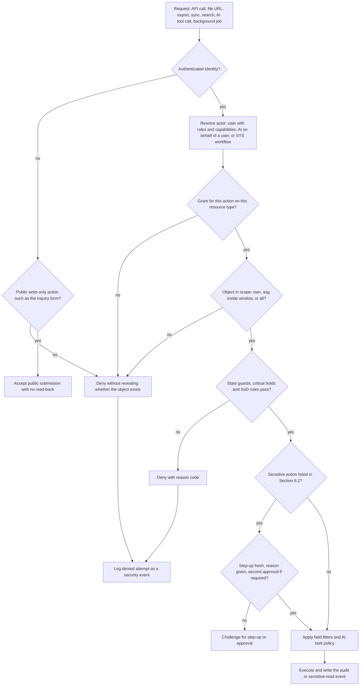
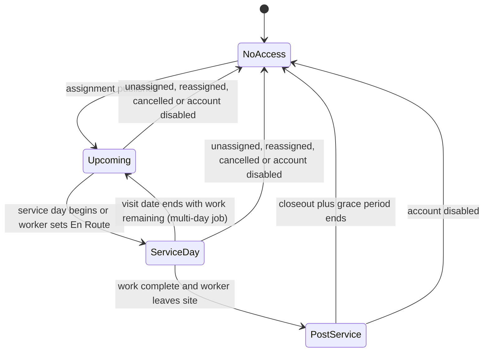

# 27 - Roles and Permissions

> **Status:** Draft - AI-generated planning document, not approved · **Owner/domain:** Security / identity and access · **Last updated:** 2026-10-03
> **Human review required:** Owner (who holds each role at launch, approval authorities and limits, acceptance of separation-of-duties compensating controls); privacy owner (OWN-007: field and note classes, the worker access window, photo-sharing channels and access-secret handling); bookkeeper or CPA (cash/check reconciliation, refund, credit and write-off authority, tax settings); attorney licensed in KY and/or IN (customer approval identity, who may act for a customer, employee phone and monitoring rules, subcontractor access, card-on-file and photo-delivery wording in the draft agreements); payroll professional (time-entry corrections); qualified safety professional (list of non-overridable critical holds); local permitting or licensing authority (START-010 prerequisites per municipality).
> **Related:** [Requirements spec](../Requierments/HandyHub_Requirements_Specification_Reconstructed.md) · [Master prompt](../HandyHub%20Master.md) · [05 Domain model](05-domain-model.md) · [06 State machines](06-state-machines.md) · [11 Worker job execution](11-worker-job-execution.md) · [12 Security threat model](12-security-threat-model.md) · [13 Privacy and data governance](13-privacy-data-governance.md) · [16 Testing strategy](16-testing-quality-strategy.md) · [33 AI and automation governance](33-ai-and-automation-governance.md)

## 1. Purpose, scope and evidence

### 1.1 What this document governs

This is the single source of truth for who may do what in the HandyHub application: the role catalog, the role x resource x action matrix with scopes, object-level authorization (BOLA) rules, sensitive-action controls, MFA, the account lifecycle, separation of duties for a two-person field team, AI and automation permissions, the PROPOSED launch role assignment (HND-007), and the PROPOSED `AUTH-` requirements with test hooks for [16](16-testing-quality-strategy.md).

Owned elsewhere and linked instead of repeated: session lifetimes, credential storage, brute-force and device threats ([12](12-security-threat-model.md)); retention periods, privacy requests and the data inventory ([13](13-privacy-data-governance.md)); transition tables ([06](06-state-machines.md)); infrastructure and database administrator access ([15](15-devops-infrastructure.md)); detailed AI task policies ([33](33-ai-and-automation-governance.md)); field gate content ([11](11-worker-job-execution.md)).

Precedence: requirement text in the spec wins. Everything here that the spec does not state is a **PROPOSED DECISION** until the owner approves it. Implementation can start on it because the matrix is stored as policy data (AUTH-002, AUTH-032), so approved changes become configuration edits rather than rewrites.

### 1.2 Evidence baseline

- **FACT** (spec §2, §2.1, §15, §18, §19.3): 11 roles (ROLE-001..ROLE-011) with access boundaries, and PERM-001..PERM-007 (§2, §2.1). AT-046..AT-053 (§18) test permission boundaries. NFR-006 (§15) requires "MFA for privileged users, session controls, least privilege". HND-007 (§19.3): "Configure roles for the two initial employees using least privilege; do not pre-grant future subcontractor permissions."
- **FACT** (master §11): consider at minimum customer, worker, admin/owner, future subcontractor and a system/automation identity; "Do not rely only on hiding UI buttons."; "Enforce permissions on the server."; sensitive actions need re-authentication or stronger confirmation, audit logs and reason capture; "Evaluate MFA for administrative users."; document account recovery, worker termination/offboarding and session revocation. Master §10: "Use object-level authorization for every resource access."
- **FACT** (owner operating context recorded 2026-10-02, [operating-context.md](../Skills/Business%20direction/handyhub-job-planner/references/operating-context.md)): "Initially two employees; hire with demand, subcontractors later. Do not count the owner as an additional worker without confirmation." · "Sending messages, publishing, spending, refunds, binding commitments and access changes require applicable explicit authorization." · "Unknown is not safe; acknowledgment cannot bypass critical holds." · "Payment provider not selected. Received checks are not cleared money." · "enforce authorization outside the model. ... Retrieve only necessary data. Do not expose credentials, access codes, card details or private photos."
- **GAP**: the spec has no role x resource x action matrix; no system/automation identity (ROLE-011 covers AI only); no account recovery, session revocation or re-authentication rule; no customer authentication method for approvals although STG-005 records "identity" and PERM-005 protects "signed approvals"; and no separation-of-duties rule for a team where one person holds several roles.

### 1.3 Issues resolved or routed by this document

Format: Problem -> Evidence -> Impact -> Correct expertise -> Proposed change -> Dependencies -> Validation.

| # | Problem | Evidence | Impact | Correct expertise | Proposed change | Dependencies | Validation |
|---|---|---|---|---|---|---|---|
| 1 | Approvers are never named | PERM-004 "Only authorized roles can alter price, discount, tax, deposit, refund, write-off, or payment status."; FIN-001 "authorized exception"; START-008 "authorized reason"; START-010 "unless prerequisite status is approved"; AT-049 "authorized share classification" | Developers hard-code guesses; enforcement differs by screen | business-systems-administrator ("Define who may move each state and what evidence is required.") | Section 4 matrix; Section 6.3 override authority | Owner limits (Q-27-04) | Section 13 hook 1 |
| 2 | No system/automation identity | Master §11 lists "system/automation identity"; ROLE-011 is the AI identity only | Automations run as an administrator (over-privileged) or unattributed | swe-architecture; business-it-security-administrator ("auditable service accounts") | SYS identity (AUTH-003, Section 10.4) | Automation registry in [33](33-ai-and-automation-governance.md) | Hook 18 |
| 3 | Supervisor identity is ambiguous with two employees | ROLE-004 merges "Lead Worker / Field Supervisor"; START-001 "authorized supervisor override"; JOB-012 "owner/supervisor action queue" | The person doing the work could approve their own exceptions | business-systems-administrator; quality-assistant playbook ("Prevent a worker's self-check from replacing required supervisor inspection.") | Per-job lead designation (D-27-18); Sections 6.3 and 9 | Lead designation (Q-27-10) | Hooks 14, 17 |
| 4 | Overrides could bypass safety holds | Spec §1.2 BLOCKING GATE "... or an authorized override is recorded"; PERM-006; owner: "acknowledgment cannot bypass critical holds" | A recorded override could authorize unsafe or unlicensed work | handyhub-risk-triage and handyhub-job-planner playbooks (consulted) | Non-overridable critical holds (AUTH-012, Section 6.3) | **HUMAN REVIEW: qualified safety professional** (Q-27-15) | Hook 14 |
| 5 | "Privileged users" undefined for MFA | NFR-006 "MFA for privileged users" | MFA scope disputes; the weakest office account becomes the entry point | business-it-security-administrator | Definition and policy (Section 7, AUTH-016) | Factors in [12](12-security-threat-model.md) | Hook 15 |
| 6 | No recovery, revocation, re-authentication or offboarding procedure | Master §11; spec has only NFR-006 "session controls" and AT-051 | A former employee or a lost phone keeps access | business-it-security-administrator ("on departure revoke access/sessions/tokens") | Sections 6 and 8 (AUTH-013, AUTH-019..AUTH-022) | Lifetimes in [12](12-security-threat-model.md) | Hooks 10, 13, 16, 26 |
| 7 | Separation of duties is impossible with two employees | Owner fact on staffing; FIN-004 "collector" versus ROLE-008 "cash/check reconciliation"; no SoD rule | Undetected cash, refund or discount loss | business-systems-administrator; job-costing and bookkeeping skills (consulted) | Section 9 compensating controls (AUTH-023, AUTH-024) | Owner and CPA (Q-27-02, Q-27-03) | Hook 17 |
| 8 | Field credential handling contradicts the service cards | C-HI05-01 (critical, confirmed): plan and SOP have workers program master and guest codes, while HI-05.SAF says "have customer control personal account/password"; C-CL05-01 (critical, confirmed) includes missing access-code protection (CL-05.SAF "protect access codes"); COM-002 only "should avoid exposing lockbox codes" | Customer property security and liability exposure | business-privacy-data-owner ("gate/access codes"); business-systems-administrator ("Do not use free-text notes as a secret vault.") | Field classes (Section 4.7, AUTH-009) | **HUMAN REVIEW: privacy owner + attorney**; SOP wording via [31](31-sop-standard.md) | Hook 22 |
| 9 | Customer approval identity undefined | STG-005 "System records timestamp, version, identity"; PERM-005 "signed approvals"; CX-003 versioned approvals | Disputed approvals; an unauthorized person approves work | swe-architecture (identity); legal review | AUTH-027, AUTH-028, Section 5.5 | **HUMAN REVIEW: attorney** (Q-27-06, Q-27-07) | Hooks 23, 24 |
| 10 | AI tier conflict | NEAR-002 places AI workspaces in P1, while HND-008 "Run all 60 acceptance tests in staging ... before launch" includes AT-052 and AT-053 | Launch blocked, or AI shipped untested | swe-architecture ("Enforce authorization outside the model") | D-27-13: AI disabled at launch; AT-052/AT-053 run now as negative tests and in full at NEAR-002 | Owner via [33](33-ai-and-automation-governance.md) and [18](18-release-and-launch-plan.md) (Q-27-14) | Hooks 11, 12 |
| 11 | Job photos leave the system through personal channels | CL-05 SOP ([sop Airbnb Cleaning and Turnover Checklist](../Standard%20Of%20Operations/sop%20Airbnb%20Cleaning%20and%20Turnover%20Checklist.md)): "upload them to the host portal" and "text them to the property owner as proof of readiness"; CL-05 agreement ([contract-airbnb-turnover](../Service%20Agreements/contract-airbnb-turnover.md)): "photos will be sent instantly to the Client"; REC-002 requires an internal-only or customer-shareable class on every photo | Interior and guest-property photos (and any access code in frame) bypass classification, the communication log (JOB-009) and offboarding, and stay in personal camera rolls and personal cloud backups | business-privacy-data-owner ("Limit public links, bulk exports, personal accounts, and vendor access."); owner fact "Do not expose credentials, access codes, card details or private photos." | In-app capture and in-app sharing only (AUTH-034, D-27-19, Section 4.6) | Channel decision (Q-27-16); SOP and agreement wording via [31](31-sop-standard.md) and [30](30-service-agreement-standards.md); **HUMAN REVIEW: privacy owner** | Hook 28 |
| 12 | Draft agreements assume a stored payment card although no provider is selected | CL-01 agreement ([contract-routine-cleaning](../Service%20Agreements/contract-routine-cleaning.md)): "authorized to bill the Client’s card on file"; CL-05 agreement ([contract-airbnb-turnover](../Service%20Agreements/contract-airbnb-turnover.md)): "billed automatically to the credit card or payment channel authorized on file"; CL-06 agreement ([contract-hotel-housekeeping](../Service%20Agreements/contract-hotel-housekeeping.md)): "billed and captured"; owner fact "Payment provider not selected." | Staff may take card numbers by phone or message and keep them in notes, messages or spreadsheets, where no control applies; HandyHub records would come into card-data scope | business-systems-administrator ("Never put full card details in the CRM or ordinary documents."); business-privacy-data-owner ("Never collect raw card data in ordinary records.") | No card number is entered into HandyHub records; a card on file can only be a provider-held token; free-text fields reject card-number patterns (AUTH-035, D-27-20, Section 4.7) | Provider decision ([28](28-pricing-estimating-and-job-costing.md), [07](07-system-architecture.md)); agreement wording via [30](30-service-agreement-standards.md); **HUMAN REVIEW: attorney** (auto-billing terms) (Q-27-17) | Hook 32 |

### 1.4 Specialist expertise applied

| Skill | Rule applied (quoted) | Where |
|---|---|---|
| [business-it-security-administrator](../Skills/Website%2C%20software%2C%20and%20cybersecurity/business-it-security-administrator/references/playbook.md) | "Use least privilege, individual accounts, separate admin roles, and auditable service accounts." · "Enroll recovery methods and a controlled emergency-access path before enforcing policies that could lock out the owner." · "on departure revoke access/sessions/tokens, transfer business records, remove delegated access, and recover assets" · "a lost personal device does not automatically authorize wiping all personal data" · [verification](../Skills/Website%2C%20software%2C%20and%20cybersecurity/business-it-security-administrator/references/verification.md): "Confirm least-privileged users can perform required work and cannot access restricted functions." · "revoke compromised sessions/tokens" | Sections 3, 6.2, 7, 8, 13 |
| [business-systems-administrator](../Skills/Website%2C%20software%2C%20and%20cybersecurity/business-systems-administrator/references/playbook.md) | "Define who may move each state and what evidence is required." · "Restrict bulk export, refunds, bank-detail changes, and deletion." · "Do not use free-text notes as a secret vault." · "Never put full card details in the CRM or ordinary documents." | Sections 4, 6, 9 |
| [business-privacy-data-owner](../Skills/Website%2C%20software%2C%20and%20cybersecurity/business-privacy-data-owner/references/playbook.md) | "Specify who needs each category and why." · "Defer exact addresses or detailed photos until operationally useful." · "Separate job documentation from publication permission." · "verify identity proportionately without collecting excessive new data" · "Never collect raw card data in ordinary records." | Sections 1.3, 4.6, 4.7, 4.8, 5.2, 8.3, 8.4 |
| [swe-architecture](../Skills/Website%2C%20software%2C%20and%20cybersecurity/swe-architecture/references/contracts-security.md) | "Enforce authorization on every server operation, object, field, tenant, export, and background job as applicable. Deny by default; do not rely on hidden buttons or unpredictable IDs." · "Specify session lifetime, rotation, revocation, logout, recovery, enrollment, MFA/passkeys if needed, account enumeration resistance, and sensitive-action reauthentication." · "Enforce authorization outside the model" · [discovery](../Skills/Website%2C%20software%2C%20and%20cybersecurity/swe-architecture/references/discovery.md): "Define permissions separately from personas." | Sections 2, 5, 10, 12 |
| Consulted for specific rules | [customer-service playbook](../Skills/Branding%2C%20marketing%2C%20social%20media%2C%20and%20sales/handyhub-customer-service/references/playbook.md): "A refund request creates a review item, not an automatic refund." and "A caller claiming to be a landlord cannot receive a tenant's records without authorization." · [quality-assistant playbook](../Skills/LLC%2C%20legal%20administration%2C%20and%20risk/handyhub-quality-assistant/references/playbook.md): "Prevent a worker's self-check from replacing required supervisor inspection." · [job-planner playbook](../Skills/Business%20direction/handyhub-job-planner/references/playbook.md): "Acknowledging a warning cannot clear a hard safety hold." · [risk-triage playbook](../Skills/LLC%2C%20legal%20administration%2C%20and%20risk/handyhub-risk-triage/references/playbook.md): "Signing a checkbox cannot bypass an unresolved structural hazard." · [job-costing playbook](../Skills/bookkeeping%2C%20taxes%2C%20profitability%2C%20and%20cash/handyhub-job-costing/references/playbook.md): "A check received is not cleared money" · [scheduling playbook](../Skills/Business%20direction/handyhub-scheduling/references/playbook.md): "A check awaiting clearance does not satisfy a cleared-deposit gate." · [swe-implementation backend](../Skills/Website%2C%20software%2C%20and%20cybersecurity/swe-implementation/references/backend.md): "Do not trust a client-provided owner, role, price, or tenant identifier." · [swe-quality-delivery verification](../Skills/Website%2C%20software%2C%20and%20cybersecurity/swe-quality-delivery/references/verification.md): "identifier substitution, list/search/export leakage, cached responses, and background jobs" | Sections 5, 6, 9, 13 |

## 2. Authorization model

### 2.1 Principles (PROPOSED DECISION D-27-01)

1. Deny by default, enforced on the server for every operation, object, field, file URL, export, search, sync action and background job (AUTH-001). Hiding a button is a usability choice, never the control.
2. Roles are capability bundles stored as versioned policy data, separate from people (AUTH-002). One person may hold several roles; the effective permission is the union of their roles, minus separation-of-duties blocks (Section 9, D-27-03).
3. Every grant has a scope: `own`, `asg` (assigned, inside the access window) or `all` (AUTH-004..AUTH-007). Scope comes from server-side relationships, never from identifiers the client sends.
4. Field classes filter what a permitted reader sees: price, cost and margin, access secrets, check images, injury details, HR, legal and fraud notes (AUTH-008, Section 4.7).
5. State guards apply after the permission check: approved, issued and acknowledged records are immutable; corrections use void, reverse or supersede (PERM-005, REC-001, AUTH-010).
6. Approvals, overrides and other sensitive actions need the right person, a reason and, where listed, step-up re-authentication. Some holds cannot be overridden by anyone (Section 6).
7. AI never has standing access: it acts inside the invoking user's permissions intersected with its task policy (AIC-002). Deterministic automations run as named SYS identities with enumerated actions (Section 10).
8. Display language never changes permissions, approvals or reasons; reasons are stored as language-independent codes plus free text (PERM-007).

### 2.2 Decision pipeline



### 2.3 Actor types

| Actor | Authenticates as | Audit attribution |
|---|---|---|
| Staff user | Named individual account with MFA (Section 7) | User ID plus the effective roles and capabilities used |
| Customer or authorized contact | Customer account or a version-bound secure link (AUTH-027, AUTH-029) | Contact ID plus channel |
| Guest | Unauthenticated public form | Submission ID |
| AI assistant (ROLE-011) | The invoking user's session plus the AI role task policy | AI role (AIR-001..AIR-016) on behalf of the user ID |
| SYS workflow | Non-interactive service credential (secret handling in [15](15-devops-infrastructure.md)) | Workflow name plus the triggering record |

## 3. Role catalog

### 3.1 Mapping to the master minimum roles

| Master §11 minimum role | HandyHub roles |
|---|---|
| customer | ROLE-002 Customer; ROLE-001 Guest / Prospect before an account or link exists |
| worker | ROLE-003 Worker / Employee; ROLE-004 Lead Worker / Field Supervisor |
| admin/owner | ROLE-009 Administrator / Owner, plus the office sub-roles ROLE-005 Dispatcher / Scheduler, ROLE-006 Estimator, ROLE-007 Customer Service, ROLE-008 Bookkeeper / Accounting |
| future subcontractor | ROLE-010 Subcontractor (future); not provisioned at launch (HND-007, NEAR-004) |
| system/automation identity | SYS (new, AUTH-003, D-27-02) for deterministic workflows; ROLE-011 AI Assistant Role for AI acting on behalf of a user |

Column codes used in the matrices (labels, not requirement IDs): GST = ROLE-001 · CUS = ROLE-002 · WKR = ROLE-003 · LWK = ROLE-004 · DSP = ROLE-005 · ESTR = ROLE-006 · CSR = ROLE-007 · BKP = ROLE-008 · ADM = ROLE-009 · SUB = ROLE-010 · AI = ROLE-011 · SYS = system/automation identity. Name collisions to keep apart in code: ROLE-007 Customer Service (human) versus AIR-012 Customer Service (AI); ROLE-005 Dispatcher / Scheduler versus AIR-008 Scheduling.

### 3.2 Role catalog

Launch holders are **PROPOSED** (Section 11). The owner is not counted as a field worker (owner fact). Text in quotes is spec-stated; the rest is PROPOSED.

| ID | Role | Purpose (spec §2) | Launch holder (PROPOSED) | Data scope | Prohibited actions |
|---|---|---|---|---|---|
| ROLE-001 | Guest / Prospect | Browse services, service area and trust information; submit an inquiry or estimate request | Public visitors | Public content; write-only inquiry with photos (AT-004) | "cannot view private job data"; no read-back of what was submitted |
| ROLE-002 | Customer | View own estimates, approvals, appointments, messages, invoices, payments and explicitly shared photos/documents | Customers and authorized contacts (AUTH-028) | Own customer record, linked properties and jobs; customer-visible versions and classes only | "cannot view internal notes or other customers"; no internal-only photos (AT-049); no worker private data beyond policy (SCH-006) |
| ROLE-003 | Worker / Employee | View assigned jobs and required operational data; create field documentation | Employee 1 and Employee 2 | Assigned jobs inside the access window (Section 5.2); own time entries, expenses and collections | "cannot change financial policy, delete audit records, or view unrelated customer records"; cannot bind the customer to extra work (JOB-005); cannot change payments or reconciliation (AT-046); cannot authorize own gate exceptions |
| ROLE-004 | Lead Worker / Field Supervisor | Worker rights plus "approved field overrides, quality checks, incident escalation, team coordination and limited change-order preparation" | Employee 1 (owner designates, Q-27-10) | As ROLE-003; lead powers apply only on jobs where the user is the designated lead worker (SCH-002, D-27-18) | Override a critical hold; verify own supervisor-required work; set prices; approve for the customer |
| ROLE-005 | Dispatcher / Scheduler | Assignments, availability, arrival windows, routing notes, readiness, rescheduling, customer notifications | Owner (ASSUMPTION that the owner runs the office, Q-27-01) | All jobs and schedules; customer contact fields; deposit status for readiness; staff directory (name, phone for dispatch, qualification tags), never HR fields | Waive deposits; edit scope or price; send outside approved templates and the auto-send policy; read the audit log |
| ROLE-006 | Estimator | Estimate inputs, measurements, pricing drivers, scope, exclusions, alternates and revisions "subject to pricing permissions" | Owner (Q-27-01) | All leads, customers, properties and estimates; price book read; cost and margin on estimates they prepare | Approve own below-minimum exception or a discount above the limit; edit the price book; change an approved estimate (REC-001); record a customer approval |
| ROLE-007 | Customer Service | Leads, customer communications, complaints, follow-ups and "non-financial job coordination" | Owner (Q-27-01) | All leads, customers, communications and complaints; read-only financial status | Alter price, discount, tax, deposit, refund, write-off or payment status (PERM-004); promise refunds, discounts or warranty; read access secrets (write-only) |
| ROLE-008 | Bookkeeper / Accounting | Invoices, payments, cash/check reconciliation, deposits, receivables, vendor/subcontractor records, accounting exports | External bookkeeper or CPA if engaged, otherwise the owner (Q-27-02) | All financial records; billing fields; job financial status | "no unrestricted field-data access unless needed"; reconcile own field collections; approve own refund requests; roles and configuration |
| ROLE-009 | Administrator / Owner | "Full operational administration, policy configuration, user/role management, exception approvals, reporting and audit access" | Owner | All | Delete protected records (PERM-005); edit audit events; override critical holds; skip step-up; start a job as an unassigned person; read customer device credentials (never stored) |
| ROLE-010 | Subcontractor (future) | "Only assigned work package, approved site briefing, required safety/SOP/material information, submission of field evidence and limited messaging" | None at launch | Assigned work packages (ENT-006) only | "no broad customer/accounting access"; other jobs; prices; direct customer contact unless granted |
| ROLE-011 | AI Assistant Role | "Role-scoped advisory/automation identity" | None active at launch (D-27-13) | The invoking user's scope intersected with the task policy | "Must never gain permissions merely because it can generate text"; approve, send, override, financial changes, exports (Section 10.3) |
| SYS | System / automation identity (new) | Deterministic workflows (Section 10.4) | One service identity per workflow | Declared actions only | Interactive login; approvals; overrides; price, payment or role changes; exports outside a defined job |

### 3.3 Not application roles

- OWN-001..OWN-007 (spec §13) are engineering and operations responsibilities, not app roles. If the IT / cybersecurity administrator (OWN-006) or website maintainer (OWN-003) is a separate person or vendor, their infrastructure access is governed in [15](15-devops-infrastructure.md) by the same rules: named accounts, MFA, least privilege and audited break-glass. Direct database edits bypass application authorization and audit, so they are allowed only through that break-glass path (handoff to [12](12-security-threat-model.md)).
- Developers and AI coding agents get no production credentials and no production personal data (NFR-015; swe-architecture: "Never use private production data in development casually").

## 4. Permission matrix

### 4.1 Notation

- Actions: `V` view · `C` create · `E` edit (editable states only) · `A` approve, accept, issue, activate, confirm or verify · `X` void, reverse, supersede, cancel or deactivate · `O` override with reason (only where Section 6.3 allows) · `Ex` export.
- There is no delete action. Protected records are never deleted (PERM-005); drafts are discarded with `X`. The only removals are retention disposal and privacy erasure executed by the [13](13-privacy-data-governance.md) procedure, both audited (AUTH-010, D-27-14).
- Scope after the colon: `own` (the actor is the customer or authorized contact of the record, or its author or subject) · `asg` (linked to a job or work package the actor is assigned to, or holds a valid share grant for, inside the access window) · `all` · `pub` (public, write-only) · `inv` (AI: the invoking user's cell intersected with the task policy; drafts only) · `sys` (declared SYS workflow only). Groups are separated by semicolons.
- `(f)` field-limited: see Section 4.7 and the per-resource rules in Section 4.6. `(cap)` only with a named capability (below). `—` no access.
- The Section 4.7 field classes and Section 4.8 note classes apply to every cell, including cells without `(f)`; `(f)` marks cells where the filter removes a large part of the record. Where a cell and a class rule differ, the more restrictive rule wins.
- Every cell is a **PROPOSED DECISION** derived from the cited spec text. Approval of this document turns the cells into the policy data of AUTH-002.
- SYS cells list only what a declared workflow in the Section 10.4 table needs; a SYS `C` or `E` cell includes reading the records that workflow writes.

Named capabilities: nobody holds one unless ADM grants it to a named user with step-up and a reason, audited. The "Default holders" column lists the PROPOSED grants that accompany a role assignment; each still needs owner authorization per person.

| Capability | Grants | Default holders (PROPOSED) | Basis |
|---|---|---|---|
| collect | Record cash or check payments on assigned jobs and issue the receipt; see the balance due on those jobs | Nobody until the owner decides (Q-27-03) | QA-007 "Worker may record allowed payment methods according to role"; FIN-004; FIN-005 |
| field-override | Field gate overrides allowed in Section 6.3 | ROLE-004 on jobs where designated lead | ROLE-004 "approved field overrides"; PERM-006 |
| qa-verify | Supervisor QA verification and QA exceptions, never on own work | ROLE-004 on jobs where designated lead | QA-001; quality-assistant playbook |
| share-grant | Create explicit share grants (Section 5.3) | ROLE-005, ROLE-009; ROLE-004 for jobs where designated lead | PERM-002 |
| photo-share | Reclassify photos from internal-only to customer-shareable | ROLE-004 (asg), ROLE-007, ROLE-009 | REC-002; AT-049 |
| customer-contact | Subcontractor may see and use the site contact channel | Nobody | ROLE-010 "limited messaging" |

### 4.2 Matrix A - customer, sales and estimating

| Resource | GST | CUS | WKR | LWK | DSP | ESTR | CSR | BKP | ADM | SUB | AI | SYS |
|---|---|---|---|---|---|---|---|---|---|---|---|---|
| Lead / request | C:pub | V C:own | — | — | V:all | V E:all | V C E A X:all | — | V C E A X Ex:all | — | inv | C E:sys |
| Customer | — | V E:own (f) | V:asg (f) | V:asg (f) | V:all (f) | V:all (f) | V C E A:all | V E:all (f) | V C E A X Ex:all | V:asg (f) | inv | V:sys |
| Contact and representative authority | — | V C E:own | V:asg (f) | V:asg (f) | V:all | V:all | V C E A:all | V:all (f) | V C E A X Ex:all | V:asg (f, cap) | inv | V:sys |
| Property / site | — | V E:own (f) | V C:asg (f) | V C:asg (f) | V E:all | V E:all (f) | V C E:all (f) | V:all (f) | V C E X Ex:all | V:asg (f) | inv | — |
| Estimate and revisions | — | V A:own | V:asg (f) | V:asg (f) | V:all (f) | V C E A X:all | V:all (f) | V:all | V C E A X O Ex:all | — | inv | V:sys |
| Price book and pricing rules | — | — | — | — | — | V C:all | V:all (f) | V:all | V C E A X Ex:all | — | inv | — |

### 4.3 Matrix B - field operations

| Resource | GST | CUS | WKR | LWK | DSP | ESTR | CSR | BKP | ADM | SUB | AI | SYS |
|---|---|---|---|---|---|---|---|---|---|---|---|---|
| Job | — | V:own (f) | V E:asg | V E:asg; O:asg (cap) | V E X:all | V:all (f) | V E:all (f) | V:all (f) | V C E A X O Ex:all | V E:asg (f) | inv | C E:sys |
| Briefing and acknowledgements | — | — | V C:asg | V C A:asg | V E:all | V:all | V:all (f) | — | V E A:all | V C:asg (f) | inv | C:sys |
| SOP / service card | — | — | V:asg | V C:all | V:all | V C:all | V:all (f) | — | V C E A X:all | V:asg | inv | V:sys |
| Hazard template | — | — | V:asg | V C:all | V:all | V:all | — | — | V C E A X:all | V:asg | inv | — |
| Schedule, appointment, availability | — | V C:own | V:own, asg; C:own; E:asg | V:asg; C:own; E:asg | V C E A X O:all | V C:all | V C:all | — | V C E A X O Ex:all | V E:asg (f) | inv | V:sys |
| Time entry | — | — | V C:own | V C:own; V:asg | V:all (f) | — | — | V Ex:all | V A X Ex:all | V C:own | inv | C:sys |
| Materials, tools, inventory | — | — | V E:asg (f) | V E A:asg (f) | V E:all (f) | V E:all | — | V:all | V C E A X Ex:all | V E:asg (f) | inv | V:sys |
| Purchase / expense | — | — | V C:own | V C:own; V:asg | — | — | — | V E X:all | V C E A X Ex:all | — | inv | — |
| Change order | — | V A:own | V C:asg | V C E:asg | V:all (f) | V C E A X:all | V:all (f) | V:all | V C E A X O:all | V C:asg | inv | V E:sys |
| Incident and emergency-stabilization record | — | — | C:asg; V:own | C:asg; V E:asg (f) | V C:all (f) | — | V:all (f) | V:all (f) | V C E A X Ex:all | C:asg; V:own | inv | E:sys |
| QA check and punch item | — | V C A:own | V C E:asg | V C E:asg; A O:asg (cap) | V:all | V:all | V:all | V:all (f) | V C E A X O:all | V C E:asg | inv | E:sys |
| Complaint and rework case (added) | — | V C:own | V:asg (f) | V E:asg (f) | V:all (f) | V:all (f) | V C E A:all | V:all (f) | V C E A X Ex:all | V:asg (f) | inv | E:sys |

### 4.4 Matrix C - finance

| Resource | GST | CUS | WKR | LWK | DSP | ESTR | CSR | BKP | ADM | SUB | AI | SYS |
|---|---|---|---|---|---|---|---|---|---|---|---|---|
| Invoice | — | V:own | V:asg (f, cap) | V:asg (f, cap) | V:all (f) | V:all | V:all | V C E A X Ex:all | V C E A X O Ex:all | — | inv | C E:sys |
| Payment (cash and check; provider later) | — | V:own | C:asg (cap); V:own | C:asg (cap); V:own | — | — | V:all (f) | V C E A X Ex:all | V C E A X Ex:all | — | inv | E:sys (P1) |
| Deposit, refund, credit, write-off | — | V C:own | — | — | V:all (f) | V:all (f) | V C:all (f) | V C E Ex:all | V C E A X O Ex:all | — | inv | V:sys |

### 4.5 Matrix D - records, communications and administration

| Resource | GST | CUS | WKR | LWK | DSP | ESTR | CSR | BKP | ADM | SUB | AI | SYS |
|---|---|---|---|---|---|---|---|---|---|---|---|---|
| Photo / file | C:pub | V C:own (f) | V C:asg (f) | V C:asg (f); A:asg (cap) | V:all (f) | V C:all (f) | V C A:all (f) | V:all (f) | V C A X Ex:all | V C:asg (f) | inv | C E:sys |
| Internal and sensitive notes | — | — | V C:asg (f) | V C:asg (f) | V C:all (f) | V C:all (f) | V C:all (f) | V C:all (f) | V C X:all | V:asg (f) | inv (f) | — |
| Communication (messages and log) | — | V C:own | V C:asg | V C:asg | V C:all | V C:all | V C E:all | V C:all (f) | V C X Ex:all | V C:asg (f) | inv | C E:sys |
| Notification template | — | — | — | — | V:all | V:all | V C E:all | V:all (f) | V C E A X:all | — | inv | V:sys |
| Reports and dashboards | — | — | V:own (f) | V:asg (f) | V:all (f) | V:all (f) | V:all (f) | V Ex:all (f) | V Ex:all | — | inv | — |
| Users, roles, capabilities | — | V E:own | V E:own | V E:own | V:all (f); E:own | V E:own | V E:own | V E:own | V C E A X Ex:all | V E:own | — | V:sys (f) |
| Configuration and business policy | — | — | — | — | V E:all (f) | V:all (f) | V:all (f) | V:all (f) | V E A X:all | — | — | V:sys |
| Audit log | — | — | — | — | — | — | — | V:all (f) | V Ex:all | — | — | C:sys |
| AI workspace (when enabled) | — | — | V C:own | V C:own | V C:own | V C:own | V C:own | V C:own | V C:all | — | — | — |
| Exports | — | Ex:own (f) | — | — | — | — | Ex:all (f) | Ex:all (f) | Ex:all | — | — | Ex:sys (P1) |

### 4.6 Per-resource rules

| Resource | Rules beyond the matrix | Sources |
|---|---|---|
| Lead / request | Public submissions are write-only for GST; the confirmation must not imply a booking. SYS may flag duplicate candidates; only CSR or ADM merge (A), and both originals stay linked. Conversion to an estimate by CSR, ESTR or ADM. | ROLE-001, ROLE-007, ENT-003, RECT-001, CX-002, NTF-001, LAUNCH-002, AIR-010 |
| Customer | Billing fields: BKP, CSR and ADM only. Marketing consent changes only by the customer, or by CSR or ADM recording the customer's instruction with evidence. Changing the email or phone on file notifies the previous contact (AUTH-019). Merge (A) needs review; deactivation (X) is ADM-only. | ENT-001, ROLE-002, COM-004, REC-005 |
| Contact and representative authority | Field roles see only the approved site contact and channel. Approval, financial or access authority is a flag that only CSR or ADM sets, with evidence (AUTH-028, Section 5.5). | BRF-002, QA-004, CL-03.INT, CL-05.INT, DW-04.INT |
| Property / site | Profile reuse needs per-job reconfirmation. Field roles create site observations and site-specific hazards; they do not edit the profile. Access secrets follow Section 4.7. **PROPOSED**: a one-time access secret is cleared at job closeout; a secret is kept for recurring service only on the customer's instruction and is reconfirmed for each job. Customer keys held by HandyHub (the CL-01 draft agreement already offers entry by "Key / Lockbox Code / In-Person Entry", [contract-routine-cleaning](../Service%20Agreements/contract-routine-cleaning.md)) are custody items: issue and return are logged per person and the key tag carries a code, never the address. No worker location tracking. | ENT-002, CX-005, BRF-002, BRF-003, SCH-004 |
| Estimate and revisions | Customers see sent versions only. Approved versions are immutable; changes create a revision or a change order. ESTR may send (A) only when no exception is pending; below-minimum exceptions and discounts above the configured limit need ADM (O, Section 6.3). AI drafts only, never A or X (AT-053). Field roles see scope and exclusions without prices unless they hold collect. | EST-001..EST-007, CX-003, FIN-001, PERM-004, REC-001, AT-005, AT-007, AT-053, AIR-011 |
| Price book and pricing rules | Versioned with effective dates and preview; activation by ADM with step-up. The owner has supplied no numeric rates, wages, production factors, tax rates or profit targets (owner fact); the dollar figures in the 26 draft `Pricing/` files are unapproved, so no value becomes active without an owner decision ([28](28-pricing-estimating-and-job-costing.md)). Tax settings: **HUMAN REVIEW: CPA**. | BIZ-003, BIZ-004, MOD-010, NFR-013, NFR-019, PERM-004 |
| Job | Transitions are validated server-side against [06](06-state-machines.md). Field roles move only their assigned job through worker transitions (en route, arrived, start through the gates, pause, No Start, completion request). Cancel (X) needs a reason and records the customer-notification outcome. After closeout, corrections are ADM-only. | ENT-005, STM-003, SCH-002, SCH-006..SCH-008, CX-006, QA-011, START-001, NFR-020 |
| Briefing and acknowledgements | Acknowledgements are personal; nobody acknowledges for another person. The snapshot acknowledged at start is immutable. DSP edits set the "changed" flag. LWK A is the high-risk supervisor confirmation, never for their own start. | RECT-005, BRF-001..BRF-014, START-002..START-004, START-014, AT-014, AT-027 |
| SOP / service card | Only active approved versions reach briefings. Activation (A) requires a recorded competent review and Spanish review (owner fact: "No active field SOP until competent review"); retire (X) keeps history. **HUMAN REVIEW: qualified safety and trade reviewers; bilingual reviewer.** | ENT-007, ENT-008, NFR-013, LAUNCH-009, HND-004 |
| Hazard template | As for SOPs. An edit that removes or weakens a control needs a recorded safety review. Site hazards added by field or office roles never overwrite template hazards. | ENT-009, BRF-007, AT-018, HND-004 |
| Schedule, appointment, availability | Customer actions are requests, not changes. Conflict override (O) by DSP or ADM with reason. History is kept. AI suggests only. | SCH-001..SCH-007, CX-002, CX-006, AT-011, AT-012, AIR-008 |
| Time entry | Events are append-only. Corrections are requests approved by ADM; nobody approves their own. **HUMAN REVIEW: payroll professional** for the timekeeping policy. | JOB-002, START-014 |
| Materials, tools, inventory | Field roles see quantities, specifications and approved purchasing limits, not unit cost or margin. Usage entries never change customer price. Substitutions that affect appearance, specification, warranty, safety, cost or expectation go to customer approval; LWK A covers only like-for-like substitutions with no customer-visible effect. | ENT-010, ENT-011, FIN-007, JOB-007, AT-021, AT-037 |
| Purchase / expense | Spending above the purchasing limit needs ADM approval; limits are owner decisions and none are supplied. BKP categorizes; **HUMAN REVIEW: CPA** for accounting treatment. | FIN-007; master §5 file 05 (Purchase, Expense; not in spec §14) |
| Change order | A worker or subcontractor request is not approval. LWK prepares the scope and time delta; ESTR sets the price delta. Customer approval binds one version. Emergency stabilization is a separate record. | ENT-013, RECT-004, JOB-005, JOB-006, FIN-008, CX-003, AT-032..AT-034 |
| Incident and emergency-stabilization record | Reporters see their own reports. Injury and medical fields: ADM and the injured worker only. Closing (A) is ADM-only. AI cannot close an incident or declare a site safe. **HUMAN REVIEW: insurer and attorney; qualified safety professional for OSHA conclusions; medical decisions by qualified medical professionals.** | ENT-014, RECT-007, JOB-008, JOB-012, STM-006, AT-035, AIR-001, AIR-003 |
| QA check and punch item | The performer never verifies their own supervisor-required checks. Safety-critical checks cannot be excepted (Section 6.3). Punch items persist through invoicing. Customers create punch items and record walkthrough acceptance. | ENT-015, STM-007, QA-001..QA-005, AT-039..AT-042 |
| Complaint and rework case (added) | Warranty position and dispute outcomes are human decisions; **HUMAN REVIEW: attorney** where legal or financial exposure is material. Review requests are suppressed while a case is open. | CX-007, QA-009, QA-010, AT-059, AIR-004, AIR-012 |
| Invoice | Issue (A) only after the readiness check. Void or adjust (X) by BKP with reason; ADM approval when payments are applied or after closeout. Customers see issued versions only. | ENT-016, RECT-009, FIN-003, QA-006, STM-005, AT-043 |
| Payment | A collector creates the payment and receipt and cannot edit or reverse them afterwards. Cleared or returned status is set only by BKP or ADM ("Received checks are not cleared money"). Reversal (X) with reason. Card data is never stored. | ENT-017, RECT-010, FIN-004..FIN-006, QA-007, PERM-004, AT-044..AT-046 |
| Deposit, refund, credit, write-off | The deposit requirement comes from configured policy; a waiver (O) is ADM-only. A refund request creates a review item; ADM approves; BKP records the execution. Write-off: ADM, **HUMAN REVIEW: CPA**. Thresholds and refund terms are owner decisions; consumer refund terms: **HUMAN REVIEW: attorney**. | BIZ-006, FIN-002, PERM-004, HND-003, AT-008, AT-009 |
| Photo / file | Default class is internal-only (PROPOSED value for REC-002 "minimize accidental disclosure", D-27-15). photo-share holders reclassify to customer-shareable; only ADM marks media marketing-eligible, and only with a consent record and after identifiers are removed (faces, children, addresses, documents, plates, location metadata; register rules in [32](32-website-and-customer-experience.md) and [13](13-privacy-data-governance.md)); withdrawal of consent removes eligibility on the next request and lists published copies for follow-up. Files are served through short-lived signed URLs. **PROPOSED** (AUTH-034, D-27-19): job photos are captured in the app, not saved to the phone's general camera roll (the local copy is removed after a confirmed sync), and reach customers, hosts or property owners only through the app's share or message functions, which apply the class, write the communication log and strip location metadata from the shared copy. Texting photos from a phone and uploading to a host's own portal, as the current CL-05 SOP and agreement direct, need an owner-approved channel (Q-27-16). Capture prompts avoid people, documents and valuables not needed for the work (CL-06.SAF "do not photograph/access personal records without need"). | ENT-012, RECT-006, REC-002, REC-003, JOB-009, CL-06.SAF, AT-004, AT-049, AT-050 |
| Internal and sensitive notes | Class-based (Section 4.8). Append-only; corrections supersede with history. | PERM-003, AT-048 |
| Communication (messages and log) | Sent messages are immutable. Staff send only through templates and approved channels; automated sends only under the owner-approved auto-send policy (owner fact on sending; UXE-008). Collection messages need owner authorization. No access secrets or internal notes in SMS or email. | ENT-018, RECT-012, JOB-009, COM-002..COM-005, UXE-008, AT-028, AT-055 |
| Notification template | Versioned in English and Spanish; preview before activation; safety or other critical text needs a recorded bilingual review (owner fact on safety translations). | COM-001, COM-006, HND-006, NFR-013 |
| Reports and dashboards | Reports inherit the object and field scopes of their source records; margins appear only for ADM, BKP and on the ESTR's own estimates. Reports are computed under the reader's identity; there is no SYS-generated report snapshot, so no report shows more than its reader may see. | RPT-001..RPT-010, FIN-007 |
| Users, roles, capabilities | Every grant needs owner authorization (owner fact: "access changes require applicable explicit authorization"), step-up and a reason; removing access needs only L1 so it is never delayed (Section 6.2). Qualification tags used by scheduling and start gates are set by ADM with evidence, never self-asserted. Own-profile edits cover name, language, notification preferences and MFA factors, never roles. DSP and SYS (f) see the staff directory only: name, phone for dispatch, qualification tags and working hours, never HR fields (Section 4.7). | PERM-001, HND-007, AT-051, AT-057, SCH-003, START-010 |
| Configuration and business policy | Preview, validation and audit. Service area, deposit policy, minimum-job rule, the START-015 exception flow, the auto-send policy, access-window and retention settings: ADM-only with step-up. DSP edits scheduling calendars (business hours, holidays) only. | MOD-010, NFR-019, HND-002, HND-003, BIZ-003, START-015, REC-004 |
| Audit log | Append-only; no application role edits or deletes events. ADM views and exports with step-up; BKP sees financial events. IP and device metadata only where justified. | ENT-019, RECT-011, NFR-008, PERM-005, REC-005, AT-057 |
| AI workspace (when enabled) | Disabled at launch (D-27-13). Sessions are visible to the invoking user and ADM. Outputs stay drafts until a human applies them through their own permissions. | MOD-009, NEAR-002, AIC-001..AIC-006, AT-052, AT-053 |
| Exports | Bulk exports: ADM only, with step-up and reason. Accounting exports: BKP. Customer-facing packets exclude internal classes. CSR exports one customer's customer-facing packet on request. Export files expire. | REC-006, NFR-014, AT-048, AT-060, REC-005 |

### 4.7 Field-level data classes

| Class | Examples | Read | Write | Never appears in | Basis |
|---|---|---|---|---|---|
| Customer price | Estimate and invoice prices, totals, balance due | CUS (own, sent or issued); ESTR, CSR, BKP, ADM; collect holders see the balance due on assigned jobs | ESTR (estimates), BKP (invoices), ADM | Field views without collect | FIN-007, AT-046 |
| Internal cost and margin | Labor cost rates, material cost, markup, margin, job-cost actuals | ESTR (estimates they prepare), BKP, ADM | ADM (rates), BKP (actuals) | Customer and field views; reports for non-financial roles; worker-invoked AI | FIN-007; AT-052 "owner-only financial data" |
| Site access secret | Lockbox, gate, alarm and door codes; key location | Assigned WKR, LWK and SUB on the service day, reveal logged; DSP and ADM, reveal logged | CUS (own), CSR (write-only), DSP, ADM | SMS, email, exports, AI context, photos, free-text notes, application logs | COM-002, CL-05.SAF, owner fact on access codes |
| Customer device or account credential | Smart-lock app account and password, master codes, Wi-Fi passwords | Nobody: not collected or stored (D-27-16) | Nobody | Everywhere | HI-05.SAF "have customer control personal account/password"; HI-05.QAC "customer controls codes/accounts"; C-HI05-01 |
| Payment card data | Card numbers, security codes | Not stored; provider components only once a provider is selected. A "card on file" (assumed by the CL-01, CL-05 and CL-06 draft agreements) can only be a token held by that provider (D-27-20, Q-27-17) | Nobody types card numbers into HandyHub; free-text fields reject card-number patterns (AUTH-035) | Everywhere, including notes, messages, photos and reasons | business-systems-administrator playbook; owner fact "Payment provider not selected." |
| Check image and bank reference | FIN-005 optional photo | BKP, ADM; the collector until the capture syncs | Collector (capture) | Customer and field views after sync; AI context | FIN-005 "subject to privacy controls" |
| Payee bank details (future vendors and subcontractors) | Account and routing data | BKP, ADM | ADM with step-up and out-of-band verification | All other views | business-it-security-administrator playbook: "verify payment-detail changes through a trusted independent channel" |
| Injury and medical detail | Injury fields of an incident | ADM; the injured or reporting worker for their own report | Reporter, ADM | Customer views, default AI context, non-aggregated reports | JOB-008, REC-005 |
| Employee and HR data | Pay rate, discipline, background-check results, qualification evidence | ADM; the employee for their own profile and qualification tags; BKP for payroll fields | ADM | All other roles | REC-005, PERM-003 |
| Marketing and photo-publication consent | Consent state, notice version, evidence | CUS (own), CSR, ADM; the Marketing AI reads the state only | CUS (grant or withdraw); CSR and ADM record with evidence | — | REC-003, COM-004, AT-050 |
| Worker personal data | Personal phone, home address | ADM; DSP (phone for dispatch) | ADM, self | Customer notifications and portal | SCH-006 |
| Worker location | GPS position | Not collected unless separately approved by the owner and privacy owner (**HUMAN REVIEW: employment attorney** for any worker monitoring) | — | — | SCH-004 |
| Audit client metadata | IP address, device ID | ADM for security review | SYS | All other views | RECT-011 |

### 4.8 Sensitive note classes (PERM-003, D-27-17)

| Note class | Read | Write | Customer-visible | Default AI context |
|---|---|---|---|---|
| Customer-visible job note | CUS (own); staff with record access | Staff with record access | Yes | Yes (inv) |
| Internal operational | Staff with record access (WKR, LWK, SUB: asg) | Staff with record access | No | Yes (inv) |
| Risk and safety (site, occupants, animals, hazards) | WKR, LWK, SUB (asg); DSP, ESTR, CSR, ADM | Staff with record access | No | Yes (inv) |
| Payment | BKP, ADM; CSR read-only | BKP, ADM; a collector on their own collection | No | Only when BKP or ADM invokes |
| Complaint | CSR, ADM; LWK read on assigned rework jobs | CSR, ADM | No | Only when CSR or ADM invokes |
| Employee / HR | ADM | ADM | No | Excluded |
| Legal | ADM | ADM | No | Excluded |
| Fraud | ADM, BKP | ADM, BKP | No | Excluded |

A note's author may move it to a more restricted class; only ADM moves it to a less restricted one. No internal class appears in the customer portal or a customer-facing export (AT-048, tested per class).

### 4.9 Illustrative policy encoding

```yaml
# Illustrative only - PROPOSED format for the policy data (AUTH-002); not implemented code
payment:
  view:    {customer: own, worker: own_collected, lead_worker: own_collected,
            customer_service: all_status_only, bookkeeper: all, admin: all}
  create:  {worker: assigned_with_cap_collect, lead_worker: assigned_with_cap_collect,
            bookkeeper: all, admin: all}
  edit:    {bookkeeper: reconciliation_fields, admin: reconciliation_fields}
  approve: {bookkeeper: all_except_own_collections, admin: all}   # reconciliation sign-off
  reverse: {bookkeeper: all, admin: all}                          # step_up: L2, reason: required
  export:  {bookkeeper: all, admin: all}                          # step_up: L2
  # no delete key: protected record (PERM-005)
```

The permission test suite (Section 13, hook 1) is generated from this data, so this document, the code and the tests cannot drift silently (AUTH-032).

## 5. Object-level authorization (BOLA)

### 5.1 Rules by actor

1. Customer (ROLE-002): an object is in scope only when it links to a customer for which the identity is the customer or an authorized contact (Section 5.5), and only in customer-visible versions and classes. Lists, search, notification links, file URLs and exports apply the same filter. Changing an identifier in a URL or request returns the same response as a missing object (AT-047). Scope follows the customer relationship, not the address: when HandyHub serves a new customer at an address it served before (for example after a move-in or move-out clean, CL-03), the new customer sees none of the earlier customer's jobs, photos or notes, and a reused property profile shows only site facts reconfirmed for the new job (CX-005).
2. Worker and lead worker (ROLE-003, ROLE-004): job-linked objects need an active assignment to that job (as lead or member) or a valid share grant, and the current time inside the access window (Section 5.2) (PERM-002, AT-013). Lead powers apply only where the user is the designated lead (SCH-002). Reassignment revokes the previous worker's access on the next request, and the new worker receives the handoff data (JOB-011, AT-038).
3. Subcontractor (ROLE-010, future): work-package-linked objects only (ENT-006), with the work-package subset of the briefing; no billing data; messages go to the dispatcher or lead unless customer-contact is granted.
4. Office roles (ROLE-005..ROLE-008): `all` scope per the matrix, still field-filtered (Section 4.7) and sensitive-read logged (REC-005, AUTH-015).
5. Administrator (ROLE-009): `all`, still bound by state guards, critical holds, step-up and the no-deletion rule.
6. AI (ROLE-011): the invoking user's scope intersected with the task policy (Section 10).
7. SYS: only the resources and actions its workflow declares (Section 10.4).

### 5.2 Worker access window (PROPOSED DECISION D-27-04)



| Phase | Visible to the assigned worker | Not visible |
|---|---|---|
| Upcoming | Job number, date and window, services, approved scope and exclusions, SOP, hazards, tools and materials, address, parking and non-secret access notes (SCH-004) and site contact name (needed for APXA-001 "Before leaving") | Access secrets, site contact phone, billing, prices (unless collect), margins |
| Service day | All of the above, plus the site contact phone with one-tap call (UXE-002) and access secrets on reveal (logged) | Billing details, margins, other jobs |
| Post-service (until closeout plus grace) | Own evidence and sync status, punch items assigned to them, read-only job summary | Access secrets, site contact phone |
| No access | Nothing; cached job data is wiped at next sync | — |

The service day is the scheduled date in the property's time zone. A job scheduled over several visit dates (for example drywall remodeling, DW-03) has a service day for each visit date; between visits it shows the Upcoming view, so access secrets and the contact phone are not available overnight. The length of the grace period and the exact moment address and contact details appear are **OPEN QUESTION** Q-27-09 (owner with the privacy owner; privacy playbook: "Defer exact addresses or detailed photos until operationally useful."). Offline caches follow the same window: cached entries expire no later than the window end, and access secrets are not cached beyond the service day (handoff to [11](11-worker-job-execution.md) and [12](12-security-threat-model.md)).

**DECISION (owner, 2026-10-05, [OWN-DEC-40](20-decision-log.md#OWN-DEC-40)):** the assigned worker sees the service address from the moment the office confirms the visit through the service day; after the service day it is hidden. A tentative assignment shows no address. The contact phone, access secrets and grace period parts of Q-27-09 stay open (D-27-04 PROPOSED for those parts).

### 5.3 Explicit share grants (PERM-002)

A share grant names the object, the grantee, the reason, the granter (a share-grant holder) and an expiry. It is read-only unless the granter selects edit, expires at the end of the service day by default (PROPOSED), can be revoked at any time and is audited (AUTH-007). Typical uses: the second employee helps on a job without being assigned, or the owner asks the lead worker to look at a site before an estimate visit.

### 5.4 Server-side enforcement checklist

1. One policy enforcement point in the backend, used by every endpoint, file route, search query, export, notification job and offline-sync endpoint. The admin interface uses the same API; there are no back-door endpoints ([07](07-system-architecture.md), [09](09-api-contracts.md)).
2. Identity, roles and scope come from the server session, never from request bodies, headers or client state ("Do not trust a client-provided owner, role, price, or tenant identifier.").
3. Scope is applied inside the data query (for example, a join on the assignment), so lists, search (NFR-017) and pagination never leak rows or counts.
4. Out-of-scope objects return the same response as missing objects; the attempt is logged as a security event for [17](17-observability-and-operations.md).
5. Photos and files are served through short-lived signed URLs issued per authorized request; there are no permanent public links to private records.
6. Caches are keyed by user and scope; private responses are never shared between users.
7. Background jobs and notifications carry their authorizing context; recipients are computed from the record's linked contacts at send time.
8. Queued offline actions are re-authorized at sync against the assignment and roles in force when the action was taken and now; lapsed actions are quarantined for ADM review and never silently applied (AUTH-033).
9. Public identifiers are non-sequential as defense in depth only; they are not the control.

### 5.5 Customer representatives and authority

Contacts are informational by default. A contact may approve estimates or change orders, receive financial records or give access instructions only when CSR or ADM records an authority flag with evidence and scope (property, job or account) (AUTH-028). This covers spouses, tenants, landlords and property managers (CL-03.INT "lease/landlord checklist"), short-term-rental hosts (CL-05.INT "host checklist") and builders (DW-04.INT "builder plans"). Customer-service playbook: "A caller claiming to be a landlord cannot receive a tenant's records without authorization." **PROPOSED**: an authority flag carries its scope and an optional end date; the customer can revoke it at any time; ending the relationship (a tenant moves out, a property is sold, a host changes property manager) ends that contact's access to later records of the property, while records already shared stay as they were. Who may legally authorize work on a property is **HUMAN REVIEW: attorney** (Q-27-07). **PROPOSED**: for HI-05 lock work, the requester's authority over the door is confirmed before scheduling.

## 6. Sensitive actions: step-up, reason capture and audit

### 6.1 Control levels (PROPOSED DECISION D-27-08)

| Level | Mechanism | Used when |
|---|---|---|
| L1 strong confirmation | Confirmation screen that states the effect, plus a reason code and free text; on a phone the session must be unlocked by the device (biometric or PIN) | Field actions and lower-impact office actions |
| L2 step-up | Fresh MFA re-authentication inside the freshness window, plus a reason | Money, roles, configuration, exports, document voids, safety content |
| L3 dual control | L2 plus approval by a second authorized person | Only where a second authorized person exists; otherwise L2 plus after-the-fact review (Section 9) |

The freshness window, session lifetimes and accepted factors are set in [12](12-security-threat-model.md) against a pinned OWASP ASVS version (Q-27-11). Step-up and reason prompts exist in English and Spanish; reasons are stored as codes plus text (PERM-007). L2 actions are online-only.

### 6.2 Sensitive action register

| Action | Who may | Level | Reason | Extra controls | Sources |
|---|---|---|---|---|---|
| Change the price book, pricing rules, minimum-job rule or discount limits | ADM | L2 | Required | Preview, effective date, old and new values | BIZ-003, NFR-019, AT-057 |
| Discount above the ESTR limit; below-minimum exception on an estimate | ADM | L2 | Required | Linked to the estimate version; reported in RPT-002 | FIN-001, EST-004, PERM-004 |
| Change the deposit policy; waive a required deposit | ADM | L2 | Required | Old and new values; waiver linked to the job | BIZ-006, FIN-002, AT-057 |
| Change tax settings or the tax treatment of an estimate or invoice line | ADM | L2 | Required | Old and new values; **HUMAN REVIEW: CPA** for taxability and rates (owner fact: tax rates not supplied) | PERM-004, EST-004 |
| Payment void, reversal or adjustment | BKP, ADM | L2; L3 when BKP and ADM are different people and the amount exceeds an owner-set limit | Required | Reversal record linked to the original | FIN-006, AT-045 |
| Mark a check cleared or returned; reconciliation sign-off | BKP, ADM, never the collector | L1; sign-off L2 | Required for returned checks | Bank reference | FIN-005; owner fact on checks |
| Approve a refund or credit; write-off | ADM approves; BKP prepares and records | L2; L3 when BKP is a separate person | Required | Confirmation to the customer contact on file; **HUMAN REVIEW: CPA** for write-offs | PERM-004 |
| Void or adjust an issued invoice | BKP; ADM when payments are applied or after closeout | L2 | Required | Link to the replacement invoice or credit memo | STM-005, FIN-006 |
| Grant a role or capability; reset MFA; re-enable an account | ADM | L2 | Required | Alert to the affected user and the owner's monitored mailbox | PERM-001, AT-051, AT-057, RPT-010 |
| Revoke a role or capability; disable an account; revoke sessions; mark a device lost | ADM | L1: protective actions are never delayed by step-up | Required | Same alerts; reviewed at the next access review (AUTH-031) | AT-051; business-it-security-administrator playbook: "revoke compromised sessions/tokens" |
| Override a non-critical start gate | LWK with field-override on jobs where designated lead (never their own start); ADM | L1 in the field; L2 for ADM remotely | Required | Pre-override state and evidence; owner queue | PERM-006, START-005..START-008, JOB-012 |
| Override a schedule conflict | DSP, ADM | L1 | Required | — | AT-011 |
| QA exception; invoice-readiness override; reopen a closed job | LWK with qa-verify for QA (not own work); ADM | L1; reopening L2 | Required | A punch item is created for any excepted check | QA-001, QA-006, QA-011 |
| Customer data export for a privacy request; bulk export; job packet export; audit log export | ADM; BKP for accounting exports; CSR for one customer's customer-facing packet, sent only to the verified contact on file | L2 | Purpose required | Scope and record count logged; export files expire | REC-005, REC-006, NFR-014, AT-060 |
| Void or supersede an estimate version, change order or signed approval | ESTR for unsent estimate revisions (L1); ADM | L1 or L2 | Required | The original is retained | PERM-005, REC-001, EST-006 |
| Activate or retire an SOP, service card or hazard-template version | ADM | L2 | Required | Reviewer evidence (competent review; Spanish review) | NFR-013, HND-004; owner fact on SOPs |
| Activate a notification template | ADM | L1 after preview; L2 for templates the auto-send policy sends | — | Bilingual review evidence for critical text | COM-001, COM-006 |
| Change service area, START-015 exception flow, auto-send policy, access window or retention settings | ADM | L2 | Required | Preview; old and new values | NFR-019, HND-002, START-015, REC-004 |
| Reveal a site access secret | Assigned field roles on the service day; DSP; ADM | L1 (tap to reveal) | — | Reveal log | COM-002, AUTH-009 |
| Mark media marketing-eligible | ADM | L1 | — | Consent record required | REC-003, AT-050 |
| Merge customer or lead records | CSR, ADM | L1 | Required | Both originals retained | LAUNCH-002 |
| Change payee bank details (future) | ADM | L2 | Required | Out-of-band verification | business-it-security-administrator and business-systems-administrator playbooks |
| Change own email, phone, password or MFA factor | Self | L2 (customers without MFA: re-verification through the current contact on file) | — | Notice to the previous contact | AUTH-019 |

### 6.3 Gate and rule override authority (PERM-006)

| Gate or rule | Overridable? | Who releases or overrides | Required evidence | Notes |
|---|---|---|---|---|
| START-001 assigned worker only | No direct override | DSP, LWK (own crew) or ADM reassigns; the newly assigned worker then completes the normal start (D-27-05) | Reassignment reason | Implements "authorized supervisor override" without anyone starting as an unassigned person |
| START-002 briefing freshness | No | — | The worker views the changes before start | AT-027 |
| START-003 scope acknowledgement | No | — | Personal acknowledgement | Operational confirmation, not a legal waiver (spec) |
| START-004 safety acknowledgement and high-risk confirmation | Acknowledgement: no. High-risk confirmation: released by a second person | LWK (not the performing worker) or ADM | Confirmation record | Cannot clear a critical hold |
| START-005 critical tools | Exception with resolution | The worker records it; LWK or ADM approves the resolution | Exception and resolution | AT-020 |
| START-006 critical materials | Yes, when not safety- or competence-critical | LWK or ADM | Reason | Customer-affecting substitution goes to a change order (JOB-007) |
| START-007 site mismatch | Material difference: human release only | LWK or ADM; critical findings become a critical hold | Site check record; Risk Triage output is advisory | AIR-001 "Cannot declare site safe" |
| START-008 required photos | Authorized reason | LWK or ADM; never self-authorized | Reason, for example customer refusal | AT-022 |
| START-009 customer-supplied products | No | — | Record condition, model and quantity, or record a No Start | — |
| START-010 permit, license or qualification | No (critical hold) | ADM records the approved prerequisite with evidence | Permit, license or qualification evidence | AT-024; **HUMAN REVIEW: local permitting or licensing authority for the actual municipality; attorney** (owner fact: "Verify the actual Kentucky/Indiana municipality; do not assume statewide trade permissions.") |
| START-011 stop-work clarity, START-012 offline access, START-013 language, START-014 start event | Not gates; nothing to override | — | — | Stop Work and Report Hazard stay available to every field role (AT-036); a start recorded offline is re-authorized at sync (AUTH-033); language never changes the record (PERM-007) |
| START-015 low-risk exception flow | Configuration, not an override | ADM enables per service with L2 | Reason and risk basis | Default disabled; unknown risk is not low risk (owner fact) |
| Critical holds: suspect hazardous material (asbestos, lead paint), structural concern, unapproved electrical, plumbing, gas or HVAC scope, failed or incomplete inspection (DW-04.SAF), any hazard flagged critical | No | Nobody; cleared only by a recorded qualified assessment or approval (D-27-06) | Assessment record and reviewer | Owner fact "acknowledgment cannot bypass critical holds"; START-011; DW-02.SAF; CL-07.SAF; **HUMAN REVIEW: qualified professionals** |
| Schedule conflict (SCH-003, AT-011) | Yes | DSP, ADM | Reason | — |
| Deposit required (SCH-001, AT-009) | Yes (waiver) | ADM | Reason | DSP cannot waive; a check awaiting clearance does not satisfy a cleared-deposit gate |
| Minimum-job rule (FIN-001) | Yes (exception) | ADM | Reason | Rule values are owner decisions |
| Discount above the limit (PERM-004, EST-004) | Yes | ADM | Reason | The limit is an owner decision (Q-27-04) |
| Required QA checks (QA-001, AT-039) | Non-safety checks only | LWK with qa-verify (not own work) or ADM | Exception plus punch item | Safety-critical checks cannot be excepted |
| Invoice readiness (QA-006) | Yes | ADM | Reason | — |
| Closeout lock (QA-011) | Correction process | ADM | Reason and correction record | **HUMAN REVIEW: bookkeeper/CPA** for financial corrections |
| Emergency stabilization (JOB-006) | Not an override | The worker acts within policy; LWK and ADM are notified | Why, what was done, evidence | Separate record (AT-034) |

Every override writes an override record (gate, pre-override state, actor, role, reason code and text, evidence, timestamp) and appears in the owner/supervisor queue (JOB-012). The per-service critical-hold list needs **HUMAN REVIEW: qualified safety professional and licensing reviewer** (Q-27-15) and is maintained with [11](11-worker-job-execution.md) and [31](31-sop-standard.md).

### 6.4 Protected events and audit content

Protected events: role and capability changes; account lifecycle events; step-up events; customer and internal approvals; estimate send and revision; change-order approval and application; invoice issue and void; payment create, reverse, clear and reconcile; refund, credit, write-off and deposit waiver; price-book, configuration, template, SOP and hazard changes; exports; access-secret reveals; sensitive reads (REC-005); photo reclassification and marketing eligibility; job cancel, closeout and reopen; incident closure; AI drafts applied by a human; SYS workflow writes; denied out-of-scope attempts.

Minimum audit fields (RECT-011, NFR-008, AT-057): event ID; UTC timestamp with time-zone context; actor type (user, AI on behalf of a user, SYS); actor ID and on-behalf-of user; effective roles and capabilities used; action; object type, ID and version; previous and new values or a change summary; reason code and text; step-up level and time; second approver; evidence links; request or correlation ID; client type (web, mobile, offline sync); IP or device ID only where [13](13-privacy-data-governance.md) justifies it; result (allowed or denied). Tamper evidence and audit retention belong to [12](12-security-threat-model.md) and [13](13-privacy-data-governance.md).

## 7. MFA policy (NFR-006)

Definition (PROPOSED): a privileged user is anyone holding a capability to view all customers; change price, discount, tax, deposit, refund, write-off or payment status (PERM-004); manage users, roles or configuration; export in bulk; or override gates. Under this definition every office role is privileged, and field roles become privileged when granted collect or field-override.

| Role | MFA (PROPOSED DECISION D-27-07) | Preferred factor | When challenged | Recovery |
|---|---|---|---|---|
| ADM | Required before any admin capability activates | Phishing-resistant (passkey or security key) where practical, plus a second enrolled factor | Each new session; L2 actions | Recovery codes in a business-controlled vault; emergency-access path (AUTH-017) |
| BKP | Required | Phishing-resistant where practical | Each new session; L2 actions | ADM-assisted reset (Section 8.3) |
| DSP, ESTR, CSR | Required (they see all customers' data) | Passkey or authenticator app | Each new session; L2 actions | ADM-assisted reset |
| WKR, LWK | Required at enrollment and on every new device; the registered phone's passkey counts as the second factor | Passkey bound to the registered phone | New device; session expiry; L2 actions (rare in the field) | ADM-assisted reset after identity verification |
| SUB (future) | Required | Passkey or authenticator app | Each new session | ADM-assisted reset |
| CUS | Optional | Verified email or phone | Approval actions re-verify the recipient (AUTH-027) | Self-service through the contact on file (Section 8.3) |
| GST | None | — | — | — |
| AI | Not applicable: runs inside the invoking user's session | — | — | — |
| SYS | Not applicable: scoped service credential stored and rotated per [15](15-devops-infrastructure.md) | — | — | — |

Rules: enforce MFA only after the recovery method and the owner's emergency path exist ("Enroll recovery methods and a controlled emergency-access path before enforcing policies that could lock out the owner."). Never ask anyone to share passwords, MFA codes or recovery codes in chat or messages. **PROPOSED**: SMS one-time codes are not the only factor for ADM or BKP. Any SMS-based step (invitation, reset, customer verification) depends on an SMS provider and, for customers, on the consent wording decided in [32](32-website-and-customer-experience.md) (Q-32-11); until then email is the channel. Factor choices, lockout thresholds and remembered-device rules are finalized in [12](12-security-threat-model.md). No MFA control exists today; this section is a plan.

## 8. Account lifecycle

### 8.1 Provisioning and invitation (staff)

1. The owner authorizes the account in the app: person, roles, capabilities, start date and device type (company or personal) (owner fact: access changes need explicit authorization).
2. Onboarding paperwork runs outside the app on the legal-compliance checklist ([legal-compliance-administrator](../Skills/LLC%2C%20legal%20administration%2C%20and%20risk/legal-compliance-administrator/SKILL.md) "onboarding/offboarding paperwork checklists"); any screening or background-check rule is **HUMAN REVIEW: attorney**.
3. ADM creates a named individual account (no shared accounts) with roles in a pending state; no capability is active yet.
4. The system sends a single-use, expiring invitation to the person's verified email or phone; re-issuing it invalidates the earlier one.
5. The invitee sets credentials and enrolls MFA (Section 7); field staff register their phone, which must meet the device baseline set in [12](12-security-threat-model.md) (supported operating system with updates, screen lock, device encryption). Privileged capabilities activate only after enrollment.
6. The person acknowledges the app rules, in English or Spanish with a human-reviewed translation (owner fact on the bilingual worker experience): report a lost phone at once; never share accounts or codes; never photograph or write down access codes; keep job photos and customer details inside the app, not in the camera roll, personal messages or contacts (AUTH-034).
7. ADM verifies with a synthetic job that the user can do the assigned work and cannot open another job or a restricted function (business-it-security-administrator verification rule).
8. Every step is audited (AUTH-018).

Customers: an account or a version-bound secure link is created when HandyHub sends an estimate or invoice (NTF-002, NTF-010). Self-registration links to an existing customer record only after verification through the contact on file, so nobody can claim another customer's record by typing their email address.

### 8.2 Role change

Owner authorization -> ADM change with L2 and reason (L1 when the change only removes access, Section 6.2) -> effective on the next request -> share grants, assignments and capabilities that no longer fit are revoked -> user and owner notified -> audited (AT-057).

### 8.3 Account recovery

Staff:
1. Forgotten password: self-service reset through the verified email or phone. The response never reveals whether an account exists, the reset revokes all sessions, and a password reset never bypasses MFA.
2. Lost MFA factor: use a recovery code; otherwise ADM resets after out-of-band verification (in person, or a call-back to the number on file, never a number supplied in the request). The reset revokes sessions and requires re-enrollment; the user and owner are notified.
3. Owner (the only ADM): the emergency-access path (AUTH-017): sealed recovery material in a business-controlled vault, written steps, tested before launch, every use alerted and audited. The custodian is **OPEN QUESTION** Q-27-13.

Customers:
1. Self-service through the email or phone on file, with no account enumeration.
2. Support-assisted by CSR with proportionate verification (customer-service playbook: "Verify identity proportionately before disclosing private job/property/billing details."). CSR never changes the email or phone on file and then discloses records in the same interaction; every contact change notifies the previous contact.
3. Contacts get their own identities; nobody recovers into another person's account.

### 8.4 Worker termination and offboarding (AT-051)

1. Timing (PROPOSED): disable at or before the moment an involuntary separation is communicated; at the end of the last shift for a resignation.
2. ADM disables the account (L1, Section 6.2): sessions, refresh tokens and device registrations stop working on the next request; pending invitations are cancelled; the app wipes cached data at its next contact.
3. Open assignments return to the dispatcher queue; jobs in progress are reassigned with a handoff (JOB-011); share grants are revoked.
4. Unsynced offline evidence: ask for the device to sync before disabling where that is safe; otherwise record what may be lost.
5. Cash and checks in the person's custody are counted and reconciled by BKP; differences are recorded.
6. Company phone, keys, cards and tools are recovered. ADM reviews the reveal log for access secrets the person saw recently and decides with the owner whether customers should be advised to change codes (**HUMAN REVIEW: attorney** where notification duties may apply).
7. The person is asked to delete customer data held outside the app (job photos, messages and contact entries on a personal phone or in personal cloud accounts), and the confirmation is recorded. HandyHub cannot verify or enforce this on a personal device (Q-27-05); the wording of the request is **HUMAN REVIEW: employment attorney**.
8. Accounts outside the app (business email, password-manager vaults, supplier portals) are revoked and records transferred by the IT administrator (OWN-006) (business-it-security-administrator playbook: "remove delegated access, and recover assets").
9. Authored records stay attributed to the disabled user (AT-051); drafts move to ADM; nothing is deleted.
10. Checklist completion is recorded with the owner's sign-off (AUTH-020). Final pay is **HUMAN REVIEW: payroll professional**.

### 8.5 Sessions and revocation

Sessions are server-side and revocable. Role, capability and assignment changes take effect on the next request; roles are not trusted from long-lived tokens. Revocation triggers: account disabled; password changed or reset; MFA reset; role or capability removed; device marked lost; suspected compromise; the user's "sign out other sessions"; customer contact changed; ADM forced sign-out. Offline clients receive the revocation at their next contact, so cached data must be encrypted and short-lived (Section 5.2). Lifetimes and idle timeouts per role are set in [12](12-security-threat-model.md) (AUTH-021).

### 8.6 Lost or stolen phone

1. The worker reports the loss to the dispatcher or owner immediately, by any channel (onboarding instruction).
2. ADM marks the device lost: its sessions are revoked, its device ID is blocked and the app wipes HandyHub data at its next contact. A full remote wipe applies only to a company-managed phone: "a lost personal device does not automatically authorize wiping all personal data" (Q-27-05).
3. The worker's passkey on that device is removed; the worker re-enrolls on a replacement device after identity verification.
4. ADM reviews activity since the last known possession and the reveal log; the list of jobs cached on the device identifies the exposed addresses, photos and access secrets.
5. The privacy owner assesses the exposure ([13](13-privacy-data-governance.md)). Any customer or regulator notification is **HUMAN REVIEW: attorney** and is never sent by AI.
6. ADM decides with the owner whether affected customers or hosts should be advised to change access codes; CSR sends the advice using an approved template.
7. Record it as a security event, distinct from the field Incident entity (ENT-014), with lessons learned (AUTH-022).

If the lost phone is the owner's, the owner revokes it from a trusted device through the emergency-access path (Section 8.3, AUTH-017); for this reason the owner's recovery material and second factor are never held only on that phone.

### 8.7 Subcontractors (future)

No ROLE-010 account exists before the NEAR-004 prerequisites are recorded: subcontractor policy, signed agreement (**HUMAN REVIEW: attorney**), insurance and compliance verification (**HUMAN REVIEW: insurance broker**) and worker classification (**HUMAN REVIEW: attorney and CPA**). After that: MFA, work-package scope, customer-contact off by default, and offboarding at contract end (AUTH-030).

## 9. Separation of duties for a two-person team

**FACT**: two employees plus the owner (owner fact). **ASSUMPTION**: the owner runs the office functions (Q-27-01). Full separation is therefore impossible. The system flags incompatible combinations at role assignment and requires an SoD exception record (who accepted it, which compensating controls apply, review date) (AUTH-023).

| Conflicting duties | Risk | Preferred split | Compensating controls when one person holds both | Detection | Reviewer |
|---|---|---|---|---|---|
| Cash/check collection versus reconciliation and cleared status | Lost or misappropriated cash; received checks shown as cleared | The collector is never the reconciler | System receipt number issued at collection and sent to the customer; the collector cannot edit after submission (AT-046); custody hand-over recorded at the end of each service day (PROPOSED cadence, Q-27-03); deposit slips matched by BKP; aging of uncleared and undeposited items; a collector cannot reconcile their own collections even when also BKP | RPT-007 cash/check pending reconciliation | Owner; **HUMAN REVIEW: CPA** |
| Pricing and discounts versus exception approval | Margin leakage; unauthorized discounts | ESTR proposes; ADM approves exceptions | When the owner is both: reason capture and a periodic exceptions report | RPT-002 discounts, exceptions and below-minimum attempts | Owner |
| Refund or credit request versus approval versus recording | Fraudulent refunds | CSR or BKP requests; ADM approves; BKP records | The requester cannot approve their own request; when the owner does all three, the CPA reviews every refund, credit and write-off; the customer contact on file receives a confirmation | RPT-007 adjustments | **HUMAN REVIEW: CPA** |
| Invoice issue and void versus payment recording | Hiding a collection through a void | BKP issues; ADM approves voids after payment | Void needs L2 and a reason; invoice numbers are never reused; void report | RPT-007 | Owner; CPA |
| User and role administration versus use of privileges | Self-escalation | Only the owner administers | Every grant alerts the owner's monitored mailbox; immutable audit; access review (AUTH-031) | RPT-010 privileged access changes | Owner |
| Performing the work versus supervisor QA verification | Self-certified quality or safety | The performer is never the verifier | When only one person was on site: customer walkthrough outcome plus required photos, and owner review of the photos before closeout for supervisor-required checks | RPT-005 | Owner; LWK |
| Gate override versus performing the work | Unsafe starts | LWK overrides for the worker; ADM overrides for the lead | Reason and evidence; immediate owner notification; critical holds not overridable; periodic override review | RPT-003 readiness failures | Owner |
| Time entry versus correction approval | Payroll error or fraud | The worker submits; ADM approves | No self-approval; correction history kept | — | Owner; **HUMAN REVIEW: payroll professional** |
| Purchase versus approval versus reimbursement | Expense fraud | The worker buys within the limit; ADM approves above it; BKP reimburses | Receipt required; limit enforced in the app; BKP matches the purchase to the job | — | Owner; BKP |
| Assignment versus field override (if DSP and LWK are the same person) | Self-assignment followed by an override | Different people | Assignment changes audited; override queue reviewed by the owner | RPT-003 | Owner |
| Policy change versus approval | Silent rule changes | Owner only | Preview, change log, notification, periodic review | AT-057 audit | Owner |

Role combinations: WKR or LWK with collect plus BKP is incompatible (exception record and all controls of the first row). ESTR plus ADM, DSP plus LWK, and BKP plus ADM are compatible with the controls above. If the owner also does field work (only with confirmation), the owner's own overrides and QA results are reviewed at the access review; critical holds still apply.

**DECISION (owner, 2026-10-05, [OWN-DEC-38](20-decision-log.md#OWN-DEC-38)):** no second administrator account is created for now, and nobody releases a hold they raised. Consequence: a hold the owner raises cannot be released until a second administrator exists; the rule is never relaxed for a sole administrator (CLAUDE.md rule 4). Voids follow [06](06-state-machines.md) H3 unchanged (`VoidHold` is not built in the software yet).

## 10. AI assistant and automation permissions

### 10.1 Effective permission (AIC-002)

Effective AI permission = (the invoking user's permissions for the record, including scope and field classes) ∩ (the AI role's task policy) ∩ (data minimization: only the fields the task needs). Retrieval is filtered on the server before any data reaches the model ("Enforce authorization outside the model"; owner fact). The AI role never holds standing access, cannot be invoked by a customer, guest or subcontractor at launch, and every output is a draft that names its source data, assumptions and unknowns (AIC-001, AIC-003). Customer text and uploads are untrusted evidence, not instructions (owner fact). Data that reaches the model is disclosed to the AI provider; the provider, its retention and its use of submitted data are vendor decisions in [13](13-privacy-data-governance.md) and [33](33-ai-and-automation-governance.md) (AIC-006), and no customer data is sent to an AI provider before they are approved. AT-052 and AT-053 are the acceptance anchors.

### 10.2 AI roles and invokers (PROPOSED)

| AI role | Who may invoke | Data scope (always inside the invoker's scope) | Allowed output | Server-enforced never | Human approver |
|---|---|---|---|---|---|
| AIR-001 Risk Triage | WKR, LWK, DSP, ESTR, ADM | Job, intake, photos and incident flags | Proposed risk flags and questions | Declare a site safe; waive controls; authorize regulated work; clear holds | LWK or ADM; qualified reviewer for critical items |
| AIR-002 Legal & Compliance Administrator | ADM | Business records, configured policies | Checklists, missing-approval flags | Legal conclusions; sending notices | Owner; **HUMAN REVIEW: attorney** |
| AIR-003 Safety & Liability Manager | LWK, ADM | Hazards, SOP drafts, incidents without medical detail | Draft controls and checklists | Authorize unsafe exceptions; activate SOPs | ADM; qualified safety professional |
| AIR-004 Quality Assistant | LWK, CSR, ADM | QA records, punch items, photos | Flags, corrective-action proposals, lessons-learned drafts | Accept work; set warranty position; discipline | LWK or ADM |
| AIR-005 Owner Analyst | ADM | Aggregates including finance | Summaries labelled as fact or estimate | Post financial adjustments | Owner |
| AIR-006 Business Strategy Analyst | ADM | Aggregated data | Recommendations | Fabricate demand or results | Owner |
| AIR-007 Job Planner | LWK, DSP, ADM (WKR reads approved plans) | Approved scope, service templates | Draft tasks, sequence, loadout, readiness list | Override scope or safety requirements | LWK |
| AIR-008 Scheduling | DSP, ADM | Schedules, availability, qualification tags | Slot suggestions, conflict flags | Change schedules; send notifications | DSP |
| AIR-009 Marketing | ADM | Approved claims; media with a consent record only | Drafts | Publish; use media without consent; invent reviews, credentials or prices | Owner |
| AIR-010 Lead Intake | CSR, ADM | Lead records | Summaries, missing information, routing proposals | Promise price or schedule | CSR |
| AIR-011 Estimate Assistant | ESTR, ADM | Estimate inputs, service cards, price book (read) | Draft lines and scope text | Mark approved; alter an approved price; send (AT-053) | ESTR |
| AIR-012 Customer Service | CSR, ADM | Customer records in scope, excluding restricted note classes | Message drafts, follow-up tasks | Send; refunds; liability admissions | CSR or ADM |
| AIR-013 Sales & Growth Assistant | CSR, ADM | Leads, conversion data | Prioritization, drafts | Unauthorized discounts; deceptive urgency; fabricated scarcity | ADM |
| AIR-014 Job Costing | BKP, ADM | Costs and time entries (aggregate) | Variances, missing-cost flags | Reclassify or post | BKP or ADM |
| AIR-015 Bookkeeping & Accounting Assistant | BKP, ADM | Financial records | Categorization suggestions, exception lists | Reconciliation sign-off; adjustments | BKP; **HUMAN REVIEW: CPA** for treatment |
| AIR-016 Tax & Cash Flow Assistant | ADM, BKP | Accounting data | Forecasts, checklists | Tax conclusions, filings, payments | Owner; **HUMAN REVIEW: CPA** |

Task policies (prompt versions, allowed tools, evaluation sets, cost limits) are defined in [33](33-ai-and-automation-governance.md).

### 10.3 AI hard prohibitions (AUTH-026)

No AI identity can approve, issue, send, publish, override a gate, change price, discount, tax, deposit, refund, write-off, payment or reconciliation status, manage users or roles, export, or read access secrets, check images, injury details, or employee, legal and fraud notes. The server refuses and logs any attempt. A human applies an AI draft only through their own permissions, and the audit records "AI draft applied by user". This implements master §23, under which AI must not silently "override safety blocks", "alter accepted financial records without authorization" or "promise customer pricing outside approved rules". A future "constrained automation action" under AIC-001 is added only through an owner-approved change to [33](33-ai-and-automation-governance.md) and to this matrix (AUTH-032), never by a prompt or a configuration toggle alone.

### 10.4 SYS workflows at launch (PROPOSED)

Each workflow has its own service identity, declared resources and actions, idempotency (NFR-012, AT-054) and audit attribution (AUTH-003). The "Reads" and "Writes" columns are the complete SYS grants; every SYS cell in Sections 4.2-4.5 traces to a row here.

| # | Workflow | Trigger | Reads | Writes | Never |
|---|---|---|---|---|---|
| 1 | Public intake | Inquiry form submitted | Configuration (service area) | Lead C, E (duplicate-candidate and serviceability flags, AT-003); Photo / file C (attachments, internal-only) | Merge leads; read back a submission; imply a booking (CX-002) |
| 2 | Approved estimate or change order to job | Customer approval recorded (AUTH-027) | Estimate, Change order (approved versions only) | Job C with the immutable estimate snapshot and preparation tasks (EST-007, AT-010; the automation example in OWN-005); Job E and Change order E to apply an approved delta and mark it Applied (AT-032) | Change price or scope beyond the approved version |
| 3 | Readiness recomputation | Change to deposit, materials, SOP version, qualification tags or assignment | Deposit, Materials, SOP, Schedule, Users (qualification tags only), Configuration | Job E (readiness flags only, SCH-001) | Waive a deposit; clear a hold; treat a check awaiting clearance as cleared |
| 4 | Start record | Worker completes the start gates | Briefing | Briefing C (acknowledged snapshot); Job E (Started); Time entry C (work timer, only where the timekeeping policy says so) (START-014) | Start without completed gates or for an unassigned user |
| 5 | Notification dispatch | Event covered by the owner-approved auto-send policy | Customer, Contact, Users (staff contact only), Notification template, Configuration (auto-send policy) | Communication C, E (delivery state, bounded retries, COM-003, NFR-012) | Send outside the policy; include access secrets, internal notes or card data (COM-002) |
| 6 | Invoice draft | Job completion (timing per [06](06-state-machines.md)) | Estimate, Change order (approved only) | Invoice C, E (draft only, AT-043) | Issue an invoice; include unapproved requested work |
| 7 | Escalation routing and review suppression | High-risk exception, incident, unresolved QA failure, major change order or blocked job (JOB-012); open complaint (QA-009) | Job, Incident, QA, Complaint | Job, Incident, QA and Complaint E (queue flags only); Communication E (hold a pending review request) | Close, resolve or re-grade any item |
| 8 | Media processing | Photo or file upload | Photo / file | Photo / file E (optimized previews, NFR-004; location-stripped copies for sharing, AUTH-034) | Change a photo's class; publish |
| 9 | Audit writing | Every protected event (Section 6.4) | — | Audit log C (append-only) | Edit or delete events |

Until the auto-send policy is approved, staff release each customer send (owner fact on sending). **PROPOSED**: security notices (invitation, password reset, MFA reset, the contact-change notice to the previous contact, privileged-change alerts) are approved as one class in that policy before launch, because holding them for manual release defeats their purpose; they carry no secrets and no personal data beyond need. Retention jobs run under [13](13-privacy-data-governance.md); backups run under infrastructure identities ([15](15-devops-infrastructure.md)), not SYS.

Not at launch: payment-provider webhooks (Payment E, no provider selected) and automated accounting exports (Exports Ex, P1).

**DECISION (owner, 2026-10-05, [OWN-DEC-41](20-decision-log.md#OWN-DEC-41)):** the notification outbox is built with automatic drafts switched off (NOT CONFIGURED). The workflow 5 amendment that [06](06-state-machines.md) section 2.6 asks for (SYS drafts for events outside the auto-send policy, released by staff) stays PROPOSED until the owner approves it; until then no message is drafted from requests or visits.

## 11. Initial launch role assignment (HND-007) - PROPOSED

| Person | PROPOSED roles | Capabilities | Explicitly not granted | MFA and device | Decision needed |
|---|---|---|---|---|---|
| Owner | ROLE-009; ROLE-005, ROLE-006 and ROLE-007 for the office functions (ASSUMPTION); ROLE-008 only if no bookkeeper is engaged | share-grant, photo-share | ROLE-003 and ROLE-004 unless the owner confirms field work (owner fact) | Phishing-resistant MFA; emergency-access path | Q-27-01, Q-27-02 |
| Employee 1 | ROLE-004 (includes ROLE-003 rights) | field-override and qa-verify on jobs where designated lead; collect only if the owner approves | Office roles, price book, exports, BKP | MFA; registered phone | Q-27-03, Q-27-10 |
| Employee 2 | ROLE-003 | collect only if the owner approves | field-override, qa-verify, office roles | MFA; registered phone | Q-27-03 |
| External bookkeeper or CPA (if engaged) | ROLE-008 | — | Field data, users and roles, configuration, price-book edits | MFA; named account | Q-27-02 |
| Subcontractors | None | — | ROLE-010 cannot be assigned (HND-007, NEAR-004) | — | NEAR-004 |
| AI | ROLE-011 with no grants; AI workspace disabled | — | Everything | — | Q-27-14 |
| SYS | Workflows in Section 10.4 | — | Approvals, overrides, financial status, roles | Service credentials | Auto-send policy (owner) |
| Customers | ROLE-002 through a verified link or account | — | — | Optional | Q-27-06 |

Alternative if Employee 1 also dispatches: add ROLE-005 and apply the "assignment versus field override" controls in Section 9.

Launch checklist handed to [18](18-release-and-launch-plan.md): (1) create the owner account first, with MFA and a tested emergency path; (2) provision employee accounts per Section 8.1; (3) verify each account with a synthetic job; (4) record a baseline access review; (5) confirm no ROLE-010 or ROLE-011 grants exist; (6) complete the HND-010 security review of authentication and object access before production.

## 12. AUTH requirements (PROPOSED)

Every `AUTH-` item is a **PROPOSED** requirement introduced by this document. Priorities are PROPOSED; P0 means launch-critical under LAUNCH-008.

| ID | Requirement | Source | Priority | Test hook (Section 13) |
|---|---|---|---|---|
| AUTH-001 | Every API operation, object read, list, search, file URL, export, notification link, sync action and background job is authorized on the server; no grant means deny; UI hiding is never the control. | Master §10, §11; PERM-001; NFR-020 | P0 | 1, 2, 3, 25 |
| AUTH-002 | Roles are versioned capability bundles stored as policy data; a user may hold several roles; every grant and revocation records granter, reason and time. | PERM-001; AT-057 | P0 | 1, 19 |
| AUTH-003 | Each deterministic automation runs as a named SYS identity limited to the reads and writes declared for it in the Section 10.4 table; SYS cannot approve, override, change financial status, manage roles or export outside its job; every SYS write is attributed. | Master §11; OWN-005; NFR-012; AT-054 | P0 | 18 |
| AUTH-004 | Scope (own, asg, all) comes from server-side relationships; client-supplied identifiers never grant access; out-of-scope objects respond like missing objects and the attempt is logged. | Master §10; AT-047 | P0 | 2, 3, 25 |
| AUTH-005 | Customer identities see only records of customers they are linked to as customer or authorized contact, in customer-visible versions and classes. | ROLE-002; PERM-003; AT-047..AT-049 | P0 | 2, 8, 9 |
| AUTH-006 | Field access requires an active assignment or share grant inside the access window; reassignment, cancellation or disablement revokes access on the next request and invalidates offline cache entries. | PERM-002; JOB-011; AT-013; AT-038 | P0 | 4, 5 |
| AUTH-007 | Share grants name object, grantee, reason, granter and expiry, are read-only by default, expire automatically and are audited. | PERM-002 | P0 | 6 |
| AUTH-008 | The field classes in Section 4.7 are filtered in every response, report, export, notification and AI context. | FIN-007; PERM-003; COM-002; REC-005 | P0 | 7, 22 |
| AUTH-009 | Customers' device or account credentials are never stored; site access secrets are encrypted, revealed on demand to permitted roles inside the window, every reveal logged, and never sent by SMS or email or included in exports, AI context, photos or logs; one-time secrets are cleared at job closeout, recurring secrets are kept only on the customer's instruction, and physical keys are custody items with a per-person issue and return log (Section 4.6). | HI-05.SAF; HI-05.QAC; CL-05.SAF; COM-002; owner fact | P0 | 22 |
| AUTH-010 | No hard delete of protected records; corrections use void, reverse or supersede with reason and a link to the original; privacy erasure only through the [13](13-privacy-data-governance.md) procedure. | PERM-005; FIN-006; REC-001; NFR-008 | P0 | 20 |
| AUTH-011 | Every override records gate, pre-override state, actor, role, reason code and text, evidence and time, and enters the owner/supervisor queue; overrides exist only where Section 6.3 allows. | PERM-006; JOB-012 | P0 | 14 |
| AUTH-012 | Critical holds cannot be cleared by acknowledgement or override by any role; they clear only with a recorded qualified assessment or approval. | START-010; START-011; AT-024; owner fact | P0 | 14 |
| AUTH-013 | Actions in Section 6.2 require the listed control level; L2 actions need fresh MFA inside the configured window and are online-only. | Master §11; NFR-019 | P0 | 13 |
| AUTH-014 | Protected events write append-only audit records with the Section 6.4 fields; no application role can edit or delete them. | RECT-011; NFR-008; AT-057 | P0 | 19 |
| AUTH-015 | Reads and reveals of access secrets, check images, injury details, employee, legal and fraud notes, payment details, bulk searches and exports are logged. | REC-005 | P0 | 22 |
| AUTH-016 | MFA is enforced per Section 7 before privileged capabilities activate. | NFR-006 | P0 | 15 |
| AUTH-017 | A documented, tested emergency-access path exists for the owner account; any use alerts and is audited. | business-it-security-administrator playbook | P0 | 15 |
| AUTH-018 | Staff accounts exist only from owner-authorized requests through single-use, expiring invitations; there are no shared accounts. | HND-007; business-it-security-administrator playbook | P0 | 16 |
| AUTH-019 | Staff and customer recovery follow Section 8.3; recovery revokes sessions; contact changes notify the previous contact; responses resist account enumeration. | Master §11; swe-architecture contracts-security | P0 | 16 |
| AUTH-020 | Disabling an account revokes sessions, tokens and devices on the next request, releases assignments and keeps historical attribution. | AT-051 | P0 | 10 |
| AUTH-021 | Sessions are server-revocable; role and assignment changes apply on the next request; revocation triggers per Section 8.5. | NFR-006 | P0 | 10, 16 |
| AUTH-022 | Marking a device lost revokes its sessions, blocks the device ID and wipes HandyHub data at its next contact. | Master §5 file 12 "lost worker phones" | P0 | 26 |
| AUTH-023 | SoD-incompatible role combinations are flagged at assignment and need an exception record; self-approval is blocked where Section 9 forbids it. | PERM-004; FIN-004 | P0 | 17 |
| AUTH-024 | Field collection needs the collect capability; the collector creates the payment and receipt but cannot edit, reverse, clear or reconcile it. | QA-007; FIN-004; FIN-005; AT-044..AT-046 | P0 | 7, 17 |
| AUTH-025 | AI retrieval and tool calls run with the invoking user's identity and scope intersected with the task policy, filtered before data reaches the model; outputs are drafts. | AIC-001; AIC-002; AIC-005; AT-052 | P1 (P0 if AI launches) | 11 |
| AUTH-026 | AI identities are refused server-side for the actions and data classes in Section 10.3; attempts are logged. | AIR-001..AIR-016 boundaries; master §23; AT-053 | P1 (P0 if AI launches) | 11, 12 |
| AUTH-027 | Customer approvals come only from an authenticated customer session or a single-use link bound to the version and recipient with re-verification; the record stores version, time, identity evidence and channel; in-person signatures record the capturing worker. **HUMAN REVIEW: attorney.** | STG-005; CX-003; PERM-005 | P0 | 23 |
| AUTH-028 | A contact may approve, receive financial records or give access only with a recorded authority flag and evidence; the flag carries a scope and optional end date and the customer can revoke it (Section 5.5). **HUMAN REVIEW: attorney.** | QA-004 "customer/representative"; CL-03.INT; CL-05.INT; DW-04.INT | P0 | 24 |
| AUTH-029 | Links in SMS and email are opaque, expiring, single-purpose tokens that open only the referenced object and carry no personal data or secrets. | HND-010; COM-002 | P0 | 21 |
| AUTH-030 | ROLE-010 cannot be assigned until the NEAR-004 prerequisites are recorded; after that, scope is the work package only. | HND-007; NEAR-004 | P1 | 27 |
| AUTH-031 | The owner reviews role grants, capabilities, share grants, sessions and devices, dormant accounts and pending invitations, SoD exceptions and override logs on a set cadence (PROPOSED monthly, Q-27-12) and records the review. | PERM-001; business-it-security-administrator playbook | P0 | 19 |
| AUTH-032 | Permission policy changes are code-reviewed, versioned and tested by the matrix suite before release. | PERM-001; master §30 | P0 | 1 |
| AUTH-033 | Queued offline actions are re-authorized at sync; actions whose authorization lapsed are quarantined for ADM review. | START-012; NFR-005 | P0 | 5 |
| AUTH-034 | Job photos are captured in the app and kept in its private storage, never the phone's general camera roll, and the local copy is removed after a confirmed sync; they reach customers, hosts or property owners only through the app's share or message functions, which apply the photo class, write the communication log and strip location metadata from the shared copy; any other channel needs an owner-approved exception (Q-27-16). | REC-002; JOB-009; owner fact "Do not expose credentials, access codes, card details or private photos."; CL-05 SOP and agreement (Section 1.3 issue 11) | P0 | 28 |
| AUTH-035 | No payment card number is entered into HandyHub records: free-text fields (notes, messages, captions, reasons) reject or mask text that matches a card-number pattern and log the attempt without the number; a card on file exists only as a token held by the selected payment provider. | Owner fact "Payment provider not selected."; business-systems-administrator playbook; CL-01, CL-05 and CL-06 draft agreements (Section 1.3 issue 12) | P0 | 32 |

## 13. Permission test hooks for 16

### 13.1 Approach

- Matrix-driven: generate at least one allowed and one denied case per role x resource x action cell from the policy data (AUTH-002) and run them against the API, not the UI.
- Negative cases are mandatory for every security-sensitive test (master §19: "Security-sensitive tests must include negative cases.").
- Cover "identifier substitution, list/search/export leakage, cached responses, and background jobs" (swe-quality-delivery verification), plus stale sessions, revoked assignments, offline replays and AI retrieval.
- Use synthetic customers, jobs and payments in staging only (NFR-015, HND-008); never real messages or payments.
- [16](16-testing-quality-strategy.md) assigns the TC IDs; the hooks below are scenarios, not IDs.

### 13.2 Hooks

| # | Scenario (Given / When / Then) | Covers | Type |
|---|---|---|---|
| 1 | Given the policy data, when the generated suite runs every cell, then allowed cells succeed and every out-of-scope variant is denied | AUTH-001, AUTH-002, AUTH-032, PERM-001 | Permission (negative), API |
| 2 | Given customers A and B, when A requests B's estimate, job, invoice, photo URL, export or notification link, or searches B's phone number, then nothing of B is returned or counted; a new customer linked to a property HandyHub previously served for B sees none of B's jobs, photos or notes | AT-047, AUTH-004, AUTH-005, CX-005 | Security (negative), BOLA |
| 3 | Given workers 1 and 2 on different jobs, when worker 1 requests worker 2's job by ID, through search, a photo URL or the sync endpoint, or taps Start on it, then the response matches a missing object, no start event exists and a security event is logged | AUTH-004, AUTH-006, PERM-002, START-001; master §19 "unauthorized job access" (no spec AT covers object access) | Security (negative) |
| 4 | Given a day with three jobs, when a worker opens the day list, then only their assigned jobs inside the window appear, with readiness summaries | AT-013, AUTH-006 | Permission (negative) |
| 5 | Given a worker mid-job, when the dispatcher reassigns the job, then the previous worker's next request and sync are denied, cached entries are invalidated, queued offline actions are quarantined, and the new worker sees the handoff | AT-038, JOB-011, AUTH-006, AUTH-033 | Permission (negative), offline |
| 6 | Given a share grant that expires today, when it expires or is revoked, then access ends and both events are audited | AUTH-007 | Permission (negative) |
| 7 | Given a worker without collect, when they request an unrelated invoice, payment details or a reconciliation change, then all are denied; with collect, they can record cash or a check on an assigned job but cannot edit, reverse, clear or reconcile it; no worker view shows unit cost or margin; after sync a check image is visible only to BKP and ADM | AT-046, AUTH-008, AUTH-024, FIN-004, FIN-005, FIN-007, PERM-004 | Permission (negative) |
| 8 | Given one note of each internal class on a job, when the customer opens the portal or a customer-facing export, then no internal class appears | AT-048, PERM-003, AUTH-005 | Security (negative) |
| 9 | Given an internal-only photo, when the customer views the job, then the photo is hidden until a photo-share holder reclassifies it; marketing use stays blocked until ADM records consent | AT-049, AT-050, REC-002, REC-003 | Permission (negative) |
| 10 | Given an employee with active web and phone sessions, when ADM disables the account, then both sessions fail on the next request, the device registration is gone, the app wipes cached data at next contact, and past audit events still name the employee | AT-051, AUTH-020, AUTH-021 | Security (negative) |
| 11 | Given AI enabled in staging, when a worker invokes it about their job and a customer message contains instructions to fetch other jobs or owner financials, then retrieval returns only that worker's job data and the request is refused and logged; with AI disabled, AI endpoints are unreachable | AT-052, AUTH-025, AUTH-026, AIC-002 | Security (negative), AI |
| 12 | Given an estimate, when the Estimate Assistant tries to mark it customer-approved or change an approved price, then the server refuses and logs the attempt | AT-053, AUTH-026, REC-001 | Permission (negative), AI |
| 13 | Given a BKP session older than the freshness window, when they reverse a payment, then step-up is required and the reason is mandatory; without step-up the action is denied | AUTH-013, FIN-006 | Security (negative) |
| 14 | Given a job with a pending START-010 prerequisite or another critical hold, when ADM or LWK attempts an override, then it is refused; a non-critical gate override succeeds only with reason and evidence and appears in the owner queue; an LWK cannot override their own start | AUTH-011, AUTH-012, AT-024, PERM-006 | Permission (negative) |
| 15 | Given a new ADM or BKP account, when MFA is not yet enrolled, then privileged capabilities are inactive; an MFA reset revokes sessions; the emergency path works and alerts | AUTH-016, AUTH-017, NFR-006 | Security (negative) |
| 16 | Given an invitation, when it is reused, expired or re-issued, then the old link fails; a password reset does not reveal whether an account exists and revokes sessions; a customer email change notifies the old address | AUTH-018, AUTH-019, AUTH-021 | Security (negative) |
| 17 | Given a person holding collect and BKP, when they try to reconcile their own collection, then it is blocked unless an SoD exception is recorded; a refund requester cannot approve their own request; a performer cannot verify their own supervisor-required QA | AUTH-023, AUTH-024 | Permission (negative) |
| 18 | Given a SYS workflow, when it attempts an approval (including issuing an invoice), override, payment status change or any read or write not declared for it in the Section 10.4 table, then it is refused; its permitted writes carry the workflow identity; a retried trigger creates no duplicate | AUTH-003, AT-054, NFR-012, FIN-003 | Security (negative), API |
| 19 | Given a role change and a deposit-policy change, when the audit is queried, then actor, time and old and new values are present; the audit API offers no edit or delete; the access-review report lists the change | AT-057, AUTH-014, AUTH-031 | Data integrity |
| 20 | Given protected records, when any role calls a delete operation, then none exists or it is rejected; the void path keeps the original | AUTH-010, PERM-005, AT-045 | Permission (negative) |
| 21 | Given a notification link, when it is opened after expiry, by another account, or edited to point at another object, then it fails; the URL contains no personal data or secrets | AUTH-029, HND-010 | Security (negative) |
| 22 | Given a lockbox code on a property, when notifications, exports, AI context and logs are inspected, then the code never appears; a reveal outside the window, including between the visit dates of a multi-day job, is denied; every reveal is logged; a one-time code is gone after closeout | AUTH-009, AUTH-015, COM-002 | Security (negative) |
| 23 | Given an estimate link forwarded to another person, when that person tries to approve, then re-verification to the recipient fails and no approval is recorded; a valid approval binds to the version | AUTH-027, CX-003 | Security (negative) |
| 24 | Given a contact without an authority flag, when they try to approve or view an invoice, then both are denied | AUTH-028 | Permission (negative) |
| 25 | Given two users with different scopes, when they call the same list endpoint in sequence, then cached responses never cross users; notification jobs target only linked contacts | AUTH-001, AUTH-004 | Security (negative) |
| 26 | Given a device marked lost, when it reconnects, then its sessions are refused and local HandyHub data is wiped; the worker re-enrolls on a new device | AUTH-022 | Security (negative), mobile |
| 27 | Given the NEAR-004 prerequisites are not recorded, when ADM tries to assign ROLE-010, then it is refused | AUTH-030, HND-007 | Permission (negative) |
| 28 | Given a CL-05 turnover job, when the worker captures readiness photos and shares them with the host, then the photos exist only in the job record (not in the phone's camera roll, and not on the device after sync), the shared copy has no location metadata, the share writes a communication-log entry, and an internal-only photo cannot be shared until a photo-share holder reclassifies it | AUTH-034, REC-002, JOB-009, AT-049 | Privacy (negative), mobile |
| 29 | Given a worker using Spanish and an administrator using English, when the worker records a gate exception reason and the customer approves an estimate in Spanish, then the stored reason code, status, amounts and approval match the English path, and switching display language changes no permission or approval | PERM-007, START-013 | Permission (negative), i18n |
| 30 | Given an estimate whose calculated total is below the configured minimum, or with a discount above the ESTR limit, when ESTR tries to send it, then sending is blocked until ADM records the exception with step-up and a reason; when DSP tries to waive a required deposit, it is refused; a check awaiting clearance does not satisfy a cleared-deposit gate; after approval the customer-facing total cannot change | FIN-001, FIN-002, PERM-004, EST-004, AT-006, AT-009 | Permission (negative) |
| 31 | Given a change order created by a worker or subcontractor, or a customer's verbal request recorded in the field, when the customer has not approved that version, then the job's active scope and the invoice draft are unchanged; LWK can prepare the scope delta but cannot set the price delta | FIN-008, JOB-005, AT-032, AT-033, AT-043 | Permission (negative) |
| 32 | Given a note, message, caption or reason containing a test card number, when it is saved, then it is rejected or masked, the attempt is logged without the number, and no card number appears in exports, notifications or AI context | AUTH-035, AUTH-008 | Security (negative) |

Spec test gaps these hooks close: object-level access by a worker to an unassigned job and a negative START-001 attempt (3); MFA and session behaviour for NFR-006 (15, 16); offboarding beyond loss of access (10); override authority (14); photo channels (28); language independence of permissions and approvals (29); financial approval authority by role (30); change-order binding by role (31); card numbers in free text (32).

## 14. Handoffs to other documents

| Document | Takes from 27 | 27 needs back |
|---|---|---|
| [05 Domain model](05-domain-model.md) | Entities: User, Role, Role assignment, Capability grant, Job assignment (lead or member, window), Share grant, Contact authority, Session, Device, Override record, Access secret and reveal event, Consent record, SoD exception; actor types on Audit Event | Final entity names |
| [06 State machines](06-state-machines.md) | Actor sets for transitions (Sections 4 and 6.3); critical holds | Transition tables to cross-check the matrix |
| [07 System architecture](07-system-architecture.md) | One policy enforcement point; a maintained identity library or service | Identity provider choice |
| [08 Data model](08-data-model-and-database.md) | Policy tables; encrypted access secrets; append-only audit; no hard-delete paths for protected types | Schema |
| [09 API contracts](09-api-contracts.md) | Each operation declares capability, scope and control level; out-of-scope responds as not found | Endpoint list to map against the matrix |
| [10 Frontend UX](10-frontend-ux-plan.md) | Step-up, override, reveal and denied-state UX in English and Spanish | Field usability limits |
| [11 Worker job execution](11-worker-job-execution.md) | Gate override table, access window, offline cache scope | Per-service critical holds |
| [12 Security threat model](12-security-threat-model.md) | MFA policy, sessions, devices, audit tampering, break-glass | Lifetimes, factors, freshness window |
| [13 Privacy and data governance](13-privacy-data-governance.md) | Field classes, note classes, sensitive-read logging, privacy-request execution | Retention periods; worker data shown to customers |
| [15 DevOps](15-devops-infrastructure.md) | SYS credentials, infrastructure admin access, break-glass database access | Secret management |
| [16 Testing](16-testing-quality-strategy.md) | Section 13 hooks | TC IDs |
| [17 Observability](17-observability-and-operations.md) | Denied-access security events, privileged-change alerts (RPT-010), override metrics | Alert routing |
| [18 Release](18-release-and-launch-plan.md) | Launch checklist (Section 11) | Go-live sequencing |
| [20 Decision log](20-decision-log.md), [21 Risk register](21-risk-register.md), [22 Backlog](22-backlog.md) | D-27, R-27 and Q-27 items; AUTH stories | — |
| [26 Business process map](26-business-process-map.md) | Approval swimlanes | — |
| [28 Pricing, estimating and job costing](28-pricing-estimating-and-job-costing.md) | Discount, exception, refund and write-off authorities; card data never in HandyHub records (AUTH-035) | Limit values (owner); payment provider and card-on-file decision (Q-27-17) |
| [30 Service agreement standards](30-service-agreement-standards.md) | Photo-delivery wording for CL-05 (AUTH-034); card-on-file wording in the CL-01, CL-05 and CL-06 drafts (AUTH-035) | Reviewed agreement text |
| [31 SOP standard](31-sop-standard.md) | Credential and access-code handling rule for HI-05 and CL-05 SOPs ([HI-05](04-service-registry.md#HI-05), [CL-05](04-service-registry.md#CL-05)) | Reviewed SOP text |
| [32 Website and customer experience](32-website-and-customer-experience.md) | The public form is write-only for GST; customer login and secure-link rules (AUTH-027, AUTH-029) | SMS channel decision (Q-32-11) |
| [33 AI and automation governance](33-ai-and-automation-governance.md) | Section 10 | Task policies; automation registry |

## Assumptions

1. The custom application (owner fact: "Custom phased application with AI coding") is the system of record for every resource in Section 4; interim tools are not designed here.
2. HandyHub is one business, not a multi-tenant product; the isolation units are the customer, the assignment, the subcontractor work package and the AI invocation.
3. The owner holds ROLE-009 and, until Q-27-01 is answered, the office roles; the owner is not a field worker.
4. Field staff use phones (master §22); whether they are company-owned or personal is open (Q-27-05).
5. No payment provider is selected, so no card data is handled at launch and payment webhooks are deferred.
6. The AI workspace is not live at launch (NEAR-002 is P1) unless the owner decides otherwise (Q-27-14).
7. Subcontractors are not provisioned at launch (HND-007, NEAR-004).
8. ROLE, AIR, AIC, OWN, RECT, BRF, STG, NTF, LAUNCH, NEAR, HND and service-card field keys are the traceability IDs now present in the spec (added 2026-10-03).
9. No control described here is implemented; every control is a plan until built and verified.

## Decisions

| ID | Decision | Kind | Approver | Section |
|---|---|---|---|---|
| D-27-01 | Authorization model: capability-bundle roles, object scopes (own, asg, all), field classes and state guards; deny by default; enforced server-side; policy stored as versioned data | PROPOSED DECISION | Owner; architecture review in [07](07-system-architecture.md) | 2.1 |
| D-27-02 | Add a SYS system/automation identity separate from ROLE-011 | PROPOSED DECISION | Owner | 3.1, 10.4 |
| D-27-03 | A user may hold several roles; incompatible combinations need an SoD exception record with compensating controls | PROPOSED DECISION | Owner | 2.1, 9 |
| D-27-04 | Field access is time-bounded by the assignment access window; access secrets only on the service day | PROPOSED DECISION | Owner + privacy owner | 5.2 |
| D-27-05 | The START-001 "authorized supervisor override" is an audited reassignment followed by a normal start; nobody starts a job as an unassigned person | PROPOSED DECISION | Owner | 6.3 |
| D-27-06 | Critical holds cannot be overridden by any role and clear only with a recorded qualified assessment | PROPOSED DECISION | Owner + qualified safety professional | 6.3 |
| D-27-07 | MFA required for all staff accounts (field staff through a passkey on the registered phone) and future subcontractors; optional for customers | PROPOSED DECISION | Owner + IT/security ([12](12-security-threat-model.md)) | 7 |
| D-27-08 | Control levels L1-L3 and the sensitive action register | PROPOSED DECISION | Owner | 6.1, 6.2 |
| D-27-09 | Internal cost and margin hidden from field, dispatch and customer-service roles; customer price shown to field roles only with collect | PROPOSED DECISION | Owner | 4.1, 4.7 |
| D-27-10 | Below-minimum exceptions, discounts above the limit, deposit waivers, refunds, credits and write-offs need ADM until the owner delegates | PROPOSED DECISION | Owner; CPA for write-offs | 6.2, 6.3 |
| D-27-11 | Customer approvals are bound to an authenticated session or a version-bound, re-verified link | PROPOSED DECISION | Owner + attorney | 12 (AUTH-027) |
| D-27-12 | Launch role assignment in Section 11 | PROPOSED DECISION | Owner | 11 |
| D-27-13 | AI workspace disabled at launch; AT-052 and AT-053 run now as negative tests (AI unreachable, policy layer) and in full when NEAR-002 ships | PROPOSED DECISION | Owner (confirm in [33](33-ai-and-automation-governance.md) and [18](18-release-and-launch-plan.md)) | 10, 11 |
| D-27-14 | No hard delete of protected records; privacy erasure only through the [13](13-privacy-data-governance.md) procedure | PROPOSED DECISION | Owner + attorney (through 13) | 4.1 |
| D-27-15 | Photos default to internal-only; photo-share holders reclassify; only ADM marks media marketing-eligible, with a consent record | PROPOSED DECISION | Owner + privacy owner | 4.6 |
| D-27-16 | HandyHub never stores customers' device or account credentials; site access secrets are encrypted, reveal-logged and excluded from messages, exports and AI | PROPOSED DECISION | Owner + privacy owner + attorney | 4.7 |
| D-27-17 | Sensitive note classes and read lists in Section 4.8 | PROPOSED DECISION | Owner | 4.8 |
| D-27-18 | Lead-worker powers apply only on jobs where the user is the designated lead worker | PROPOSED DECISION | Owner | 3.2 |
| D-27-19 | Job photos are captured in the app and shared only through app functions that apply the class, log the share and strip location metadata; any other channel needs an owner-approved exception | PROPOSED DECISION | Owner + privacy owner | 4.6 (AUTH-034) |
| D-27-20 | No card number is ever entered into HandyHub records; a card on file exists only as a token held by the selected payment provider | PROPOSED DECISION | Owner; attorney for agreement wording | 4.7 (AUTH-035) |

Recorded owner decisions (FACT, [operating context](../Skills/Business%20direction/handyhub-job-planner/references/operating-context.md), recorded 2026-10-02):
- "Initially two employees; hire with demand, subcontractors later. Do not count the owner as an additional worker without confirmation."
- "Sending messages, publishing, spending, refunds, binding commitments and access changes require applicable explicit authorization."
- "Unknown is not safe; acknowledgment cannot bypass critical holds."
- "Payment provider not selected. Received checks are not cleared money."
- "Use approved APIs and least privilege; enforce authorization outside the model. ... Do not expose credentials, access codes, card details or private photos."

## Open questions

| ID | Question | Owner / reviewer | Blocks |
|---|---|---|---|
| Q-27-01 | Who performs dispatch, estimating and customer service at launch (owner, an employee or a split), and does the owner do field work? | Owner | Section 11; Section 9 |
| Q-27-02 | Is a bookkeeper or CPA engaged, and does that person need an app account or only exports? | Owner + CPA | ROLE-008 holder |
| Q-27-03 | Which field employees may collect cash and checks, and what are the custody hand-over and bank-deposit routines? | Owner + bookkeeper or CPA | collect capability; Section 9 |
| Q-27-04 | What are the estimator discount limit, purchasing limits, refund and credit approval thresholds and write-off authority? No values are supplied. | Owner + CPA | Sections 4, 6, 9 |
| Q-27-05 | Will field staff use company-owned or personal phones, is device management in scope, and should one-tap calls go through a masked business number so customer numbers do not stay in personal call logs? | Owner + employment attorney | Sections 8.4 and 8.6 |
| Q-27-06 | How do customers authenticate and approve (portal account, verified link, e-signature)? | Owner + attorney | AUTH-027 |
| Q-27-07 | Who may approve work or receive records for a customer (tenant, landlord, property manager, host, builder)? | Owner + attorney | AUTH-028 |
| Q-27-08 | Which worker details may customers see (first name, photo, vehicle)? | Owner + privacy owner | SCH-006 |
| Q-27-09 | When do the address, contact phone and access secrets become visible to the worker, and how long is the post-service grace period? | Owner + privacy owner | AUTH-006 · **Answered in part 2026-10-05 ([OWN-DEC-40](20-decision-log.md#OWN-DEC-40)):** the address is visible from visit confirmation through the service day, then hidden; contact phone, access secrets and grace period not answered |
| Q-27-10 | Is Employee 1 the lead worker, and who confirms high-risk starts when the lead is the person doing the work? | Owner + qualified safety professional | Section 6.3 |
| Q-27-11 | Session lifetimes, step-up freshness window, accepted MFA factors and lockout thresholds | Owner + IT/security ([12](12-security-threat-model.md)) | AUTH-013, AUTH-016, AUTH-021 |
| Q-27-12 | Access-review cadence and reviewer | Owner | AUTH-031 |
| Q-27-13 | Who holds the owner's emergency-access material? | Owner | AUTH-017 |
| Q-27-14 | Does AI ship at launch, and are AT-052 and AT-053 launch blockers? | Owner (through [33](33-ai-and-automation-governance.md), [18](18-release-and-launch-plan.md)) | D-27-13 |
| Q-27-15 | What is the complete critical-hold list per service? | Qualified safety professional + licensing reviewer | AUTH-012 |
| Q-27-16 | Which channels may deliver job photos to customers, hosts and property owners (in-app share or portal link only, or also uploads to a host's own portal or messages from a business number), and how must the CL-05 SOP and agreement wording change? | Owner + privacy owner; attorney for agreement wording | AUTH-034; CL-05 SOP and agreement via [31](31-sop-standard.md) and [30](30-service-agreement-standards.md) |
| Q-27-17 | Will HandyHub keep a card on file for recurring services (the CL-01, CL-05 and CL-06 drafts assume one), through which provider, and under what customer authorization? | Owner + attorney (auto-billing terms) | AUTH-035; [28](28-pricing-estimating-and-job-costing.md) |

## Risks

| ID | Risk | Category | Likelihood | Impact | Mitigation | Owner |
|---|---|---|---|---|---|---|
| R-27-01 | The only administrator account is locked out or compromised | Security | Medium | High | Phishing-resistant MFA; tested emergency path (AUTH-016, AUTH-017); alerts on privileged changes | Owner; IT administrator |
| R-27-02 | Separation of duties collapses in a two-person team and cash, refund or discount losses go undetected | Financial control | Medium | High | Section 9 compensating controls; CPA review of refunds, credits and write-offs | Owner; CPA |
| R-27-03 | BOLA exposure of another customer's data or an unassigned job | Security and privacy | Medium | High | AUTH-001, AUTH-004, AUTH-006; matrix-driven negative tests; HND-010 review | Developers; security reviewer |
| R-27-04 | A lost or stolen phone exposes cached briefings and access secrets | Security and privacy | Medium | High | Service-day secrets, encrypted short-lived cache, lost-device revocation (AUTH-006, AUTH-009, AUTH-022) | Owner; IT administrator |
| R-27-05 | Owner-centric launch grants persist as staff grow (privilege creep) | Security | High | Medium | Role bundles as data (AUTH-002); access review (AUTH-031) | Owner |
| R-27-06 | AI retrieval leaks data beyond the invoker's scope or follows instructions injected in customer text | AI and security | Medium | High | AUTH-025, AUTH-026; filter before the model; injection tests (hook 11) | Developers; [33](33-ai-and-automation-governance.md) owner |
| R-27-07 | Frequent overrides normalize unsafe starts | Safety | Medium | High | Non-overridable critical holds (AUTH-012); override records and review (AUTH-011); RPT-003 | Owner; qualified safety professional |
| R-27-08 | Customer approvals are disputed because identity evidence is weak | Legal and financial | Medium | High | AUTH-027, AUTH-028; **HUMAN REVIEW: attorney** | Owner |
| R-27-09 | Delayed offboarding leaves a former employee with access or cached data | Security | Medium | High | Section 8.4 checklist; disable before notice (AUTH-020) | Owner |
| R-27-10 | Field handling of customer credentials continues contrary to the HI-05 card (C-HI05-01) | Privacy, security and liability | High | High | AUTH-009; SOP and plan flags through [31](31-sop-standard.md) after review; onboarding rule (Section 8.1) | Owner; privacy owner |
| R-27-11 | MFA and step-up friction drive shared accounts or workarounds in the field | Usability and security | Medium | Medium | Passkey on the registered phone; L1 in the field; no shared accounts; monitor denied and step-up events | Owner |
| R-27-12 | The matrix, the code and the tests drift apart | Delivery | Medium | Medium | Policy as data with generated tests (AUTH-002, AUTH-032) | Developers |
| R-27-13 | Job photos and customer details persist on personal phones and personal accounts (camera roll, messaging apps, call logs, cloud backups), outside offboarding and lost-phone controls; the current CL-05 SOP directs texting photos | Privacy | High | Medium | In-app capture and sharing (AUTH-034); onboarding rule and offboarding deletion request (Sections 8.1, 8.4); masked-calling decision (Q-27-05) | Owner; privacy owner |

## Acceptance criteria

1. The owner has answered Q-27-01..Q-27-04 and approved Section 11, or recorded alternatives in [20](20-decision-log.md).
2. Every matrix cell in Sections 4.2-4.5 is filled (no unknowns), and every resource row cites sources in Section 4.6.
3. PERM-001..PERM-007, FIN-001..FIN-008, START-001 and AT-046..AT-053 each map to at least one matrix rule or AUTH requirement and one test hook.
4. Section 6.3 covers START-001..START-015, the critical holds, FIN-001, FIN-002, QA-001, QA-006, QA-011 and AT-011, and a qualified safety professional has reviewed the critical-hold list.
5. Section 6.2 covers price, discount, tax and deposit policy; payment void, refund and write-off; role grants and protective revocations; start-gate overrides; customer data export; document void; and SOP and hazard-template changes.
6. Section 7 states an MFA rule for every role, and Section 8 covers provisioning, invitation, staff and customer recovery, offboarding, session revocation and lost phones.
7. Section 9 holds an owner-accepted compensating control for every SoD conflict the launch assignment creates, and the CPA has reviewed the financial rows.
8. An attorney has reviewed AUTH-027, AUTH-028, Section 5.5 and the device rules in Section 8.6.
9. Documents 05, 06, 09, 11, 12, 13, 16 and 33 reference this document for actors and permissions without contradicting it.
10. Every relative link in this document resolves to an existing vault file or a planned control-center file.
11. Every SYS cell in Sections 4.2-4.5 traces to a workflow row in the Section 10.4 table, and every AUTH, D-27, Q-27 and R-27 ID and hook number referenced in this document is defined in it.

## Revision history

| Date | Change | Author |
|---|---|---|
| 2026-10-03 | Initial draft created from the repository audit | AI orchestrator (Claude) |
| 2026-10-03 | Independent review: defined the referenced but missing AUTH-034, D-27-19, Q-27-16 and hook 28 (was "hook 33"); aligned SYS matrix cells with a declared-workflow table in 10.4 (no SYS estimate creation or report snapshots; readiness reads added); staff directory for DSP; tax and protective-revocation rows in 6.2; START-011..014 row in 6.3; hooks 29-32 so PERM-007 and FIN-001..008 have tests; card-on-file contradiction in the CL-01/CL-05/CL-06 drafts (issue 12, AUTH-035, D-27-20, Q-27-17); multi-day access window, address-reuse isolation, authority-flag end dates, offboarding data-deletion request, owner lost-phone path, AI-provider disclosure, R-27-13; licensing reviewer and spec section citations corrected | AI reviewer (Claude) |
