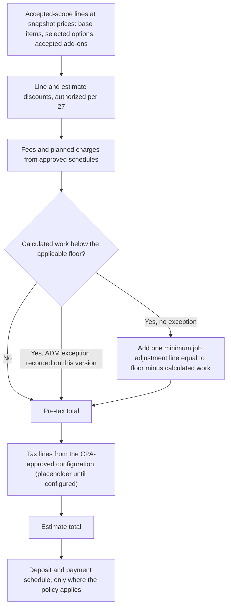
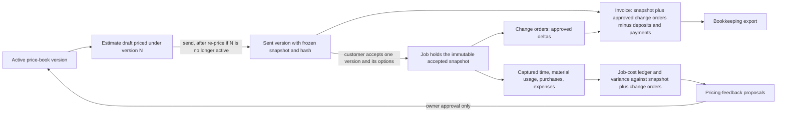
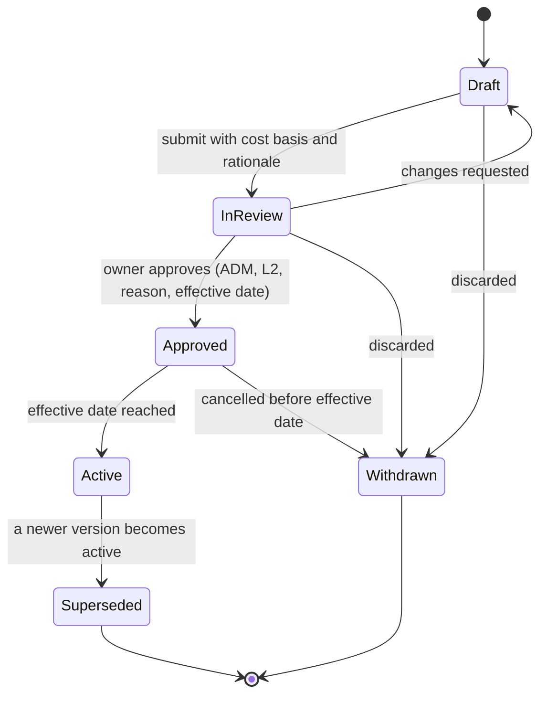
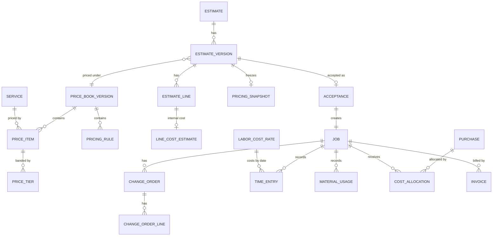

# 28 - Pricing, Estimating and Job Costing

> **Status:** Draft - AI-generated planning document, not approved · **Owner/domain:** Estimating / finance (primary skill handyhub-estimate-assistant; cost-basis, ledger, variance and pricing-feedback sections handyhub-job-costing) · **Last updated:** 2026-10-03
> **Human review required:** Owner (every price and rate card, how the \$150 minimum applies, the fee schedule, discount limits, deposit and payment policy, margin basis and targets); CPA or tax professional (tax applicability by service, material and state, tax rounding, deposits as liabilities, revenue recognition, overhead allocation, chart of accounts); attorney licensed in KY and/or IN (deposit, refund, cancellation, fee and "penalty" wording, late interest and payment terms that reach agreements); payroll professional (loaded labor cost and timekeeping categories); accredited asbestos inspector or EPA RRP-qualified professional, and licensed engineer or building official, before hazardous-material or structural scope is priced as a firm quote; qualified safety professional before any hazardous add-on is activated (PRC-042); local waste authority for disposal items.
> **Related:** [Requirements spec](../Requierments/HandyHub_Requirements_Specification_Reconstructed.md) · [Master prompt](../HandyHub%20Master.md) · [02 Gap analysis](02-gap-analysis.md) · [04 Service registry](04-service-registry.md) · [05 Domain model](05-domain-model.md) · [06 State machines](06-state-machines.md) · [08 Data model](08-data-model-and-database.md) · [09 API contracts](09-api-contracts.md) · [27 Roles and permissions](27-roles-and-permissions.md) · [29 Inventory and procurement](29-inventory-and-procurement.md) · [30 Service agreement standards](30-service-agreement-standards.md) · [32 Website and customer experience](32-website-and-customer-experience.md)

## 1. Purpose, scope and evidence

### 1.1 What this document governs

This is the single source of truth for how HandyHub prices work and how job costs are measured: the status of the 26 draft pricing files, the price-book architecture and supported pricing models, the \$150 minimum-charge rule, the estimate structure (EST-001..EST-007) and its immutable snapshots, the separation of customer price from internal cost and margin, the job-cost model and its bookkeeping hand-off, money representation, and the PROPOSED `PRC-` requirements with the owner decisions they wait on.

Owned elsewhere and linked instead of repeated: who may approve, override or see margins ([27](27-roles-and-permissions.md)); Estimate, Change order, Invoice and Payment transition tables ([06](06-state-machines.md)); entity names and schema ([05](05-domain-model.md), [08](08-data-model-and-database.md)); endpoints ([09](09-api-contracts.md)); estimator and customer screens ([10](10-frontend-ux-plan.md)); the public minimum statement and the no-prices rule for the website ([32](32-website-and-customer-experience.md)); deposit, refund, fee, warranty and payment clauses in agreements ([30](30-service-agreement-standards.md)); stock, purchasing and consumption quantities ([29](29-inventory-and-procurement.md)); test IDs ([16](16-testing-quality-strategy.md)); canonical service identity ([04](04-service-registry.md)); the contradiction register ([02](02-gap-analysis.md)).

Precedence: requirement text in the spec wins, and owner decisions recorded in [20](20-decision-log.md) supersede it where they say so. Anything here that the spec does not state is a **PROPOSED DECISION** until the owner approves it. **No number in this document is a HandyHub price.** Figures copied from the vault are marked "benchmark in file (unapproved)".

### 1.2 Evidence baseline

- **FACT** (owner facts recorded 2026-10-02, [operating context](../Skills/Business%20direction/handyhub-job-planner/references/operating-context.md)):
  - "Minimum \$150 USD. Proposed default is once per separately quoted job/visit bundle before applicable tax; owner must confirm recurrence, callbacks and estimate-visit exceptions. Do not apply it to every line."
  - "Use service-specific estimating; numeric rates, wages, production factors, tax rates and profit targets are not supplied."
  - "Deposits for large jobs; threshold, amount, timing and terms remain owner decisions."
  - "Electronic invoices with cash/check acceptance. Payment provider not selected. Received checks are not cleared money."
  - "Keep customer, property, request, accepted estimate version, appointment, job, invoice and payment separate."
- **FACT** (spec): BIZ-003 "A \$150 minimum applies to jobs unless an authorized administrator changes the business rule."; BIZ-004 "The system must preserve estimate inputs, assumptions, quantities, labor, materials, fees, discounts, taxes if applicable, and approval history."; BIZ-006 deposit terms "must be configurable by an administrator"; EST-001..EST-007; FIN-001..FIN-008; CX-001, CX-003, CX-004; PERM-004; JOB-002, JOB-003, JOB-005; QA-006, QA-010; NFR-012, NFR-013, NFR-019, NFR-020; RPT-002, RPT-007; LAUNCH-003, LAUNCH-007; NEAR-003 places "job costing" in P1.
- **FACT** (master §13): "Never overwrite the historical price of an already accepted estimate when the master price book changes." and "Version pricing rules."; (master §9) "never use floating-point values for currency", "store integer minor units or a proper decimal type", "store currency code"; (master §29) AI may not silently "change approved prices", "change tax treatment" or "change payment commitments".
- **FACT** (repository audit of all 26 `Pricing/` files, 2026-10-03; findings registered in [02](02-gap-analysis.md)): 26/26 present unsourced benchmark figures and a margin target; 0/26 state an internal labor cost, a tax treatment, or an approver, source, version or effective date; 9 embed a service-specific minimum construct; 5 services list a complete-job price below \$150; 6 contain SAR amounts (25 lines) and 4 per-square-metre rates; 9 contain Arabic text. Of 25 agreements, 7 have no price field and 4 name a pricing file as their scope or price basis; CL-07 has no agreement. The four Main Plans contain no dollar amounts (text search).
- **GAP** (spec): no price-book entity, no aggregation rule for the minimum, no rounding rule, no Purchase, Expense, Time entry, Deposit or Refund entity (master §5 lists them for [05](05-domain-model.md)), and no tax-line structure although EST-004 requires "tax treatment when applicable" (FIN-003 invoice content and the Invoice entity list line items, deposits and balance but no tax line).

### 1.3 Specialist expertise applied

| Skill | Rule applied (quoted) | Where |
|---|---|---|
| [handyhub-estimate-assistant](../Skills/Branding%2C%20marketing%2C%20social%20media%2C%20and%20sales/handyhub-estimate-assistant/references/playbook.md) | "Use owner-approved cost rates/productivity and current supplier evidence; never invent an industry-standard price." · "Enforce the approved \$150 minimum policy; until aggregation/tax treatment is configured, identify it as a launch decision rather than applying \$150 to every line." · "Keep tax applicability, exemptions and deposit requirements as separately reviewed settings." · "Request human approval before sending a binding offer; freeze accepted version and price additions only as separately approved change orders." · "A multi-service visit must not accidentally receive several minimum charges." · "Avoid counting bundled preparation twice." | Sections 2-5, 7, 10 |
| [handyhub-job-costing](../Skills/bookkeeping%2C%20taxes%2C%20profitability%2C%20and%20cash/handyhub-job-costing/references/playbook.md) | "Calculate labor cost as actual person-hours times the approved loaded cost rate, including applicable employer burdens. Distinguish wage rate from customer billing rate and crew elapsed time from person-hours." · "Gross margin=(net revenue-direct cost)/net revenue; markup=(price-cost)/cost." · "Compare actual against estimate by quantity, productivity, price and scope." · "Never overwrite reconciled entries, invent tax rates, file returns, transfer funds or initiate collection messages without authorization." | Sections 6, 8, 11 |
| [bookkeeping-accounting-assistant](../Skills/bookkeeping%2C%20taxes%2C%20profitability%2C%20and%20cash/bookkeeping-accounting-assistant/SKILL.md) | "Distinguish cash movement from revenue/expense recognition when timing differs. When accounting treatment is materially uncertain, identify the issue for CPA review." · chart of accounts with "deposits/customer liabilities when appropriate" · "Never invent transactions." | Sections 3.10, 11.5 |
| [tax-cash-flow-assistant](../Skills/bookkeeping%2C%20taxes%2C%20profitability%2C%20and%20cash/tax-cash-flow-assistant/SKILL.md) | "Label every tax amount as actual liability, booked estimate, provisional reserve, or professional-input assumption." · "Never promise tax savings or state that a strategy is compliant without appropriate verification." · scenario "large-job deposit timing" | Sections 3.9, 3.10, 11.5, 11.6, 12.3 |
| [handyhub-owner-analyst](../Skills/Business%20direction/handyhub-owner-analyst/references/playbook.md) | "Separate earned revenue, cash collected, deposits/liabilities, unpaid balances and bank settlement. Report profit only with its included and excluded costs." · "Control for job mix before comparing workers; never use analysis alone to make employment decisions." | Sections 8, 11.4 |
| [sales-growth-assistant](../Skills/Branding%2C%20marketing%2C%20social%20media%2C%20and%20sales/sales-growth-assistant/SKILL.md) | "Do not recommend discounts without modeling margin impact and capacity implications." · "avoid deceptive scarcity, fake social proof, or manipulative claims" | Section 3.8 |
| [legal-compliance-administrator](../Skills/LLC%2C%20legal%20administration%2C%20and%20risk/legal-compliance-administrator/SKILL.md) | "Do not say a business is legally compliant based only on a conversational review. Do not draft language as a substitute for attorney review when material liability is at stake." · "Separate: **confirmed requirement**, **likely requirement needing verification**, **business policy choice**, and **professional-review item**." | Sections 3.7, 3.10, 9.2, 11.5, 14 (PRC-041, PRC-043) |
| Consulted for specific rules | [swe-architecture contracts](../Skills/Website%2C%20software%2C%20and%20cybersecurity/swe-architecture/references/contracts-security.md): "Store money with explicit currency and a suitable exact representation; define rounding." · [swe-implementation backend](../Skills/Website%2C%20software%2C%20and%20cybersecurity/swe-implementation/references/backend.md): "Do not trust a client-provided owner, role, price, or tenant identifier." · [scheduling playbook](../Skills/Business%20direction/handyhub-scheduling/references/playbook.md): "A check awaiting clearance does not satisfy a cleared-deposit gate." · [marketing playbook](../Skills/Branding%2C%20marketing%2C%20social%20media%2C%20and%20sales/handyhub-marketing/references/playbook.md): "A \$150 minimum must not become a promise that every job costs \$150." · [business-systems-administrator playbook](../Skills/Website%2C%20software%2C%20and%20cybersecurity/business-systems-administrator/references/playbook.md): "Never put full card details in the CRM or ordinary documents." | Sections 3.10, 4, 12 |

No skill was used to reach a tax, legal, licensing, insurance or structural conclusion. Those items carry a HUMAN REVIEW marker.

### 1.4 Gap-register entries routed to this document

[02](02-gap-analysis.md) routes the gaps below to this document. Each is answered here as a PROPOSED design or held as an owner question; none is closed until the owner decides.

| Gap ([02](02-gap-analysis.md)) | Topic | Where answered | Still open |
|---|---|---|---|
| G-015, G-135 | Pricing-file status; rate cards, labor cost, productivity, markups, margin basis | Sections 2, 8, 10 | Q-28-01, Q-28-02, Q-28-13 |
| G-038, G-133 | Minimum rule stated three ways; application, order with discounts, no stacking | Section 4 | Q-28-03 to Q-28-06 |
| G-026 | One rule per topic instead of per file | Sections 3.7 (fee schedule), 3.10 (deposit policy, payment-terms matrix), 4 (minimum rule) | Q-28-07, Q-28-09, Q-28-10 |
| G-028, G-158 | Included versus add-on; material supply and markup | Sections 3.5, 9.1 (P7) | Q-28-14, Q-28-21 |
| G-035 | Unnamed approvers and thresholds | Section 10.1 with [27](27-roles-and-permissions.md) | Q-27-04, Q-28-08 |
| G-039, G-116, G-127 | Received versus cleared money; card data; payment provider | Sections 3.10, 11.5, 11.6 | Q-28-10 |
| G-084, G-142 | Collections authority; payment terms by customer type; meaning of "captured" | Sections 3.10 (payment-terms matrix), 11.5 | Q-28-10, Q-28-19 |
| G-086, G-152 | Refund and credit policy; tax records | Sections 3.9, 3.10, 11.5 | Q-28-12, Q-28-27 |
| G-089 | Change-order procedure and price basis | Section 3.11 | Q-28-16 |
| G-094 | Phased jobs and progress invoicing | Sections 3.10, 4.5 | Q-28-10 |
| G-095 | Estimate route and estimate-visit fee | Sections 4.5, 5.6 | Q-28-05 |
| G-099, G-153 | Bookkeeping hand-off; accounting system and chart of accounts | Section 11.5 | Q-28-25 |
| G-125 | Deposit policy | Section 3.10 | Q-28-09 |
| G-130 | Sales and use tax treatment; exemptions | Section 3.9 | Q-28-12, Q-28-19 |
| G-131 | Fee schedule and wording | Section 3.7 | Q-28-07 |
| G-132 | Warranty and callback policy (pricing side only) | Section 4.5; the policy itself in [30](30-service-agreement-standards.md) | Q-28-05 |
| G-143 | Estimate validity and acceptance | Sections 5.4, 5.5 | Q-28-11 |
| G-006, G-145 | Timekeeping policy; material substitution (invoice void and adjust policy: [27](27-roles-and-permissions.md), [06](06-state-machines.md)) | Section 11.2 | Q-28-24 |
| G-157 | Waste and disposal | Section 3.5 | Q-28-15 |
| G-046, G-049, G-053, G-054, G-057, G-059, G-061, G-063, G-065 | Per-service pricing gaps (labor basis, material supply, minimum statement) | Section 7 | Q-28-01, Q-28-20 |

## 2. Status of pricing in the repository

### 2.1 Repository-level status

**FACT**: every figure in the 26 files under `Pricing/` is a brainstorm benchmark. No file names a source, date, version, approver or effective date, and the owner has supplied no rates, wages, production factors, tax rates or profit targets (owner facts). The 19 home-improvement, drywall and painting files present their figures under "Kentuckiana Local Market Benchmarks"; the 7 cleaning files under "Financial Benchmarks". **PROPOSED DECISION D-28-01**: treat all 26 files as unapproved benchmarks; none of their values may be quoted to a customer or loaded into the application without an owner approval record (PRC-002).

| Element (audit count, 26 files) | Count | Consequence for implementation |
|---|---|---|
| Unsourced "benchmarks" heading | 26/26 | Not a rate card; import gate PRC-002 |
| Margin or net-profit target stated | 26/26 | Internal and unapproved (Section 8); never shown to customers or field roles |
| Internal labor cost or wage | 0/26 | Margins cannot be tested; cost rates are an owner decision (Q-28-02) |
| Customer hourly rate stated | 10 | Labor-hour model needs a person-hour basis (Section 3.3) |
| Time or productivity assumption | 7 | Person-hours versus crew time ambiguous in several (Section 11.3) |
| Crew size stated | 6 (cleaning) | Two exceed or exhaust the two-employee team (CL-02, CL-04) |
| Material basis (inclusion, exclusion or markup) | 14 stated, 2 partial, 10 none; quantities or costs 0/26 | Material policy decision (Q-28-14) |
| Service-specific minimum, trip or call-out construct | 9 | Section 4.4 |
| Complete-job price below \$150 | 5 services (HI-01, HI-04, HI-05, CL-01, CL-05) | FIN-001 gate (Section 4) |
| Deposit rule | 1 (CL-06 prepayment) | 5 agreements set deposits their pricing files never mention (Section 3.10) |
| Tax treatment | 0/26 | Placeholder only (Section 3.9) |
| SAR amounts / per-square-metre rates | 6 / 4 | Never imported (PRC-039) |
| Arabic text | 9 | Cleanup through [34](34-naming-and-migration-plan.md) and [36](36-file-modification-plan.md) |

### 2.2 Per-file status

Status for every file is **Unapproved benchmark**. "Agreement relationship" records how the matching draft agreement in `Service Agreements/` uses price (FACT, text search 2026-10-03). Blockers are what must be decided before any value from the file can become an approved price-book entry.

| Code | Pricing file | Figures heading | Agreement relationship | Status | Approval blockers |
|---|---|---|---|---|---|
| [HI-01](04-service-registry.md#HI-01) | [pricing-picture-hanging](../Pricing/pricing-picture-hanging.md) | Kentuckiana Local Market Benchmarks | Fixed visit-price placeholder; no minimum disclosure | Unapproved benchmark | Visit charge versus \$150 (C-HI01-03); which of three methods governs (Q-28-06, Q-28-20) |
| [HI-02](04-service-registry.md#HI-02) | [pricing-grill-cleaning](../Pricing/pricing-grill-cleaning.md) | Kentuckiana Local Market Benchmarks | Flat-fee placeholder only; the file's hourly mode has no basis in the agreement (C-HI02-06) | Unapproved benchmark | Hourly switch only by change order; grill types without a tier (Q-28-06, Q-28-20) |
| [HI-03](04-service-registry.md#HI-03) | [pricing-driveway-cleaning](../Pricing/pricing-driveway-cleaning.md) | Kentuckiana Local Market Benchmarks | No price field; a dry-run fee exists only in the agreement | Unapproved benchmark | Trip-charge meaning (C-HI03-06); bio-shield inclusion (C-HI03-05); tier bounds (C-HI03-07) (Q-28-06, Q-28-07, Q-28-21) |
| [HI-04](04-service-registry.md#HI-04) | [pricing-tv-mounting](../Pricing/pricing-tv-mounting.md) | Kentuckiana Local Market Benchmarks | No financial section; wire hiding excluded "unless itemized below" with nothing itemized (C-HI04-05) | Unapproved benchmark | Base service below \$150 (C-HI04-03); bracket supply and markup (Q-28-01, Q-28-14) |
| [HI-05](04-service-registry.md#HI-05) | [pricing-smart-locks](../Pricing/pricing-smart-locks.md) | Kentuckiana Local Market Benchmarks | No price field; strike-plate work listed as included (C-HI05-04) | Unapproved benchmark | Single-unit jobs below \$150 (C-HI05-03); inclusion versus add-on (Q-28-01, Q-28-21) |
| [HI-06](04-service-registry.md#HI-06) | [pricing-gutter-maintenance](../Pricing/pricing-gutter-maintenance.md) | Kentuckiana Local Market Benchmarks | No price field; seam resealing listed as included (C-HI06-03) | Unapproved benchmark | Inclusion versus surcharge; deposit for guard projects (Q-28-09, Q-28-21) |
| [HI-07](04-service-registry.md#HI-07) | [pricing-attic-insulation](../Pricing/pricing-attic-insulation.md) | Kentuckiana Local Market Benchmarks | Single contract-price placeholder; no line items | Unapproved benchmark | Prep items "Included or Itemized" (C-HI07-10); material and rental basis (Q-28-14, Q-28-15) |
| [HI-08](04-service-registry.md#HI-08) | [pricing-closet-shelving](../Pricing/pricing-closet-shelving.md) | Kentuckiana Local Market Benchmarks | No price field; delayed-access fee exists only in the agreement (C-HI08-07) | Unapproved benchmark | Governing basis for client-supplied kits (C-HI08-04); fee schedule (Q-28-07, Q-28-20) |
| [HI-09](04-service-registry.md#HI-09) | [pricing-trim-molding](../Pricing/pricing-trim-molding.md) | Kentuckiana Local Market Benchmarks | Single total placeholder | Unapproved benchmark | Headline range does not contain the crown range (C-HI09-09); stock supply and waste (Q-28-14) |
| [HI-10](04-service-registry.md#HI-10) | [pricing-fence-repair](../Pricing/pricing-fence-repair.md) | Kentuckiana Local Market Benchmarks | Scope is "items checked" inside this pricing file, which carries the internal margin (C-HI10-08) | Unapproved benchmark | Call-out minimum (C-HI10-03); remove the incorporation (Q-28-06; [30](30-service-agreement-standards.md)) |
| [HI-11](04-service-registry.md#HI-11) | [pricing-deck-repair](../Pricing/pricing-deck-repair.md) | Kentuckiana Local Market Benchmarks | No price field; a structural change order is named without a rate | Unapproved benchmark | Diagnostic-visit exception; structural scope review (Q-28-05) |
| [DW-01](04-service-registry.md#DW-01) | [pricing-drywall-patching](../Pricing/pricing-drywall-patching.md) | Kentuckiana Local Market Benchmarks | Flat-fee placeholder; restates the ranged trip minimum; lockout fee only in the agreement | Unapproved benchmark | Trip minimum (C-DW01-03); paint inclusion (C-DW01-06); fee (C-DW01-09) (Q-28-06, Q-28-07, Q-28-21) |
| [DW-02](04-service-registry.md#DW-02) | [pricing-popcorn-removal](../Pricing/pricing-popcorn-removal.md) | Kentuckiana Local Market Benchmarks | Area-times-price placeholder; non-refundable retainer on every job (C-DW02-06) | Unapproved benchmark | Deposit policy; small-room floor; testing coordination (**HUMAN REVIEW: accredited asbestos inspector**) (Q-28-06, Q-28-09) |
| [DW-03](04-service-registry.md#DW-03) | [pricing-drywall-remodeling](../Pricing/pricing-drywall-remodeling.md) | Kentuckiana Local Market Benchmarks | Fixed-price placeholder; scope by "checked specifications" inside this pricing file (C-DW03-07); fixed draw schedule (C-DW03-06) | Unapproved benchmark | Framing priced nowhere (C-DW03-05); draws; corner beads (Q-28-09, Q-28-10, Q-28-21) |
| [DW-04](04-service-registry.md#DW-04) | [pricing-new-construction](../Pricing/pricing-new-construction.md) | Kentuckiana Local Market Benchmarks | Unit-rate placeholder; net terms with late interest; per-worker standby | Unapproved benchmark | Standby basis (C-DW04-03); B2B terms (Q-28-19) |
| [PT-01](04-service-registry.md#PT-01) | [pricing-interior-painting](../Pricing/pricing-interior-painting.md) | Kentuckiana Local Market Benchmarks | Total placeholder; non-refundable deposit and draws on every job (C-PT01-03); lockout fee (C-PT01-08) | Unapproved benchmark | Deposit; fee; materials markup (Q-28-07, Q-28-09, Q-28-14) |
| [PT-02](04-service-registry.md#PT-02) | [pricing-deck-staining](../Pricing/pricing-deck-staining.md) | Kentuckiana Local Market Benchmarks | Fixed price for an estimated area; payment due before the drying window ends | Unapproved benchmark | Deck-stripping floor (C-PT02-03); solid-stain premium against an oil-only SOP (C-PT02-04) (Q-28-06) |
| [PT-03](04-service-registry.md#PT-03) | [pricing-brick-limewashing](../Pricing/pricing-brick-limewashing.md) | Kentuckiana Local Market Benchmarks | Fixed-total placeholder; scope points to a pricing file that does not exist (C-PT03-06); upfront deposit (C-PT03-09) | Unapproved benchmark | Flat versus per-square-foot governance (C-PT03-V01, C-PT03-11); lift pass-through (Q-28-09, Q-28-15, Q-28-20) |
| [PT-04](04-service-registry.md#PT-04) | [pricing-wallpaper-removal](../Pricing/pricing-wallpaper-removal.md) | Kentuckiana Local Market Benchmarks | Total placeholder "based on a flat room count or total wall square footage" | Unapproved benchmark | Mid-job escalation (C-PT04-01); flat versus area (C-PT04-08) (Q-28-07, Q-28-20) |
| [CL-01](04-service-registry.md#CL-01) | [pricing-routine-cleaning](../Pricing/pricing-routine-cleaning.md) | Financial Benchmarks | Per-visit placeholder; card on file (C-CL01-03); lockout and late-cancellation fees | Unapproved benchmark | Sub-\$150 visits and discounts (C-CL01-01); SAR cleanup (Q-28-04, Q-28-08, Q-28-23) |
| [CL-02](04-service-registry.md#CL-02) | [pricing-deep-cleaning](../Pricing/pricing-deep-cleaning.md) | Financial Benchmarks | Malformed flat-or-hourly placeholder; non-refundable deposit with forfeiture (C-CL02-02) | Unapproved benchmark | Inclusion versus add-on (C-CL02-01); method (C-CL02-13); deposit (Q-28-09, Q-28-20, Q-28-21) |
| [CL-03](04-service-registry.md#CL-03) | [pricing-move-in-out](../Pricing/pricing-move-in-out.md) | Financial Benchmarks | Area (square feet or square metres) times price placeholder; fixed leftover surcharge (C-CL03-01) | Unapproved benchmark | Surcharge basis; fees; method (Q-28-07, Q-28-20) |
| [CL-04](04-service-registry.md#CL-04) | [pricing-post-construction](../Pricing/pricing-post-construction.md) | Financial Benchmarks | Phase checkboxes with placeholders; net terms with late interest | Unapproved benchmark | Scaffolding fee absent from the agreement (C-CL04-08); crew size; B2B terms (Q-28-15, Q-28-19) |
| [CL-05](04-service-registry.md#CL-05) | [pricing-airbnb-turnover](../Pricing/pricing-airbnb-turnover.md) | Financial Benchmarks | Two layout placeholders against four property types (C-CL05-14); automatic card billing (C-CL05-06) | Unapproved benchmark | Sub-\$150 turnovers (C-CL05-03); revenue-share option (Q-28-04, Q-28-18) |
| [CL-06](04-service-registry.md#CL-06) | [pricing-hotel-housekeeping](../Pricing/pricing-hotel-housekeeping.md) | Financial Benchmarks | Tier placeholders; agreement incorporates this pricing guide (C-CL06-10); full monthly prepayment "captured" (C-CL06-06) | Unapproved benchmark | Prepayment and skip policy (C-CL06-05); minimum per visit or per plan (Q-28-04, Q-28-18) |
| [CL-07](04-service-registry.md#CL-07) | [pricing-air-duct-cleaning](../Pricing/pricing-air-duct-cleaning.md) | Financial Benchmarks | No agreement exists (a draft is planned, see [36](36-file-modification-plan.md)) | Unapproved benchmark | Model selection (C-CL07-09); add-ons and inspection-only visits (Q-28-05, Q-28-20) |

### 2.3 Status vocabulary for pricing content

| Status | Meaning | Set by | Usable on a customer estimate |
|---|---|---|---|
| benchmark-draft | Brainstorm figure in a vault file, no provenance (all 26 files today; the file edits planned in [36](36-file-modification-plan.md) mark each pricing file `status: benchmark-draft`, `owner_approved: false`) | — | Never |
| proposed | Price item drafted in the application price book with cost basis, rationale and evidence | Estimator (ROLE-006) or the Estimate Assistant as a draft | Never |
| approved | Owner approval recorded (approver, time, reason) with an effective date | Owner as ADM (ROLE-009), step-up L2 per [27](27-roles-and-permissions.md) | From the effective date |
| active | In force for new pricing | System at the effective time | Yes |
| superseded | Replaced by a newer active version; retained for snapshots, audit and analytics | System | Only through existing snapshots |
| withdrawn | Never became active | Estimator or owner | Never |

## 3. Pricing architecture

### 3.1 Principles (PROPOSED DECISION D-28-02)

1. One versioned price book. A version is immutable once approved; corrections create a new version. Effective dates are timezone-aware instants (NFR-020) in a business timezone the owner configures.
2. No value without provenance. Price items, fees and rules become active only through an owner approval record (PRC-002).
3. Customer price, internal cost and margin are different data with different readers (FIN-007; [27](27-roles-and-permissions.md) D-27-09).
4. Every estimate freezes its pricing when it is sent, and acceptance binds one version (EST-006, EST-007, CX-003).
5. Policies are configuration without seeded values: minimum evaluation scope, service floors, fees, discount limits, deposits, payment schedules and payment terms, refund and credit rules, tax treatment, travel, validity. The only seeded value is the \$150 minimum amount, which is a recorded fact (BIZ-003; owner facts).
6. The server computes every amount; client-supplied totals and prices are ignored (swe-implementation backend rule).
7. Exact money arithmetic in USD only (Section 12).
8. Build only what the launch services need (master §24): price items and models are added per service as the owner approves rate cards.
9. Sell only what can be performed and promise nothing unapproved (PROPOSED DECISIONS D-28-24, D-28-25). A price item activates only for a registry service or add-on whose SOP and hazard template are active after competent review (owner facts: "No active field SOP until competent review"; [31](31-sop-standard.md) SOP-029). Customer-facing item text carries no guarantee, warranty, certification, code-compliance or outcome claim without an approved policy and attorney-reviewed wording (master §1.4, §29). See PRC-041 and PRC-042.

### 3.2 Price book and rule objects

Names are PROPOSED; final names and keys belong to [05](05-domain-model.md) and [08](08-data-model-and-database.md).

| Object | Purpose | Key fields | Notes |
|---|---|---|---|
| PriceBookVersion | Container of all customer-price data in force from a date | version number (monotonic), status (Section 2.3), effective_from, approved_by, approved_at, approval reason, change summary, supersedes | One active version at a time |
| PriceItem | One sellable unit of work, add-on or material | stable item code, service ID (spec Appendix B), pricing model, unit, rate (exact decimal) and currency, optional minimum quantity or minimum billable person-hours, tier set, EN and ES customer description (reviewed text, PRC-041), customer-visible flag, tax category reference, internal cost reference, reference to the active SOP and hazard-template version that covers the work (PRC-042), provenance note | Item codes are stable across versions so versions and variances can be compared |
| PriceTier | Size or quantity bands | lower bound (inclusive), upper bound (exclusive; empty for the open top tier), rate or flat amount | Contiguous, non-overlapping (PRC-004) |
| MinimumJobRule | The \$150 rule | amount in minor units and currency, evaluation scope, basis, effective_from | Section 4 |
| ServiceFloorRule | Optional service-specific floor above the minimum | service ID, amount, owner approval | Inactive until approved (Section 4.4) |
| FeeScheduleItem | No-work and condition fees | code, trigger definition, amount or rate, applicability, EN and ES wording, agreement clause reference | Section 3.7 |
| ConditionalSurchargeRule | Site-condition price changes | trigger, required evidence, pricing basis | Applied only by change order (Section 3.7) |
| DiscountPolicy | Discount types, reason codes, estimator limit | limit in basis points and/or minor units, reason codes | Limit values: Q-27-04 |
| TravelRule | Travel or zone adjustment | zone definition, amount | Disabled (Section 3.6) |
| TaxConfiguration | Placeholder for tax treatment | jurisdiction, category, taxability determination, rate reference, effective date, CPA approval reference | No values seeded (Section 3.9) |
| DepositPolicy | Large-job deposit | see Section 3.10 | No values seeded |
| PaymentScheduleTemplate | Progress-payment structure | installments in basis points or amounts, triggers (each a recorded job milestone) | Owner and attorney approval |
| PaymentTermsMatrix | Payment terms by customer type | customer type, billing event, due-date policy, deposit or prepayment rule reference, accepted methods, late-payment terms reference, reminder and collection policy reference | No values seeded; owner, attorney and CPA approval (Section 3.10) |
| EstimateValidityPolicy | Expiry of sent estimates | validity duration | Value: Q-28-11 |
| RoundingPolicy | Rounding mode and allocation rule | mode, scope | Section 12.2 |
| LaborCostRate | Internal loaded cost per role or person | rate, effective dates | Job costing only; never customer-visible (Section 11) |

### 3.3 Supported pricing models

| Model | Definition and formula | Required inputs | Found in files (examples) | Rules |
|---|---|---|---|---|
| Minimum service charge | One "minimum job adjustment" line = applicable floor − calculated work, when positive | Calculated work, applicable floor | Spec BIZ-003; 9 competing file constructs | Section 4 |
| Flat rate | Fixed amount per defined unit of work | Inclusion list, size band | HI-02 grill tiers, HI-04 screen bands, HI-05 per lock, PT-01 room types, CL-05 property types | Each flat item states its inclusions; band bounds follow PRC-004 |
| Labor-hour | Person-hours × hourly billing rate (a billing rate is not a wage) | Estimated person-hours, crew size, optional minimum billable person-hours | CL-01 and CL-02 hourly methods; hourly fallbacks in HI-01, HI-11, PT-04; hourly with minimum hours in HI-02, HI-08 | Quantity is person-hours (two workers for three hours = six person-hours); a switch to hourly billing mid-job requires a change order |
| Unit | Quantity × unit rate | Counted units with provenance | HI-05 locks, HI-10 posts and pickets, HI-11 treads, DW-03 sheets, CL-07 registers | Unit list is controlled (PRC-039) |
| Linear-foot | Measured length × rate | Length with provenance | HI-06 gutters, HI-09 trim, HI-11 boards, PT-02 railings | As unit model with unit "linear ft" |
| Square-foot | Measured area × rate | Area basis definition (floor, wall face gross or net of openings, ceiling) | HI-03, HI-07, DW-02, DW-03, DW-04, PT-02, PT-03, PT-04, CL-01..CL-04 | Area basis must be stated per item; no square metres |
| Tiered package | Flat amount selected by size or volume tier | Tier bounds | HI-03, HI-06, CL-02, CL-03, DW-04 volume tiers | Contiguous [lower, upper) tiers (PRC-004) |
| Recurring plan | Per-visit or per-period price by frequency | Frequency, period, proration, skip rules | CL-01 frequency discounts, CL-05 retainer, CL-06 monthly tiers | Section 3.12 |
| Material markup, allowance or pass-through | Allowance amount; or cost × (1 + markup); or named material at a set price | Material policy | PT-01 markup or contractor-discount pass-through with a handling fee; HI-06 guards "Labor + Materials included" | Section 3.5; a markup is not a margin |
| Equipment rental | Pass-through at documented cost or an approved flat amount | Rental quote | PT-03 lift, CL-04 scaffolding, HI-07 machine "can be rig-mounted or rented" (inventory) | Section 3.5 |
| Disposal fee | Flat, per unit, or pass-through | Disposal basis | CL-04 construction trash, DW-03 demolition debris, CL-03 leftovers | Hazardous waste is referred, not priced as routine disposal |
| Travel or service-area adjustment | Only if the owner approves a rule | Zone definition | Trip, visit or call-out charges in HI-01, HI-03, HI-10, DW-01, DW-02, PT-02 | Disabled (Section 3.6) |
| Optional add-on | Separately identifiable line the customer can accept or decline | Option group | Add-on menus in HI-04, CL-02, CL-07, PT-01 | EST-005 |
| Surcharge | Price change for a disclosed condition | Trigger and evidence | Ceiling and height premiums, solid-stain premium, utilities-off, leftover items | Planned conditions may be priced on the estimate; site-discovered ones only by change order (Section 3.7) |
| Discount | Negative line with reason and approver | Discount policy | CL-01 frequency discounts | Section 3.8 |
| Tax | Placeholder lines | CPA-approved configuration | None in any file | Section 3.9 |
| Deposit | Payment schedule, not a price | Deposit policy | 5 agreements and the CL-06 prepayment | Section 3.10 |
| Change order | Priced delta against the accepted scope | Accepted snapshot | 6 agreements route specific events to a change order (HI-01, HI-06, HI-11, PT-01, PT-04, DW-04); none defines the procedure | Section 3.11 |

### 3.4 Calculation order (PROPOSED DECISION D-28-03)



1. Resolve each line's price from the price-book version the draft is priced under; compute extended amounts (Section 12.2).
2. Apply authorized line and estimate-level discounts.
3. Add fees and planned charges that the estimate includes (for example disposal or a rental pass-through).
4. "Calculated work" = the sum of steps 1-3, before tax, excluding deposits and payments. Compare it with the applicable floor (Section 4). If it is lower and no exception is recorded, add one minimum job adjustment line.
5. Compute tax lines only from an active, CPA-approved configuration (Section 3.9).
6. The deposit and payment schedule is derived from the total; it never changes the price.

Whether discounts may take calculated work below the minimum is an owner decision (Q-28-08); with this order a discount that does so is absorbed by the adjustment line, which keeps FIN-001 intact.

### 3.5 Materials, equipment rental and disposal

- **Material policy** (owner decision Q-28-14): for each price item, one of (a) included in the item price, (b) an allowance amount shown on the estimate, (c) cost plus a markup in basis points, (d) a named material at a set price, or (e) customer-supplied. The PT-01 file's markup or contractor-discount pass-through with a "minor logistics handling fee" is a benchmark in file (unapproved). **GAP**: vendor names in files are unverified and no approved vendor list exists ([29](29-inventory-and-procurement.md)).
- **Customer-supplied items** (HI-04 TV and bracket, HI-08 kits, HI-05 locks, DW-01 paint): the estimate records who supplies each item; START-009 requires recording "visible condition/model/quantity before installation or service". **RECOMMENDATION** for [30](30-service-agreement-standards.md): one acceptance, defect and liability rule for customer-supplied items, drafted with an attorney (X-22).
- **Equipment rental**: pass-through at the documented rental cost or an approved flat amount, never both on one job; the PT-03 file states the lift charge both ways (C-PT03-11).
- **Disposal**: a disposal line exists only where the service plan includes removal (CL-04 trash, DW-03 demolition debris, CL-03 leftovers after a change order). Suspected hazardous material (asbestos, lead paint, mold) is a stop-and-refer condition, not a disposal line (**HUMAN REVIEW: qualified hazardous-material professional**). No waste and disposal policy (construction debris, chemical waste, rinse water, tenant leftovers) exists yet ([02](02-gap-analysis.md) G-157); disposal items stay inactive until it does (**HUMAN REVIEW: local waste authority**; Q-28-15).
- Materials consumed on a job are recorded as quantities for costing; recording usage never changes the customer price (AT-037).

### 3.6 Travel and service-area adjustments

Master §13 allows "travel/service-area adjustments if approved". None is approved. **PROPOSED DECISION D-28-10**: travel pricing is disabled at launch. Serviceability is decided by the configured coverage rule (BIZ-001, HND-002; [32](32-website-and-customer-experience.md)), not by price. Six files name a trip, visit or call-out charge (HI-01, HI-03, HI-10, DW-01, DW-02, PT-02), and DW-01 and PT-01 justify fees by "I-65 bridge" crossings. **RISK**: no file verifies that premise, and the fees would apply whether or not a crossing occurs (C-PT01-08). If the owner wants travel pricing (Q-28-17), it becomes a TravelRule with defined zones, shown as its own estimate line, counted inside calculated work, and never combined with a separate trip fee.

### 3.7 Fees and surcharges

- **One fee schedule** (PROPOSED DECISION D-28-09). Fees appear in agreements without a pricing source (lockout and dry-run in CL-01, DW-01, HI-03, PT-01; delayed access in HI-08; waiting in CL-03; utilities per day in DW-03; emergency rework in DW-04, whose standby charge also differs between pricing and agreement), and the same trigger is priced differently or not at all across services. Every fee the business intends to charge becomes a FeeScheduleItem approved by the owner, with wording reviewed by an attorney; an estimate or invoice cannot carry a fee that is not in the active schedule (PRC-021). The words "fine" and "penalty" used in CL-03, CL-05, PT-04 and DW-04 files are held for **HUMAN REVIEW: attorney**; the application uses "fee".
- **No-work fees** (lockout, dry run, waiting) are not "calculated work" and do not trigger or satisfy the minimum (Section 4.5).
- **Conditional surcharges** (PROPOSED DECISION D-28-08). Conditions known at estimate time (for example a ceiling over a stated height) are priced as estimate lines. Conditions discovered on site (crystallized adhesive in PT-04, torn drywall paper in PT-04, leftover items in CL-03, neglected grills in HI-02, clutter in CL-01) may be described on the estimate as possible changes, but a price change happens only through a change order the customer approves before the extra work (FIN-008, JOB-005, AT-032), with evidence (photos, notes). This resolves the critical findings C-PT04-01 and C-CL03-01 in the software; the amounts remain owner decisions.

### 3.8 Discounts with authorization

- Discounts are negative lines with type (frequency, promotion, goodwill, other), amount or basis points, reason code and approver (EST-004 "discounts with authorization"; PERM-004).
- The estimator may apply discounts up to a configured limit; above it, ADM approval with step-up (L2) is required ([27](27-roles-and-permissions.md) Sections 6.2, 6.3; D-27-10). Limit values are an OPEN QUESTION (Q-27-04).
- Frequency discounts (the CL-01 file's weekly, bi-weekly and monthly deductions, benchmarks in file, unapproved) are price items on recurring plans, not ad hoc discounts. "Monthly Service (Every 4 weeks)" in that file means 13 visits a year, not 12; plan periods must state which they mean.
- Promotions follow the sales-growth rules: model margin and capacity impact before proposing a discount, and no deceptive urgency or scarcity (AIR-013 boundary "No deceptive urgency, fabricated scarcity or unauthorized discounts").
- After acceptance, a price reduction is a change order or a credit, never an edit of the accepted version.
- RPT-002 reports discounts and exceptions by estimator and service.

### 3.9 Taxes (placeholders only)

**HUMAN REVIEW: CPA or tax professional.** No file states tax treatment, and the owner supplied no tax rates. This document makes no claim about whether any HandyHub service or material is taxable in Kentucky, Indiana or any locality. Spec boundary for the Tax and Cash Flow Assistant (AIR-016, FACT): "No unsupported tax conclusions; filing positions and payments require qualified/human approval."

- **Structure (PROPOSED DECISION D-28-11)**: each estimate and invoice line carries a tax jurisdiction reference, a tax category reference, a taxability determination (empty until configured), a reference to the TaxConfiguration version used, and a computed tax amount. Tax lines are summarized per jurisdiction.
- **No seeded values.** TaxConfiguration rows are created only from a CPA-approved determination with its source, date and jurisdiction recorded (tax-cash-flow rule: label every tax amount by its basis).
- **Send gate.** An estimate version cannot be sent until every line has a tax treatment from an active, CPA-approved configuration. The configuration may record that a category is not taxable; the system never assumes it. This is a launch dependency (R-28-09).
- Whether the minimum job adjustment, deposits, fees, rental pass-throughs and discounts belong to the taxable base, and how tax is rounded, are CPA questions (Q-28-03, Q-28-12, Q-28-22). Exemption handling for builder or contractor customers (DW-04, CL-04) is part of Q-28-19. Tax paid on materials, rentals and supplies bought for jobs is recorded as shown on the receipt (Section 11.2); how it enters job cost, and whether any other tax applies to those purchases, are also CPA questions (Q-28-12, Q-28-28).

### 3.10 Deposits and payment schedules

**Canonical (FACT):** BIZ-006 "Deposits are for larger jobs only. The threshold, percentage or fixed amount, exceptions, refund/cancellation treatment, and approval authority must be configurable by an administrator."; FIN-002 "The system must not assume every job requires a deposit."; HND-003; AT-008, AT-009; owner facts "threshold, amount, timing and terms remain owner decisions".

**Conflicting drafts (FACT, agreement text, unapproved):** non-refundable deposits or retainers on every job in CL-02 (with forfeiture if utilities fail), DW-02 and PT-01; fixed draw schedules in DW-03, PT-01 and PT-03; a full monthly prepayment "captured" in CL-06. No pricing file mentions these terms except the CL-06 prepayment. Registered as C-CL02-02, C-DW02-06, C-PT01-03 (critical), C-DW03-06, C-PT03-09, C-CL06-06 (high) and X-04.

**PROPOSED DECISION D-28-12** (DepositPolicy, versioned, ADM-only change with L2; no default values; the feature is off until the owner approves a policy):

| Field | Meaning |
|---|---|
| enabled | Off until the owner approves a policy |
| applies_to | All services or listed service IDs |
| threshold_basis | Pre-tax estimate total or total including tax (owner decision with CPA) |
| threshold_amount | Minor units and currency; empty until decided |
| amount_type and value | Basis points or fixed minor units |
| timing | At acceptance, before scheduling, or before material purchase |
| refund_and_cancellation_reference | Version of the agreement clause approved by an attorney |
| exceptions and waiver_authority | Waiver by ADM only, with reason ([27](27-roles-and-permissions.md) Section 6.3) |
| cleared_funds_required | Whether a received check satisfies the readiness gate; "A check awaiting clearance does not satisfy a cleared-deposit gate." (scheduling playbook) |

- The policy is evaluated per estimate version; a job that does not meet the criteria never receives a deposit line (AT-008). A required, unpaid deposit shows in job readiness and flags or blocks dispatch per policy (SCH-001, AT-009).
- Accounting and tax treatment of deposits (for example, whether a deposit is carried as a customer liability until earned, and when it counts as income under the business's accounting method) is a CPA decision (**HUMAN REVIEW: CPA**). Operationally, a deposit is a payment recorded against the estimate or job and is never reported as earned revenue in job costing or owner reports (Sections 6.1, 11.5).
- Progress-payment schedules are PaymentScheduleTemplate records approved by the owner, with terms reviewed by an attorney; none is hard-coded per service (Q-28-10). Each installment's trigger is a recorded job milestone (phase completion or a QA milestone), so a progress invoice is issued only from a recorded event ([02](02-gap-analysis.md) G-094). **RECOMMENDATION** for [30](30-service-agreement-standards.md) (**HUMAN REVIEW: attorney**): the final balance never falls due before the cleanup, walkthrough and invoice-readiness checks the spec requires (QA-006), which the DW-02, PT-02 and PT-04 drafts contradict (C-DW02-08, X-14). Cash-timing scenarios for large jobs (deposit arriving after material purchase) belong to the tax and cash-flow forecast (Section 11.6).
- Refunds and credits: no refund or credit policy exists, while drafts say "No cash refunds will be processed" (CL-02 agreement) and that skipped subscription visits earn "no partial monetary credit" (CL-06 agreement). Who approves, the limits, credit versus refund versus write-off, how a refund is paid when the customer paid by cash or check, and the link to any deposit forfeiture are owner decisions (Q-28-27; [02](02-gap-analysis.md) G-152; approval authority in [27](27-roles-and-permissions.md) Section 6.2; **HUMAN REVIEW: attorney** for consumer refund terms, **CPA** for accounting treatment).
- Until a payment provider is selected, payments are cash, check and payment against an electronic invoice (BIZ-007; owner facts); card-on-file and automatic capture in CL-01, CL-05 and CL-06 drafts are not supported (C-CL01-03, C-CL05-06, C-CL06-06).

**Payment-terms matrix (PROPOSED DECISION D-28-26; structure only, every value is an owner decision; [30](30-service-agreement-standards.md) AGR-012 renders it).** Accepted methods in every row are electronic invoice, cash and check until a provider is selected; no row uses card-on-file, automatic charging or "captured" wording until a provider exists and the authorization text is attorney-approved. Draft terms are listed so the owner sees what must be replaced; they are unapproved and never configured. **HUMAN REVIEW: attorney** (terms, late-payment charges, collection practices) and **CPA** (prepayments, deposits).

| Customer type | Services | Billing event and due date | Deposit or prepayment | Late-payment terms | Draft terms found (unapproved) | Question |
|---|---|---|---|---|---|---|
| Residential one-off | HI-01..HI-11, DW-01..DW-03, PT-01..PT-04, CL-02, CL-03, CL-07 | `<owner decision>`; the final balance is never due before the QA-006 readiness checks | DepositPolicy only (D-28-12) | `<owner decision>` | Payment "captured in full" at the walkthrough (HI-01, DW-01); final payment before containment removal, cure or cleanup (DW-02, PT-02, PT-04; X-14); fixed draws (DW-03, PT-01, PT-03) | Q-28-10 |
| Residential recurring | CL-01 | Per visit or per plan period (Section 3.12) | DepositPolicy only | `<owner decision>` | Card on file billed within 24 hours of each visit (C-CL01-03) | Q-28-10, Q-28-18 |
| Short-term-rental host | CL-05 | Per turnover or periodic statement | DepositPolicy only; a management retainer is a plan option, not a deposit (Q-28-18) | `<owner decision>` | Weekly automatic billing to a card or channel on file (C-CL05-06) | Q-28-10, Q-28-18 |
| Subscription | CL-06 | Per plan period | Advance payment for a period is modelled as a plan term, not a DepositPolicy deposit; its accounting is a CPA question | `<owner decision>` | Full month billed and "captured" upfront; no partial credit for skipped visits (C-CL06-06, C-CL06-05) | Q-28-18 |
| Builder, GC or commercial | DW-04, CL-04 when billed to a contractor | Per unit block or phase on recorded completion | `<owner decision>` | Exists only in drafts | Net-terms placeholder and monthly late interest (DW-04, CL-04 agreements) | Q-28-19 |

### 3.11 Change orders

- A change order (ENT-013, STM-004) holds delta lines (added, removed, modified scope) priced against the accepted scope, a reason, the author, evidence, and its own versions; customer approval binds one version before the extra work starts, except emergency stabilization under JOB-006 (FIN-008, CX-003, AT-032, AT-034).
- **Pricing basis (PROPOSED DECISION D-28-14)**: a line that repeats an item from the accepted estimate uses the snapshot unit rate of that item; a new item uses the price-book version active when the change order is created. The owner confirms or chooses another basis (Q-28-16).
- **Minimum re-evaluation (PROPOSED DECISION D-28-06)**: the change order recomputes the job's calculated work. Added work first absorbs any existing minimum job adjustment; a removal that drops calculated work below the floor re-adds it. The change-order view shows the old total, the delta and the new total, so the customer-facing total changes only through an approved change order (FIN-001 "never silently change after approval").
- An applied change order updates the active scope without rewriting the accepted estimate (AT-032); invoices include only approved change orders (AT-043).
- Change orders that lead into work no catalog service owns (fascia, roofing, masonry repair, mold remediation, foundation) are referral cases, not priced lines (X-05; [04](04-service-registry.md), [30](30-service-agreement-standards.md)).

### 3.12 Recurring plans

CL-01 (weekly, bi-weekly or monthly visits with frequency discounts), CL-05 (per-turnover fees plus an optional monthly retainer per property) and CL-06 (monthly prepaid tiers by visits per week) price recurring service. **PROPOSED**: a ServicePlan record holds frequency, per-visit or per-period price, plan discounts, proration for partial periods, skip and makeup rules (the CL-06 pricing file and agreement disagree, C-CL06-05), and the minimum evaluation scope (Section 4.5). Each scheduled visit is still a Job (STM-003) for operations and costing. **OPEN QUESTION**: no plan is active until the owner decides its terms (Q-28-04, Q-28-18), and whether a recurring service is in the launch set decides whether this is P0 or P1.

### 3.13 Constructs found in files that the architecture does not adopt

| Construct | Where | Why not adopted | Route |
|---|---|---|---|
| Share of the host's reservation revenue ("Option A") | CL-05 pricing file | Not a line-item price (EST-002); needs host revenue data; property-management and tax questions (C-CL05-07) | Q-28-18; **HUMAN REVIEW: attorney, CPA** |
| Fee "Passed down to the guest via app" | CL-05 pricing file | Implies a platform integration that is not configured (master §1.4) | Q-28-18 |
| Late-payment interest per month | DW-04 and CL-04 agreements | Payment-term decision, not a price item | Q-28-19; [30](30-service-agreement-standards.md); **HUMAN REVIEW: attorney** |
| "All-In Commercial Bundle" whose per-square-foot range equals the sum of the three phase ranges | CL-04 pricing file | Presented as the best option for contractors (Arabic subheading) but offers no bundle saving (ESTIMATE, arithmetic on file values) | Q-28-20 |
| Containment, chemical or masking "overhead" lines inside price lists | DW-02, HI-02, PT-03 pricing files | Internal cost assumptions, not customer prices | Cost basis (Section 11); never customer-visible |

## 4. Minimum-charge rule

### 4.1 Sources

| Source | Text |
|---|---|
| BIZ-003 | "A \$150 minimum applies to jobs unless an authorized administrator changes the business rule. The system must surface the minimum before a customer commits to booking or paying." |
| FIN-001 | "If calculated work is below \$150, the estimate must either apply the minimum or record an authorized exception. The customer-facing total must never silently change after approval." |
| CX-001 | "Before a lead is converted to a booked job, the customer must be informed that the normal minimum job value is \$150, with any authorized exception clearly documented." |
| AT-006 | "Calculated total below \$150 applies configured minimum or requires authorized exception before send." |
| EST-004 | "minimum-job adjustment if needed" |
| Owner facts | "Proposed default is once per separately quoted job/visit bundle before applicable tax; owner must confirm recurrence, callbacks and estimate-visit exceptions. Do not apply it to every line." |
| Estimate playbook | "A multi-service visit must not accidentally receive several minimum charges." |

### 4.2 Rule definition (PROPOSED DECISION D-28-04)

- **Amount**: 15000 minor units, currency USD (the \$150 recorded fact), stored in a versioned MinimumJobRule; changed only by ADM with step-up and reason ([27](27-roles-and-permissions.md) Section 6.2; BIZ-003).
- **Unit of evaluation**: one estimate version = one "separately quoted job/visit bundle". All services quoted on the same estimate for the same property and performed under the resulting job, including multi-day work and drying revisits the estimate plans, share one minimum. A separately numbered estimate is a separate bundle.
- **Basis**: calculated work before tax and after authorized discounts (Section 3.4).
- **Form**: one line, "Minimum job adjustment", equal to the floor minus calculated work, shown with the approved explanation. It is never spread across lines, never added per line and never added on top of another minimum-type charge.
- **Exception**: ADM only, with step-up, reason and link to the estimate version ([27](27-roles-and-permissions.md) D-27-10); reported under RPT-002 "below-minimum attempts".
- **No stacking (PROPOSED DECISION D-28-05)**: the applicable floor for a bundle is the highest active floor among the global minimum and any owner-approved service floors for the services in the bundle, applied once.

### 4.3 Algorithm

```text
# Illustrative pseudocode; amounts in integer minor units (cents), currency USD
calculated_work = sum(line.extended_minor for line in accepted_scope_lines)   # base + selected options + add-ons
                + sum(fee.amount_minor for fee in planned_fees)                 # fees the estimate includes
                - sum(authorized_discounts_minor)
floor = max([minimum_rule.amount_minor] +
            [f.amount_minor for f in active_service_floors if f.service_id in bundle_services])
if calculated_work < floor:
    if exception_recorded(estimate_version):          # ADM, step-up, reason
        adjustment = 0
    else:
        adjustment = floor - calculated_work          # one line, never per line
else:
    adjustment = 0
pre_tax_total = calculated_work + adjustment
# tax lines follow from the CPA-approved configuration only
```

Invariants for tests: at most one adjustment line per estimate version; `pre_tax_total >= floor` unless an exception is recorded; the adjustment is never negative; recomputing from the frozen snapshot yields the same result.

### 4.4 Competing service-level constructs

Nine files embed their own minimum-type charge. **PROPOSED**: none is active. Each becomes, on owner decision (Q-28-06), either an approved ServiceFloorRule (applied through the bundle rule above), an approved minimum billable person-hours on an hourly price item (which counts toward calculated work and is not a second minimum), an approved travel or fee item, or nothing.

| Service | Construct as written (benchmark in file, unapproved) | Kind | Relation to the \$150 rule | IDs |
|---|---|---|---|---|
| HI-01 | "Trip Fee / Minimum Visit Charge" with a range starting below \$150 | Visit charge | Lower bound below \$150; second minimum | C-HI01-03 |
| HI-02 | Hourly rate "(Minimum 3 hours)" for neglected or "commercial" restorations | Hourly minimum | Above \$150; mid-job switch needs a change order | C-HI02-06 |
| HI-03 | "Minimum Equipment Trip Charge" equal to \$150 "minimum billable allocation" | Trip label | Reads as an add-on fee | C-HI03-06 |
| HI-08 | Hourly rate "(Minimum 2 hours billable baseline)" | Hourly minimum | Above \$150 | X-18 |
| HI-10 | "Minimum Structural Repair Call-Out Fee" stated as a "minimum balance" above \$150 | Call-out | Competing minimum; floor or fee unclear | C-HI10-03 |
| DW-01 | "Trip Fee Minimum" range starting at \$150, covering fuel, setup and first hour | Trip range | Second minimum; double charge on a flat bracket | C-DW01-03 |
| DW-02 | Small room "minimum trip fee" well above \$150 | Service floor | Above \$150; unapproved | X-18 |
| PT-02 | "Minimum Trip Fee for Decks" stated as an "absolute minimum" above \$150 | Service floor | Above \$150; floor or fee unclear | C-PT02-03 |
| PT-03 | House-type "minimum" ranges for invoicing | Project floor | Above \$150; unapproved | X-18 |

Worked consequence (ESTIMATE, arithmetic on file values): a visit combining HI-01 and DW-01 as written would carry two trip-type charges whose sum exceeds a single \$150 minimum (X-18); under D-28-05 it carries one floor.

### 4.5 Situations the owner must decide

| Situation | Evidence | Options | Proposed default (until the owner decides) | Question |
|---|---|---|---|---|
| Recurring visits (CL-01 weekly or bi-weekly, CL-05 per turnover) | CL-01 smallest layout and CL-05 smallest property type fall below \$150 per visit; frequency discounts push more visits below (C-CL01-01, C-CL05-03) | Per visit; per billing period (sum of visits); plan-level exception | Evaluation scope is a ServicePlan setting; default **per visit**, the strictest reading of BIZ-003 because each visit is a Job (PROPOSED DECISION D-28-07) | Q-28-04 |
| Monthly subscription (CL-06) | Plan totals exceed \$150; per-visit equivalents do not (ESTIMATE) | Per plan period; per visit | Per plan period if the owner keeps prepaid tiers; otherwise as above | Q-28-04 |
| Callbacks and return visits | CX-007 and QA-010 classify warranty, workmanship rework, incomplete punch, new scope, customer damage, product issue | No minimum for rework linked to the original job; minimum for new scope | Rework or incomplete-punch visits linked to the original job are not a new bundle; new scope gets a new estimate with its own minimum; whether rework is billable at all is warranty policy ([30](30-service-agreement-standards.md)) | Q-28-05 |
| Separately quoted estimates performed on one visit | Owner facts "once per separately quoted job/visit bundle"; estimate playbook "A multi-service visit must not accidentally receive several minimum charges." | Each estimate keeps its own minimum; combine into one estimate version before acceptance; ADM exception on the later estimate | When a draft is opened for a property that has another open draft, the estimator is prompted to quote both on one estimate; if two separately accepted estimates are scheduled into one visit, scheduling flags the second minimum for an ADM decision | Q-28-03 |
| Estimate or site-assessment visits | Q-32-06 asks whether estimates are free or charged | Free; estimate-visit fee (a fee item, not a job minimum); credited against the job | No charge and no minimum until the owner decides | Q-28-05 |
| Inspection-only or stop-at-inspection visits | CL-07 base "inspection" fee; stop-work on suspected mold (CL-07.SAF) | Fee item; no charge | No charge construct is active | Q-28-05 |
| No-work visits (lockout, dry run, waiting) | Agreement-only fees (Section 3.7) | Fee schedule item; nothing | Not calculated work; minimum not applied | Q-28-07 |
| Phased jobs invoiced per phase (CL-04) | Agreement invoices phases separately | Minimum on the job total; per phase | Minimum evaluated on the estimate (job) total, not on progress invoices | Q-28-04 |
| Change orders | FIN-001, FIN-008 | Re-evaluate; freeze adjustment | Re-evaluate (D-28-06) | Q-28-16 |
| B2B subcontracts and commercial work (DW-04, CL-04) | Spec minimum is not limited to residential work | Apply; exempt by owner rule | Apply until the owner records an exemption | Q-28-19 |
| Minimum adjustment and tax | Owner facts "before applicable tax" | Taxable; not taxable | Per CPA configuration only | Q-28-03 |

### 4.6 Disclosure, exceptions and reporting

- **Before booking**: the public site and request form disclose the minimum with one versioned statement and store the acknowledgement or display version (CX-001, AT-001; [32](32-website-and-customer-experience.md) D-32-04, WEB-008, WEB-017, Q-32-05). Wording never implies a flat price or a per-line charge (marketing playbook; R-32-05).
- **On the estimate**: the estimate shows the statement version and, when applied, the adjustment line with the explanation "Your estimate is below HandyHub's \$150 minimum job value, so a minimum adjustment is added" (PROPOSED wording; **HUMAN REVIEW: owner, attorney; bilingual reviewer for Spanish**).
- **Exceptions**: ADM only (L2), reason codes, linked to the estimate version; never by an AI role (AT-053).
- **Reporting**: RPT-002 counts below-minimum attempts, applied adjustments and exceptions by service and estimator, so the owner can see whether services such as HI-05 or CL-01 are routinely lifted to the minimum.

## 5. Estimate structure

### 5.1 Field map for EST-001..EST-007

| Requirement | Required content (spec) | PROPOSED fields | Customer-visible |
|---|---|---|---|
| EST-001 | "Estimate number, customer, property, service(s), date, preparer and expiration/validity policy." | estimate number (unique, never reused; format in [08](08-data-model-and-database.md)), version number, customer ID, property ID, service IDs, created and sent instants, preparer, validity policy version, expires_at | Yes (which preparer details customers see is open: [27](27-roles-and-permissions.md) Q-27-08) |
| EST-002 | "Detailed scope by line/work package; quantities/measurements when relevant; labor assumption; material allowance or named materials; equipment/rental/disposal/travel/other charges when used." | lines (Section 5.2) with quantity, unit, measurement provenance, labor assumption text, material treatment | Yes, except internal cost fields |
| EST-003 | "Explicit exclusions, customer responsibilities, access assumptions, concealed-condition assumptions, schedule assumptions and permit/licensing dependencies when applicable." | structured assumption and exclusion lists from a versioned per-service library plus job-specific entries; permit or licensing dependency flags | Yes, in plain language (CX-004, AT-007) |
| EST-004 | "Price subtotal, discounts with authorization, tax treatment when applicable, minimum-job adjustment if needed, deposit rule, total, and payment schedule." | subtotal, discount lines with approver, tax lines (placeholder), minimum adjustment line, deposit policy version and computed schedule, total | Yes |
| EST-005 | "Options/alternates must be separately identifiable so acceptance is unambiguous." | option groups (optional or mutually exclusive), selection recorded at acceptance | Yes |
| EST-006 | "Every revision must preserve the prior version and the reason for change." | revision reason code and text; prior version link | Reason summary yes; internal notes no |
| EST-007 | "Converted jobs must retain the approved estimate snapshot even if catalog/pricing rules later change." | frozen pricing snapshot and content hash; job references the accepted version | Snapshot content as sent |

The seller identity printed on estimates and invoices (legal entity name and any registration identifiers) comes from configuration, never from a template. No legal entity is recorded in the vault, and the 25 draft agreements still carry placeholders such as "[Your Company Name]" (**OPEN QUESTION** for the owner; **HUMAN REVIEW: attorney, CPA**; [30](30-service-agreement-standards.md)).

### 5.2 Line items

| Line type | Pricing source | Notes |
|---|---|---|
| Labor or work item | PriceItem (flat, labor-hour, unit, linear, area, tier) | Labor assumption stated: crew, person-hours, visits |
| Material | Included, allowance, markup, named material or customer-supplied | Supplier and supply responsibility recorded |
| Equipment rental | Pass-through or approved flat | Documented rental quote when pass-through |
| Disposal | Approved disposal item | Not for hazardous material |
| Travel | TravelRule | Disabled until approved |
| Fee | FeeScheduleItem | Only from the active schedule |
| Add-on (optional) | PriceItem in an option group | Accept or decline per item |
| Discount | DiscountPolicy | Negative amount, reason, approver |
| Minimum job adjustment | MinimumJobRule and floors | At most one per version |
| Tax | TaxConfiguration | Placeholder until configured |

Every line stores: line ID, type, service ID, price item code and price-book version, description in English and Spanish (from the price item, or custom text flagged untranslated per COM-006), quantity and unit, measurement provenance (customer-reported, estimator-measured, verified on site), unit rate, extended amount in minor units, option group, customer-visible flag, tax references, and a link to an internal cost estimate held in a separate table (Section 6.2). Changing display language never changes amounts (PERM-007).

Line-building checklist from the estimate playbook: "Normalize units, openings, surfaces, coats, crew size and person-hours. Capture mobilization, protection, cleanup, purchasing, travel, drying revisits, disposal, rentals and subcontractors. Avoid counting bundled preparation twice." Example of double counting to prevent: a DW-01 patch line followed by a separate "trip minimum" covering "first hour" of the same work (C-DW01-03).

### 5.3 Estimating basis by service family

The basis comes from the estimate playbook; the drivers come from each spec service-card intake row (`<CODE>.INT`).

| Family | Basis (estimate playbook) | Intake drivers (spec examples) | Typical models |
|---|---|---|---|
| Cleaning CL-01..CL-07 | "area/condition/frequency for cleaning" | CL-01.INT "rooms, occupancy/pets, surfaces/materials, priority areas"; CL-05.INT "checkout/check-in times, host checklist, linens, amenities/restock levels"; CL-07.INT "HVAC system type, accessible registers/returns" | Area, tier, labor-hour, recurring plan, unit (CL-07) |
| Drywall DW-01..DW-04 | "repaired size/finish/visits for drywall" | DW-01.INT "hole/damage size/location, cause of damage, active leak status"; DW-02.INT "home/ceiling age, prior testing, area/height"; DW-04.INT "builder plans, unit/room schedule, board types/thicknesses" | Flat by size, area, unit (sheet), volume tier |
| Painting PT-01..PT-04 | "surface area/preparation/coats for painting" | PT-01.INT "rooms/areas, colors/finish ... wall condition"; PT-02.INT "wood species/age, existing coating, moisture condition, area"; PT-04.INT "wallpaper type/layers, wall substrate, age" | Area, flat by room, linear, conditional surcharge by change order |
| Installations HI-01, HI-04, HI-05, HI-08, HI-09 | "units/time/materials/access for installations" | HI-04.INT "TV size/weight/model, mount model, wall/substrate, stud layout"; HI-05.INT "door material/thickness, existing bore/backset, lock model" | Unit, flat, linear, add-ons |
| Structural or specialist HI-07, HI-10, HI-11, DW-03 | "site-specific takeoff for structural/specialist work" | HI-10.INT "property-line assumptions, underground utility concerns"; HI-11.INT "framing condition, ledger/joist observations"; DW-03.INT "approved design/scope, framing locations, utilities, permits/inspections status" | Site-assessed takeoff; firm quote blocked until hazards and permits are decided (**HUMAN REVIEW: licensed engineer or building official** where structural) |
| Exterior cleaning in HI (HI-02, HI-03, HI-06) | Area or unit with condition | HI-03.INT "surface type/condition, area, drainage ... stain types, water source, weather"; HI-06.INT "building height/roofline, gutter type/length" | Tier, area, linear |

### 5.4 Assumptions, exclusions, options and validity

- **Assumptions and exclusions** come from a versioned library per service (seeded from the spec card and, after legal review, from [30](30-service-agreement-standards.md)) plus job-specific entries, and are shown before approval (AT-007). Concealed-condition assumptions state what happens if a condition is found: stop, document, change order or referral (FIN-008, JOB-004).
- **Options and alternates**: option groups are either optional (accept any) or exclusive (choose one, for example PT-03 limewash versus elastomeric coating). Acceptance records the selected options; unselected options never reach the job, the invoice or the cost baseline (EST-005, AT-043).
- **Validity**: each sent version has `expires_at` from the active EstimateValidityPolicy. The period is an owner decision (Q-28-11). An expired version cannot be approved; re-issuing creates a new version priced under the active price book. NTF-003 reminders stop after approval, rejection or expiry.

### 5.5 Versions and snapshot immutability (PROPOSED DECISION D-28-13)

- States follow STM-002 ("Draft → Internal Review → Sent → Viewed → Approved / Declined / Expired → Revised/Superseded"); transitions and actors are in [06](06-state-machines.md) and [27](27-roles-and-permissions.md).
- **Re-price before send**: a draft records the price-book version it was priced under. If that version is no longer active, the draft cannot be sent until the estimator re-prices it; re-pricing shows a line-by-line difference (NFR-019).
- **Freeze at Send**: the version stores a pricing snapshot: resolved lines with unit rates and extended amounts, the price-book version ID, the minimum rule, service floors, fee schedule, discount, deposit, tax and validity policy versions used, the customer-visible texts in both languages, the totals and a content hash. A sent version is never edited; changes create a new version with a reason (EST-006, AT-005).
- **Acceptance** binds exactly one version and its selected options (CX-003), records time, identity evidence and channel ([27](27-roles-and-permissions.md) AUTH-027), and copies the snapshot into the job (AT-010).
- **Price-book changes never touch sent or accepted versions** (master §13; EST-007; REC-001). Analytics and job-cost variance always read the snapshot, not the current price book.



### 5.6 Estimate route and AI boundary

- The estimator chooses the route recorded on the estimate: "nonbinding preliminary range, remotely reviewed proposal or mandatory site assessment" (estimate playbook). "Missing hazardous-condition decisions block a firm quote. Photos alone cannot establish hidden condition or load-bearing adequacy." Per the boundary in [35](35-skills-coverage-matrix.md): lead intake proposes, risk triage constrains (a hazard can force a site visit), the Estimate Assistant decides as a draft, and the human estimator approves.
- A preliminary range is labelled nonbinding, is computed only from approved price items, and is never published on the website ([32](32-website-and-customer-experience.md) no-prices rule).
- The Estimate Assistant (AIR-011) drafts takeoffs, line items, scope text and price proposals; it cannot send, approve, record exceptions or discounts, activate a price book, or alter a sent or accepted version (AT-053; [27](27-roles-and-permissions.md) AUTH-026; [33](33-ai-and-automation-governance.md)).

## 6. Customer price, cost and margin separation

### 6.1 Definitions and formulas

| Term | Definition (PROPOSED unless quoted) | Formula |
|---|---|---|
| Customer price (net revenue) | Accepted snapshot plus approved change orders, minus discounts and credits, excluding tax; deposits are payments, not revenue | Sum of accepted lines |
| Direct labor cost | "actual person-hours times the approved loaded cost rate, including applicable employer burdens" (job-costing playbook) | Σ person-hours × loaded cost rate in effect on the work date |
| Material cost | "net materials after returns and discounts" (job-costing playbook); quantities and purchases come from the [29](29-inventory-and-procurement.md) section 10.4 feed | Stock issued ((used + waste) × stock unit cost) + job purchases net of supplier discounts − vendor returns and credits − leftovers returned to stock |
| Other direct cost | Equipment rental, subcontractors (future), disposal, job travel, rework on this job | Recorded amounts or approved allocation |
| Direct cost | Sum of the above | — |
| Gross margin | "Gross margin=(net revenue-direct cost)/net revenue" (job-costing playbook) | (R − DC) / R; undefined when R = 0 |
| Markup | "markup=(price-cost)/cost" (job-costing playbook) | (R − DC) / DC; undefined when DC = 0 |
| Contribution margin | Net revenue minus direct cost and job-driven variable overhead (for example card fees once a provider exists, consumables not tracked per job); which costs count as variable is an **OPEN QUESTION** for the owner and a CPA (Q-28-13) | (R − DC − VO) / R |
| Overhead allocation | Share of fixed overhead (vehicles, insurance, software, office) assigned to a job by an owner- and CPA-approved method; none is defined | Method is an OPEN QUESTION (Q-28-13) |
| Allocated operating profit | Contribution minus allocated overhead | R − DC − VO − AO |

Conversions: markup = margin / (1 − margin); margin = markup / (1 + markup). "A 30% margin is not a 30% markup" (estimate playbook): for \$1,000 net revenue and \$700 direct cost, margin is 30% and markup about 42.86% (job-costing playbook example). Zero denominators and missing cost inputs are reported as unknown, never as zero (job-costing verification rule).

### 6.2 Storage and visibility (PROPOSED DECISION D-28-16)

- Customer-price data (estimate lines, invoice lines) and internal cost data (line cost estimates, loaded cost rates, actual costs, margins) live in separate tables, joined only in services that run for permitted roles.
- The "Internal cost and margin" field class of [27](27-roles-and-permissions.md) Section 4.7 applies: readable by ADM, BKP and by the estimator on estimates they prepare; never in customer views, field views, non-financial reports or worker-invoked AI context (D-27-09; AUTH-008; AT-046; AT-052). FIN-007: "Workers should see required material quantities and approved purchasing limits without automatically seeing margins unless their role permits it."
- Agreements, website pages and notification templates never embed internal pricing files or margins. **FACT**: four agreements currently do (C-DW03-07, C-CL06-10, C-HI10-08, C-PT03-06). **RECOMMENDATION** for [30](30-service-agreement-standards.md): replace those references with the accepted estimate version (PRC-037).
- The minimum job adjustment is reported as its own revenue component, so it is not misread as price or productivity variance (Section 11.3).

## 7. Per-service pricing model table

All 26 files have the status **unapproved benchmark**. Every dollar figure from a pricing file is a benchmark in file (unapproved); this table avoids quoting them and describes relations to the \$150 minimum instead. "Sub-\$150 standalone risk" asks whether a complete job priced as written could total less than \$150. Component and unit rates that only sum below \$150 are not contradictions: FIN-001 lifts them at estimate level (the audit refuted those findings). "Contradiction IDs" lists the pricing and currency-language entries of the register in [02](02-gap-analysis.md), plus closely related IDs marked "related".

### 7.1 Home Improvement

| Service | Model(s) found | Units | Add-ons, surcharges, fees | Sub-\$150 standalone risk | Currency, unit, language artifacts | Labor / material assumptions | Status | Contradiction IDs |
|---|---|---|---|---|---|---|---|---|
| [HI-01](04-service-registry.md#HI-01) Picture hanging | Hourly fallback; visit charge; flat per frame; 5-frame bundle; flat per heavy item. Three methods can price the same job with no precedence rule | Hour, visit, frame or item, bundle | Masonry surcharge per item | Yes: the visit-charge range starts below \$150 (C-HI01-03); one-hour fallback and 1-2 frame jobs compute below \$150 | "\$" without currency code; no SAR or Arabic in the pricing file (inventory has Arabic headings) | Labor: hourly rate only; no time per item, crew or travel. Material: anchors embedded in the heavy-item line; supply and markup undefined | Unapproved benchmark | C-HI01-03, C-HI01-07, C-HI01-12; X-18, X-19 |
| [HI-02](04-service-registry.md#HI-02) Grill cleaning | Flat by burner-count tier; hourly with minimum hours for neglected "commercial" restorations; per-job chemical "surcharge" (cost or add-on unclear) | Grill tier, hour | Chemical surcharge; hourly switch on a subjective trigger | No complete job below \$150 at file values; the hourly minimum is a second service-level minimum | None in pricing; Arabic headings in inventory | Time per grill stated, no crew or person-hours; chemical cost only; no tier for portable, charcoal, pellet, electric or kamado grills | Unapproved benchmark | C-HI02-06; X-18, X-19; related C-HI02-V01 |
| [HI-03](04-service-registry.md#HI-03) Driveway cleaning | Per-sq-ft benchmark; three flat area tiers; "Minimum Equipment Trip Charge" | Sq ft, area tier | Heavy oil extraction surcharge; bio-shield spray option | Tiers exceed \$150; an add-on-only visit would not (OPEN QUESTION); the trip-charge wording reads as an add-on (C-HI03-06) | Arabic heading in the pricing file; citation residue in inventory | None: no crew, hours, chemical, water, fuel or equipment ownership | Unapproved benchmark | C-HI03-05, C-HI03-06, C-HI03-07, C-HI03-09; X-18, X-19 |
| [HI-04](04-service-registry.md#HI-04) TV mounting | Flat base by screen-size band (labor only); flat add-ons and substrate surcharges; two market reference lines with no matching matrix entry | TV size band, add-on item | Wire hiding; soundbar; plaster, wire-lath or metal-stud surcharge; brick or concrete surcharge | Yes: the smallest-screen base alone is below \$150 (C-HI04-03); add-ons sold alone undefined | Arabic heading in the pricing file (add-on menu) | "Labor only" without hours or crew; two-person lift not reflected; bracket supply and markup undefined; no band above the largest listed size, no full-motion line | Unapproved benchmark | C-HI04-03, C-HI04-10, C-HI04-15; X-19; related C-HI04-05, C-HI04-07 |
| [HI-05](04-service-registry.md#HI-05) Smart locks | Flat per unit (standard swap, smart lock); per-strike add-on; per-unit benchmark overlapping the matrix | Lock unit, strike plate | Strike-plate realignment (the agreement lists it as included) | Yes: every single-unit job is below \$150 (C-HI05-03) | Arabic heading in the pricing file | None; lock supply undefined; no bore, re-bore, mortise or re-key lines | Unapproved benchmark | C-HI05-03, C-HI05-04, C-HI05-06, C-HI05-11; X-19 |
| [HI-06](04-service-registry.md#HI-06) Gutter maintenance | Per-linear-foot benchmarks; cleaning packages by stories and length; per-foot guard installation "Labor + Materials included"; per-seam surcharge | Linear ft, story tier, seam | Miter seam resealing per leaking seam | The single-story package floor equals \$150 (benchmark in file, unapproved); short runs or seam-only visits would fall below (OPEN QUESTION) | None in pricing; Arabic headings in inventory | None for cleaning; guards have no labor and material split; no package above the largest listed length or for three stories; pitch, drain and fascia work unpriced | Unapproved benchmark | C-HI06-03, C-HI06-10; X-19 |
| [HI-07](04-service-registry.md#HI-07) Attic insulation | Tiered per-sq-ft by attic footprint; per-bay baffle and per-fixture shield items "Included or Itemized" | Sq ft footprint, rafter bay, light fixture | Baffles; can-light shields | Not plausible for a whole attic; add-on-only work would fall below (OPEN QUESTION) | None in pricing; Arabic heading in inventory | None: no crew, hours, product, R-value per inch, bag count or supplier; possible machine rental unpriced | Unapproved benchmark | C-HI07-10, C-HI07-13; X-19 |
| [HI-08](04-service-registry.md#HI-08) Closet shelving | Per-foot "install surcharge" (benchmark); hourly with minimum hours; flat per closet type; per-tier-face rate for HandyHub-supplied slats | "Linear foot of shelving layout" and "linear shelf tier face" (both undefined), hour, closet | None in the file; delayed-access fee only in the agreement | Small per-tier-face jobs fall below \$150 (minimum governs); the reach-in flat equals \$150 (benchmark in file, unapproved); the hourly minimum is a second service-level minimum | None in pricing; Arabic headings in inventory | Hourly rate only; HandyHub-supplied lumber has no material line or markup; supply split undefined | Unapproved benchmark | C-HI08-04, C-HI08-07, C-HI08-13; X-18, X-19; related C-HI08-01 |
| [HI-09](04-service-registry.md#HI-09) Trim and molding | Per-foot labor-only rates by profile; flat per wainscoting wall face | Linear ft, "standard wall area face" (undefined) | None | Short runs fall below \$150 (minimum governs) | None in pricing; Arabic headings in inventory | "Labor only" without hours; stock, species, waste allowance and markup undefined; deep and multi-piece profiles unpriced | Unapproved benchmark | C-HI09-09, C-HI09-11; X-19; related C-HI09-02 |
| [HI-10](04-service-registry.md#HI-10) Fence repair | Flat per component (post stabilization, rail section, picket with a minimum order, gate re-alignment); call-out "minimum balance"; post-replacement benchmark with no HandyHub line | Post, rail section, picket, gate opening | None | The picket-only order and the low end of one gate fall below \$150 (components; minimum governs); the call-out minimum competes with \$150 (C-HI10-03) | None in pricing; Arabic headings in inventory | Concrete and lumber embedded in some lines; no person-hours; brace-cure wait or return trip unpriced | Unapproved benchmark | C-HI10-03, C-HI10-11; X-18, X-19; related C-HI10-08 |
| [HI-11](04-service-registry.md#HI-11) Deck repair | Per-foot board replacement (lumber included); per-post through-bolt; flat per stair tread; hourly diagnostic fallback | Linear ft, post connection, tread, hour | None | A single board, post, tread or one diagnostic hour falls below \$150 (minimum governs); the diagnostic-visit exception is an OPEN QUESTION | None in pricing; Arabic headings in inventory | Lumber and fasteners included; no person-hours; joist sistering, structural remediation and disposal unpriced; "structural carpenter" qualification not established | Unapproved benchmark | C-HI11-11; X-19; related X-05 |

### 7.2 Drywall

| Service | Model(s) found | Units | Add-ons, surcharges, fees | Sub-\$150 standalone risk | Currency, unit, language artifacts | Labor / material assumptions | Status | Contradiction IDs |
|---|---|---|---|---|---|---|---|---|
| [DW-01](04-service-registry.md#DW-01) Drywall patching | Flat by patch-size bracket; percentage ceiling surcharge; flat paint-and-primer match add-on in two variants; ranged "Trip Fee Minimum"; hourly benchmark | Patch size band, patch area | Ceiling premium; paint and primer match; lockout or dry-run fee only in the agreement | The smallest bracket starts at \$150 (benchmark in file, unapproved); the ranged trip minimum is a second minimum and double-charges the first hour (C-DW01-03) | None in pricing; Arabic in inventory and in an SOP step | None beyond "Low material cost" | Unapproved benchmark | C-DW01-03, C-DW01-06, C-DW01-09, C-DW01-13; X-18, X-19 |
| [DW-02](04-service-registry.md#DW-02) Popcorn removal | Tiered per-sq-ft by finish level; asbestos-testing surcharge; per-sq-ft high-ceiling surcharge; "Fixed Minimum Estimates for Marketing" including a small-room floor; containment cost per room (internal) | Sq ft, room, test | Testing surcharge (**HUMAN REVIEW: accredited asbestos inspector**); high-ceiling surcharge | None below \$150; the small-room floor is an unapproved service minimum | None in pricing; Arabic heading in inventory | None; multi-visit drying not priced; containment cost unsourced; disposal not costed although the margin note says "disposal intensive" | Unapproved benchmark | C-DW02-06, C-DW02-11, C-DW02-13, C-DW02-17; X-18, X-19; related C-DW02-02, C-DW02-08 |
| [DW-03](04-service-registry.md#DW-03) Drywall remodeling | Method A per sq ft of surface; Method B per sheet installed; hourly tie-in rate; per-sq-ft and per-bead add-ons | Sq ft, sheet, hour, corner bead | Insulation per sq ft; corner beads after the first four; demolition per sq ft; utilities fee per day only in the agreement | One sheet, one hour or a small area falls below \$150 (minimum governs) | None | Hourly rate only; board inclusion in Method A unclear; framing, fire-rated board and disposal containers unpriced | Unapproved benchmark | C-DW03-05, C-DW03-06, C-DW03-12, C-DW03-V01; X-04, X-19; related C-DW03-07 |
| [DW-04](04-service-registry.md#DW-04) New construction | Builder per-sq-ft packages (hang only, tape only, turnkey) with volume tiers; hourly crew standby; percentage winter heat surcharge | Sq ft by volume tier, crew-hour | Standby; winter surcharge; emergency rework rate and late interest only in the agreement | Not realistic for builder work; whether the minimum applies to B2B is an OPEN QUESTION | None in pricing; Arabic heading in inventory | No production factor; builder-supplied versus all-in board appears only in benchmarks | Unapproved benchmark | C-DW04-03, C-DW04-10, C-DW04-11, C-DW04-13; X-19; related C-DW04-04, C-DW04-09 |

### 7.3 Painting

| Service | Model(s) found | Units | Add-ons, surcharges, fees | Sub-\$150 standalone risk | Currency, unit, language artifacts | Labor / material assumptions | Status | Contradiction IDs |
|---|---|---|---|---|---|---|---|---|
| [PT-01](04-service-registry.md#PT-01) Interior painting | Flat by room type and scope; flat add-ons; percentage high-ceiling surcharge; hourly labor benchmark; materials markup or contractor-discount pass-through with a handling fee | Room size band, wall, closet | Ceiling; accent wall; closet interiors; high-ceiling surcharge; lockout or late-cancellation fee only in the agreement | No listed job total below \$150; single-wall or closet-only requests are unpriced (OPEN QUESTION) | None in pricing; Arabic in inventory | Hourly benchmark not tied to hours per room; whether paint is included is unclear; no coverage basis | Unapproved benchmark | C-PT01-03, C-PT01-08, C-PT01-09, C-PT01-12; X-04, X-19; related C-PT01-10 |
| [PT-02](04-service-registry.md#PT-02) Deck and fence staining | Per-sq-ft full-service package; per-foot railing, per-tread step and per-sq-ft under-deck add-ons; percentage solid-stain premium; deck-stripping "absolute minimum"; fence per-foot benchmark only | Sq ft, linear ft, tread | Railings, steps, under-deck joists, solid-stain premium | The deck floor competes with \$150 (C-PT02-03); fence work has no HandyHub method | None in pricing; Arabic and citation residue in inventory | None; the two-visit cycle is recognized only through the minimum; products unspecified | Unapproved benchmark | C-PT02-03, C-PT02-12; X-18, X-19; related C-PT02-04 |
| [PT-03](04-service-registry.md#PT-03) Brick limewashing | Per-sq-ft by coating option; house-type "minimum" and "flat rate" ranges; lift-rental surcharge stated both as flat and as pass-through | Sq ft of wall face (gross or net undefined), house type | Lift rental | None listed (project floors); partial areas such as a chimney are undefined | No SAR; citation residue with an Arabic comma in the agreement and inventory | Masking share of time only; spray-rig ownership versus rental unaddressed | Unapproved benchmark | C-PT03-09, C-PT03-10, C-PT03-11, C-PT03-V01, C-PT03-13; X-04, X-18, X-19; related C-PT03-06 |
| [PT-04](04-service-registry.md#PT-04) Wallpaper removal | Per-sq-ft benchmark; flat per standard room; per-sq-ft multi-layer or "commercial" rate; hourly fallback; per-room drywall reconstruction charge after stopping work (labelled "Fine"); border-only fee per room | Sq ft, room, hour | Reconstruction surcharge; border-only fee | The border-only fee starts at \$150 (benchmark in file, unapproved); small accent walls fall below (minimum governs) | Arabic heading in the pricing file | None; drying revisit unpriced; primer and compound quantities not estimated | Unapproved benchmark | C-PT04-01, C-PT04-08, C-PT04-09, C-PT04-11; X-19; related X-14 |

### 7.4 Cleaning

| Service | Model(s) found | Units | Add-ons, surcharges, fees | Sub-\$150 standalone risk | Currency, unit, language artifacts | Labor / material assumptions | Status | Contradiction IDs |
|---|---|---|---|---|---|---|---|---|
| [CL-01](04-service-registry.md#CL-01) Routine cleaning | Flat by layout (Method A); hourly per cleaner (B); per sq ft (C); frequency discounts; per-visit surcharges | Layout, cleaner-hour, sq ft, visit | Pet hair; high clutter (decided on site); weekly, bi-weekly and monthly discounts | Yes: the smallest layout range lies wholly and the next partly below \$150; discounts push more visits below (C-CL01-01); recurrence rule is an OPEN QUESTION (Q-28-04) | SAR on 6 lines; per-square-metre rate; Arabic heading | Time per 1,000 sq ft and crew size stated (person-hours versus crew time ambiguous); no labor cost; no consumables | Unapproved benchmark | C-CL01-01, C-CL01-05, C-CL01-08, C-CL01-09; X-19; related C-CL01-03 |
| [CL-02](04-service-registry.md#CL-02) Deep cleaning | Per sq ft (labelled "Safest Industry Standard", unsourced); hourly per cleaner (recommended for first-time clients); flat by property size; add-on menu | Sq ft, cleaner-hour, property size band, room, window | Oven; refrigerator; cabinets; wall washing per room; blinds per window | Small units by area and short hourly jobs fall below \$150, and the area method contradicts the flat floor (C-CL02-13); add-on-only bookings undefined | SAR on 5 lines; per-square-metre rate; Arabic heading; "Luxury Villa" vocabulary | Time per 1,000 sq ft; crew of 2-3 exceeds the two-employee team; no chemical allowance despite stated heavy use | Unapproved benchmark | C-CL02-01, C-CL02-10, C-CL02-11, C-CL02-12, C-CL02-13; X-19; related C-CL02-02, X-04 |
| [CL-03](04-service-registry.md#CL-03) Move-in and move-out | Per sq ft (recommended); flat vacant packages; percentage leftover-items surcharge; utilities-off surcharge; per-window exterior add-on | Sq ft, package, window | Leftover trash or furniture ("Penalty"); utilities off ("Fine"); exterior windows | Small units by area fall below \$150 and below the package floor (C-CL03-13) | SAR on 4 lines; per-square-metre rate; Arabic heading meaning penalty clauses; "Sq. Ft / Sq. M" placeholder in the agreement | Crew size only; no hours; no consumables; no package between studio and three bedrooms | Unapproved benchmark | C-CL03-01, C-CL03-09, C-CL03-10, C-CL03-11, C-CL03-12, C-CL03-13; X-19 |
| [CL-04](04-service-registry.md#CL-04) Post-construction | Three per-sq-ft phases; per-sq-ft bundle equal to the sum of the phases; scaffolding rental or hazard fee | Sq ft per phase ("square foot/meter") | High-ceiling scaffolding fee | A single phase on a small area falls below \$150; per-phase invoicing makes the evaluation unit unclear | SAR on 4 lines; per-square-metre rate; Arabic heading | Crew of 3-5 exceeds the two-employee team (C-CL04-07); no productivity; no disposal fee although trash removal is included | Unapproved benchmark | C-CL04-08, C-CL04-13; X-19; related C-CL04-07, C-CL04-11 |
| [CL-05](04-service-registry.md#CL-05) Airbnb turnover | Flat per turnover by property type with a maximum cleaning time; co-hosting share of reservation revenue; monthly retainer per property; hourly late-checkout and flat rush surcharges | Turnover event, month, hour, share of revenue | Late checkout; same-day rush | Yes: the smallest property type lies wholly and the next partly below \$150 per turnover (C-CL05-03); retainer months without turnovers undefined | None in pricing; Arabic in inventory; "Passed down to the guest via app" implies an unconfigured integration | Crew of 1-2 and a time cap (elapsed versus person-hours undefined); restock and laundry unpriced and contradictory | Unapproved benchmark | C-CL05-03, C-CL05-04, C-CL05-14, C-CL05-15; X-19; related C-CL05-02, C-CL05-06, C-CL05-07 |
| [CL-06](04-service-registry.md#CL-06) Hotel-style housekeeping | Monthly prepaid subscription tiers by visits per week; monthly fine-garments surcharge; skip and makeup rule | Month | Fine-garments surcharge | Plan totals exceed \$150; per-visit equivalents fall below (ESTIMATE); per visit versus per plan undecided | SAR on 3 lines | Top tier states daily on-site hours, which commit a large share of one of two employees; who pays for supplies is undefined | Unapproved benchmark | C-CL06-V01, C-CL06-13; X-19; related C-CL06-05, C-CL06-06, C-CL06-10 |
| [CL-07](04-service-registry.md#CL-07) Air duct cleaning | Model A base fee plus per register; Model B flat by system or zone; ancillary add-ons | System, register, zone | Dryer vent; commercial range exhaust hood; antimicrobial fogging (safety-critical, C-CL07-03) | Add-ons booked alone and the base fee when work stops at inspection are undefined | SAR on 3 lines; Arabic heading | Crew and hours per system stated; no cost; filter replacement promised in the plan but unpriced | Unapproved benchmark | C-CL07-09, C-CL07-10, C-CL07-V02; X-19; related C-CL07-04, C-CL07-05, C-CL07-V03 |

## 8. Margin and profit statements found in files

All values below are internal, unapproved and must never appear in customer documents, field views or agreements (FIN-007). None states whether it is a gross, contribution or net margin, and none has a cost basis (owner facts: profit targets "not supplied"). The 19 non-cleaning files say "Target Margin"; the 7 cleaning files say "Target Net Profit Margin", which would require an overhead allocation that no file defines.

| Service | Wording | Value as written (benchmark in file, unapproved) | Rationale stated in the file | Observation |
|---|---|---|---|---|
| HI-01 | Target Margin | 80% | — | Highest target, for light work. ESTIMATE: read as gross margin, direct cost may be at most 20% of price; read as markup, cost is about 55.6% of price |
| HI-02 | Target Margin | 70% | — | The chemical line in the same block may be a cost or an add-on |
| HI-03 | Target Margin | 75% | — | Equipment ownership unknown |
| HI-04 | Target Margin | 70% | — | Second-person lifts not costed |
| HI-05 | Target Margin | 75% | — | — |
| HI-06 | Target Margin | 65% | — | Guard materials inside the rate, no split |
| HI-07 | Target Margin | 50% - 60% | "Higher machine asset and continuous material inventory costs" | Cites costs the file never quantifies |
| HI-08 | Target Margin | 65% | — | — |
| HI-09 | Target Margin | 60% | "Requires precise compound miter cuts, nail filling, and flawless caulk prep lines" | Skill difficulty used as margin rationale |
| HI-10 | Target Margin | 60% | — | Sits beside the call-out minimum |
| HI-11 | Target Margin | 55% - 65% | — | — |
| DW-01 | Target Margin | 75% | "Low material cost, high skill/convenience markup" | Margin and markup conflated |
| DW-02 | Target Margin | 60% | "Labor and disposal intensive" | Disposal neither priced nor costed |
| DW-03 | Target Margin | 55% - 65% | — | — |
| DW-04 | Target Margin | 35% - 45% | "Lower margin but balanced by massive volume and fast cash flow turnover draws" | The agreement uses net terms; capacity claim versus two employees |
| PT-01 | Target Margin | 65% - 75% | — | Separate materials markup statement (below) |
| PT-02 | Target Margin | 65% | "Very high profit if using efficient airless sprayers and thick block back-brushes" | Unverified profit claim |
| PT-03 | Target Margin | 60% - 65% | "High ticket sizes", with a typical contract range (benchmark in file, unapproved) | — |
| PT-04 | Target Margin | 55% | "Highly labor-intensive, low tool-chemical overhead" | — |
| CL-01 | Target Net Profit Margin | 65% - 70% | — | Net profit implies an undefined overhead allocation |
| CL-02 | Target Net Profit Margin | 50% - 60% | "due to heavy chemical use and extended hours" | No chemical allowance in the file |
| CL-03 | Target Net Profit Margin | 55% - 65% | — | — |
| CL-04 | Target Net Profit Margin | 40% - 50% | "High risk, specialized equipment like HEPA vacuums and glass scrapers required" | Higher risk carries a lower target |
| CL-05 | Target Net Profit Margin | 60% | "Highly repetitive, fast setups" | — |
| CL-06 | Target Net Profit Margin | 65% - 75% | — | At the file's own top-tier price and daily hours, little room remains for labor cost if the target held (ESTIMATE; no cost data exists, so this is a RISK, not a contradiction) |
| CL-07 | Target Net Profit Margin | 70% - 80% | "Very high margins after specialized heavy equipment is paid off" | Equipment ownership and cost not established |

Other profit and cost statements:

| Service | Statement (quoted) | Kind | Treatment |
|---|---|---|---|
| PT-01 | "Standard practice is to mark up retail paint costs by 15% to 20% or pass down your contractor discount (Sherwin-Williams/PPG) with a minor logistics handling fee." | Material markup policy (benchmark in file, unapproved); vendor names unverified | Q-28-14 |
| CL-02 | "Safest Industry Standard" | Unsourced industry claim | Estimate playbook: "never invent an industry-standard price" |
| DW-02 | "Containment Overhead" per room in sheeting and tape | Internal material cost estimate (benchmark in file, unapproved) | Cost-basis candidate (Section 11); never customer-visible |
| HI-02 | "Chemical Surcharge" per job | Internal cost or add-on, unclear | Owner decides which (Q-28-21) |
| PT-03 | "Roughly 25% of your total project timeline will be spent masking" | Labor-share assumption (benchmark in file, unapproved) | Productivity input once validated |
| DW-04 | "fast cash flow turnover draws" | Cash-timing assumption | Tax and cash-flow scenario; agreement uses net terms (Q-28-19) |

**PROPOSED DECISION D-28-17**: the application does not enforce any margin target. It reports gross margin and contribution with stated formulas (Section 6.1) once cost rates exist. A configurable "margin floor warning" for estimators may be added after the owner and a CPA define the margin basis and targets (Q-28-13).

## 9. Pricing contradictions and resolution owners

### 9.1 Cross-cutting patterns

| # | Problem | Evidence | Impact | Correct expertise | Proposed change | Dependencies | Validation |
|---|---|---|---|---|---|---|---|
| P1 | Unsourced benchmarks and margins presented as operating values | 26/26 files; X-19; per-service IDs C-HI01-07, C-HI04-10, C-HI05-06, C-PT01-09, C-PT03-10, C-PT04-09, C-CL01-08, C-CL02-11, C-CL03-11, C-DW02-11 | Invented prices quoted; margins with no cost basis | Estimate assistant, job costing; owner | D-28-01; import gate PRC-002; status banner on each file ([36](36-file-modification-plan.md)) | Q-28-01, Q-28-02, Q-28-13 | 0 active price items without an approval record (test hook 12) |
| P2 | Competing minimum constructs that would stack | 9 files (Section 4.4); X-18; C-HI01-03, C-HI03-06, C-HI10-03, C-DW01-03, C-PT02-03 | Double charges; disclosure differs from CX-001 | Estimate assistant; owner | D-28-04, D-28-05; constructs inactive until approved | Q-28-03, Q-28-06 | Hooks 2-4 |
| P3 | Complete-job prices below \$150 | C-HI04-03, C-HI05-03, C-CL01-01, C-CL05-03; HI-01 visit floor | FIN-001 violated if quoted as written | Estimate assistant; owner | Below-minimum gate PRC-009; owner sets prices, bundles or plan rules | Q-28-01, Q-28-04 | AT-006 |
| P4 | Deposits and payment terms hard-coded in agreements | C-CL02-02, C-DW02-06, C-PT01-03 (critical); C-DW03-06, C-PT03-09, C-CL06-06 (high); X-04 | Unapproved forfeiture and prepayment terms; possible legal exposure that only an attorney can assess | Legal-compliance, bookkeeping, tax and cash flow; **HUMAN REVIEW: attorney, CPA** | Flag clauses ([30](30-service-agreement-standards.md)); DepositPolicy with no defaults (D-28-12) | Q-28-09, Q-28-10 | AT-008, AT-009 |
| P5 | Price escalation decided on site without a change order | C-PT04-01, C-CL03-01 (critical); C-HI02-06; CL-01 clutter fee | Customer billed above the approved total | Estimate assistant, legal; **HUMAN REVIEW: attorney** | D-28-08; PRC-020 | Q-28-07, Q-28-16 | AT-032, AT-043; hook 14 |
| P6 | Fees only in agreements, different triggers, "fine" and "penalty" wording | C-CL01-05, C-DW01-09, C-PT01-08, C-HI08-07, C-DW03-V01, C-CL03-09, C-CL03-10, C-CL05-04, C-DW04-03, C-DW04-10, C-HI03-06; X-16 | One customer meets different fees per service | Legal-compliance; owner | One fee schedule (D-28-09, PRC-021) | Q-28-07 | Hook 15 |
| P7 | The same task is included in one file and an add-on in another | C-HI03-05, C-HI05-04, C-HI06-03, C-CL02-01, C-DW01-06, C-DW03-12, C-HI07-10, C-CL06-V01 | Double charging or giving paid work away | Estimate assistant, quality, legal | Per-service inclusion list in [04](04-service-registry.md) and [30](30-service-agreement-standards.md); price items follow it | Q-28-21 | Estimate lines match the inclusion list |
| P8 | Several estimating methods with no selection rule, or inconsistent results | C-HI08-04, C-CL07-09, C-CL02-13, C-CL03-13, C-PT03-V01, C-PT03-11, C-PT04-08, C-HI03-07, C-HI09-09, C-DW04-11, C-CL02-10 | Same job priced differently by method | Estimate assistant | One governing method per service and job type; tier validation PRC-004 | Q-28-20 | Hook 11 |
| P9 | Contracted or promised scope with no price line | C-DW03-05 (framing); C-HI04-05 (nothing itemized); X-05 (change orders into work no service owns) | Unpriceable change orders; unbacked promises | Estimate assistant, job planner, legal | Price items only for registry scope; referral path for out-of-catalog work | Q-28-01; [04](04-service-registry.md) | Every change-order type maps to a service or a referral |
| P10 | SAR, square-metre and Arabic artifacts | 6 SAR files, 4 metric, 9 Arabic; C-CL01-09, C-CL02-12, C-CL03-12, C-CL04-13, C-CL06-13, C-CL07-10, C-HI03-09, C-HI04-15, C-HI05-11, C-PT04-11 | Wrong currency or unit in an estimate | Orchestrator cleanup; bilingual reviewer | Never imported (PRC-002, PRC-039); cleanup with originals preserved ([34](34-naming-and-migration-plan.md), [36](36-file-modification-plan.md)) | Q-28-23 | Hook 12 |
| P11 | Card-on-file and automatic capture with no payment provider | C-CL01-03, C-CL05-06, C-CL06-06 | Promised payment method cannot be performed | Bookkeeping, business systems; **HUMAN REVIEW: attorney** | Cash, check and electronic invoice only until a provider is chosen | Q-28-10 | Agreements list only supported methods |
| P12 | Agreements incorporate internal pricing files | C-DW03-07, C-CL06-10, C-HI10-08, C-PT03-06; X-01, X-03 | Margins exposed; scope tied to editable files | Legal-compliance | Agreements reference the accepted estimate version (PRC-037) | [30](30-service-agreement-standards.md) | No agreement links to `Pricing/` |
| P13 | Crew and time assumptions exceed the two-employee team | C-CL04-07; CL-02 crew size; CL-06 top-tier hours | Unfulfillable quotes or hidden overtime | Scheduling, owner analyst | Person-hour basis on every labor line; capacity check before send ([26](26-business-process-map.md)) | Q-28-02 | Estimate person-hours fit available capacity |
| P14 | Add-ons and promises sold in pricing that no approved procedure supports | C-CL07-03, C-HI08-01 (critical); C-CL07-04, C-CL07-05, C-HI04-07, C-PT02-04 | Work sold that cannot yet be performed safely; a "certification" or outcome nobody can give | Safety-liability, legal-compliance, estimate assistant; **HUMAN REVIEW: qualified safety professional, attorney** | Price items activate only with an active SOP and hazard template (PRC-042); no claims in item text (PRC-041) | [31](31-sop-standard.md) SOP-029; [30](30-service-agreement-standards.md) | Hooks 25, 26 |

### 9.2 Critical and high contradictions with resolution owners

Severities are those of the authoritative register summarized in [02](02-gap-analysis.md). "Decision" points to the owner question that unblocks the fix. No price, percentage or legal term is changed by this document.

| ID | Service | Severity | Contradiction (short) | Resolution owner | Reviewer | Decision |
|---|---|---|---|---|---|---|
| C-CL02-02 | CL-02 | critical | Non-refundable deposit with forfeiture on every deep clean | Owner | Attorney; CPA | Q-28-09 |
| C-CL03-01 | CL-03 | critical | Leftover-items surcharge: a range in pricing, a fixed percentage in the agreement, applied without a change order | Owner | Attorney | Q-28-07 |
| C-DW02-06 | DW-02 | critical | Non-refundable retainer on every job, forfeitable when the job is suspended for testing | Owner | Attorney | Q-28-09 |
| C-PT01-03 | PT-01 | critical | Non-refundable deposit and fixed draws on every job | Owner | Attorney; bookkeeper | Q-28-09, Q-28-10 |
| C-PT04-01 | PT-04 | critical | Hourly switch and reconstruction charge applied mid-job without change-order approval | Owner; estimate assistant (change-order form) | Attorney | Q-28-07, Q-28-16 |
| C-CL05-02 | CL-05 | critical (legal) | Completion guarantee in the agreement versus turnover times in pricing | Owner | Attorney | [30](30-service-agreement-standards.md); Q-28-18 |
| C-HI01-03 | HI-01 | high | Visit charge versus the \$150 minimum | Owner | — | Q-28-06 |
| C-HI03-05 | HI-03 | high | Bio-shield included in the plan, sold as an option in pricing | Owner | — | Q-28-21 |
| C-HI04-03 | HI-04 | high | Smallest-screen base below \$150 | Owner | — | Q-28-01 |
| C-HI05-03 | HI-05 | high | Every single-unit price below \$150 | Owner | — | Q-28-01 |
| C-HI05-04 | HI-05 | high | Strike-plate work included in the agreement, an add-on in pricing | Owner | Attorney (agreement text) | Q-28-21 |
| C-HI08-04 | HI-08 | high | Three pricing bases for the same client-supplied-kit job | Owner; estimate assistant | — | Q-28-20 |
| C-HI10-03 | HI-10 | high | Service-specific call-out minimum versus \$150 | Owner | — | Q-28-06 |
| C-DW01-03 | DW-01 | high | Ranged trip minimum versus the single \$150 minimum | Owner | — | Q-28-06 |
| C-DW03-05 | DW-03 | high | Framing contracted but priced nowhere | Owner; estimate assistant | Licensed engineer or building official for structural scope | Q-28-01 |
| C-DW03-06 | DW-03 | high | Fixed draw schedule versus undecided deposit policy | Owner | Attorney | Q-28-09, Q-28-10 |
| C-DW04-03 | DW-04 | high | Standby charged per crew-hour in pricing, per worker-hour in the agreement, with different triggers | Owner | Attorney | Q-28-07, Q-28-19 |
| C-PT01-08 | PT-01 | high | Lockout and late-cancellation fee only in the agreement | Owner | Attorney | Q-28-07 |
| C-PT02-03 | PT-02 | high | Deck "absolute minimum" versus \$150 | Owner | — | Q-28-06 |
| C-PT03-09 | PT-03 | high | Upfront deposit and fixed schedule versus undecided policy | Owner | Attorney | Q-28-09 |
| C-CL01-01 | CL-01 | high | Layout tiers and frequency discounts below \$150 per visit | Owner | — | Q-28-04, Q-28-08 |
| C-CL02-01 | CL-02 | high | Tasks presented as included but sold as add-ons | Owner | — | Q-28-21 |
| C-CL05-03 | CL-05 | high | Smaller turnover fees below \$150 | Owner | — | Q-28-04 |
| C-HI01-07, C-HI04-10, C-HI05-06, C-PT01-09, C-PT03-10, C-PT04-09 | Several | high | Unapproved benchmark rates and margins presented as operating values | Owner | CPA (margin basis) | Q-28-01, Q-28-13 |
| C-CL01-03, C-CL05-06, C-CL06-06 | CL-01, CL-05, CL-06 | high | Card-on-file, automatic or "captured" billing with no payment provider | Owner | Attorney; CPA | Q-28-10 |
| C-DW03-07 | DW-03 | high | Agreement uses the internal pricing file as its specification | Owner | Attorney | [30](30-service-agreement-standards.md) |
| C-DW02-08 | DW-02 | high | Final payment due before containment removal | Owner | Attorney | Q-28-10 |
| C-HI04-05 | HI-04 | high | Wire hiding excluded "unless itemized below" with nothing itemized | Owner | Attorney | Q-28-21 |
| C-DW02-02 | DW-02 | critical (legal) | "Company testing" in the agreement versus "coordinates the lab test" in pricing: who samples suspect material is undefined, so no testing charge can be defined | Owner | Accredited asbestos inspector; attorney | Q-28-07 |
| C-HI08-01 | HI-08 | critical (legal) | The pricing file's slat line includes a "weight load capacity certification" that conflicts with the agreement's load disclaimer | Owner | Attorney | PRC-041; [30](30-service-agreement-standards.md) |
| C-CL07-03 | CL-07 | critical (safety) | Antimicrobial fogging is sold as an add-on with no SOP step, SDS, label check or occupant controls | Owner | Qualified safety professional | PRC-042; Q-28-01 |
| C-CL05-07 | CL-05 | high | The revenue-share co-hosting option exists only in pricing | Owner | Attorney; CPA | Q-28-18 |
| C-CL06-05 | CL-06 | high | Skip and makeup terms differ between pricing and agreement | Owner | Attorney | Q-28-18 |

Medium and low pricing entries are listed per service in Section 7 and in [02](02-gap-analysis.md).

## 10. Price approval and change workflow

### 10.1 Authority

| Action | Who | Control | Source |
|---|---|---|---|
| Draft price items, rate cards, fees, rules | Estimator; Estimate Assistant drafts only | Draft status | [27](27-roles-and-permissions.md) Matrix A (ESTR "V C" on the price book); AIR-011 |
| Cost-basis review of a proposal (cost rates, productivity, margin and markup shown with formulas) | Job costing with the owner | Review record attached to the version | Job-costing playbook |
| Tax configuration | Owner as ADM | L2; **HUMAN REVIEW: CPA** determination attached | Section 3.9 |
| Fee schedule, deposit policy, payment-schedule templates, validity policy | Owner as ADM | L2; customer-facing terms reviewed by an attorney before activation | BIZ-006; [30](30-service-agreement-standards.md) |
| Approve and activate a price-book version | Owner as ADM | L2, reason, effective date, preview | [27](27-roles-and-permissions.md) Section 6.2 "Change the price book, pricing rules, minimum-job rule or discount limits" |
| Change the minimum amount or evaluation scope | Owner as ADM | L2, reason | BIZ-003 "unless an authorized administrator changes the business rule" |
| Discount above the estimator limit; below-minimum exception | Owner as ADM | L2, reason, linked to the estimate version | D-27-10 |
| Publish any price statement on the website | Owner | Content workflow in [32](32-website-and-customer-experience.md) | WEB-008 |

**ASSUMPTION** (pending [27](27-roles-and-permissions.md) Q-27-01): the owner holds the estimator and administrator roles together at launch, so separation of duties relies on reason capture and the periodic exceptions report (RPT-002), as proposed in [27](27-roles-and-permissions.md) Section 9.

### 10.2 Workflow (PROPOSED DECISION D-28-02)



1. **Draft**: changes are made only in a draft version copied from the active one. Item codes stay stable.
2. **Review**: the review shows the line-by-line difference from the active version; for each changed item, the cost basis and the resulting gross margin and markup (once cost rates exist); tax, fee and legal flags; and the number and value of open draft estimates that would need re-pricing (NFR-019 preview).
3. **Approval**: owner approval with step-up and reason; the approval record is the provenance for every value in the version (PRC-002).
4. **Activation**: at the effective instant the version becomes active and the previous one superseded, atomically. Rollback is a new version restoring earlier values, never an edit of a version.
5. **Record**: each activated version gets an entry in [20](20-decision-log.md) (decision) and [25](25-change-log.md) (change), and an audit event with old and new values (AT-057).

### 10.3 Propagation

| Target | Rule | Owner document |
|---|---|---|
| Draft estimates | Banner "priced under version N"; re-price required before send (PRC-018) | This document |
| Sent, not accepted | Unchanged until expiry; to change the price, issue a new version with a reason | This document; [06](06-state-machines.md) |
| Accepted estimates and jobs | Never changed (EST-007; master §13) | This document |
| Change orders | Pricing basis per D-28-14 | This document |
| Invoices | Derived from the accepted snapshot plus approved change orders and prior deposits and payments (AT-043) | [06](06-state-machines.md) |
| Agreements | Reference the estimate number and accepted version, the fee schedule version and the deposit policy version; never embed price-book figures or pricing files (X-01; PRC-037) | [30](30-service-agreement-standards.md) |
| Website | Only the approved minimum statement; if the owner later publishes any price, it is generated from the active version with its effective date, identical in English and Spanish | [32](32-website-and-customer-experience.md) |
| Notification templates | "Estimate ready" carries the amount from the sent version; templates never hard-code prices (NTF-002, COM-001) | [32](32-website-and-customer-experience.md) |
| Vault `Pricing/` files | **PROPOSED DECISION D-28-23**: once the application price book holds approved values, it is canonical; each vault file keeps its original text as a historical benchmark with a pointer to the price book (Q-28-23). Any canonical change is searched across dependent files and updated or flagged (master §30) | [34](34-naming-and-migration-plan.md), [36](36-file-modification-plan.md) |
| Job costing and analytics | Variance always against the snapshot; reports group by price-book version | Section 11 |

## 11. Job costing model

### 11.1 Scope and phasing (PROPOSED DECISION D-28-18)

Job costing is P1 in the spec ("Rework analytics, service/SOP feedback loop, job costing, dashboards and exception queues", NEAR-003), but its inputs must be captured from launch, because costs cannot be reconstructed later: basic time and status events (LAUNCH-006), material usage (AT-037, one of the 60 tests HND-008 requires before launch) and cash and check payment records (LAUNCH-007). Ledger computation, variance reports and pricing feedback follow in P1. The playbook rule applies throughout: "Report unknown rather than substituting zero, safe, paid or approved."

### 11.2 Cost capture

| Source | Captured data | Rules | Launch |
|---|---|---|---|
| Time entries | Person, job, task, event (start, pause, resume, complete), category (work, travel, break, preparation per policy), device time with timezone, sync state | Person-level, append-only; corrections are approved requests ([27](27-roles-and-permissions.md)); categories per the timekeeping policy (JOB-002; START-014 "according to timekeeping policy"); **HUMAN REVIEW: payroll professional** | P0 capture |
| Materials consumed | Item, quantity loaded, used, returned, waste; unit; job and task; substitution status (ENT-011) | Usage never edits customer price (AT-037); substitutions per JOB-007 | P0 capture |
| Purchases | Vendor, date, receipt image, lines, amount, tax as shown on the receipt, payment method, job allocation by documented quantity | Purchasing limits per role (FIN-007 "approved purchasing limits"; values are an OPEN QUESTION, Q-27-04); allocation never duplicates a cost; stock purchases flow through [29](29-inventory-and-procurement.md) | P1 (P0 if field purchasing starts at launch) |
| Expenses | Reimbursable and company-paid job expenses (for example disposal tickets, parking), receipt, category, job | Approval above limit; reimbursement status for bookkeeping | P1 |
| Equipment rental | Rental agreement, period, cost, job | Pass-through or flat per Section 3.5 | P1 |
| Subcontractor costs (future) | Work package, agreement, invoice, amount | Only after NEAR-004 prerequisites; contractor information reporting is a CPA topic | Later |
| Disposal | Ticket, weight or count, cost, job | Hazardous material is referred, not disposed as routine | P1 |
| Callbacks and rework | Return-visit time and materials linked to the original job and its warranty episode | QA-010 classification; "Track callback costs to the original job and warranty episode without obscuring the original period" (playbook) | P1 |
| Labor cost rates | Loaded rate per role or person with effective dates | ADM only; never visible to field roles; values are an OPEN QUESTION (Q-28-02); **HUMAN REVIEW: payroll professional or CPA** for burden | P1 |
| Overhead | Method and pools | Owner and CPA decision (Q-28-13) | P1 |

### 11.3 Calculations and variance

- **Person-hours** come from each person's time events; crew elapsed time is never multiplied by an assumed crew size ("Two workers for three hours equals six person-hours").
- **Direct labor cost** = Σ person-hours × loaded cost rate effective on the work date. Premium pay (overtime or other), if any applies, is determined by payroll and imported as an adjustment; the costing engine never applies a pay rule of its own (**HUMAN REVIEW: payroll professional**). If the owner works in the field, owner time is costed only by the method the owner and CPA choose (Q-28-02); otherwise job margins are overstated.
- **Material cost** = stock issued to the job ((used + waste) quantity × stock unit cost) + job purchases (net of supplier discounts) − vendor returns and credits − leftovers of job purchases returned to stock, following the consumption and purchase feed of [29](29-inventory-and-procurement.md) section 10.4 (D-29-12). Job purchases use the matching receipt; the stock unit cost is an owner and CPA decision (latest purchase, moving average or standard cost; Q-28-28). Where no receipt exists, a standard cost may be used and the result is labelled ESTIMATE.
- **Baseline**: the accepted snapshot plus approved change orders (never the current price book). If the estimate carried internal cost estimates (PRC-030), they form the cost baseline; otherwise only actuals and revenue are reported.
- **Variance decomposition** ("Compare actual against estimate by quantity, productivity, price and scope"):

| Component | Formula (PROPOSED) |
|---|---|
| Quantity (materials, rentals, disposal) | (actual quantity − estimated quantity) × estimated unit cost |
| Price (materials, rentals, disposal) | (actual unit cost − estimated unit cost) × actual quantity |
| Productivity (labor efficiency) | (actual person-hours − estimated person-hours) × estimated loaded rate |
| Labor rate | (actual loaded rate − estimated loaded rate) × actual person-hours |
| Scope | Estimated cost of approved change-order lines, that is the move from the original snapshot baseline to the revised baseline; unapproved work found in captured time is flagged, not absorbed |

Computed in exact decimals before display rounding, quantity plus price, and productivity plus labor rate, add up exactly to each line's cost variance against the revised baseline; this is a testable invariant (hook 23).

- The minimum job adjustment is shown as a separate revenue component and excluded from per-line price variance.
- **Completeness flags** before a result is called complete: assigned workers without time entries on a worked day, materials used without cost, unallocated purchases, open change orders, unreconciled payments. Incomplete results carry the label and the list of missing inputs ("Flag missing timesheets/receipts, duplicates and unapproved changes before reporting a complete result").

### 11.4 Profitability inputs and reporting

- Per job: net revenue, direct cost by category, gross profit and margin, markup, contribution, allocated operating profit (when a method exists), each with its formula and included and excluded costs ("Report profit only with its included and excluded costs").
- Aggregations by service, price-book version, estimator, crew and acquisition channel feed the owner reports (RPT-004 "planned vs recorded duration ... material exceptions, change orders"; RPT-007 "job-costing completeness"; the KPI dictionary in [17](17-observability-and-operations.md)). Comparisons between workers control for job mix, and "never use analysis alone to make employment decisions" (owner-analyst playbook).
- Revenue, cash and liabilities stay separate: "A week with \$5,000 invoices, \$2,000 deposits and \$3,000 cleared payments must not report \$10,000 revenue." (owner-analyst playbook example).
- **Pricing feedback (PROPOSED DECISION D-28-20)**: variance patterns (for example HI-05 jobs routinely lifted to the minimum, or DW-02 drying revisits exceeding estimates) produce a draft proposal in the price-book workflow (Section 10.2). Nothing changes active prices automatically (AIC-005; master §23 "promise customer pricing outside approved rules").

### 11.5 Bookkeeping hand-off

**HUMAN REVIEW: CPA** for accounting treatment; **owner or bookkeeper** for reconciliation sign-off ([27](27-roles-and-permissions.md) Q-27-02, Q-27-03).

| Business event | Hand-off content | Treatment owner |
|---|---|---|
| Invoice issued, voided or adjusted | Invoice ID and version, customer, job, lines by category, tax lines, totals in minor units and currency, due date | Bookkeeping; CPA for revenue recognition |
| Deposit received | Payment ID, method, amount, estimate and job, deposit policy version and its refundability terms | CPA decides the treatment and its tax timing (bookkeeping skill: chart of accounts with "deposits/customer liabilities when appropriate") |
| Cash or check received | Collector, receipt number, check reference, deposit-to-bank status; a received check is exported as received, not cleared | Bookkeeping; reconciliation never by the collector ([27](27-roles-and-permissions.md) Section 9) |
| Check returned | Reversal linked to the original payment; balance reopens ("A bounced \$500 check reopens the balance through reversal, not deletion") | Bookkeeping (FIN-006) |
| Refund, credit, write-off | Request, ADM approval, execution record and tender (cash, check or credit against a later invoice) | Owner approves under the refund and credit policy (Q-28-27); CPA for write-offs |
| Tax collected (only under a CPA-approved configuration) | Per jurisdiction and period: taxable base, tax amount, configuration version, invoice IDs; each figure labelled "actual liability", "booked estimate", "provisional reserve" or "professional-input assumption" | CPA; filing positions and payments need qualified approval (AIR-016); the application files and pays nothing |
| Purchase, expense, reimbursement | Vendor, receipt, category, job allocation | Bookkeeping; CPA for categories |
| Payroll inputs | Approved time by person and period | Payroll provider or CPA (master §1.3 "Final payroll decisions") |
| Job cost summary | Per job and period, with completeness flag | Job costing (read-only for bookkeeping) |

- Exports are idempotent (stable event IDs; replay does not duplicate; NFR-012, AT-054), use minor units and currency codes, timezone-aware dates, and category codes mapped to a chart of accounts that the bookkeeping skill drafts and a CPA reviews. The accounting system, export format and cadence are not chosen (Q-28-25; NFR-014; NEAR-001).
- Job costing reads reconciled payment states and never reconciles banks; bookkeeping owns ledgers, reconciliation and close drafts; final close is **HUMAN REVIEW: CPA** (master §1.3 "Final accounting close").
- **Overdue balances**: past-due invoices and A/R aging are visible to permitted roles (RPT-007). Payment reminders and collection messages are sent only by an authorized person or under an owner-approved, attorney-reviewed template and schedule; job costing and AI roles never start them ("Never overwrite reconciled entries, invent tax rates, file returns, transfer funds or initiate collection messages without authorization", job-costing playbook; [02](02-gap-analysis.md) G-084; Q-28-10; **HUMAN REVIEW: attorney** for collection practices).
- **Disputed charges**: a customer dispute over a fee, surcharge, deposit forfeiture or change order is recorded against the invoice or payment and stays visible as disputed (the state itself belongs to [06](06-state-machines.md); [02](02-gap-analysis.md) G-039); it is never resolved by silently adjusting or writing off the amount (FIN-006). Disputes with material legal or financial exposure go to the owner and an attorney (master §1.3; **HUMAN REVIEW: attorney**).

### 11.6 Cash-timing inputs for the tax and cash-flow forecast

The tax and cash-flow assistant owns the rolling forecast ([35](35-skills-coverage-matrix.md)); this module only supplies dated, labelled inputs with record IDs and as-of times, and sets no forecast values, reserve percentages or tax rates.

| Input | Source in this module | Rule |
|---|---|---|
| Scheduled collections | Installments of accepted versions; issued invoices with due dates | Dated by the payment-terms matrix (Section 3.10); overdue amounts shown separately (RPT-007 A/R aging) |
| Deposits | Deposit lines under an active DepositPolicy | Until the owner approves a policy, deposits are a scenario parameter, never an expected inflow (owner facts: "threshold, amount, timing and terms remain owner decisions") |
| Cash and checks received | Payment records (FIN-004, FIN-005) | Cash is shown as collected when receipted and as banked when deposited ([27](27-roles-and-permissions.md) Q-27-03 custody routine); a check counts as cash only when cleared and a returned check reverses ("Received checks are not cleared money"; FIN-006; [02](02-gap-analysis.md) G-039) |
| Material, rental and disposal outflows | Purchases and planned purchases for scheduled jobs ([29](29-inventory-and-procurement.md)) | Dated by planned purchase date, so the "large-job deposit timing" scenario can compare deposit receipt with material purchase |
| Labor outflows | Approved time by person and pay period | Pay dates and amounts come from payroll (**HUMAN REVIEW: payroll professional**) |
| Tax amounts | Tax lines under a CPA-approved configuration | Shown apart from operating cash and labelled by basis (tax-cash-flow rule); remittance timing is a CPA input |
| Advance payments for service periods | ServicePlan prepayments (CL-06, only if the owner keeps prepaid tiers) | Shown with the visits still owed, so prepaid cash is not read as earned revenue ("Separate earned revenue, cash collected, deposits/liabilities, unpaid balances and bank settlement", owner-analyst playbook) |

Scenarios the forecast runs (tax-cash-flow skill): "base, downside, upside, delayed collections, seasonal slowdown, large-job deposit timing, hiring, and unexpected rework/claim costs". HandyHub-specific drivers already visible in the drafts: builder net terms (DW-04, CL-04), monthly prepayment (CL-06) and deposits the owner has not yet decided.

## 12. Money representation

### 12.1 Storage (PROPOSED DECISION D-28-15)

| Value | Representation | Example column |
|---|---|---|
| Money amounts (line extended amounts, subtotals, adjustments, tax amounts, totals, payments, deposits, costs) | Signed 64-bit integer minor units (cents) plus ISO 4217 currency code; USD only at launch (check constraint) | `amount_minor BIGINT NOT NULL`, `currency CHAR(3) NOT NULL` |
| Unit rates | Exact decimal with 4 fractional digits plus currency (rates such as per-square-foot prices may need fractions of a cent) | `unit_rate NUMERIC(19,4)` |
| Quantities | Exact decimal with 3 fractional digits plus a unit from the controlled list | `quantity NUMERIC(14,3)`, `unit TEXT` |
| Percentages (discounts, surcharges, markups, deposit shares) | Integer basis points (1 bp = 0.01%) | `rate_bp INTEGER` |
| Timestamps | Timezone-aware instants; business dates with the business timezone | `TIMESTAMPTZ` |

- No binary floating point anywhere in the money path: database, application, API or browser. API payloads carry amounts as integers in minor units with a currency field, and rates and quantities as decimal strings (for example `"0.2250"`) so that clients never parse them as floats.
- Sign conventions are enforced by line type (charges at or above zero, discounts and credits at or below zero) with check constraints.
- Display formatting is locale-aware in English and Spanish and never changes stored values (PERM-007; [32](32-website-and-customer-experience.md)).
- SAR and per-square-metre values in vault files are never converted or imported (PRC-039).

### 12.2 Rounding (PROPOSED; mode to be confirmed with a CPA, Q-28-22)

1. **One rounding point per line**: extended amount = quantity × unit rate computed exactly, then rounded once to cents with ROUND_HALF_UP (away from zero at .5).
2. **Percentages**: a percentage discount, surcharge or markup is computed on the cent-exact base it applies to, then rounded once with the same mode.
3. **Totals** are sums of rounded lines; nothing is re-rounded. Displayed lines always add up to the displayed total.
4. **Allocations** (an estimate-level discount spread over lines for a tax base; one payment applied to several invoices): largest-remainder method, so the parts sum exactly to the whole.
5. **Installments** (deposit and progress payments): each installment is rounded half-up; the last installment equals the total minus all earlier installments, absorbing any remainder.
6. **Tax**: per-line or per-invoice tax rounding is a jurisdiction question for the CPA; the engine supports both and uses neither until configured (Section 3.9).
7. All rules live in one money library used by estimate, change order, invoice, payment and costing code, with property-based tests (Section 13.6).

### 12.3 Tax lines as placeholders

Tax lines exist in the schema and the snapshot from the start: jurisdiction reference, tax category reference, taxability determination, configuration version, taxable base in minor units, tax amount in minor units. Until a CPA-approved configuration exists, the taxability field is empty and the send gate (Section 3.9) stops customer estimates. Reports label every tax figure as "actual liability", "booked estimate", "provisional reserve" or "professional-input assumption" (tax-cash-flow rule). No tax rate appears in any seed, fixture or example of this plan.

### 12.4 Test fixtures (test data, not prices)

| Fixture | Input | Expected |
|---|---|---|
| F1 | quantity 1234.550 × rate 0.2250 | exact 277.773750 → 27777 minor units |
| F2 | quantity 1.000 × rate 0.1250 | half-up 0.13 (half-even would give 0.12) → 13 minor units |
| F3 | 10.00% (1000 bp) discount on 1999 minor units | 199.9 → 200 minor units |
| F4 | deposit share 3333 bp of 10000 minor units, two installments | first 3333; last 10000 − 3333 = 6667 |
| F5 | allocate 1000 minor units across bases 3333, 3333, 3334 | shares 333.3, 333.3, 333.4 → 333, 333, 334 |
| F6 | minimum floor 15000; calculated work 9000; no exception | one adjustment line of 6000; pre-tax total 15000 |
| F7 | F6 job, then an approved change order adding 8000 of work | adjustment removed; new pre-tax total 17000; delta shown 2000 |

## 13. Pricing engine feature specification

Format: Goal → Requirements → Design → Data → API → UI → Security → Performance → Tests → Rollback → Monitoring → Documentation.

### 13.1 Goal and requirements

Price every HandyHub estimate, change order and invoice from owner-approved, versioned data, enforce the \$150 minimum once per bundle, keep accepted prices immutable, and capture the inputs job costing needs. Requirements: Section 14 (PRC-001..PRC-043); spec EST-001..EST-007, FIN-001..FIN-008, CX-001, CX-003, BIZ-003, BIZ-004, BIZ-006, NFR-020; LAUNCH-003, LAUNCH-007; NEAR-003.

### 13.2 Design and data

One module inside the single application (master §24): pricing (price book, rules, calculator), estimating (versions, snapshots), and costing (capture and ledger). The calculator is a pure function of a draft and the rule versions it references, so the same code recomputes snapshots for verification. Entity sketch for [05](05-domain-model.md) and [08](08-data-model-and-database.md):



PRICING_RULE stands for the rule objects of Section 3.2 (minimum, service floor, fee, surcharge, discount, deposit, tax placeholder, validity, rounding). Uniqueness: one active price-book version; item code unique within a version; estimate number unique and never reused; one acceptance per estimate; at most one minimum adjustment line per estimate version.

### 13.3 API (illustrative; contracts in [09](09-api-contracts.md))

| Operation | Actor | Notes |
|---|---|---|
| Create or edit a draft price-book version; submit for review | ESTR, ADM | Draft only |
| Approve and schedule a version | ADM | Step-up L2; reason; effective date |
| Price or re-price an estimate draft | ESTR | Server computes; returns lines, adjustments, totals and difference from the previous pricing |
| Send an estimate version | ESTR | Fails if priced under a non-active version, if below the floor without adjustment or exception, if a discount exceeds the limit, or if any line lacks an active tax treatment |
| Record a below-minimum exception or an above-limit discount | ADM | L2; linked to the version |
| Accept a version with selected options | Customer | Identity rules in [27](27-roles-and-permissions.md) AUTH-027 |
| Create, send and approve a change order | WKR or LWK propose on assigned jobs; ESTR prices, edits and sends; customer approves one version ([27](27-roles-and-permissions.md) Matrix B) | Re-evaluates the minimum (D-28-06) |
| Record time events, material usage, purchases, expenses | Field roles record their own entries; BKP edits purchase and expense records; ADM approves time corrections ([27](27-roles-and-permissions.md) Matrix B, Section 9) | Idempotency key per event |
| Read a job cost summary | ADM, BKP | Field-class filtering (AUTH-008) |
| Export financial events | BKP, ADM | Idempotent, paginated |

Every money-affecting write carries an idempotency key (NFR-012); out-of-scope objects respond as not found ([27](27-roles-and-permissions.md) AUTH-004).

### 13.4 UI (detail in [10](10-frontend-ux-plan.md))

- Estimator: price-book version badge; line builder by type; measurement provenance per quantity; option groups; conditional-change notes; the minimum adjustment line with its explanation; warnings for below-minimum, discount above limit and missing tax treatment, each with a request-exception path; a margin panel visible only to permitted roles; re-price difference view.
- Customer: lines, options with clear selection, assumptions and exclusions in plain language, the minimum statement and adjustment, tax lines per configuration, deposit schedule when applicable, validity date; English and Spanish with identical amounts.
- Field: scope, quantities and approved purchasing limits; never unit prices, costs or margins. A person holding the collect capability sees only the balance due on assigned jobs ([27](27-roles-and-permissions.md) Section 4.7).

### 13.5 Security and performance

- Security: server-side computation and authorization ([27](27-roles-and-permissions.md) AUTH-001, AUTH-008, AUTH-013); step-up for price-book activation, exceptions and policy changes; audit events with old and new values for every price, rule and policy change (AT-057); snapshot hashes detect tampering; tamper evidence and retention in [12](12-security-threat-model.md) and [13](13-privacy-data-governance.md).
- Performance: pricing one estimate touches tens of lines and is computed synchronously; active price-book versions are immutable and safe to cache by version ID; job-cost aggregation for dashboards runs as background work with stated freshness; lists paginate ([14](14-performance-scalability-plan.md)). No targets are claimed here.

### 13.6 Tests (hooks for [16](16-testing-quality-strategy.md))

| Hook | Behavior | Spec link |
|---|---|---|
| 1 | v1 sent, revised to v2; both retrievable; approval binds only the accepted version | AT-005, EST-006 |
| 2 | Below-floor estimate cannot be sent without the adjustment line or an ADM exception; the exception is logged | AT-006, FIN-001 |
| 3 | Multi-service estimate with two approved service floors gets one adjustment based on the highest floor | D-28-05 |
| 4 | No line ever carries a per-line minimum; at most one adjustment line per version | Owner facts |
| 5 | Change order adding work absorbs the adjustment (fixture F7); total changes only after approval | FIN-001, FIN-008 |
| 6 | Recurring plan: per-visit and per-period evaluation scopes both produce the expected adjustments | D-28-07 |
| 7 | Exclusions and assumptions visible before approval | AT-007 |
| 8 | Small job gets no deposit; a job meeting configured criteria does; a received but uncleared check does not satisfy a cleared-funds gate | AT-008, AT-009 |
| 9 | Activating a new price-book version leaves sent and accepted versions and job snapshots unchanged; recomputation reproduces the stored hash | AT-010, EST-007 |
| 10 | Draft priced under a superseded version cannot be sent until re-priced; difference shown | PRC-018 |
| 11 | Overlapping or gapped tiers are rejected at activation | PRC-004 |
| 12 | Import of SAR, per-square-metre or unapproved values is rejected | PRC-002, PRC-039 |
| 13 | Estimator discount within limit allowed; above limit needs ADM step-up; audited | PERM-004, EST-004 |
| 14 | Site-discovered surcharge or hourly switch cannot reach an invoice without an approved change order | AT-032, AT-043 |
| 15 | A fee not in the active schedule cannot be added | PRC-021 |
| 16 | Send blocked while any line lacks an active tax treatment (test configuration only, no real rates) | EST-004 |
| 17 | Rounding fixtures F1-F5; property tests: lines sum to totals, installments sum to totals, allocations sum to the whole | NFR-020 |
| 18 | Worker, dispatcher, customer service, customer and worker-invoked AI cannot read internal cost or margin | AT-046, AT-052, FIN-007 |
| 19 | Material usage entries never change customer price | AT-037 |
| 20 | Invoice equals snapshot plus approved change orders minus deposits and payments; unapproved requests excluded | AT-043 |
| 21 | Estimate Assistant can draft but not send, approve, discount, except or activate | AT-053 |
| 22 | Price-book, minimum, discount-limit and deposit-policy changes audited with old and new values | AT-057 |
| 23 (P1) | Fixture job with known time and materials yields the expected variance by component; a missing time entry marks the result incomplete | NEAR-003 |
| 24 (P1) | Export replay creates no duplicate events | NFR-012, AT-054 |
| 25 | Activating a price item whose customer text is flagged as a guarantee, certification or outcome claim fails until a named reviewer clears or rewrites it | PRC-041 |
| 26 | A price item for a service or add-on without an active SOP and hazard template cannot be activated, and no estimate containing it can be sent | PRC-042; [31](31-sop-standard.md) SOP-029 |
| 27 | Invoice due dates come only from the active payment-terms matrix; card-on-file and automatic charging cannot be selected while no payment provider is configured | PRC-043; BIZ-007 |

### 13.7 Rollback, monitoring and documentation

- Rollback: price-book changes roll back by activating a new version with the earlier values; deposit, tax, travel and recurring-plan engines sit behind configuration that is off until approved; schema changes are additive ([15](15-devops-infrastructure.md)).
- Monitoring ([17](17-observability-and-operations.md)): below-minimum exceptions and adjustments per week; discounts against limits; estimates sent under a non-active version (expected 0); snapshot hash mismatches (expected 0); money-invariant violations (expected 0); job-costing completeness (RPT-007); export failures and retries.
- Documentation: estimator guide (how prices, minimums, options and change orders work); price-book change notes in [25](25-change-log.md); decisions in [20](20-decision-log.md); customer-facing wording through [32](32-website-and-customer-experience.md) and [30](30-service-agreement-standards.md).

## 14. PRC requirements (PROPOSED)

Every `PRC-` item is a **PROPOSED** requirement introduced by this document. Priorities are PROPOSED; P0 means launch-critical under LAUNCH-003 or LAUNCH-007 for the services in the launch set.

| ID | Requirement | Source | Priority | Hook |
|---|---|---|---|---|
| PRC-001 | Customer pricing lives in versioned price books with statuses draft, in review, approved, active, superseded and withdrawn, and timezone-aware effective dates; an approved version is immutable and changes create a new version. | Master §13 "Version pricing rules."; NFR-013; BIZ-004 | P0 | 9, 22 |
| PRC-002 | A price item, fee or rule becomes active only through an owner approval record (approver, time, reason, source note); values from vault files are never imported without it; import rejects SAR, per-square-metre and unsourced "industry standard" values. | Owner facts; estimate playbook; X-19 | P0 | 12 |
| PRC-003 | Each price item has a stable item code, service ID from spec Appendix B, pricing model, controlled unit, exact rate and currency, optional minimum quantity or minimum billable person-hours, tiers, English and Spanish descriptions, customer-visible flag, tax category reference and internal cost reference. | EST-002; BIZ-002; COM-001 | P0 | 12 |
| PRC-004 | Tiers of one item are contiguous and non-overlapping, lower bound inclusive and upper bound exclusive, with at most one open top tier; activation fails otherwise. | C-HI03-07; C-DW04-11 | P0 | 11 |
| PRC-005 | The engine supports flat, labor-hour, unit, linear, area, tiered, material (included, allowance, markup, named, customer-supplied), rental, disposal, fee, conditional surcharge, add-on, discount, minimum adjustment, tax placeholder, deposit schedule and change-order delta lines; recurring plans and travel rules exist but stay disabled until approved. | Master §13 | P0 (core); P1 (recurring, rental pass-through) | 2-16 |
| PRC-006 | The server computes all amounts in the order of Section 3.4 and ignores client-supplied prices and totals. | Swe-implementation backend rule; NFR-020 | P0 | 17 |
| PRC-007 | The minimum is a versioned rule with amount 15000 minor units USD, evaluation scope and basis; only ADM changes it, with step-up and reason. | BIZ-003; owner facts; [27](27-roles-and-permissions.md) Section 6.2 | P0 | 22 |
| PRC-008 | The minimum applies once per estimate version as one "minimum job adjustment" line equal to the applicable floor minus calculated work; never per line; the floor is the highest active floor among the global minimum and approved service floors in the bundle. | FIN-001; owner facts; estimate playbook | P0 | 3, 4 |
| PRC-009 | A version below the floor cannot be sent unless it carries the adjustment line or an ADM exception with reason; attempts, adjustments and exceptions feed RPT-002. | FIN-001; AT-006; RPT-002 | P0 | 2 |
| PRC-010 | Change orders re-evaluate calculated work and the minimum adjustment and display old total, delta and new total; the customer-facing total changes only through an approved change order. | FIN-001; FIN-008; CX-003 | P0 | 5 |
| PRC-011 | Every estimate shows the approved minimum statement version and, when applied, the adjustment line and explanation; no wording implies a flat or per-line price. | CX-001; AT-001; [32](32-website-and-customer-experience.md) WEB-008 | P0 | 2 |
| PRC-012 | Estimate headers carry a unique, never-reused estimate number, version, customer, property, services, preparer, created and sent instants, and an expiry from the active validity policy; expired versions cannot be approved. | EST-001; master §9 numbering | P0 | 1 |
| PRC-013 | Estimate lines carry type, quantity, unit, measurement provenance, labor assumption, material treatment and supplier responsibility, and equipment, rental, disposal, travel or other charges when used. | EST-002; START-009 | P0 | 1 |
| PRC-014 | Assumptions, exclusions, customer responsibilities, access, concealed-condition, schedule and permit or licensing dependencies come from a versioned per-service library plus job entries and are customer-visible before approval. | EST-003; CX-004; AT-007 | P0 | 7 |
| PRC-015 | Options and alternates live in optional or exclusive option groups; acceptance records the selection; unselected options never reach the job, invoice or cost baseline. | EST-005; AT-043 | P0 | 20 |
| PRC-016 | Sent versions are immutable; a revision creates a new version with a reason; all versions stay retrievable; approval binds exactly one version. | EST-006; CX-003; AT-005; REC-001 | P0 | 1 |
| PRC-017 | Sending freezes a snapshot (resolved lines, price-book and rule versions, texts in both languages, totals, content hash); acceptance copies it to the job; price-book changes never alter sent or accepted versions; recomputation reproduces the totals exactly. | EST-007; AT-010; master §13 | P0 | 9 |
| PRC-018 | A draft priced under a version that is no longer active cannot be sent until re-priced; re-pricing shows a line-by-line difference. | NFR-019 | P0 | 10 |
| PRC-019 | Discounts carry type, amount or basis points, reason and approver; the estimator works within a configured limit; above it ADM approves with step-up; after acceptance only a change order or credit reduces price. | EST-004; PERM-004; [27](27-roles-and-permissions.md) D-27-10 | P0 | 13 |
| PRC-020 | Site-discovered surcharges and billing-basis switches become billable only through an approved change order with evidence; the estimate may describe them as possible changes. | FIN-008; JOB-005; AT-032; C-PT04-01; C-CL03-01 | P0 | 14 |
| PRC-021 | Fees come only from an owner-approved, versioned fee schedule whose items carry trigger, amount, wording and agreement reference; other fees cannot be added. | C-CL01-05; C-PT01-08; X-16 | P0 | 15 |
| PRC-022 | Travel adjustments are disabled unless the owner activates a travel rule; an active rule produces its own disclosed line. | Master §13 "if approved" | P0 (default off) | — |
| PRC-023 | Tax lines carry jurisdiction, category, taxability determination, configuration version and amounts; no rates or taxability are seeded; sending requires an active CPA-approved treatment for every line. | EST-004; BIZ-004; **HUMAN REVIEW: CPA** | P0 | 16 |
| PRC-024 | A versioned deposit policy (enabled, applicability, threshold basis and amount, amount type and value, timing, refund and cancellation reference, exceptions, waiver authority, cleared-funds requirement) has no default values; it is evaluated per version; jobs outside the criteria never get a deposit; deposit status feeds readiness. | BIZ-006; FIN-002; AT-008; AT-009; HND-003 | P0 | 8 |
| PRC-025 | Progress-payment schedules come only from owner-approved templates; none is hard-coded per service; each installment's trigger is a recorded job milestone, so progress invoices are issued only from recorded events. | EST-004; QA-006; C-DW03-06; C-PT03-09; [02](02-gap-analysis.md) G-094 | P0 | 8 |
| PRC-026 | Change orders hold versioned delta lines priced per the approved basis, need customer approval of one version before work (except JOB-006 stabilization), update active scope without rewriting the original, and reach invoices only when approved. | FIN-008; CX-003; AT-032; AT-034; AT-043 | P0 | 5, 14, 20 |
| PRC-027 | Money amounts are integer minor units with an ISO 4217 code; rates and quantities are exact decimals with declared scale; percentages are basis points; no floating point in database, API or UI; USD only at launch. | NFR-020; master §9 | P0 | 17 |
| PRC-028 | One money library implements the rounding and allocation rules of Section 12.2, with property-based tests for sum invariants. | NFR-020; swe-architecture "define rounding" | P0 | 17 |
| PRC-029 | Customer price data and internal cost data are stored separately; the internal cost and margin class is filtered in every response, report, export and AI context; field roles see quantities and approved purchasing limits only. | FIN-007; [27](27-roles-and-permissions.md) AUTH-008; AT-046; AT-052 | P0 | 18 |
| PRC-030 | Estimate lines may carry internal cost estimates (person-hours × loaded rate version, material, rental, disposal, subcontractor); margin and markup use the Section 6.1 formulas; missing inputs and zero denominators show as unknown. | Job-costing playbook | P1 | 23 |
| PRC-031 | From launch the system captures person-level time events with policy categories and material usage (loaded, used, returned, waste) per job and task; neither changes customer price. | JOB-002; JOB-003; ENT-011; AT-037; LAUNCH-006 | P0 | 19 |
| PRC-032 | Purchases and expenses record vendor, receipt, lines, payment method, category, job allocation by documented quantity, limit check, approval above limit and reimbursement status. | FIN-007; master §5 (Purchase, Expense) | P1 | 23 |
| PRC-033 | Loaded labor cost rates are versioned by role or person with effective dates, set only by ADM and never visible to field roles. | Job-costing playbook; FIN-007 | P1 | 18 |
| PRC-034 | The job-cost ledger reports direct cost by category, gross profit, contribution and allocated operating profit separately; variance against the snapshot plus approved change orders splits into quantity, productivity, price and scope; the minimum adjustment is a separate component; completeness flags precede any complete result; callback costs link to the original job and warranty episode. | NEAR-003; RPT-004; RPT-007; QA-010 | P1 | 23 |
| PRC-035 | Financial events (invoice, payment, deposit, refund, credit, write-off, reversal, purchase, expense) export idempotently with stable IDs, minor-unit amounts, currency, timezone-aware dates, job IDs and category codes; received checks export as received, not cleared. | NFR-012; NFR-014; NEAR-001; FIN-004..FIN-006 | P1 (cash and check records P0 under LAUNCH-007) | 24 |
| PRC-036 | Variance-driven price changes are draft proposals in the price-book workflow; nothing changes active prices automatically. | AIC-005; master §23 | P1 | 21 |
| PRC-037 | Agreements, website content and notification templates never embed price-book figures, margins or internal pricing files; they reference the accepted estimate version, the fee schedule and deposit policy versions or the approved minimum statement. | X-01; X-03; C-DW03-07; C-CL06-10; C-HI10-08; C-PT03-06 | P0 | — ([30](30-service-agreement-standards.md) check) |
| PRC-038 | Service plans configure frequency, per-visit or per-period price, plan discounts, proration, skip and makeup rules and minimum evaluation scope; none is active until the owner decides. | C-CL01-01; C-CL05-03; C-CL06-05; C-CL06-06 | P1 (P0 if a recurring service launches) | 6 |
| PRC-039 | Units come from a controlled list (each, person-hour, sq ft, linear ft, room, visit, turnover, month, sheet, system, register and others the owner approves); there is no square-metre unit at launch and no automatic unit or currency conversion; quantities carry measurement provenance. | C-CL01-09; C-CL03-12; C-CL04-13 | P0 | 12 |
| PRC-040 | AI may draft estimates, takeoffs and price proposals but cannot send, approve, apply exceptions or discounts, activate price books or alter sent or accepted versions. | AIR-011; AT-053; [27](27-roles-and-permissions.md) AUTH-026 | P0 if AI launches, else P1 | 21 |
| PRC-041 | Customer-facing price-item, option and estimate text carries no guarantee, warranty, certification, code-compliance or outcome claim unless an owner-approved warranty or claims policy and attorney-reviewed wording exist; claims in the pricing files (HI-08 slat line "weight load capacity certification", CL-07 fogging "to kill lingering mold spores", HI-03 spray that "slows down future mold spore germination") are not carried into price items. **HUMAN REVIEW: attorney.** | Master §1.4 (warranties, service promises), §29 ("add guarantees"); C-HI08-01; C-CL07-03 | P0 | 25 |
| PRC-042 | A price item activates only for a registry service or add-on whose SOP and hazard template are active after competent review; estimates cannot include inactive items. Add-ons with no procedure today (CL-07 fogging, dryer-vent and commercial range-hood cleaning; HI-04 masonry and plaster add-ons; PT-02 solid stain) stay inactive until then. **HUMAN REVIEW: qualified safety professional** for hazardous add-ons. | Owner facts "No active field SOP until competent review"; [31](31-sop-standard.md) SOP-029; C-CL07-03; C-CL07-04; C-CL07-05; C-HI04-07; C-PT02-04 | P0 | 26 |
| PRC-043 | Payment terms come from a versioned payment-terms matrix by customer type (billing event, due-date policy, deposit or prepayment rule, accepted methods, late-payment terms, reminder policy) with no seeded values; accepted methods are electronic invoice, cash and check until a provider is selected; no final-balance due date precedes the QA-006 invoice-readiness checks. | BIZ-007; FIN-003; QA-006; [30](30-service-agreement-standards.md) AGR-012; [02](02-gap-analysis.md) G-142 | P0 | 27 |

## 15. Owner decisions required

Each row is an **OPEN QUESTION** detailed in the Open questions section. "Launch" marks decisions without which customer estimates for the launch services cannot be sent.

| Decision | Launch | Blocks | Question | Reviewer |
|---|---|---|---|---|
| Rate cards and governing method for each launch service | Yes | PRC-002, PRC-003, all estimates | Q-28-01, Q-28-20 | Owner |
| How the minimum applies: basis, discounts, recurrence, callbacks, estimate and inspection visits, phased and B2B jobs | Yes | PRC-007..PRC-010 | Q-28-03, Q-28-04, Q-28-05, Q-28-19 | Owner; CPA for taxability of the adjustment |
| Service floors, trip and call-out fees, hourly minimums | Yes | PRC-008 | Q-28-06 | Owner |
| Fee schedule and wording | Yes, if any fee is charged | PRC-021 | Q-28-07 | Owner; attorney |
| Tax treatment and tax rounding | Yes | PRC-023 | Q-28-12, Q-28-22 | **CPA** |
| Deposit policy and payment schedules | Yes, if any launch job meets a threshold | PRC-024, PRC-025 | Q-28-09, Q-28-10 | Owner; attorney; CPA |
| Payment terms by customer type, reminder and collection authority | Yes (invoices need a due-date policy) | PRC-043 | Q-28-10, Q-28-19 | Owner; attorney; CPA |
| Refund and credit policy | Yes, before the first refund, credit or deposit | Section 3.10; refund hand-off (Section 11.5) | Q-28-27 | Owner; attorney; CPA |
| Estimate validity period | Yes | PRC-012 | Q-28-11 | Owner; attorney |
| Discount limits and frequency discounts | Yes, if discounts are offered | PRC-019 | Q-28-08 (with Q-27-04) | Owner |
| Material policy and customer-supplied items | Yes | PRC-013 | Q-28-14 | Owner; attorney |
| Inclusion versus add-on for conflicting items | Yes, per launch service | PRC-014 | Q-28-21 | Owner |
| Change-order pricing basis | Yes | PRC-026 | Q-28-16 | Owner |
| Rental and disposal basis | Per service | PRC-005 | Q-28-15 | Owner |
| Travel pricing | No (off by default) | PRC-022 | Q-28-17 | Owner |
| Recurring plan terms | Only if a recurring service launches | PRC-038 | Q-28-18 | Owner; attorney |
| Labor cost rates and productivity | No (P1) | PRC-030, PRC-033 | Q-28-02 | Owner; payroll professional or CPA |
| Margin basis, targets and overhead method | No (P1) | PRC-034 | Q-28-13 | Owner; CPA |
| Stock material cost basis and tax paid on purchases in job cost | No (P1) | PRC-034 | Q-28-28, Q-28-12 | Owner; CPA |
| Timekeeping categories | Yes (capture starts at launch) | PRC-031 | Q-28-24 | Owner; payroll professional |
| Accounting system, export cadence, reconciliation sign-off | No (P1), cash and check records at launch | PRC-035 | Q-28-25 | Owner; CPA |
| Vault pricing files after the price book is canonical | No | D-28-23 | Q-28-23 | Owner |
| Any website price beyond the minimum statement | No | PRC-037 | Q-28-26 | Owner |

## 16. Handoffs to other documents

| Document | Takes from 28 | 28 needs back |
|---|---|---|
| [02 Gap analysis](02-gap-analysis.md) | Pattern view (Section 9.1) and owners | Final register IDs and severities |
| [04 Service registry](04-service-registry.md) | Pricing model, minimum behavior, estimating method, labor and material assumption columns per service (Section 7) | Inclusion lists; alias map |
| [05 Domain model](05-domain-model.md), [08 Data model](08-data-model-and-database.md) | Section 3.2 objects, Section 12 representation, Section 13.2 sketch | Final names, keys, numbering formats |
| [06 State machines](06-state-machines.md) | Estimate, change-order and price-book transitions; snapshot and re-price rules | Transition tables and actors |
| [09 API contracts](09-api-contracts.md) | Section 13.3 operations and guards | Endpoint contracts, error codes |
| [10 Frontend UX](10-frontend-ux-plan.md) | Section 13.4 | Screens, bilingual layouts |
| [16 Testing](16-testing-quality-strategy.md) | Section 13.6 hooks and fixtures | TC IDs |
| [17 Observability](17-observability-and-operations.md) | Section 13.7 metrics; KPI inputs | Alert routing; KPI dictionary |
| [20 Decision log](20-decision-log.md), [21 Risk register](21-risk-register.md), [22 Backlog](22-backlog.md) | D-28, R-28 and Q-28 items; Pricing engine, Estimating, Change orders, Invoicing, Time tracking, Purchasing, Accounting export stories | — |
| [26 Business process map](26-business-process-map.md) | Financial lifecycle steps: estimate, accepted amount, deposit, capture, change orders, invoice, payment, refund or credit, reconciliation, tax records, profitability; cash-timing inputs (Section 11.6) | Swimlanes |
| [27 Roles and permissions](27-roles-and-permissions.md) | Price-book, exception and discount actions; margin field class use | Limit values (Q-27-04) |
| [29 Inventory and procurement](29-inventory-and-procurement.md) | Material usage and purchase cost needs (Section 11.2) | Item master, purchase records |
| [30 Service agreement standards](30-service-agreement-standards.md) | PRC-037; deposit, fee, payment-schedule, validity and change-order references; payment-terms matrix for AGR-012 (PRC-043); claims rule for item text (PRC-041); flagged clauses (Section 9) | Attorney-reviewed clause versions; refund and warranty policy |
| [31 SOP standard](31-sop-standard.md) | PRC-042 activation dependency | SOP and hazard-template activation status per service and add-on; the SOP-029 uncovered-work list |
| [32 Website and customer experience](32-website-and-customer-experience.md) | Minimum application rules for the estimate (Section 4) | Approved minimum statement versions (Q-32-05); estimate-visit answer (Q-32-06) |
| [33 AI and automation governance](33-ai-and-automation-governance.md) | PRC-040 and AI drafting scope | Task policies |
| [36 File modification plan](36-file-modification-plan.md) | Status banner and classification content for the 26 pricing files | Executed edits |

## Assumptions

1. The custom application (owner facts: "Custom phased application with AI coding") becomes the system of record for prices once built; until then no customer quote uses a vault figure.
2. Currency is USD only, the market is Kentucky and Indiana, and units are imperial; no foreign-currency or metric pricing is planned.
3. The owner holds ROLE-009 and, until Q-27-01 is answered, the estimator and bookkeeper roles; the owner is not a field worker.
4. The launch service set is not decided; price items are needed only for services the owner activates.
5. Job-costing computation is P1 (NEAR-003); its inputs are captured from launch.
6. No payment provider is selected; launch payments are cash, check and payment against electronic invoices.
7. Contradiction IDs and severities are those of the authoritative register summarized in [02](02-gap-analysis.md); refuted findings are not treated as open issues.
8. BIZ, ROLE, MOD, STG, RECT, NTF, AIR, AIC, RPT, LAUNCH, NEAR and HND keys and service-card field keys are the traceability IDs now present in the spec.
9. No control or feature described here is implemented; everything is a plan until built and verified.

## Decisions

| ID | Decision | Kind | Approver | Section |
|---|---|---|---|---|
| D-28-01 | All 26 pricing files are unapproved benchmarks; no value is quoted or imported without an owner approval record | PROPOSED DECISION | Owner | 2.1 |
| D-28-02 | Versioned price book with effective dates, immutable approved versions, owner activation with step-up; workflow Draft → In review → Approved → Active → Superseded | PROPOSED DECISION | Owner | 3.1, 10.2 |
| D-28-03 | Calculation order: lines, authorized discounts, planned fees, minimum adjustment, tax placeholder, total, deposit schedule | PROPOSED DECISION | Owner; CPA for the tax step | 3.4 |
| D-28-04 | The minimum is one adjustment line per estimate version (job/visit bundle), on pre-tax calculated work after authorized discounts, never per line | SUPERSEDED (owner, 2026-10-05, OWN-DEC-31) (implements the owner's proposed default) | Owner | 4.2 |
| D-28-05 | No stacking: the bundle floor is the highest active floor; service floors, trip or call-out fees and hourly minimums are inactive until approved | SUPERSEDED (owner, 2026-10-05, OWN-DEC-31) | Owner | 4.2, 4.4 |
| D-28-06 | Change orders re-evaluate calculated work and the minimum adjustment and show old total, delta and new total | SUPERSEDED (owner, 2026-10-05, OWN-DEC-31) | Owner | 3.11 |
| D-28-07 | Minimum evaluation scope for recurring plans is configurable; default per visit until the owner decides | SUPERSEDED (owner, 2026-10-05, OWN-DEC-31) | Owner | 4.5 |
| D-28-08 | Site-discovered surcharges and billing-basis switches apply only through approved change orders | PROPOSED DECISION | Owner; attorney | 3.7 |
| D-28-09 | One owner-approved fee schedule; the application uses "fee", not "fine" or "penalty" | PROPOSED DECISION | Owner; attorney | 3.7 |
| D-28-10 | Travel and service-area pricing disabled unless the owner approves a rule | PROPOSED DECISION | Owner | 3.6 |
| D-28-11 | Tax is a placeholder structure with no seeded rates or taxability; sending requires a CPA-approved treatment per line | PROPOSED DECISION | Owner; **CPA** | 3.9 |
| D-28-12 | Deposit policy is configurable with no default values and stays off until the owner approves it | PROPOSED DECISION | Owner; attorney; CPA | 3.10 |
| D-28-13 | Snapshot frozen at send; re-price before send when the pricing version is not active; accepted versions immutable | PROPOSED DECISION | Owner | 5.5 |
| D-28-14 | Change-order pricing: repeated items at snapshot unit rates; new items at the active price book | PROPOSED DECISION | Owner | 3.11 |
| D-28-15 | Money: integer minor units with currency code; decimal rates (4 places) and quantities (3 places); basis points; one half-up rounding per line; largest-remainder allocation; last installment absorbs remainders | PROPOSED DECISION | Owner; CPA for rounding mode | 12 |
| D-28-16 | Customer price, internal cost and margin stored separately; visibility adopts D-27-09 | PROPOSED DECISION | Owner | 6.2 |
| D-28-17 | Margin targets in files are not enforced; the system reports gross margin and contribution with stated formulas | PROPOSED DECISION | Owner; CPA | 8 |
| D-28-18 | Job-cost inputs captured from launch; ledger, variance and feedback in P1, against the snapshot plus approved change orders | PROPOSED DECISION | Owner | 11.1 |
| D-28-19 | SAR, per-square-metre and Arabic artifacts are never imported; USD and imperial units only | PROPOSED DECISION | Owner | 12.1 |
| D-28-20 | Pricing feedback runs only through the price-book workflow; nothing changes active prices automatically | PROPOSED DECISION | Owner | 11.4 |
| D-28-21 | Agreements, website and templates never embed price-book figures, margins or pricing files | PROPOSED DECISION | Owner; attorney (through 30) | 6.2, 10.3 |
| D-28-22 | Tiers are contiguous and non-overlapping, lower bound inclusive and upper bound exclusive | PROPOSED DECISION | Owner | 3.2 |
| D-28-23 | Once the application price book holds approved values it is canonical; vault pricing files remain historical benchmarks with a pointer | PROPOSED DECISION | Owner | 10.3 |
| D-28-24 | Customer-facing item and estimate text carries no guarantee, warranty, certification, code-compliance or outcome claim without an approved policy and attorney-reviewed wording | PROPOSED DECISION | Owner; attorney | 3.1, 14 (PRC-041) |
| D-28-25 | Price items activate only for services and add-ons with an active, competently reviewed SOP and hazard template | PROPOSED DECISION | Owner; qualified safety professional | 3.1, 14 (PRC-042) |
| D-28-26 | Payment terms live in one versioned payment-terms matrix by customer type with no seeded values; electronic invoice, cash and check only until a provider is selected | PROPOSED DECISION | Owner; attorney; CPA | 3.10, 14 (PRC-043) |

Recorded owner decisions (FACT, [operating context](../Skills/Business%20direction/handyhub-job-planner/references/operating-context.md), recorded 2026-10-02):
- "Minimum \$150 USD." The application of the minimum ("once per separately quoted job/visit bundle before applicable tax") is recorded as a proposal the owner must confirm, not as a decision.
- "numeric rates, wages, production factors, tax rates and profit targets are not supplied."
- "Deposits for large jobs; threshold, amount, timing and terms remain owner decisions."
- "Electronic invoices with cash/check acceptance. Payment provider not selected. Received checks are not cleared money."
- "Initially two employees; hire with demand, subcontractors later."
- Spec baseline (FACT, BIZ-003): the \$150 minimum applies "unless an authorized administrator changes the business rule".
- **DECISION (owner, 2026-10-05, [OWN-DEC-32](20-decision-log.md#OWN-DEC-32)):** "each job should priced individually based on the job estimate will be generated after the visit or online if it doesn't require". No fixed price list: the estimator prices each job on its estimate (answers Q-28-01; per-job pricing is built in the software as CORE 8c).
- **DECISION (owner, 2026-10-05, [OWN-DEC-34](20-decision-log.md#OWN-DEC-34)):** a sent estimate stays valid for 14 days (period part of Q-28-11; the owner activates the `estimate_validity` setting in the staff app).
- **DECISION (owner, 2026-10-05, [OWN-DEC-36](20-decision-log.md#OWN-DEC-36)):** accepted methods are cash, check, Zelle, Cash App, Chime and Stripe (methods part of Q-28-10); the deposit policy (Q-28-09) is not decided and deposits stay OFF.

## Open questions

| ID | Question | Owner / reviewer |
|---|---|---|
| Q-28-01 | For each launch service: which pricing model, which price items, and what approved values? Which services are priced first? | Owner (estimate assistant and job costing prepare proposals) · **Answered 2026-10-05 ([OWN-DEC-32](20-decision-log.md#OWN-DEC-32)):** each job is priced individually on its estimate; no price items with pre-approved values; all 26 services launch ([OWN-DEC-33](20-decision-log.md#OWN-DEC-33)) |
| Q-28-02 | What are the loaded labor cost rates per role or person (wage plus burden) and the production factors per service? If the owner works in the field, is owner time costed at an imputed rate or excluded and disclosed, so job margins are not overstated? | Owner; **HUMAN REVIEW: payroll professional or CPA** |
| Q-28-03 | Confirm the minimum basis: once per separately quoted job/visit bundle, before tax; are discounts applied before the comparison; is the adjustment taxable? When two separately quoted estimates are performed on the same visit, does each keep its own minimum? | Owner; **CPA** for taxability |
| Q-28-04 | For recurring service (CL-01 visits, CL-05 turnovers and retainer months, CL-06 subscriptions) and phased jobs (CL-04), is the minimum evaluated per visit, per billing period, per job, or waived by a plan-level exception? | Owner |
| Q-28-05 | Does the minimum or any charge apply to callbacks (warranty, rework, punch), to estimate or site-assessment visits (with Q-32-06), and to inspection-only visits such as a CL-07 stop for suspected mold? | Owner; warranty position with attorney through [30](30-service-agreement-standards.md) |
| Q-28-06 | Keep any of the nine service-level constructs (Section 4.4) as service floors, fees or minimum billable hours, or drop them? | Owner |
| Q-28-07 | Which no-work and condition fees exist (lockout, dry run, waiting, utilities off, clutter, pet hair, rush, late checkout, standby, testing coordination, leftover disposal), with what triggers and amounts, and what wording? | Owner; **HUMAN REVIEW: attorney** |
| Q-28-08 | Which discounts exist (frequency, promotions, goodwill), what is the estimator limit (Q-27-04), and may a discount take a job below the minimum? | Owner |
| Q-28-09 | Deposit policy: applicability, threshold basis and amount, percentage or fixed amount, timing, refundability and forfeiture, exceptions, waiver authority, cleared-funds rule? | Owner; **HUMAN REVIEW: attorney (KY, IN), CPA** |
| Q-28-10 | Payment terms and progress schedules by customer type (residential one-off, recurring, host, subscription, builder) for the payment-terms matrix; what "captured" means in the HI-01, DW-01 and CL-06 drafts; who may send payment reminders or collection messages, and when ([02](02-gap-analysis.md) G-084, G-142); card-on-file and automatic billing once a provider exists? | Owner; **HUMAN REVIEW: attorney, CPA** · **Methods part answered 2026-10-05 ([OWN-DEC-36](20-decision-log.md#OWN-DEC-36)):** cash, check, Zelle, Cash App, Chime and Stripe; terms, schedules, reminders and card on file not answered |
| Q-28-11 | How long is a sent estimate valid, and is an expired estimate re-priced under the current price book? | Owner; attorney · **Period answered 2026-10-05 ([OWN-DEC-34](20-decision-log.md#OWN-DEC-34)):** 14 days; re-pricing of an expired estimate not answered |
| Q-28-12 | Tax treatment by service, material and fee in Kentucky, Indiana and each locality served, including tax paid on materials and equipment bought for jobs; exemption handling for builder and contractor customers; which tax records must be kept and for how long? | **CPA or tax professional** |
| Q-28-13 | Which margin basis (gross, contribution, net) does the business use, are there targets, and how is overhead allocated? | Owner; **CPA** |
| Q-28-14 | Material policy per service: included, allowance, markup, named material or customer-supplied; handling fee; acceptance and defect rule for customer-supplied items? | Owner; attorney for the customer-supplied rule |
| Q-28-15 | Equipment rental and disposal: pass-through at cost, approved flat amount, or included? | Owner |
| Q-28-16 | Change-order pricing basis (D-28-14) and minimum re-evaluation on change orders (D-28-06): confirm or replace? | Owner |
| Q-28-17 | Should any travel or zone pricing exist? The I-65 bridge premise in two files is unverified. | Owner |
| Q-28-18 | Recurring plan terms: CL-06 prepayment, proration and skip credits; CL-01 frequency periods; CL-05 retainer; is the CL-05 revenue-share option offered at all? | Owner; **HUMAN REVIEW: attorney, CPA** for revenue share |
| Q-28-19 | Builder and commercial work (DW-04, CL-04): does the minimum apply; net terms, retainage, late interest; exemption certificates? | Owner; **HUMAN REVIEW: attorney, CPA** |
| Q-28-20 | Where a file offers several methods (HI-01, HI-08, DW-03, PT-03, PT-04, CL-01, CL-02, CL-03, CL-07), which one governs for which job type? | Owner (estimate assistant proposes) |
| Q-28-21 | For conflicting items, included or add-on: HI-03 bio-shield, HI-05 strike plate, HI-06 seam resealing, HI-07 prep items, HI-02 chemical line, HI-04 wire hiding, CL-02 appliance interiors, walls and blinds, DW-01 paint and primer, DW-03 corner beads, CL-06 tier inclusions? | Owner; agreement text through [30](30-service-agreement-standards.md) |
| Q-28-22 | Confirm half-up rounding per line, and per-line or per-invoice tax rounding. | Owner; **CPA** |
| Q-28-23 | After the price book is canonical, do vault pricing files stay as historical benchmarks with a pointer, and who approves the SAR and Arabic cleanup? | Owner (with [34](34-naming-and-migration-plan.md), [36](36-file-modification-plan.md)) |
| Q-28-24 | Timekeeping categories for costing and pay (travel, breaks, preparation), and who approves corrections? | Owner; **HUMAN REVIEW: payroll professional or wage-hour attorney** |
| Q-28-25 | Which accounting system, chart of accounts, export format and cadence, and who signs off reconciliations (with Q-27-02)? | Owner; **CPA** |
| Q-28-26 | Will the website ever show prices beyond the minimum statement? | Owner (with [32](32-website-and-customer-experience.md)) |
| Q-28-27 | Refund and credit policy: who approves and up to what limits (with Q-27-04); credit versus refund versus write-off; how a refund is paid when the customer paid by cash or check; the link to any deposit forfeiture; what replaces the draft "No cash refunds" (CL-02) and "no partial monetary credit" (CL-06) terms? ([02](02-gap-analysis.md) G-152) | Owner; **HUMAN REVIEW: attorney** (consumer refund terms), **CPA** (accounting treatment) |
| Q-28-28 | Which unit cost applies to materials issued from van or shop stock (latest purchase cost, moving average or standard cost)? Confirm that leftovers return to stock at the cost they were charged ([29](29-inventory-and-procurement.md) D-29-12). | Owner; **CPA** |

## Risks

| ID | Risk | Category | Likelihood | Impact | Mitigation | Owner |
|---|---|---|---|---|---|---|
| R-28-01 | Unapproved benchmark figures are quoted to customers or loaded as prices | Pricing / legal | Medium | High | D-28-01; PRC-002 import gate; status banners on the 26 files; no prices on the website | Owner |
| R-28-02 | The minimum is applied per line, stacked with trip fees, or skipped, causing double charges or disputes | Pricing | Medium | Medium | PRC-008, PRC-009; hooks 2-6; one disclosure statement | Owner; developers |
| R-28-03 | Launch is blocked because rate cards, tax treatment, deposit policy or the minimum rules are undecided | Delivery | High | High | Decision list in Section 15 tracked in [20](20-decision-log.md); parameterized engine; launch with a small service set | Owner |
| R-28-04 | Services priced below the minimum (HI-05, CL-01, CL-05) lose customers when lifted, or lose money when excepted | Commercial | Medium | Medium | RPT-002 below-minimum report; owner decides bundles or plan rules (Q-28-04) | Owner |
| R-28-05 | Draft deposit, forfeiture and prepayment clauses are used before the policy exists | Legal / financial | Medium | High | Flag the clauses through [30](30-service-agreement-standards.md); deposit engine off; attorney review | Owner; attorney |
| R-28-06 | Site-discovered charges are billed without customer approval | Legal / customer | Medium | High | PRC-020; AT-032, AT-043; evidence capture | Owner |
| R-28-07 | Rounding or floating-point errors create cent mismatches between estimate, invoice, payments and accounting export | Data integrity | Medium | Medium | PRC-027, PRC-028; one money library; property tests | Developers |
| R-28-08 | Internal cost or margin leaks to field roles, customers or agreements | Privacy / commercial | Medium | High | PRC-029, PRC-037; AUTH-008; hook 18 | Owner; developers |
| R-28-09 | Tax is charged wrongly or not at all because no CPA determination exists at launch | Tax / legal | Medium | High | Send gate (PRC-023); CPA engagement before launch | Owner; CPA |
| R-28-10 | Margin and markup confusion leads to under-pricing | Financial | Medium | Medium | Labelled formulas (Section 6.1); cost review in the approval workflow | Owner |
| R-28-11 | Incomplete time or receipt capture makes job costing misleading | Data quality | High | Medium | Completeness flags; "unknown, not zero"; capture from launch | Owner; job costing |
| R-28-12 | A defect lets a price-book change alter sent or accepted estimates | Data integrity | Low | High | Snapshot plus hash; hook 9; immutable versions | Developers |
| R-28-13 | Quotes assume more labor than two employees can deliver | Capacity | Medium | Medium | Person-hour basis on labor lines; capacity check with scheduling | Owner |
| R-28-14 | Discounts and exceptions erode margin when one person holds estimator and administrator roles | Financial control | Medium | Medium | Reason capture, RPT-002 exceptions report, CPA review ([27](27-roles-and-permissions.md) Section 9) | Owner; CPA |
| R-28-15 | SAR or metric artifacts enter estimates | Data quality | Low | Medium | PRC-002, PRC-039; cleanup through [36](36-file-modification-plan.md) | Orchestrator |
| R-28-16 | Large jobs strain cash because deposits and payment terms are undecided (DW-04 net terms), or uncleared checks are counted as cash | Cash flow | Medium | Medium | Section 11.6 inputs to the tax and cash-flow forecast (checks counted only when cleared; large-job deposit timing scenario); owner decisions Q-28-09, Q-28-10, Q-28-19 | Owner |
| R-28-17 | The pricing engine is overbuilt before any rate is approved | Delivery | Medium | Medium | Build models per launch service (master §24); recurring, travel and rental features off until needed | Owner; developers |
| R-28-18 | Refunds, credits or deposit forfeitures are granted or refused inconsistently because no refund and credit policy exists and the drafts say "No cash refunds" | Legal / financial | Medium | High | Q-28-27 before the first deposit or refund; ADM approval per [27](27-roles-and-permissions.md) Section 6.2; CPA review of refunds and write-offs | Owner; attorney; CPA |
| R-28-19 | An add-on or service is sold before any approved procedure supports it (for example CL-07 fogging), or item text promises a certification or outcome | Safety / legal | Medium | High | PRC-041, PRC-042; hooks 25, 26; SOP-029 in [31](31-sop-standard.md) | Owner; qualified safety professional; attorney |
## Acceptance criteria

1. The owner has answered, or explicitly deferred with a recorded reason in [20](20-decision-log.md), every question marked "Launch: Yes" in Section 15.
2. All 26 services appear in Sections 2.2, 7 and 8 with status, models, minimum risk, artifacts, assumptions and contradiction IDs consistent with [02](02-gap-analysis.md).
3. Every PRC requirement has a source, a priority and a test hook or a named check; every P0 item maps to LAUNCH-003, LAUNCH-007 or an acceptance test in [03](03-requirements-traceability-matrix.md) and [16](16-testing-quality-strategy.md).
4. A CPA has reviewed Sections 3.9, 3.10, 6.1, 11.3, 11.5, 11.6 and 12 (tax placeholders, deposits and prepayments, margin and material-cost definitions, bookkeeping hand-off, tax amounts in the cash-timing inputs, rounding).
5. An attorney licensed in KY and/or IN has reviewed the fee, deposit, refund and credit, payment-term (payment-terms matrix), collection-practice, validity and item-text claim (PRC-041) hand-offs to [30](30-service-agreement-standards.md).
6. Documents 04, 05, 06, 08, 09, 27, 29, 30 and 32 reference this document for pricing and costing rules without contradicting it.
7. Every figure taken from a pricing file is labelled "benchmark in file (unapproved)"; the only other figures are the recorded \$150 minimum, counts from the repository audit, skill-playbook arithmetic examples and labelled test fixtures; the document contains no tax rate or taxability claim.
8. Every relative link in this document resolves to an existing vault file or a planned control-center file.
9. Every gap that [02](02-gap-analysis.md) routes to this document appears in Section 1.4 with the section that answers it or the open question that holds it.

## Revision history

| Date | Change | Author |
|---|---|---|
| 2026-10-03 | Initial draft created from the repository audit | AI orchestrator (Claude) |
| 2026-10-03 | Independent review (job costing, tax and cash flow, legal-compliance lens): added gap traceability to document 02 (Section 1.4), a payment-terms matrix (D-28-26, PRC-043), a refund and credit question (Q-28-27), a stock cost-basis question (Q-28-28), cash-timing inputs for the forecast (Section 11.6), tax-record, collections and disputed-charge hand-offs, claims and SOP-activation rules (PRC-041, PRC-042, D-28-24, D-28-25, R-28-18, R-28-19), and a separate-estimates-same-visit minimum case; corrected material cost to include waste and the document 29 feed, made the labor-rate variance explicit, reworded deposit treatment as a CPA decision, fixed change-order, time-entry, preparer and field-view statements against document 27, added C-HI01-12 to Section 7 and five critical or high entries to Section 9.2 | AI reviewer (Claude) |
