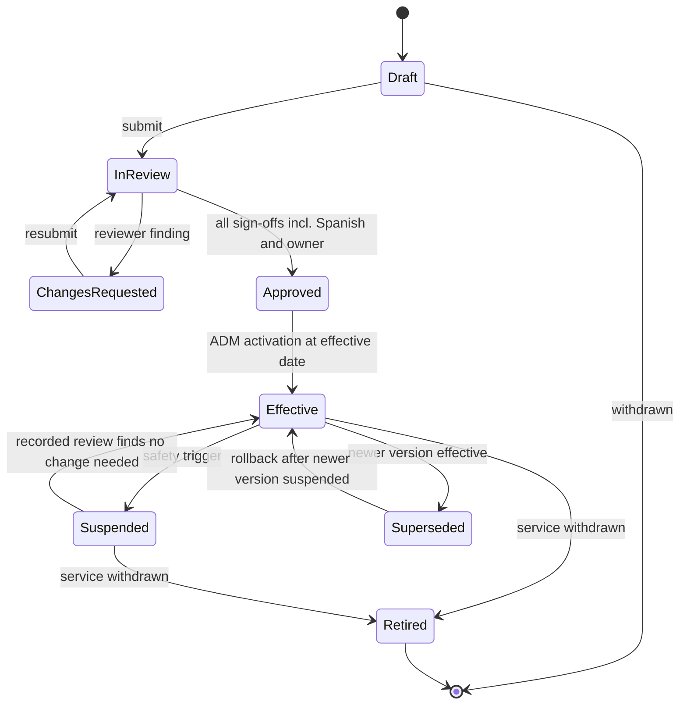
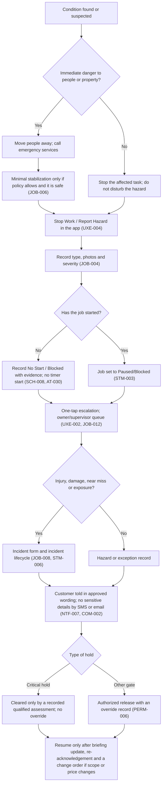

# 31 - SOP Standard

> **Status:** Draft - AI-generated planning document, not approved · **Owner/domain:** Field safety and operations · **Last updated:** 2026-10-04
> **Human review required:** qualified safety professional (template safety sections, PPE rule, hazard ranking, stop-work and escalation text, critical-hold seeds); licensed electrician, gas, HVAC and plumbing professionals (utility boundaries and Do-not-perform entries); structural engineer or building official (structural and inspection holds); accredited asbestos inspector and EPA RRP-certified renovator (old-property screening); qualified mold assessor (mold rule); qualified bilingual reviewer (Spanish workflow and safety glossary, HND-006); privacy owner and attorney licensed in KY and/or IN (credential rule, incident wording, any non-retaliation statement); owner (reviewer designation, approvals, launch order, review interval).
> **Related:** [Requirements spec](../Requierments/HandyHub_Requirements_Specification_Reconstructed.md) · [Master prompt](../HandyHub%20Master.md) · [04 Service registry](04-service-registry.md) · [11 Worker job execution](11-worker-job-execution.md) · [27 Roles and permissions](27-roles-and-permissions.md) · [02 Gap analysis](02-gap-analysis.md) · [06 State machines](06-state-machines.md) · [16 Testing strategy](16-testing-quality-strategy.md) · [29 Inventory and procurement](29-inventory-and-procurement.md) · [30 Service agreement standards](30-service-agreement-standards.md) · [33 AI and automation governance](33-ai-and-automation-governance.md) · [35 Skills coverage matrix](35-skills-coverage-matrix.md)

## 1. Purpose, scope and evidence

### 1.1 What this document governs

This is the single standard for HandyHub's 26 service Standard Operating Procedures (SOPs). It defines:

- the SOP template (sections, frontmatter, Do-not-perform list, Spanish translation status) that implements master section 16 (section 3);
- how one approved SOP version is shown to workers as a full SOP and as a condensed field checklist (spec BRF-006; section 4);
- SOP governance: versioning (NFR-013, ENT-008), approval by competent reviewers, effective dates, change triggers (incidents, QA-012 lessons learned), suspension and translation review (section 5);
- a compliance matrix of the 26 current SOP files against the standard (section 6);
- safety-critical remediation priorities ranked by hazard severity (section 7);
- standard stop-work language and the escalation path (START-011, JOB-004, JOB-006, AT-030; section 8);
- the restructuring recipe used in the edit phase and per-service notes for it (sections 9 and 10);
- PROPOSED `SOP-` requirements (section 11).

Owned elsewhere and linked instead of repeated: Start Job gate logic, briefing layout and offline behavior ([11](11-worker-job-execution.md), [10](10-frontend-ux-plan.md)); canonical state-transition tables ([06](06-state-machines.md)); entity and table design ([05](05-domain-model.md), [08](08-data-model-and-database.md)); who may activate or override what ([27](27-roles-and-permissions.md)); PPE, hazardous-material flags and SDS records in inventory ([29](29-inventory-and-procurement.md)); how agreements reference scope ([30](30-service-agreement-standards.md)); AI drafting limits ([33](33-ai-and-automation-governance.md)); renaming SOP files ([34](34-naming-and-migration-plan.md)); test cases ([16](16-testing-quality-strategy.md)).

Precedence: requirement text in the spec wins over this document. Where an owner fact is stricter than the spec (for example, Spanish review before any SOP is active), the owner fact governs. Everything here that neither states is a **PROPOSED DECISION** until the owner approves it.

### 1.2 Evidence base and labels

- **FACT** sources read for this document: all 26 files in `Standard Of Operations/` (read in full on 2026-10-03; unchanged since the audit snapshot); spec sections 1.1, 2 (PERM), 3 (MOD), 4 (CX), 5 (FIN), 6 (SCH), 7 (BRF, START, UXE), 8 (JOB), 9 (QA), 10-11 (RECT, REC, NTF, COM), 12 (AIR, AIC), 13 (OWN), 14 (ENT, STM), 15 (NFR), 16 (RPT), 17 (all 26 service cards), 18 (acceptance tests), 19 (LAUNCH, NEAR, HND) and Appendices A-C; the inventory, pricing and agreement files where a hazard row or per-service note quotes them; master sections 1.3, 1.4, 12, 16, 22 and 29; owner facts in the [operating context](../Skills/Business%20direction/handyhub-job-planner/references/operating-context.md) (cited as "owner facts Lnn"); the four skill files listed in 1.3.
- Contradiction IDs (`C-<CODE>-nn`, `X-nn`) come from the verified repository audit of 2026-10-03 and are tracked in [02 Gap analysis](02-gap-analysis.md). Severities quoted here are the final, adjudicated values.
- Vault files are cited by requirement ID, section heading or quoted text, not by line number, because the edit phase adds lines to them. Owner-fact and skill-playbook line numbers are stable and are cited.
- Labels follow master section 1.4: **FACT**, **ASSUMPTION**, **ESTIMATE**, **HYPOTHESIS**, **PROPOSED DECISION**, **OPEN QUESTION**, **RISK**, **RECOMMENDATION**, **GAP**. **HUMAN REVIEW:** marks master section 1.3 boundaries.
- This document names no product, respirator class, ladder setting, chemical ratio, pressure, cure time, threshold or legal requirement of its own. Numbers that appear are quotations from vault files, flagged where unsourced. The "pre-1978" trigger for the lead hold (sections 7.2 and 10; SOP-022) is quoted from the risk-triage playbook L27 ("A pre-1978 painted surface is not cleared by a customer saying it looks safe") and the EPA RRP source in owner facts L21; it only adds holds, unknown age is always a hold, and whether a rule applies to a given job is decided by the EPA RRP-certified renovator with the attorney (Q-31-07). No legal conclusion is drawn here.

### 1.3 Expert skills applied

| Skill (file read) | Rules applied | Where |
|---|---|---|
| [safety-liability-manager](../Skills/LLC%2C%20legal%20administration%2C%20and%20risk/safety-liability-manager/SKILL.md) | Classify work as routine / elevated / high-risk-specialist review / stop-work-emergency with the concrete hazard named (L21); hierarchy of controls with PPE last (L27); emergency response before paperwork (L28); stop-work triggers that name who must be involved before work resumes (L14); incident and near-miss elements (L15); "never encourage proceeding through an uncontrolled serious hazard merely because a customer wants the work completed quickly" (L21) | Sections 3, 7, 8 |
| [handyhub-risk-triage](../Skills/LLC%2C%20legal%20administration%2C%20and%20risk/handyhub-risk-triage/references/playbook.md) | Screening is not certification; unknown hazards stay unknown (L7); exposure checklist (L9); route lead/asbestos, leaks/rot, unsafe decks, attic wiring/heat and elevated gutter work to competent assessment, no DIY abatement (L11); never invent respirator selection, fit-test clearance, anchor ratings, ladder tolerances or mixing ratios (L15); name the release evidence and role for every hold (L17); "A pre-1978 painted surface is not cleared by a customer saying it looks safe. Unknown popcorn-ceiling material is not cleared by wet scraping." (L27) | Sections 3.5, 7, 8.4, 10 |
| [handyhub-job-planner](../Skills/Business%20direction/handyhub-job-planner/references/playbook.md) | Use only approved, versioned SOPs and manufacturer instructions; ordered steps with prerequisites, tools, materials, PPE, evidence and hold points; never invent structural specifications or chemical mixtures (L11); an acknowledgement cannot clear a hard safety hold (L17); flag safety-critical translations without reviewer approval (L19); a scope revision invalidates the old acknowledgement; access codes stay out of work orders (L27) | Sections 4, 5, 9 |
| [handyhub-quality-assistant](../Skills/LLC%2C%20legal%20administration%2C%20and%20risk/handyhub-quality-assistant/references/playbook.md) | Evidence statuses and "missing photos are unknown evidence" (L7, L27); photos cannot prove hidden fasteners, structural adequacy, hazardous-material clearance or electrical safety (L9); a worker's self-check does not replace a required supervisor inspection (L13); propose SOP and training changes "with versioned review rather than silently changing active instructions" (L19) | Sections 4, 5.5, 6.1 |

Applied in the consistency sweep of 2026-10-04 (safety-legal lens), in addition to the four skills above:

| Skill (file read) | Rules applied | Where |
|---|---|---|
| [legal-compliance-administrator](../Skills/LLC%2C%20legal%20administration%2C%20and%20risk/legal-compliance-administrator/SKILL.md) | Separate "confirmed requirement, likely requirement needing verification, business policy choice, and professional-review item" (L24); "Do not say a business is legally compliant based only on a conversational review" and "Do not invent licenses, permit rules, filing fees, deadlines, or tax registrations. When multiple jurisdictions apply, treat each separately." (L29); identify when a question needs an attorney, CPA, insurance broker, permit office or licensing authority (L17) | Sections 1.2, 5.3, 8.5 |
| [business-privacy-data-owner](../Skills/Website%2C%20software%2C%20and%20cybersecurity/business-privacy-data-owner/SKILL.md) and its [playbook](../Skills/Website%2C%20software%2C%20and%20cybersecurity/business-privacy-data-owner/references/playbook.md) | "Protect credentials and private customer records" (SKILL L13); pay attention to interior photos, faces, children and gate or access codes, and "Collect only what the task needs" (playbook L13); separate job documentation from publication permission (playbook L23) | Sections 3.5 rule 7, 5.8 (credential rule, photo module) |

Known limits of the skills, carried as gaps: the safety skill has no operating context or templates of its own, so owner facts were taken from the job-planner copy; the skills use different risk vocabularies (safety classes, triage dispositions, master section 12 gate outcomes; [02](02-gap-analysis.md) G-034). This document uses the master section 12 gate outcomes for software behavior and leaves the crosswalk to [06](06-state-machines.md), [11](11-worker-job-execution.md) and [20](20-decision-log.md). No skill covers asbestos, lead, mold, silica or biocides (G-076), so human reviewers are mandatory for those hazards.

## 2. Current status of the 26 SOPs

### 2.1 No SOP is active (owner decision)

**FACT** (owner facts L20): "No active field SOP until competent review of task-specific manufacturer instructions, hazards, qualifications, applicable requirements, emergency arrangements and Spanish translation. Unknown is not safe; acknowledgment cannot bypass critical holds." **FACT** (owner facts L11): the worker experience is English/Spanish and safety translations must be human-reviewed.

All 26 SOP files are therefore **drafts**. None carries a version, approval, effective date, reviewer, revision history or Spanish text. Seven are titled "Micro-Checklist" and nineteen "SOP:". They are written as task checklists: across the 26 files there are 303 checklist items, 0 PPE items, 0 incident steps and 1 file with photo steps.

### 2.2 Inventory of the SOP files

| Code | SOP file | H1 (emoji omitted) | Structure | Items | Notes |
|---|---|---|---|---|---|
| HI-01 | [sop-picture-hanging.md](../Standard%20Of%20Operations/sop-picture-hanging.md) | SOP: Picture Hanging & Art Installation | 2 "Problem Option" sections | 7 | Anchor weight bands "10–50 lbs" |
| HI-02 | [sop-grill-cleaning.md](../Standard%20Of%20Operations/sop-grill-cleaning.md) | SOP: Barbecue & Grill Deep-Cleaning | Single list | 5 | Gas valves closed, never restored |
| HI-03 | [sop-driveway-cleaning.md](../Standard%20Of%20Operations/sop-driveway-cleaning.md) | SOP: Driveway Pressure Washing | 2 "Problem Option" sections | 6 | 0-degree nozzle step |
| HI-04 | [sop-tv-mounting.md](../Standard%20Of%20Operations/sop-tv-mounting.md) | SOP: Professional TV Wall Mounting | 2 "Problem Option" sections | 7 | Ends before the TV is hung |
| HI-05 | [sop-smart-locks.md](../Standard%20Of%20Operations/sop-smart-locks.md) | SOP: Door Hardware & Smart Lock Installation | 2 "Problem Option" sections | 6 | Worker configures codes |
| HI-06 | [sop-gutter-maintenance.md](../Standard%20Of%20Operations/sop-gutter-maintenance.md) | SOP: Gutter Maintenance & Leaf Protection | 2 "Problem Option" sections | 6 | Roof-edge step, no height controls |
| HI-07 | [sop-attic-insulation.md](../Standard%20Of%20Operations/sop-attic-insulation.md) | SOP: Attic Insulation Upgrades | Single list | 4 | Shortest SOP (157 words) |
| HI-08 | [sop-closet-shelving.md](../Standard%20Of%20Operations/sop-closet-shelving.md) | SOP: Closet & Shelving System Installation | 2 "Problem Option" sections | 6 | Load "guarantee" line |
| HI-09 | [sop-trim-molding.md](../Standard%20Of%20Operations/sop-trim-molding.md) | SOP: Custom Trim & Architectural Molding | 2 "Problem Option" sections | 7 | Crown and wainscoting only |
| HI-10 | [sop-fence-repair.md](../Standard%20Of%20Operations/sop-fence-repair.md) | SOP: Structural Fence Maintenance & Repairs | 2 "Problem Option" sections | 6 | Digging with no locate gate |
| HI-11 | [sop-deck-repair.md](../Standard%20Of%20Operations/sop-deck-repair.md) | SOP: Structural Deck Maintenance & Repairs | 2 "Problem Option" sections | 6 | In-field joist sistering |
| DW-01 | [sop drywall-patching.md](../Standard%20Of%20Operations/sop%20drywall-patching.md) | SOP: Meticulous Drywall Patching & Repairs | 5 phases | 16 | Arabic word inside a step |
| DW-02 | [sop popcorn-removal.md](../Standard%20Of%20Operations/sop%20popcorn-removal.md) | SOP: Popcorn Ceiling Removal & Texture Matching | 5 phases | 16 | Only SOP that mentions asbestos |
| DW-03 | [sop drywall-remodeling.md](../Standard%20Of%20Operations/sop%20drywall-remodeling.md) | SOP: Residential Remodeling & Structural Additions | 5 phases | 15 | Horsehair-plaster tie-ins |
| DW-04 | [sop new-construction.md](../Standard%20Of%20Operations/sop%20new-construction.md) | SOP: High-Volume New Construction Drywall | 5 phases | 15 | Plain `tags:` line |
| PT-01 | [sop-interior-painting.md](../Standard%20Of%20Operations/sop-interior-painting.md) | SOP: Premium Residential Interior Painting | 5 phases | 18 | Intro "guarantees flawless" |
| PT-02 | [sop-deck-staining.md](../Standard%20Of%20Operations/sop-deck-staining.md) | SOP: Outdoor Deck & Fence Staining | 5 phases | 13 | Sodium hydroxide stripper |
| PT-03 | [sop-brick-limewashing.md](../Standard%20Of%20Operations/sop-brick-limewashing.md) | SOP: Brick Limewashing & Elastomeric Coatings | 5 phases | 16 | Plain `tags:` line; bleach mixing |
| PT-04 | [sop-wallpaper-removal.md](../Standard%20Of%20Operations/sop-wallpaper-removal.md) | SOP: Wallpaper Removal & Surface Restoration | 5 phases | 14 | Plain `tags:` line; Arabic word |
| CL-01 | [sop Routine Cleaning Checklist.md](../Standard%20Of%20Operations/sop%20Routine%20Cleaning%20Checklist.md) | Routine Cleaning Micro-Checklist | 5 phases | 23 | |
| CL-02 | [sop Deep Cleaning CheckList.md](../Standard%20Of%20Operations/sop%20Deep%20Cleaning%20CheckList.md) | Deep Cleaning Micro-Checklist | 7 phases | 25 | Acid, chlorine and vinegar steps |
| CL-03 | [sop Move-In and Move-Out Cleaning Checklist.md](../Standard%20Of%20Operations/sop%20Move-In%20and%20Move-Out%20Cleaning%20Checklist.md) | Move-In / Move-Out Micro-Checklist | 5 phases | 15 | "(Property must be completely vacant)" |
| CL-04 | [sop Post-Construction Cleaning Checklist.md](../Standard%20Of%20Operations/sop%20Post-Construction%20Cleaning%20Checklist.md) | Post-Construction Micro-Checklist | 3 phases | 12 | Dry dust pull and sweeping |
| CL-05 | [sop Airbnb Cleaning and Turnover Checklist.md](../Standard%20Of%20Operations/sop%20Airbnb%20Cleaning%20and%20Turnover%20Checklist.md) | Airbnb Cleaning & Turnover Micro-Checklist | 5 phases | 16 | Only SOP with photo steps |
| CL-06 | [sop Hotel-Style Housekeeping Checklist.md](../Standard%20Of%20Operations/sop%20Hotel-Style%20Housekeeping%20Checklist.md) | Hotel-Style Housekeeping Micro-Checklist | 4 phases | 12 | |
| CL-07 | [sop Air Duct and Vent Cleaning Checklist.md](../Standard%20Of%20Operations/sop%20Air%20Duct%20and%20Vent%20Cleaning%20Checklist.md) | Air Duct & Vent Cleaning Micro-Checklist | 4 phases | 11 | No service agreement exists yet |

**FACT:** three file-name conventions exist (`sop-<slug>.md` for HI and PT, `sop <slug>.md` for DW, `sop <Title> Checklist.md` for CL). Renaming is planned only through [34](34-naming-and-migration-plan.md); the alias map lives in [04](04-service-registry.md).

### 2.3 What the current state blocks

- **Problem:** no service has an SOP that a worker may follow, yet the files read like finished procedures.
- **Evidence:** owner facts L20; [02](02-gap-analysis.md) G-013 (SOPs lack the master section 16 structure); spec HND-004 "Approve initial SOPs, hazards, tools, materials, stop-work conditions and QA checklists for every active service before enabling booking"; BRF-006 requires a "Service-specific approved SOP version"; AT-017 records the version acknowledged at start; master section 12 lists "required SOP availability" before Start Job; X-03: 20 of 25 agreements incorporate an internal SOP, pricing or checklist file by filename, with no version pinned.
- **Impact:** no service is bookable under HND-004 ([32](32-website-and-customer-experience.md) records "Bookable services: None yet"); every job packet is DRAFT or BLOCKED on the approved-SOP gate (job-planner playbook L11, L17); AT-017 cannot run with real content; SOP edits silently change what those draft agreements point to.
- **Correct expertise:** safety-liability-manager (policy), handyhub-risk-triage (hazards), handyhub-job-planner (procedure), handyhub-quality-assistant (QA and evidence); **HUMAN REVIEW:** competent reviewers in section 5.3.
- **Proposed change:** adopt this standard; restructure the 26 files additively (section 9); add holds for the ranked hazards now (section 7); run competent review in the owner's launch order (Q-31-03).
- **Dependencies:** reviewer designation (Q-31-01, Q-31-02); shared safety modules (5.8); agreements stop incorporating mutable SOP files ([30](30-service-agreement-standards.md)).
- **Validation:** section 6 matrix re-scored after the edit phase; acceptance criteria at the end of this document.

## 3. The SOP standard template

### 3.1 Sections

Every SOP has these sections, in this order, with these numbers. A section with no approved content says `TBD - requires <reviewer> review` (in the edit phase, the exact recipe R4 wording given in 9.2 step 13) and is never omitted. Section numbers are fixed so that checklist items, matrix columns and review notes can refer to them.

| # | Section | Master section 16 element | Minimum content | Source priority | Section owner -> human reviewer | App use |
|---|---|---|---|---|---|---|
| 1 | Purpose | Purpose | One or two sentences naming the work and the outcome for the canonical service; no guarantees or absolute claims | Spec Appendix B name; spec card; original intro line (kept verbatim, flagged if promissory) | job-planner -> owner | Full SOP only |
| 2 | Scope: in scope, out of scope, Do not perform | Scope | Tasks covered, matched to estimate line types; exclusions; tasks that are priced or contracted but have no approved step, listed as "Not covered - pending review"; Do-not-perform list (3.3) | Spec card `.INT`; pricing; agreement; [04](04-service-registry.md) exclusions; START-011 | job-planner (scope); safety-liability-manager (Do not perform) -> owner, licensed reviewers | Approved-scope context (BRF-004); Do-not-perform list (UXE-010); JOB-010 |
| 3 | Preconditions | Preconditions | Dispatch and Start Job conditions for this service: approvals, permit/licence/qualification flags, property-age and hazardous-material screening result, site, weather and utility conditions, hold points that must clear before start | Spec card `.INT`/`.SAF`; APXA-001, APXA-003; master section 12 | job-planner + risk-triage -> qualified safety professional | Readiness banner (UXE-001); gates (SCH-001, START-005 to START-010) |
| 4 | Required worker qualifications | Required worker qualifications | Qualification tags, training, licensed or certified tasks, two-person tasks | Spec card `.SAF`; owner policy (none yet: **GAP**) | safety-liability-manager -> qualified safety professional, owner | Scheduling tags (SCH-003); START-010 |
| 5 | Customer and property preparation | Customer/property preparation | What the customer does before the visit; required property state; what is re-confirmed for every job (CX-005) | Spec card `.INT`; agreement preparation clauses (conflicts flagged); APXA-001 | job-planner -> owner | Confirmation and reminder content (NTF-004, NTF-005); BRF-002, BRF-005 |
| 6 | PPE | PPE | PPE per task from the approved PPE matrix; `TBD - pending safety review` until it exists. In the app, entries reference catalog PPE items, not free text ([29](29-inventory-and-procurement.md) INV-004) | Spec card `.TLS`/`.SAF`; inventory PPE lines; SDS | safety-liability-manager -> qualified safety professional | Safety guidance (BRF-008); START-004 |
| 7 | Tools and equipment | Tools | Required and optional tools, access equipment, test devices, pre-use inspection per manufacturer; in the app, catalog items and kits linked to the steps that use them ([29](29-inventory-and-procurement.md) INV-001, INV-005) | Spec card `.TLS`; inventory; original steps | job-planner -> owner | BRF-009; START-005; loadout (UXE-005) |
| 8 | Materials and consumables | Materials | Materials by specification; supplier (HandyHub or customer); substitution rule (JOB-007); hazardous-material flag and SDS link; in the app, catalog items linked to steps ([29](29-inventory-and-procurement.md) INV-003, INV-005) | Spec card `.MAT`; inventory; approved estimate | job-planner -> owner | BRF-010; START-006; START-009 |
| 9 | Hazards | Hazards | One entry per hazard: source, type, severity, controls in hierarchy order, PPE, stop-work trigger, escalation, reviewer | Spec card `.HAZ`; risk-triage exposure list; shared modules (5.8); register IDs | risk-triage (content) + safety-liability-manager (controls) -> qualified safety professional | Hazard cards (BRF-007); AT-018, AT-019 |
| 10 | Stop-work conditions | stop-work conditions | Standard stop-work statement (8.5) + the card's stop triggers + service holds with the release role | START-011; spec card `.SAF`; register holds | safety-liability-manager -> qualified safety professional | Persistent Stop Work control (UXE-004); AT-036 |
| 11 | Setup | setup | Protection, containment, isolate-verify-restore, staging, equipment set-up, pre-start evidence | APXA-002, APXA-003; spec card `.SAF`; original setup phase | job-planner -> qualified safety professional | Checklist phases APXA-002/003; START-008 |
| 12 | Step-by-step procedure | step-by-step procedure | Ordered steps with prerequisites, hold points and manufacturer-instruction references; in the edit phase, all original procedure text verbatim | Original SOP; manufacturer instructions | job-planner (+ safety for hold wording) -> qualified safety professional, trade reviewers | Task items (JOB-001); resume card (UXE-009) |
| 13 | Quality checkpoints | quality checkpoints | Observable checks from the card, who inspects (self or supervisor), evidence | Spec card `.QAC`; QA-001 | quality-assistant -> owner | Required QA checks (QA-001); AT-039 |
| 14 | Cleanup | cleanup | Remove protection and containment, restore the site, account for tools and materials, restore utilities altered within scope | QA-002; APXA-005 | quality-assistant + job-planner -> owner | Closeout preview (BRF-014) |
| 15 | Waste handling | waste handling | Waste streams, containers, destination, who pays; hazardous waste is not handled without an approved policy (no waste or stormwater specialist exists: [02](02-gap-analysis.md) G-078) | Spec card `.SAF`; SDS; local rules | safety-liability-manager -> qualified safety professional; legal-compliance for disposal rules | Waste lines by stream (AT-037; [29](29-inventory-and-procurement.md) INV-014) |
| 16 | Photo requirements (before / during / after) | before/during/after photo requirements | Photos by workflow moment, tagged to area or task, internal-only by default, privacy limits | START-008; QA-003; UXE-006; REC-002; [27](27-roles-and-permissions.md) AUTH-034 | quality-assistant + privacy -> owner, privacy owner | Photo prompts; AT-022, AT-040 |
| 17 | Customer communication | customer communication | Arrival and completion updates (drafts), walkthrough, care notes from approved product data, blocked-work wording, what not to say | QA-004; QA-008; NTF-007; UXE-008 | quality-assistant + customer-service -> owner | Notification templates; AT-042 |
| 18 | Completion criteria | completion criteria | Definition of done: QA answered, after photos, cleanup, utilities restored, property secured, punch items recorded, walkthrough outcome | QA-001 to QA-006; spec card `.QAC`; APXA-005, APXA-006 | quality-assistant -> owner | Completion gate; AT-039, AT-041 |
| 19 | Escalation | escalation | Standard escalation block (8.5) + service roles and contacts (owner decisions) | BRF-013; UXE-002; JOB-012 | safety-liability-manager -> owner | Escalation card; supervisor queue |
| 20 | Incident reporting | incident reporting | Standard incident block (8.5) | JOB-008; STM-006 | safety-liability-manager (+ privacy for injury data) -> owner, attorney | Incident form; AT-035 |
| 21 | Linked files | linked pricing/inventory/agreement files | Relative links: registry, pricing, inventory, agreement, spec card, main plan, shared modules | [04](04-service-registry.md); spec Appendix C | job-planner -> owner | Traceability only |
| 22 | Spanish translation status | (owner facts L11, L20; START-013) | Status block (3.4) | Owner facts; COM-006; HND-006 | bilingual reviewer -> owner | Language toggle (START-013) |
| RH | Review notes and revision history | revision history | Issues table (IDs from [02](02-gap-analysis.md)), open questions, revision history table | Edit recipe R3 (section 9) | orchestrator -> owner | Version history (ENT-008) |

### 3.2 Frontmatter fields

Two tiers. Tier A is applied to all 26 files in the edit phase (recipe R1) and is binding now. Tier B is **PROPOSED**: it is added when an SOP enters review and is then maintained by the governance workflow (section 5), in the vault file and later in the app's SOP Version record (ENT-008).

**Tier A - identity (edit phase, R1)**

| Field | Rule | Example (HI-04) |
|---|---|---|
| `title` | Original H1 text without emoji, quoted. At the controlled rename the title becomes `"SOP - <Appendix B name> (<CODE>)"` ([34](34-naming-and-migration-plan.md) section 3.4) | `"SOP: Professional TV Wall Mounting"` |
| `service_id` | Canonical code (spec Appendix B) | `HI-04` |
| `service_slug` | Canonical slug (alias map in [04](04-service-registry.md)) | `tv-mounting` |
| `canonical_name` | Spec Appendix B name, quoted | `"Professional TV Wall Mounting & Wire Hiding"` |
| `category` | Home Improvement, Drywall, Painting or Cleaning | `"Home Improvement"` |
| `doc_type` | Always `sop` | `sop` |
| `status` | Always `draft-not-field-approved` until activation | `draft-not-field-approved` |
| `authority` | `supporting` | `supporting` |
| `owner_approved` | `false` | `false` |
| `human_review` | `"qualified safety reviewer"`, `"owner"`, `"Spanish translation reviewer"`, plus `"licensed trade professional"` when electrical, gas, structural, HVAC, asbestos or lead scope is involved (per-service notes in section 10) | as listed |
| `registry` | `"AI Development Plans/04-service-registry.md#<CODE>"` | `"AI Development Plans/04-service-registry.md#HI-04"` |
| `last_reviewed` | Date of the edit | `2026-10-03` |
| `aliases` | Not added in the edit pass ([36](36-file-modification-plan.md) D-36-04, adopted here in the 2026-10-04 consistency sweep; owner confirmation open, Q-36-08): frontmatter aliases hold only former file names and are added at the controlled rename ([34](34-naming-and-migration-plan.md) D-34-04, section 3.6); non-canonical file names, H1s and titles are name variants that live only in the [04](04-service-registry.md) alias map. None of the 26 edited SOPs carries `aliases` | none in this pass |

**Tier B - governance (PROPOSED; set at first review)**

| Field | Values and rule |
|---|---|
| `sop_version` | `MAJOR.MINOR`. Drafts run `0.x`; the first approved version is `1.0`. MAJOR for any change to steps, hazards, controls, PPE, qualifications, tools, materials, QA, scope, Do-not-perform or Spanish safety text; MINOR only for editorial changes that do not change meaning (typos, links, formatting). Both create a new immutable version. |
| `version_status` | `draft`, `in_review`, `changes_requested`, `approved`, `effective`, `suspended`, `superseded`, `retired` (5.2) |
| `effective_date` | Date and time zone (NFR-020); set at approval |
| `supersedes` | Previous version, if any |
| `review_plan` | Reviewer roles required for this version, derived from `hazard_classes` and `licensed_boundaries` (5.3) |
| `approvals` | One entry per sign-off: role, reviewer reference, sections or hazard classes covered, date, evidence reference. No personal names or contact details in the vault file. |
| `review_due` | From the owner's review interval (Q-31-04) |
| `risk_class` | Service default from the safety skill: `routine`, `elevated`, `high-risk-specialist-review`. Job-level classification stays with Risk Triage. |
| `hazard_classes` | For example height, electrical, gas, chemical, pressure, silica-dust, asbestos, lead, mold-biological, structural, heat-weather, sharps-biohazard, security-privacy |
| `licensed_boundaries` | For example electrical, gas, HVAC, plumbing, structural, asbestos, lead, mold |
| `modules` | Shared safety modules referenced, with versions (5.8) |
| `translation_es` | Status, source version, review date, reviewer reference (3.4) |
| `checklist_version` | Always equal to `sop_version` (section 4) |

### 3.3 Do-not-perform list

Section 2 of every SOP ends with a `### Do not perform` list (spec UXE-010 "Worker-facing 'Do not perform' list for out-of-scope, prohibited or licensed/permit-dependent work"). Each entry states the prohibited action, the reason class (licensed trade, permit, hazardous material, structural, out of scope, policy), the source, and what to do instead (stop and escalate, refer, change order).

**Universal entries (PROPOSED wording; HUMAN REVIEW: qualified safety professional and licensing reviewer).** Every SOP carries these:

1. Electrical, plumbing, gas or HVAC work outside the approved scope or requiring a licensed trade (source: spec START-011 "unapproved electrical/plumbing/gas/structural scope"; master section 1.3).
2. Structural work, meaning cutting, removing, sistering or adding load-bearing members, ledgers, footings or framing, unless it is in the approved scope with the required qualified review (source: START-011; master section 1.3).
3. Disturbing suspect asbestos, lead paint or mold: stop and escalate (source: START-011 "suspect hazardous materials"; owner facts L20 "Unknown is not safe").
4. Work that is not in the approved scope or an approved change order; record customer requests instead (source: JOB-005, JOB-010, FIN-008, AT-033).
5. Working at height or using access equipment beyond the approved height and access policy (source: HI-06.SAF "beyond approved height/access policy"; DW-04.TLS "scaffolds/stilts only under approved policy").
6. Mixing or sequencing chemicals in any way the approved step and the product SDS do not allow (source: CL-01.SAF "never mix incompatible chemicals"; X-09).
7. Recording, photographing or sending customer passwords, master codes or site access codes outside the app's secured fields (source: COM-002; owner facts L17; [27](27-roles-and-permissions.md) AUTH-009).
8. Promising results, warranties, safety, health or code compliance to the customer (source: master sections 1.4, 17 and 29; CL-07.SAF "do not make unsupported indoor-air-quality claims").

Service-specific entries come from the spec card `.SAF` row, the agreement and the verified register findings; seeds for each service are in section 10.

### 3.4 Spanish translation status block

Section 22 of every SOP holds this table. The edit phase sets "Not started" for all 26 files. The Spanish text itself lives in a sibling file `sop-<slug>.es.md` with `lang: es` in its frontmatter and the same `sop_version` ([34](34-naming-and-migration-plan.md) D-34-09); the file name implies nothing about approval.

| Field | Value |
|---|---|
| Spanish version | `Not started` / `Draft - unreviewed` / `In review` / `Approved` / `Outdated` |
| Source English version | `sop_version` the Spanish text was made from |
| Translator (role) | `<owner decision>`; an AI draft is allowed only when marked `Draft - unreviewed` (COM-006) |
| Bilingual reviewer (role) | `<owner decision: qualified bilingual reviewer>` (Q-31-02) |
| Safety glossary version | Approved EN/ES critical safety terminology (HND-006); none exists yet (**GAP**) |
| Last review | Date |
| Notes | For example: "An Arabic word inside a step is kept verbatim and flagged (C-DW01-13); it is not a translation." |

### 3.5 Writing rules for SOP text

1. **Imperative, one action per step.** Conditions come first: "If <condition>, stop and escalate." Hold points start with `HOLD:` and name the release role and release evidence (risk-triage playbook L17).
2. **Every added statement carries a source** in the form `(source: spec HI-04.SAF)`, `(source: inventory file)`, `(source: owner facts 2026-10-02)`, or reads `TBD - requires <reviewer> review`.
3. **No invented numbers** ([02](02-gap-analysis.md) G-044). Pressures, distances, dilutions, dwell, depth, spacing, temperature, cure or dry times, loads and thresholds come only from manufacturer instructions, SDS or an approved policy. Numbers already in an original SOP stay verbatim and are flagged `UNSOURCED - verify against manufacturer instructions` until a reviewer confirms them (spec section 17: "Service-card defaults never override a site-specific hazard, manufacturer instruction, permit/licensing requirement, or approved change order").
4. **No procedural detail for regulated work** (electrical, gas, HVAC, plumbing, structural, asbestos or lead abatement, mold remediation): the SOP says "stop and refer" (master section 16 "Avoid unsafe procedural detail for work that legally or safely requires a qualified professional").
5. **No promises.** No guarantees, warranties, "flawless", "invisible", "damage-free", "absolute" or safety, health and code-compliance claims. Existing promissory lines stay verbatim but are flagged for the owner and attorney (master sections 1.4 and 29).
6. **No PPE, respirator, ladder or fall-protection selection by AI.** These come from the qualified safety professional's PPE matrix and modules (risk-triage playbook L15).
7. **Privacy.** No customer names, addresses, access codes, passwords or photos of people or documents in SOP text; photo steps avoid people, documents and valuables not needed for the work (CL-06.SAF "do not photograph/access personal records without need").
8. **Products.** Name a product only if it is on the approved product list with its SDS; otherwise describe the product type and write "approved product per SDS". Brand names already in originals stay verbatim.
9. **Units.** US customary units, with metric in parentheses where an original already gives both (as DW-04 does for temperature). **PROPOSED**.
10. **Language and format.** English source text; Spanish only through the translation workflow; no other language in worker steps. No emoji in added headings; original headings stay verbatim.

### 3.6 Copy-ready skeleton

```markdown
---
title: "<original H1 text without emoji>"
service_id: <CODE>
service_slug: <slug>
canonical_name: "<spec Appendix B name>"
category: "<Home Improvement | Drywall | Painting | Cleaning>"
doc_type: sop
status: draft-not-field-approved
authority: supporting
owner_approved: false
human_review:
  - "qualified safety reviewer"
  - "owner"
  - "Spanish translation reviewer"
registry: "AI Development Plans/04-service-registry.md#<CODE>"
last_reviewed: 2026-10-03
---

# <original H1, unchanged>

> [!warning] Draft — not owner-approved
> Canonical service: **<CODE> — <canonical name>** · [Registry entry](../AI%20Development%20Plans/04-service-registry.md#<CODE>)
> Not approved for field use. No SOP is active until competent review of task-specific manufacturer instructions, hazards, qualifications, applicable requirements, emergency arrangements and the Spanish translation (owner facts 2026-10-02). Workers must stop work and escalate for any unsafe, unexpected or out-of-scope condition. Standard: [31 SOP standard](../AI%20Development%20Plans/31-sop-standard.md).
> Review notes for this file: see "Review notes and cross-references" at the end.

## 1. Purpose
## 2. Scope
### In scope
### Out of scope
### Do not perform
## 3. Preconditions
## 4. Required worker qualifications
## 5. Customer and property preparation
## 6. PPE
## 7. Tools and equipment
## 8. Materials and consumables
## 9. Hazards
## 10. Stop-work conditions
## 11. Setup
## 12. Step-by-step procedure
### <original phase or option heading, demoted, verbatim>
- [ ] <original item, verbatim>
## 13. Quality checkpoints
## 14. Cleanup
## 15. Waste handling
## 16. Photo requirements (before / during / after)
## 17. Customer communication
## 18. Completion criteria
## 19. Escalation
## 20. Incident reporting
## 21. Linked files
## 22. Spanish translation status

---

## Review notes and cross-references (added 2026-10-03)
### Issues affecting this file
### Open questions
### Revision history
```

The callout text is the SOP callout of [36](36-file-modification-plan.md) section 3.2 (D-36-07), which restores "applicable requirements" from owner facts L20 (the regulatory, licensing and permit review that activation needs); all 26 edited SOPs carry it. Some edited files also place a one-line italic note on the added structure under the callout; such a note is optional and carries no approval.

## 4. Full SOP versus condensed field checklist (BRF-006)

### 4.1 Two views of one approved version

**FACT** (spec BRF-006): the briefing shows the "Service-specific approved SOP version with pre-work, setup, execution, quality checks, cleanup and closeout steps. Worker can open the full SOP and a condensed field checklist."

| | Full SOP | Condensed field checklist |
|---|---|---|
| What it is | The controlled document: all 22 sections and review history | Ordered, tappable items derived from the full SOP |
| Who uses it | Reviewers, trainers, owner; workers via "Open full SOP" | Workers on the phone during the job |
| Source of truth | Yes | No. Generated from the full SOP version; never edited on its own |
| Version | `sop_version` | `checklist_version` = `sop_version` |
| Language | EN and ES text of the same version | EN and ES item text of the same version (START-013) |
| Offline | Cached with the briefing (START-012) | Cached with the briefing (START-012, AT-025) |

**PROPOSED DECISION D-31-07:** the checklist is generated from the full SOP and approved together with it. A field team never edits checklist items directly; changes go through a new SOP version.

### 4.2 Checklist item model

| Field | Meaning | Source |
|---|---|---|
| `step_id` | Stable ID `<CODE>-<section>-<nnn>`, for example `HI-04-12-003`; kept across versions when the step's meaning is unchanged | JOB-001 (task evidence must survive completion) |
| `sop_version` | Version the item belongs to | ENT-008; START-014 |
| `phase` | APXA-001 Before leaving to APXA-007 After job | Spec Appendix A |
| `order` | Position within the phase | ENT-008 "steps" |
| `type` | `action`, `check`, `hold`, `photo`, `measurement`, `acknowledgement`, `decision`, `info` | BRF-006; UXE-006 |
| `text_en`, `text_es` | Short plain-language text; Spanish only from the approved translation | START-013; COM-006 |
| `applies_when` | Condition, for example "Option B only", "property age unknown", "customer present" | Original "Problem Option" structure; CX-005 |
| `evidence` | Required photo moment, measurement unit or none | START-008; QA-003; UXE-006 |
| `hold_release` | For `hold`: release role and release evidence; critical holds name a qualified assessment, never an override | Risk-triage playbook L17; [27](27-roles-and-permissions.md) section 6.3 |
| `hazard_refs`, `tool_refs`, `material_refs` | Links to section 9, 7 and 8 entries | ENT-009; ENT-010; ENT-011 |
| `do_not_perform_refs` | Do-not-perform entries shown with the item | UXE-010 |
| `source_section` | Full-SOP section the item came from | Traceability |

### 4.3 Where each full-SOP section appears in the app

| Full SOP section | Appears in the app as | Phase | Requirement and test |
|---|---|---|---|
| 1 Purpose, 21 Linked files, revision history | Full SOP view only | - | BRF-006; AT-017 shows the version |
| 2 Scope and Do not perform | Approved-scope context; Do-not-perform list | APXA-001, APXA-003 | BRF-004; UXE-010; JOB-010 |
| 3 Preconditions | Readiness items and gate results | APXA-001, APXA-003 | SCH-001; START-005 to START-010; AT-009, AT-020 to AT-024 |
| 4 Qualifications | Not a checklist item: scheduling tags and the START-010 gate | - | SCH-003; START-010; AT-024 |
| 5 Customer and property preparation | Confirmation and reminder content; "verify access" items | APXA-001, APXA-002 | NTF-004; NTF-005; CX-005 |
| 6 PPE | Safety guidance; acknowledgement | APXA-003 | BRF-008; START-004; AT-019 |
| 7 Tools, 8 Materials | Loadout items | APXA-001 | BRF-009; BRF-010; START-005; START-006; AT-020; AT-021 |
| 9 Hazards | Hazard cards merged with site hazards | Briefing | BRF-007; AT-018; AT-019 |
| 10 Stop-work | Prominent statement and persistent Stop Work / Report Hazard control | Whole job | START-011; UXE-004; AT-036 |
| 11 Setup | Setup and pre-start evidence items | APXA-002, APXA-003 | START-008; AT-022 |
| 12 Procedure | Ordered task items with holds; resume card | APXA-004 | JOB-001; UXE-009; AT-031 |
| 13 Quality checkpoints | Required QA checks | APXA-005 | QA-001; AT-039 |
| 14 Cleanup, 15 Waste | Closeout items | APXA-005 | QA-002; BRF-014; AT-037 |
| 16 Photos | Photo prompts at workflow moments | All phases | UXE-006; START-008; QA-003; AT-022; AT-040 |
| 17 Customer communication | Walkthrough outcome; message drafts | APXA-006 | QA-004; UXE-008; AT-042 |
| 18 Completion criteria | Completion gate | APXA-005, APXA-006 | QA-001; QA-006; AT-039 |
| 19 Escalation, 20 Incident | Escalation card; incident button | Whole job | BRF-013; UXE-002; JOB-008; AT-035 |
| 22 Spanish | Language toggle | Whole job | START-013 |

Appendix A items that apply to every service (for example "read latest changes", "identify pets/occupants") are maintained once as an SOP of kind company field checklist, with its own versions and the same review, approval and activation path as a service SOP ([05](05-domain-model.md) section 7.4, D-05-25; a separate template entity would duplicate that lifecycle). A service checklist is the checklist items of that company SOP plus the service's own items (**PROPOSED**). The site-assessment checklist of [11](11-worker-job-execution.md) section 5.11 item 2 (visits whose parent is a lead, where no work is performed) is a second SOP of this kind and is approved the same way before any assessor uses it (**PROPOSED**).

### 4.4 Generation and approval rules

1. The generator reads the full SOP version and emits items only from sections 2, 3, 5 to 20; it never adds text that is not in the full SOP.
2. Every `hold` item must have a release role. A generator run that finds a hold without one fails.
3. Reviewers approve the full SOP and see the generated checklist side by side; the approval covers both (D-31-07).
4. Spanish item text comes from the approved Spanish SOP text. If any item lacks approved Spanish, the version cannot be activated (owner facts L20).
5. A new SOP version regenerates the checklist; step IDs are kept where the meaning is unchanged so that resume cards and history stay linked.

### 4.5 Mobile access to SOP content (master section 22)

Master section 22: "Critical safety/SOP content should remain easy to access." For SOP content this means:

- The Stop Work / Report Hazard control and the stop-work statement are reachable from every job screen, without navigating to admin screens (UXE-004, AT-036).
- The effective SOP (full and condensed, both languages) is cached with the briefing; the screen shows the version and "last updated" time, and warns when a newer or suspended version is known (START-002, START-012).
- The condensed checklist is text-first, so it works on low bandwidth; images and diagrams load on demand.
- Large, glove-friendly controls and minimal typing (UXE-007); photo prompts compress before upload and queue for retry (owned by [10](10-frontend-ux-plan.md) and [11](11-worker-job-execution.md)).
- Viewing an SOP never needs location permission.

### 4.6 Current state

**FACT:** the seven cleaning files are already short checklists ("Micro-Checklist"), but they lack every safety section, so none is a condensed checklist in the BRF-006 sense. The 19 other files have neither a full SOP nor a checklist view. After the edit phase, the original checklists sit verbatim in section 12 of each file; the app checklist is generated only from approved versions.

## 5. SOP governance

### 5.1 Who does what

| Activity | Responsible | Approves | Consulted | Informed |
|---|---|---|---|---|
| Draft or revise an SOP version | AI drafting skills: job-planner (procedure), safety-liability-manager (safety sections), quality-assistant (QA, photos, completion), risk-triage (hazard inputs); or ADM | ADM submits for review | Lead worker (LWK) | Owner |
| Hazard and control content (sections 2 Do not perform, 6, 9, 10, 19, 20) | safety-liability-manager and risk-triage drafts | Qualified safety professional (technical sign-off) | Trade, structural and hazardous-material reviewers per the review plan | Owner |
| Licensed or regulated boundaries | Drafting skills flag them | The relevant licensed or qualified reviewer | legal-compliance-administrator (jurisdiction research, no legal conclusion) | Owner |
| Quality checkpoints, photos, completion | quality-assistant drafts | Owner, after safety review where a check is safety-critical | Privacy owner (photos) | LWK |
| Spanish translation | Translator (human, or AI draft marked unreviewed) | Qualified bilingual reviewer | Qualified safety professional for safety terms | Owner |
| Field validation | LWK walks the checklist on a real phone (HND-009) | Owner | Qualified safety professional | Workers |
| Business approval | Owner | Owner | Owners of [28](28-pricing-estimating-and-job-costing.md) and [30](30-service-agreement-standards.md) (scope, pricing, agreement alignment) | - |
| Activation, retirement | ADM with step-up L2 ([27](27-roles-and-permissions.md) section 6.2) | Owner | Qualified safety professional | Workers, DSP |
| Suspension | ADM (L1; it strengthens safety) | Owner | Qualified safety professional | Workers, DSP, affected customers |
| Change-trigger triage | Owner or Quality Assistant (QA-012) | Owner | Qualified safety professional | Section owners |

AI boundaries: AI drafts only (AIC-001). The Safety & Liability Manager role "Cannot replace qualified safety professional or authorize unsafe exceptions" (AIR-003) and may not activate SOPs ([27](27-roles-and-permissions.md) section 10.2). AI never fabricates inspections, approvals or safety checks (AIC-004). Details in [33](33-ai-and-automation-governance.md).

**Wave 1 (owner direction 2026-10-04, HANDOFF section 2; [33](33-ai-and-automation-governance.md) section 2.1 principle 5 and AIG-002):** the application's AI module stays in its tested disabled state, so the app offers no AI drafting, translation, triage or tagging. Every activity this document gives to an AI drafting skill or to the Quality Assistant (AIR-004 in QA-012) is done by a person in Wave 1: ADM drafts or imports SOP versions (drafts prepared outside the app, for example the vault drafts of this pass, enter the same review path and carry no approval), the owner triages change triggers and applies QA-012 tags, and a machine translation made outside the app is entered only as `Draft - unreviewed` (COM-006). No SOP gate, hold release or activation ever depends on AI.

### 5.2 Version lifecycle

**FACT** (spec NFR-013): "SOPs, service cards, estimates, notification templates and other controlled content retain versions and effective dates." The spec names the entity "SOP Version" (ENT-008) and records the SOP version acknowledged at start (AT-017, RECT-005).

**PROPOSED DECISION D-31-05.** The canonical transition table moves to [06](06-state-machines.md); this is its input. "Active" in [05](05-domain-model.md) (SOP version) and "activate" in [27](27-roles-and-permissions.md) section 6.2 refer to the Effective state here.



| From | To | Who | Conditions | Effects |
|---|---|---|---|---|
| none | Draft | AI drafting or ADM | New SOP, or a change to an effective one | Not visible to field roles |
| Draft | In review | ADM | Structure check passes (SOP-001); every added statement sourced; checklist generated; review plan set | Review tasks created |
| In review | Changes requested | Any assigned reviewer | Finding recorded | Back to editing |
| In review | Approved | System | All review-plan sign-offs, Spanish approved, owner approval (SOP-003) | Ready to activate |
| Approved | Effective | ADM, step-up L2 | Effective date reached; at most one effective version per service | Previous effective version becomes Superseded; briefings use the new one |
| Effective | Suspended | ADM, L1 | Safety trigger (5.6) | Start gate BLOCKED for the service; scheduled jobs flagged |
| Suspended | Effective | ADM, L2 | Recorded competent review: no change needed | Starts allowed again |
| Effective | Superseded | System | A newer version becomes effective | Jobs pinned to it keep it |
| Superseded | Effective | ADM, L2 | The newer version is suspended; a recorded competent review confirms that the older version does not contain the instruction or gap that triggered the suspension; its Spanish approval is still valid; reason recorded (strengthened in independent review: a superseded version is never restored on a role decision alone) | Rollback |
| Effective or Suspended | Retired | ADM, L2 | Service withdrawn | Service not bookable |

Effective, superseded, suspended and retired versions are immutable (SOP-005). Every transition is a protected audit event (SOP-025).

### 5.3 Approval workflow and competent review

1. **Pre-review check (automated):** 22 sections present in order; Do-not-perform list present; every added statement sourced; no unsourced number without an `UNSOURCED` flag; no promissory wording outside flagged originals; links resolve; checklist generated without errors.
2. **Review plan:** derived from the version's hazard classes and licensed boundaries using the table below.
3. **Competent review:** each reviewer signs the sections and hazard classes they cover. Findings return the version to Changes requested.
4. **Field validation (PROPOSED):** the lead worker walks the checklist on a real phone with a test job (HND-009) and records issues.
5. **Spanish translation and bilingual review** of the same version (5.7).
6. **Owner approval:** scope matches pricing and agreements; launch decision.
7. **Activation** by ADM with step-up L2 at the effective date; workers acknowledge the new version in their next briefing.

**Competent-review checklist** (the owner-fact elements, owner facts L20, plus the standard's own checks):

| Element | What the reviewer verifies | Evidence recorded |
|---|---|---|
| Task-specific manufacturer instructions | Each tool, equipment and product step references the manufacturer instruction or SDS it relies on | Instruction or SDS reference per step |
| Hazards | Section 9 covers the spec card `.HAZ` row, the risk-triage exposure list (height/falls, electricity/gas, moving equipment, structural instability, hidden utilities, lead/asbestos, silica/other dust, chemical incompatibility, biological contamination, heat, ventilation, lifting, occupants and animals) and site classes; controls follow the hierarchy of controls | Hazard sign-off |
| Qualifications | Section 4 names qualification tags and licensed or certified tasks | Tag list |
| Applicable requirements | Permit, licensing and regulatory questions checked against current primary sources for the actual KY or IN municipality, with source, date and jurisdiction (owner facts L21); AI draws no legal conclusion | Source register entry |
| Emergency arrangements | Escalation contacts, emergency-services reminder, utility shut-off information and first-response provisions exist (BRF-013; X-10) | Contact directory and kit references |
| Spanish translation | Approved for the same version (5.7) | Translation record |
| Stop-work and holds | Every hold names its release role and evidence; critical holds are non-overridable | Hold list |
| Numbers | No unsourced numeric parameter remains | Number register |
| Do not perform | Universal and service entries present and correct | Sign-off |

**Review-plan table (who must review what):**

| Hazard class or boundary | Required reviewer (role) |
|---|---|
| Every SOP | Qualified safety professional; owner; qualified bilingual reviewer |
| Electrical (fixtures, isolation, line-voltage boundary) | Licensed electrician |
| Gas appliances and fuel lines | Licensed gas professional |
| HVAC systems | Licensed HVAC contractor |
| Plumbing connections | Licensed plumber |
| Structural members, decks, framing, fire and sound assemblies, inspection before concealment | Structural engineer or building official, as applicable |
| Suspect asbestos | Accredited asbestos inspector or abatement professional |
| Lead paint in older housing | EPA RRP-certified renovator or firm (applicability confirmed by them, with the attorney where needed; no AI conclusion) |
| Mold and biological contamination | Qualified mold assessor or industrial hygienist |
| Respiratory protection, silica, chemical exposure, heat, fall protection | Qualified safety professional (OSHA applicability not concluded here) |
| Permits and licensing | Local permitting or licensing authority, with attorney where needed |
| Credentials, access codes, photos of private spaces | Privacy owner (OWN-007), with attorney for wording |

**HUMAN REVIEW:** who qualifies as each reviewer, and how their competence is evidenced, is an owner decision (Q-31-01).

### 5.4 Effective dates, version pinning and jobs in progress

1. One effective version per service at a time; the effective date may be in the future and is stored with its time zone (NFR-020).
2. Job start records the SOP version, checklist version and language acknowledged (START-014, RECT-005, AT-017).
3. A started job keeps its pinned version unless the version is suspended (5.6).
4. If a new version becomes effective after the worker last viewed the briefing, the briefing highlights "SOP updated", and changed safety items (sections 2 Do not perform, 6, 9, 10) need a new acknowledgement before start (START-002, AT-027; job-planner playbook L27 "A scope revision invalidates the old acknowledgment").
5. Offline starts fail closed (**PROPOSED**; the rule is owned by [11](11-worker-job-execution.md) section 5.9 items 2 and 3, D-11-19, and stated here in the same terms). A worker may start offline only on a cached, unexpired approval: the cached SOP version was effective, and no suspension or critical hold was known, at the last successful sync, and that sync is within the configured maximum cache age. The maximum age is an owner decision with the qualified safety professional (**OPEN QUESTION** Q-31-17, the same question as 11 Q-11-05 and [07](07-system-architecture.md) Q-07-05; answer once), and no number is assumed here. Until it is configured, no offline start is possible: the worker starts once the phone has signal, or records No Start, which works offline (owner facts L20 "Unknown is not safe"). Once it is configured, the offline start screen shows the last-sync time prominently (START-002), the start is recorded as provisional with an "offline start" flag, a start beyond the maximum age is refused, and at sync the server re-evaluates the start while the app warns about any newer or suspended version (START-012, NFR-005; 11 section 5.9 items 4 and 5). Tasks that 11 section 5.9 item 9 marks online-only (for example covering work before an inspection, or removing a material whose test result gates the work) never start offline. Because HND-009 includes an offline start, Q-31-17 must be answered before that field test.
6. Training: a new MAJOR version is acknowledged by each assigned worker before their first job with it (**PROPOSED**; training records owned by the safety skill's training matrix, a **GAP** today).

### 5.5 Change triggers

Each trigger opens an SOP review item linked to the SOP version and, where known, the step ID (SOP-018); in the data model the review item is a Lessons-learned tag that targets the SOP version, created by a person or by SYS for the deterministic triggers ([05](05-domain-model.md) section 7.4, D-05-25). Safety triggers are triaged first; response times are an owner decision, not set here.

| Trigger | Requirement | Raised by | Minimum response |
|---|---|---|---|
| Incident or near miss on a job using the SOP | JOB-008; STM-006; RPT-006 | System from the incident record | Owner and qualified safety professional decide on suspension (5.6) and a new version |
| Repeated stop-work or unexpected-condition records for a service | JOB-004; START-007; AT-023 | Owner or Quality Assistant | Review sections 3, 9, 10 |
| QA-012 lessons-learned tag | QA-012 | Owner or Quality Assistant | Route by tag (table below) |
| Rework classified as warranty/workmanship, or a callback | QA-010; CX-007 | Quality Assistant | Cause analysis; review sections 12, 13 |
| Product, SDS or manufacturer-instruction change; approved substitution | JOB-007 | Job planner or inventory owner | Review affected steps and section 8 |
| Spec service card change | ENT-007; NFR-013 | Owner | Review sections 6 to 10 and 13 |
| Inventory or tool change | [29](29-inventory-and-procurement.md) | Inventory owner | Review sections 7, 8 |
| Pricing or agreement scope change | [28](28-pricing-estimating-and-job-costing.md); [30](30-service-agreement-standards.md) | Owner | Review section 2 |
| Regulatory or source change | Owner facts L21 | legal-compliance-administrator | Review section 3 and the Do-not-perform list |
| Shared safety module change | SOP-021 | Module owner | Review every referencing SOP |
| Translation defect | COM-006 | Any user | Spanish status becomes `Outdated` for the affected text |
| Worker feedback or field-validation finding | HND-009 | Worker or LWK | Section owner reviews |
| Periodic review due | SOP-020 | System | Full review |

**QA-012 tag routing:**

| QA-012 tag | SOP sections usually affected | Section owner | Reviewer |
|---|---|---|---|
| Recurring defect | 12, 13 | quality-assistant, job-planner | Owner; trade reviewer if technical |
| Hazard | 2 Do not perform, 6, 9, 10 | risk-triage, safety-liability-manager | Qualified safety professional |
| Estimate miss | 2 (scope); mostly [28](28-pricing-estimating-and-job-costing.md) | estimate assistant | Owner |
| Material miss | 7, 8; [29](29-inventory-and-procurement.md) | job-planner | Owner |
| Process issue | 3, 11, 12, 17, 19 | job-planner | Owner |

Automated linking and analytics are near-term (NEAR-003 "service/SOP feedback loop"); the manual review item is needed at launch (SOP-018).

### 5.6 Emergency suspension

**PROPOSED DECISION D-31-05 (part).** When an incident, near miss or reviewer finding shows that an effective SOP instruction may be unsafe:

1. ADM suspends the version immediately (step-up L1, because suspension only strengthens safety).
2. Start Job returns BLOCKED for every job of that service from the moment the suspension commits: the gate reads the SOP version status itself ([11](11-worker-job-execution.md) section 5.3 check 6, never overridden), so the block never waits for an outbox reaction, a queued job or a notification (the same principle as [07](07-system-architecture.md) ARC-037 for critical holds). Dispatch then flags scheduled jobs (SCH-001), started jobs move to Blocked ([06](06-state-machines.md) section 18.1) and assigned workers are notified.
3. Jobs in progress: workers stop at a safe point and escalate, or continue on the pinned version, according to the owner's decision (Q-31-14). Until that decision, the conservative default is stop at a safe point and escalate.
4. Customers with affected appointments get the approved "work blocked" message (NTF-007).
5. Reactivation follows 5.2: either a new version through full review, or a recorded competent review that finds no change is needed.

### 5.7 Translation review workflow

1. The English content of the version is frozen.
2. A translator produces the Spanish text. An AI draft is allowed only when marked `Draft - unreviewed`; machine translation is never shown to workers as approved (COM-006).
3. The qualified bilingual reviewer checks the Spanish against the approved safety glossary (HND-006), confirms that version IDs, numbers, units and specifications are identical (START-013), and confirms that the stop-work statement and Do-not-perform list carry the same meaning.
4. Status becomes `Approved` for that version; activation is allowed (SOP-003).
5. Any later change to English safety text sets the Spanish status to `Outdated`; that version cannot be activated until the Spanish is re-approved.
6. Job-specific text typed by staff (for example site hazards) is shown with an "untranslated" indicator instead of being silently machine-translated (COM-006).

**PROPOSED DECISION D-31-06:** Spanish review is an activation gate for every SOP version. The spec is weaker ("where translations exist", START-013; "should be approved", COM-006); owner facts L11 and L20 are stricter and govern. [27](27-roles-and-permissions.md) already requires "Spanish review" evidence for activation. No Spanish content exists anywhere in the vault today ([02](02-gap-analysis.md) G-012), so this gate is on the launch critical path. In the vault, the Spanish text sits in the sibling `.es.md` file described in 3.4.

### 5.8 Shared safety modules

The audit found the same hazards handled differently across SOPs (X-06 to X-13, X-27), and the company policies the spec relies on do not exist ([02](02-gap-analysis.md) G-005, G-029). **PROPOSED DECISION D-31-11:** company-level modules are written once, versioned and approved like SOPs, and referenced by each SOP's sections 3, 6, 9, 10 and 11. A module change opens review items for every SOP that references it. None of these modules exists today (**GAP**). In the data model a module is an SOP of kind "shared module" with its own versions, referenced by a service card version ([05](05-domain-model.md) D-05-10); 11.1 uses that structure.

| Module | Evidence | SOPs that must reference it | Primary owner | HUMAN REVIEW |
|---|---|---|---|---|
| Height and access (ladders, roof edges, lifts, scaffolds, stilts) | X-12: 0 of 26 SOPs mention ladders, scaffolds, stilts, harnesses or fall controls; access equipment in 3 of 26 inventories; spec cards flag ladder, fall or height risk for 18 services | HI-01, HI-04, HI-06, HI-07, HI-08, HI-09, HI-11, DW-01 to DW-04, PT-01, PT-03, PT-04, CL-02, CL-03, CL-04, CL-07 | safety-liability-manager | Qualified safety professional |
| Isolate-verify-restore (electrical, gas, water, HVAC) | X-07: 5 SOPs isolate a utility or appliance, none verifies isolation, 4 never restore | CL-07, PT-04, DW-02, HI-02, CL-02, CL-03, PT-01 | safety-liability-manager | Licensed electrician, gas and HVAC professionals |
| Chemicals and SDS (register, compatibility, storage, transport, spill, disposal) | X-09: at least 16 inventories stock chemicals; "SDS" appears in none of the 103 service files (G-008); [29](29-inventory-and-procurement.md) INV-003 blocks activation of any chemical item without a current SDS | CL-01 to CL-07, DW-01, DW-02, HI-02, HI-03, HI-06, PT-01 to PT-04 | safety-liability-manager (with [29](29-inventory-and-procurement.md)) | Qualified safety professional |
| Pressure washing and airless spraying | X-08: three services, pressure specified three different ways, no exclusion of people | HI-03, PT-02, PT-03 | safety-liability-manager | Qualified safety professional; equipment manufacturer instructions |
| Old-property hazardous-material screening (lead, asbestos) | X-13: one asbestos-only "before 1980" rule in DW-02; no lead rule in any SOP; no build-year capture elsewhere; [02](02-gap-analysis.md) G-076: no vault file mentions lead paint or RRP | DW-01, DW-02, DW-03, PT-01, PT-04, HI-01, HI-07, CL-04, CL-07 (CL-07.SAF "asbestos-containing material"; G-076); screening questions for CL-02, HI-04, HI-05, HI-06, HI-09, PT-02, PT-03, and, **PROPOSED** pending the qualified safety professional (Q-04-18), HI-08 (drilling into older painted or textured walls), HI-11 (painted deck boards, rails and posts) and CL-03 (painted sills, doors and ceilings of unknown composition in older homes), aligned with [04](04-service-registry.md) section 6.2 and already applied in those three edited SOPs | handyhub-risk-triage with safety | EPA RRP-certified renovator; accredited asbestos inspector |
| Mold, moisture and biological contamination | X-06: mold excluded, cleaned routinely, sold as an outcome, billed as a change order and a spec stop trigger | HI-07, DW-01, DW-03 (X-06), CL-07, PT-04, CL-01, CL-02, CL-03, CL-05; exterior mildew distinction for HI-03, PT-02, PT-03 | safety-liability-manager with risk-triage | Qualified mold assessor or industrial hygienist |
| Occupants, children and pets | X-11: 0 of 26 SOPs and 0 of 25 agreements protect them from active work hazards | All 26 | safety-liability-manager | Qualified safety professional |
| Weather, temperature and heat | X-27: no exterior SOP and no attic SOP has a weather, temperature or heat-stress rule | HI-03, HI-06, HI-07, HI-10, HI-11, PT-02, PT-03; DW-04 temperature precondition | safety-liability-manager | Qualified safety professional |
| Emergency kit, first response and incident reporting | X-10: no first-aid kit, extinguisher, eyewash, spill kit or SDS in any inventory; no incident step in any SOP; [29](29-inventory-and-procurement.md) INV-018 adds the vehicle safety kit to every job once its contents are defined | All 26 | safety-liability-manager | Qualified safety professional; insurance broker for notification questions |
| Make-safe (emergency stabilization) | JOB-006 and FIN-008 allow minimal stabilization "as allowed by policy"; no policy exists (G-005) | All 26, especially HI-10, HI-11, DW-01, DW-02, DW-03 | safety-liability-manager | Qualified safety professional; owner |
| Waste, runoff and disposal | 0 of 26 SOPs define a waste destination (G-013); runoff and stormwater have no specialist (G-078); [29](29-inventory-and-procurement.md) INV-014 waste streams | All services that produce debris, wash water or chemical residue | safety-liability-manager (interim) | Local waste or stormwater authority; qualified safety professional |
| Guest property, damage reporting and lock-up | CL-05.SAF "never discard guest property without policy"; CL-05.INT "damage-report rule"; HI-05.SAF and CL-03.SAF lock-up rules (G-005) | CL-05, CL-06, CL-03, HI-05 | handyhub-customer-service with legal-compliance | Attorney; owner |
| Underground utilities before digging | HI-10.SAF "utility-location/permit policy before digging"; C-HI10-01 | HI-10 and any ground-driven anchor | handyhub-risk-triage with legal-compliance | Local authority and utility rules (no legal conclusion here) |
| Credentials and access codes | HI-05.SAF; CL-05.SAF; COM-002; [27](27-roles-and-permissions.md) AUTH-009 | HI-05, CL-05, CL-06, CL-03, CL-01 | business-privacy-data-owner with safety | Privacy owner; attorney |
| Photo capture and classification | REC-002; REC-003; START-008; X-02; [27](27-roles-and-permissions.md) AUTH-034 | All 26 | quality-assistant with privacy | Privacy owner |

**Hazard library ([02](02-gap-analysis.md) G-007).** The approved section 9 entries of every SOP, plus the hazards defined in the modules above, form the hazard-template library that LAUNCH-009 and BRF-007 require. Each template entry (ENT-009 fields) is versioned with its SOP or module; site hazards from intake, estimate or earlier visits are added per job and never overwrite a template (AT-018). Until a qualified safety professional approves them, the entries seeded from the spec cards in the edit phase are drafts.

**Credential rule requested by [27](27-roles-and-permissions.md) (PROPOSED DECISION D-31-16; HUMAN REVIEW: privacy owner and attorney).** SOPs never instruct a worker to create, record, photograph or transmit customer passwords, master codes or Wi-Fi credentials. The customer (or host) creates and owns the app account and enters the Wi-Fi password and all master and guest codes on their own device; the worker may point to the manufacturer's setup steps. Site access secrets for the job are revealed only in the app (AUTH-009) and never appear in SOP text, notes, photos or messages. Sources: HI-05.SAF "protect customer credentials; have customer control personal account/password"; CL-05.SAF "protect access codes"; COM-002; owner facts L17. The current HI-05 step "Pair the lock to the home Wi-Fi hub, configure temporary guest access pin codes, and test remote lock/unlock commands via the client's smartphone" is held under C-HI05-01 (section 10).

### 5.9 Source of truth

**PROPOSED DECISION D-31-12:** until the app's administration module exists (LAUNCH-009, MOD-010), the vault Markdown file is the authoring source for each SOP draft. At first approval the approved content is imported into the app's SOP Version record (ENT-008), which becomes the system of record for activation, pinning and history. After that, edits are made as new versions in the app, and the vault file is regenerated as a read-only export or marked superseded. **HUMAN REVIEW:** owner and swe-architecture (Q-31-13).

**Retention of superseded versions** (the question [34](34-naming-and-migration-plan.md) D-34-09 leaves to this standard): superseded, suspended and retired versions are kept as immutable SOP Version records in the app, never as extra vault files, because version numbers stay out of file names ([34](34-naming-and-migration-plan.md) section 3.1 rule 5). Activation is an app action (SOP-003), so before the app exists the vault holds only drafts; their earlier states are preserved by each file's revision-history table and the dated vault backups described in [34](34-naming-and-migration-plan.md). If the owner wants approved SOPs used on paper before the app exists, a vault retention scheme must be agreed first (Q-31-13).

## 6. SOP compliance matrix (26 SOPs x standard sections)

### 6.1 Rubric

- **Y (present):** a dedicated section, phase or step clearly serving the element exists. Present means structurally present, not adequate or approved; adequacy is decided only by competent review (5.3).
- **P (partial):** the element appears only inline or implicitly, covers part of what the spec card or Appendix A requires, or is written as a promise. An intro line that promises an outcome ("guarantees", "flawless", "invisible", "damage-free") counts as a partial purpose. Tools and materials named inside steps count as partial. A single isolation or warning step counts as a partial hazard entry.
- **- (missing):** nothing in the file.
- Layout and marking steps (laser lines, stud finding) count as procedure, not setup. Cleanup for cleaning services means the exit sequence and the crew's own equipment, not the cleaning service itself.

Columns use the template section numbers in 3.1: `2c` is the Do-not-perform list, `RH` is revision history. Totals count the 22 master section 16 elements (all columns except `2c` and `22`), 572 cells in all. Scored from a direct read of the 26 files on 2026-10-03.

### 6.2 Matrix

| SOP | 1 | 2 | 2c | 3 | 4 | 5 | 6 | 7 | 8 | 9 | 10 | 11 | 12 | 13 | 14 | 15 | 16 | 17 | 18 | 19 | 20 | 21 | 22 | RH | Y | P | Missing |
|---|---|---|---|---|---|---|---|---|---|---|---|---|---|---|---|---|---|---|---|---|---|---|---|---|---|---|---|
| HI-01 | - | - | - | - | - | - | - | P | P | - | - | - | P | - | - | - | - | P | - | - | - | - | - | - | 0 | 4 | 18 |
| HI-02 | - | - | - | - | - | - | - | P | P | P | - | P | P | - | - | - | - | - | - | - | - | - | - | - | 0 | 5 | 17 |
| HI-03 | - | - | - | - | - | - | - | P | P | - | - | - | P | - | - | - | - | - | - | - | - | - | - | - | 0 | 3 | 19 |
| HI-04 | - | - | - | - | - | - | - | P | P | - | - | - | P | P | - | - | - | - | - | - | - | - | - | - | 0 | 4 | 18 |
| HI-05 | - | - | - | - | - | - | - | P | P | - | - | - | P | P | - | - | - | P | - | - | - | - | - | - | 0 | 5 | 17 |
| HI-06 | - | - | - | - | - | - | - | P | P | - | - | - | P | - | - | - | - | - | - | - | - | - | - | - | 0 | 3 | 19 |
| HI-07 | - | - | - | - | - | - | - | P | P | P | - | P | P | - | - | - | - | - | - | - | - | - | - | - | 0 | 5 | 17 |
| HI-08 | - | - | - | - | - | - | - | P | P | - | - | - | P | P | - | - | - | - | - | - | - | - | - | - | 0 | 4 | 18 |
| HI-09 | - | - | - | - | - | - | - | P | P | - | - | - | P | - | - | - | - | - | - | - | - | - | - | - | 0 | 3 | 19 |
| HI-10 | - | - | - | - | - | - | - | P | P | - | - | - | P | P | - | - | - | - | - | - | - | - | - | - | 0 | 4 | 18 |
| HI-11 | - | - | - | - | - | - | - | P | P | P | - | - | P | P | - | - | - | - | - | - | - | - | - | - | 0 | 5 | 17 |
| DW-01 | P | P | - | - | - | - | - | P | P | P | - | Y | Y | Y | P | - | - | - | - | - | - | - | - | - | 3 | 6 | 13 |
| DW-02 | P | P | - | P | - | - | - | P | P | P | P | Y | Y | P | - | - | - | - | - | - | - | - | - | - | 2 | 8 | 12 |
| DW-03 | Y | P | - | - | - | - | - | P | P | - | - | - | Y | Y | Y | - | - | - | - | - | - | - | - | - | 4 | 3 | 15 |
| DW-04 | Y | P | - | P | - | P | - | P | P | P | P | Y | Y | Y | - | - | - | P | P | - | - | - | - | - | 4 | 9 | 9 |
| PT-01 | P | P | - | - | - | - | - | P | P | - | - | Y | Y | Y | Y | - | - | - | - | - | - | - | - | - | 4 | 4 | 14 |
| PT-02 | Y | P | - | - | - | - | - | P | P | P | P | Y | P | P | P | P | - | Y | - | - | - | - | - | - | 3 | 9 | 10 |
| PT-03 | P | P | - | - | - | - | - | P | P | - | - | Y | Y | P | P | - | - | - | - | - | - | - | - | - | 2 | 6 | 14 |
| PT-04 | P | P | - | - | - | - | - | P | P | P | - | Y | Y | - | - | - | - | - | P | - | - | - | - | - | 2 | 6 | 14 |
| CL-01 | - | - | - | - | - | - | - | P | P | P | - | P | Y | Y | P | - | - | - | - | - | - | - | - | - | 2 | 5 | 15 |
| CL-02 | - | - | - | - | - | - | - | P | P | P | - | P | Y | - | P | - | - | - | - | - | - | - | - | - | 1 | 5 | 16 |
| CL-03 | - | - | - | P | - | P | - | P | P | - | - | - | Y | - | P | - | - | - | - | - | - | - | - | - | 1 | 5 | 16 |
| CL-04 | - | - | - | - | - | - | - | P | P | P | - | - | Y | Y | P | P | - | - | P | - | - | - | - | - | 2 | 6 | 14 |
| CL-05 | - | - | - | - | - | - | - | P | P | - | - | - | Y | Y | P | - | P | Y | - | P | - | - | - | - | 3 | 5 | 14 |
| CL-06 | - | - | - | - | - | - | - | P | P | - | - | - | Y | P | - | - | - | - | - | - | - | - | - | - | 1 | 3 | 18 |
| CL-07 | - | - | - | - | - | - | - | P | P | P | - | Y | P | Y | - | P | - | - | - | - | - | - | - | - | 2 | 5 | 15 |
| **Y/P count** | 3/5 | 0/8 | 0/0 | 0/3 | 0/0 | 0/2 | 0/0 | 0/26 | 0/26 | 0/12 | 0/3 | 8/4 | 13/13 | 8/9 | 2/8 | 0/3 | 0/1 | 2/3 | 0/3 | 0/1 | 0/0 | 0/0 | 0/0 | 0/0 | **36** | **130** | **406** |

Column key: 1 Purpose · 2 Scope · 2c Do not perform · 3 Preconditions · 4 Qualifications · 5 Customer/property preparation · 6 PPE · 7 Tools · 8 Materials · 9 Hazards · 10 Stop-work · 11 Setup · 12 Procedure · 13 Quality checkpoints · 14 Cleanup · 15 Waste · 16 Photos · 17 Customer communication · 18 Completion criteria · 19 Escalation · 20 Incident reporting · 21 Linked files · 22 Spanish status · RH Revision history.

### 6.3 Reading the matrix

- **FACT (this scoring):** of 572 cells, 36 are present (6%), 130 partial (23%) and 406 missing (71%). No SOP is complete; the best-structured file, DW-04, still misses 9 of 22 elements, and three HI files miss 19.
- **Safety-critical sections are almost empty:** PPE 0/26, qualifications 0/26, incident reporting 0/26, Do-not-perform 0/26, Spanish 0/26; stop-work is partial in 3 files (DW-02, DW-04, PT-02), hazards partial in 12, escalation partial in 1 (CL-05).
- **What exists is procedure:** every file has steps (13 complete, 13 partial). The HI files are the thinnest: problem-option fragments with no setup, cleanup or completion steps; HI-04 never hangs the TV.
- **Comparison with the audit estimate:** the repository audit, recorded in [02](02-gap-analysis.md) G-013, estimated about 470 of 572 elements missing (82%) using slightly different conventions per service. This document applies one rubric to all 26 files and counts inline tools and materials as partial (52 cells), which explains most of the difference. **PROPOSED DECISION D-31-13:** this rubric is used for tracking SOP progress from now on.
- **RISK:** "present" can be misread as "acceptable". Every cell, including Y, still needs competent review before activation.

## 7. Safety-critical remediation priorities

### 7.1 Ranking method

**PROPOSED (HUMAN REVIEW: qualified safety professional).** Hazards are ranked by: (1) worst credible outcome (fatal or irreversible above serious injury, above minor injury, property or privacy harm); (2) whether the current SOP text directs the exposure rather than merely omitting a control; (3) exposure of occupants, children or the public; (4) number of services affected. This is a qualitative severity ranking from the vault evidence, not a quantified risk assessment (**ASSUMPTION**). Only hazards with evidence in vault files are listed. The order among hazards with a similar worst outcome is a judgment for the qualified safety professional (reviewer note under 7.2; Q-31-18).

### 7.2 Ranked hazards

| Rank | Hazard and worst credible outcome | Evidence (SOP text, spec card, inventory, pricing, agreement) | IDs | Control required before any activation | HUMAN REVIEW |
|---|---|---|---|---|---|
| 1 | Asbestos disturbance in textured ceilings and other suspect materials; irreversible disease for workers and occupants | DW-02 Phase 1 "Asbestos Verification": "Confirm if the home was built before 1980. If yes, stop work and verify asbestos testing logs before disturbing the ceiling matrix", then Phase 2 wet scraping; no rule for unknown build year; the agreement lets work resume after an abatement firm "encapsulates or clears the space"; no file says who samples. DW-02.HAZ "suspect asbestos in older textures"; CL-07.SAF "asbestos-containing material"; HI-07 existing insulation never screened; CL-02 "Vacuum ceiling edges" and CL-03 ceiling clearing over textures of unknown composition (RISK) | C-DW02-01, C-DW02-02, C-DW02-03, C-HI07-01, X-13 | Unknown build year = HOLD; untested texture = HOLD at any property age until a qualified reviewer sets the screening rule ([04](04-service-registry.md#DW-02) prerequisites; [11](11-worker-job-execution.md) section 12.4); positive or inconclusive result = BLOCKED; release only on documented clearance from a qualified asbestos professional accepted by the owner; no HandyHub sampling until the testing role is defined; the "1980" threshold flagged UNSOURCED but not relaxed | Accredited asbestos inspector or abatement professional; attorney |
| 2 | Lead-paint disturbance in older housing; irreversible harm, especially to children | PT-01 Phase 2 "Pole Sanding": "Sand patched areas and the entire wall plane using a 120-grit pole sander to remove old paint textures and nubs"; PT-04 scoring, coarse abrasive scrubbing and sanding of old walls; DW-03 tie-ins to "thick old horsehair plaster" and demolition; DW-02 painted texture; DW-01 cutting painted walls; HI-06 wire wheel on painted gutters, PT-02 stripping old coatings (RISK). The word "lead" appears in no SOP except "lead expansion masonry anchor sleeve" (HI-01). PT-01.HAZ "dust/lead in older coatings" | C-PT01-01, C-PT04-04, C-DW03-02, C-DW02-03, C-DW01-01, X-13 | Approximate build year captured (BRF-003 "approximate age if known") with "unknown" as a value; pre-1978 or unknown = no sanding, scraping or cutting of existing coatings until a qualified person records a disposition; no abatement instructions | EPA RRP-certified renovator or firm; attorney |
| 3 | Falls from ladders, roof edges, lifts, scaffolds, stilts and through ceilings; fatal fall | HI-06 Option B "Slide the back flange of the gutter guard screen safely underneath the first layer of roof shingles" with two-story pricing; PT-03 Phase 2 "Tuck plastic flashing underneath the first row of roof shingles", soffits, gutters and lifts; DW-04 panel lifts, scaffolds and stilts; CL-04 work above 12 ft priced; PT-01 ceiling cut-line with 10-14 ft ceilings priced; DW-03 stilts; CL-02 work to a 12-ft ladder in the agreement; HI-07 "falls through ceiling"; HI-11 boards removed on elevated decks | C-HI06-01, C-PT03-04, C-DW04-01, C-CL04-01, C-PT01-02, C-HI07-02, C-HI11-03, C-DW03-08, C-CL02-05, X-12 | Height and access module approved (equipment, inspection, qualification, exclusion zones, weather and ground checks); until then roof-edge and elevated work is BLOCKED | Qualified safety professional |
| 4 | Contact with energized electrical systems: water or steam near live equipment, unverified isolation, drilling, cutting or nailing into hidden wiring, ladders or tools near overhead power lines; electrocution, fire | DW-02 misting the ceiling with no fixture de-energize step; PT-04 "Turn off circuit breakers ... Stuff wall electrical boxes with plastic bag scrapers" with no verification while the agreement powers the steamer from "a reachable junction box"; CL-07 "switch off the main circuit breaker" while vacuum and drill equipment run (which breaker is meant is an ASSUMPTION); HI-01, HI-04, HI-08, HI-09 drill, cut or nail without a hidden-service check; HI-07 unconditional boxing of "hot recessed can lights"; HI-06 ladder work at the roofline although HI-06.HAZ lists "overhead power" and HI-06.SAF says "stop near unsafe power lines", with no power-line check in the SOP; HI-03.HAZ "electrical proximity" during pressure washing (HI-03.SAF "protect electrical/openings/landscape"); PT-03 power washing near "exterior light fixtures" and "utility meters" before they are masked (RISK) | C-DW02-04, C-PT04-03, C-HI01-01, C-HI04-02, C-HI08-02, C-HI09-01, C-HI07-03, C-CL07-06, C-HI04-06, C-HI06-01, X-07 | Isolate-verify-restore module; hidden-service scan hold before every penetration; overhead power-line check before any ladder, pole or lift is raised, with any clearance distance set by the qualified safety professional and never invented (risk-triage playbook L15); no washing toward electrical fixtures, outlets or meters until they are protected (HI-03.SAF); Do-not-perform entry for line-voltage and unlicensed electrical work | Licensed electrician; qualified safety professional; electric utility guidance for overhead lines (no conclusion drawn here) |
| 5 | Attic work: heat stress, fall-through, low clearance, fibers, wiring, combustion and flue issues, unknown insulation; heat illness, fall, fire | HI-07 "Crawl into the low attic perimeter edges"; first step is floor masking, with no pre-inspection; HI-07.HAZ "heat stress, low clearance, dust/fibers, electrical, falls through ceiling, pests/mold, combustion/ventilation issues"; HI-07.SAF "stop on mold, active leak or unsafe wiring" | C-HI07-01, C-HI07-02, C-HI07-03, X-27 | Mandatory on-site assessment and pre-work inspection gate using the card triggers; heat plan; respiratory protection program decision; electrical and combustion items referred | Qualified safety professional; licensed electrician; HVAC or gas professional; asbestos inspector |
| 6 | Toxic gas or chemical injury from mixing or sequencing incompatible products | CL-02: acid limescale remover (inventory "pH 1.5-3"), chlorine-based mildew product, "vinegar-soaked cloths" and a disinfectant flush in the same bathroom, with no compatibility control; PT-03 Phase 1 "Spray a specialized masonry cleaner mixed with bleach"; CL-04 phosphoric-acid treatment contracted with no SOP step | C-CL02-03, C-PT03-01, C-CL04-02, X-09 | Chemicals and SDS module; until reviewed, "do not combine or sequence products"; no mixing ratio written by anyone but the reviewer from SDS | Qualified safety professional with product SDSs |
| 7 | Gas appliances and fuel lines; leak, fire, explosion, carbon monoxide | HI-02 "Turn off the propane tank or gas line valves" with no restore or leak check, and "Use a small drill bit or paperclip to clear out single clogged gas vent ports"; CL-02 "Pull out the stove and refrigerator (if safe)"; HI-07 "combustion/ventilation issues"; CL-07 gas furnaces (OPEN QUESTION); PT-03 wrapping "utility meters" (RISK); HI-02.HAZ "grease/fire risk" while no inventory lists a fire extinguisher (X-10) | C-HI02-03, C-HI02-04, C-CL02-04, C-HI07-01, X-07, X-10 | Never disconnect or modify gas components; restore and leak verification only by a qualified person under an approved method; fire-prevention and first-response provisions decided by the reviewer (X-10; [29](29-inventory-and-procurement.md) INV-018 vehicle safety kit); Do-not-perform entries | Licensed gas professional; qualified safety professional (fire and first response) |
| 8 | Underground utility strike while digging; electrocution, gas rupture | HI-10 Option A "Dig out a 24-inch deep cone-shaped trench"; inventory lists ground-driven plates and a gas auger; HI-10.SAF "utility-location/permit policy before digging" | C-HI10-01 | Underground utilities module: no digging, augering or driven anchors until locate status and property authorization are recorded | Owner; local utility and authority rules (no legal conclusion) |
| 9 | Structural failure or fall-through during repair; serious injury | HI-11 "If spongy, sister a fresh pressure-treated 2x4 block alongside the damaged joist for structural support"; boards pried up before support is inspected; DW-03 framing and headers with no permit, inspection or structural holds; HI-10 unstable sections disturbed before bracing; DW-04 fire and sound assemblies with "reduces required screw counts by 30%" | C-HI11-01, C-HI11-03, C-DW03-01, C-HI10-05, C-DW04-02 | Stop rules for structural findings; inspection-before-concealment holds; no in-field structural repair without an approved change order and qualified review | Structural engineer or building official |
| 10 | High-pressure water and airless-spray injection; serious injection injury, flying debris | HI-03 "high-pressure 0-degree oscillating turbo nozzle wand, holding the tip 6 inches away"; PT-03 "Power wash the entire brick envelope at 2,500-3,000 PSI" before masking, with no washer in inventory; PT-02 "Low-Pressure Power Wash" with a 2,500-3,000 PSI unit; airless spraying in PT-02 and PT-03; no file excludes people | C-HI03-01, C-PT03-03, C-PT02-09, X-08 | Pressure washing and airless module: exclusion zone, method selection from manufacturer instructions and the reviewer | Qualified safety professional |
| 11 | Caustic and alkaline burns to skin and eyes | PT-02 sodium hydroxide stripper while the only PPE line covers "heavy acidic brighteners"; PT-03 slaked-lime mixing and brushing (PT-03.HAZ "chemical/alkaline materials") with no PPE although PT-03.SAF requires "PPE/skin/eye protection"; CL-02 alkaline degreaser "pH 11-13"; HI-03 hypochlorite program | C-PT02-02, C-HI03-02, C-CL02-03 | SDS-based PPE for every chemical step; first-response provisions (X-10) | Qualified safety professional |
| 12 | Respirable dust including crystalline silica; chronic lung disease | CL-04 Phase 1 "Heavy Rough Clean & Dry Dust Pull" and "Sweep" while the inventory calls respirators "Mandatory to protect workers' lungs from airborne silica dust particles"; DW-02 "hazardous dust protocol" with no PPE; DW-01.HAZ "silica/dust"; HI-01 hammer drilling into brick; PT-03 wire brushing brick; HI-10 dry concrete mix poured in place | C-CL04-03, C-DW02-05, C-DW01-01 | Dust-control methods and respiratory protection program decided by the reviewer; the inventory's "Mandatory" statement is never weakened | Qualified safety professional (OSHA applicability not concluded) |
| 13 | Mold and biological contamination | CL-07 Phase 3 "break up caked-on dust and mold spores" against CL-07.SAF "stop on suspected significant mold"; PT-04 agreement turns hidden mold into a paid reconstruction change order; CL-02 "eliminate embedded mildew and mold discoloration"; HI-07 "pests/mold" | C-CL07-01, C-PT04-02, X-06 | One company mold definition separating cleanable surface mildew from suspected growth (stop and assess) | Qualified mold assessor or industrial hygienist |
| 14 | Biocide fogging and occupant exposure | CL-07 fogging stocked and sold with no SOP step, SDS, label check or occupant control; no SOP or agreement treats occupants, children or pets as a control | C-CL07-03, X-11 | Fogging not performable until a specific product, its label directions and SDS are approved; occupant and pet module | Qualified safety professional |
| 15 | Sharps, biohazards and site security (codes, lock-up) | CL-05 linens, drains and trash with no gloves or sharps rule, "lockbox dials" wiped but codes unprotected; CL-03 unknown debris; HI-05 worker sets codes and pairs Wi-Fi; no "do not leave property unsecured" hold | C-CL05-01, C-CL03-07, C-CL01-06, C-HI05-01, C-HI05-02 | Sharps and biohazard stop rules; credential rule (5.8); lock-up verification hold | Qualified safety professional; privacy owner; attorney |

Validation for every row: the control is present in the restructured SOP as a hold or section entry with a source (edit phase), then signed off by the named reviewer (5.3), and exercised by AT-019, AT-023, AT-024, AT-030, AT-036 and the field test in HND-009.

**Reviewer note (independent review, 2026-10-03).** Rank 12 (respirable dust including silica) has an irreversible worst outcome and touches six services (CL-04, DW-02, DW-01, HI-01, PT-03, HI-10), so criteria (1) and (4) in 7.1 could place it above ranks 9 to 11. It stays at 12 until the qualified safety professional sets the final order (Q-31-18). In practice the remediation order does not change, because the two SOPs whose text directs dry or "hazardous" dust work (CL-04, DW-02) are already in wave 1.

### 7.3 Cross-cutting prerequisites

These are not single hazards but controls every SOP needs before any activation:

1. Incident and near-miss reporting step plus an emergency kit decision (X-10).
2. Occupant, child and pet protection (X-11).
3. Weather, temperature and heat rules (X-27).
4. Isolate-verify-restore for anything a SOP switches off (X-07).
5. An approved emergency and escalation contact directory; none exists (**GAP**; Q-31-05).
6. The PPE matrix; 0 of 26 SOPs name a PPE item and 21 of 26 inventories list none.
7. The hazard library and the SDS register; neither exists ([02](02-gap-analysis.md) G-007, G-008).

### 7.4 Remediation waves

**PROPOSED DECISION D-31-10.** Remediation priority (adding holds and safety sections, then review) follows hazard rank. Approval order for launch is a separate owner decision (Q-31-03): lower-hazard services need fewer specialist reviewers and are natural early candidates (**RECOMMENDATION**), but no service is approved until its own review is complete.

| Wave | SOPs | Why |
|---|---|---|
| 1 | DW-02, PT-01, PT-04, DW-03, HI-06, PT-03, HI-07, DW-04, CL-04 | The core procedure directs a rank 1, 2, 3 or 5 exposure across most of the job (asbestos, lead, falls from roof edges, lifts, scaffolds or stilts, attic work), or a rank 4 exposure combined with water (PT-04) |
| 2 | CL-02, HI-02, HI-10, HI-11, CL-07, HI-04, HI-08, HI-09, HI-01, DW-01 | Specific steps direct a rank 2 to 9 or rank 13 exposure: drilling, cutting or nailing without a hidden-service check (4), localized disturbance of painted walls (DW-01, 2), chemical mixing (6), gas (7), digging (8), structural repair and open elevated decks (3, 9), mold (13) |
| 3 | HI-03, PT-02, CL-05, HI-05, CL-03, CL-01, CL-06 | Lower-hazard core work whose SOP-directed exposures rank 6 or 10 to 15: pressure, caustics, chemical use in cleaning, sharps, credentials, security |

Wave membership follows the exposure that the core procedure directs (wording corrected in independent review; the earlier rank ranges overlapped). Individual rank 1 to 5 holds in lower-wave services, for example DW-01 lead screening, HI-11 open elevated decks, the HI-01, HI-04, HI-08 and HI-09 hidden-service checks, CL-02 and CL-03 ceiling textures, and HI-03 electrical proximity, are inserted in the edit phase regardless of wave and are reviewed first within their wave.

In the edit phase, holds for all three waves are added at once (they are additive and cheap); competent review then proceeds wave by wave or in the owner's launch order.

## 8. Standard stop-work language and escalation path

### 8.1 Universal stop-work triggers and report types

**FACT** (START-011): "The screen must prominently state that a worker can stop and escalate for unsafe conditions, concealed damage, suspect hazardous materials, unapproved electrical/plumbing/gas/structural scope, aggressive occupants/animals, severe weather or any material mismatch." JOB-004 adds "concealed damage, substrate failure, moisture, hazardous-material suspicion, access issue, missing customer-supplied item or other condition with photos and severity". Master section 12 requires the worker to be able to report "unexpected hazard, property damage discovered before work, incorrect scope, missing material, missing tool, unsafe condition, customer-requested scope change, inaccessible work area, weather issue, permit/license issue".

**PROPOSED** report types for the Stop Work / Report Hazard control (union of the three lists): unsafe condition; unexpected hazard; suspect hazardous material; concealed damage or substrate failure; moisture or active leak; unapproved electrical, plumbing, gas, HVAC or structural scope; aggressive occupant or animal; severe weather or unsafe heat or cold; site or scope mismatch; property damage found before work; missing tool; missing material or customer-supplied item; inaccessible work area; customer-requested scope change; permit or licence issue; other. [11](11-worker-job-execution.md) section 6 uses this list (D-11-10; the ten master section 12 conditions first). Before the job has started, the same control records No Start with the reason codes of 11 section 5.3 row 20, which add wrong address or unit, customer cancelled or refused on site, and worker unable to work (no detail recorded).

### 8.2 Escalation path



**FACT** (AT-030): "Worker selects unsafe/inaccessible; records reason/evidence; system does not force work timer/start and queues supervisor follow-up." **FACT** (JOB-006): "Policy may allow minimal action necessary to prevent immediate injury or property damage; the worker records why it was necessary and what was done, with prompt supervisor/customer notification." The stabilization policy itself does not exist yet (**GAP**, owner decision with the qualified safety professional).

### 8.3 Release and resumption rules

1. Every hold names its release role and release evidence (risk-triage playbook L17).
2. Critical holds cannot be overridden by any role; they clear only with a recorded qualified assessment or approval ([27](27-roles-and-permissions.md) section 6.3 and D-27-06): suspect hazardous material (asbestos, lead paint), structural concern, unapproved electrical, plumbing, gas or HVAC scope, failed or incomplete inspection (DW-04.SAF), and any hazard flagged critical. A critical hold is written in the same transaction as the hazard or condition report that raises it, under the job lock, and the Start Job gate reads active holds under the same lock; it never goes through the outbox, a queued job or a pausable workflow ([07](07-system-architecture.md) section 4.5 rule 3 and ARC-037; [05](05-domain-model.md) section 6.3 safety exception).
3. Other gates may be released by the authorized role with an override record: who, why, when and the pre-override state (PERM-006). With two employees, a lead worker never releases their own hold ([27](27-roles-and-permissions.md)). Never released by exception, acknowledgement or override: a critical hold; an SOP version that is not effective (SOP-004); a permit, license or qualification gap (START-010); missing approved Spanish safety text (SOP-017); a hold that exists because a required policy or module is missing (8.4 rule 4); and a missing safety-critical inventory line (PPE, access or fall equipment, isolation means, the vehicle safety kit), which clears only when the item is verified or the task is removed or rescheduled through the scope process ([29](29-inventory-and-procurement.md) INV-009, D-29-05; [11](11-worker-job-execution.md) WRK-014). The "authorized exception" of APXA-003 and the START-005 exception record never cover these.
4. "acknowledgment cannot bypass critical holds" (owner facts L20). A customer request or signature never clears a safety hold (risk-triage playbook L27; quality playbook L27).
5. Work resumes only after the briefing is updated and the changed items are re-acknowledged (START-002), with a change order when scope or price changes (FIN-008, JOB-005).

### 8.4 Per-service critical-hold seeds

[27](27-roles-and-permissions.md) asks for the per-service critical-hold list (Q-27-15). The seeds are the "Holds" entries in section 10 and come from the spec cards and verified findings. Not every seed is a critical hold.

**PROPOSED classification rule (strengthening only; added in independent review):**

1. A seed is a critical hold when it concerns a class in 8.3 rule 2 (suspect hazardous material, structural concern, unapproved electrical, plumbing, gas or HVAC scope, failed or incomplete inspection) or a hazard the reviewer flags critical.
2. Suspected mold growth at a card stop trigger (HI-07.SAF, DW-01.SAF "stop on mold"; CL-07.SAF "suspected significant mold") is treated as critical until the company mold definition exists (Q-31-10), consistent with the stop-work block in 8.5.
3. Leaving a property unsecured (HI-05.SAF "do not leave property unsecured"; CL-03.SAF "secure property at exit"; CL-05.SAF "verify lockup") is treated as critical, because an acknowledgment cannot clear a hard hold (job-planner playbook L17).
4. A hold that exists because a required company policy or module is missing (height and access, underground utilities before digging, chemical compatibility and SDS) cannot be released by override until that policy is approved; until then it behaves as a critical hold (owner facts L20 "Unknown is not safe").
5. Other seeds, such as added restore, rinse, reinstall or hardware-fit checks (for example the HI-05 lock compatibility check), are ordinary gates released with an override record (PERM-006) or plain procedure steps.

**HUMAN REVIEW:** qualified safety professional and licensing reviewer confirm the final list and its classification.

### 8.5 Standard text blocks for SOP sections 10, 19 and 20

The edit phase copies these blocks verbatim into every SOP and keeps the source tags. They are **PROPOSED** wording pending review by the qualified safety professional (all blocks), attorney (incident block and the "right to stop work" sentence) and bilingual reviewer (Spanish).

**Section 10 block - stop-work rule**

> **Stop-work rule (all HandyHub services).** You have the right to stop work. For any condition below, stop the affected work and escalate before continuing (source: spec START-011, JOB-004):
> - an unsafe condition for you, the customer, occupants, pets or the public;
> - concealed damage, substrate failure, moisture or an active leak;
> - suspect hazardous material, such as possible asbestos, lead paint or mold; do not disturb it;
> - electrical, plumbing, gas, HVAC or structural work that is not in the approved scope or needs a licensed trade;
> - an aggressive occupant or animal;
> - severe weather or unsafe heat or cold (source: spec BRF-008);
> - any material mismatch between the site and the briefing, approved scope, materials, access or approvals.
>
> Do not continue through an unsafe or restricted condition to keep the schedule (source: master section 12). A customer request, a checkbox or a signature does not clear a safety hold (source: owner facts 2026-10-02; risk-triage playbook L27). In an emergency, move people away and call emergency services first (source: spec BRF-013; risk-triage playbook L7). Then use Stop Work / Report Hazard in the app (source: spec UXE-004) and follow section 19.

Note: START-011 says a worker "can" stop; the block makes stopping the expected action for the listed conditions. This strengthens a safety control and needs owner and safety-reviewer approval (D-31-09). Whether to add a non-retaliation sentence is an owner and attorney decision (Q-31-06). "You have the right to stop work" states company policy under START-011 ("can stop and escalate"); it is not a statement about legal rights, and its final wording goes to the attorney together with Q-31-06.

**Section 19 block - escalation path**

> 1. Stop the affected work and keep yourself, occupants and pets away from the hazard; do not try to fix, move or disturb it (source: spec START-011; risk-triage playbook L7).
> 2. Emergency (fire, gas odor, injury, electrical contact, structural movement): call emergency services first, then `<owner decision: emergency contact>` (source: spec BRF-013).
> 3. Only if policy allows and it is safe, take the minimum action needed to prevent immediate injury or property damage, and record why and what you did (source: spec JOB-006).
> 4. Report in the app with Stop Work / Report Hazard: type, photos and severity (source: spec JOB-004, UXE-004). Before the job has started, record No Start / Blocked instead of starting (source: spec SCH-008, AT-030).
> 5. Escalate with one tap to `<owner decision: escalation order>`; the item enters the owner/supervisor queue (source: spec UXE-002, JOB-012).
> 6. Wait for release by the role named in the hold, with evidence recorded. Critical holds clear only with a recorded qualified assessment (source: owner facts 2026-10-02; 27 Roles and permissions section 6.3).
> 7. Tell the customer only what the approved "work blocked" message says; never send incident details or access codes by text or email (source: spec NTF-007, COM-002).
> 8. Resume only after the briefing is updated and re-acknowledged, with a change order if scope or price changes (source: spec START-002, FIN-008, JOB-005).

**Section 20 block - incident reporting**

> - Report every injury, property damage, near miss, customer conflict, tool or equipment failure and suspected hazardous-material exposure on the incident form (source: spec JOB-008).
> - An injured person comes first: call emergency services; give only the first aid that the company's approved first-response arrangements cover (not yet defined; pending qualified safety review); medical decisions belong to emergency services and medical professionals (source: master section 1.3; safety-liability-manager skill "prioritize immediate safety and emergency response over paperwork").
> - Record facts, photos and actions taken. Do not guess causes or discuss fault or liability with the customer; refer those questions to the owner (source: spec AIR-012 boundary "liability admissions require human review").
> - Keep injury and medical details out of customer-visible notes and messages (source: spec PERM-003, COM-002).
> - Report as soon as it is safe and before the job is closed (source: spec Appendix A APXA-007). High-severity incidents go to the escalation queue (source: spec AT-035, JOB-012).

**HUMAN REVIEW:** attorney licensed in KY and/or IN for the fault and liability sentence; insurance broker for any insurer-notification step added later.

## 9. SOP restructuring recipe (edit phase)

This is the recipe used to restructure the 26 existing files (recipe R4 in the orchestrator's edit plan, together with R1 frontmatter, R2 callout and R3 review section). It is additive: no original line is changed or dropped.

### 9.1 Inputs, in order of precedence

1. The original SOP file (every line must survive verbatim).
2. The spec service card for the code: `<CODE>.INT`, `.TLS`, `.MAT`, `.HAZ`, `.SAF`, `.QAC`.
3. The inventory file, agreement and main plan for the service (agreement clause text is never edited).
4. Spec Appendix A (APXA-001 to APXA-007) for generic pre-start and closeout steps; START-011, JOB-004, JOB-008 and QA-001 to QA-004 for generic controls.
5. The verified findings for the service in [02](02-gap-analysis.md) and the per-service notes in section 10.
6. This standard (sections 3, 8.5 and 10).

### 9.2 Steps

1. **Frontmatter (R1).** Insert Tier A fields (3.2) as the first lines. Add `aliases` when the H1 or file name is not canonical. Add `"licensed trade professional"` to `human_review` where section 10 says so.
2. **H1.** Keep the original H1 line unchanged.
3. **Callout (R2).** Insert the SOP callout directly after the H1, exactly as in the skeleton (3.6).
4. **Non-procedure original lines.** Keep the intro statement, any `tags:` line and the CL-03 vacancy note verbatim. The intro statement may move into section 1 and the vacancy note into section 3, or both may stay under the callout; either way the text is unchanged. Flag promissory intros (`FLAG: outcome claim - owner and attorney review`).
5. **Sections 1 to 22** in the order of 3.1, as `##` headings with the template numbers.
6. **Section 12.** Move all original procedure content here verbatim and in original order. Original `##` phase or option headings become `###` headings, text unchanged; checklist items keep their exact text.
7. **Holds next to steps (RECOMMENDATION, compatible with the additive rule).** For each hold in section 10's per-service notes, insert a separate line directly after the affected original step, for example `> HOLD (C-DW02-03): build year unknown - do not disturb; escalate. Pending qualified review.` The original step stays unchanged above it. The same hold is listed in section 10 and in the R3 issues table.
8. **Sections 6 to 10 and 13** are populated from the spec card first (`.HAZ`, `.SAF`, `.TLS`, `.MAT`, `.QAC`, `.INT`), then the inventory, agreement and main plan. Every bullet ends with its source. PPE stays `TBD - pending safety review` where no reviewed PPE exists.
9. **Generic sections** 3, 11, 14, 16 and 18 take Appendix A items and the QA rules with spec sources.
10. **Standard blocks.** Paste the 8.5 blocks into sections 10, 19 and 20, then add the card's service-specific stop triggers to section 10.
11. **Do not perform.** Add the universal entries (3.3) and the service seeds (section 10). Where the service touches older coatings, textures, plaster, insulation or moisture, include "Suspected asbestos / lead paint / mold: stop and escalate (source: spec START-011)".
12. **Out of scope.** List tasks that pricing or the agreement sell but no step covers, as "Not covered - pending review (<ID>)" (section 10 notes).
13. **Empty sections** read exactly as recipe R4 specifies: `TBD — requires review by safety-liability-manager and a qualified person; owner to approve.` (PPE sections may instead read `TBD - pending safety review`, step 8).
14. **Section 21** links: registry anchor, pricing, inventory, agreement (for CL-07 the new draft `Service Agreements/contract-air-duct-cleaning.md`), spec, main plan.
15. **Section 22** uses the 3.4 table with status `Not started`; note any Arabic text as kept verbatim and flagged.
16. **Review section (R3)** at the end: related files, issues table using [02](02-gap-analysis.md) IDs, open questions, revision history row `| 2026-10-03 | Added frontmatter, status callout, standard sections and review notes; original text unchanged | AI orchestrator (Claude) |`.

Never: change an original word or number; add procedural detail for regulated work (electrical, gas, structural, asbestos or lead abatement); add numeric settings, product specifications, PPE classes, prices, warranties or guarantees; remove or soften a safety instruction (for example the inventory's "Mandatory" respirator line or DW-04's temperature precondition).

### 9.3 Verification checklist for the edit verifier

1. Every original line is present, unchanged, with procedure lines in original order inside section 12 (automated line-preservation check plus reading).
2. YAML parses; identity fields match [04](04-service-registry.md); `doc_type: sop`, `status: draft-not-field-approved`.
3. The R2 callout sits directly under the unchanged H1.
4. All 22 sections and the Do-not-perform list exist, in order.
5. At least eight added bullets are spot-checked against their cited sources; unsupported bullets are removed or relabelled.
6. No added guarantee, warranty, waiver, price, tax, licensing or insurance claim; no new procedural detail for regulated work; nothing weakens or contradicts a safety instruction.
7. Stop-work (section 10) and escalation (section 19) are clear and contain the 8.5 blocks.
8. Issue IDs exist in [02](02-gap-analysis.md); every link resolves or targets a planned file.
9. The matrix row for the file is re-scored; expected result after the edit phase: all sections present as headings, safety content still `TBD` where review is pending, version not activatable.

## 10. Per-service restructuring notes

Each note lists the holds to insert next to the affected original steps (strengthening only, all pending review), Do-not-perform seeds, work that is sold but not covered, lines to flag verbatim and reviewers to add. "Universal list" means the eight entries in 3.3. Spec card keys `<CODE>.INT/.TLS/.MAT/.HAZ/.SAF/.QAC` are the first source for sections 6 to 10 and 13 in every service.

**HUMAN REVIEW:** every hold and Do-not-perform seed below is a draft for the reviewers named in its note (qualified safety professional in all cases; licensed trades, structural, hazardous-material and privacy reviewers where listed). None is approved, and none adds procedural detail for regulated work. Together they are the seed for the per-service critical-hold list that [27](27-roles-and-permissions.md) Q-27-15 asks for.

### HI-01 - Precision Picture Hanging & Art Installation
- **Files and state:** [SOP](../Standard%20Of%20Operations/sop-picture-hanging.md) · [registry](04-service-registry.md#HI-01) · [agreement](../Service%20Agreements/contract-picture-hanging.md) · matrix 0 Y / 4 P / 18 missing.
- **Holds:** C-HI01-01 hidden-service check before any drilling in Options A and B, with the stocked scanner used per its manufacturer instructions; if uncertain, STOP and escalate (HI-01.SAF "stop if hidden-service risk or wall condition is uncertain"). C-HI01-02 maximum accepted item weight is an OPEN QUESTION; items heavier than the SOP's own Option A bands ("under 10 lbs", "10–50 lbs") stop and escalate; Option B (masonry) gives no weight band, so the accepted weight comes from the anchor manufacturer's rating recorded for the job; no anchor rating is added here. Two-person lift when required (HI-01.SAF).
- **Do-not-perform seeds:** universal list; no electrical work for picture lights or any wiring; fireplace-mantel installs need an on-site assessment for heat and gas-appliance proximity (RISK).
- **Not covered:** plaster and "soft brick" substrates (C-HI01-05); gallery-wall layout.
- **Flag verbatim:** "standard center is 57 to 60 inches from the floor" (unsourced convention; customer preference governs); "lead expansion masonry anchor sleeve" (inventory hazardous-material flag, not a lead-paint item).
- **Reviewers:** R1 defaults; EPA RRP-certified renovator if drilling or patching older painted plaster is in scope (OPEN QUESTION).

### HI-02 - Deep-Clean Barbecue & Grill Maintenance
- **Files and state:** [SOP](../Standard%20Of%20Operations/sop-grill-cleaning.md) · [registry](04-service-registry.md#HI-02) · [agreement](../Service%20Agreements/contract-grill-cleaning.md) · 0 / 5 / 17.
- **Holds:** C-HI02-03 the SOP closes "the propane tank or gas line valves" but never restores fuel or checks for leaks: HOLD until a reviewer writes the restore and leak-verification method; a leak or damaged gas part means shut off, tag out of service, tell the customer, escalate; a supervisor, not the worker alone, verifies (quality playbook L13). C-HI02-04 "Use a small drill bit or paperclip to clear out single clogged gas vent ports" held pending manufacturer-instruction review. C-HI02-02 rinse, dry and residue check per the approved product label before reassembly. Precondition "confirm unit is cool/off" (HI-02.SAF); scald control for the "boiling water solution" step. Grease-fire risk (HI-02.HAZ "grease/fire risk"; the pricing file's "heavy grease fire risk crust layers" tier): fire-prevention and first-response provisions pending review (X-10); no burn-off or ignition step is added.
- **Do-not-perform seeds:** universal list; "avoid modifying gas components beyond scope" and "isolate fuel/power per manufacturer" (HI-02.SAF); no gas-component repair.
- **Not covered:** charcoal, pellet and electric grills; grease-tray cleaning and disposal; insect nests in burner tubes.
- **Flag:** the agreement's "completely non-toxic" warranty (C-HI02-01, critical) is never repeated in the SOP or customer communication.
- **Reviewers:** add "licensed trade professional" (gas).

### HI-03 - Driveway Pressure Washing & Surface Restoration
- **Files and state:** [SOP](../Standard%20Of%20Operations/sop-driveway-cleaning.md) · [registry](04-service-registry.md#HI-03) · [agreement](../Service%20Agreements/contract-driveway-cleaning.md) · 0 / 3 / 19.
- **Holds:** C-HI03-01 "high-pressure 0-degree oscillating turbo nozzle wand, holding the tip 6 inches away" held pending safety review; add test area, exclusion zone and PPE from HI-03.SAF, and protection of electrical fixtures, outlets and openings before washing (HI-03.HAZ "electrical proximity"; HI-03.SAF "protect electrical/openings/landscape"). C-HI03-02 the 12.5% sodium hypochlorite program: SDS, PPE, landscape protection, final rinse and runoff control pending review. Reference the pressure-washing and weather modules (X-08, X-27).
- **Do-not-perform seeds:** universal list; "exclude people/pets", "stop for damaged substrate" (HI-03.SAF); no pressure washing of painted surfaces until assessed (older-paint RISK).
- **Not covered:** perimeter wand detailing promised in the agreement (C-HI03-03); bio-shield (C-HI03-05); rust-line treatment.
- **Reviewers:** R1 defaults; runoff and disposal rules to legal-compliance with the local authority (no conclusion here).

### HI-04 - Professional TV Wall Mounting & Wire Hiding
- **Files and state:** [SOP](../Standard%20Of%20Operations/sop-tv-mounting.md) · [registry](04-service-registry.md#HI-04) · [agreement](../Service%20Agreements/contract-tv-mounting.md) · 0 / 4 / 18. The SOP ends after lag-bolting the bracket; mounting the TV is missing.
- **Holds:** C-HI04-02 hidden-service check before Option B cutouts; any uncertainty = STOP. C-HI04-08 if the fish tape meets blocking, insulation or any pipe or vent: STOP, do not bore or cut, record (JOB-004), escalate. C-HI04-01 verify mount and TV ratings and the hang step against the mount manufacturer's instructions (no step invented). Two-person lift (HI-04.SAF).
- **Do-not-perform seeds:** universal list; "do not perform unlicensed line-voltage work" (HI-04.SAF; C-HI04-06, the licensed electrician defines the boundary); no boring through framing or fire blocking without an approved procedure (C-HI04-08).
- **Not covered:** masonry and fireplace mounts, plaster/lath and metal-stud add-ons (C-HI04-07).
- **Flag verbatim:** "Bore 2.5-inch deep pilot holes" (UNSOURCED; mount instructions govern); "Verify absolute plumbness" (the card asks for "level").
- **Reviewers:** add "licensed trade professional" (electrician); building official for fire blocking.

### HI-05 - Door Hardware & Smart Lock Installation
- **Files and state:** [SOP](../Standard%20Of%20Operations/sop-smart-locks.md) · [registry](04-service-registry.md#HI-05) · [agreement](../Service%20Agreements/contract-smart-locks.md) · 0 / 5 / 17.
- **Holds:** C-HI05-01 the Option B step that pairs Wi-Fi and configures guest codes is held; apply the credential rule (5.8). C-HI05-02 compatibility check (door thickness, bore/backset, handing, model) before removing the old lock; final function test with the door closed, including emergency and manual operation per the lock manufacturer; "Do not leave the property unsecured" hold, with the contingency an OPEN QUESTION.
- **Do-not-perform seeds:** universal list; "do not leave property unsecured" (HI-05.SAF); no lock change without verified authority; no mains-powered access control; no fire-rated or egress door modification without review (OPEN QUESTION).
- **Flag verbatim:** "this stabilizes the loose frame and prevents future settling misalignment" (outcome claim, C-HI05-05).
- **Reviewers:** privacy owner and attorney (credentials); building official or fire marshal for rated doors (OPEN QUESTION).

### HI-06 - Gutter Maintenance & Leaf Protection
- **Files and state:** [SOP](../Standard%20Of%20Operations/sop-gutter-maintenance.md) · [registry](04-service-registry.md#HI-06) · [agreement](../Service%20Agreements/contract-gutter-maintenance.md) · 0 / 3 / 19.
- **Holds:** C-HI06-01 whole-SOP HOLD: no ladder, fall-protection, power-line, weather or height-policy controls; insert HI-06.HAZ and HI-06.SAF verbatim as sections 9 and 10. The Option B "Roofline Slide" step is roof-edge work under the height module. Overhead power-line check before any ladder is raised (HI-06.HAZ "overhead power"; section 7.2 rank 4); no clearance distance is invented. Flushing downspouts into underground drains: stop if the drain backs up (RISK).
- **Do-not-perform seeds:** universal list; "stop near unsafe power lines/roof conditions or beyond approved height/access policy" (HI-06.SAF); fascia replacement and roofing are out of catalog (X-05): stop and refer.
- **Not covered:** pre-cleaning before guard installation; two-story work until the height policy exists.
- **Reviewers:** R1 defaults (qualified safety reviewer for fall protection).

### HI-07 - Attic Insulation Upgrades
- **Files and state:** [SOP](../Standard%20Of%20Operations/sop-attic-insulation.md) · [registry](04-service-registry.md#HI-07) · [agreement](../Service%20Agreements/contract-attic-insulation.md) · 0 / 5 / 17.
- **Holds:** C-HI07-01 pre-work inspection gate before the first step, quoting the card ("pre-inspect moisture/electrical/combustion concerns"; "stop on mold, active leak or unsafe wiring"); unknown or suspect existing insulation, for example vermiculite: do not disturb, stop, escalate. C-HI07-02 attic travel, heat, fall-through and respiratory controls pending review (no temperature limits or respirator types invented). C-HI07-03 the fixture-boxing step is held: licensed electrician; if fixture type or rating is unknown, stop and keep insulation out of the clearance zone.
- **Do-not-perform seeds:** universal list; "do not cover unsafe fixtures/vents" (HI-07.SAF); no electrical, combustion, flue or gas-appliance work; no removal of existing insulation; no mold or pest remediation.
- **Flag verbatim:** "to a depth of 16–20 inches to hit the regional code target (R-49 to R-60 value)" (C-HI07-06; depth comes from the approved plan; code claims need verified local requirements, C-HI07-05).
- **Reviewers:** add "licensed trade professional" (electrician; HVAC or gas); accredited asbestos inspector.

### HI-08 - Closet & Shelving System Installation
- **Files and state:** [SOP](../Standard%20Of%20Operations/sop-closet-shelving.md) · [registry](04-service-registry.md#HI-08) · [agreement](../Service%20Agreements/contract-closet-shelving.md) · 0 / 4 / 18.
- **Holds:** C-HI08-02 scan the drilling and fastening path, record the result, STOP if a service is detected or the cavity cannot be cleared. C-HI08-03 fasten per the anchor and kit manufacturer's rating and spacing; record rating and expected load. Metal studs, plaster, masonry and tile are not covered: stop.
- **Do-not-perform seeds:** universal list; "do not overload wall/substrate" (HI-08.SAF); no moving of closet lights or outlets.
- **Not covered:** layout design, wooden or custom shelving (C-HI08-05).
- **Flag verbatim:** "This guarantees maximum load limits for heavy clothing arrays or garage storage boxes." (C-HI08-01).
- **Reviewers:** R1 defaults.

### HI-09 - Custom Trim & Architectural Molding Installation
- **Files and state:** [SOP](../Standard%20Of%20Operations/sop-trim-molding.md) · [registry](04-service-registry.md#HI-09) · [agreement](../Service%20Agreements/contract-trim-molding.md) · 0 / 3 / 19.
- **Holds:** C-HI09-01 scan fastening paths before nailing; guarded tool use, eye and hearing protection, dust collection and ladder controls (HI-09.SAF), selection pending review. Removing or cutting existing painted trim in pre-1978 or unknown-age homes: HOLD (X-13; that removal occurs is an ASSUMPTION).
- **Do-not-perform seeds:** universal list; no electrical box extensions or device moves in wainscot or baseboard zones.
- **Not covered:** baseboards and door or window casings (C-HI09-02).
- **Flag verbatim:** "standard is 31.6-degree miter and 33.9-degree bevel" (technical HYPOTHESIS for a finish carpenter to confirm).
- **Reviewers:** R1 defaults; EPA RRP-certified renovator if trim removal is in scope.

### HI-10 - Structural Fence Maintenance & Structural Repairs
- **Files and state:** [SOP](../Standard%20Of%20Operations/sop-fence-repair.md) · [registry](04-service-registry.md#HI-10) · [agreement](../Service%20Agreements/contract-fence-repair.md) · 0 / 4 / 18.
- **Holds:** C-HI10-01 before Option A: no digging, augering or ground-driven anchors until utility-locate status and property authorization are recorded (HI-10.SAF). C-HI10-05 brace or support unstable sections before excavation or rail removal. Stop for "major structural/boundary uncertainty" (HI-10.SAF).
- **Do-not-perform seeds:** universal list; non-wood or unknown fence materials: stop.
- **Not covered:** picket and post replacement, steel post splints (C-HI10-06).
- **Flag verbatim:** "24-inch deep", "1–2 gallons of plain water", "cure for 4 hours" (UNSOURCED; product instructions govern).
- **Reviewers:** add "licensed trade professional" (structural); locate rules are an OPEN QUESTION for the owner and local authority.

### HI-11 - Structural Deck Maintenance & Deck Board Repairs
- **Files and state:** [SOP](../Standard%20Of%20Operations/sop-deck-repair.md) · [registry](04-service-registry.md#HI-11) · [agreement](../Service%20Agreements/contract-deck-repair.md) · 0 / 5 / 17.
- **Holds:** C-HI11-01 the "Joist Inspection" sentence "If spongy, sister a fresh pressure-treated 2x4 block alongside the damaged joist for structural support." is SUSPENDED pending structural review: stop, make safe (JOB-006), record (JOB-004), escalate; no structural repair without an approved change order (FIN-008). C-HI11-03 before Option A: restrict access, inspect support before removing or loading boards, cover or barricade openings (HI-11.SAF). Working at a loose guard rail: fall control pending review.
- **Do-not-perform seeds:** universal list; "stop for major structural/ledger/foundation issues outside approved repair" (HI-11.SAF); no under-deck structural evaluation (C-HI11-05).
- **Not covered:** stairs (C-HI11-04); railing, baluster and stringer work.
- **Flag verbatim:** "completely eliminating any sway or play in the safety handrail" (outcome claim on a guard); bolt length is a HYPOTHESIS to field-measure.
- **Reviewers:** add "licensed trade professional" (structural engineer or building official).

### DW-01 - Professional Patching, Repair & Handyman Services
- **Files and state:** [SOP](../Standard%20Of%20Operations/sop%20drywall-patching.md) · [registry](04-service-registry.md#DW-01) · [agreement](../Service%20Agreements/contract-drywall-patching.md) · 3 / 6 / 13.
- **Holds:** C-DW01-01 preconditions and hold block from DW-01.SAF: "confirm leak/source resolved; scan before cutting; isolate dust; stop on mold/suspect hazardous material or extensive concealed damage"; build year unknown or pre-1978 = HOLD for RRP review; PPE placeholder with no respirator class.
- **Do-not-perform seeds:** universal list; structural load-bearing work, which the agreement offers as a "paid add-on" (C-DW01-02, critical); no electrical or plumbing relocation.
- **Not covered:** texture matching promised in the agreement (C-DW01-04).
- **Flag verbatim:** intro "repaired to an invisible finish in a single visit" (C-DW01-05); the Arabic word in the Phase 5 flashlight step (C-DW01-13); "approx. 30 mins" given for two different setting compounds (UNSOURCED).
- **Reviewers:** add "licensed trade professional" (lead and asbestos screening); mold assessor.

### DW-02 - Texture Matching & Popcorn Ceiling Removal
- **Files and state:** [SOP](../Standard%20Of%20Operations/sop%20popcorn-removal.md) · [registry](04-service-registry.md#DW-02) · [agreement](../Service%20Agreements/contract-popcorn-removal.md) · 2 / 8 / 12.
- **Holds:** C-DW02-03 build year unknown = HOLD; painted texture in a pre-1978 or unknown-age home = HOLD for RRP review; the "1980" threshold flagged UNSOURCED with the existing stop kept. C-DW02-01 and C-DW02-02 positive or inconclusive result = BLOCKED; release only on documented clearance from a qualified asbestos professional accepted by the owner; no HandyHub sampling until the testing role is defined. C-DW02-04 electrical isolation of ceiling fixtures and circuits in the work zone, pending safety review, no electrical work beyond approved scope. C-DW02-05 PPE section pending review. C-DW02-07 structural sagging or framing movement = STOP, photograph, record (JOB-004), supervisor or engineer review. C-DW02-09 closeout missing (containment removal, HVAC restore, disposal). C-DW02-V01 the SOP turns the HVAC off "entirely" at setup, while the agreement consents only "during the scraping and sanding phases": HVAC-off duration and an occupant and worker temperature plan pending owner, attorney (consent wording) and safety review; no temperature limit is invented (X-27).
- **Do-not-perform seeds:** universal list; "do not disturb suspect hazardous material without required evaluation/testing/authorization" (DW-02.SAF); no abatement or encapsulation; no fixture removal without a licensed electrician.
- **Flag verbatim:** intro "safely scrape texture and restore ceilings to a flawless modern finish"; "2 tablespoons of liquid dish soap", "15 minutes" soak and "10–15 minutes" knockdown wait (UNSOURCED).
- **Reviewers:** add "licensed trade professional"; accredited asbestos inspector; EPA RRP-certified renovator; licensed electrician; attorney.

### DW-03 - Residential Remodeling & Home Additions
- **Files and state:** [SOP](../Standard%20Of%20Operations/sop%20drywall-remodeling.md) · [registry](04-service-registry.md#DW-03) · [agreement](../Service%20Agreements/contract-drywall-remodeling.md) · 4 / 3 / 15.
- **Holds:** C-DW03-01 preconditions block: approved plans and scope on file; permit determination recorded by a reviewer, not assumed; required inspections signed off with photos before concealment; headers, load-bearing and addition framing = HOLD for engineer or building official; plumbing, electrical and HVAC relocations by licensed trades only. C-DW03-02 pre-1978 or unknown-age painted surfaces and suspect materials, including horsehair-plaster tie-ins and demolition = HOLD. C-DW03-08 stilts, panel lifts and team lifting pending review.
- **Do-not-perform seeds:** universal list; "do not conceal unapproved utility work" (DW-03.SAF); no structural framing changes without approved plans; no demolition until the hazardous-material policy exists.
- **Not covered:** containment curtains promised in the agreement (C-DW03-03); insulation (C-DW03-04).
- **Flag verbatim:** "Space studs precisely at 16 inches on-center" and the fastener spacing in Phase 2 (UNSOURCED; manufacturer, listed assembly and code govern); the "Fire-Blocking & Blocking" step describes backing only; the H1 "Structural Additions" (scope alias).
- **Reviewers:** add "licensed trade professional"; structural engineer or building official; asbestos and RRP reviewers.

### DW-04 - High-Volume Residential New Construction
- **Files and state:** [SOP](../Standard%20Of%20Operations/sop%20new-construction.md) · [registry](04-service-registry.md#DW-04) · [agreement](../Service%20Agreements/contract-new-construction.md) · 4 / 9 / 9.
- **Holds:** C-DW04-01 access equipment (scaffolds, stilts, lifts) and qualification tags pending review. C-DW04-02 "reduces required screw counts by 30%" UNSOURCED: follow the manufacturer and listed assembly; add the precondition "assembly schedule from builder plans verified before hanging". "do not cover incomplete/failed inspections" (DW-04.SAF) is a critical hold. Keep the SOP's temperature precondition; pricing that allows colder work with a surcharge does not weaken it (C-DW04-04). Phase 1 "Load Calculation" relies on supplier crane or boom-truck deliveries into rooms: material handling and staging controls per DW-04.HAZ "material handling" and DW-04.SAF "safe staging/handling", pending review; workers stay clear of supplier lifting operations (RISK).
- **Do-not-perform seeds:** universal list; scaffolds and stilts "only under approved policy" (DW-04.TLS); never cover incomplete or failed inspections.
- **Not covered:** corner-bead installation; electrical box cutouts with the stocked router.
- **Flag verbatim:** intro "optimized for commercial developers" against the canonical "Residential" name (C-DW04-09); the 2-hour punch team (C-DW04-05); the handover certificate that releases payment draws (legal review).
- **Reviewers:** add "licensed trade professional" (building official for assemblies and inspections); qualified safety professional for the multi-employer site.

### PT-01 - Professional Residential Interior Painting
- **Files and state:** [SOP](../Standard%20Of%20Operations/sop-interior-painting.md) · [registry](04-service-registry.md#PT-01) · [agreement](../Service%20Agreements/contract-interior-painting.md) · 4 / 4 / 14.
- **Holds:** C-PT01-01 before "Pole Sanding": build year before 1978 or unknown means no sanding or scraping of existing coatings until a qualified person records the lead disposition. C-PT01-02 ladder controls placeholder; maximum ceiling height is an OPEN QUESTION. Ventilation and product instructions (PT-01.SAF "ventilate"; "follow product instructions"). Thermostat faces are removed in Phase 1 but never refitted (C-PT01-V01): add a restore step.
- **Do-not-perform seeds:** universal list; "assess older coatings before aggressive disturbance" (PT-01.SAF); no electrical device work beyond removing and refitting cover plates.
- **Not covered:** ceilings, trim, baseboards, doors and closets (C-PT01-06); a full primer coat (C-PT01-04).
- **Flag verbatim:** intro "guarantees flawless multi-coat interior coverage, razor-sharp cut-lines, and absolute property protection" (C-PT01-07).
- **Reviewers:** add "licensed trade professional" (EPA RRP-certified renovator).

### PT-02 - Outdoor Deck & Fence Staining and Sealing
- **Files and state:** [SOP](../Standard%20Of%20Operations/sop-deck-staining.md) · [registry](04-service-registry.md#PT-02) · [agreement](../Service%20Agreements/contract-deck-staining.md) · 3 / 9 / 10.
- **Holds:** C-PT02-02 PPE for every chemical step, including the sodium hydroxide stripper, selection pending review. C-PT02-05 weather stop (PT-02.SAF "postpone unsuitable weather"). Pressure-washing module (X-08). Acid and caustic products never share a sprayer unless the SDS allows it (RISK). Older coatings and older treated lumber: OPEN QUESTION.
- **Do-not-perform seeds:** universal list; structural wood replacement: stop and route to HI-10 or HI-11 by change order.
- **Not covered:** sealer (the canonical name says "Staining and Sealing"); solid acrylic stain (C-PT02-04); de-splinter sanding (C-PT02-06); a fence-specific procedure.
- **Flag verbatim:** "Wet plants will not absorb toxic wood stripping agents" (unsourced claim); dwell, distance, moisture and drying numbers (UNSOURCED); eco claims live in the plan and agreement (C-PT02-01) and are never repeated.
- **Reviewers:** R1 defaults; EPA RRP-certified renovator for older coatings (OPEN QUESTION).

### PT-03 - Brick Limewashing & Elastomeric Masonry Coatings
- **Files and state:** [SOP](../Standard%20Of%20Operations/sop-brick-limewashing.md) · [registry](04-service-registry.md#PT-03) · [agreement](../Service%20Agreements/contract-brick-limewashing.md) · 2 / 6 / 14.
- **Holds:** C-PT03-01 "NO MIXING - pending SDS-based product selection" on the "Mildew Wash" step. C-PT03-03 "2,500-3,000 PSI" UNVERIFIED; washing before meters and fixtures are masked is a sequence under review. C-PT03-04 no roof-edge or elevated work until an access plan is approved ("Roofline Protection", soffit and gutter steps). Slaked-lime handling: PT-03.SAF "PPE/skin/eye protection". C-PT03-05 efflorescence: hold until the moisture source is addressed (PT-03.SAF). Airless spraying per the sprayer manufacturer's safety instructions.
- **Do-not-perform seeds:** universal list; masonry repair (crumbling mortar, spalling) is out of catalog (X-05); do not wrap or obstruct gas meters or regulators (RISK, not determined; HUMAN REVIEW: gas utility guidance and a licensed gas professional).
- **Not covered:** the test section promised in the agreement (C-PT03-07); landscape protection (C-PT03-08).
- **Flag verbatim:** intro "high-durability breathable protections" against "full moisture barrier" wording (C-PT03-02).
- **Reviewers:** R1 defaults (qualified safety reviewer for lifts, airless and caustics); licensed gas professional or the gas utility for masking near gas meters (OPEN QUESTION).

### PT-04 - Wallpaper Removal & Surface Restoration
- **Files and state:** [SOP](../Standard%20Of%20Operations/sop-wallpaper-removal.md) · [registry](04-service-registry.md#PT-04) · [agreement](../Service%20Agreements/contract-wallpaper-removal.md) · 2 / 6 / 14.
- **Holds:** C-PT04-03 "Electrical Cut" and "Outlet Plugging" held: method pending electrician review; verify de-energized with an approved tester; nothing placed inside boxes until approved; add a restore step (APXA-005 "restore utilities/components altered within scope"). C-PT04-04 before scoring: pre-1978 or unknown-age walls or suspect compound mean no disturbance until a disposition is recorded; "or a HEPA dustless sander" flagged (review may only strengthen). C-PT04-02 suspected mold or moisture: stop, photograph, escalate (JOB-004). C-PT04-07 score only when appropriate (PT-04.TLS "scorer only when appropriate"), test the removal method, avoid excessive saturation (PT-04.SAF).
- **Do-not-perform seeds:** universal list; "stop on suspect hazardous coating/material" (PT-04.SAF); no electrical work; no mold remediation.
- **Not covered:** the "flawless Level 4" skim deliverable (C-PT04-06).
- **Flag verbatim:** intro "damage-free" (C-PT04-05); the Arabic word in the skim-coat step (C-PT04-11).
- **Reviewers:** add "licensed trade professional" (electrician); EPA RRP-certified renovator; asbestos inspector; mold assessor.

### CL-01 - Routine House Cleaning
- **Files and state:** [SOP](../Standard%20Of%20Operations/sop%20Routine%20Cleaning%20Checklist.md) · [registry](04-service-registry.md#CL-01) · [agreement](../Service%20Agreements/contract-routine-cleaning.md) · 2 / 5 / 15.
- **Holds:** C-CL01-06 insert CL-01.HAZ, CL-01.SAF and CL-01.QAC: "never mix incompatible chemicals; signage/control wet floors; stop and escalate on sharps/biohazard/unsafe animal/aggressive situation". Ceiling fans stopped and switched off before dusting, and hands never inside the garbage disposal (RISK; pending review).
- **Do-not-perform seeds:** universal list; biohazard cleanup (the agreement excludes "feces, mold"); ladders or step stools unless approved (PROPOSED).
- **Flag verbatim:** "zero missed spots" (outcome wording).
- **Reviewers:** R1 defaults.

### CL-02 - Elite Deep Cleaning Service
- **Files and state:** [SOP](../Standard%20Of%20Operations/sop%20Deep%20Cleaning%20CheckList.md) · [registry](04-service-registry.md#CL-02) · [agreement](../Service%20Agreements/contract-deep-cleaning.md) · 1 / 5 / 16.
- **Holds:** C-CL02-03 "CHEMICAL COMPATIBILITY NOT REVIEWED - do not combine or sequence products until SDS review" on the "Bathroom Prep", "Tile Grout", "De-scaling" and "Drainage" steps. C-CL02-04 "HOLD - appliance movement/isolation requires an approved policy; never disconnect gas/water/electrical connections" on "Behind Appliances" and the "clean wires/plugs" step. C-CL02-05 ladder and height access not defined. Mold staining versus growth (X-06). Do not brush or vacuum damaged or textured ceilings of unknown composition (RISK).
- **Do-not-perform seeds:** universal list; "move only approved/light items; unplug/isolate appliances per instruction" (CL-02.SAF); no disconnection of gas, water or electrical connections.
- **Not covered:** vent-grille removal overlaps CL-07 (boundary to be set in [04](04-service-registry.md)).
- **Reviewers:** add "licensed trade professional" (gas and plumbing for appliance moves).

### CL-03 - Move-In & Move-Out Cleaning
- **Files and state:** [SOP](../Standard%20Of%20Operations/sop%20Move-In%20and%20Move-Out%20Cleaning%20Checklist.md) · [registry](04-service-registry.md#CL-03) · [agreement](../Service%20Agreements/contract-move-in-out.md) · 1 / 5 / 16.
- **Holds:** C-CL03-07 initial walkthrough for damage and hazards; pre-existing-condition photos; sharps and chemical control; waste destination; secure the property at exit (CL-03.SAF and .QAC). C-CL03-02 no PPE in the inventory despite concentrated chemicals. Damp-wiping fans and fixtures: power off first (RISK, pending review). The freezer is turned off and never restored: add an end-state step per the customer's instruction. Droppings or infestation: stop and escalate (RISK).
- **Do-not-perform seeds:** universal list; no discarding of tenant property without recorded authority (OPEN QUESTION).
- **Not covered:** baseboard washing promised (C-CL03-04); exterior windows (C-CL03-05); floor stripping and drain clearing (stocked, no step); occupied move-outs (OPEN QUESTION).
- **Reviewers:** R1 defaults.

### CL-04 - Post-Construction & Post-Renovation Cleaning
- **Files and state:** [SOP](../Standard%20Of%20Operations/sop%20Post-Construction%20Cleaning%20Checklist.md) · [registry](04-service-registry.md#CL-04) · [agreement](../Service%20Agreements/contract-post-construction.md) · 2 / 6 / 14.
- **Holds:** C-CL04-04 insert CL-04.HAZ and CL-04.SAF with START-011: "confirm area released for cleaning; do not work amid unsafe active construction; respiratory/dust control; sharps management; verify power/water safety"; flag the switches-and-outlets step "ELECTRICAL - REVIEW". C-CL04-03 "DUST-CONTROL METHOD PENDING SAFETY REVIEW" on the dry dust pull and sweeping steps; the inventory's "Mandatory" respirator statement stays. C-CL04-01 height work pending review. C-CL04-02 no phosphoric-acid step until an SDS-based reviewed step exists. C-CL04-05 glass inspection and photos before any blade scraping.
- **Do-not-perform seeds:** universal list; "do not work amid unsafe active construction" (CL-04.SAF).
- **Not covered:** floor scraping, vents, floor buffing, cabinet exteriors (C-CL04-10); work above 12 ft (OPEN QUESTION).
- **Reviewers:** add "licensed trade professional" (renovation dust may carry lead or asbestos); qualified safety professional for silica.

### CL-05 - Airbnb Turnover & Vacation Rental Management
- **Files and state:** [SOP](../Standard%20Of%20Operations/sop%20Airbnb%20Cleaning%20and%20Turnover%20Checklist.md) · [registry](04-service-registry.md#CL-05) · [agreement](../Service%20Agreements/contract-airbnb-turnover.md) · 3 / 5 / 14.
- **Holds:** C-CL05-01 insert CL-05.HAZ, .SAF and .QAC: "protect access codes; never discard guest property without policy; escalate biohazard/damage; verify lockup and urgent maintenance"; codes only in the app's secured fields (AUTH-009). C-CL05-10 "Throw away any perishable food left in the fridge" held until the owner sets a guest-property policy. Photo channel: "upload them to the host portal" and "text them to the property owner" held until Q-27-16 is decided; capture in the app (AUTH-034). The agreement's completion-window guarantee (C-CL05-02) never overrides stop-work.
- **Do-not-perform seeds:** universal list; do not enter while guests are present (PROPOSED); biohazard cleanup beyond policy.
- **Not covered:** kitchen deep cleaning sold in the plan (C-CL05-V01); pool and hot-tub areas (OPEN QUESTION).
- **Reviewers:** privacy owner (codes and photos).

### CL-06 - Hotel-Style Luxury Housekeeping
- **Files and state:** [SOP](../Standard%20Of%20Operations/sop%20Hotel-Style%20Housekeeping%20Checklist.md) · [registry](04-service-registry.md#CL-06) · [agreement](../Service%20Agreements/contract-hotel-housekeeping.md) · 1 / 3 / 18.
- **Holds:** C-CL06-01 insert CL-06.SAF: "strict privacy; do not photograph/access personal records without need; follow garment/surface care labels; escalation for valuables/damage", plus a secure-closeout step. C-CL06-02 hazards and PPE from CL-06.HAZ ("chemical/surface damage, ergonomic strain"), plus steamer and iron burns, electrical load, wet floors, and a fragrance preference and allergy check (all pending review).
- **Do-not-perform seeds:** universal list; opening mail or personal records; handling cash or jewelry beyond written authorization (PROPOSED).
- **Not covered:** laundry washing, hand-washing and dry-cleaning errands (C-CL06-04); fridge, mail and bed-adjustment tier items (C-CL06-07).
- **Reviewers:** privacy owner.

### CL-07 - Air Duct & Ventilation Cleaning
- **Files and state:** [SOP](../Standard%20Of%20Operations/sop%20Air%20Duct%20and%20Vent%20Cleaning%20Checklist.md) · [registry](04-service-registry.md#CL-07) · [draft agreement, planned](../Service%20Agreements/contract-air-duct-cleaning.md) · 2 / 5 / 15.
- **Holds:** C-CL07-01 the "Agitation Run" step ("break up caked-on dust and mold spores") held; insert CL-07.SAF "stop on suspected significant mold, asbestos-containing material, damaged ducts or scope requiring licensed HVAC work". C-CL07-03 biocide fogging not performable until a specific product with label directions and SDS is approved. C-CL07-06 "switch off the main circuit breaker" while powered tools run: isolation method under review. C-CL07-07 plenum access holes and furnace connections: licensed HVAC only. Check duct type before rotary brushes or air whips; grilles are removed but never reinstalled: add the step.
- **Do-not-perform seeds:** universal list; "do not make unsupported indoor-air-quality claims" (CL-07.SAF); no mold remediation; no dryer-vent or commercial kitchen-exhaust work (C-CL07-04, C-CL07-05).
- **Flag verbatim:** "verify that zero residual dust particles blow out into the clean property" (not measurable); "high-MERV-rated air filter" (system compatibility, HVAC review).
- **Reviewers:** add "licensed trade professional" (HVAC, electrician); mold assessor; asbestos inspector.

## 11. Implementation outline and SOP- requirements

### 11.1 Feature outline: SOP versions and field checklists

| Aspect | Plan |
|---|---|
| Goal | Workers only ever follow an approved, versioned SOP in their language, with the stop-work control always at hand; owners can change SOPs safely and see why |
| Requirements | SOP-001 to SOP-029 below; BRF-006; NFR-013; ENT-008; START-002, START-011 to START-014; LAUNCH-009 |
| Design | Authoring and review in the admin module; checklist generator; review plan from hazard classes; translation workflow; shared modules; suspension switch |
| Data | Inputs to [05](05-domain-model.md) and [08](08-data-model-and-database.md), using 05's entity names: SOP (kind service or shared module, D-05-10, which holds the safety modules of 5.8), SOP version (ENT-008), Service task (one ordered SOP step; item fields in 4.2), Checklist template (phase checks APXA-001 to APXA-007; 4.3), Acknowledgement (SOP-version acknowledgement bound to a briefing snapshot), translation entries per SOP version. Proposed for 05 to name: Review plan and review sign-off, SOP review item (change trigger). Service card versions (ENT-007) are versioned in the same way (NFR-013). |
| API | Inputs to [09](09-api-contracts.md): get effective version for a service and language; get version by ID; admin submit, sign off, approve, activate, suspend, retire; generate checklist; list review items |
| UI | Admin: editor, side-by-side checklist preview, review queue, translation status. Worker: SOP viewer, condensed checklist, Do-not-perform list, persistent Stop Work control ([10](10-frontend-ux-plan.md), [11](11-worker-job-execution.md)) |
| Security | Activation and retirement by ADM with step-up L2; suspension L1; reviewers see only assigned versions; no secrets or personal data in SOP text; protected audit events ([27](27-roles-and-permissions.md)) |
| Performance | Effective versions are small and cacheable; text-first checklists for weak connections ([14](14-performance-scalability-plan.md)) |
| Tests | Each SOP- requirement maps to at least one case in [16](16-testing-quality-strategy.md); existing AT-014, AT-017, AT-018, AT-019, AT-025, AT-027, AT-030, AT-035, AT-036, AT-039, AT-040 |
| Rollback | Suspend the new version; re-activate the superseded one only after the recorded competent review in 5.2; history is never rewritten |
| Monitoring | Services without an effective SOP; starts blocked by the SOP gate; suspended versions; overdue reviews; Spanish outdated; review items open; RPT-005 and RPT-006 SOP patterns ([17](17-observability-and-operations.md)) |
| Documentation | This standard; worker training material; [24](24-ai-agent-development-guide.md) rules for agents editing SOPs |

### 11.2 PROPOSED SOP- requirements

All are **PROPOSED** until the owner approves them; priority P0 = needed at launch, P1 = near term (spec section 19 convention).

| ID | Requirement | Source and rationale | Priority | Verification |
|---|---|---|---|---|
| SOP-001 | Every SOP has the 22 template sections in order plus a review-notes and revision-history section; a section without approved content says `TBD - requires <reviewer> review` and is never omitted. | Master section 16; edit recipe R4 | P0 | Structure check in [16](16-testing-quality-strategy.md) |
| SOP-002 | Each SOP carries the Tier A identity fields, and exactly one SOP exists per canonical service; non-canonical titles are aliases in [04](04-service-registry.md). | Master section 3; spec Appendix B | P0 | YAML and registry cross-check |
| SOP-003 | An SOP version becomes effective only when every section is populated or signed off as not applicable, every review-plan sign-off is recorded, the Spanish translation of the same version is approved, owner approval is recorded, an effective date is set, and ADM activates it with step-up L2. | Owner facts L20; HND-004; NFR-013; ENT-008; [27](27-roles-and-permissions.md) | P0 | Negative tests: activation refused when any prerequisite is missing |
| SOP-004 | A service is not bookable, and Start Job returns BLOCKED, unless an effective approved SOP version exists for every service on the job; this gate cannot be overridden. | HND-004; master section 12 "required SOP availability"; BRF-006 | P0 | AT-014, AT-017 plus a new negative case |
| SOP-005 | Effective, superseded, suspended and retired versions are immutable; every change creates a new version with change summary, reason and trigger reference; prior versions stay retrievable. | NFR-013; ENT-008; quality playbook L19 | P0 | Data-integrity test |
| SOP-006 | Job start records the SOP, checklist and language versions acknowledged; a version that became effective after the worker last viewed the briefing is highlighted, and changed safety items need re-acknowledgement before start. | START-002; START-014; RECT-005; AT-017; AT-027 | P0 | AT-017; AT-027 |
| SOP-007 | The condensed checklist is generated from the full SOP version, carries the same version ID, contains nothing absent from the full SOP and is approved with it. | BRF-006; D-31-07 | P0 | Generator test |
| SOP-008 | Each checklist item has a stable step ID, phase (APXA-001 to APXA-007), type, EN and ES text, linked hazards, tools and materials, evidence requirement and, for holds, release role and evidence. Tool, PPE and material links point to catalog items, so the inventory rule "a line without an SOP step, or an SOP step without a line, blocks template activation" can be checked. | BRF-006; Appendix A; risk-triage playbook L17; [29](29-inventory-and-procurement.md) INV-005 | P0 | Schema validation |
| SOP-009 | Section 10 of every SOP contains the approved stop-work statement verbatim plus the card's stop triggers; the briefing shows it prominently and the Stop Work / Report Hazard control stays reachable throughout the job. | START-011; UXE-004 | P0 | AT-036 |
| SOP-010 | Section 2 of every SOP has a Do-not-perform list with the universal and service entries; the worker app shows it and work matching it is recorded as prohibited. | UXE-010; JOB-010; START-011 | P0 | New UI and API cases |
| SOP-011 | Each hazard entry records source, type, severity, controls in hierarchy order, PPE, stop-work trigger, escalation and reviewer; template hazards and site hazards merge without overwriting either. | ENT-009; BRF-007; AT-018; safety skill L27 | P0 | AT-018; AT-019 |
| SOP-012 | PPE comes only from the PPE matrix approved by the qualified safety professional and is referenced as catalog PPE items; until it exists, section 6 reads `TBD - pending safety review` and the version cannot be activated. | Risk-triage playbook L15; master section 1.3; [29](29-inventory-and-procurement.md) INV-004 | P0 | Activation negative test |
| SOP-013 | Every numeric setting cites manufacturer instructions, SDS or an approved policy; an unsourced number is flagged `UNSOURCED` and blocks activation; AI never adds or changes a number. | Spec section 17 preamble; job-planner playbook L11; risk-triage playbook L15 | P0 | Number-register review |
| SOP-014 | SOP text contains no guarantees, warranties or absolute outcome, safety, health or code-compliance claims; existing promissory lines stay verbatim but flagged until the owner and attorney decide. | Master sections 1.4 and 29; [32](32-website-and-customer-experience.md) | P0 | Wording lint |
| SOP-015 | Section 16 defines required photos by workflow moment, mapped to areas or tasks, captured in the app with internal-only default classification; services whose agreements disclaim pre-existing conditions require arrival photos. | UXE-006; START-008; QA-003; REC-002; AUTH-034; X-02 | P0 | AT-022; AT-040; AT-049 |
| SOP-016 | Sections 19 and 20 contain the standard escalation and incident blocks and reference the incident form; escalation contacts come only from the approved directory. | BRF-013; JOB-008; JOB-012 | P0 | AT-035 |
| SOP-017 | Each SOP version has a Spanish translation record (not started, draft unreviewed, in review, approved, outdated); activation requires approved; version IDs and numeric or specification data are identical in both languages; safety terms follow the approved glossary; machine translation appears only as a marked draft. | Owner facts L11, L20; START-013; COM-006; HND-006 | P0 | New bilingual cases |
| SOP-018 | An SOP review item, linked to the version and step, is created for: an incident or near miss on a job using the SOP, repeated stop-work or unexpected-condition records, a QA-012 tag, a warranty or workmanship rework (QA-010), and product, SDS, manufacturer-instruction, service-card, inventory, module or regulatory-source changes. | QA-012; QA-010; JOB-004; JOB-008; NEAR-003 | P0 manual; P1 automated | Workflow test |
| SOP-019 | ADM can suspend an effective version at once; suspension blocks new starts for the service, flags scheduled jobs and notifies assigned workers; reactivation follows the approval path. | 5.6; D-31-05 | P0 | New case |
| SOP-020 | Each effective SOP has a review-due date from the owner's interval; overdue reviews appear in the admin exception queue. | Q-31-04; NFR-013 (versions and effective dates); master section 25 (status and last-updated fields) | P1 | New case |
| SOP-021 | Company safety modules (5.8) are versioned and approved like SOPs; SOPs reference module versions, and a module change opens review items for every referencing SOP. | X-06 to X-13, X-27 | P0 for modules used by launch services | New case |
| SOP-022 | For services that disturb painted surfaces, textures, plaster, joint compound or insulation, intake and briefing capture approximate build year or "unknown", and the hazardous-material hold applies to unknown age until reviewers set thresholds. | X-13; BRF-003; DW-02, PT-01, PT-04 cards; owner facts L20 | P0 | AT-024 variant |
| SOP-023 | Task completion events reference SOP step IDs, so the resume card shows the last completed step and open exceptions, and completing a step never erases its notes, photos or measurements. | UXE-009; JOB-001; AT-031 | P0 | AT-031 |
| SOP-024 | The effective SOP (full and condensed, both languages) for each assigned job is cached with the briefing; the app shows the cached version and warns when a newer or suspended version is known. | START-012; AT-025; NFR-005 | P0 | AT-025 |
| SOP-025 | SOP and module creation, sign-off, approval, activation, suspension, supersession and retirement are protected audit events with actor, time, version and evidence. | NFR-008; RECT-011; [27](27-roles-and-permissions.md) section 6.4 | P0 | AT-057 variant |
| SOP-026 | Draft, in-review, suspended and retired versions never appear in a worker briefing as the job SOP; every unapproved SOP file in the vault carries the "Not approved for field use" callout. | Owner facts L20 | P0 | New negative case |
| SOP-027 | Restructuring an existing SOP file preserves every original line verbatim (procedure in section 12 in original order), verified by an automated line check and an independent reviewer. | Master section 1.1 "Never silently discard existing information" | P0 | Line-preservation check |
| SOP-028 | SOPs never instruct workers to create, record, photograph or transmit customer passwords, master codes or Wi-Fi credentials; customers enter them on their own devices; job access secrets are revealed only in the app. | HI-05.SAF; CL-05.SAF; COM-002; owner facts L17; AUTH-009 | P0 | Content review; [27](27-roles-and-permissions.md) hooks |
| SOP-029 | A task that is priced or contracted but has no approved SOP step is listed in section 2 as "Not covered - pending review" and cannot be scheduled or performed until an approved version covers it. | Master sections 4 and 15; spec section 17 implementation note | P0 | Scheduling negative case |

## 12. Traceability and handoffs

| Document | Takes from this standard | This standard needs from it |
|---|---|---|
| [00 Project charter](00-project-charter.md) | SOP approval status per service for the service-activation rule | Launch service set (Q-00-02) |
| [02 Gap analysis](02-gap-analysis.md) | Matrix totals (6.2) for G-013; hazard ranking (7.2); responses to G-005, G-007, G-008, G-012, G-029, G-034, G-044, G-076 and G-078 (sections 1.3, 3.5, 5.7, 5.8, 7.3) | Issue IDs for the R3 tables |
| [04 Service registry](04-service-registry.md) | SOP reference, hazards, stop-work, permit and PPE fields; review plan per service | Canonical identity and alias map |
| [05 Domain model](05-domain-model.md), [08 Data model](08-data-model-and-database.md) | Entities and fields in 3.2, 4.2 and 11.1 | Final entity names; alignment of the SOP version Spanish-review rule with D-31-06 (05 currently reads "a Spanish review where Spanish is served"; owner facts L11 and L20 make the gate unconditional) |
| [06 State machines](06-state-machines.md) | SOP version lifecycle (5.2) | Canonical transition table; incident and job Paused/Blocked states |
| [10 Frontend UX](10-frontend-ux-plan.md), [11 Worker job execution](11-worker-job-execution.md) | Checklist model, gates (SOP-004, SOP-006), escalation path (8.2), critical-hold seeds (section 10) | Gate outcome vocabulary and briefing layout |
| [16 Testing strategy](16-testing-quality-strategy.md) | SOP-001 to SOP-029 test hooks | Test case IDs |
| [18 Release and launch](18-release-and-launch-plan.md) | Approved SOP per launch service (HND-004); worker training on new versions; field test (HND-009) | Launch service list |
| [20 Decision log](20-decision-log.md), [21 Risk register](21-risk-register.md), [22 Backlog](22-backlog.md) | D-31, R-31 entries; stories for the admin module, generator, translation workflow and modules | Owner dispositions; epic IDs |
| [27 Roles and permissions](27-roles-and-permissions.md) | Credential rule (5.8); critical-hold seeds and their proposed classification (8.4); photo-channel wording for CL-05; a section 6.2 register row for SOP suspension (ADM, L1, a protective action "never delayed by step-up"; 5.6) | Activation authority, step-up, override rules, Q-27-15, Q-27-16 |
| [28 Pricing](28-pricing-estimating-and-job-costing.md) | Uncovered-work rule (SOP-029); height and hazardous-material holds that affect what can be sold | Pricing lines that reference SOP scope |
| [29 Inventory](29-inventory-and-procurement.md) | PPE matrix, SDS register, emergency kit and access-equipment needs (5.8, 7.3); the SOP steps that use each catalog item (INV-005) | Catalog items and kits for SOP sections 6 to 8 (INV-001, INV-004); SDS gate (INV-003); waste streams (INV-014); hazardous-material flags per item |
| [30 Agreements](30-service-agreement-standards.md) | Agreements must not incorporate mutable SOP files by filename (X-03); arrival-photo rule for pre-existing-condition clauses (X-02) | Versioned scope attachments |
| [32 Website](32-website-and-customer-experience.md) | SOP text is never published; promissory SOP lines are never reused | - |
| [33 AI governance](33-ai-and-automation-governance.md) | AI drafts SOPs but never approves, activates or chooses PPE or numbers | Task policies |
| [34 Naming and migration](34-naming-and-migration-plan.md) | Answer on retaining superseded SOP versions (5.9, for D-34-09); template section numbers that stay stable across renames | Target names `sop-<slug>.md`, titles and aliases (D-34-04), Spanish sibling files (D-34-09), Wave 2a schedule |
| [35 Skills coverage](35-skills-coverage-matrix.md) | Confirms safety-liability-manager as primary owner of this document | Section ownership |

## Assumptions

1. **ASSUMPTION:** no SOP has been competently reviewed outside the vault; nothing in the repository shows such a review.
2. **ASSUMPTION:** the 26 files in `Standard Of Operations/` are the only SOP drafts; any external SOP the owner adopts goes through this standard.
3. **ASSUMPTION:** workers use phones on sites with weak connectivity (master section 22).
4. **ASSUMPTION:** the application will store SOP versions as ENT-008 records as part of LAUNCH-009; until then the vault is the authoring source (D-31-12).
5. **FACT** (owner facts L6): two employees at launch. Second-person releases and supervisor inspections depend on staffing (Q-31-15).
6. **ASSUMPTION:** the spec service cards are the first source for hazard, safety and QA content; they are themselves part of a baseline draft and are reviewed with each SOP.
7. **ASSUMPTION:** the hazard ranking reflects the worst credible outcome under the current SOP text; it is qualitative, not a quantified risk assessment.
8. **FACT:** the SOP files were unchanged since the 2026-10-03 audit snapshot when this document was written; matrix values describe that state.

## Decisions

| ID | Decision | Type | Source / section | Approver |
|---|---|---|---|---|
| D-31-01 | No field SOP is active until competent review of task-specific manufacturer instructions, hazards, qualifications, applicable requirements, emergency arrangements and Spanish translation | **DECISION** (owner fact, recorded 2026-10-02) | Owner facts L20; section 2.1 | Owner (recorded) |
| D-31-02 | English/Spanish worker experience with human-reviewed safety translations | **DECISION** (owner fact) | Owner facts L11 | Owner (recorded) |
| D-31-03 | All 26 services are in scope; each keeps its own SOP | **DECISION** (owner fact) | Owner facts L5; master section 1.1 rule 5 | Owner (recorded) |
| D-31-04 | Adopt the 22-section template, frontmatter tiers, Do-not-perform list and Spanish status block for all 26 SOPs | **PROPOSED DECISION** | Section 3 | Owner + qualified safety professional |
| D-31-05 | SOP version lifecycle with immutable versions, suspension and rollback | **PROPOSED DECISION** | Sections 5.2, 5.6 | Owner + swe-architecture |
| D-31-06 | Spanish review is an activation gate for every SOP version (owner fact stricter than START-013 and COM-006) | **PROPOSED DECISION** | Section 5.7 | Owner |
| D-31-07 | The condensed checklist is generated from the full SOP and approved with it; it is never edited on its own | **PROPOSED DECISION** | Section 4 | Owner |
| D-31-08 | An effective approved SOP is a non-overridable booking and Start Job gate | **PROPOSED DECISION** | SOP-004 | Owner + qualified safety professional |
| D-31-09 | Standard stop-work, escalation and incident text blocks, including the strengthening of "can stop" to "stop and escalate" for listed conditions | **PROPOSED DECISION** | Section 8.5 | Owner + qualified safety professional; attorney for the incident block |
| D-31-10 | Hazard-severity ranking and remediation waves; holds for all waves added in the edit phase | **PROPOSED DECISION** | Section 7 | Qualified safety professional + owner |
| D-31-11 | Company-level shared safety modules referenced by SOPs | **PROPOSED DECISION** | Section 5.8 | Owner + qualified safety professional |
| D-31-12 | Vault Markdown is the authoring source until the admin module exists; then app records are the system of record | **PROPOSED DECISION** | Section 5.9 | Owner + swe-architecture |
| D-31-13 | The 6.1 rubric is the tracking measure for SOP progress | **PROPOSED DECISION** | Section 6 | Owner |
| D-31-14 | No promissory language in SOPs; existing promissory lines kept verbatim and flagged | **PROPOSED DECISION** | Section 3.5 | Owner + attorney |
| D-31-15 | Unknown property age is treated as a hold for surface-disturbing tasks until reviewers set thresholds (strengthening only) | **PROPOSED DECISION** | SOP-022 | Owner + EPA RRP-certified renovator + asbestos inspector |
| D-31-16 | Credential and access-code rule for HI-05, CL-05 and other services | **PROPOSED DECISION** | Section 5.8 | Owner + privacy owner + attorney |
| D-31-17 | Numeric parameters must be sourced; unsourced numbers are flagged, kept and block activation | **PROPOSED DECISION** | SOP-013 | Owner + qualified safety professional |
| D-31-18 | Section 10 hold seeds are classified as critical holds or ordinary gates; holds caused by a missing company policy, suspected mold at a card stop trigger and leaving a property unsecured behave as critical until the policy or definition is approved (strengthening only) | **PROPOSED DECISION** | Section 8.4 | Owner + qualified safety professional + licensing reviewer |

## Open questions

| ID | Question | Owner / reviewer | Section |
|---|---|---|---|
| Q-31-01 | Who are the competent reviewers (qualified safety professional; trade, structural and hazardous-material reviewers), how is their competence evidenced, and how are they engaged? | Owner | 5.3 |
| Q-31-02 | Who is the qualified bilingual reviewer, and what is the scope of the EN/ES safety glossary (HND-006)? Same reviewer as [32](32-website-and-customer-experience.md) Q-32-10; answer once. | Owner | 5.7 |
| Q-31-03 | Which services launch first, and therefore in which order are SOPs approved? Same decision as [00](00-project-charter.md) Q-00-02; answer once. | Owner + qualified safety professional | 7.4 · **Answered in part 2026-10-05 ([OWN-DEC-33](20-decision-log.md#OWN-DEC-33)):** all 26 services launch; the SOP approval order is not decided |
| Q-31-04 | What is the periodic review interval for effective SOPs? | Owner + qualified safety professional | 5.5 |
| Q-31-05 | What are the emergency and escalation contacts, escalation order and after-hours coverage for a two-person team? | Owner | 8.5 |
| Q-31-06 | Should SOPs carry a non-retaliation statement for stopping work, and in what words? | Owner + attorney licensed in KY and/or IN | 8.5 |
| Q-31-07 | Which property-age thresholds trigger lead and asbestos screening in which services, and does HandyHub hold or plan EPA RRP certification? | Owner + EPA RRP-certified renovator + accredited asbestos inspector | 7.2, SOP-022 |
| Q-31-08 | Are these SOP activities offered at all, or referred out: joist sistering (HI-11), fixture boxing (HI-07), biocide fogging (CL-07), appliance pull-out (CL-02), burner-port clearing (HI-02), acid grout-haze removal (CL-04), fireplace mounting (HI-01, HI-04), roof-edge guard installation (HI-06)? | Owner + relevant reviewers | 10 |
| Q-31-09 | Height and access policy: maximum working heights, equipment types, and who may use lifts, scaffolds and stilts? | Owner + qualified safety professional | 5.8 |
| Q-31-10 | What is the company definition of mold growth versus cleanable mildew, and the stop rule? | Owner + qualified mold assessor | 5.8 |
| Q-31-11 | What goes in the emergency kit, who owns the SDS register, and how are chemicals stored and transported? | Owner + qualified safety professional | 7.3 |
| Q-31-12 | Which channels may deliver job photos to hosts and customers (links to Q-27-16)? | Owner + privacy owner | 10 (CL-05) |
| Q-31-13 | Confirm the SOP system of record and when it moves from the vault to the app | Owner + swe-architecture | 5.9 |
| Q-31-14 | On suspension, do jobs in progress stop at a safe point or continue on the pinned version? | Owner + qualified safety professional | 5.6 |
| Q-31-15 | Which QA or safety checks need a second person (supervisor) rather than the worker's self-check while there are two employees? | Owner | 3.1 section 13 |
| Q-31-16 | Who approves replacement wording for promissory original lines once an SOP version is revised? | Owner + attorney | 3.5 |
| Q-31-17 | What is the maximum age of a cached SOP version that a worker may use for an offline start, and what happens when it is exceeded? | Owner + qualified safety professional; swe-architecture for [11](11-worker-job-execution.md) | 5.4 |
| Q-31-18 | Confirm the final hazard order in 7.2 (in particular whether respirable dust and silica, rank 12, moves above ranks 9 to 11) and which section 10 hold seeds are critical holds under the 8.4 rule. | Qualified safety professional + owner; licensing reviewer for 8.4 | 7.1, 7.2, 8.4 |

## Risks

| ID | Risk | Likelihood | Impact | Mitigation | Owner |
|---|---|---|---|---|---|
| R-31-01 | Unapproved SOP drafts are followed in the field (for example wet-scraping ceilings of unknown age or sanding old paint) | Medium | High | R2 callout on every file; holds added in the edit phase; SOP-004 and SOP-026 in the app; worker briefing on SOP status | Owner; safety-liability-manager |
| R-31-02 | Competent reviewers are not designated or affordable, so no SOP is approved and launch stays blocked (HND-004) | High | High | Launch subset chosen for fewer specialist reviews; review plans per SOP; early engagement (Q-31-01) | Owner |
| R-31-03 | Unreviewed or machine-translated Spanish safety text reaches workers | Medium | High | SOP-017 activation gate; glossary; marked drafts only | Owner; bilingual reviewer |
| R-31-04 | Restructuring loses or alters original lines or weakens a safety instruction | Low | High | SOP-027 line check; independent verifier; strengthening-only holds | Orchestrator |
| R-31-05 | Agreements that incorporate SOP files by filename change signed scope when SOPs are edited (X-03) | High | Medium | [30](30-service-agreement-standards.md) versioned scope attachments; attorney review | Owner; legal-compliance-administrator |
| R-31-06 | The condensed checklist drifts from the full SOP | Medium | High | SOP-007 generation; no direct edits; tests | swe-architecture |
| R-31-07 | AI-drafted safety content (PPE, numbers, methods) is mistaken for reviewed content | Medium | High | SOP-012, SOP-013; labels and sources; reviewer sign-off; [33](33-ai-and-automation-governance.md) | Safety-liability-manager |
| R-31-08 | Workers use an old or suspended version while offline | Medium | Medium | SOP-006, SOP-024; stale and suspension warnings | swe-architecture |
| R-31-09 | Shared modules are never written, so controls diverge again across SOPs | High | Medium | SOP-021; modules first for launch services | Owner; safety-liability-manager |
| R-31-10 | Review workload exceeds the owner's capacity, inviting shortcuts | High | Medium | Waves; templates; AI drafting with human sign-off | Owner |
| R-31-11 | Schedule and time guarantees in agreements (for example C-CL05-02; CL-05.HAZ itself lists "time pressure") pressure workers to skip stop-work | Medium | High | Standard stop-work text; agreement review in [30](30-service-agreement-standards.md) | Owner |
| R-31-12 | Promissory SOP lines are reused on the website or in agreements | Medium | Medium | SOP-014; [32](32-website-and-customer-experience.md) WEB-003 | Owner |
| R-31-13 | Matrix "present" cells are read as approved content | Medium | Medium | Rubric statement (6.1); activation only through 5.3 | Owner |
| R-31-14 | Section 10 seeds are applied without the critical and ordinary distinction, so a critical hold becomes overridable or every added step blocks work | Medium | High | Classification rule in 8.4 (D-31-18); reviewer confirmation (Q-31-18, [27](27-roles-and-permissions.md) Q-27-15); hold release roles checked by the generator (4.4) | Safety-liability-manager; owner |

## Acceptance criteria

This document is approved when:

1. The owner confirms the status statement in section 2 and either names the competent and bilingual reviewers (Q-31-01, Q-31-02) or records that designation is pending.
2. A qualified safety professional has reviewed sections 3.3, 3.5, 7, 8 and the holds in section 10, and their changes are recorded.
3. A reviewer has spot-checked the section 6 matrix against at least five SOP files and the totals reconcile to 572 cells.
4. Every D-31 decision has an owner disposition (approved, rejected or deferred) recorded in [20](20-decision-log.md), and every R-31 risk is in [21](21-risk-register.md).
5. Every SOP- requirement maps to at least one test in [16](16-testing-quality-strategy.md) and one story in [22](22-backlog.md).
6. All relative links resolve or target planned control-center files.
7. The edit-phase verifier confirms that section 9 matches the recipe applied, and that all 26 SOP files were restructured with every original line preserved.
8. The document contains no price, tax rate, licensing or permit rule, insurance statement, warranty or invented numeric safety parameter.
9. The bilingual reviewer has accepted the translation workflow in 5.7, or the owner has recorded an alternative.

## Revision history

| Date | Change | Author |
|---|---|---|
| 2026-10-03 | Initial draft created from the repository audit | AI orchestrator (Claude) |
| 2026-10-03 | Independent review (safety-liability-manager and handyhub-risk-triage lens): verified the 303-item count, the 572-cell matrix totals and more than 40 quotations against the SOP, spec card, inventory, pricing and agreement files. Added overhead power lines and pressure-washing electrical proximity to rank 4 (C-HI06-01), grease-fire risk to rank 7 (X-10) and the PT-03 alkaline card hazard to rank 11. Added a reviewer note on the silica rank (Q-31-18), corrected the overlapping rank ranges in the remediation waves, and added a proposed critical-versus-ordinary classification of hold seeds (8.4, D-31-18, R-31-14). Made the escalation step 1 and injured-person wording safer and sourced them. A rollback now requires competent review; the offline cache age is an open question (Q-31-17). Added CL-07 to the old-property module and DW-03 to the mold module. Section 10 additions: HI-02 grease fire, HI-03 electrical proximity, HI-06 power-line check, DW-02 HVAC-off duration (C-DW02-V01), DW-04 crane deliveries, PT-03 gas-meter reviewer, PT-04 card attribution, CL-06 card hazards and an HI-01 weight-band correction. Aligned entity names with 05 and the empty-section text with recipe R4; added attorney and privacy owner to frontmatter review; flagged the 05 Spanish-gate wording and a 27 suspension row as handoffs | AI reviewer (Claude) |
