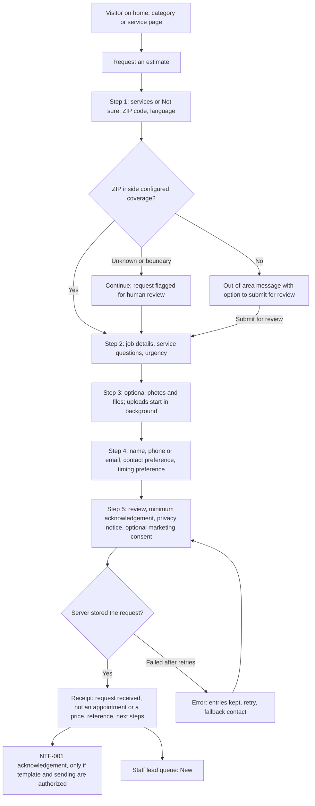
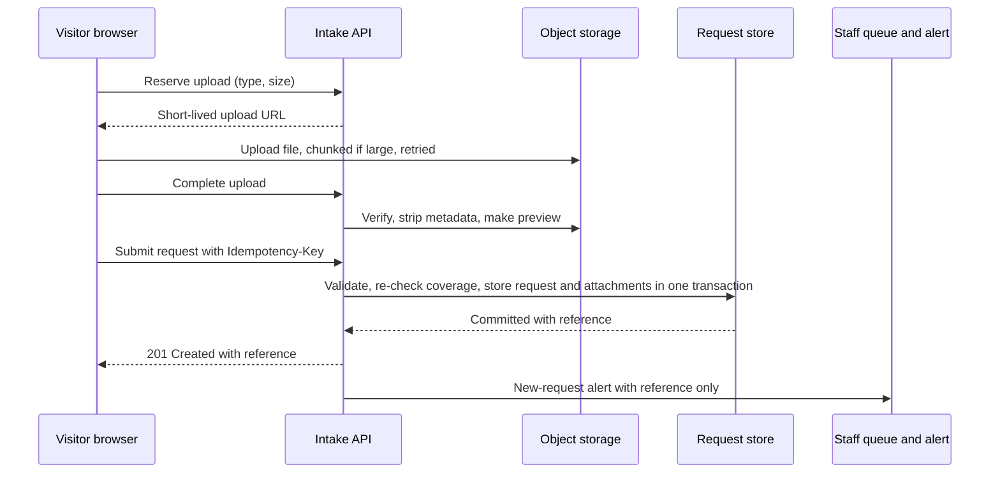
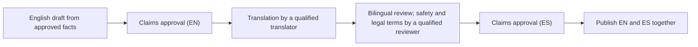

# 32 - Website and Customer Experience

> **Status:** Draft - AI-generated planning document, not approved · **Owner/domain:** Website strategy / marketing / CX (proposed primary skill: business-website-strategist) · **Last updated:** 2026-10-03
> **Human review required:** Owner (every business fact and public claim, minimum wording, coverage, launch service set, contact details); attorney licensed in KY and/or IN (claims register, privacy notice, terms, consent and SMS wording, accessibility statement, review practices); licensed insurance broker (any insurance wording); competent safety reviewer, asbestos/lead-qualified professional, structural engineer and licensed electrical/HVAC/gas trades (hazardous-material, structural and licensed-trade copy, urgent-danger guidance); local building or code officials (frost-depth, R-value, permit and code statements); qualified bilingual reviewer (all Spanish content; mandatory for safety and legal text).
> **Related:** [04 Service registry](04-service-registry.md) · [10 Frontend UX](10-frontend-ux-plan.md) · [13 Privacy](13-privacy-data-governance.md) · [14 Performance](14-performance-scalability-plan.md) · [15 DevOps](15-devops-infrastructure.md) · [17 Observability](17-observability-and-operations.md) · [28 Pricing and estimating](28-pricing-estimating-and-job-costing.md) · [Requirements spec](../Requierments/HandyHub_Requirements_Specification_Reconstructed.md) · [Master prompt](../HandyHub%20Master.md)

## Scope and reading guide

This document plans HandyHub's public website (spec MOD-001) and the pre-sale customer experience: the Discover and Request stages (STG-001, STG-002) and the customer-facing part of Qualify (STG-003). It turns master §17 (Website and Customer Experience), §21 (Accessibility and Internationalization) and the website parts of §8 (images, Lighthouse, third-party scripts) into buildable requirements WEB-001 to WEB-045 (section 12).

Implementers start with section 6 (estimate request form) and section 12 (WEB requirements). Content writers start with section 4 (claims gate) and section 5 (disclosures). Nothing in sections 3 to 5 may be published until its claims pass the gate in section 4.

| Topic | Decided here | Owned elsewhere |
|---|---|---|
| Public pages, information architecture, URLs, page briefs | Yes | Service identity and slugs: [04](04-service-registry.md) |
| Messaging rules, claims register seed, publication gate | Yes | Copy drafting: handyhub-marketing; contradictions: [02](02-gap-analysis.md) |
| Estimate request form behavior, fields, states | Yes | API shapes [09](09-api-contracts.md), schema [08](08-data-model-and-database.md), Lead states [06](06-state-machines.md), threats [12](12-security-threat-model.md) |
| Customer portal, worker app, admin UI | No | [10](10-frontend-ux-plan.md) |
| Data inventory, retention, privacy notice content | Website requirements only | [13](13-privacy-data-governance.md) |
| Public-page performance budgets | PROPOSED values | [14](14-performance-scalability-plan.md) (final) |
| Hosting, DNS, TLS, CDN, environments, backups | Website ownership and specifics | [15](15-devops-infrastructure.md) |
| SLOs, alerts, runbooks | Website SLIs and runbook list | [17](17-observability-and-operations.md) |
| Minimum rule, estimate process, deposits | Disclosure wording only | [28](28-pricing-estimating-and-job-costing.md) |
| Website terms of use and the legal review checklist for public content | Content requirements (section 5) and checklist (section 5.4); legal-compliance-administrator is the section owner | Attorney drafts and approves; customer agreements in [30](30-service-agreement-standards.md) |

**PROPOSED DECISION D-32-01:** this document is the single home for website planning artifacts (site map, page briefs, claims register seed, form schema, SEO/GEO plan, measurement plan). Doc 10 links here for public pages instead of duplicating them.

**Expert skills applied (master §1.2).** Each skill's SKILL.md and listed references were read; their rules shape the sections named.

| Skill | Files read | Rules applied | Sections |
|---|---|---|---|
| [business-website-strategist](../Skills/Website%2C%20software%2C%20and%20cybersecurity/business-website-strategist/references/playbook.md) | SKILL.md, playbook, verification | "Mark unverified credentials or claims for confirmation before publication"; "Distinguish a request from a confirmed appointment"; IA built on the visitor's questions; page briefs; "Avoid thin duplicated location pages or fabricated local presence"; "Do not guarantee immediate response unless supported"; justify each field; separate consents; a thank-you page must "not falsely confirm a booked time or price"; no fake proof; scenario walkthroughs | 2, 3, 4, 5, 6 |
| [website-seo-geo](../Skills/Website%2C%20software%2C%20and%20cybersecurity/website-seo-geo/SKILL.md) | SKILL.md, references content, technical, architecture-trust, measurement, templates | No fabricated reviews, statistics or credentials; no ranking or citation guarantees; no doorway pages; schema "only when it accurately describes visible content"; search access kept separate from model-training access; claim-register fields; "Do not invent a price range to fill a gap"; unknown is not zero | 4, 7, 9, 10 |
| [business-website-developer](../Skills/Website%2C%20software%2C%20and%20cybersecurity/business-website-developer/references/playbook.md) | SKILL.md, playbook, verification | One complete journey; server-side validation, bounded input, abuse controls, upload limits; "Do not display success just because a button was clicked"; dedup without losing distinct inquiries; customer data kept out of URLs, analytics and logs; delivery proven end to end; no WCAG claim from automated checks alone | 6, 9, 11 |
| [handyhub-marketing](../Skills/Branding%2C%20marketing%2C%20social%20media%2C%20and%20sales/handyhub-marketing/references/playbook.md) | SKILL.md, playbook | "Treat handyhub247.com as a domain, not proof of around-the-clock staffing"; no invented reviews, projects, licenses, health claims, deposit recovery or universal savings; image permissions; EN/ES parity; "A $150 minimum must not become a promise that every job costs $150" | 4, 5, 8 |
| [handyhub-lead-intake](../Skills/Branding%2C%20marketing%2C%20social%20media%2C%20and%20sales/handyhub-lead-intake/references/playbook.md) | SKILL.md, playbook | Language, outcome, category and ZIP first; accept "not sure"; no account; "Kentuckiana is a business area label, not a complete ZIP list"; defer access codes and payment data; hazards go to risk triage; duplicates to human review; separate consents | 6 |
| [business-privacy-data-owner](../Skills/Website%2C%20software%2C%20and%20cybersecurity/business-privacy-data-owner/references/playbook.md) | SKILL.md, playbook, verification | Minimize home-service data; map analytics before drafting disclosures and verify banner behavior on the network; photo publication permission separate; no permission inferred from a phone number; "Do not invent a universal retention period"; notices drafted from the actual data map | 6, 10 |
| [legal-compliance-administrator](../Skills/LLC%2C%20legal%20administration%2C%20and%20risk/legal-compliance-administrator/SKILL.md) (section owner: customer terms content and the legal review checklist, per [35](35-skills-coverage-matrix.md)) | SKILL.md (the folder holds no references) | "Do not say a business is legally compliant based only on a conversational review"; "Do not invent licenses, permit rules, filing fees, deadlines, or tax registrations"; "When multiple jurisdictions apply, treat each separately"; separate confirmed requirement, likely requirement needing verification, business policy choice and professional-review item; produce "concise questions for professional advisers" | 1, 4, 5 (5.4), Q-32-04 |
| Supporting: [business-website-maintainer](../Skills/Website%2C%20software%2C%20and%20cybersecurity/business-website-maintainer/references/playbook.md) | playbook | Operational inventory; "A provider's claim of backups is not evidence of a successful restore"; broken-form recovery | 11 |

**Evidence conventions.** Main Plans text is quoted with its service section (line numbers will shift when the plans are edited): [Home Improvement](../Main%20Plans/Home%20Improvement%20Business.md) (HI), [Dry Wall](../Main%20Plans/Dry%20Wall%20Business.md) (DW), [Painting](../Main%20Plans/Painting%20Business.md) (PT), [Cleaning](../Main%20Plans/Cleaning%20Business.md) (CL). Spec content is cited by requirement ID or traceability key (for example CX-001, NTF-001, HI-04.SAF). "Owner facts Ln" means line n of [operating-context.md](../Skills/Business%20direction/handyhub-job-planner/references/operating-context.md), recorded 2026-10-02. Contradiction IDs (C-HI04-06 and similar) are tracked with status and severity in [02 Gap analysis](02-gap-analysis.md).

## 1. Current state

### 1.1 What exists today

| Area | Current state | Evidence | Label |
|---|---|---|---|
| Website code, CMS, hosting | None. The vault has no HTML, CSS, JavaScript, site export or deployment configuration. Nothing is built or live. | Vault file scan 2026-10-03; master Purpose: "brainstorming and planning repository" | **FACT** |
| Domain handyhub247.com | Listed in the spec baseline table ("Website" row), but not established. Registrant, registrar, DNS host, mail records and renewal date are unknown. | Owner facts L3 "Domain ownership/connection and 24/7 staffing are not established." | **FACT** + **GAP** |
| "247" in the domain | A name, not evidence of 24/7 staffing or emergency service. | Owner facts L3; marketing playbook "Treat handyhub247.com as a domain, not proof of around-the-clock staffing." | **FACT** |
| Website copy | Drafts only. Each of the 26 service sections in the four Main Plans has a "Target Headline for Website", an overview and a "What We Do (The Process)" list (HI 11, DW 4, PT 4, CL 7). | Main Plans | **FACT** |
| Gaps in the drafts | The brand name "HandyHub" appears 0 times; no $150 minimum, exclusions, estimate process or call to action; "Kentuckiana" appears in 4 of 26 sections (HI-03, HI-05, HI-10, PT-02); no Spanish text exists anywhere in the vault; one Arabic artifact "(معجون)" sits in the PT-04 section. | Text search of Main Plans 2026-10-03 | **FACT** |
| Claims in the drafts | Nearly every section contains guarantee-like or absolute outcome promises, and several make health, environmental, capacity, safety or licensed-trade claims that contradict contracts, SOPs or the spec (section 4). | Section 4 registers; [02](02-gap-analysis.md) | **FACT** (quotes); classification is a judgment |
| Proof assets | No brand assets, verified portfolio or reviews. | Owner facts L12 "never fabricate proof" | **FACT** |
| Identity and contact facts | No business phone number, email address, postal address, business hours or legal entity name exists in any vault file. The entity type, formation status and any assumed-name (DBA) registration for "HandyHub" are not recorded; "LLC" appears only in a skills folder name. The 25 contracts use four different placeholder names: "[Your Company Name]" (11), "[Your Cleaning Company Name]" (6), "[Your Drywall Company Name]" (4) and "[Your Painting Company Name]" (4). | Vault text search 2026-10-03; [contract-picture-hanging.md](../Service%20Agreements/contract-picture-hanging.md) | **FACT** + **GAP** |
| Bookable services | None yet. No SOP is approved and booking requires approved SOPs. | Owner facts L20 "No active field SOP until competent review"; spec HND-004 | **FACT** |
| Online payment | Not possible. No payment provider selected; electronic invoices with cash and check are the stated methods. | Owner facts L10; spec baseline table "Invoices & payments" | **FACT** |
| Messaging, analytics, Search Console, business listings | None configured or verified. | Owner facts L17 "A skill is instructions, not an integration or background worker." | **FACT** |
| Requirements | MOD-001, STG-001/002, CX-001, CX-002, NTF-001, NFR-002, NFR-003, NFR-010, COM-004, COM-006, AT-001 to AT-004 and LAUNCH-001 (P0) define the public flow. NFR-003 has no WCAG version, NFR-004 says "promptly" and NFR-010 does not define the "core customer journey". | Spec §3, §4, §11, §15, §18, §19.1 | **FACT** + **GAP** |

### 1.2 Problems that block a truthful launch

| # | Problem | Evidence | Impact | Correct expertise | Proposed change | Dependencies | Validation |
|---|---|---|---|---|---|---|---|
| 1 | Domain not established | Owner facts L3 | No DNS, business email, TLS or search verification; a third party could hold the name | business-website-maintainer, business-it-security-administrator | Owner confirms registrant; move to a business-owned registrar account with MFA, auto-renew and lock (WEB-041) | Owner (Q-32-01) | Registrar record names the business |
| 2 | Draft copy carries unsupported claims | Section 4.4 and 4.5 | Misleading-advertising and safety exposure; contradicts contracts | handyhub-marketing, website-seo-geo; **HUMAN REVIEW: attorney** | Claims gate and copy lint (WEB-001 to WEB-003) | Owner evidence, attorney | Zero unapproved claims at publish |
| 3 | No identity or contact facts | Section 1.1 | No footer identity, click-to-call, legal pages or fallback contact | legal-compliance-administrator | Owner supplies legal entity name, phone, email, hours and whether any address is public (WEB-012) | Q-32-03, Q-32-04 | Identity block renders from one configuration |
| 4 | Nothing is bookable and no launch service set exists | Owner facts L20; HND-004 | Site could collect leads HandyHub cannot serve | business-website-strategist, safety-liability-manager | Estimate requests only; per-service web status from 04 (WEB-006) | Q-32-07 | Hidden services absent from pages, sitemap and form |
| 5 | Minimum rule and disclosure point unsettled | Spec baseline "$150 minimum job value"; BIZ-003 "before a customer commits to booking or paying"; CX-001 "Before a lead is converted to a booked job"; AT-001 "before booking/approval"; owner facts L7 "Proposed default" | Inconsistent disclosure, disputes over how the minimum applies | handyhub-estimate-assistant, handyhub-marketing | Disclose at request time, the earliest trigger, with versioned approved wording (D-32-04); the estimate shows how it applies ([28](28-pricing-estimating-and-job-costing.md)) | Q-32-05 | AT-001 passes |
| 6 | No Spanish content or named reviewer | COM-006; owner facts L11; HND-006 open | LAUNCH-001 bilingual flow cannot ship | handyhub-marketing, qualified bilingual reviewer | Core bilingual launch set (D-32-05) and workflow (section 8) | Q-32-10 | WEB-030 approvals recorded |

## 2. Goals and mobile-first conversion flows

### 2.1 Goals

1. A visitor on any service page can answer "Do you do my job? Do you serve my area? Can I trust you? What happens next? How do I contact you?" without leaving the page (strategist playbook; STG-001).
2. Complete, consented, in-area estimate requests are stored durably with no false booking or price (STG-002, CX-002, RECT-001).
3. No unapproved claim is ever published, in either language (master §17 "Do not create unsupported claims").
4. English and Spanish parity for the core journey (BIZ-002, NFR-010).
5. Fast and accessible on phones (NFR-002, NFR-003; section 9).
6. A measurable funnel with no personal data in analytics (RPT-001; section 7.8).

**GAP:** no baseline exists, so no numeric conversion or response-time target is set. Targets are `<owner decision: set after the first measurement period>`.

### 2.2 Primary action and channels

**PROPOSED DECISION D-32-02:** the site has one primary action, "Request an estimate". Phone is a secondary action only when a staffed, verified number and hours exist. There is no self-service booking, online payment, chat widget or instant quote at launch. Reasons: pricing is project-specific (BIZ-004); a request is not an appointment (CX-002); no service is bookable (owner facts L20); no payment provider exists (owner facts L10); capacity is two employees (owner facts L6).

| Channel | Launch status | Condition | Notes |
|---|---|---|---|
| Estimate request form | P0 | None | Section 6 |
| Phone (click-to-call) | Conditional | Verified business number, staffed hours, voicemail fallback (Q-32-03) | `tel:` link in E.164 format; show hours next to it; never "call anytime" |
| Email | Conditional | Business mailbox on the verified domain with mail authentication ([15](15-devops-infrastructure.md)) | Shown as text plus link |
| Text message | Not at launch | Attorney-approved consent wording and a selected provider (Q-32-11) | Preference option hidden until then |
| Online booking | Not at launch | Approved SOPs, scheduling rules, confirmation flow (CX-002, NTF-004) | Future roadmap item |
| Online payment | Not at launch | Provider selected ([28](28-pricing-estimating-and-job-costing.md), [07](07-system-architecture.md)) | Never collect card data in a generic form |
| Chat widget or AI assistant | Not at launch | AI governance ([33](33-ai-and-automation-governance.md)), privacy review, staffing | Avoids unattended promises |

### 2.3 Request-estimate flow (mobile first)

### 2.4 Mobile-first rules

- One column; the "Request an estimate" button is visible in the first screen of every service page.
- A sticky call-to-action bar is allowed on content pages only and must never cover focused fields or content (developer playbook); it is hidden on the form.
- Minimal typing: choice chips, `inputmode="numeric"` for ZIP, `autocomplete` tokens for name, email, phone and address, camera or gallery selection for photos.
- One question group per screen with a "Step n of 5" indicator; "Back" never loses data.
- Works at 320 CSS px width and 400% zoom; no entry pop-ups or interstitials.
- Content pages stay readable if JavaScript fails; the form shows the fallback contact if its script cannot load.

### 2.5 Scenario walkthroughs required before launch

| Scenario | Expected behavior | Trace |
|---|---|---|
| Small task, for example hanging two pictures (HI-01) | Minimum statement shown and acknowledged before submit; receipt quotes no price | AT-001, CX-001 |
| Spanish speaker switches language on step 4 | All values and photos kept; one request stored | AT-002 |
| ZIP outside configured coverage | Non-confirming out-of-area message; optional submit for review | AT-003 |
| Photo fails on weak signal | Failure shown on that file; retry or remove; rest of form intact | AT-004 |
| Urgent safety concern (active leak, sparking, gas smell) | Request flagged urgent; safety guidance shown; the page says the form is not an emergency channel; no emergency-response promise | Owner facts L3; **HUMAN REVIEW: owner + competent safety reviewer + attorney** for guidance text |
| Visitor unsure which service | "Not sure" path with free description | Lead-intake playbook |
| Several services (paint plus drywall patch) | One request with several services | Lead-intake playbook |
| Property manager, short-term rental host or builder | Relationship captured; authority confirmed later by staff | Lead-intake playbook |
| Keyboard-only and screen-reader user | Completes every step and hears status changes | NFR-003 |
| Double tap on submit, or network drop during submit | Exactly one request; same reference returned | NFR-012 |
| Same person submits again two days later | New request flagged as possible duplicate; never auto-merged | LAUNCH-002 |
| Visitor types a lockbox code into the description | Microcopy warns against it beforehand; staff handling rule in [13](13-privacy-data-governance.md) | COM-002; owner facts L17 |

### 2.6 Customer journey touchpoints after the website

| Stage | Customer touchpoint | Truthfulness rule | Spec IDs | Detailed in |
|---|---|---|---|---|
| Discover | Public pages | Claims gate, disclosures | STG-001, MOD-001 | This doc |
| Request | Form, receipt, acknowledgement | Not an appointment or price | STG-002, CX-002, NTF-001 | This doc |
| Qualify | Staff contact, photo requests, area decision | Respond within the owner-set expectation; clear out-of-area answer | STG-003, AT-003, HND-002 | [26](26-business-process-map.md), [06](06-state-machines.md) |
| Estimate | Written estimate, reminders | Scope, exclusions, how the minimum applies | STG-004, CX-004, AT-007, NTF-002, NTF-003 | [28](28-pricing-estimating-and-job-costing.md), [10](10-frontend-ux-plan.md) |
| Approve | Approval of one version; deposit if required | Only the approved version binds | STG-005, CX-003, FIN-002 | [28](28-pricing-estimating-and-job-costing.md), [30](30-service-agreement-standards.md) |
| Prepare | Appointment confirmation and reminders | Only now is the job booked | CX-002, NTF-004, NTF-005 | [06](06-state-machines.md), [10](10-frontend-ux-plan.md) |
| Execute to follow-up | En route, change orders, completion, invoice, feedback | Review requests only without an active complaint | NTF-006 to NTF-011 | [10](10-frontend-ux-plan.md), [11](11-worker-job-execution.md), [26](26-business-process-map.md) |

## 3. Information architecture

### 3.1 Page inventory

Launch: P0 = launch-critical (spec §19.1, LAUNCH-001); P1 = after launch.

| Page | EN URL | ES URL | Visitor question | Primary action | Launch | Content dependency |
|---|---|---|---|---|---|---|
| Home | `/` | `/es/` | Do you do my job, where, what next? | Request an estimate | P0 | Approved claims; launch service set |
| Services index | `/services` | `/es/services` | What do you offer? | Choose category or service | P0 | [04](04-service-registry.md) |
| Category hub (4) | `/services/{category}` | `/es/services/{category}` | What is in this category? | Choose service or request | P0 | 04 |
| Service page (26) | `/services/{category}/{service-slug}` | `/es/services/{category}/{service-slug}` | Do you do my job, what is included and excluded, how is it estimated? | Request with service preselected | P0 for launch-active services; hidden otherwise | 04, section 4, section 5 |
| Service area | `/service-area` | `/es/service-area` | Do you serve my address? | ZIP check, then request | P0 | Coverage configuration (HND-002) |
| How estimates work, including minimum charge | `/how-estimates-work` (minimum section at `#minimum-charge`) | `/es/how-estimates-work` | What happens next and how is the price set? | Request | P0 | [28](28-pricing-estimating-and-job-costing.md); Q-32-05, Q-32-06 |
| Request an estimate | `/request-estimate` | `/es/request-estimate` | How do I ask? | Submit | P0 | Section 6 |
| Request received | `/request-estimate/received` | `/es/request-estimate/received` | Did it work, what now? | None (noindex) | P0 | Section 6 |
| About HandyHub (trust) | `/about` | `/es/about` | Can I trust you? | Request | P0 (verified facts only) | Q-32-04 |
| FAQ | `/faq` | `/es/faq` | Common questions | Request | P0 minimal set, then P1 | Real customer questions |
| Contact | `/contact` | `/es/contact` | Other ways to reach you | Call or email | Conditional | Q-32-03 |
| Privacy notice | `/privacy` | `/es/privacy` | What happens to my data? | None | P0 | [13](13-privacy-data-governance.md); **HUMAN REVIEW: attorney** |
| Terms of use | `/terms` | `/es/terms` | What does submitting mean? | None | P0 | **HUMAN REVIEW: attorney** |
| Accessibility statement | `/accessibility` | `/es/accessibility` | Can I use this site, whom do I tell? | Report a problem | P0 | Section 9 |
| Error pages | 404 and 500 in both languages | Same | Where now? | Home, request | P0 | None |
| Machine files | `/sitemap.xml`, `/robots.txt` | Shared | Crawlers | None | P0 | Section 7.4 |

The customer portal (MOD-006) is not part of the public site. It is authenticated, noindexed and linked as "Customer login" only after it exists ([10](10-frontend-ux-plan.md)). Builders (DW-04), contractors (CL-04), and hosts or property managers (CL-05) use the main form with the relationship field until Q-32-15 decides on audience pages. **DECISION (owner, 2026-10-03, recorded action):** Carpentry is not a separate business plan or category, so there is no Carpentry hub ([20](20-decision-log.md)).

### 3.2 Category hubs and the 26 service URLs

Category slugs: `home-improvement`, `drywall`, `painting`, `cleaning` (spec Appendix B categories). Service slugs are the canonical slugs; names are the Appendix B names, displayed until Q-32-09 is answered. Spanish paths mirror the English paths under `/es/`.

| Code | Canonical name | EN path |
|---|---|---|
| [HI-01](04-service-registry.md#HI-01) | Precision Picture Hanging & Art Installation | `/services/home-improvement/picture-hanging` |
| [HI-02](04-service-registry.md#HI-02) | Deep-Clean Barbecue & Grill Maintenance | `/services/home-improvement/grill-cleaning` |
| [HI-03](04-service-registry.md#HI-03) | Driveway Pressure Washing & Surface Restoration | `/services/home-improvement/driveway-cleaning` |
| [HI-04](04-service-registry.md#HI-04) | Professional TV Wall Mounting & Wire Hiding | `/services/home-improvement/tv-mounting` |
| [HI-05](04-service-registry.md#HI-05) | Door Hardware & Smart Lock Installation | `/services/home-improvement/smart-locks` |
| [HI-06](04-service-registry.md#HI-06) | Gutter Maintenance & Leaf Protection | `/services/home-improvement/gutter-maintenance` |
| [HI-07](04-service-registry.md#HI-07) | Attic Insulation Upgrades | `/services/home-improvement/attic-insulation` |
| [HI-08](04-service-registry.md#HI-08) | Closet & Shelving System Installation | `/services/home-improvement/closet-shelving` |
| [HI-09](04-service-registry.md#HI-09) | Custom Trim & Architectural Molding Installation | `/services/home-improvement/trim-molding` |
| [HI-10](04-service-registry.md#HI-10) | Structural Fence Maintenance & Structural Repairs | `/services/home-improvement/fence-repair` |
| [HI-11](04-service-registry.md#HI-11) | Structural Deck Maintenance & Deck Board Repairs | `/services/home-improvement/deck-repair` |
| [DW-01](04-service-registry.md#DW-01) | Professional Patching, Repair & Handyman Services | `/services/drywall/drywall-patching` |
| [DW-02](04-service-registry.md#DW-02) | Texture Matching & Popcorn Ceiling Removal | `/services/drywall/popcorn-removal` |
| [DW-03](04-service-registry.md#DW-03) | Residential Remodeling & Home Additions | `/services/drywall/drywall-remodeling` |
| [DW-04](04-service-registry.md#DW-04) | High-Volume Residential New Construction | `/services/drywall/new-construction` |
| [PT-01](04-service-registry.md#PT-01) | Professional Residential Interior Painting | `/services/painting/interior-painting` |
| [PT-02](04-service-registry.md#PT-02) | Outdoor Deck & Fence Staining and Sealing | `/services/painting/deck-staining` |
| [PT-03](04-service-registry.md#PT-03) | Brick Limewashing & Elastomeric Masonry Coatings | `/services/painting/brick-limewashing` |
| [PT-04](04-service-registry.md#PT-04) | Wallpaper Removal & Surface Restoration | `/services/painting/wallpaper-removal` |
| [CL-01](04-service-registry.md#CL-01) | Routine House Cleaning | `/services/cleaning/routine-cleaning` |
| [CL-02](04-service-registry.md#CL-02) | Elite Deep Cleaning Service | `/services/cleaning/deep-cleaning` |
| [CL-03](04-service-registry.md#CL-03) | Move-In & Move-Out Cleaning | `/services/cleaning/move-in-out` |
| [CL-04](04-service-registry.md#CL-04) | Post-Construction & Post-Renovation Cleaning | `/services/cleaning/post-construction` |
| [CL-05](04-service-registry.md#CL-05) | Airbnb Turnover & Vacation Rental Management | `/services/cleaning/airbnb-turnover` |
| [CL-06](04-service-registry.md#CL-06) | Hotel-Style Luxury Housekeeping | `/services/cleaning/hotel-housekeeping` |
| [CL-07](04-service-registry.md#CL-07) | Air Duct & Ventilation Cleaning | `/services/cleaning/air-duct-cleaning` |

**OPEN QUESTION Q-32-09:** several canonical names carry claims or third-party marks ("Elite", "Luxury", "Structural", "Management", "Handyman Services", "High-Volume", "Airbnb"; the CL-05 slug contains "airbnb"). Decide display names and the CL-05 slug before launch so no redirect is needed later. **HUMAN REVIEW: attorney** (trademark and claim wording) and structural engineer (use of "Structural").

### 3.3 URL rules

**PROPOSED DECISION D-32-03:**
- English at the root, Spanish under `/es/` with mirrored path segments.
- Service path `/services/{category_slug}/{service_slug}`, generated from the [04](04-service-registry.md) registry at build time. The build fails if a visible service lacks a slug, category or approved translation.
- Lowercase ASCII, hyphen separated, no file extensions, no trailing slash (the slash variant 301-redirects).
- Canonical URLs carry no query parameters. Tracking parameters are ignored for canonicals. `/request-estimate?service=HI-04` may preselect a service; its canonical is `/request-estimate`.
- Every slug or category change ships with a 301 redirect, a sitemap update and updated internal links. Never redirect everything to the home page (SEO technical reference).
- Alternatives considered: flat `/services/{slug}` (more stable if categories change, weaker breadcrumbs); translated Spanish slugs such as `/es/servicios/...` (more natural for readers, needs an alias table and doubles redirect work). Both stay open for later with redirects.

### 3.4 Navigation and internal links

- Header: Services (four categories), Service area, How estimates work, About, the "Request an estimate" button, and the language switcher "English / Español" that links to the equivalent page, not the home page.
- Footer: categories, business identity block (WEB-012), privacy notice, terms, accessibility statement, contact (when verified).
- Breadcrumbs on hubs and service pages.

| Source | Destination | Purpose |
|---|---|---|
| Home | Hubs, how estimates work, service area, request | Route by intent |
| Hub | Its services, how estimates work | Choose a service |
| Service page | Request with service preselected; `#minimum-charge`; service area; up to 3 related services in the same category | Answer and convert |
| How estimates work | Request, FAQ | Next step |
| FAQ | The service page that answers each question in full | One source per answer |
| Every page | Legal pages | Trust and compliance |

### 3.5 Page briefs

| Page | Audience and intent | Main message | Required sections | Claims constraints | Acceptance |
|---|---|---|---|---|---|
| Home | Local homeowners, tenants, hosts, property managers in Kentuckiana; "can they do my job?" | HandyHub handles cleaning, drywall, painting and home-improvement jobs in Kentuckiana (Kentucky and Indiana), by estimate | Offer summary; 4 category entries; how it works in 4 steps; minimum statement; service-area check; trust facts (section 7.1); request button | No guarantees, 24/7, credentials, reviews or prices | All five visitor questions answered above the footer |
| Category hub | Visitor who knows the trade | What HandyHub does in this category | Short intro; service list with one-line approved summaries; shared limitations (for example licensed-trade boundary); request | Same as home | Every visible service linked; no hidden service listed |
| Service page | Visitor with a specific job | What this service covers and how it is estimated | Template below | Rows for this service in sections 4.4 and 4.5 resolved | Template complete in both languages |
| Service area | "Do you come to me?" | Kentuckiana label; coverage confirmed per address | Plain description; ZIP checker; what happens out of area | No city, county or ZIP list until coverage is approved (HND-002) | Checker returns in, out or review for test ZIPs |
| How estimates work | Price-sensitive visitor | Process and minimum explained | Steps (section 5.3); `#minimum-charge`; deposits wording; what affects the price | No price ranges | Owner-approved statement versions recorded |
| Request and receipt | Ready to ask | Fast, safe request | Section 6 | Receipt never confirms a booking or price | AT-001 to AT-004 pass |
| About | "Can I trust you?" | Who HandyHub is, verifiable facts only | Identity, languages, how we work, payment methods, service area; credentials only after verification (section 4.2) | No team size, years, counts, badges or bios unless the owner supplies and approves them | Every statement has an approved register row |
| FAQ | Quick answers | Real questions only | Starts with process questions (Is a request a booking? Is there a minimum? Do you serve my area? Can I write in Spanish?) | Answers must match section 5 | No FAQ entry without a real source question |
| Legal pages | Visitors and regulators | Accurate practices | Section 5 rows | Drafted from the actual data map and practices | Attorney sign-off recorded |

**Service page template** (order adapted from the SEO content reference; only sections with approved content are shown):
1. H1: approved display name (canonical name until Q-32-09 is answered).
2. Summary in one or two sentences: what it is, for whom, where.
3. What is included: approved scope from the registry; add-ons labeled as add-ons.
4. What is not included and limits: exclusions and licensed-trade or hazardous-material boundaries (section 5.2).
5. How the estimate works for this service: price drivers taken from the service's intake row (for example HI-04.INT "TV size/weight/model, mount model, wall/substrate"), never prices; the minimum component.
6. Preparing for the visit: customer preparation from the registry.
7. Safety notes where relevant (DW-02, PT-01, PT-04, CL-07, HI-02, HI-04): **HUMAN REVIEW: competent safety reviewer + attorney**.
8. Questions customers actually ask.
9. "Request an estimate" (service preselected).
10. Related services in the same category; service-area statement with ZIP check link.

## 4. Messaging rules and claims register

### 4.1 Messaging rules

| # | Rule | Source |
|---|---|---|
| 1 | Publish only owner-approved facts. Every substantive claim needs an approved claims-register row, per language, before its page is published. | Master §17; strategist playbook; WEB-001 |
| 2 | No guarantees, warranties or absolute outcomes ("guarantee", "flawless", "perfect", "permanent", "undetectable", "damage-free", "zero mess", "safe" as an outcome). No warranty or callback policy exists. | Master §1.4 "warranties", "service promises"; spec AIR-004 (Quality Assistant) boundary "Human decides acceptance, warranty position" |
| 3 | No health, indoor-air-quality, sterilization, mold, energy-savings or environmental claims ("eco-safe", "non-toxic", "Zero-VOC") without substantiation and review. | CL-07.SAF "do not make unsupported indoor-air-quality claims"; marketing playbook; **HUMAN REVIEW: attorney**, SDS review by the safety owner |
| 4 | No capacity or organization claims ("team", "crews", "division", "specialists", "artisans", "highly trained", "rapid-response", "every single day/week"). | Owner facts L6 (two employees); owner facts L5 "Reported capability is not documentary proof" |
| 5 | No credentials ("licensed", "insured", "bonded", "certified", "background-checked") until verified under section 4.2. The contract text "The Company is fully insured." must not be reused (C-CL01-02, critical). | Owner facts L4-L5; [contract-routine-cleaning.md](../Service%20Agreements/contract-routine-cleaning.md); **HUMAN REVIEW: insurance broker + attorney** |
| 6 | No reviews, ratings, testimonials, star counts, portfolio, before/after images, customer counts, partner logos or awards unless genuine, permitted and recorded. | Owner facts L12; spec AIR-009 boundary "Cannot invent reviews, credentials, prices, results"; REC-003 |
| 7 | No 24/7, emergency, same-day, "in a single day" or response-time promises. The domain name is not a promise. | Owner facts L3; marketing playbook |
| 8 | No prices or ranges other than the approved minimum statement. Never "starting at", "flat $150" or "every job costs $150". No deposit terms beyond approved wording. No "free estimate" until Q-32-06 is answered. | Owner facts L7-L9; marketing playbook; SEO content reference |
| 9 | Scope statements must match the approved SOP, contract and pricing. Paid add-ons are never shown as included. | [02](02-gap-analysis.md) included-versus-add-on contradictions |
| 10 | Licensed-trade, structural and hazardous-material limits are stated as limits, using approved wording only. | HI-04.SAF, CL-07.SAF, DW-02.SAF, HI-11.SAF; **HUMAN REVIEW** per section 5.2 |
| 11 | Third-party names (Airbnb, Nest, Schlage, August) only as descriptive or compatibility references, never implying partnership. | **HUMAN REVIEW: attorney** |
| 12 | Service area is "Kentuckiana (Kentucky and Indiana)" with coverage confirmed per address. No statewide coverage or trade-permission claims. | BIZ-001; owner facts L4, L21; lead-intake playbook |
| 13 | English and Spanish say the same thing: same scope, exclusions, minimum and calls to action. | Marketing playbook; NFR-010 |
| 14 | Imagery is real and permitted, or clearly conceptual so it cannot imply HandyHub completed the work. Stock photos of finished projects are not used as proof. | Strategist playbook "Label conceptual imagery"; REC-003, AT-050 |
| 15 | No non-English artifacts outside the Spanish site (the Arabic word in the PT-04 draft is not carried over). | Main Plans PT-04 section |
| 16 | The brand is written "HandyHub" (spec baseline; owner facts L3); the vault folder spelling "Handy Hub" is not used publicly unless Q-32-20 decides otherwise. | Spec baseline; owner facts L3 |

### 4.2 Verification procedures for credentials and proof

| Claim type | Evidence required | Reviewer | Register fields | Re-check |
|---|---|---|---|---|
| Insurance (any wording) | Current policy declarations or certificate from the carrier, matching the exact wording (policy type, named insured) | **HUMAN REVIEW: licensed insurance broker + attorney** | Policy type, insurer, named insured, period, approved wording | Before expiry; remove wording on lapse |
| License, registration or permit capability | License number, issuing authority, jurisdiction (state or municipality), scope, expiry | **HUMAN REVIEW: attorney / legal-compliance-administrator**; owner facts L21 "Verify the actual Kentucky/Indiana municipality" | Authority, number, scope, jurisdictions, expiry | Before expiry |
| Reviews and testimonials | Original source (platform link or signed statement), customer permission for this use, no incentive or an incentive disclosed as required | **HUMAN REVIEW: attorney** (endorsement and review rules) + privacy owner | Source, date, permission reference, channels | When permission is withdrawn |
| Project photos | Job record link, marketing consent (REC-003), identifiers removed (faces, addresses, documents, plates) | Privacy owner | Asset ID, consent version, derivative, channels | On withdrawal |
| Product or environmental claims | Manufacturer data sheet or SDS for the exact product used on every job of that service | **HUMAN REVIEW: attorney** + safety owner | Product, document date, wording | When the product changes |
| Capacity or response claims | Owner-confirmed staffing and measured response data | Owner | Measurement window and value | Each review cycle |

### 4.3 Register structure, states and publication gate

The register uses the fields of the SEO skill's claim and permission template ([templates.md](../Skills/Website%2C%20software%2C%20and%20cybersecurity/website-seo-geo/references/templates.md)), extended for HandyHub: row key; service code or "site-wide"; proposed wording (EN, ES); source and owner; market and date; permission reference; fact or interpretation; verification state; approved wording; reviewer and date; recheck date; pages using it; related contradiction ID.

States: `unverified` → `evidence requested` → `under review` (named HUMAN REVIEW) → `approved` (exact wording per language) or `rejected`; `approved` becomes `expired` at its recheck date.

Gate: content files list the register keys they use. The build fails if a page uses a key that is not `approved` for that language, or if the copy lint finds a blocked term (rules 2 to 8) with no approved key covering it. The English blocked-term list starts from the terms quoted in section 4.1; the qualified bilingual reviewer produces the Spanish list.

**PROPOSED DECISION D-32-15:** at launch, site content and the operational register are kept as versioned files next to the site code, so the gate runs in CI and every change is reviewable; a CMS is reconsidered only if non-technical editing becomes frequent (master §24 "Avoid Overengineering"). Location and key format are open (Q-32-18, [34](34-naming-and-migration-plan.md)).

**PROPOSED DECISION D-32-16:** the registers below are the seed. Every row starts as `unverified`; the dispositions are proposals for the owner, marketing and the named reviewers. Row numbers are local to this document.

### 4.4 Seed register A: the 26 website headlines (all start as `unverified`)

Dispositions: Remove (do not use), Hold (needs evidence or review first), Reword (publishable after a neutral rewrite is approved), Candidate (low risk; approve as is or lightly edited).

| # | Code | Headline (verbatim, Main Plans) | Issue | Disposition | Review | Related ID |
|---|---|---|---|---|---|---|
| 1 | HI-01 | "Secure, Laser-Level Placement for Fine Art, Heavy Mirrors, and Gallery Walls" | "Secure" and "Heavy Mirrors" imply a load assurance; body claims 100+ lb while the SOP stops at 50 lb | Reword | Safety reviewer | C-HI01-02 |
| 2 | HI-02 | "Restore Your Outdoor Grill to Factory Shine—Eco-Safe, Carbon-Stripping Service" | Outcome promise; environmental claim | Remove "Factory Shine" and "Eco-Safe"; Hold chemical claims | Attorney + SDS review | C-HI02-01 |
| 3 | HI-03 | "Eradicate Oil Stains, Mildew, and Black Mold—Instant Curb Appeal Restored" | Outcome guarantee; mold is a hazardous-material boundary; contract says stains "may leave permanent concrete shading shadows" | Remove | Attorney + safety reviewer | C-HI03-04 |
| 4 | HI-04 | "Sleek, Ultra-Secure TV Mounting with Seamless Hidden Cable Routing" | Safety assurance; hidden routing is low-voltage only and a priced add-on | Reword; state limit and add-on | Licensed electrician (wording) + attorney | C-HI04-06 |
| 5 | HI-05 | "Upgrade Your Home Security with Premium Smart Locks & Modern Door Hardware" | Security outcome; customers must control their own codes (HI-05.SAF) | Reword | Privacy owner + IT security | C-HI05-01 |
| 6 | HI-06 | "Structural Water Diversion—Premium Seamless Gutter Guards and Cleaning" | "Seamless" is inaccurate (SOP cuts 4-foot sections); "Structural" | Reword | Owner | C-HI06-07 |
| 7 | HI-07 | "Slash Energy Bills and Keep Your Home Comfortable—Premium Blow-In Attic Insulation" | Universal savings claim | Remove savings claim | Attorney | C-HI07-07 |
| 8 | HI-08 | "Reclaim Your Spaces—Custom-Fit Closet Systems & Heavy-Duty Shelving" | "Heavy-Duty" implies load capacity; body guarantees loads | Reword; manufacturer ratings only | Safety reviewer + attorney | C-HI08-01 |
| 9 | HI-09 | "Elegant Visual Detailing—Custom Crown Molding, Baseboards, and Wainscoting" | Baseboards and casings not covered by the SOP | Hold "Baseboards"; rest Candidate | Owner + SOP owner | C-HI09-02 |
| 10 | HI-10 | "Secure Your Property Bounds—Expert Fence Post Stabilization and Panel Repairs" | "Expert" unverified; body makes frost-line claims | Reword | Owner; building official for body claims | C-HI10-02 |
| 11 | HI-11 | "Ensure Backyard Safety—Professional Deck Structural Repairs and Board Replacements" | Safety outcome; structural boundary | Remove "Ensure Backyard Safety"; Hold "Structural" | Structural engineer + attorney | C-HI11-05 |
| 12 | DW-01 | "Flawless Wall & Ceiling Repairs in a Single Day" | Quality and time promise | Remove | Attorney | C-DW01-05 |
| 13 | DW-02 | "Modernize Your Home—Ditch the Outdated Popcorn Ceilings" | No testing disclosure; DW-02.HAZ "suspect asbestos in older textures, lead paint" | Hold until the hazard disclosure is approved | Asbestos/lead-qualified professional + attorney | C-DW02-03 |
| 14 | DW-03 | "Custom Drywall Installations for Renovations & Extensions" | Body implies general-contractor scope and permits | Candidate; limit body to drywall scope | Legal-compliance (licensing, permits) | C-DW03-01 |
| 15 | DW-04 | "Production-Grade Drywall Contracting for Developers & Builders" | Capacity and contractor-licensing scope with two employees | Hold | Owner + legal-compliance + insurance broker | C-DW04-05 |
| 16 | PT-01 | "Transform Your Living Spaces with Flawless, Crisp Cut-Lines" | "Flawless"; older-coating disclosure missing (PT-01.HAZ "dust/lead in older coatings") | Reword; add disclosure | Attorney; EPA RRP-qualified reviewer for the disclosure | C-PT01-07 |
| 17 | PT-02 | "Restore and Protect Your Backyard Oasis—Professional Wood Sealing" | Low risk; body eco claims conflict with SOP chemicals | Candidate after body rows are fixed | Marketing | C-PT02-01 |
| 18 | PT-03 | "Classic European Aesthetics—Breathable Protection for Your Brick Home" | "Breathable" conflicts with the elastomeric option sold as "Full Waterproof Shield" | Hold | Masonry or coatings specialist | C-PT03-02 |
| 19 | PT-04 | "Say Goodbye to Dated Wallpaper—Restore Your Walls to Fresh Canvas" | Low risk; body says "damage-free" | Candidate after body rows are fixed | Marketing | C-PT04-05 |
| 20 | CL-01 | "Consistent, Reliable Upkeep for a Beautiful, Stress-Free Home" | Puffery | Candidate | Marketing | none |
| 21 | CL-02 | "Rejuvenate Your Space with a Meticulous, Top-to-Bottom Reset" | "Top-to-Bottom" implies items sold as add-ons | Reword; disclose add-ons | Owner | C-CL02-01 |
| 22 | CL-03 | "Flawless Vacant Property Turnovers for Absolute Peace of Mind" | Absolute claims | Reword | Attorney | C-CL03-03 |
| 23 | CL-04 | "Eradicate Construction Dust and Turn Your Renovation into a Masterpiece" | Absolute outcome | Reword | Attorney | C-CL04-06 |
| 24 | CL-05 | "5-Star Staging & Fast Turnovers for Premium Guest Reviews" | Review outcome; capacity ("Fast") | Remove review outcome | Owner + attorney | C-CL05-08 |
| 25 | CL-06 | "Resort-Level Care and Butler-Grade Organization for Your Private Residence" | Puffery; body capacity claims | Reword | Owner | C-CL06-03 |
| 26 | CL-07 | "Clean Air, Lower Energy Bills—Professional HVAC & Vent Restoration" | Indoor-air and savings claims; "HVAC ... Restoration" implies licensed HVAC scope (CL-07.SAF) | Remove | Attorney + licensed HVAC technician (scope wording) | C-CL07-02 |

### 4.5 Seed register B: body claims to remove or substantiate

Counter-evidence files (registers A and B): [contract-move-in-out.md](../Service%20Agreements/contract-move-in-out.md), [contract-drywall-patching.md](../Service%20Agreements/contract-drywall-patching.md), [contract-drywall-remodeling.md](../Service%20Agreements/contract-drywall-remodeling.md), [contract-wallpaper-removal.md](../Service%20Agreements/contract-wallpaper-removal.md), [contract-interior-painting.md](../Service%20Agreements/contract-interior-painting.md), [contract-grill-cleaning.md](../Service%20Agreements/contract-grill-cleaning.md), [contract-gutter-maintenance.md](../Service%20Agreements/contract-gutter-maintenance.md), [contract-closet-shelving.md](../Service%20Agreements/contract-closet-shelving.md), [contract-trim-molding.md](../Service%20Agreements/contract-trim-molding.md), [contract-fence-repair.md](../Service%20Agreements/contract-fence-repair.md), [contract-picture-hanging.md](../Service%20Agreements/contract-picture-hanging.md), [contract-tv-mounting.md](../Service%20Agreements/contract-tv-mounting.md), [contract-driveway-cleaning.md](../Service%20Agreements/contract-driveway-cleaning.md), [contract-smart-locks.md](../Service%20Agreements/contract-smart-locks.md), [contract-brick-limewashing.md](../Service%20Agreements/contract-brick-limewashing.md), [contract-routine-cleaning.md](../Service%20Agreements/contract-routine-cleaning.md), [sop-picture-hanging.md](../Standard%20Of%20Operations/sop-picture-hanging.md), [sop-deck-staining.md](../Standard%20Of%20Operations/sop-deck-staining.md), [sop-gutter-maintenance.md](../Standard%20Of%20Operations/sop-gutter-maintenance.md), [sop-driveway-cleaning.md](../Standard%20Of%20Operations/sop-driveway-cleaning.md), [pricing-driveway-cleaning.md](../Pricing/pricing-driveway-cleaning.md), [pricing-tv-mounting.md](../Pricing/pricing-tv-mounting.md), [pricing-deep-cleaning.md](../Pricing/pricing-deep-cleaning.md), [pricing-hotel-housekeeping.md](../Pricing/pricing-hotel-housekeeping.md), [pricing-airbnb-turnover.md](../Pricing/pricing-airbnb-turnover.md), [pricing-grill-cleaning.md](../Pricing/pricing-grill-cleaning.md), [pricing-brick-limewashing.md](../Pricing/pricing-brick-limewashing.md), [pricing-closet-shelving.md](../Pricing/pricing-closet-shelving.md), [pricing-post-construction.md](../Pricing/pricing-post-construction.md).

Classes: GUAR (guarantee-like), HEALTH (health, air quality, sterilization), ENV (environmental), CAP (capacity or credentials), SAFE (safety or regulated boundary), SCOPE (scope not covered or sold as add-on), REV (review outcome).

| # | Code | Draft claim (verbatim) | Class | Counter-evidence | Action | Review | Related ID |
|---|---|---|---|---|---|---|---|
| 1 | CL-03 | "guarantee the return of your security deposit"; "help tenants secure their security deposits" | GUAR | Contract: "does not guarantee the return of a security deposit" | Remove | Attorney | C-CL03-03 |
| 2 | CL-03 | "delivers an absolute top-to-bottom sterilization" | HEALTH | SOP describes sanitizing only | Remove | Attorney + safety reviewer | C-CL03-03 |
| 3 | CL-04 | "make your brand-new renovation safe, clean, and ready for immediate occupancy" | GUAR, SAFE | CL-04.SAF "do not work amid unsafe active construction"; cleaning cannot certify occupancy | Remove | Attorney | C-CL04-06 |
| 4 | CL-05 | "to ensure your next guests leave a glowing 5-star review" | REV | AIR-009 boundary; owner facts L12 | Remove | Owner + attorney | C-CL05-08 |
| 5 | CL-05 | "We operate as your on-the-ground operational partner" (property-management offer) | SCOPE | Pricing: "If you act as the complete property manager"; no contract or SOP coverage | Hold | Attorney (licensing) + owner | C-CL05-07 |
| 6 | CL-06 | "our highly trained housekeepers" | CAP | No training records; two employees | Remove | Owner | C-CL06-08 |
| 7 | CL-06 | "maintaining an immaculate residential environment every single day" | CAP | Pricing tiers start at "Silver Tier (2x Visits Per Week)" | Reword per approved tier | Owner | C-CL06-03 |
| 8 | CL-07 | "letting your family breathe pure, clean air" | HEALTH | CL-07.SAF "do not make unsupported indoor-air-quality claims" | Remove | Attorney | C-CL07-02 |
| 9 | CL-07 | "Removing allergens, mold spores, and pet dander" | HEALTH, SAFE | CL-07.SAF stop on "suspected significant mold" | Remove | Attorney + safety reviewer | C-CL07-01 |
| 10 | CL-02 | "Cleaning the hidden interior compartments of ovens, refrigerators, and microwaves"; "Washing walls, baseboards, ceiling fans" | SCOPE | Pricing sells "Interior Oven Cleaning" and wall washing as add-ons | Hold until the owner decides included versus add-on | Owner | C-CL02-01 |
| 11 | DW-01 | "Our rapid-response patching and repair service" | CAP | Owner facts L3 | Remove | Owner | none |
| 12 | DW-01 | "the transition patch is completely undetectable" | GUAR | Contract: "a 100% molecular texture blend cannot be legally guaranteed" | Remove | Attorney | C-DW01-05 |
| 13 | DW-02 | "safely strips away these old finishes, dramatically modernizing your home while improving interior air quality" | SAFE, HEALTH | DW-02.SAF "do not disturb suspect hazardous material without required evaluation/testing/authorization" | Remove; add approved testing disclosure | Asbestos/lead-qualified professional + attorney | C-DW02-10, C-DW02-03 |
| 14 | DW-03 | "tackling a complete kitchen/bathroom gut renovation" | SCOPE, SAFE | DW-03.SAF "verify approved plans/permit dependencies; do not conceal unapproved utility work" | Limit copy to drywall scope | Legal-compliance (licensing, permits) | C-DW03-01 |
| 15 | DW-03 | "providing straight corners, square walls, and perfectly level ceilings" | GUAR | Contract: "blend gradually to simulate visual flatness" | Remove "perfectly" | Attorney | C-DW03-09 |
| 16 | DW-04 | "specialized crews" and "thousands of square feet of drywall every single week" | CAP | Owner facts L6 | Remove | Owner | C-DW04-05 |
| 17 | PT-01 | "absolutely zero mess left behind" | GUAR | No warranty policy | Remove | Attorney | C-PT01-07 |
| 18 | PT-01 | "premium, eco-friendly (Zero-VOC) latex paint" | ENV | Contract leaves "brand selection" to the client | Remove unless the product is specified per job | Attorney | C-PT01-05 |
| 19 | PT-01 | "We apply a high-hiding foundation primer" | SCOPE | SOP spot-primes repairs only | Reword | Owner | C-PT01-04 |
| 20 | PT-02 | "specialized, eco-safe wood conditioners and brighteners" | ENV, SAFE | SOP calls its stripping chemicals "toxic wood stripping agents" | Remove | Attorney + SDS review | C-PT02-01 |
| 21 | PT-02 | "we lightly sand heavy handrail areas and footpaths" | SCOPE | No SOP step or price | Hold | Owner | C-PT02-06 |
| 22 | PT-03 | "chemically fuse with your brick" ... "allowing the masonry to breathe naturally" | SAFE | Elastomeric option sold as "Full Waterproof Shield" | Hold | Masonry or coatings specialist | C-PT03-02 |
| 23 | PT-03 | "Our specialized brick coatings division" | CAP | Owner facts L6 | Remove | Owner | none |
| 24 | PT-04 | "takes a patient, damage-free approach" | GUAR | Contract: "minor paper tearing of the sheet core may occur during removal" | Remove | Attorney | C-PT04-05 |
| 25 | HI-01 | "rated to hold up to 100+ lbs safely without sagging" | SAFE | SOP covers "10–50 lbs" anchors; HI-01.SAF "confirm fastener capacity" | Remove the number; manufacturer ratings only | Safety reviewer | C-HI01-02 |
| 26 | HI-01 | "to guarantee perfect symmetry and spacing" | GUAR | Contract: "Once the Client signs off on the physical visual layout" | Reword as a layout the customer approves | Attorney | C-HI01-V01 |
| 27 | HI-02 | "using non-toxic, eco-safe methods" | ENV, GUAR | Contract warrants "completely non-toxic"; pricing names "commercial carbon stripping agents" | Remove | Attorney + SDS review | C-HI02-01 |
| 28 | HI-02 | "lifespan in half" (statistic) | HEALTH | No source | Remove | Marketing | none |
| 29 | HI-03 | "rendering slippery walkways completely safe again" | GUAR, SAFE | No source | Remove | Attorney | none |
| 30 | HI-03 | "keeping your driveway cleaner for three times longer" | GUAR, SCOPE | Bio-shield is a "+$45 flat option" in pricing | Remove claim; show the add-on only if approved | Attorney | C-HI03-05 |
| 31 | HI-04 | "ensures your screen is anchored with absolute structural safety" | GUAR, SAFE | Contract "Structural Guarantee" is unapproved | Remove | Attorney + insurance broker | none |
| 32 | HI-04 | "for a completely wireless appearance" | SAFE | HI-04.SAF "do not perform unlicensed line-voltage work"; "In-Wall Low-Voltage Wire Hiding" is priced as an add-on | Remove; state the low-voltage limit | Licensed electrician + attorney | C-HI04-06 |
| 33 | HI-05 | "program emergency master codes" | SAFE (credentials) | HI-05.SAF "have customer control personal account/password" | Remove | Privacy owner + IT security | C-HI05-01 |
| 34 | HI-06 | "shield your home from falling leaves and twigs permanently" | GUAR | Contract: "are not covered under clog failure warranties" | Remove | Attorney | C-HI06-02 |
| 35 | HI-07 | "to guarantee that fresh air ventilation channels stay completely unblocked" | GUAR | No warranty policy | Remove | Attorney | C-HI07-07 |
| 36 | HI-07 | "R-49 to R-60 standard" | SAFE (code claim) | Local code targets unverified | Hold | Local code official | C-HI07-05 |
| 37 | HI-08 | "to guarantee the tracking frame can support heavy bulk loads" | GUAR, SAFE | Contract: "the ultimate load tolerance is bound to the structural integrity of the Client's drywall" | Remove; manufacturer ratings only | Attorney + safety reviewer | C-HI08-01 |
| 38 | HI-09 | "Our finish carpentry team specializes in executing flawless, micro-tight wood joints" | CAP, GUAR | Contract: "to simulate visual straightness" | Remove "team" and "flawless" | Attorney | C-HI09-04 |
| 39 | HI-10 | "reinforcing existing structures to like-new strength" | GUAR | Contract: "cannot issue wind-load warranties" | Remove | Attorney | none |
| 40 | HI-10 | "pour fast-setting concrete collars below the frost line" | SAFE | No source for local frost depth; HI-10.SAF "utility-location/permit policy before digging" | Hold | Building official + legal-compliance | C-HI10-02 |
| 41 | HI-11 | "restores the safety and lifespan of your deck footprint" | GUAR, SAFE | HI-11.SAF "stop for major structural/ledger/foundation issues outside approved repair" | Remove | Structural engineer + attorney | C-HI11-05 |
| 42 | HI-11 | "We crawl underneath the deck frame" (structural inspection) | SAFE, SCOPE | SOP has no under-deck inspection | Reword as visual observation with referral | Structural engineer | C-HI11-05 |
| 43 | HI-02 | "ensuring a safe, consistent gas flow and uniform flame pattern" | SAFE (gas), GUAR | HI-02.SAF "avoid modifying gas components beyond scope"; the SOP clears ports with "a small drill bit or paperclip" and has no leak check after reassembly | Remove the gas-safety assurance | Licensed gas technician or appliance manufacturer instructions + attorney | C-HI02-04 |
| 44 | HI-02 | "toxic carbon crust" ... "actively alters the flavor of your food" | HEALTH | No source in any vault file | Remove or substantiate | Attorney | none |
| 45 | HI-03 | "We spray industrial, eco-safe surfactants" | ENV, SAFE | SOP pre-treat is a "sodium hypochlorite solution (soft-wash mix)" | Remove | Attorney + SDS review | C-HI03-V02 |
| 46 | HI-05 | "without damaging the structural wood or fiberglass door veneer" | GUAR | Contract: "the Company is not responsible for ongoing structural home settling" | Remove | Attorney | none |
| 47 | HI-07 | "We build protective fire-rated enclosures around attic recessed can lights" | SAFE (fire, electrical) | HI-07.SAF "do not cover unsafe fixtures/vents"; no fixture-rating check exists | Hold | Licensed electrician + local code official | C-HI07-03 |
| 48 | HI-08 | "test structural weight tolerances" (pricing adds "weight load capacity certification") | GUAR, CAP | The SOP has no load test; HI-08.QAC asks only for a "basic load/fit check" | Remove; no certification wording | Attorney + safety reviewer | C-HI08-01 |
| 49 | HI-11 | "structurally reinforce loose handrails by installing heavy-duty structural through-bolts" | SAFE (guardrail loads) | No load criteria in any vault file; HI-11.SAF stop rule for structural issues outside approved repair | Hold | Structural engineer or building official | C-HI11-05 |
| 50 | DW-01 | "to prevent future sagging or cracking" | GUAR | No warranty policy | Remove | Attorney | none |
| 51 | DW-02 | "to match the pattern perfectly" | GUAR | Patching contract: "a 100% molecular texture blend cannot be legally guaranteed" | Remove "perfectly" | Attorney | C-DW02-15 |
| 52 | DW-03 | "incorporating true-square headers and door frames" | SAFE (structural) | DW-03.SAF "verify approved plans/permit dependencies"; no structural hold point in the SOP | Hold | Structural engineer + legal-compliance (permits) | C-DW03-01 |
| 53 | DW-03 | "to actively prevent mold growth behind the tile lines" | GUAR, HEALTH | No source; wet-area board suitability is not established in any vault file | Remove | Attorney + board and tile manufacturer instructions | C-DW03-09 |
| 54 | DW-04 | "multi-family apartment complexes" | SCOPE, CAP | Canonical name is "High-Volume Residential New Construction"; licensing and insurance needs for multi-family or commercial work are not established | Hold | Legal-compliance + insurance broker | C-DW04-09 |
| 55 | PT-03 | "bridge hairline cracks, flexing with your home's structural movement while preventing wind-driven rain penetration" | GUAR | Contract: "The Company is not responsible for crumbling mortar joints" | Remove unless a manufacturer data sheet supports the exact wording | Attorney + masonry or coatings specialist | C-PT03-02 |
| 56 | PT-04 | "preventing future paint bubbling or peeling flaws" | GUAR | No warranty policy | Remove | Attorney | none |
| 57 | CL-02 | "Removing stubborn soap scum, limescale, and mildew" | SAFE (mold boundary) | The routine-cleaning contract excludes "clean biohazards (feces, mold)" | Hold until the safety owner sets the line between cosmetic mildew and mold that needs referral | Competent safety reviewer | none |
| 58 | CL-04 | "Our industrial-grade Post-Construction division" | CAP | Owner facts L6; pricing staffs "3 - 5 Cleaners" | Remove | Owner | C-CL04-07 |
| 59 | CL-05 | "to document and photograph any guest damages for insurance claims" | SCOPE, privacy | The SOP sends photos to an undefined "host portal"; no insurance-claim service exists | Reword without "for insurance claims"; photo handling per REC-002 | Privacy owner + attorney | none |
| 60 | CL-07 | "forces your AC unit to work harder, increasing your energy bills" | ENV (savings) | No source; marketing playbook rule against "universal savings" | Remove | Attorney | C-CL07-02 |

Rows 43 to 60 were added at independent review. Register B is a seed, not a complete inventory: any other Main Plans sentence enters the register as `unverified` before it is used on a page (WEB-003), and the copy lint (WEB-002) catches blocked terms the seed missed.

### 4.6 Other text that must not reach the site, and template claims held by default

- SOP and pricing text written as marketing: [sop-closet-shelving.md](../Standard%20Of%20Operations/sop-closet-shelving.md) "This guarantees maximum load limits"; [sop-interior-painting.md](../Standard%20Of%20Operations/sop-interior-painting.md) "guarantees flawless multi-coat interior coverage"; [sop-wallpaper-removal.md](../Standard%20Of%20Operations/sop-wallpaper-removal.md) "A damage-free, patient chemical and steam operational sequence"; [pricing-popcorn-removal.md](../Pricing/pricing-popcorn-removal.md) heading "Fixed Minimum Estimates for Marketing" (unapproved prices, owner facts L8). Contracts are drafts blocked pending legal review and are never published as site terms.
- **RISK:** site templates and AI coding agents commonly insert stock claims. These site-wide rows start as `unverified` and are held by default: "24/7", "emergency service", "same-day", "licensed and insured", "bonded", "background-checked", "satisfaction guaranteed", "free estimates", "locally owned", "family owned", "trusted by N customers", "N years of experience", star ratings, sample testimonials, placeholder phone numbers and addresses, and "Hablamos español" (spoken Spanish capability is unverified, Q-32-10).

## 5. Required disclosures

| Disclosure | What it must say | Facts available now | Blocked on | Placement | Review |
|---|---|---|---|---|---|
| Services | Approved services by canonical or approved display name, with scope, inclusions and add-ons | 26 names (Appendix B); all in scope (owner facts L5) | Launch set (Q-32-07); included-versus-add-on decisions; registry | Home, hubs, service pages, form list | Owner |
| Service area | "Kentuckiana (Kentucky and Indiana)"; coverage confirmed per address | Region label (spec baseline; BIZ-001) | Coverage configuration (HND-002, Q-32-08) | Home, service area, every service page, form step 1 | Owner |
| Trust | Verifiable identity and transparent process; credentials only after section 4.2 | Brand; EN/ES; estimate-based pricing; electronic invoices; cash and check | Q-32-04; proof assets (owner facts L12) | About, home, footer | Owner; **HUMAN REVIEW** per credential |
| How estimates work | Steps in section 5.3 | Spec process STG-002 to STG-006, CX-003, FIN-008 | Q-32-06 (estimate visit fee), estimate validity (EST-001) | How estimates work, service pages, FAQ | Owner |
| Minimum charge (CX-001) | Approved statement in section 5.1 | "$150 minimum job value" (spec baseline; CX-001) | Q-32-05 (application wording) | Section 5.1 list | Owner; **HUMAN REVIEW: attorney** for wording |
| Expectations | Response expectation, language of contact, request is not a booking, confirmation needed, customer preparation, photos and access handling | CX-002, NTF-001, NTF-004 | Q-32-03 (hours, response time) | Receipt, how estimates work, service pages | Owner |
| Exclusions | Site-wide limits (section 5.2) and per-service exclusions | Spec SAF rows | Approved per-service exclusions (registry, [30](30-service-agreement-standards.md)) | Hubs, service pages, estimate | **HUMAN REVIEW** per section 5.2 |
| Business identity | Legal entity name, brand, contact channels, service area; business address only if the owner approves publishing one | Brand only | Q-32-01, Q-32-03, Q-32-04 | Footer, about, contact, legal pages, structured data | Owner + attorney |
| Privacy | Notice at collection on the form; full notice drafted from the real data map | Spec REC-003, COM-004, NFR-009 | Data map and retention ([13](13-privacy-data-governance.md), Q-32-19) | Form step 5, footer, `/privacy` | **HUMAN REVIEW: attorney + qualified bilingual reviewer** |
| Terms | Website terms of use; submitting a request creates no contract, appointment or price; which language version controls | None | Attorney drafting | `/terms`, form step 5 link | **HUMAN REVIEW: attorney** |
| Accessibility statement | Target, known limits, alternative ways to request, how to report a barrier | Section 9 | Audit results | `/accessibility`, footer | Owner; attorney recommended |
| Payment methods | Electronic invoices; cash and check accepted; no online payment yet | Spec baseline; owner facts L10 | Provider selection for any card wording | How estimates work, FAQ | Owner |

### 5.1 Minimum charge statement

PROPOSED wording (owner approval required; Spanish through section 8):
- Full: "HandyHub has a $150 minimum job value. Your written estimate shows the price for your job and how the minimum applies."
- Short (service pages, form, receipt): "Minimum job value: $150. Your estimate shows how it applies to your job."
- Acknowledgement label on form step 5: "I understand HandyHub has a $150 minimum job value."
- Never: "starting at $150", "$150 flat rate", "$150 per hour", "$150 per item", "every job costs $150" (marketing playbook; owner facts L7 "Do not apply it to every line."). No tax wording until tax treatment is decided by the owner with a CPA ([28](28-pricing-estimating-and-job-costing.md)).
- Placement: home summary, `/how-estimates-work#minimum-charge`, every service page, form step 5 (with acknowledgement), receipt page. All placements render one versioned component (WEB-008); the version shown is stored with the request (WEB-017, AT-001).

### 5.2 Site-wide exclusions and limits

PROPOSED wording points. **HUMAN REVIEW: attorney + competent safety reviewer + licensed electrical, plumbing, HVAC and gas trades + asbestos/lead-qualified professional + structural engineer** before use.
- Work that requires a licensed trade (for example line-voltage electrical, gas, plumbing or HVAC work) or a permit is not included. It is offered only if a verified license or permit for that work and jurisdiction is recorded (section 4.2) and the written estimate names it; otherwise it is referred out (HI-04.SAF "do not perform unlicensed line-voltage work", CL-07.SAF "scope requiring licensed HVAC work", DW-03.SAF, HI-02.SAF). The website never states which tasks need a license or permit; that determination belongs to the licensing authority or attorney per jurisdiction (owner facts L21).
- Materials suspected to contain asbestos or lead are not disturbed without the required evaluation, testing or authorization; work stops until cleared (DW-02.SAF "do not disturb suspect hazardous material without required evaluation/testing/authorization", PT-01.SAF "assess older coatings before aggressive disturbance", PT-04.SAF "stop on suspect hazardous coating/material"). No age thresholds are published until the safety and legal review sets them.
- Suspected significant mold is referred, not treated as routine cleaning (CL-07.SAF, DW-01.SAF, HI-07.SAF).
- Major structural, ledger or foundation problems are referred out (HI-11.SAF). This conflicts with the word "Structural" in the HI-10 and HI-11 names (Q-32-09).
- Customers keep control of their own lock codes, app accounts and passwords (HI-05.SAF).

### 5.3 How estimates work and what to expect

PROPOSED outline. Each line becomes a register row; placeholders are owner decisions.
1. Tell us about the job online or by `<owner decision: verified phone>`.
2. We review the request and check that the address is in our area.
3. We may ask questions or for photos. Some jobs need an on-site visit (`<owner decision: estimate visit free or charged>`).
4. You receive a written estimate with scope, what is not included, assumptions and price. You approve one specific version (CX-003). Estimates are valid for `<owner decision: validity period>` (EST-001).
5. Larger jobs may require a deposit, shown on your estimate (BIZ-006; wording per [28](28-pricing-estimating-and-job-costing.md)).
6. Your appointment is confirmed only when we send a date and arrival window (CX-002, NTF-004).
7. If the scope changes after approval, you approve a change order before extra work (FIN-008).
8. After the work we walk through it with you when possible and send an electronic invoice; cash and check are accepted (spec baseline; Appendix A customer closeout).
9. Photos taken during the job document the work; they are never used for marketing without your separate permission (REC-003).

### 5.4 Legal review checklist for public content

**HUMAN REVIEW: attorney licensed in KY and/or IN.** legal-compliance-administrator keeps the checklist as a register (owner, status, source, date, jurisdiction; owner facts L21). The rule names in the "Candidate rules" column are **OPEN QUESTION** leads for the attorney to confirm, rule out or replace. They are not verified requirements, and this document does not state that any of them applies to HandyHub. Each jurisdiction (state, county, city) is assessed separately.

| # | Site content affected | Question for the adviser | Candidate rules to check (leads only) | Reviewer | Blocks |
|---|---|---|---|---|---|
| L1 | Footer identity, legal pages, structured data | Which exact legal name, entity type and assumed name (DBA) must appear, and must they be registered in both Kentucky and Indiana before HandyHub advertises there? | State business-entity and assumed-name filing rules in KY and IN | Attorney + legal-compliance-administrator | WEB-012, Q-32-04 |
| L2 | Service pages, about page, any credential wording | Must license or registration numbers appear in advertising for any trade HandyHub offers in a launch municipality? | State and local contractor and trade-licensing rules per launch jurisdiction (owner facts L21 "do not assume statewide trade permissions") | Attorney + local licensing authority | Section 4.2, WEB-001 |
| L3 | Reviews, testimonials, ratings, review requests (NTF-011) | What may be published or solicited, and which disclosures are needed? | FTC Endorsement Guides; FTC rule on consumer reviews and testimonials | Attorney | Rule 6, section 4.2 |
| L4 | "Eco", "non-toxic", "Zero-VOC" and other environmental wording | What substantiation is required before any environmental claim? | FTC Green Guides; product labels and SDS | Attorney + safety owner | Rule 3; register B ENV rows |
| L5 | Disinfecting, sanitizing, mold or antimicrobial wording (CL-01, CL-02, CL-03, CL-07) | May any such claim be made, and only within a product's registered label? | EPA pesticide (antimicrobial) labeling rules; FTC Act deceptive-claims standard | Attorney + safety owner | Register B HEALTH rows |
| L6 | Text messages, phone follow-up, marketing email | Consent wording, records and opt-out handling before any text message or marketing email | TCPA and FCC rules; CAN-SPAM Act; carrier registration rules for business texting | Attorney + messaging provider | Q-32-11, WEB-019 |
| L7 | Privacy notice, analytics, consent | Which privacy statutes apply at HandyHub's size, and what must the notice say? | State consumer data privacy statutes enacted in KY and IN (check current status, effective dates and applicability thresholds); state data-breach notification statutes; FTC Act | Attorney + privacy owner | Q-32-12, WEB-013, WEB-040 |
| L8 | Accessibility statement | How to state the target and known limits without a conformance claim the audit does not support | ADA expectations for business websites; current DOJ guidance | Attorney | D-32-09, WEB-032 |
| L9 | Names and copy that mention Airbnb, Nest, Schlage or August | Is the descriptive use acceptable, and must the CL-05 name or slug change? | Trademark law (descriptive or nominative use) | Attorney | Q-32-09, rule 11 |
| L10 | Popcorn-ceiling, interior-painting, wallpaper and patching pages | Which testing and pre-renovation disclosures apply to older homes, and what may a page say before testing? | EPA lead Renovation, Repair and Painting (RRP) program and EPA asbestos guidance (sources in owner facts L21); state asbestos rules | Asbestos/lead-qualified professional + attorney | Section 5.2; register A row 13 |
| L11 | Minimum statement, "a request is not a contract or appointment", estimate wording | Does a state home-improvement or consumer-protection statute govern estimate, minimum-charge or contract content that the site must not contradict? | State home-improvement contract and consumer-protection statutes in KY and IN | Attorney, with [30](30-service-agreement-standards.md) | Section 5.1; terms |
| L12 | Terms of use and their Spanish version | Governing law, which language version controls, and how a request form limits reliance | Attorney's choice | Attorney + qualified bilingual reviewer | WEB-013 |

Each row closes with one disposition: applies (with source, date and jurisdiction), does not apply (with reason), or needs more facts (named). A row without a disposition blocks the content in its "Blocks" column (Q-32-21; launch gate item 3 in section 11.7).

## 6. Estimate request form specification

### 6.1 Goal

Let a visitor on a phone send a complete, consented estimate request in either language in a few minutes, with or without photos, and receive a truthful receipt. Every genuine request reaches the lead queue exactly once and is never presented as an appointment or a price (STG-002, CX-002, NTF-001, RECT-001, LAUNCH-001).

### 6.2 Requirements

WEB-014 to WEB-029 (section 12), with WEB-008, WEB-010 and WEB-040. Spec: CX-001, CX-002, NTF-001, PERM-007, NFR-003, NFR-009, NFR-010, NFR-012, NFR-016, COM-004, COM-006, REC-002, REC-003, RECT-001, LAUNCH-002, HND-010, AT-001 to AT-004.

### 6.3 Design

**Steps.**

| Step | Content | Leaves the step when |
|---|---|---|
| 1 | Services (multi-select by category, "Not sure") and ZIP; language switcher always visible | At least one service or "Not sure", and a valid ZIP |
| 2 | Description; up to four questions per selected service; urgency; property type; year built where relevant | Description present; urgency chosen |
| 3 | Optional photos and files with use explained ("used to prepare your estimate") | Always (uploads continue in the background) |
| 4 | Name, phone and/or email, contact preference, preferred language, relationship to the property, optional address, timing preference, how they heard about HandyHub | Name plus phone or email |
| 5 | Review summary with edit links; minimum statement and acknowledgement; privacy notice at collection; optional marketing consent; submit | Acknowledgement checked |

**Service-specific questions.** Each service shows at most four closed questions (PROPOSED), chosen from its `<CODE>.INT` intake row and stored in the registry ([04](04-service-registry.md)). Every question offers "Not sure". The public form never asks for access codes, passwords, Wi-Fi or app credentials, payment data or health details. CL-01.INT allows allergies only "if volunteered", so the form does not ask. Examples (PROPOSED):

| Service | Intake key | Public questions |
|---|---|---|
| HI-04 | HI-04.INT | Screen size; mount already purchased; wall type (drywall, brick or stone, plaster, not sure); cable hiding wanted (none, low-voltage cables only, not sure), with the approved line-voltage limit shown |
| DW-02 | DW-02.INT ("home/ceiling age, prior testing") | Year built; texture tested for asbestos (yes with results, no, not sure); approximate area; ceiling painted; any "no" or "not sure" on testing shows the approved testing disclosure and flags Risk Triage |
| CL-07 | CL-07.INT | System type; approximate number of vents; main reason (no health framing); signs of mold or pests (yes flags Risk Triage and shows the approved referral note) |
| CL-05 | CL-05.INT | Usual checkout and check-in times; linens (host supplies, laundry needed, not sure); written host checklist (optional PDF); access method (in person, lockbox or smart lock with "do not enter codes here") |

**Serviceability.** The ZIP is checked against the configured coverage rules after five digits are entered (debounced, PROPOSED 300 ms) and checked again on the server at submit. Results: `in_coverage` continues; `unknown` continues with a review flag and a neutral note (PROPOSED copy: "We will confirm whether we serve your address."); `out_of_coverage` shows a non-confirming message (PROPOSED copy: "We may not serve this area. You can still send your request and we will tell you.") and lets the visitor submit for review or leave. No message implies availability or a booking (AT-003, BIZ-001, lead-intake playbook).

**Minimum disclosure and acknowledgement.** **SUPERSEDED 2026-10-05 ([OWN-DEC-31](20-decision-log.md#OWN-DEC-31)): there is no minimum job value, so the form carries no minimum statement or acknowledgement.** Original text: **PROPOSED DECISION D-32-04:** step 5 requires the acknowledgement checkbox, and the server stores the disclosure version and time. This satisfies the earliest of the conflicting triggers (BIZ-003, CX-001, AT-001) and gives AT-001 an auditable record. Alternative: display-only with the shown version recorded (less friction, weaker evidence). Owner decides (Q-32-05).

**Attachments, large files, upload failures, retries and resume.** **PROPOSED DECISION D-32-07** (all values PROPOSED; validate against hosting limits in [07](07-system-architecture.md) and [15](15-devops-infrastructure.md) and privacy review in [13](13-privacy-data-governance.md)):

| Parameter | PROPOSED value | Reason |
|---|---|---|
| Image types | JPEG, PNG, WebP, HEIC/HEIF | Phone camera defaults |
| Document type | PDF | Landlord and host checklists (CL-03.INT, CL-05.INT), builder plans (DW-04.INT) |
| Not accepted at launch | Video, archives, office documents, SVG, executables | Size and active-content risk |
| Files per request | 10 | Enough for a job overview |
| Size per image as selected | 15 MB | High-resolution phone photos before downscaling |
| Size per PDF | 20 MB | Larger plans are sent after first contact |
| Total per request after client processing | 75 MB | Bounded storage and abuse |
| Client downscale | Longest edge 2560 px, quality about 0.8, in a Web Worker | Less mobile data; HEIC the browser cannot decode is uploaded as is and converted on the server |
| Stored derivative | Re-encoded image with all metadata removed, including GPS; preview 400 px | Privacy (master §8 "EXIF/privacy handling") |
| Originals of lead uploads | Not kept | Data minimization; confirm in 13 |
| Chunked, resumable upload | Files over 5 MB | Weak mobile signal |
| Automatic retries | 3 per file or chunk, backoff about 1 s, 3 s, 9 s with jitter, then a manual Retry button | Master §8 retries with backoff |
| Upload URL | Single object, size-bounded, 15 minutes | Limits misuse |
| Unattached uploads | Deleted after 24 hours | Privacy and cost |

Behavior: uploads start as soon as a file is selected and continue while the visitor completes steps 4 and 5. Each file shows queued, uploading with percent, uploaded, failed with a reason, or retrying, and offers Retry and Remove. An expired upload URL is refreshed automatically. A failed file never clears other fields or blocks submission. At submit, the visitor chooses to wait for files still uploading or to send without them; the request then records "photos pending or failed" so staff can ask again (AT-004, NFR-016). Lead uploads are classified internal-only (REC-002).

**Success confirmation without false booking.** Success is shown only after the server has committed the request and returned a reference (developer playbook). PROPOSED receipt copy (EN; Spanish through section 8):

> **Request received.** Your reference is `{reference}`.
> This is a request, not an appointment or a price. We review requests `<owner decision: response expectation and business hours>` and will contact you by `{contact method}` with any questions and to arrange a remote or on-site estimate.
> Your appointment is confirmed only when we send a date and arrival window.
> Minimum job value: $150. Your estimate shows how it applies to your job.
> To add something, contact `<owner decision: verified phone or email>` and mention your reference.

The receipt shows no price, availability, schedule or worker name. Its URL carries no personal data; it is noindexed. The NTF-001 acknowledgement follows WEB-025: it confirms receipt only (spec NTF-001), identifies the business and gives a path to a person (COM-005), contains no sensitive data or free-text echo (COM-002), uses the approved template in the chosen language (COM-001), and is sent automatically only if the owner authorizes auto-send (owner facts L18). Its delivery failure is visible to staff and does not affect the stored request (COM-003).

**Duplicate submissions.**

| Case | Detection | Behavior |
|---|---|---|
| Same submission retried (double tap, network retry) | Same idempotency key | Original reference returned; no second request (NFR-012) |
| Same person sends again within 7 days (PROPOSED) | Normalized email or phone, overlapping service, same ZIP | New request flagged "possible duplicate"; staff decide (lead-intake playbook: "Match potential duplicate ... with human review") |
| Same address, different person | Address only | Not flagged (landlord, tenant and manager are different requesters) |
| Existing customer | Contact matches a customer record | Staff see a suggested link; no automatic merge |

The visitor always sees a normal receipt. The public site never reveals whether a record already exists.

**Spam protection options.** **PROPOSED DECISION D-32-08:** launch with the first five layers; add a third-party challenge only if measured spam exceeds `<owner decision: tolerable spam per day>`.

| Option | How it works | Benefit | Cost or risk | Launch |
|---|---|---|---|---|
| Honeypot field | Hidden field humans never fill | Free, invisible | Autofill false positives; must be hidden from assistive technology (`aria-hidden`, `tabindex="-1"`, `autocomplete="off"`) | Yes, flag only |
| Minimum fill time | Server compares form-render token time with submit time; under 3 s (PROPOSED) flags | Free | False positives with autofill | Yes, flag only |
| Signed form token | Server-issued token required on submit | Blocks naive direct posts | Needs a session | Yes |
| Rate limits | Per IP and session: 5 submits, 30 upload slots, 60 ZIP checks per hour (PROPOSED) | Protects queue and storage | Shared carrier IPs | Yes |
| Content signals | Many links, known spam phrases | Cheap | Tuning effort | Yes, flag only |
| Third-party challenge | Vendor risk scoring | Strong | Third-party script, data sharing, cost, accessibility failures | Only after privacy, accessibility and consent review |
| Contact verification code | Code by email or text | Strong | Friction; needs a provider and SMS consent | No |

Flagged submissions are stored with `spam_suspected` in a review list, never silently discarded, and deleted after the retention period set in [13](13-privacy-data-governance.md). Spam rate is a KPI (section 7.8).

**Privacy notice and consent capture.** Step 5 shows a short notice at collection (what is collected, why, who sees it) with a link to `/privacy`; the server records the notice version shown. Marketing consent is optional, unchecked and separate, recorded per channel with granted or withheld, timestamp, notice version, language, method and source (COM-004). The request form never asks for photo-publication permission (strategist playbook "do not bundle photo publication permission into an inquiry submission"; REC-003, AT-050). No permission to text or market is inferred from a phone number (privacy playbook). **HUMAN REVIEW: attorney + qualified bilingual reviewer** for notice and consent text in both languages.

**Bilingual state preservation.** Form state is one object keyed by field keys and stored as language-neutral codes (service codes, enum keys). Switching language changes labels, help text and error messages only; if a page change is needed (`/request-estimate` to `/es/request-estimate`), the state and uploaded file references are restored from session storage. Free text is stored exactly as typed. One request is created whatever the number of switches; it records the submit language and the preferred contact language (AT-002, PERM-007, NFR-010).

### 6.4 Data

**PROPOSED DECISION D-32-06 (data minimization):** ZIP is required and the street address optional; phone or email is enough; the form never collects access codes, credentials, payment data or health details; text message is not offered as a contact method until consent wording and a provider exist (Q-32-11). Strategist playbook: "Ask for job type and general service-area information first when sufficient; defer exact address or interior photos until needed."

Logical fields (PROPOSED; physical model in [08](08-data-model-and-database.md), entities in [05](05-domain-model.md)). Owner facts L14 require request, customer, property and appointment to stay separate, so the submission creates a request with a contact and property snapshot; staff link it to customer and property records after matching.

| Field | Step | Required | Type and validation | Why collected | Stored as |
|---|---|---|---|---|---|
| `services` | 1 | Yes (at least one) | Codes of services open for requests, or `unsure`; max 5 | Routing; leads by service (RPT-001) | Request services |
| `service_other` | 1 | No | Text, max 200 | Unclear jobs | Request |
| `zip` | 1 | Yes | Five digits | Serviceability (BIZ-001) | Request area |
| `description` | 2 | Yes | Text, 1 to 2,000 characters, trimmed | Understand the job (STG-002) | Request problem |
| `service_answers` | 2 | No | Per registry question key; `unsure` allowed | Estimate route, Risk Triage | Request answers |
| `urgency` | 2 | Yes | `flexible`, `soon`, `safety_concern` | Prioritization; safety guidance | Request urgency |
| `property_type` | 2 | Yes | House, townhouse, apartment or condo, short-term rental, commercial or other, not sure | Scope fit | Property snapshot |
| `year_built` | 2 | No | Year from 1700 to the current year, or `unsure`; asked only for DW-01, DW-02, DW-03, PT-01, PT-04, CL-07 | Risk Triage routing; thresholds set by safety and legal review, never hard-coded | Property snapshot (customer-reported) |
| `attachments` | 3 | No | Section 6.3 limits | Remote assessment | Photo/File, internal-only |
| `full_name` | 4 | Yes | 1 to 100 characters, Unicode letters, spaces, hyphens, apostrophes | Address the customer | Contact snapshot |
| `phone` | 4 | Phone or email | US number normalized to E.164 | Contact | Contact snapshot |
| `email` | 4 | Phone or email | Max 254 characters, syntax check | Contact; acknowledgement | Contact snapshot |
| `contact_method` | 4 | Yes | Phone call or email (text message after Q-32-11) | Respect preference | Request |
| `preferred_language` | 4 | Yes | `en` or `es`, defaults to page language | Communications language (BIZ-002) | Request |
| `relationship` | 4 | Yes | Owner-occupant, tenant, property manager, short-term rental host, builder or contractor, other | Authority to request work | Request |
| `address` | 4 | No | Street, unit, city, state (KY, IN, other); max 200 each | Prepare the estimate; optional at this stage | Property snapshot |
| `timing` | 4 | Yes | Flexible, within 2 weeks, within a month, date range; labeled "preference, not an appointment" | Scheduling preference (CX-002) | Request |
| `heard_about` | 4 | No | Search, map listing, referral, social media, vehicle or sign, other | Lead source (MOD-002, RPT-001) | Request source |
| `minimum_ack` | 5 | Yes (D-32-04) | Checkbox; server adds disclosure version and time | CX-001, AT-001 | Request |
| `marketing_consent` | 5 | No | Per channel, unchecked by default | COM-004 | Consent record |
| Server fields | n/a | System | Reference, idempotency key, received time (UTC; displayed in the configured business time zone, NFR-020), submit language, form version, privacy notice version, source path and campaign parameters, serviceability result and rule version, spam signals, duplicate flags | Audit and traceability | Request |
| Original submission | n/a | System | Immutable snapshot of the payload as submitted | RECT-001 "Original submission, consent, source and attachments" | Request snapshot |

IP addresses are kept only in a short-lived abuse log, not on the request (PROPOSED; spec RECT-011 allows "IP/device metadata only if justified by privacy/security policy"; retention in 13). Visitor text and files are untrusted data (owner facts L17).

### 6.5 API

PROPOSED operations; [09](09-api-contracts.md) owns the final contract.

| Operation | Purpose | Key behavior |
|---|---|---|
| `GET /api/public/v1/serviceability?zip=` | Coverage check | Returns `in_coverage`, `out_of_coverage` or `unknown` only; rate limited; short cache |
| `POST /api/public/v1/uploads` | Reserve an upload | Validates declared type and size; returns a single-object, size-bounded URL valid 15 minutes, or a resumable session |
| `PUT` to the returned URL | Upload bytes | Direct to private object storage; chunked over 5 MB |
| `POST /api/public/v1/uploads/{id}/complete` | Finish upload | Server checks file signature and size, strips metadata, makes the preview, returns status |
| `POST /api/public/v1/estimate-requests` | Submit | Header `Idempotency-Key` (UUID created when the form opens); 201 with reference; replay returns the same body; 422 with field keys and error codes (messages localized on the client); 429 with `Retry-After`; 5xx retried by the client with backoff |

### 6.6 UI states and accessibility

States to design and test: empty, typing, inline error, error summary, ZIP checking, in area, out of area, unknown area, upload in progress, upload failed, upload retrying, offline, submitting, submit failed with fallback contact, success, duplicate (shows the normal receipt), form paused (shows verified contact channels).

Accessibility of the form (target in section 9):
- Visible labels tied to inputs; required marked in text, not by color only; hints and errors linked with `aria-describedby`.
- Grouped choices use `fieldset` and `legend`; error summary at the top with links to fields; focus moves to the step heading on step change and to the summary on a failed submit.
- Upload status and ZIP results announced through a polite live region; each file's Remove button names the file.
- `autocomplete` tokens and input types (`tel`, `email`, `inputmode="numeric"`) (WCAG 1.3.5); no time limits; no step asks again for data already given (WCAG 2.2 redundant entry).
- Targets at least 44 x 44 CSS px for primary controls (PROPOSED; above the WCAG 2.2 AA minimum of 24 x 24); contrast at least 4.5:1 for text and 3:1 for controls; `prefers-reduced-motion` honored for progress animations.
- Errors and help appear in the active language; `lang="es"` on Spanish pages.

PROPOSED microcopy (each line is a register row): label timing "Preferred timing (not an appointment)"; under the description "Please do not include gate codes, lockbox codes or passwords."; photos "Used to prepare your estimate. Not used for marketing."; urgency "safety concern" shows `<owner decision + HUMAN REVIEW: competent safety reviewer + attorney: guidance for immediate danger, for example contacting emergency services or the utility first, and a statement that this form is not monitored as an emergency channel>` and no response-time promise.

### 6.7 Security

Details in [12](12-security-threat-model.md); the spec requires a pre-production review of "uploads" and "notification links" (HND-010).
- Server-side validation of every field; request-size limits at the edge; CSRF protection and same-site cookies; CORS limited to the site origin.
- Customer text is shown in staff tools as plain text, never rendered as HTML. Files are served through authorized, short-lived links with safe content types; PDF previews are sandboxed; PDFs are scanned for malware (tool chosen in 12).
- Object storage is private and encrypted; only authorized roles can open lead attachments ([27](27-roles-and-permissions.md)).
- AI Lead Intake (AIR-010) treats request text as data, never as instructions, and cannot send messages or promise price or schedule (AIR-010 boundary "Must not promise price/schedule beyond policy"; owner facts L17; [33](33-ai-and-automation-governance.md)).
- If AI Lead Intake or any summarizer uses an external model provider, that provider receives request text and possibly photos: it is listed in the data map and the privacy notice, and its retention and training terms are reviewed before it is enabled (AIC-006 "follow privacy, retention and vendor/security controls"; [13](13-privacy-data-governance.md); section 5.4 row L7).
- The acknowledgement goes only to the address entered, once per request, and never echoes free text, so the form cannot be used as a mail relay.
- No personal data in URLs, logs or analytics; TLS only.

### 6.8 Performance

- Form code loads only on the request route (route-level splitting, master §8); image processing runs off the main thread so typing stays responsive (INP budget, section 9).
- Space is reserved for status messages and file lists to avoid layout shift.
- Uploads run in the background during later steps; the ZIP lookup is debounced and cached briefly.

### 6.9 Tests

| Test | Pass condition | Trace |
|---|---|---|
| AT-001 Lead minimum disclosure | Small-task request shows the minimum before submit; stored request holds acknowledgement, version and time | CX-001, WEB-008, WEB-017 |
| AT-002 Bilingual lead form | Switching languages on each step keeps all values and files; one request stored | WEB-029, WEB-027 |
| AT-003 Serviceability | Out-of-coverage ZIP flagged for review or not serviceable; no booking language anywhere | WEB-016, WEB-010 |
| AT-004 Photo upload | Forced failure shows on the file, retry works, other fields intact | WEB-020, WEB-021 |

Proposed additional cases for [16](16-testing-quality-strategy.md) (TC IDs assigned there): idempotent replay and double submit; duplicate flag without merge; honeypot and fill-time flags quarantine but keep the request; GPS metadata absent from stored images; oversize and disguised file types rejected; receipt contains no booking or price wording in both languages; acknowledgement delivery failure visible to staff; analytics requests contain no form values (network inspection); keyboard-only and screen-reader walkthroughs in both languages; staging submissions never reach real recipients (NFR-015); synthetic end-to-end submission reaches the staff queue.

### 6.10 Rollback

- The form is versioned (`form_version`) and released behind a flag; rolling back restores the previous version without touching stored requests.
- If the intake API is unavailable, the page switches to "form paused" and shows verified contact channels; drafts stay in the browser session.
- Content releases are atomic deployments that can be reverted ([15](15-devops-infrastructure.md)). Stored requests are never deleted by a rollback.

### 6.11 Monitoring

Service indicators for [17](17-observability-and-operations.md): submit success ratio (server-accepted over valid attempts), submit latency p95, upload failure ratio after retries, acknowledgement failures, spam-flag ratio, serviceability errors, synthetic test result. PROPOSED alerts: two consecutive synthetic test failures, or more than 5% server errors on submit over 15 minutes, notify the responsible person; new-request alerts carry the reference only.

### 6.12 Documentation

Form schema reference (fields, codes, versions), staff guide for spam review and duplicates, runbook "requests not arriving" ([17](17-observability-and-operations.md)), claims and translation procedures (sections 4 and 8), and the privacy notice data map ([13](13-privacy-data-governance.md)).

## 7. SEO/GEO plan based on real business facts

### 7.1 Publishable facts and facts that need evidence

| Publishable after owner authorization | Source | Not publishable without evidence | Source |
|---|---|---|---|
| Brand HandyHub | Spec baseline; owner facts L3 | Prices or ranges | Owner facts L8 |
| Kentuckiana, Kentucky and Indiana, as a region label | Spec baseline; BIZ-001; owner facts L4 | Deposit terms | Owner facts L9 |
| English and Spanish website and written communication (spoken capability per Q-32-10) | Spec baseline; BIZ-002 | Domain as owned and live | Owner facts L3 |
| $150 minimum job value (approved wording) | Spec baseline; CX-001 | 24/7, emergency, same-day | Owner facts L3 |
| Services by canonical name (launch set) | Appendix B; owner facts L5 | Licenses, insurance, bonding, certifications, qualifications | Owner facts L4-L5 |
| Project-specific estimates | BIZ-004 | Reviews, ratings, portfolio, before/after, counts | Owner facts L12 |
| Electronic invoices; cash and check accepted | Spec baseline; owner facts L10 | Warranties and guarantees | Master §1.4 |
| Deposits only for larger jobs (approved wording) | BIZ-006 | Years in business, staff numbers, offices | Not in any vault file |

### 7.2 Pre-launch mode

The site does not exist, so baselines are unknown and no search or AI-visibility data may be stated (SEO skill: "Do not fabricate crawl results, citations, traffic, search volume"). Pre-launch tasks: (1) topic-to-URL map = section 3; (2) English and Spanish query maps built separately from real customer questions captured at intake, labeled **HYPOTHESIS** until observed; (3) one configuration for entity facts (name, domain, contact, service area) used by pages, structured data and listings; (4) measurement accounts set up after the domain is verified (Q-32-01).

Query map record (PROPOSED fields, adapted from the SEO skill's evidence and visibility templates): query ID; exact query as the customer wrote or said it; language; intent class (service, problem, cost, area, trust, process, safety); target URL from section 3; source (intake description, call note, Search Console query, FAQ request); first observed date; status (`hypothesis` until observed in intake or Search Console, then `observed`); notes. Spanish queries come from Spanish-language intake and Spanish search data, not from translating English keywords. No search volume is recorded unless a named tool and date supplied it. Cost-intent queries map to the service page's "how the estimate works" section and `/how-estimates-work`, never to a price range (rule 8).

### 7.3 Service-area pages without doorway spam

**PROPOSED DECISION D-32-12:** one service-area page with a ZIP checker. City, county or ZIP landing pages are created only when all of these hold (WEB-038): the coverage configuration includes the area and is approved (HND-002); the page has unique, verified, useful content for that area (for example permitted project examples); it serves a distinct reader purpose; it is not a name-swapped template; the owner approves it. No offices or local presence are implied (SEO architecture-trust reference: "Do not invent offices or publish unsupported service-area pages").

**HYPOTHESIS:** local visitors search by city or county name more often than by "Kentuckiana". Test it with intake and Search Console data once live. Once the coverage configuration is approved (Q-32-08), the single service-area page may list the approved cities or counties in plain text. That helps visitors and search without creating doorway pages. No place name is published before that approval.

### 7.4 Technical SEO baseline

- HTTPS only; one canonical host (www or apex, decided in 15) with 301 from the other; no redirect chains.
- Unique title and meta description per page and language, written from approved claims. PROPOSED title pattern for service pages: `{approved display name} | HandyHub`; the area statement appears in the meta description and on-page summary only where the approved area wording applies. Titles and descriptions never contain blocked terms (rules 2 to 8), superlatives ("best", "#1", "top-rated"), "near me" stuffing, prices, or "24/7"; the copy lint (WEB-002) runs on metadata as well as body text.
- Self-referencing canonical per language version; never a cross-language canonical.
- XML sitemap listing only indexable canonical URLs with hreflang alternates; hidden services excluded.
- `robots.txt` allows search crawlers on public pages and disallows the receipt page, staff, portal and staging paths; the receipt is also `noindex`. Robots rules are not access control: staging is protected by authentication (WEB-044).
- Important content is server-rendered text; 404 returns status 404; no soft-error pages.

### 7.5 Structured data

**PROPOSED DECISION D-32-13:** JSON-LD only for facts visible on the page and verified; validated in CI; validity is not rich-result eligibility, and neither guarantees ranking (SEO technical reference).

| Type | Page | Allowed now | Not allowed until verified |
|---|---|---|---|
| Organization (LocalBusiness only if the owner confirms the details that type requires) | Home, about | `name`, `url`, `logo` (when a brand asset exists), `contactPoint` with a verified phone, `sameAs` for real profiles | `address` unless approved for publication, `openingHours` (never 24/7), `aggregateRating`, `review`, `award`, `hasCredential`, `foundingDate` |
| Service | Each visible service page | `name`, `serviceType`, `provider` (Organization id), `areaServed` matching the visible area statement | `offers`, `priceRange`, ratings, reviews |
| BreadcrumbList | Hubs, service pages | Breadcrumb items | n/a |
| WebSite | Home | `name`, `url`, `inLanguage` | `SearchAction` (no site search) |
| FAQPage | None by default | Only if the content is visible and current eligibility is verified | n/a |

### 7.6 AI search (GEO)

- Allow search crawlers (for example Googlebot, Bingbot, OAI-SearchBot) to public pages; decide model-training crawler access separately (Q-32-16; SEO technical reference "Keep GPTBot/model-training settings separate from search settings").
- Answer-first service pages (section 3.5 template) and consistent entity facts are the GEO work. `llms.txt` is an optional experiment only.
- No claim that HandyHub will appear or be cited in any AI answer.

### 7.7 Local business listings

Creating or claiming map and search business listings needs a verified name, phone, service area and hours, owner authorization, and a check of each platform's current policy for service-area businesses (Q-32-17). Listings must match the site's identity block exactly.

### 7.8 Measurement plan

**PROPOSED DECISION D-32-11** covers the analytics tool (section 10). Business outcomes come from the request store; analytics supplies only page and step counts.

| KPI | Definition | Source | Notes |
|---|---|---|---|
| Form completion rate | Server-confirmed requests / form starts (first field interaction) | Request store; analytics | Excludes spam-flagged and test requests |
| Step drop-off | Starts reaching step n+1 / starts reaching step n | Analytics | No field values sent |
| Qualified request rate | Requests reaching Qualified / non-spam requests | Lead states ([06](06-state-machines.md)); RPT-001 | |
| Out-of-area rate | `out_of_coverage` / non-spam requests | Request store | Informs coverage decisions |
| Spam burden | Spam-flagged / all submissions; staff minutes on spam | Request store; staff log | Triggers D-32-08 escalation |
| Upload failure rate | Files failed after retries / files attempted | Upload service | |
| First-response time | First logged contact minus received time, median and 90th percentile | Communication log; RPT-008 | Business hours per Q-32-03 |
| Requests by service, language, source | Counts | Request store; RPT-001 | |
| Search impressions and clicks | Per page and language | Search Console and Bing Webmaster Tools, once verified | Property, date and search type stated |
| AI visibility panel | Mentions and citations over successfully observed runs of a fixed EN/ES query panel | Manual record | Unknown is not zero (SEO measurement reference) |

Review every 2 to 4 weeks once live (PROPOSED); a cadence is a plan until it is actually scheduled.

## 8. Bilingual approach

### 8.1 Scope at launch

**PROPOSED DECISION D-32-05:** the "core customer journey" of NFR-010 for the public site is: home, services index, category hubs, service pages of launch-active services, service area, how estimates work, request form with all messages, receipt, NTF-001 template, privacy notice, terms, accessibility statement, and error pages. None ships in one language only. Other pages may launch later, but only as complete pairs.

### 8.2 URLs, language tags and switcher

- **PROPOSED DECISION D-32-14:** `hreflang` values `en-US` and `es-US`, plus `x-default` pointing to the English page; annotations are reciprocal and listed in the sitemap.
- Every page sets `lang`; mixed-language fragments set their own `lang`.
- The switcher links to the equivalent page and keeps form state (WEB-029). The choice is remembered in a functional preference ([13](13-privacy-data-governance.md) confirms whether consent is needed).
- No automatic redirect by IP address or browser language; a dismissible suggestion is allowed. Crawlers must reach both versions.

### 8.3 Translation workflow

- Machine translation may produce a draft for the translator, labeled as such; it is never published unreviewed (COM-006; owner facts L11 "require human-reviewed safety translations"; HND-006).
- Customer-entered text is never machine-translated silently; staff tools may offer a labeled translation (COM-006).
- Legal pages: **HUMAN REVIEW: attorney + qualified bilingual reviewer**, including which language version controls.
- Translation memory and a glossary keep terms consistent. Service display names in Spanish are approved by the owner and the bilingual reviewer and stored in the registry.

### 8.4 Internationalization rules (master §21)

| Item | Rule |
|---|---|
| Translation keys | All user-facing strings come from keyed message files; no hard-coded text (master §21 "Do not hard-code user-facing text across the codebase") |
| Fallback | Page-level only: a page without an approved Spanish version is not published in Spanish; the build fails if a core-set key is missing |
| Pluralization | ICU-style plural rules for counts ("1 photo", "3 photos") |
| Dates and times | Locale formatting; stored in UTC with time-zone context (NFR-020) |
| Currency | USD in both languages via locale-aware formatting; the minimum amount is never retyped per language |
| Validation messages | Keyed per error code; the server returns codes, the client shows text |

### 8.5 Glossary

The glossary covers service names, trade terms, safety terms (asbestos, lead, mold, line voltage), legal terms (estimate, change order, deposit, minimum) and form labels. It is versioned like templates (COM-001) and approved by the qualified bilingual reviewer (Q-32-10).

## 9. Accessibility and performance budgets

### 9.1 Accessibility target

**PROPOSED DECISION D-32-09:** WCAG 2.2 Level AA for all public pages and the form (NFR-003 gives no version). It covers keyboard navigation, labels, focus management, contrast, semantic structure, screen-reader behavior and reduced motion (master §21), plus WCAG 2.2 additions relevant here: focus not obscured by sticky bars, target size, redundant entry and consistent help location. Testing: automated checks in CI on every template, then manual keyboard, VoiceOver (iOS), TalkBack (Android) and one desktop screen reader, in both languages, before launch. The accessibility statement states the target and known limits; it claims conformance only after an audit (developer verification: "Do not claim WCAG conformance ... from these checks alone"). Documents are published as HTML, not PDF.

### 9.2 Performance budgets for public pages

**PROPOSED DECISION D-32-10.** Final values belong in [14](14-performance-scalability-plan.md). No measurement exists; these are targets, not results.

| Metric | Budget | Basis |
|---|---|---|
| LCP | 2.5 s or less at the 75th percentile, mobile | Matches the "good" threshold Google publishes for Core Web Vitals (external guidance, not a vault fact: **ASSUMPTION** until re-verified against the current primary source at implementation) |
| INP | 200 ms or less at the 75th percentile | Same |
| CLS | 0.1 or less at the 75th percentile | Same |
| TTFB | 0.8 s or less | Published guidance; re-verify |
| Lighthouse, mobile, representative pages | Performance 90+, Accessibility 95+, Best Practices 95+, SEO 95+ | Master §8 "Set measurable budgets" |
| JavaScript, compressed | 100 KB or less on content pages; 200 KB or less on the request route | Avoid giant initial bundles (master §8) |
| First-view transfer on a service page | 1 MB or less | Mobile data |
| LCP image | 200 KB or less | Same |
| Fonts | System font stack until brand assets exist; then at most 2 font files | Owner facts L12 (no brand assets) |
| Third-party requests before consent | 0 | Master §8 "consent gating" |

Representative page set (master §8 "not only the homepage"): home (EN and ES), one category hub, two service pages (one image-heavy), service area, each form step, receipt. Lab runs in CI on a throttled mobile profile; field data from real-user monitoring once traffic exists, collected without personal data and within the consent decision (section 10). Low traffic may leave field data empty; that is reported as unknown.

### 9.3 Images, scripts and caching (master §8)

- Responsive `srcset` and `sizes`; AVIF or WebP with JPEG or PNG fallback; maximum dimensions; build-time resizing; width and height set to prevent layout shift.
- The LCP image is never lazy-loaded and may be preloaded; below-the-fold images are lazy-loaded.
- Static pre-rendered pages served from a CDN; HTML cache rules set in [15](15-devops-infrastructure.md); form responses and any personal data are never cached publicly.
- Loading skeletons are not used on static pages; status text space is reserved instead.
- Third-party scripts: none at launch unless inventoried, approved, deferred and consent-gated (WEB-035).

## 10. Analytics and consent

**HUMAN REVIEW: attorney + privacy owner (business-privacy-data-owner).** Which federal, Kentucky and Indiana privacy, consumer-protection and marketing rules apply to HandyHub's site, at its scale, is not determined here (privacy playbook: "Do not assume a small business is exempt or that one privacy law applies everywhere").

### 10.1 Current state and principles

**FACT:** no analytics, tag manager, pixel or tracking script is configured (owner facts L17; nothing is built). Principles: map every analytics and embedded service before drafting disclosures; never claim a banner blocks tracking unless network behavior proves it; never send form values, contact details, free text or request references to analytics (privacy playbook "Avoid sending form values or sensitive identifiers to analytics"; strategist playbook "without sending private form values to analytics"); no session replay or heatmaps on the form (PROPOSED).

### 10.2 Options

| Option | Description | Benefit | Cost or risk |
|---|---|---|---|
| A | First-party, cookieless, aggregate page and event counts | Low data footprint; consent need may be lower (applicability for attorney) | Fewer attribution details |
| B | Full third-party analytics with consent banner | Rich reports | Third-party data flow; banner must be verified; heavier scripts |
| C | Server logs and request-store metrics only | No client tracking | Limited funnel visibility |

**PROPOSED DECISION D-32-11:** start with A or C plus request-store KPIs; no advertising pixels, session replay or cross-site identifiers at launch; revisit after the attorney's applicability review (Q-32-12).

### 10.3 Event dictionary (no personal data)

`page_view` (path, language); `cta_click` (location); `form_start`; `form_step_complete` (step number); `form_error` (field key, error code, never the value); `zip_result` (in, out, unknown); `upload_failed` (error type); `language_switch` (from, to, step); `form_submit_confirmed` (fired only after the server's 201, with no reference).

### 10.4 Storage and script inventory

| Item | Purpose | Category | Status |
|---|---|---|---|
| Language preference | Remember EN or ES | Functional (consent need per attorney) | Planned |
| Form draft in session storage | Preserve entries during the session | Functional; cleared on submit | Planned |
| CSRF token | Security | Strictly necessary | Planned |
| Analytics (option A or C) | Aggregate counts | Per Q-32-12 | Not selected |
| Third-party challenge | Spam | Per D-32-08 | Not at launch |
| Advertising pixels, session replay | None | n/a | Not allowed at launch |

### 10.5 Verification

Before launch and after any tag change, inspect network traffic on every page type and each form step, in both languages, with consent given and refused; record which requests leave the site (privacy verification: "Validate website tracking behavior rather than trusting banner appearance"). Trace one synthetic request from form to request store, staff queue, email, logs, exports and backups.

## 11. Website operations ownership

Detailed environments, DNS, TLS, CDN and backups are in [15](15-devops-infrastructure.md); SLOs, alerting and runbooks in [17](17-observability-and-operations.md).

### 11.1 Responsibilities (R = does, A = accountable, C = consulted)

The spec names the roles (OWN-001 to OWN-007); with two employees, one person may hold several. Who holds them is open (Q-32-14).

| Activity | Owner | Maintainer (OWN-003) | Developer (OWN-002) | IT/security (OWN-006) | Privacy (OWN-007) | Strategist and marketing (OWN-001) | Systems admin (OWN-004) |
|---|---|---|---|---|---|---|---|
| Domain, registrar, DNS | A | R | C | C | | | |
| Hosting, deployments, rollback | A | R | R | C | | | |
| TLS certificates | A | R | | C | | | |
| Security and dependency updates | A | R | R | C | | | |
| Backups and restore tests | A | R | C | C | C | | |
| Uptime and form monitoring, alerts | A | R | C | C | | | C |
| Request routing and staff queue | A | C | R | | C | | R |
| Content and claims updates | A | C | C | | C | R | |
| Translations | A | | C | | C | R | |
| Privacy notice, consent, analytics configuration | A | C | R | C | R | C | |
| Incident response (site down, compromise, data exposure) | A | R | C | R | R | | C |
| Renewals and billing | R and A | C | | | | | |

### 11.2 Operational inventory to record before launch

Domain registrar and registrant (business-owned), DNS host and nameservers, mail records (MX, SPF, DKIM, DMARC), hosting, source repository, deployment path, certificate handling, form destination, object storage, backup location, analytics account, search-console verification, support contacts, renewal dates and auto-renew status. Credentials are stored as references to a password vault only (maintainer playbook). Every item is unknown today (**GAP**; WEB-041).

### 11.3 Availability and monitoring

Configured, not merely planned (developer and maintainer rules): availability checks of the home and request pages every 5 minutes (PROPOSED); a daily synthetic end-to-end request to an authorized test inbox, flagged as test and excluded from KPIs (NFR-015); alerts to the person on duty. PROPOSED SLO candidates for 17: public pages 99.5% monthly availability; fewer than 1% server errors on valid submits. These are proposals, not commitments to customers.

### 11.4 Backups and restore

Requests, consent records and lead uploads are covered by application backups; site code and content live in version control. PROPOSED recovery targets for 15: data loss of at most 24 hours and restore within one business day, to be confirmed by the owner against the cost of lost inquiries (maintainer playbook). A restore test runs before launch and on a schedule (NFR-007, AT-058); a backup notification alone is not a restore test.

### 11.5 Updates and content upkeep

Critical security advisories are applied promptly; other dependency updates are reviewed monthly (PROPOSED); staging first, then production, with rollback ready. Claims and facts are re-verified when services, coverage, process or staff change and at least quarterly (PROPOSED); credentials before expiry. A review schedule is active only once it is actually scheduled.

### 11.6 Runbooks needed in 17

Requests not arriving (find where loss occurred: browser, server, storage, queue, notification; recover without duplicate outreach; send no customer messages without authorization; record lost or uncertain requests); acknowledgement delivery failing; spam surge; upload storage errors or quota; domain, DNS or TLS expiry; site compromise or defacement (IT incident plus privacy assessment); unapproved claim published (revert, record, notify owner, review).

### 11.7 Website launch gate

Input to [18 Release and launch plan](18-release-and-launch-plan.md).

1. Domain verified as business-owned; DNS, TLS and mail authentication configured.
2. Launch service set and coverage configuration approved; hidden services absent everywhere.
3. Claims gate passes with zero unapproved claims in both languages; legal pages approved by the attorney; every row of the section 5.4 legal review checklist has a recorded disposition.
4. Core bilingual set approved by the qualified bilingual reviewer.
5. AT-001 to AT-004 and the section 6.9 cases pass in staging with test contacts.
6. Accessibility audit and performance budgets met on the representative page set.
7. Analytics and consent behavior verified on the network.
8. Monitoring configured and alerting a named person; backup and restore test recorded.
9. Robots, sitemaps and canonicals checked; staging not indexable.
10. Rollback path tested.

## 12. WEB- requirements

All rows are **PROPOSED** requirements. Priority: P0 = launch-critical (spec §19.1), P1 = near-term (spec §19.2). Mapping to tickets and tests belongs in [03](03-requirements-traceability-matrix.md), [16](16-testing-quality-strategy.md) and [22](22-backlog.md).

| ID | Requirement | Priority | Trace | Verification |
|---|---|---|---|---|
| WEB-001 | Every substantive public claim has an `approved` claims-register row for each published language before its page is published; the build blocks pages that use unapproved keys. | P0 | Master §17; AIR-009; MOD-001 | CI gate report shows zero unapproved keys |
| WEB-002 | A copy lint in both languages flags the blocked terms of section 4.1 (rules 2 to 8); a flagged term fails the build unless an approved key covers it. | P0 | Owner facts L3, L5, L12; CL-07.SAF | Lint test with seeded violations |
| WEB-003 | Main Plans headlines and body text, contract, pricing and SOP text are never published verbatim; they enter only through register rows (sections 4.4 to 4.6). | P0 | Section 4 | Release review checklist |
| WEB-004 | Published media is real and permitted with recorded provenance, or labeled conceptual; customer photos need separate marketing consent and identifier removal. | P0 | REC-003, AT-050 | Media register audit |
| WEB-005 | URLs follow section 3.3, generated from the registry; every change ships with a 301 redirect; exactly one indexable URL per service per language. | P0 | Master §3 slugs; [04](04-service-registry.md) | Crawl and redirect tests |
| WEB-006 | A service appears on pages, in the sitemap and in the form only if its registry web status allows estimate requests; no "book now" control exists for any service. | P0 | Owner facts L20; HND-004; CX-002 | Toggle a status in staging; verify all surfaces |
| WEB-007 | The core bilingual set of section 8.1 exists in English and Spanish at launch. | P0 | LAUNCH-001; NFR-010 | Page-pair report |
| WEB-008 | One versioned minimum-statement component renders on home, how estimates work, every service page, form step 5 and the receipt, never implying a flat or per-line price. | P0 | CX-001; BIZ-003; AT-001 | Snapshot tests; copy lint |
| WEB-009 | How estimates work describes the real process (section 5.3) using only approved statements; no price ranges. | P0 | STG-001 to STG-005; CX-003; BIZ-006 | Register check |
| WEB-010 | The site states "Kentuckiana (Kentucky and Indiana)" with coverage confirmed per address, offers a ZIP check driven by the configured coverage, and lists no cities, counties or ZIPs until coverage is approved. | P0 | BIZ-001; HND-002; AT-003 | Checker tests with configured ZIPs |
| WEB-011 | Each service page shows included scope, add-ons, exclusions, preparation and approved safety or licensed-trade limits from the registry. | P0 | CX-004 (intent); service-card SAF rows | Template completeness check per service |
| WEB-012 | The identity block (legal name, brand, verified contacts, hours, service area) comes from one configuration; no residential address is published without owner approval. | P0 | Master §17 "business identity"; owner facts L3 | Configuration review; page check |
| WEB-013 | Privacy notice, terms and accessibility statement exist in both languages, are versioned with effective dates, are attorney-reviewed where required, and are linked from every page. | P0 | MOD-001; master §17 | Review record; link check |
| WEB-014 | The form collects only the fields of section 6.4, needs no account, and never asks for access codes, credentials, payment data or health details. | P0 | STG-002; RECT-001; NFR-009; owner facts L17 | Schema review; privacy trace |
| WEB-015 | All fields are validated on the server with bounded sizes; the client shows localized inline errors and an error summary; entered data is kept on error. | P0 | Master §17, §21; NFR-016 | Negative tests per field |
| WEB-016 | The ZIP is checked against configured coverage on step 1 and again at submit; out-of-coverage and unknown results create a flagged request and show a non-confirming message. | P0 | AT-003; BIZ-001 | AT-003 |
| WEB-017 | The minimum acknowledgement (or display, per Q-32-05) is required at step 5 and stored with disclosure version and time. | P0 | AT-001; CX-001 | AT-001 |
| WEB-018 | Spam protection uses the launch layers of section 6.3; suspected spam is stored and reviewed, never silently discarded; spam rate is measured. | P0 | Master §17 "spam" | Seeded spam tests; KPI present |
| WEB-019 | A notice at collection is shown and its version stored; marketing consent is optional, unchecked, separate and recorded per channel; no photo-publication consent in the request. | P0 | COM-004; REC-003; NFR-009 | Consent record inspection |
| WEB-020 | Attachments follow the section 6.3 limits; the server verifies file signatures, strips metadata, stores files privately as internal-only, and deletes unattached uploads after 24 hours. | P0 | AT-004; REC-002; HND-010; master §8 | GPS-tagged and disguised-file tests |
| WEB-021 | Uploads show per-file state, retry automatically with backoff, resume large files, allow manual retry and removal, and never block or clear the rest of the form. | P0 | AT-004; NFR-016 | Network-fault tests |
| WEB-022 | Success is shown only after the server commits the request and returns a reference; the receipt says it is not an appointment or price, gives next steps and a fallback contact, carries no personal data in the URL and is noindexed. | P0 | CX-002; NTF-001 | Receipt text test in both languages |
| WEB-023 | Submission is idempotent through a client-generated key; double submits and retries return the original reference. | P0 | NFR-012 | Replay test |
| WEB-024 | Possible duplicates are flagged for human review and never merged automatically. | P0 | LAUNCH-002; lead-intake playbook | Duplicate scenario test |
| WEB-025 | The NTF-001 acknowledgement uses an approved bilingual template, confirms receipt only, identifies the business and a path to a person, contains no sensitive data or free-text echo, records delivery state, and is sent automatically only with owner authorization. | P0 | NTF-001; COM-001 to COM-003, COM-005; owner facts L18 | Template review; failure test |
| WEB-026 | New requests appear in the staff queue (MOD-002) and trigger an alert containing the reference only; form failures alert the responsible person. | P0 | NFR-011 | Synthetic request test |
| WEB-027 | Entered text survives reloads and language switches within the session and is cleared after a confirmed submit; files are not stored on the device beyond the page session. | P0 | NFR-016; AT-002 | Reload and switch tests |
| WEB-028 | Each request stores an immutable original submission with form version, language, disclosure and notice versions, source and attachments. | P0 | RECT-001 | Data inspection |
| WEB-029 | Switching language keeps all values and attachments, stores language-neutral codes and creates one request. | P0 | AT-002; PERM-007; NFR-010 | AT-002 |
| WEB-030 | All user-facing text uses translation keys; Spanish is published only after qualified review, with safety and legal text approved by a qualified reviewer; customer text is never machine-translated silently. | P0 | COM-006; HND-006; owner facts L11; master §21 | Approval records; missing-key build check |
| WEB-031 | Every page declares `lang`; EN and ES pairs carry reciprocal `en-US`, `es-US` and `x-default` annotations and self canonicals; the switcher links to the equivalent page; no forced redirect by IP or browser language. | P0 | NFR-010; SEO technical reference | Crawl check |
| WEB-032 | Public pages and the form target WCAG 2.2 AA, verified by automated checks in CI and manual keyboard and screen-reader tests in both languages before launch. | P0 | NFR-003; master §21 | Audit report |
| WEB-033 | The section 9.2 budgets are enforced in CI on the representative page set; regressions block release. | P0 | Master §8; NFR-002 | CI budget report |
| WEB-034 | Images follow section 9.3 (responsive formats, dimensions set, LCP image not lazy-loaded, below-the-fold lazy-loaded). | P0 | Master §8 | Lighthouse and template checks |
| WEB-035 | No third-party script loads unless it is inventoried, approved, deferred and consent-gated as decided; none at launch by default. | P0 | Master §8 "Defer non-critical scripts" | Network inspection |
| WEB-036 | Technical SEO baseline of section 7.4 is in place (titles, descriptions, canonicals, sitemaps with alternates, robots rules, correct status codes). | P0 | SEO technical reference | Crawl report |
| WEB-037 | Structured data follows section 7.5 and is validated in CI; no ratings, reviews, offers, hours or credentials unless verified and visible. | P0 | SEO technical reference | Validator output |
| WEB-038 | Area landing pages exist only when all section 7.3 criteria hold. | P1 | SEO architecture-trust reference; HND-002 | Owner approval record |
| WEB-039 | KPIs of section 7.8 are produced from the request store and verified consoles, with stated definitions and denominators. | P1 | RPT-001; RPT-008 | Dashboard review |
| WEB-040 | Analytics events follow section 10.3 and never carry form values or identifiers; non-essential tracking loads only under the approved consent mechanism, verified on the network. | P0 | COM-004; NFR-009 | Network inspection (section 10.5) |
| WEB-041 | Domain, DNS, hosting, repository and analytics accounts are business-owned with MFA, auto-renew and registrar lock where available, and recorded in the operational inventory before launch. | P0 | OWN-003; owner facts L3; NFR-006 | Inventory review |
| WEB-042 | Availability checks and a daily synthetic end-to-end request are configured and alert a named person; test requests are flagged and excluded from KPIs. | P0 | NFR-011; NFR-015; OWN-003 | Alert test |
| WEB-043 | Requests, consent records and uploads are backed up; a restore test is recorded before launch and repeated on schedule. | P0 | NFR-007; AT-058 | Restore record |
| WEB-044 | Staging is access-restricted and noindexed, uses a non-production request store and test recipients, and never messages real customers. | P0 | NFR-015 | Staging checks |
| WEB-045 | Maintenance and content review follow section 11.5 once scheduled. | P1 | OWN-003 | Schedule evidence |

Spec acceptance tests to WEB requirements: AT-001 → WEB-008, WEB-017; AT-002 → WEB-027, WEB-029; AT-003 → WEB-010, WEB-016; AT-004 → WEB-020, WEB-021. CX-002 and NTF-001 → WEB-006, WEB-022, WEB-025.

## 13. Delivery sequence (proposed)

| Phase | Scope | Depends on | Exit |
|---|---|---|---|
| 1. Facts and approvals | Answers to Q-32-01 to Q-32-10; first pass of registers A and B; legal page drafts | Owner, attorney | Launch-blocking questions answered or deferred with a decision |
| 2. Intake first | Form, intake API, storage, receipt, staff queue, alerts, both languages | [07](07-system-architecture.md), [08](08-data-model-and-database.md), [09](09-api-contracts.md), [12](12-security-threat-model.md), [13](13-privacy-data-governance.md) | AT-001 to AT-004 pass in staging |
| 3. Core pages | Home, how estimates work, service area, hubs, launch-set service pages, legal pages | [04](04-service-registry.md); approved claims and translations | WEB-001 to WEB-013 pass |
| 4. Hardening and launch | Accessibility audit, budgets, SEO baseline, monitoring, restore test, launch gate | [14](14-performance-scalability-plan.md) to [18](18-release-and-launch-plan.md) | Section 11.7 complete |
| After launch | Measurement reviews, FAQ from real questions, listings, area pages if criteria hold, text-message channel if approved | Data; owner | Per WEB-038, WEB-039, WEB-045 |

## Assumptions

- **ASSUMPTION:** the public site and intake are built within HandyHub's custom phased application (owner facts L13), with pre-rendered marketing pages and the form posting to the application's intake API; [07](07-system-architecture.md) decides (Q-32-13).
- **ASSUMPTION:** launch offers estimate requests only, no booking or payment (owner facts L10, L20).
- **ASSUMPTION:** coverage will be configured as postal-code rules with boundary cases sent to human review (HND-002).
- **ASSUMPTION:** content is authored in English and translated into Spanish.
- **ASSUMPTION:** early traffic is low, so field performance data may be missing; lab tests and real-user monitoring fill the gap.
- **ASSUMPTION:** visitors are in the United States and the currency is USD (owner facts L7).
- **ASSUMPTION:** the Appendix B canonical names are displayed until Q-32-09 is answered.
- **ASSUMPTION:** content is kept as versioned files in the site repository at launch (D-32-15), which suits a small team and lets the claims gate run in CI; a CMS is reconsidered if non-technical editing becomes frequent (master §24).

## Decisions

PROPOSED DECISIONS (owner approval required; record outcomes in [20 Decision log](20-decision-log.md)):

| ID | Decision | Section |
|---|---|---|
| D-32-01 | This document is the single home for website planning artifacts; doc 10 links here for public pages | Scope |
| D-32-02 | One primary action, "Request an estimate"; phone only when verified and staffed; no booking, online payment, chat or instant quote at launch | 2.2 |
| D-32-03 | URL scheme: English at root, Spanish under `/es/` with mirrored paths, `/services/{category}/{service-slug}` from the registry, 301 on change | 3.3 |
| D-32-04 | Minimum disclosure at request time with a required acknowledgement storing version and time (**SUPERSEDED** by the owner 2026-10-05, [OWN-DEC-31](20-decision-log.md#OWN-DEC-31): no minimum job value) | 6.3 |
| D-32-05 | Definition of the core bilingual set for the public site (NFR-010 scope) | 8.1 |
| D-32-06 | Data minimization: ZIP required, street address optional, phone or email, no access codes, credentials, payment or health data; no text-message option until consent wording and a provider exist | 6.4 |
| D-32-07 | Attachment types, limits and pipeline (PROPOSED values) | 6.3 |
| D-32-08 | Layered spam protection without a third-party challenge at launch; flag and review, never discard | 6.3 |
| D-32-09 | Accessibility target WCAG 2.2 AA | 9.1 |
| D-32-10 | Public-page performance budgets (final values in 14) | 9.2 |
| D-32-11 | Privacy-minimal analytics (option A or C); no advertising pixels or session replay at launch | 10.2 |
| D-32-12 | One service-area page with a ZIP checker; area pages only under the section 7.3 criteria | 7.3 |
| D-32-13 | Structured data only from verified, visible facts | 7.5 |
| D-32-14 | `hreflang` en-US, es-US and x-default (English) | 8.2 |
| D-32-15 | Content kept as versioned files with the claims gate in CI at launch, instead of a CMS | 4.3 |
| D-32-16 | Claims registers A and B seeded from the Main Plans, every row starting as `unverified`, with the proposed dispositions | 4.4, 4.5 |

Recorded owner decisions and facts used (**FACT**):
- **DECISION (owner action, 2026-10-03):** `Main Plans/Carpentry Business.md` was deleted and its MOC line removed; Carpentry is not a separate business plan or category, so the site has no Carpentry hub (to be logged in [20](20-decision-log.md); confirm with owner).
- Owner facts recorded 2026-10-02: brand HandyHub with domain and 24/7 not established (L3); Kentuckiana with configured coverage (L4); all 26 services in scope (L5); two employees (L6); $150 USD minimum, with only its application (once per separately quoted job/visit bundle before applicable tax; recurrence, callbacks and estimate-visit exceptions unconfirmed) a proposed default (L7); English and Spanish with human-reviewed safety translations (L11); no brand assets or verified proof (L12).
- **DECISION (owner, 2026-10-05, [OWN-DEC-33](20-decision-log.md#OWN-DEC-33)):** all 26 services form the launch set (Q-32-07); each is offered only with its activation evidence.
- **DECISION (owner, 2026-10-05, [OWN-DEC-35](20-decision-log.md#OWN-DEC-35)):** a reply in less than an hour, every day; the site shows only "We aim to reply within an hour, every day." until an attorney approves "guaranteed" (rule 2 of section 4.1 applies); phone and email are not provided yet (Q-32-03).
- **DECISION (owner, 2026-10-05, [OWN-DEC-37](20-decision-log.md#OWN-DEC-37)):** the service area is the Louisville metropolitan area in Kentucky and Southern Indiana (nine counties, plus Salem and Madison, Q-32-22); the ZIP list is [owner-service-area-zip-list.md](owner-service-area-zip-list.md), PROPOSED until the owner activates it (Q-32-08).

## Open questions

| ID | Question | Owner / reviewer |
|---|---|---|
| Q-32-01 | Who is the registrant of handyhub247.com, at which registrar and DNS host, and is it connected to anything today? Are other domains held? | Owner |
| Q-32-02 | Is "247" a brand element only? Is any after-hours or emergency service intended? | Owner |
| Q-32-03 | Public phone number, email address, business hours and a truthful response-time expectation; who answers and what happens out of hours? | Owner · **Answered in part 2026-10-05 ([OWN-DEC-35](20-decision-log.md#OWN-DEC-35)):** a reply in less than an hour, every day; the website says "We aim to reply within an hour, every day." until an attorney approves "guaranteed"; phone, email, hours and out-of-hours handling are still open |
| Q-32-04 | Legal entity name for the site and legal pages; entity type and formation status; is "HandyHub" the legal name or an assumed name (DBA), and is it registered in Kentucky and Indiana? Which one name replaces the four contract placeholders? Is any business address publishable, or service area only? | Owner + attorney (section 5.4 row L1) |
| Q-32-05 | Approved minimum wording and its application (recurring visits, callbacks, estimate visits, bundles); required acknowledgement or display only? | Owner; **HUMAN REVIEW: attorney** for wording |
| Q-32-06 | Are estimates or site visits free or charged? Are remote estimates from photos offered? | Owner · **Answered in part 2026-10-05 ([OWN-DEC-32](20-decision-log.md#OWN-DEC-32)):** the estimate is prepared after a visit, or online when no visit is needed; whether a visit is free or charged is not answered |
| Q-32-07 | Which services accept estimate requests at launch and which stay hidden? | Owner + competent safety reviewer · **Answered 2026-10-05 ([OWN-DEC-33](20-decision-log.md#OWN-DEC-33)):** all 26 services; each is offered only with its activation evidence |
| Q-32-08 | Launch coverage configuration (ZIPs or counties) and who may override it (HND-002) | Owner · **Answered in part 2026-10-05 ([OWN-DEC-37](20-decision-log.md#OWN-DEC-37)):** nine counties plus the towns of Salem and Madison (Q-32-22); ZIP list in [owner-service-area-zip-list.md](owner-service-area-zip-list.md), PROPOSED until activated; override authority not answered |
| Q-32-09 | Display names and the CL-05 slug for names with claims or third-party marks ("Elite", "Luxury", "Structural", "Management", "Handyman Services", "High-Volume", "Airbnb") | Owner + attorney; structural engineer for "Structural" |
| Q-32-10 | Can staff serve Spanish speakers by phone and on site, or is Spanish limited to the website and written messages? Who is the qualified bilingual reviewer? | Owner |
| Q-32-11 | When may text messages be offered, with which consent wording and provider? | Owner + attorney; provider in 07 |
| Q-32-12 | Which analytics option and consent mechanism, and which federal, Kentucky and Indiana rules apply? | Owner + privacy owner + attorney |
| Q-32-13 | Public site built inside the custom application or on a separate site builder or CMS? | Owner + swe-architecture (07) |
| Q-32-14 | Who performs the website developer, maintainer and alert-recipient roles (staff or contractor)? | Owner |
| Q-32-15 | Do builders (DW-04), contractors (CL-04) and hosts or property managers (CL-05) get their own landing pages or share the main form? | Owner |
| Q-32-16 | Allow or block model-training crawlers, separately from search crawlers? | Owner |
| Q-32-17 | Will map and search business listings be created, with which verified name, phone, service area and hours? | Owner |
| Q-32-18 | Where does the operational claims register live, and what is its key format? | Orchestrator + owner; [34](34-naming-and-migration-plan.md) |
| Q-32-19 | Retention periods for requests, lead uploads, spam-flagged submissions and abuse logs | Owner + attorney + CPA via [13](13-privacy-data-governance.md) |
| Q-32-20 | Brand spelling ("HandyHub" or "Handy Hub") and brand assets (logo, colors, typefaces) | Owner |
| Q-32-21 | Disposition of each section 5.4 checklist row (applies, does not apply, needs more facts), with source, date and jurisdiction | Attorney (KY/IN) + legal-compliance-administrator; local licensing authority for row L2 |
| Q-32-22 | The owner named the towns of Salem (Washington County, IN) and Madison (Jefferson County, IN) for the service area ([OWN-DEC-37](20-decision-log.md#OWN-DEC-37)): serve the whole county, only the ZIP codes that serve the town, or neither? ([owner-service-area-zip-list.md](owner-service-area-zip-list.md) lists their ZCTAs separately) | Owner · **Answered 2026-10-05 ([OWN-DEC-37](20-decision-log.md#OWN-DEC-37)):** "whole counties" - Washington County and Jefferson County, IN are served in full |

## Risks

| ID | Risk | Likelihood | Impact | Mitigation | Owner |
|---|---|---|---|---|---|
| R-32-01 | Draft claims (guarantees, health, environmental, capacity) are published | High | High | WEB-001 to WEB-003; registers A and B; **HUMAN REVIEW: attorney** | Owner + marketing |
| R-32-02 | The domain is not controlled by the business | Medium | High | Verify before build spend; WEB-041 | Owner |
| R-32-03 | "247" leads customers to expect round-the-clock service | High | Medium | Rule 7; no 24/7 hours in structured data; Q-32-02 | Owner + marketing |
| R-32-04 | A request is mistaken for a booking or a price | Medium | High | WEB-022, WEB-025; receipt and acknowledgement wording; AT-003 | Strategist |
| R-32-05 | The minimum is read as a flat price or applied per line | Medium | Medium | Section 5.1 wording; estimate shows the application ([28](28-pricing-estimating-and-job-costing.md)) | Owner |
| R-32-06 | Leads arrive for services that cannot yet be delivered | High | Medium | WEB-006; launch set Q-32-07 | Owner |
| R-32-07 | Privacy exposure through photo metadata, codes typed in descriptions, or analytics | Medium | High | WEB-019, WEB-020, WEB-040; microcopy; private storage | Privacy owner |
| R-32-08 | Requests are lost through undetected form or delivery failure | Medium | High | Durable commit before success; synthetic tests; alerts (WEB-022, WEB-026, WEB-042) | Maintainer |
| R-32-09 | Spam overloads the queue or storage | Medium | Medium | WEB-018; rate limits; storage limits | Developer |
| R-32-10 | Spanish safety or legal text is mistranslated | Medium | High | WEB-030; qualified reviewer; glossary | Owner + bilingual reviewer |
| R-32-11 | Accessibility barriers exclude visitors | Medium | Medium | WEB-032; manual testing | Developer |
| R-32-12 | With two employees, responses are slow and trust drops | Medium | Medium | Truthful expectation; alerts; response-time KPI | Owner |
| R-32-13 | AI coding agents or templates ship placeholder content (sample reviews, "licensed and insured" badges, fake phone numbers) | High | High | Section 4.6 holds; copy lint; developer check "no fake data or dead controls remain" | Developer + marketing |
| R-32-14 | Hazardous-service pages imply safe removal or health outcomes | Medium | High | WEB-011; section 5.2 review | Owner + safety reviewer |
| R-32-15 | Doorway or area pages trigger search penalties | Low | Medium | WEB-038 | SEO owner |
| R-32-16 | Third-party scripts slow pages or leak data | Medium | Medium | WEB-035, WEB-040 | Developer + privacy owner |
| R-32-17 | Request text manipulates an AI intake assistant (prompt injection) | Medium | Medium | Text treated as data; no tool actions from content ([33](33-ai-and-automation-governance.md)) | Automation owner |
| R-32-18 | Public content conflicts with an advertising, consumer-protection, licensing, texting or privacy rule nobody reviewed (for example review solicitation, license-number display, unregistered assumed name, texting consent) | Medium | High | Section 5.4 checklist with dispositions before launch (launch gate item 3); **HUMAN REVIEW: attorney (KY/IN)** | Owner + legal-compliance-administrator |
| R-32-19 | Regulated-trade or structural copy (gas, line-voltage, fire-rated enclosures, headers, handrails) implies work HandyHub is not licensed or qualified to do | Medium | High | Register B rows 43, 47, 49, 52 held; section 5.2 licensed-trade limit; WEB-011 | Owner + safety reviewer |

## Acceptance criteria

This document is approved when:
1. The owner has answered, or deferred with a recorded decision, Q-32-01 to Q-32-10.
2. Each of D-32-01 to D-32-16 is accepted, changed or rejected in [20](20-decision-log.md).
3. An attorney licensed in KY and/or IN has reviewed section 3.2 (names and third-party marks), sections 4 and 5 (including the section 5.4 checklist), 6.3 (consent capture), 6.6 (urgent-danger microcopy) and 10, and the review is recorded.
4. Every row of registers A and B quotes current plan text, and every cited contradiction ID exists in [02](02-gap-analysis.md) with a status other than refuted.
5. WEB-001 to WEB-045 each have a priority, trace and verification method and appear in [03](03-requirements-traceability-matrix.md); [16](16-testing-quality-strategy.md) assigns test cases where no spec AT exists.
6. AT-001 to AT-004 each map to at least one WEB requirement and one test.
7. No price other than the $150 minimum statement, and no tax, licensing, insurance, warranty, testimonial or measured-performance statement, appears as FACT.
8. All relative links resolve or point to planned control-center files.
9. Docs 10, 13, 14, 15, 17 and 18 reference this document for public-website items and do not contradict it.

## Revision history

| Date | Change | Author |
|---|---|---|
| 2026-10-03 | Initial draft created from the repository audit | AI orchestrator (Claude) |
| 2026-10-03 | Independent review: corrected the owner-fact summary (the $150 minimum is a fact; only its application rule is a proposed default); tightened the licensed-trade exclusion so an estimate cannot override a license or permit requirement; added 18 regulated and guarantee claims to register B (rows 43 to 60, including the HI-02 gas-flow assurance) and completed the counter-evidence file list; added the section 5.4 legal review checklist, Q-32-21, R-32-18 and R-32-19; made legal-compliance-administrator the section owner for customer terms (per doc 35); added entity, DBA and contract-placeholder facts to section 1.1 and Q-32-04; fixed the IP-address and session-replay attributions; added a safety reviewer to urgent-danger guidance, an AI-vendor privacy rule, the unknown-ZIP note, the query-map record, title rules and the city-name hypothesis; labeled the Core Web Vitals basis as external | AI reviewer (Claude) |
